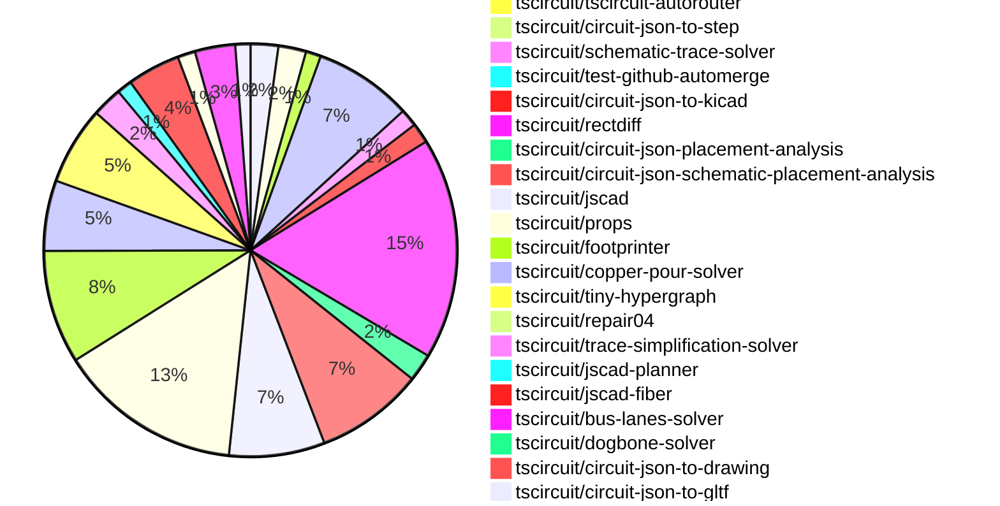

# contribution tracker

[contributions.tscircuit.com](https://contributions.tscircuit.com) ・ [tscircuit.com](https://tscircuit.com) ・ [Contribution Overviews](./contribution-overviews/) ・ [Changelogs](./changelogs/)

Generates weekly contribution overviews for tscircuit contributors. Check out all
the [contribution overviews here](./contribution-overviews/)
You can find AI-generated monthly changelogs in the [changelogs directory](./changelogs/)

- All PRs in the tscircuit org are scanned/summarized via an LLM
- The LLM classifies each Diff/PR as into a set of attributes for scoring
- All the PRs, summaries, and classifications are organized into charts and tables for [the website](https://contributions.tscircuit.com)

> Want to run locally? See the [Development Section](#development)

## Current Week

<!-- START_CURRENT_WEEK -->

# Contribution Overview 2026-10-20

The current week is shown below. There are 3 major sections:

- [Contributor Overview](#contributor-overview)
- [PRs by Repository](#prs-by-repository)
- [PRs by Contributor](#changes-by-contributor)
- [Scoring & Sponsorship Details](/docs/sponsorship-calculation-explanation.md)

## PRs by Repository

## Contributor Overview

| Contributor | 🐳 Major | 🐙 Minor | 🐌 Tiny | Score | ⭐ |
|-------------|---------|---------|---------|-------|-----|
| [seveibar](#seveibar) | 32 | 11 | 11 | 162 | 👑👑👑 |
| [ShiboSoftwareDev](#ShiboSoftwareDev) | 10 | 0 | 4 | 59 | ⭐⭐⭐ |
| [0hmX](#0hmX) | 10 | 7 | 3 | 58 | ⭐⭐⭐ |
| [imrishabh18](#imrishabh18) | 7 | 5 | 5 | 44 | ⭐⭐ |
| [mohan-bee](#mohan-bee) | 3 | 7 | 8 | 38 | ⭐⭐ |
| [Abse2001](#Abse2001) | 1 | 8 | 8 | 37 | ⭐⭐ |
| [rushabhcodes](#rushabhcodes) | 0 | 12 | 10 | 35 | ⭐⭐ |
| [MustafaMulla29](#MustafaMulla29) | 2 | 5 | 17 | 31 | ⭐⭐ |
| [techmannih](#techmannih) | 5 | 2 | 2 | 27 | ⭐⭐ |
| [GokulPandi-M](#GokulPandi-M) | 2 | 2 | 4 | 16 | ⭐⭐ |
| [Devesh36](#Devesh36) | 0 | 5 | 3 | 14 | ⭐⭐ |
| [tscircuitbot](#tscircuitbot) | 0 | 0 | 354 | 12 | ⭐⭐ |
| [AnasSarkiz](#AnasSarkiz) | 1 | 2 | 2 | 10 | ⭐ |
| [KrishnaX12](#KrishnaX12) | 1 | 0 | 2 | 6 | ⭐ |
| [trixie010](#trixie010) | 1 | 1 | 0 | 6 | ⭐ |
| [hrithik18k](#hrithik18k) | 0 | 0 | 4 | 4 | ⭐ |
| [anil08607](#anil08607) | 0 | 1 | 0 | 2 |  |
| [ducanh3005](#ducanh3005) | 0 | 0 | 1 | 1 |  |

## Staff Pass Ratio (SPR)

| Contributor | Reviewed PRs | Rejections | Approvals | SPR |
|-------------|--------------|------------|-----------|-----|
| [Abse2001](#Abse2001) | 5 | 0 | 5 | 100.0% |
| [0hmX](#0hmX) | 3 | 0 | 3 | 100.0% |
| [ShiboSoftwareDev](#ShiboSoftwareDev) | 3 | 0 | 3 | 100.0% |
| [MustafaMulla29](#MustafaMulla29) | 1 | 0 | 1 | 100.0% |

Abse2001 SPR PRs (5)

- [#1090](https://github.com/tscircuit/pcb-viewer/pull/1090) Fix fabrication dimensions rendering on the wrong board side
- [#1063](https://github.com/tscircuit/3d-viewer/pull/1063) Fix green copper fallback on flex boards
- [#4806](https://github.com/tscircuit/core/pull/4806) fix: preserve authored footprint origins for CAD placement
- [#4836](https://github.com/tscircuit/core/pull/4836) fix: synchronize footprint polarity with component pin labels
- [#457](https://github.com/tscircuit/checks/pull/457) fix: check trace thickness against its own routed copper

0hmX SPR PRs (3)

- [#4765](https://github.com/tscircuit/core/pull/4765) Render external IBIS simulation declarations from TSX
- [#3187](https://github.com/tscircuit/tscircuit-autorouter/pull/3187) Use default Pipeline 9 for srj18 main-branch benchmarks
- [#6](https://github.com/tscircuit/jlcpcb-manufacturing-specs/pull/6) Add JLCPCB physical stackups through 8 layers

ShiboSoftwareDev SPR PRs (3)

- [#1108](https://github.com/tscircuit/pcb-viewer/pull/1108) Improve large-board interaction latency
- [#3233](https://github.com/tscircuit/tscircuit-autorouter/pull/3233) Reduce Pipeline 9 blocker-search memory and repeated scans
- [#3239](https://github.com/tscircuit/tscircuit-autorouter/pull/3239) Use conflict-driven priority routing for Pipeline 9 high-density nodes

MustafaMulla29 SPR PRs (1)

- [#338](https://github.com/tscircuit/circuit-json-schematic-placement-analysis/pull/338) Detect fuse connector misalignment

> Note: AI evaluates PRs and assigns 1-3 star ratings automatically. 4 and 5 star ratings require manual staff review.

## Review Table

[reviews-received-hover]: ## "Number of reviews received for PRs for this contributor"
[approvals-received-hover]: ## "Number of approvals received for PRs this contributor authored"
[rejections-received-hover]: ## "Number of rejections received for PRs this contributor authored"
[prs-opened-hover]: ## "Number of PRs opened by this contributor"
[issues-created-hover]: ## "Number of issues created by this contributor"

| Contributor | Reviews Received | Approvals Received | Rejections Received | Approvals | Rejections Given | PRs Opened | PRs Merged | Issues Created |
|---|---|---|---|---|---|---|---|---|
| [0hmX](#0hmX) | 20 | 4 | 0 | 13 | 0 | 31 | 21 | 0 |
| [1932819331hy-debug](#1932819331hy-debug) | 0 | 0 | 0 | 0 | 0 | 8 | 0 | 0 |
| [9xj89gzrtw-hue](#9xj89gzrtw-hue) | 0 | 0 | 0 | 0 | 0 | 8 | 0 | 0 |
| [Abse2001](#Abse2001) | 10 | 9 | 0 | 9 | 0 | 26 | 17 | 0 |
| [agent-102](#agent-102) | 0 | 0 | 0 | 0 | 0 | 1 | 0 | 0 |
| [AnasSarkiz](#AnasSarkiz) | 4 | 4 | 0 | 0 | 0 | 10 | 5 | 0 |
| [andrewsiah](#andrewsiah) | 0 | 0 | 0 | 0 | 0 | 0 | 0 | 0 |
| [anil08607](#anil08607) | 5 | 2 | 1 | 0 | 0 | 4 | 1 | 0 |
| [bacourosp](#bacourosp) | 0 | 0 | 0 | 0 | 0 | 2 | 0 | 0 |
| [BrandoBlue](#BrandoBlue) | 0 | 0 | 0 | 0 | 0 | 4 | 0 | 0 |
| [Brayaniglesias08](#Brayaniglesias08) | 0 | 0 | 0 | 0 | 0 | 2 | 0 | 0 |
| [darzasassing-hub](#darzasassing-hub) | 1 | 0 | 0 | 0 | 0 | 2 | 0 | 0 |
| [Devesh36](#Devesh36) | 13 | 9 | 0 | 1 | 0 | 12 | 8 | 0 |
| [dinoksb](#dinoksb) | 0 | 0 | 0 | 0 | 0 | 2 | 0 | 0 |
| [ducanh3005](#ducanh3005) | 0 | 0 | 0 | 0 | 0 | 14 | 1 | 0 |
| [duongynhi000005-oss](#duongynhi000005-oss) | 0 | 0 | 0 | 0 | 0 | 15 | 0 | 0 |
| [gekkom](#gekkom) | 0 | 0 | 0 | 0 | 0 | 1 | 0 | 0 |
| [godgamerex3-boop](#godgamerex3-boop) | 0 | 0 | 0 | 0 | 0 | 30 | 0 | 0 |
| [GokulPandi-M](#GokulPandi-M) | 11 | 10 | 0 | 0 | 0 | 8 | 8 | 0 |
| [hrithik18k](#hrithik18k) | 16 | 7 | 5 | 0 | 0 | 19 | 4 | 0 |
| [imrishabh18](#imrishabh18) | 3 | 3 | 0 | 28 | 8 | 26 | 17 | 0 |
| [KrishnaX12](#KrishnaX12) | 11 | 4 | 1 | 0 | 0 | 14 | 3 | 0 |
| [Lingu17](#Lingu17) | 0 | 0 | 0 | 0 | 0 | 3 | 0 | 0 |
| [Lion0871](#Lion0871) | 0 | 0 | 0 | 0 | 0 | 1 | 0 | 0 |
| [mohan-bee](#mohan-bee) | 13 | 7 | 4 | 5 | 0 | 64 | 18 | 0 |
| [MustafaMulla29](#MustafaMulla29) | 15 | 11 | 0 | 13 | 3 | 32 | 24 | 0 |
| [petermm](#petermm) | 0 | 0 | 0 | 0 | 0 | 5 | 0 | 0 |
| [rushabhcodes](#rushabhcodes) | 52 | 13 | 0 | 3 | 0 | 29 | 22 | 0 |
| [ryder777777](#ryder777777) | 0 | 0 | 0 | 0 | 0 | 4 | 0 | 0 |
| [seveibar](#seveibar) | 20 | 1 | 0 | 16 | 0 | 108 | 54 | 0 |
| [ShiboSoftwareDev](#ShiboSoftwareDev) | 13 | 12 | 0 | 16 | 0 | 65 | 14 | 0 |
| [Shmanya](#Shmanya) | 0 | 0 | 0 | 0 | 0 | 1 | 0 | 0 |
| [shubhook](#shubhook) | 0 | 0 | 0 | 0 | 0 | 1 | 0 | 0 |
| [techmannih](#techmannih) | 17 | 7 | 1 | 2 | 1 | 15 | 9 | 0 |
| [trixie010](#trixie010) | 3 | 3 | 0 | 0 | 0 | 8 | 2 | 0 |
| [tscircuitbot](#tscircuitbot) | 0 | 0 | 0 | 0 | 0 | 456 | 354 | 0 |
| [ZhaZhaBei](#ZhaZhaBei) | 0 | 0 | 0 | 0 | 0 | 2 | 0 | 0 |

## Changes by Repository

### [tscircuit/pcb-viewer](https://github.com/tscircuit/pcb-viewer)

| PR # | Impact | Rating | Contributor | Description |
|------|--------|--------|-------------|-------------|
| [#1108](https://github.com/tscircuit/pcb-viewer/pull/1108) | 🐳 Major | ⭐⭐⭐ | ShiboSoftwareDev | Caches primitive and trace lookups instead of rescanning the full Circuit JSON during hover and navigation. Camera updates are also limited to one React update per animation frame. The spatial index preserves original primitive order, so overlapping same-layer hits keep their existing selection priority. Median of six fixed-build runs, compared with the three-run baseline, on the 100,548-element TMDS62LEVM fixture:  Interaction  Before  After  Speedup   ---  ---:  ---:  ---:   Hover  489 ms  58 ms  8.5   20 zoom events  1,366 ms  699 ms  2.0   20 drag steps  1,766 ms  384 ms  4.6   React render time during navigation  1,997 ms  90 ms  22.3 |
| [#1113](https://github.com/tscircuit/pcb-viewer/pull/1113) | 🐙 Minor | ⭐⭐ | rushabhcodes | Fixes incorrect rotation of polygon plated-hole primitive geometry and oval drill rendering in the PCB viewer. |
| [#1090](https://github.com/tscircuit/pcb-viewer/pull/1090) | 🐙 Minor | ⭐⭐ | Abse2001 | Fixes rendering issue where fabrication dimensions assigned to one board side were incorrectly displayed on the opposite side in the PCB viewer. |

🐌 Tiny Contributions (8)

| PR # | Impact | Contributor | Description |
|------|--------|-------------|-------------|
| [#1119](https://github.com/tscircuit/pcb-viewer/pull/1119) | 🐌 Tiny | rushabhcodes | Updates the tscircuitcircuit-json-webgpu dependency from version 0.0.9 to 0.0.10, incorporating a polygon plated-hole copper and drill-offset rotation fix. |
| [#1117](https://github.com/tscircuit/pcb-viewer/pull/1117) | 🐌 Tiny | rushabhcodes | Updates the circuit-to-canvas dependency to version 0.0.138 to include polygon copper, drill, and soldermask rotation fixes, along with soldermask coverage and margin corrections, and via layer visibility fixes. |
| [#1112](https://github.com/tscircuit/pcb-viewer/pull/1112) | 🐌 Tiny | rushabhcodes | Reproduces a bug related to polygon plated-hole primitive rotation with focused test cases for validation. |
| [#1118](https://github.com/tscircuit/pcb-viewer/pull/1118) | 🐌 Tiny | tscircuitbot | Automated package update |
| [#1121](https://github.com/tscircuit/pcb-viewer/pull/1121) | 🐌 Tiny | tscircuitbot | Automated package update |
| [#1115](https://github.com/tscircuit/pcb-viewer/pull/1115) | 🐌 Tiny | tscircuitbot | Automated package update |
| [#1110](https://github.com/tscircuit/pcb-viewer/pull/1110) | 🐌 Tiny | tscircuitbot | Automated package update |
| [#1107](https://github.com/tscircuit/pcb-viewer/pull/1107) | 🐌 Tiny | ShiboSoftwareDev | Adds a browser benchmark using the full 100,548-element TMDS62LEVM board to measure interaction latency before optimization. |

### [tscircuit/circuit-json-util](https://github.com/tscircuit/circuit-json-util)

| PR # | Impact | Rating | Contributor | Description |
|------|--------|--------|-------------|-------------|
| [#268](https://github.com/tscircuit/circuit-json-util/pull/268) | 🐳 Major | ⭐⭐⭐ | mohan-bee | Fixes the issue where polygon pads return incorrect bounds, ensuring that overlap checks include the entire copper area of polygon pads. |
| [#220](https://github.com/tscircuit/circuit-json-util/pull/220) | 🐳 Major | ⭐⭐⭐ | GokulPandi-M | Allows the analyzer to infer pin 1 orientation for two-pad footprints with slight coordinate differences, improving compatibility with polarized components. |
| [#263](https://github.com/tscircuit/circuit-json-util/pull/263) | 🐙 Minor | ⭐⭐ | rushabhcodes | Fixes the orientation of silkscreen text labels to follow the correct rotation after mirroring components, ensuring readability and proper alignment in PCB designs. |
| [#262](https://github.com/tscircuit/circuit-json-util/pull/262) | 🐙 Minor | ⭐⭐ | rushabhcodes | Fixes the issue where mirroring a tilted 0603 resistor did not adjust the SMT pad angles accordingly, ensuring that rotated and reflected pads maintain their correct orientation. |
| [#260](https://github.com/tscircuit/circuit-json-util/pull/260) | 🐙 Minor | ⭐⭐ | rushabhcodes | Fixes courtyard rectangle orientation to correctly follow mirrored placements by reusing the existing rectangle-orientation helper. |
| [#257](https://github.com/tscircuit/circuit-json-util/pull/257) | 🐙 Minor | ⭐⭐ | Abse2001 | Applies the existing PCB transformation matrix to the footprint origin of PCB components, ensuring it remains attached during transformations. |
| [#258](https://github.com/tscircuit/circuit-json-util/pull/258) | 🐙 Minor | ⭐⭐ | MustafaMulla29 | Add isRouteViaCoveredByPhysicalVia to check whether a physical via covers a traces layer transition at the same coordinates and with compatible diameters. |
| [#267](https://github.com/tscircuit/circuit-json-util/pull/267) | 🐙 Minor | ⭐⭐ | mohan-bee | Fixes the issue where polygon plated pads can disappear from spatial overlap queries by adding a test case that reproduces the problem and verifies the computed bounds. |

🐌 Tiny Contributions (3)

| PR # | Impact | Contributor | Description |
|------|--------|-------------|-------------|
| [#259](https://github.com/tscircuit/circuit-json-util/pull/259) | 🐌 Tiny | rushabhcodes | Captures transform failures for a rotated 30 0603 resistor, including issues with courtyard orientation, SMT pad angles, and label placement, while adding regression tests for these cases. |
| [#256](https://github.com/tscircuit/circuit-json-util/pull/256) | 🐌 Tiny | Abse2001 | Transforms footprint origins of PCB components through the existing PCB matrix to align with physical pads during translation, rotation, and reflection, while keeping older records unchanged. |
| [#221](https://github.com/tscircuit/circuit-json-util/pull/221) | 🐌 Tiny | GokulPandi-M | Reproduces a bug where the analyzer fails to determine pin 1 orientation for slightly skewed two-pad LED and diode footprints due to small coordinate differences, without changing the analyzers functionality. |

### [tscircuit/3d-viewer](https://github.com/tscircuit/3d-viewer)

| PR # | Impact | Rating | Contributor | Description |
|------|--------|--------|-------------|-------------|
| [#1067](https://github.com/tscircuit/3d-viewer/pull/1067) | 🐳 Major | ⭐⭐⭐ | seveibar | Package previews currently rebuild the board and fetch individual component models before showing a scene. Add glbUrl and glbData inputs to CadViewer so callers can display a self-contained, pre-rendered circuit-json-to-gltf GLB directly: tsx CadViewer glbUrlpreviewsboard.glb   This path bypasses board generation and individual model loading, restores the exporters coordinate frame, fits the camera, and retains orbitcamera controls. Component node extras.tscircuit provides name tooltips, per-instance hiding, and schematic navigation without Circuit JSON. Existing GLBs without metadata still render. Geometry engine, board layer, and fold controls are omitted for baked scenes. Source changes abort pending downloads and dispose owned geometrymaterialstextures. Downloads time out after 30 seconds, failures display errors, and A-to-B-to-A source changes cannot reuse disposed scenes. Companion exporter change: https:github.comtscircuitcircuit-json-to-gltfpull261. No new exporter version is required to render an existing GLB; component identity features require metadata-enabled exports. Validation: 12 focused tests pass for actual GLB parsing, coordinate placement, shared-mesh instance selection, schematic identity, one-request loading, load errorscancellation, source replacement, and resource disposal, plus existing picking regressions. bunx tsc --noEmit and bun run build pass. Browser-verified hover names and hiding with a regenerated rushabhcodesfidget-counter assembly. The bundled GLB was generated from the pinned 1.0.12 Circuit JSON and 27 downloaded OBJ models using the companion exporter, with metadata for all 38 components. Hidden enclosure meshes are excluded from hover registration so parts underneath remain reachable. This adds library support; switching tscircuit.com previews to use published GLBs is separate consumer work. Live assembly demo: https:3d-viewer-git-feat-prerendered-glb-tscircuit.vercel.appiframe.html?idprerendered-glb--fidget-counterviewModestory The GLB is served from prerendered-glbfidget-counter.glb on that deployment. |
| [#1066](https://github.com/tscircuit/3d-viewer/pull/1066) | 🐳 Major | ⭐⭐⭐ | seveibar | Adds draggable XYZ section planes for generated scenes and pre-rendered glbUrlglbData scenes. Create sections from Advanced  Section View in the right-click menu; Advanced also contains the engine switch for generated scenes. The inactive Section toolbar button is removed. Users can drag the plane or arrow, enter a millimeter offset, flip the retained side, and look perpendicular to the cut. Cut faces use diagonal hatching with holes and cavities left empty; downloaded glTFs include the clipped geometry and caps. Merged main while preserving GLB loading, component metadata, and picking. Sourcevisibility changes invalidate pending caps immediately, and temporary material overrides are restored before GLB disposal. Fixed perpendicular dragging and moved section controls away from the orientation cube so it cannot intercept their clicks. Validation: CI tests, typechecking, formatting, and Graphite review pass. All four Chromium browser tests pass: dragging without camera movement plus closeclear, JSCAD sections, Manifold sections, and GLB URL cuts with patterned caps and no extra GLB loads during section operations. The generated-scene and GLB tests create sections through the Advanced submenu. The URL integration test uses the real GLB loader and scene attachment with transformed meshes, caps, sectioned export, metadata picking, hideunhide, source replacement, and resource disposal. Package JavaScript and declaration builds pass locally. Browser checks run with bun run test:sections. Successful browser run(https:github.comtscircuit3d-vieweractionsruns39658536420) includes screenshots and the Playwright report. |
| [#1073](https://github.com/tscircuit/3d-viewer/pull/1073) | 🐙 Minor | ⭐⭐ | rushabhcodes | Changes copper-pour rendering to use a configurable opacity, reducing redraws from eight to one and adding regression tests for various pour types. |
| [#1063](https://github.com/tscircuit/3d-viewer/pull/1063) | 🐙 Minor | ⭐⭐ | Abse2001 | Fixes the fallback color for flex boards without a custom mask color to use an amber and copper blend instead of FR4 green. |

🐌 Tiny Contributions (2)

| PR # | Impact | Contributor | Description |
|------|--------|-------------|-------------|
| [#1060](https://github.com/tscircuit/3d-viewer/pull/1060) | 🐌 Tiny | mohan-bee | Motivation I was not able to hide the assembly to view the pcb boards 3d view, https:3d-viewer-a19cxntdn-tscircuit.vercel.app?pathstoryassembly-gimbal--gimbal-assembly https:github.comuser-attachmentsassets304e75ed-b590-4e89-8fa3-43a032db4b92 |
| [#1062](https://github.com/tscircuit/3d-viewer/pull/1062) | 🐌 Tiny | imrishabh18 | Fixes rendering issues in the 3D viewer for flex PCB tails with nonparallel bend axes by updating flex-utils and restoring Float32 boundary precision. |

### [tscircuit/core](https://github.com/tscircuit/core)

| PR # | Impact | Rating | Contributor | Description |
|------|--------|--------|-------------|-------------|
| [#4807](https://github.com/tscircuit/core/pull/4807) | 🐳 Major | ⭐⭐⭐ | Abse2001 | Preserves authored footprint origins for CAD placement, ensuring accurate positioning of components during layout. |
| [#4631](https://github.com/tscircuit/core/pull/4631) | 🐳 Major | ⭐⭐⭐ | seveibar | Adds a core implementation of assembly.explosion.stage and assembly.explosion.move, including multi-target moves and rendered constrained-assembly examples. The upstream props and PoppyGL changes are merged. This PR uses their published npm releases.  Multiple targets targetRefs accepts either a comma-separated string or an array: tsx assembly.explosion.move targetRefsshade, collar offZ60mm  assembly.explosion.move targetRefsshade, collar offZ60mm   Props trims and normalizes either form to targetRefs: string. Existing targetRef remains a single-target input alias; supply exactly one selector prop. Core resolves and validates every target before evaluating progress, then moves the union of the selected subtrees using one displacement in the stage owners frame. Duplicate references and overlapping parentchild selections move each part and reference surface only once. Each distinct selected target gets its own guide, anchored before the instruction moves any target. Model-less container centroids include prior independent movements of their children. All targets share the instructions progress, and evaluation leaves assembled Circuit JSON and props unchanged. !Comma-separated and array targets, shared progress, and legacy compatibility(https:raw.githubusercontent.comtscircuitcoreb16362715bac0d1e544dc2b51eb785e44770bb66testsassembly__snapshots__assembly-explosion-target-refs-annotated.snap.png)  Staged rendering getAssemblyExplosion(circuit,  throughStageRef?, stageProgress? ) derives an immutable CAD view after mounting constraints resolve. Stages use a stable topological sort with authored order as fallback; missingambiguous references, cycles, duplicate stages, and invalid move targets produce named diagnostics. Parent movement carries descendant CAD and reference-surface centers. Repeated evaluation and backward scrubbing reconstruct the assembled starting state. Existing examples lift an intact constrained cover, move it aside, and then remove its cap in the displaced subassembly frame. Frame tests cover upright, inverted, and tilted mounts against emitted reference directions, with guide endpoints checked against emitted GLTF translations. Run bun scriptsrender-assembly-explosion.tsx workassembly-explosion-preview to export those four PNGGLBJSON states.  Dependencies tscircuitprops: 0.0.707 in dev dependencies and overrides, including the merged stagemove API and targetRefs normalization. poppygl: 0.0.36, including the merged explosion guide and arrow APIs. Updated with main and resolved the package conflict. The existing dependency check is preserved and passes with these registry versions. The compatibility refresh also removes the unsupported write: false option from the existing Bun browser-bundle test; it continues to inspect the returned bundle without an output directory.  Validation 69 assembly regressions and 4 namespaced assembly regressions pass (73 total), using Bun 1.4.0 and the published npm packages. Three new tests cover stringarraylegacy selectors, shared progress, overlap and duplicate handling in a mounted frame, reference-surface translation without orientation changes, pre-move centroids, and validation of later-stage targets. Both new annotated visual snapshots were inspected and pass on comparison. Full CI is green on the updated branch: all ten test groups, full typecheck, dependency check, distribution smoke tests, package preview build, and deployment. Local package build (including declarations), 73 assemblynamespaced regressions, browser-bundle regression, changed-TypeScript formatting, and feature diff checks pass. Behavior and approval tracking are documented in docsassembly-explosion.md. This prototype supports mechanical CAD translations and rejects PCBcable-containing targets. Swept-path collision verification remains unimplemented (collisionCheckStatus: not_implemented); diagrams do not certify assembly clearance. |
| [#4833](https://github.com/tscircuit/core/pull/4833) | 🐳 Major | ⭐⭐⭐ | seveibar | Fixes the omission of bus minLength and maxLength from source_bus and router input, ensuring proper routing constraints are applied. |
| [#4834](https://github.com/tscircuit/core/pull/4834) | 🐳 Major | ⭐⭐⭐ | seveibar | Updates props to 0.0.706 and consumes platform.autorouterThreads for local Pipeline9 routing, enabling worker-backed solveAsync for routing with counts above one, while retaining existing paths for counts of one or omitted. |
| [#4765](https://github.com/tscircuit/core/pull/4765) | 🐳 Major | ⭐⭐⭐ | 0hmX | Add native TSX declarations for IBIS models, binary traffic, and eye requests, exporting them as Circuit JSON for the local PCB extractionSPICE runner. Existing spiceEnginepcb_spice selects that backend; no executionMode prop or execution_mode record field is introduced. The built-in render phase skips that backend while native experiments continue to execute. Models use the shared Asset object and explicit vendor componentpinmodel names. Core maps port labels to physical source_port_id values, translates Boolean directionoutput-enable states, and preserves the requested IBIS data column and package parasitics choice. Reference roles identify physical supplyclamp ports. Duplicate physical pin mappings, unmapped referencemodel keys, stimuli without an enabled output, and pin states without exactly one model binding are rejected. Model binding validation runs after all declarations render, so JSX order does not matter. Dependencies  merge order: https:github.comtscircuitcircuit-jsonpull908, https:github.comtscircuitpropspull945, then this PR. The verified preview pins must be replaced with published versions before merging. The repository dependency guard remains unchanged. Validation: all 43 targeted simulation tests pass, including eight IBIS integration tests and a PCB snapshot. Schemaprops suites pass (479 and 687 tests). Independent Opus review confirmed the schema review changes and both additional pin-binding fixes. TypeScript and the package build (ESM and declarations) pass. GitHub build, smoke-test, type-check, and all ten test shards pass. No new enums, ternaries, docs, or README edits are included. Rendering does not fetch assets, install tools, or execute external solvers. CLIlocal-runner wiring and CSVHTML result commands remain follow-ups. No Python or solver binaries are added; the prototype backends three-selected-trace limit is unchanged. |
| [#4541](https://github.com/tscircuit/core/pull/4541) | 🐳 Major | ⭐⭐⭐ | mohan-bee | Fixes PCB trace saving failure when using custom schematic symbols by correcting the port selector logic. |
| [#4843](https://github.com/tscircuit/core/pull/4843) | 🐳 Major | ⭐⭐⭐ | GokulPandi-M | Adopts skew-tolerant pin 1 analysis for two-pad footprints to ensure accurate orientation detection in LED and diode components. |
| [#4763](https://github.com/tscircuit/core/pull/4763) | 🐳 Major | ⭐⭐⭐ | KrishnaX12 | Watchys J3 display connector has distinct physical pins 8 and 17 labelled GND. The full circuit routes copper, but autorouting:end omits pcbTracePaths and reports PCB port selector is not unique: .J3  port.GND. Includes the full PCBelectrical circuit from my Watchy v1.2.12 board(https:tscircuit.comkrishnax12watchy-eink-smartwatchreleases2b57e298-6436-4480-8eff-a1421b557830), alongside the original two-pad reduction. The self-contained TSX fixture retains the full circuit, footprints, wiring, board outline, pours and keepouts. J2 is moved from the right edge to the clear left-edge position (-12, 0), rotated 270, to resolve its out-of-board placement error without disabling placement checks; all other component placements and J3 pin labels are unchanged. STEP models and the non-electrical display assembly are omitted. The full circuit is kept in one fixture file alongside its test and PCB snapshot. The full-board test uses the normal autorouter, verifies that J3 has two GND ports and that copper was generated, and asserts the actual export failure. Its PCB snapshot displays that emitted error. routeRemaining enables the full route. Placement checks remain enabled, and the test asserts there are no component-outside-board or autorouting errors. It does not claim all post-routing manufacturing checks pass. No production code or dependencies are changed. Validation: Full Watchy reproduction and existing minimal reproduction pass. Biome, TypeScript, build and diff checks pass. Full-board PCB snapshot rendered and visually inspected. Run: bun test testsreprosrepro-watchy-duplicate-ground-label-path-export.test.tsx. Fix: 4764. Merge this reproduction first; the fixs exportreplay assertions must then be rebased over these failure assertions. |
| [#4830](https://github.com/tscircuit/core/pull/4830) | 🐙 Minor | ⭐⭐ | rushabhcodes | Reproduces a bug where polygon plated-hole pads do not retain correct rotation, leading to copper misalignment with the silkscreen outline. |
| [#4831](https://github.com/tscircuit/core/pull/4831) | 🐙 Minor | ⭐⭐ | rushabhcodes | Fixes the issue where polygon plated holes did not retain their rotation during Circuit JSON reconstruction, ensuring correct rendering and alignment with the chips rotation. |
| [#4806](https://github.com/tscircuit/core/pull/4806) | 🐙 Minor | ⭐⭐ | Abse2001 | Fixes CAD placement by preserving the authored footprint origins for asymmetric footprints, ensuring that changes in copper geometry do not affect model positioning. |
| [#4836](https://github.com/tscircuit/core/pull/4836) | 🐙 Minor | ⭐⭐ | Abse2001 | Fixes the mismatch between electrical anodecathode labels and footprint artwork for diodes, LEDs, and capacitors, ensuring consistent polarity representation in generated footprints. |
| [#4812](https://github.com/tscircuit/core/pull/4812) | 🐙 Minor | ⭐⭐ | MustafaMulla29 | Reproduces inline schematic text positions for labels away from their wires in the TB67S579FTG breakout, validating current behavior with comprehensive tests and snapshots. |
| [#4811](https://github.com/tscircuit/core/pull/4811) | 🐙 Minor | ⭐⭐ | MustafaMulla29 | Saves inline text positions on schematic wires, preserving alignment and relationships, while updating the schematic-trace-solver dependency. |
| [#4856](https://github.com/tscircuit/core/pull/4856) | 🐙 Minor | ⭐⭐ | 0hmX | Emit PCB SPICE channel modeling from transient simulations, allowing PCB SPICE to consume circuit declarations without separate modeling exports. |
| [#4826](https://github.com/tscircuit/core/pull/4826) | 🐙 Minor | ⭐⭐ | 0hmX | Resolves JLCPCB stackups from fabricatorPreset and the boards layer count, thickness, and material using tscircuitjlcpcb-manufacturing-specs, ensuring proper stackup handling for imported boards and maintaining existing construction data. |
| [#4699](https://github.com/tscircuit/core/pull/4699) | 🐙 Minor | ⭐⭐ | mohan-bee | Fixes the issue where metal-lined connector holes in four-layer boards inside panels do not connect to the inner copper layers, only recording the top and bottom layers. |
| [#4700](https://github.com/tscircuit/core/pull/4700) | 🐙 Minor | ⭐⭐ | mohan-bee | Reproduces missing inner copper layers on plated connector holes inside native panels, ensuring that both inner and outer layers are correctly represented in the test. |
| [#4818](https://github.com/tscircuit/core/pull/4818) | 🐙 Minor | ⭐⭐ | Devesh36 | Fixes polygon-pad overlap in PCB flex layout by accurately calculating bounds for nonrectangular polygons and circular primitives, ensuring proper spacing between pads. |
| [#4816](https://github.com/tscircuit/core/pull/4816) | 🐙 Minor | ⭐⭐ | Devesh36 | Fixes the LED outline rotation reproduced in 4622, ensuring that rotating LED footprints also rotates their corresponding silkscreen rectangles correctly. |
| [#4817](https://github.com/tscircuit/core/pull/4817) | 🐙 Minor | ⭐⭐ | Devesh36 | Fixes the connector mounting-slot rotation reproduced in 4623, ensuring vertical mounting slots align with silkscreen guides and pads when a connector is rotated 90. |

🐌 Tiny Contributions (18)

| PR # | Impact | Contributor | Description |
|------|--------|-------------|-------------|
| [#4825](https://github.com/tscircuit/core/pull/4825) | 🐌 Tiny | rushabhcodes | Updates circuit-to-svg to version 0.0.453, fixing rotated polygon plated holes and PCB bounds for traces containing vias, and refreshes SVG snapshots for display-label and SOIC8 fanout phase. |
| [#4874](https://github.com/tscircuit/core/pull/4874) | 🐌 Tiny | tscircuitbot | Updates the tscircuitchecks package from version 0.0.263 to 0.0.264 |
| [#4873](https://github.com/tscircuit/core/pull/4873) | 🐌 Tiny | tscircuitbot | Updates the tscircuitchecks package to version 0.0.263 in package.json |
| [#4871](https://github.com/tscircuit/core/pull/4871) | 🐌 Tiny | tscircuitbot | Updates the version of the tscircuitchecks package from 0.0.261 to 0.0.262 in package.json |
| [#4870](https://github.com/tscircuit/core/pull/4870) | 🐌 Tiny | tscircuitbot | Updates the version of the tscircuitchecks package from 0.0.261 to 0.0.262 in package.json |
| [#4808](https://github.com/tscircuit/core/pull/4808) | 🐌 Tiny | tscircuitbot | Updates the version of the tscircuitchecks package from 0.0.258 to 0.0.259 in package.json |
| [#4822](https://github.com/tscircuit/core/pull/4822) | 🐌 Tiny | tscircuitbot | Updates the version of the tscircuitchecks package from 0.0.260 to 0.0.261 in package.json |
| [#4820](https://github.com/tscircuit/core/pull/4820) | 🐌 Tiny | tscircuitbot | Updates the version of the tscircuitchecks package from 0.0.259 to 0.0.260 in package.json |
| [#4819](https://github.com/tscircuit/core/pull/4819) | 🐌 Tiny | tscircuitbot | Updates the version of the tscircuitchecks package from 0.0.259 to 0.0.260 in package.json |
| [#4809](https://github.com/tscircuit/core/pull/4809) | 🐌 Tiny | tscircuitbot | Updates the version of the tscircuitchecks package from 0.0.258 to 0.0.259 in package.json |
| [#4810](https://github.com/tscircuit/core/pull/4810) | 🐌 Tiny | seveibar | Updates tscircuitcapacity-autorouter from 0.0.988 to 0.0.996, bringing in the released Pipeline9 SolverRuntime support from tscircuittscircuit-autorouter3125. |
| [#4805](https://github.com/tscircuit/core/pull/4805) | 🐌 Tiny | seveibar | Updates the bundled tscircuitbus-lanes-solver from version 0.0.21 to 0.0.27, incorporating fixes for AM3352 byte routing stalls and default-layer escapes. |
| [#4869](https://github.com/tscircuit/core/pull/4869) | 🐌 Tiny | mohan-bee | Updates the tscircuitschematic-trace-solver dependency to version 0.0.238 in the package.json file. |
| [#4814](https://github.com/tscircuit/core/pull/4814) | 🐌 Tiny | mohan-bee | Updates the schematic trace solver dependency from version 0.0.230 to 0.0.236. |
| [#4815](https://github.com/tscircuit/core/pull/4815) | 🐌 Tiny | mohan-bee | Updates the tscircuitmatchpack dependency to version 0.0.100 in the package.json file. |
| [#4540](https://github.com/tscircuit/core/pull/4540) | 🐌 Tiny | mohan-bee | Reproduces the saved PCB path export failure observed with the LoRaLink custom schematic symbol. |
| [#4838](https://github.com/tscircuit/core/pull/4838) | 🐌 Tiny | techmannih | Updates tscircuitcapacity-autorouter from 0.0.996 to 0.0.999, matching autorouter main. |
| [#4673](https://github.com/tscircuit/core/pull/4673) | 🐌 Tiny | Devesh36 | Reproduces a bug where the PCB note rectangle does not rotate with its parent chip, demonstrating the issue with a test case and snapshot. |

### [tscircuit/circuit-to-svg](https://github.com/tscircuit/circuit-to-svg)

| PR # | Impact | Rating | Contributor | Description |
|------|--------|--------|-------------|-------------|
| [#869](https://github.com/tscircuit/circuit-to-svg/pull/869) | 🐙 Minor | ⭐⭐ | rushabhcodes | Fixes the issue where rotating polygon plated holes in PCB SVGs does not rotate their copper outlines and offset drills, ensuring they move together with the pad group during rotation. |

🐌 Tiny Contributions (1)

| PR # | Impact | Contributor | Description |
|------|--------|-------------|-------------|
| [#868](https://github.com/tscircuit/circuit-to-svg/pull/868) | 🐌 Tiny | rushabhcodes | Reproduces a bug where polygon plated pads do not render correctly at specified rotations, specifically asserting that a pad with a 90 rotation is rendered incorrectly. |

### [tscircuit/circuit-json-to-gerber](https://github.com/tscircuit/circuit-json-to-gerber)

| PR # | Impact | Rating | Contributor | Description |
|------|--------|--------|-------------|-------------|
| [#204](https://github.com/tscircuit/circuit-json-to-gerber/pull/204) | 🐙 Minor | ⭐⭐ | rushabhcodes | Fixes a bug where exporting Gerber files would overwrite the entire source JSON file, leading to data loss. |
| [#213](https://github.com/tscircuit/circuit-json-to-gerber/pull/213) | 🐙 Minor | ⭐⭐ | GokulPandi-M | Fixes the omission of copper-pour clearance and solder-mask openings for pill-shaped NPTH slots in Gerber outputs, ensuring accurate fabrication. |

🐌 Tiny Contributions (1)

| PR # | Impact | Contributor | Description |
|------|--------|-------------|-------------|
| [#190](https://github.com/tscircuit/circuit-json-to-gerber/pull/190) | 🐌 Tiny | GokulPandi-M | Adds a reproduction test for the omission of non-plated pill mounting slots in Gerber openings, ensuring that the fabrication layers align correctly with the drill output. |

### [tscircuit/circuit-to-canvas](https://github.com/tscircuit/circuit-to-canvas)

| PR # | Impact | Rating | Contributor | Description |
|------|--------|--------|-------------|-------------|
| [#317](https://github.com/tscircuit/circuit-to-canvas/pull/317) | 🐙 Minor | ⭐⭐ | rushabhcodes | Adds a configurable opacity parameter for copper pours in the 3D viewer, allowing for a single rendering pass instead of eight. |
| [#313](https://github.com/tscircuit/circuit-to-canvas/pull/313) | 🐙 Minor | ⭐⭐ | rushabhcodes | Fixes the issue where rotating a component with polygon plated holes does not rotate its copper, drill offsets, and soldermask openings, ensuring they align correctly in the 3D viewer. |

🐌 Tiny Contributions (5)

| PR # | Impact | Contributor | Description |
|------|--------|-------------|-------------|
| [#312](https://github.com/tscircuit/circuit-to-canvas/pull/312) | 🐌 Tiny | rushabhcodes | Fixes rendering issue where polygon plated holes ignore counter-clockwise rotation, affecting both 2D and 3D views. |
| [#321](https://github.com/tscircuit/circuit-to-canvas/pull/321) | 🐌 Tiny | tscircuitbot | Automated package update |
| [#318](https://github.com/tscircuit/circuit-to-canvas/pull/318) | 🐌 Tiny | tscircuitbot | Automated package update |
| [#316](https://github.com/tscircuit/circuit-to-canvas/pull/316) | 🐌 Tiny | tscircuitbot | Automated package update |
| [#319](https://github.com/tscircuit/circuit-to-canvas/pull/319) | 🐌 Tiny | hrithik18k | Reproduces a bug where interpolated traces narrow near bends despite consistent vertex widths, ensuring the specified copper width is preserved through trace bends. |

### [tscircuit/circuit-json-webgpu](https://github.com/tscircuit/circuit-json-webgpu)

| PR # | Impact | Rating | Contributor | Description |
|------|--------|--------|-------------|-------------|
| [#74](https://github.com/tscircuit/circuit-json-webgpu/pull/74) | 🐙 Minor | ⭐⭐ | rushabhcodes | Fixes the rotation of polygon plated-hole outlines and drill offsets around the pad anchor to ensure consistent ccw_rotation application across copper, slots, board cutouts, and soldermask openings. |
| [#69](https://github.com/tscircuit/circuit-json-webgpu/pull/69) | 🐙 Minor | ⭐⭐ | mohan-bee | Fixes rendering issue where silkscreen text appears beneath overlapping holes in the circuit design. |

🐌 Tiny Contributions (3)

| PR # | Impact | Contributor | Description |
|------|--------|-------------|-------------|
| [#73](https://github.com/tscircuit/circuit-json-webgpu/pull/73) | 🐌 Tiny | rushabhcodes | Reproduces a rendering bug where rotating a hole with a polygon pad leaves its copper outline and drill offset unrotated, adding tests to verify the issue and its resolution. |
| [#76](https://github.com/tscircuit/circuit-json-webgpu/pull/76) | 🐌 Tiny | rushabhcodes | Fixes the dependency installation failure in the publish workflow caused by the order of steps when using Bun 1.4.4. |
| [#68](https://github.com/tscircuit/circuit-json-webgpu/pull/68) | 🐌 Tiny | mohan-bee | Reproduces the issue of silkscreen text being hidden where it overlaps a hole, providing a gallery reproduction and pixel checks for occlusion without changing the renderer. |

### [tscircuit/checks](https://github.com/tscircuit/checks)

| PR # | Impact | Rating | Contributor | Description |
|------|--------|--------|-------------|-------------|
| [#457](https://github.com/tscircuit/checks/pull/457) | 🐙 Minor | ⭐⭐ | Abse2001 | Fixes incorrect warnings when traces sharing a net request different widths by ensuring checks are made against their own routed segments. |
| [#458](https://github.com/tscircuit/checks/pull/458) | 🐙 Minor | ⭐⭐ | Abse2001 | Fixes routing width checks to match the owning source trace instead of all traces on the same net, ensuring accurate thickness validation for PCB traces. |
| [#460](https://github.com/tscircuit/checks/pull/460) | 🐙 Minor | ⭐⭐ | MustafaMulla29 | Fixes copper-contact DRC crashes when checks and a geometry producer load independent Flatten instances by reconstructing foreign polygons with the local Polygon constructor through Flattens supported JSON representation. |
| [#466](https://github.com/tscircuit/checks/pull/466) | 🐙 Minor | ⭐⭐ | techmannih | Fixes the issue where a constant-width trace was incorrectly reported as not connected to a pad when its round copper endcap physically overlaps the pad, even if the endpoint center is outside the pad. |

🐌 Tiny Contributions (4)

| PR # | Impact | Contributor | Description |
|------|--------|-------------|-------------|
| [#455](https://github.com/tscircuit/checks/pull/455) | 🐌 Tiny | rushabhcodes | Update circuit-to-svg from 0.0.416 to 0.0.453 and refresh 58 affected PCB SVG snapshots for the embedded alphabet font now used for PCB note text. |
| [#459](https://github.com/tscircuit/checks/pull/459) | 🐌 Tiny | MustafaMulla29 | Reproduces a routing DRC crash caused by a copper-pour boundary issue in the RP2040 BLDC motor-controller board. |
| [#467](https://github.com/tscircuit/checks/pull/467) | 🐌 Tiny | KrishnaX12 | Reproduces a bug where the missing-reference designator hint incorrectly suggests an unresolved placeholder instead of displaying the correct reference designator for a vibration motor circuit. |
| [#472](https://github.com/tscircuit/checks/pull/472) | 🐌 Tiny | techmannih | Reproduces a bug where a trace endcap overlaps a pad but is reported as a missing connection due to its endpoint being outside the pad. |

### [tscircuit/tscircuit](https://github.com/tscircuit/tscircuit)

| PR # | Impact | Rating | Contributor | Description |
|------|--------|--------|-------------|-------------|
| [#6001](https://github.com/tscircuit/tscircuit/pull/6001) | 🐳 Major | ⭐⭐⭐ | seveibar | The README now explains tscircuit directlydesign circuit boards with TypeScript and Reactand shows real community designs across photography, 3D, schematic, and PCB views. |

🐌 Tiny Contributions (87)

| PR # | Impact | Contributor | Description |
|------|--------|-------------|-------------|
| [#6027](https://github.com/tscircuit/tscircuit/pull/6027) | 🐌 Tiny | tscircuitbot | Updates the tscircuitcli package version from 0.1.2407 to 0.1.2408 |
| [#6026](https://github.com/tscircuit/tscircuit/pull/6026) | 🐌 Tiny | tscircuitbot | Automated package update |
| [#6025](https://github.com/tscircuit/tscircuit/pull/6025) | 🐌 Tiny | tscircuitbot | Automated package update |
| [#6023](https://github.com/tscircuit/tscircuit/pull/6023) | 🐌 Tiny | tscircuitbot | Updates the tscircuitcli package version from 0.1.2406 to 0.1.2407 in package.json |
| [#6022](https://github.com/tscircuit/tscircuit/pull/6022) | 🐌 Tiny | tscircuitbot | Automated package update |
| [#6021](https://github.com/tscircuit/tscircuit/pull/6021) | 🐌 Tiny | tscircuitbot | Automated package update |
| [#6024](https://github.com/tscircuit/tscircuit/pull/6024) | 🐌 Tiny | tscircuitbot | Automated package update |
| [#6028](https://github.com/tscircuit/tscircuit/pull/6028) | 🐌 Tiny | tscircuitbot | Automated package update |
| [#6017](https://github.com/tscircuit/tscircuit/pull/6017) | 🐌 Tiny | tscircuitbot | Updates the tscircuitcli package from version 0.1.2403 to 0.1.2404 and the tscircuitrunframe package from version 0.0.3059 to 0.0.3060 in package.json |
| [#6011](https://github.com/tscircuit/tscircuit/pull/6011) | 🐌 Tiny | tscircuitbot | Updates the version of the tscircuitrunframe package from 0.0.3058 to 0.0.3059 in package.json |
| [#6009](https://github.com/tscircuit/tscircuit/pull/6009) | 🐌 Tiny | tscircuitbot | Updates the tscircuitcli package to version 0.1.2402 in package.json |
| [#6006](https://github.com/tscircuit/tscircuit/pull/6006) | 🐌 Tiny | tscircuitbot | Automated package update |
| [#6005](https://github.com/tscircuit/tscircuit/pull/6005) | 🐌 Tiny | tscircuitbot | Updates the tscircuitcli package version from 0.1.2400 to 0.1.2401 in package.json |
| [#6020](https://github.com/tscircuit/tscircuit/pull/6020) | 🐌 Tiny | tscircuitbot | Automated package update |
| [#6018](https://github.com/tscircuit/tscircuit/pull/6018) | 🐌 Tiny | tscircuitbot | Automated package update |
| [#6016](https://github.com/tscircuit/tscircuit/pull/6016) | 🐌 Tiny | tscircuitbot | Automated package update |
| [#6015](https://github.com/tscircuit/tscircuit/pull/6015) | 🐌 Tiny | tscircuitbot | Updates the tscircuitcli package to version 0.1.2403 in the package.json file. |
| [#6012](https://github.com/tscircuit/tscircuit/pull/6012) | 🐌 Tiny | tscircuitbot | Automated package update |
| [#6008](https://github.com/tscircuit/tscircuit/pull/6008) | 🐌 Tiny | tscircuitbot | Automated package update |
| [#6007](https://github.com/tscircuit/tscircuit/pull/6007) | 🐌 Tiny | tscircuitbot | Automated package update |
| [#6003](https://github.com/tscircuit/tscircuit/pull/6003) | 🐌 Tiny | tscircuitbot | Automated package update |
| [#6002](https://github.com/tscircuit/tscircuit/pull/6002) | 🐌 Tiny | tscircuitbot | Automated package update |
| [#6019](https://github.com/tscircuit/tscircuit/pull/6019) | 🐌 Tiny | tscircuitbot | Updates the tscircuitcli package version from 0.1.2404 to 0.1.2406 in package.json |
| [#6010](https://github.com/tscircuit/tscircuit/pull/6010) | 🐌 Tiny | tscircuitbot | Automated package update |
| [#5997](https://github.com/tscircuit/tscircuit/pull/5997) | 🐌 Tiny | tscircuitbot | Updates the tscircuitcli package from version 0.1.2398 to 0.1.2399 and the tscircuitrunframe package from version 0.0.3054 to 0.0.3055. |
| [#5993](https://github.com/tscircuit/tscircuit/pull/5993) | 🐌 Tiny | tscircuitbot | Updates the tscircuitcli package to version 0.1.2398 in the package.json file |
| [#6000](https://github.com/tscircuit/tscircuit/pull/6000) | 🐌 Tiny | tscircuitbot | Updates the package version from 0.0.3002 to 0.0.3003 in package.json |
| [#5999](https://github.com/tscircuit/tscircuit/pull/5999) | 🐌 Tiny | tscircuitbot | Updates the tscircuitcli package version from 0.1.2399 to 0.1.2400 |
| [#5998](https://github.com/tscircuit/tscircuit/pull/5998) | 🐌 Tiny | tscircuitbot | Automated package update |
| [#5996](https://github.com/tscircuit/tscircuit/pull/5996) | 🐌 Tiny | tscircuitbot | Automated package update |
| [#5995](https://github.com/tscircuit/tscircuit/pull/5995) | 🐌 Tiny | tscircuitbot | Automated package update |
| [#5994](https://github.com/tscircuit/tscircuit/pull/5994) | 🐌 Tiny | tscircuitbot | Automated package update |
| [#5992](https://github.com/tscircuit/tscircuit/pull/5992) | 🐌 Tiny | tscircuitbot | Automated package update |
| [#5991](https://github.com/tscircuit/tscircuit/pull/5991) | 🐌 Tiny | tscircuitbot | Automated package update |
| [#5990](https://github.com/tscircuit/tscircuit/pull/5990) | 🐌 Tiny | tscircuitbot | Automated package update |
| [#5989](https://github.com/tscircuit/tscircuit/pull/5989) | 🐌 Tiny | tscircuitbot | Automated package update |
| [#5987](https://github.com/tscircuit/tscircuit/pull/5987) | 🐌 Tiny | tscircuitbot | Automated package update |
| [#5986](https://github.com/tscircuit/tscircuit/pull/5986) | 🐌 Tiny | tscircuitbot | Automated package update |
| [#5984](https://github.com/tscircuit/tscircuit/pull/5984) | 🐌 Tiny | tscircuitbot | Updates the tscircuitcli package to version 0.1.2395 in package.json |
| [#5983](https://github.com/tscircuit/tscircuit/pull/5983) | 🐌 Tiny | tscircuitbot | Automated package update |
| [#5979](https://github.com/tscircuit/tscircuit/pull/5979) | 🐌 Tiny | tscircuitbot | Automated package update |
| [#5978](https://github.com/tscircuit/tscircuit/pull/5978) | 🐌 Tiny | tscircuitbot | Updates the tscircuitcli package to version 0.1.2393 |
| [#5976](https://github.com/tscircuit/tscircuit/pull/5976) | 🐌 Tiny | tscircuitbot | Automated package update |
| [#5963](https://github.com/tscircuit/tscircuit/pull/5963) | 🐌 Tiny | tscircuitbot | Updates the tscircuitcli package to version 0.1.2390 |
| [#5959](https://github.com/tscircuit/tscircuit/pull/5959) | 🐌 Tiny | tscircuitbot | Automated package update |
| [#5958](https://github.com/tscircuit/tscircuit/pull/5958) | 🐌 Tiny | tscircuitbot | Updates the tscircuitcli package version from 0.1.2388 to 0.1.2389 |
| [#5956](https://github.com/tscircuit/tscircuit/pull/5956) | 🐌 Tiny | tscircuitbot | Updates the versions of several dependencies in the package.json file. |
| [#5954](https://github.com/tscircuit/tscircuit/pull/5954) | 🐌 Tiny | tscircuitbot | Automated package update |
| [#5953](https://github.com/tscircuit/tscircuit/pull/5953) | 🐌 Tiny | tscircuitbot | Automated package update |
| [#5952](https://github.com/tscircuit/tscircuit/pull/5952) | 🐌 Tiny | tscircuitbot | Updates the tscircuitcli package version from 0.1.2386 to 0.1.2387 |
| [#5951](https://github.com/tscircuit/tscircuit/pull/5951) | 🐌 Tiny | tscircuitbot | Automated package update |
| [#5950](https://github.com/tscircuit/tscircuit/pull/5950) | 🐌 Tiny | tscircuitbot | Automated package update |
| [#5948](https://github.com/tscircuit/tscircuit/pull/5948) | 🐌 Tiny | tscircuitbot | Updates the tscircuitcli package to version 0.1.2386 |
| [#5944](https://github.com/tscircuit/tscircuit/pull/5944) | 🐌 Tiny | tscircuitbot | Updates the tscircuitcli package to version 0.1.2385 |
| [#5942](https://github.com/tscircuit/tscircuit/pull/5942) | 🐌 Tiny | tscircuitbot | Automated package update |
| [#5940](https://github.com/tscircuit/tscircuit/pull/5940) | 🐌 Tiny | tscircuitbot | Updates the tscircuitcli package to version 0.1.2384 |
| [#5938](https://github.com/tscircuit/tscircuit/pull/5938) | 🐌 Tiny | tscircuitbot | Updates the tscircuitcli package from version 0.1.2382 to 0.1.2383 and the tscircuitrunframe package from version 0.0.3033 to 0.0.3034 in package.json |
| [#5937](https://github.com/tscircuit/tscircuit/pull/5937) | 🐌 Tiny | tscircuitbot | Automated package update |
| [#5985](https://github.com/tscircuit/tscircuit/pull/5985) | 🐌 Tiny | tscircuitbot | Automated package update |
| [#5980](https://github.com/tscircuit/tscircuit/pull/5980) | 🐌 Tiny | tscircuitbot | Automated package update |
| [#5975](https://github.com/tscircuit/tscircuit/pull/5975) | 🐌 Tiny | tscircuitbot | Automated package update |
| [#5973](https://github.com/tscircuit/tscircuit/pull/5973) | 🐌 Tiny | tscircuitbot | Automated package update |
| [#5971](https://github.com/tscircuit/tscircuit/pull/5971) | 🐌 Tiny | tscircuitbot | Automated package update |
| [#5970](https://github.com/tscircuit/tscircuit/pull/5970) | 🐌 Tiny | tscircuitbot | Updates the tscircuitcli package to version 0.1.2392 |
| [#5969](https://github.com/tscircuit/tscircuit/pull/5969) | 🐌 Tiny | tscircuitbot | Automated package update |
| [#5968](https://github.com/tscircuit/tscircuit/pull/5968) | 🐌 Tiny | tscircuitbot | Automated package update |
| [#5965](https://github.com/tscircuit/tscircuit/pull/5965) | 🐌 Tiny | tscircuitbot | Automated package update |
| [#5964](https://github.com/tscircuit/tscircuit/pull/5964) | 🐌 Tiny | tscircuitbot | Automated package update |
| [#5962](https://github.com/tscircuit/tscircuit/pull/5962) | 🐌 Tiny | tscircuitbot | Automated package update |
| [#5961](https://github.com/tscircuit/tscircuit/pull/5961) | 🐌 Tiny | tscircuitbot | Automated package update |
| [#5957](https://github.com/tscircuit/tscircuit/pull/5957) | 🐌 Tiny | tscircuitbot | Automated package update |
| [#5949](https://github.com/tscircuit/tscircuit/pull/5949) | 🐌 Tiny | tscircuitbot | Automated package update |
| [#5945](https://github.com/tscircuit/tscircuit/pull/5945) | 🐌 Tiny | tscircuitbot | Automated package update |
| [#5943](https://github.com/tscircuit/tscircuit/pull/5943) | 🐌 Tiny | tscircuitbot | Automated package update |
| [#5941](https://github.com/tscircuit/tscircuit/pull/5941) | 🐌 Tiny | tscircuitbot | Automated package update |
| [#5939](https://github.com/tscircuit/tscircuit/pull/5939) | 🐌 Tiny | tscircuitbot | Automated package update |
| [#5936](https://github.com/tscircuit/tscircuit/pull/5936) | 🐌 Tiny | tscircuitbot | Automated package update |
| [#5982](https://github.com/tscircuit/tscircuit/pull/5982) | 🐌 Tiny | tscircuitbot | Updates the tscircuitcli package from version 0.1.2393 to 0.1.2394 |
| [#5981](https://github.com/tscircuit/tscircuit/pull/5981) | 🐌 Tiny | tscircuitbot | Automated package update |
| [#5967](https://github.com/tscircuit/tscircuit/pull/5967) | 🐌 Tiny | tscircuitbot | Automated package update |
| [#5966](https://github.com/tscircuit/tscircuit/pull/5966) | 🐌 Tiny | tscircuitbot | Updates the tscircuitcli package to version 0.1.2391 |
| [#5955](https://github.com/tscircuit/tscircuit/pull/5955) | 🐌 Tiny | tscircuitbot | Automated package update |
| [#5947](https://github.com/tscircuit/tscircuit/pull/5947) | 🐌 Tiny | tscircuitbot | Automated package update |
| [#5946](https://github.com/tscircuit/tscircuit/pull/5946) | 🐌 Tiny | tscircuitbot | Automated package update |
| [#5972](https://github.com/tscircuit/tscircuit/pull/5972) | 🐌 Tiny | MustafaMulla29 | Updates the dependencies for tscircuitcore, tscircuiteval, and tscircuitchecks to their latest versions. |
| [#5960](https://github.com/tscircuit/tscircuit/pull/5960) | 🐌 Tiny | MustafaMulla29 | Updates the tscircuitcircuit-json-util dependency from version 0.0.123 to 0.0.125, incorporating the isRouteViaCoveredByPhysicalVia helper for enhanced functionality in subsequent releases. |
| [#5974](https://github.com/tscircuit/tscircuit/pull/5974) | 🐌 Tiny | MustafaMulla29 | Update tscircuitcircuit-json-util from 0.0.123 to 0.0.126 and refresh the Bun lockfile, resolving parsel-js dependency from 1.2.2 to 1.2.3. |

### [tscircuit/circuit-json](https://github.com/tscircuit/circuit-json)

| PR # | Impact | Rating | Contributor | Description |
|------|--------|--------|-------------|-------------|
| [#918](https://github.com/tscircuit/circuit-json/pull/918) | 🐳 Major | ⭐⭐⭐ | seveibar | Proposes configuration-only drawing_page, drawing_part_view, and drawing_page_title_block elements. Pages contain numeric mm dimensions and optional ISO A0A4  ANSI AE size and orientation metadata; dimensions must match a named size. Custom dimensions remain supported. Part views reference a page and optional source groupcomponents, with camera direction, paper viewport, scale, hidden edges and section-plane configuration. Title blocks carry document metadata and a page reference, with positive sheet counts and numbering validation. No drawing_artifact, images, model URLs, or exporter-output records. References: ISO 5457  ASME Y14.1 for sheets, ISO 7200:2004 for title-block metadata, and Autodesks documented sheet dimensions. Documentation links the standards and distinguishes interoperability conventions from full template compliance. All enum values use snake_case. Also keeps Zod available as a runtime dependency. Validation: 502 tests, build, typecheck, Zod lint, snake_case checks, generated documentation, and one visual snapshot per new drawing test file. Consumers: https:github.comtscircuitpropspull951 and https:github.comtscircuitcircuit-json-to-drawingpull1. |
| [#923](https://github.com/tscircuit/circuit-json/pull/923) | 🐳 Major | ⭐⭐⭐ | 0hmX | Add optional simulation_experiment.pcb_spice_channel settings so channel lanes, extraction settings, passive scope, via geometry, and straightened-stage profiles travel in Circuit JSON. |
| [#911](https://github.com/tscircuit/circuit-json/pull/911) | 🐳 Major | ⭐⭐⭐ | 0hmX | Adds a new pcb_stackup element to Circuit JSON for carrying resolved physical layer data alongside the board, allowing consumers to access material properties without needing to re-resolve templates or read side files. |
| [#922](https://github.com/tscircuit/circuit-json/pull/922) | 🐙 Minor | ⭐⭐ | seveibar | Adds drawing_dimension_line as a resolved drawing primitive, allowing core precomputation of line placement and measurement text before serialization. |

🐌 Tiny Contributions (7)

| PR # | Impact | Contributor | Description |
|------|--------|-------------|-------------|
| [#925](https://github.com/tscircuit/circuit-json/pull/925) | 🐌 Tiny | tscircuitbot | Automated package update |
| [#924](https://github.com/tscircuit/circuit-json/pull/924) | 🐌 Tiny | tscircuitbot | Automated package update |
| [#920](https://github.com/tscircuit/circuit-json/pull/920) | 🐌 Tiny | tscircuitbot | Automated package update |
| [#916](https://github.com/tscircuit/circuit-json/pull/916) | 🐌 Tiny | tscircuitbot | Automated package update |
| [#915](https://github.com/tscircuit/circuit-json/pull/915) | 🐌 Tiny | tscircuitbot | Automated package update |
| [#913](https://github.com/tscircuit/circuit-json/pull/913) | 🐌 Tiny | Abse2001 | Adds optional footprint origin to PCB components, allowing for independent placement from copper bounds while maintaining backward compatibility with older records. |
| [#914](https://github.com/tscircuit/circuit-json/pull/914) | 🐌 Tiny | Abse2001 | Adds optional footprint origin to PCB components, allowing for independent placement from copper bounds while maintaining existing semantics. |

### [tscircuit/tscircuit.com](https://github.com/tscircuit/tscircuit.com)

| PR # | Impact | Rating | Contributor | Description |
|------|--------|--------|-------------|-------------|
| [#5553](https://github.com/tscircuit/tscircuit.com/pull/5553) | 🐳 Major | ⭐⭐⭐ | seveibar | Package 3D previews now prefer the selected releases 3d.glb file instead of downloading individual CAD models, improving efficiency and performance. |
| [#5495](https://github.com/tscircuit/tscircuit.com/pull/5495) | 🐙 Minor | ⭐⭐ | anil08607 | Fixes the issue where downloading a hierarchical KiCad project only included the root schematic file, ensuring all child schematic sheets are included in the download. |

🐌 Tiny Contributions (41)

| PR # | Impact | Contributor | Description |
|------|--------|-------------|-------------|
| [#5575](https://github.com/tscircuit/tscircuit.com/pull/5575) | 🐌 Tiny | tscircuitbot | Updates the tscircuitrunframe package from version 0.0.3065 to 0.0.3066 |
| [#5576](https://github.com/tscircuit/tscircuit.com/pull/5576) | 🐌 Tiny | tscircuitbot | Updates the tscircuitrunframe package to version 0.0.3067 |
| [#5574](https://github.com/tscircuit/tscircuit.com/pull/5574) | 🐌 Tiny | tscircuitbot | Automated package update |
| [#5573](https://github.com/tscircuit/tscircuit.com/pull/5573) | 🐌 Tiny | tscircuitbot | Updates the tscircuitrunframe package to version 0.0.3064 |
| [#5572](https://github.com/tscircuit/tscircuit.com/pull/5572) | 🐌 Tiny | tscircuitbot | Updates the tscircuitrunframe package from version 0.0.3062 to 0.0.3063 |
| [#5571](https://github.com/tscircuit/tscircuit.com/pull/5571) | 🐌 Tiny | tscircuitbot | Updates the tscircuiteval package from version 0.0.1655 to 0.0.1659 in package.json |
| [#5570](https://github.com/tscircuit/tscircuit.com/pull/5570) | 🐌 Tiny | tscircuitbot | Automated package update |
| [#5566](https://github.com/tscircuit/tscircuit.com/pull/5566) | 🐌 Tiny | tscircuitbot | Automated package update |
| [#5565](https://github.com/tscircuit/tscircuit.com/pull/5565) | 🐌 Tiny | tscircuitbot | Updates the tscircuitrunframe package version from 0.0.3058 to 0.0.3059 in package.json |
| [#5564](https://github.com/tscircuit/tscircuit.com/pull/5564) | 🐌 Tiny | tscircuitbot | Updates the tscircuitrunframe package from version 0.0.3057 to 0.0.3058 |
| [#5563](https://github.com/tscircuit/tscircuit.com/pull/5563) | 🐌 Tiny | tscircuitbot | Updates the tscircuitrunframe package to version 0.0.3057 in package.json |
| [#5561](https://github.com/tscircuit/tscircuit.com/pull/5561) | 🐌 Tiny | tscircuitbot | Updates the tscircuitrunframe package from version 0.0.3055 to 0.0.3056 and the tscircuitpcb-viewer package from version 1.11.431 to 1.11.432 in package.json |
| [#5560](https://github.com/tscircuit/tscircuit.com/pull/5560) | 🐌 Tiny | tscircuitbot | Updates the tscircuiteval package from version 0.0.1652 to 0.0.1655 |
| [#5559](https://github.com/tscircuit/tscircuit.com/pull/5559) | 🐌 Tiny | tscircuitbot | Automated package update |
| [#5557](https://github.com/tscircuit/tscircuit.com/pull/5557) | 🐌 Tiny | tscircuitbot | Automated package update |
| [#5551](https://github.com/tscircuit/tscircuit.com/pull/5551) | 🐌 Tiny | tscircuitbot | Updates the tscircuiteval package from version 0.0.1650 to 0.0.1652. |
| [#5555](https://github.com/tscircuit/tscircuit.com/pull/5555) | 🐌 Tiny | tscircuitbot | Automated package update |
| [#5549](https://github.com/tscircuit/tscircuit.com/pull/5549) | 🐌 Tiny | tscircuitbot | Automated package update |
| [#5558](https://github.com/tscircuit/tscircuit.com/pull/5558) | 🐌 Tiny | tscircuitbot | Automated package update |
| [#5552](https://github.com/tscircuit/tscircuit.com/pull/5552) | 🐌 Tiny | tscircuitbot | Automated package update |
| [#5547](https://github.com/tscircuit/tscircuit.com/pull/5547) | 🐌 Tiny | tscircuitbot | Automated package update |
| [#5546](https://github.com/tscircuit/tscircuit.com/pull/5546) | 🐌 Tiny | tscircuitbot | Updates the tscircuitrunframe package to version 0.0.3047 |
| [#5519](https://github.com/tscircuit/tscircuit.com/pull/5519) | 🐌 Tiny | tscircuitbot | Updates the tscircuiteval package from version 0.0.1640 to 0.0.1641 |
| [#5542](https://github.com/tscircuit/tscircuit.com/pull/5542) | 🐌 Tiny | tscircuitbot | Updates the tscircuitrunframe package version from 0.0.3044 to 0.0.3046 |
| [#5540](https://github.com/tscircuit/tscircuit.com/pull/5540) | 🐌 Tiny | tscircuitbot | Automated package update |
| [#5534](https://github.com/tscircuit/tscircuit.com/pull/5534) | 🐌 Tiny | tscircuitbot | Automated package update |
| [#5531](https://github.com/tscircuit/tscircuit.com/pull/5531) | 🐌 Tiny | tscircuitbot | Updates the tscircuitrunframe package from version 0.0.3038 to 0.0.3039 |
| [#5528](https://github.com/tscircuit/tscircuit.com/pull/5528) | 🐌 Tiny | tscircuitbot | Updates the tscircuiteval package from version 0.0.1643 to 0.0.1644 in the package.json file. |
| [#5526](https://github.com/tscircuit/tscircuit.com/pull/5526) | 🐌 Tiny | tscircuitbot | Updates the tscircuiteval package from version 0.0.1642 to 0.0.1643 |
| [#5524](https://github.com/tscircuit/tscircuit.com/pull/5524) | 🐌 Tiny | tscircuitbot | Updates the tscircuitrunframe package to version 0.0.3035 |
| [#5541](https://github.com/tscircuit/tscircuit.com/pull/5541) | 🐌 Tiny | tscircuitbot | Updates the tscircuiteval package from version 0.0.1649 to 0.0.1650 |
| [#5539](https://github.com/tscircuit/tscircuit.com/pull/5539) | 🐌 Tiny | tscircuitbot | Automated package update |
| [#5537](https://github.com/tscircuit/tscircuit.com/pull/5537) | 🐌 Tiny | tscircuitbot | Updates the tscircuitrunframe package from version 0.0.3042 to 0.0.3043 |
| [#5536](https://github.com/tscircuit/tscircuit.com/pull/5536) | 🐌 Tiny | tscircuitbot | Updates the tscircuitrunframe package from version 0.0.3041 to 0.0.3042 |
| [#5533](https://github.com/tscircuit/tscircuit.com/pull/5533) | 🐌 Tiny | tscircuitbot | Automated package update |
| [#5530](https://github.com/tscircuit/tscircuit.com/pull/5530) | 🐌 Tiny | tscircuitbot | Updates the tscircuiteval package from version 0.0.1644 to 0.0.1645 |
| [#5529](https://github.com/tscircuit/tscircuit.com/pull/5529) | 🐌 Tiny | tscircuitbot | Updates the tscircuitrunframe package from version 0.0.3036 to 0.0.3038 |
| [#5525](https://github.com/tscircuit/tscircuit.com/pull/5525) | 🐌 Tiny | tscircuitbot | Automated package update |
| [#5523](https://github.com/tscircuit/tscircuit.com/pull/5523) | 🐌 Tiny | tscircuitbot | Automated package update |
| [#5522](https://github.com/tscircuit/tscircuit.com/pull/5522) | 🐌 Tiny | tscircuitbot | Updates the tscircuiteval package from version 0.0.1641 to 0.0.1642 |
| [#5521](https://github.com/tscircuit/tscircuit.com/pull/5521) | 🐌 Tiny | tscircuitbot | Automated package update |

### [tscircuit/eval](https://github.com/tscircuit/eval)

🐌 Tiny Contributions (38)

| PR # | Impact | Contributor | Description |
|------|--------|-------------|-------------|
| [#5389](https://github.com/tscircuit/eval/pull/5389) | 🐌 Tiny | tscircuitbot | Automated package update |
| [#5380](https://github.com/tscircuit/eval/pull/5380) | 🐌 Tiny | tscircuitbot | Automated package update |
| [#5376](https://github.com/tscircuit/eval/pull/5376) | 🐌 Tiny | tscircuitbot | Automated package update |
| [#5388](https://github.com/tscircuit/eval/pull/5388) | 🐌 Tiny | tscircuitbot | Automated package update |
| [#5386](https://github.com/tscircuit/eval/pull/5386) | 🐌 Tiny | tscircuitbot | Automated package update |
| [#5385](https://github.com/tscircuit/eval/pull/5385) | 🐌 Tiny | tscircuitbot | Automated package update |
| [#5384](https://github.com/tscircuit/eval/pull/5384) | 🐌 Tiny | tscircuitbot | Updates package dependencies to their latest versions as part of routine maintenance. |
| [#5382](https://github.com/tscircuit/eval/pull/5382) | 🐌 Tiny | tscircuitbot | Automated package update |
| [#5379](https://github.com/tscircuit/eval/pull/5379) | 🐌 Tiny | tscircuitbot | Automated package update |
| [#5377](https://github.com/tscircuit/eval/pull/5377) | 🐌 Tiny | tscircuitbot | Automated package update |
| [#5367](https://github.com/tscircuit/eval/pull/5367) | 🐌 Tiny | tscircuitbot | Updates the version of the tscircuitcore package from 0.0.2191 to 0.0.2192 in package.json |
| [#5364](https://github.com/tscircuit/eval/pull/5364) | 🐌 Tiny | tscircuitbot | Automated package update |
| [#5374](https://github.com/tscircuit/eval/pull/5374) | 🐌 Tiny | tscircuitbot | Automated package update |
| [#5373](https://github.com/tscircuit/eval/pull/5373) | 🐌 Tiny | tscircuitbot | Automated package update |
| [#5371](https://github.com/tscircuit/eval/pull/5371) | 🐌 Tiny | tscircuitbot | Automated package update |
| [#5370](https://github.com/tscircuit/eval/pull/5370) | 🐌 Tiny | tscircuitbot | Automated package update |
| [#5368](https://github.com/tscircuit/eval/pull/5368) | 🐌 Tiny | tscircuitbot | Automated package update |
| [#5365](https://github.com/tscircuit/eval/pull/5365) | 🐌 Tiny | tscircuitbot | Automated package update |
| [#5362](https://github.com/tscircuit/eval/pull/5362) | 🐌 Tiny | tscircuitbot | Automated package update |
| [#5358](https://github.com/tscircuit/eval/pull/5358) | 🐌 Tiny | tscircuitbot | Automated package update |
| [#5356](https://github.com/tscircuit/eval/pull/5356) | 🐌 Tiny | tscircuitbot | Automated package update |
| [#5352](https://github.com/tscircuit/eval/pull/5352) | 🐌 Tiny | tscircuitbot | Automated package update |
| [#5361](https://github.com/tscircuit/eval/pull/5361) | 🐌 Tiny | tscircuitbot | Automated package update |
| [#5359](https://github.com/tscircuit/eval/pull/5359) | 🐌 Tiny | tscircuitbot | Automated package update |
| [#5355](https://github.com/tscircuit/eval/pull/5355) | 🐌 Tiny | tscircuitbot | Automated package update |
| [#5351](https://github.com/tscircuit/eval/pull/5351) | 🐌 Tiny | tscircuitbot | Updates package dependencies to their latest versions as part of routine maintenance. |
| [#5349](https://github.com/tscircuit/eval/pull/5349) | 🐌 Tiny | tscircuitbot | Automated package update |
| [#5348](https://github.com/tscircuit/eval/pull/5348) | 🐌 Tiny | tscircuitbot | Updates the version of the tscircuitcore package from 0.0.2184 to 0.0.2185 in package.json |
| [#5346](https://github.com/tscircuit/eval/pull/5346) | 🐌 Tiny | tscircuitbot | Automated package update |
| [#5345](https://github.com/tscircuit/eval/pull/5345) | 🐌 Tiny | tscircuitbot | Automated package update |
| [#5343](https://github.com/tscircuit/eval/pull/5343) | 🐌 Tiny | tscircuitbot | Automated package update |
| [#5342](https://github.com/tscircuit/eval/pull/5342) | 🐌 Tiny | tscircuitbot | Automated package update |
| [#5340](https://github.com/tscircuit/eval/pull/5340) | 🐌 Tiny | tscircuitbot | Automated package update |
| [#5339](https://github.com/tscircuit/eval/pull/5339) | 🐌 Tiny | tscircuitbot | Updates package dependencies to their latest versions as part of routine maintenance. |
| [#5337](https://github.com/tscircuit/eval/pull/5337) | 🐌 Tiny | tscircuitbot | Automated package update |
| [#5336](https://github.com/tscircuit/eval/pull/5336) | 🐌 Tiny | tscircuitbot | Automated package update |
| [#5334](https://github.com/tscircuit/eval/pull/5334) | 🐌 Tiny | tscircuitbot | Automated package update |
| [#5333](https://github.com/tscircuit/eval/pull/5333) | 🐌 Tiny | tscircuitbot | Updates the version of the tscircuitcore package from 0.0.2179 to 0.0.2180 in package.json |

### [tscircuit/runframe](https://github.com/tscircuit/runframe)

🐌 Tiny Contributions (73)

| PR # | Impact | Contributor | Description |
|------|--------|-------------|-------------|
| [#5909](https://github.com/tscircuit/runframe/pull/5909) | 🐌 Tiny | tscircuitbot | Automated package update |
| [#5913](https://github.com/tscircuit/runframe/pull/5913) | 🐌 Tiny | tscircuitbot | Automated package update |
| [#5912](https://github.com/tscircuit/runframe/pull/5912) | 🐌 Tiny | tscircuitbot | Updates the circuit-json-to-gerber package from version 0.0.115 to 0.0.116 |
| [#5911](https://github.com/tscircuit/runframe/pull/5911) | 🐌 Tiny | tscircuitbot | Automated package update |
| [#5910](https://github.com/tscircuit/runframe/pull/5910) | 🐌 Tiny | tscircuitbot | Updates the circuit-json-to-gerber package from version 0.0.114 to 0.0.115 |
| [#5908](https://github.com/tscircuit/runframe/pull/5908) | 🐌 Tiny | tscircuitbot | Updates the tscircuit3d-viewer package to version 0.0.632 in package.json |
| [#5907](https://github.com/tscircuit/runframe/pull/5907) | 🐌 Tiny | tscircuitbot | Automated package update |
| [#5906](https://github.com/tscircuit/runframe/pull/5906) | 🐌 Tiny | tscircuitbot | Updates the circuit-json-to-kicad package version from 0.0.249 to 0.0.251 in package.json |
| [#5903](https://github.com/tscircuit/runframe/pull/5903) | 🐌 Tiny | tscircuitbot | Updates the tscircuitpcb-viewer package to version 1.11.434 |
| [#5902](https://github.com/tscircuit/runframe/pull/5902) | 🐌 Tiny | tscircuitbot | Updates the tscircuiteval package from version 0.0.1658 to 0.0.1659 |
| [#5901](https://github.com/tscircuit/runframe/pull/5901) | 🐌 Tiny | tscircuitbot | Automated package update |
| [#5900](https://github.com/tscircuit/runframe/pull/5900) | 🐌 Tiny | tscircuitbot | Automated package update |
| [#5897](https://github.com/tscircuit/runframe/pull/5897) | 🐌 Tiny | tscircuitbot | Automated package update |
| [#5895](https://github.com/tscircuit/runframe/pull/5895) | 🐌 Tiny | tscircuitbot | Automated package update |
| [#5892](https://github.com/tscircuit/runframe/pull/5892) | 🐌 Tiny | tscircuitbot | Updates the version of the circuit-json-to-gerber package from 0.0.113 to 0.0.114 in package.json |
| [#5890](https://github.com/tscircuit/runframe/pull/5890) | 🐌 Tiny | tscircuitbot | Automated package update |
| [#5887](https://github.com/tscircuit/runframe/pull/5887) | 🐌 Tiny | tscircuitbot | Updates the tscircuiteval package from version 0.0.1654 to 0.0.1655 |
| [#5885](https://github.com/tscircuit/runframe/pull/5885) | 🐌 Tiny | tscircuitbot | Updates the tscircuitpcb-viewer package to version 1.11.432 |
| [#5904](https://github.com/tscircuit/runframe/pull/5904) | 🐌 Tiny | tscircuitbot | Automated package update |
| [#5899](https://github.com/tscircuit/runframe/pull/5899) | 🐌 Tiny | tscircuitbot | Updates the tscircuiteval package from version 0.0.1657 to 0.0.1658 |
| [#5898](https://github.com/tscircuit/runframe/pull/5898) | 🐌 Tiny | tscircuitbot | Updates the tscircuiteval package from version 0.0.1656 to 0.0.1657 |
| [#5896](https://github.com/tscircuit/runframe/pull/5896) | 🐌 Tiny | tscircuitbot | Automated package update |
| [#5894](https://github.com/tscircuit/runframe/pull/5894) | 🐌 Tiny | tscircuitbot | Updates the tscircuitpcb-viewer package to version 1.11.433 in the package.json file. |
| [#5893](https://github.com/tscircuit/runframe/pull/5893) | 🐌 Tiny | tscircuitbot | Automated package update |
| [#5889](https://github.com/tscircuit/runframe/pull/5889) | 🐌 Tiny | tscircuitbot | Updates the tscircuiteval package from version 0.0.1655 to 0.0.1656 |
| [#5886](https://github.com/tscircuit/runframe/pull/5886) | 🐌 Tiny | tscircuitbot | Automated package update |
| [#5888](https://github.com/tscircuit/runframe/pull/5888) | 🐌 Tiny | tscircuitbot | Automated package update |
| [#5872](https://github.com/tscircuit/runframe/pull/5872) | 🐌 Tiny | tscircuitbot | Automated package update |
| [#5883](https://github.com/tscircuit/runframe/pull/5883) | 🐌 Tiny | tscircuitbot | Updates the circuit-json-to-kicad package version from 0.0.248 to 0.0.249 in package.json |
| [#5877](https://github.com/tscircuit/runframe/pull/5877) | 🐌 Tiny | tscircuitbot | Updates the tscircuiteval package from version 0.0.1652 to 0.0.1653 |
| [#5884](https://github.com/tscircuit/runframe/pull/5884) | 🐌 Tiny | tscircuitbot | Automated package update |
| [#5881](https://github.com/tscircuit/runframe/pull/5881) | 🐌 Tiny | tscircuitbot | Automated package update |
| [#5878](https://github.com/tscircuit/runframe/pull/5878) | 🐌 Tiny | tscircuitbot | Automated package update |
| [#5876](https://github.com/tscircuit/runframe/pull/5876) | 🐌 Tiny | tscircuitbot | Automated package update |
| [#5875](https://github.com/tscircuit/runframe/pull/5875) | 🐌 Tiny | tscircuitbot | Updates the tscircuiteval package from version 0.0.1651 to 0.0.1652 |
| [#5874](https://github.com/tscircuit/runframe/pull/5874) | 🐌 Tiny | tscircuitbot | Automated package update |
| [#5873](https://github.com/tscircuit/runframe/pull/5873) | 🐌 Tiny | tscircuitbot | Automated package update |
| [#5871](https://github.com/tscircuit/runframe/pull/5871) | 🐌 Tiny | tscircuitbot | Automated package update |
| [#5870](https://github.com/tscircuit/runframe/pull/5870) | 🐌 Tiny | tscircuitbot | Automated package update |
| [#5869](https://github.com/tscircuit/runframe/pull/5869) | 🐌 Tiny | tscircuitbot | Automated package update |
| [#5868](https://github.com/tscircuit/runframe/pull/5868) | 🐌 Tiny | tscircuitbot | Automated package update |
| [#5880](https://github.com/tscircuit/runframe/pull/5880) | 🐌 Tiny | tscircuitbot | Updates the tscircuiteval package from version 0.0.1653 to 0.0.1654 |
| [#5867](https://github.com/tscircuit/runframe/pull/5867) | 🐌 Tiny | tscircuitbot | Updates the tscircuitpcb-viewer package to version 1.11.431 |
| [#5848](https://github.com/tscircuit/runframe/pull/5848) | 🐌 Tiny | tscircuitbot | Updates the tscircuiteval package from version 0.0.1644 to 0.0.1645 |
| [#5840](https://github.com/tscircuit/runframe/pull/5840) | 🐌 Tiny | tscircuitbot | Automated package update |
| [#5866](https://github.com/tscircuit/runframe/pull/5866) | 🐌 Tiny | tscircuitbot | Automated package update |
| [#5865](https://github.com/tscircuit/runframe/pull/5865) | 🐌 Tiny | tscircuitbot | Updates the tscircuiteval package from version 0.0.1649 to 0.0.1650 in the package.json file. |
| [#5864](https://github.com/tscircuit/runframe/pull/5864) | 🐌 Tiny | tscircuitbot | Automated package update |
| [#5863](https://github.com/tscircuit/runframe/pull/5863) | 🐌 Tiny | tscircuitbot | Updates the tscircuiteval package from version 0.0.1647 to 0.0.1649 in the package.json file. |
| [#5862](https://github.com/tscircuit/runframe/pull/5862) | 🐌 Tiny | tscircuitbot | Automated package update |
| [#5861](https://github.com/tscircuit/runframe/pull/5861) | 🐌 Tiny | tscircuitbot | Updates the circuit-json-to-kicad package version from 0.0.246 to 0.0.248 in package.json |
| [#5858](https://github.com/tscircuit/runframe/pull/5858) | 🐌 Tiny | tscircuitbot | Automated package update |
| [#5856](https://github.com/tscircuit/runframe/pull/5856) | 🐌 Tiny | tscircuitbot | Automated package update |
| [#5855](https://github.com/tscircuit/runframe/pull/5855) | 🐌 Tiny | tscircuitbot | Updates the tscircuiteval package from version 0.0.1646 to 0.0.1647 |
| [#5854](https://github.com/tscircuit/runframe/pull/5854) | 🐌 Tiny | tscircuitbot | Automated package update |
| [#5853](https://github.com/tscircuit/runframe/pull/5853) | 🐌 Tiny | tscircuitbot | Updates the circuit-json-to-kicad package version from 0.0.244 to 0.0.246 in package.json |
| [#5851](https://github.com/tscircuit/runframe/pull/5851) | 🐌 Tiny | tscircuitbot | Automated package update |
| [#5850](https://github.com/tscircuit/runframe/pull/5850) | 🐌 Tiny | tscircuitbot | Updates the tscircuiteval package from version 0.0.1645 to 0.0.1646 |
| [#5849](https://github.com/tscircuit/runframe/pull/5849) | 🐌 Tiny | tscircuitbot | Automated package update |
| [#5846](https://github.com/tscircuit/runframe/pull/5846) | 🐌 Tiny | tscircuitbot | Updates the tscircuiteval package from version 0.0.1643 to 0.0.1644 |
| [#5845](https://github.com/tscircuit/runframe/pull/5845) | 🐌 Tiny | tscircuitbot | Automated package update |
| [#5843](https://github.com/tscircuit/runframe/pull/5843) | 🐌 Tiny | tscircuitbot | Automated package update |
| [#5842](https://github.com/tscircuit/runframe/pull/5842) | 🐌 Tiny | tscircuitbot | Updates the circuit-json-to-kicad package version from 0.0.243 to 0.0.244 in package.json |
| [#5839](https://github.com/tscircuit/runframe/pull/5839) | 🐌 Tiny | tscircuitbot | Updates the circuit-json-to-kicad package version from 0.0.242 to 0.0.243 in package.json |
| [#5837](https://github.com/tscircuit/runframe/pull/5837) | 🐌 Tiny | tscircuitbot | Automated package update |
| [#5836](https://github.com/tscircuit/runframe/pull/5836) | 🐌 Tiny | tscircuitbot | Updates the tscircuiteval package from version 0.0.1641 to 0.0.1642 |
| [#5835](https://github.com/tscircuit/runframe/pull/5835) | 🐌 Tiny | tscircuitbot | Automated package update |
| [#5834](https://github.com/tscircuit/runframe/pull/5834) | 🐌 Tiny | tscircuitbot | Automated package update |
| [#5833](https://github.com/tscircuit/runframe/pull/5833) | 🐌 Tiny | tscircuitbot | Automated package update |
| [#5832](https://github.com/tscircuit/runframe/pull/5832) | 🐌 Tiny | tscircuitbot | Updates the tscircuiteval package from version 0.0.1640 to 0.0.1641 |
| [#5847](https://github.com/tscircuit/runframe/pull/5847) | 🐌 Tiny | tscircuitbot | Automated package update |
| [#5844](https://github.com/tscircuit/runframe/pull/5844) | 🐌 Tiny | tscircuitbot | Updates the tscircuiteval package from version 0.0.1642 to 0.0.1643 |
| [#5857](https://github.com/tscircuit/runframe/pull/5857) | 🐌 Tiny | imrishabh18 | Updates the tscircuit3d-viewer dependency from version 0.0.627 to 0.0.628 in package.json. |

### [tscircuit/cli](https://github.com/tscircuit/cli)

| PR # | Impact | Rating | Contributor | Description |
|------|--------|--------|-------------|-------------|
| [#5551](https://github.com/tscircuit/cli/pull/5551) | 🐳 Major | ⭐⭐⭐ | 0hmX | Removes the analog subcommand for running SPICE simulations, allowing direct simulation with tsci simulate file. |
| [#5445](https://github.com/tscircuit/cli/pull/5445) | 🐳 Major | ⭐⭐⭐ | AnasSarkiz | Add project-configured iframe tabs to dev and static sites, allowing external pages to be configured as RunFrame views and refreshed automatically during development. |
| [#5550](https://github.com/tscircuit/cli/pull/5550) | 🐳 Major | ⭐⭐⭐ | imrishabh18 | Fixes CDN static sites that reference outdated JavaScript files, ensuring they use the latest version of the RunFrame library and properly embed circuit data in the generated HTML. |
| [#5559](https://github.com/tscircuit/cli/pull/5559) | 🐙 Minor | ⭐⭐ | 0hmX | Changes the output directory for PCB simulation reports to be more descriptive and organized by saving them under the .tscircuit directory with a name derived from the input circuit file. |
| [#5547](https://github.com/tscircuit/cli/pull/5547) | 🐙 Minor | ⭐⭐ | 0hmX | Allows PCB SPICE analog simulations to derive channel settings from Circuit JSON, enabling entries without separate modeling exports to run while maintaining authority of explicit modeling files. |
| [#5541](https://github.com/tscircuit/cli/pull/5541) | 🐙 Minor | ⭐⭐ | 0hmX | Adds pcb_spice support to tsci simulate analog, allowing a TSX simulation entry to run native PCB SPICE analysis and write reports while preserving existing ngspice behavior. |
| [#5516](https://github.com/tscircuit/cli/pull/5516) | 🐙 Minor | ⭐⭐ | GokulPandi-M | Fixes the package entry point in newly initialized projects to correctly point to the generated circuit file instead of a nonexistent file. |

🐌 Tiny Contributions (38)

| PR # | Impact | Contributor | Description |
|------|--------|-------------|-------------|
| [#5570](https://github.com/tscircuit/cli/pull/5570) | 🐌 Tiny | tscircuitbot | Automated package update |
| [#5574](https://github.com/tscircuit/cli/pull/5574) | 🐌 Tiny | tscircuitbot | Automated package update |
| [#5554](https://github.com/tscircuit/cli/pull/5554) | 🐌 Tiny | tscircuitbot | Automated package update |
| [#5553](https://github.com/tscircuit/cli/pull/5553) | 🐌 Tiny | tscircuitbot | Updates the CLI usage section in the README to reflect the latest command options for the simulate command. |
| [#5560](https://github.com/tscircuit/cli/pull/5560) | 🐌 Tiny | tscircuitbot | Automated package update |
| [#5549](https://github.com/tscircuit/cli/pull/5549) | 🐌 Tiny | tscircuitbot | Automated package update |
| [#5546](https://github.com/tscircuit/cli/pull/5546) | 🐌 Tiny | tscircuitbot | Automated package update |
| [#5538](https://github.com/tscircuit/cli/pull/5538) | 🐌 Tiny | tscircuitbot | Updates the tscircuitrunframe package version from 0.0.3053 to 0.0.3054 in package.json |
| [#5536](https://github.com/tscircuit/cli/pull/5536) | 🐌 Tiny | tscircuitbot | Updates the tscircuitrunframe package version from 0.0.3052 to 0.0.3053 in package.json |
| [#5535](https://github.com/tscircuit/cli/pull/5535) | 🐌 Tiny | tscircuitbot | Automated package update |
| [#5533](https://github.com/tscircuit/cli/pull/5533) | 🐌 Tiny | tscircuitbot | Updates the tscircuitrunframe package from version 0.0.3051 to 0.0.3052 |
| [#5531](https://github.com/tscircuit/cli/pull/5531) | 🐌 Tiny | tscircuitbot | Automated package update |
| [#5530](https://github.com/tscircuit/cli/pull/5530) | 🐌 Tiny | tscircuitbot | Updates the tscircuitrunframe package version from 0.0.3046 to 0.0.3051 in package.json |
| [#5539](https://github.com/tscircuit/cli/pull/5539) | 🐌 Tiny | tscircuitbot | Automated package update |
| [#5524](https://github.com/tscircuit/cli/pull/5524) | 🐌 Tiny | tscircuitbot | Automated package update |
| [#5523](https://github.com/tscircuit/cli/pull/5523) | 🐌 Tiny | tscircuitbot | Updates the tscircuitrunframe package version from 0.0.3044 to 0.0.3046 in package.json |
| [#5521](https://github.com/tscircuit/cli/pull/5521) | 🐌 Tiny | tscircuitbot | Automated package update |
| [#5520](https://github.com/tscircuit/cli/pull/5520) | 🐌 Tiny | tscircuitbot | Updates the tscircuitrunframe package from version 0.0.3043 to 0.0.3044 |
| [#5519](https://github.com/tscircuit/cli/pull/5519) | 🐌 Tiny | tscircuitbot | Automated package update |
| [#5518](https://github.com/tscircuit/cli/pull/5518) | 🐌 Tiny | tscircuitbot | Updates the tscircuitrunframe package version from 0.0.3041 to 0.0.3043 in package.json |
| [#5514](https://github.com/tscircuit/cli/pull/5514) | 🐌 Tiny | tscircuitbot | Automated package update |
| [#5513](https://github.com/tscircuit/cli/pull/5513) | 🐌 Tiny | tscircuitbot | Updates the tscircuitrunframe package version from 0.0.3040 to 0.0.3041 in package.json |
| [#5511](https://github.com/tscircuit/cli/pull/5511) | 🐌 Tiny | tscircuitbot | Automated package update |
| [#5510](https://github.com/tscircuit/cli/pull/5510) | 🐌 Tiny | tscircuitbot | Updates the tscircuitrunframe package version from 0.0.3038 to 0.0.3040 in package.json |
| [#5507](https://github.com/tscircuit/cli/pull/5507) | 🐌 Tiny | tscircuitbot | Updates the tscircuitrunframe package version from 0.0.3036 to 0.0.3038 in package.json |
| [#5505](https://github.com/tscircuit/cli/pull/5505) | 🐌 Tiny | tscircuitbot | Automated package update |
| [#5504](https://github.com/tscircuit/cli/pull/5504) | 🐌 Tiny | tscircuitbot | Updates the tscircuitrunframe package to version 0.0.3036 in package.json |
| [#5503](https://github.com/tscircuit/cli/pull/5503) | 🐌 Tiny | tscircuitbot | Automated package update |
| [#5499](https://github.com/tscircuit/cli/pull/5499) | 🐌 Tiny | tscircuitbot | Updates the tscircuitrunframe package version from 0.0.3034 to 0.0.3035 in package.json |
| [#5498](https://github.com/tscircuit/cli/pull/5498) | 🐌 Tiny | tscircuitbot | Automated package update |
| [#5497](https://github.com/tscircuit/cli/pull/5497) | 🐌 Tiny | tscircuitbot | Updates the tscircuitrunframe package version from 0.0.3032 to 0.0.3034 in package.json |
| [#5493](https://github.com/tscircuit/cli/pull/5493) | 🐌 Tiny | tscircuitbot | Updates the tscircuitrunframe package from version 0.0.3031 to 0.0.3032 |
| [#5496](https://github.com/tscircuit/cli/pull/5496) | 🐌 Tiny | tscircuitbot | Automated package update |
| [#5573](https://github.com/tscircuit/cli/pull/5573) | 🐌 Tiny | GokulPandi-M | Updates the circuit-json-to-gerber dependency to version 0.0.117 to ensure CLI Gerber exports include copper clearances and soldermask openings for pill-shaped non-plated mounting slots. |
| [#5512](https://github.com/tscircuit/cli/pull/5512) | 🐌 Tiny | GokulPandi-M | Reproduces a bug where tsci init generates a project with a package.json that incorrectly points to a nonexistent main file, causing confusion for users and tools. |
| [#5544](https://github.com/tscircuit/cli/pull/5544) | 🐌 Tiny | AnasSarkiz | Updates the easyeda dependency from version 0.0.380 to 0.0.381 to incorporate a fix for SVG sweep direction in semicircular non-plated cutouts. |
| [#5532](https://github.com/tscircuit/cli/pull/5532) | 🐌 Tiny | AnasSarkiz | Update the CLIs easyeda dependency from 0.0.379 to 0.0.380 and refresh its Bun lockfile entry, picking up the converter fix that preserves non-plated hole shapes and rotation in generated TSX. |
| [#5569](https://github.com/tscircuit/cli/pull/5569) | 🐌 Tiny | imrishabh18 | Updates the tscircuitcircuit-json-placement-analysis package from version 0.0.15 to 0.0.17, fixing false off-board reports for components on asymmetric board extensions. |

### [tscircuit/svg.tscircuit.com](https://github.com/tscircuit/svg.tscircuit.com)

🐌 Tiny Contributions (28)

| PR # | Impact | Contributor | Description |
|------|--------|-------------|-------------|
| [#2741](https://github.com/tscircuit/svg.tscircuit.com/pull/2741) | 🐌 Tiny | tscircuitbot | Updates the tscircuit package version from 0.0.3011 to 0.0.3012 in package.json |
| [#2743](https://github.com/tscircuit/svg.tscircuit.com/pull/2743) | 🐌 Tiny | tscircuitbot | Updates the tscircuit package version from 0.0.3013 to 0.0.3014 in package.json |
| [#2742](https://github.com/tscircuit/svg.tscircuit.com/pull/2742) | 🐌 Tiny | tscircuitbot | Updates the tscircuit package version from 0.0.3012 to 0.0.3013 in package.json |
| [#2744](https://github.com/tscircuit/svg.tscircuit.com/pull/2744) | 🐌 Tiny | tscircuitbot | Updates the tscircuit package version from 0.0.3014 to 0.0.3015 in package.json |
| [#2740](https://github.com/tscircuit/svg.tscircuit.com/pull/2740) | 🐌 Tiny | tscircuitbot | Updates the tscircuit package version from 0.0.3010 to 0.0.3011 in package.json |
| [#2739](https://github.com/tscircuit/svg.tscircuit.com/pull/2739) | 🐌 Tiny | tscircuitbot | Updates the tscircuit package version from 0.0.3009 to 0.0.3010 in package.json |
| [#2738](https://github.com/tscircuit/svg.tscircuit.com/pull/2738) | 🐌 Tiny | tscircuitbot | Updates the tscircuit package version from 0.0.3008 to 0.0.3009 in package.json |
| [#2737](https://github.com/tscircuit/svg.tscircuit.com/pull/2737) | 🐌 Tiny | tscircuitbot | Updates the tscircuit package version from 0.0.3007 to 0.0.3008 in package.json |
| [#2736](https://github.com/tscircuit/svg.tscircuit.com/pull/2736) | 🐌 Tiny | tscircuitbot | Updates the tscircuit package version from 0.0.3006 to 0.0.3007 in package.json |
| [#2735](https://github.com/tscircuit/svg.tscircuit.com/pull/2735) | 🐌 Tiny | tscircuitbot | Updates the tscircuit package version from 0.0.2995 to 0.0.3006 in package.json |
| [#2726](https://github.com/tscircuit/svg.tscircuit.com/pull/2726) | 🐌 Tiny | tscircuitbot | Updates the tscircuit package version from 0.0.2992 to 0.0.2995 in package.json |
| [#2722](https://github.com/tscircuit/svg.tscircuit.com/pull/2722) | 🐌 Tiny | tscircuitbot | Updates the tscircuit package version from 0.0.2987 to 0.0.2990 in package.json |
| [#2719](https://github.com/tscircuit/svg.tscircuit.com/pull/2719) | 🐌 Tiny | tscircuitbot | Updates the tscircuit package version from 0.0.2986 to 0.0.2987 in package.json |
| [#2718](https://github.com/tscircuit/svg.tscircuit.com/pull/2718) | 🐌 Tiny | tscircuitbot | Updates the tscircuit package version from 0.0.2985 to 0.0.2986 in package.json |
| [#2717](https://github.com/tscircuit/svg.tscircuit.com/pull/2717) | 🐌 Tiny | tscircuitbot | Updates the tscircuit package version from 0.0.2983 to 0.0.2985 in package.json |
| [#2715](https://github.com/tscircuit/svg.tscircuit.com/pull/2715) | 🐌 Tiny | tscircuitbot | Updates the tscircuit package version from 0.0.2982 to 0.0.2983 in package.json |
| [#2714](https://github.com/tscircuit/svg.tscircuit.com/pull/2714) | 🐌 Tiny | tscircuitbot | Updates the tscircuit package version from 0.0.2981 to 0.0.2982 in package.json |
| [#2713](https://github.com/tscircuit/svg.tscircuit.com/pull/2713) | 🐌 Tiny | tscircuitbot | Updates the tscircuit package version from 0.0.2980 to 0.0.2981 in package.json |
| [#2712](https://github.com/tscircuit/svg.tscircuit.com/pull/2712) | 🐌 Tiny | tscircuitbot | Updates the tscircuit package version from 0.0.2979 to 0.0.2980 in package.json |
| [#2711](https://github.com/tscircuit/svg.tscircuit.com/pull/2711) | 🐌 Tiny | tscircuitbot | Updates the tscircuit package version from 0.0.2978 to 0.0.2979 in package.json |
| [#2710](https://github.com/tscircuit/svg.tscircuit.com/pull/2710) | 🐌 Tiny | tscircuitbot | Updates the tscircuit package version from 0.0.2977 to 0.0.2978 in package.json |
| [#2709](https://github.com/tscircuit/svg.tscircuit.com/pull/2709) | 🐌 Tiny | tscircuitbot | Updates the tscircuit package version from 0.0.2976 to 0.0.2977 in package.json |
| [#2708](https://github.com/tscircuit/svg.tscircuit.com/pull/2708) | 🐌 Tiny | tscircuitbot | Updates the tscircuit package version from 0.0.2975 to 0.0.2976 in package.json |
| [#2707](https://github.com/tscircuit/svg.tscircuit.com/pull/2707) | 🐌 Tiny | tscircuitbot | Updates the tscircuit package version from 0.0.2974 to 0.0.2975 in package.json |
| [#2705](https://github.com/tscircuit/svg.tscircuit.com/pull/2705) | 🐌 Tiny | tscircuitbot | Updates the tscircuit package version from 0.0.2971 to 0.0.2973 in package.json |
| [#2704](https://github.com/tscircuit/svg.tscircuit.com/pull/2704) | 🐌 Tiny | tscircuitbot | Automated package update |
| [#2723](https://github.com/tscircuit/svg.tscircuit.com/pull/2723) | 🐌 Tiny | tscircuitbot | Updates the tscircuit package version from 0.0.2990 to 0.0.2992 in package.json |
| [#2706](https://github.com/tscircuit/svg.tscircuit.com/pull/2706) | 🐌 Tiny | tscircuitbot | Updates the tscircuit package version from 0.0.2973 to 0.0.2974 in package.json |

### [tscircuit/tscircuit-autorouter](https://github.com/tscircuit/tscircuit-autorouter)

| PR # | Impact | Rating | Contributor | Description |
|------|--------|--------|-------------|-------------|
| [#3233](https://github.com/tscircuit/tscircuit-autorouter/pull/3233) | 🐳 Major | ⭐⭐⭐ | ShiboSoftwareDev | Reduces memory usage and scan repetitions in Pipeline 9s blocker-search by pinning a specific commit of the tiny-hypergraph library, optimizing the rerip solvers performance. |
| [#3239](https://github.com/tscircuit/tscircuit-autorouter/pull/3239) | 🐳 Major | ⭐⭐⭐ | ShiboSoftwareDev | Pipeline 9 independently explores many complete connection orderings. Replace eligible local ordering families with conflict-driven priority DAGs, branching on copper conflicts and retaining routes only while their exact ancestor context remains valid. Native routing, future costs, physical checks, explicit work limits, and the other portfolio strategies remain in use. Port this onto current main while preserving its per-node asynchronous batching and serial budget behavior. Sharednetwork factories keep the policy opt-in. Includes regression tests and 24 reviewed LinuxmacOS routing snapshots; all original affected assertions and tolerances remain unchanged. Validation: 15 focused solveraccounting tests: 35,011 assertions. 14 affected visualregression tests: 295 assertions, run normally with snapshot updating disabled. Supplemental SRJ23 samples 1310 and HDMI clock-pair checks: zero relaxed-DRC errors on both main and candidate. Final-head CI: all nine Bun Test shards(https:github.comtscircuittscircuit-autorouteractionsruns40168734322), formatting, build, and type checking pass on a1c3dcb9. Circuit 10 uses a reviewed Linux-specific snapshot at the existing tolerance. Fresh ABBA benchmark(https:github.comtscircuittscircuit-autorouteractionsruns40164575854), main 06498e9 versus implementation b00f8da: SRJ18 keeps all 16 samples clean in all four passes, with 11.88 less total pipeline time (1.13) and 31.51 less high-density time. Sample 2 slows 22.24, with vias 480497 and odd-angle segments 579780; aggregate vias fall 34093397. SRJ24 is still running. These are results for a changed routing policy, with different output routes. The final commit preserves the measured implementations parsed TypeScript and emitted-JavaScript structure. The Game Boy regression retains 26 existing relaxed-DRC errors in both versions, with matching normalized participants and error types; it is not counted as clean. |
| [#3218](https://github.com/tscircuit/tscircuit-autorouter/pull/3218) | 🐳 Major | ⭐⭐⭐ | ShiboSoftwareDev | Fixes incomplete minimum spanning trees caused by disconnected candidate graphs in the autorouting algorithm by dynamically expanding the neighborhood during processing. |
| [#3144](https://github.com/tscircuit/tscircuit-autorouter/pull/3144) | 🐳 Major | ⭐⭐⭐ | ShiboSoftwareDev | Fixes issues with board109 outline blockers and preserves fixed collar vias during repair, resulting in significant reductions in void rectangles and sliver blockers. |
| [#3172](https://github.com/tscircuit/tscircuit-autorouter/pull/3172) | 🐳 Major | ⭐⭐⭐ | ShiboSoftwareDev | Checks pad bounds before expensive net-connectivity lookups, allowing distant pads to be rejected early, improving routing performance. |
| [#3225](https://github.com/tscircuit/tscircuit-autorouter/pull/3225) | 🐳 Major | ⭐⭐⭐ | seveibar | Reduces the runtime of the four-thread Pipeline9 repair process by implementing a deterministic directional clearance search and optimizing various components of the autorouting algorithm. |
| [#3176](https://github.com/tscircuit/tscircuit-autorouter/pull/3176) | 🐳 Major | ⭐⭐⭐ | seveibar | Parallelizes the processing of independent high-density force improvement nodes in the autorouting pipeline, enhancing performance and efficiency during routing tasks. |
| [#3170](https://github.com/tscircuit/tscircuit-autorouter/pull/3170) | 🐳 Major | ⭐⭐⭐ | seveibar | Four-thread Pipeline9 repeatedly copied the full board context for small high-density batches and could start crowded nodes late. Schedule at most 16 cost-balanced batches, start crowded nodes first, and accept results in original serial order. Run independent high-density node repair and force-improvement work through the same BunNode worker pool while preserving serial iteration budgets, output ordering, and synchronousasynchronous resume behavior. |
| [#3125](https://github.com/tscircuit/tscircuit-autorouter/pull/3125) | 🐳 Major | ⭐⭐⭐ | seveibar | Pipeline9 can route independent high-density batches through a host-owned SolverRuntime while retaining its existing synchronous solvestep behavior. |
| [#3160](https://github.com/tscircuit/tscircuit-autorouter/pull/3160) | 🐳 Major | ⭐⭐⭐ | imrishabh18 | Reduces repeated regional routing work by stopping unnecessary neighbor expansions after a goal is accepted, optimizing search allocations and improving solver efficiency. |
| [#3165](https://github.com/tscircuit/tscircuit-autorouter/pull/3165) | 🐳 Major | ⭐⭐⭐ | techmannih | Updates the autorouter to incorporate upstream changes from repair03, ensuring compatibility and preserving clearance and via behavior while addressing specific bug reports and enhancing test coverage. |
| [#3174](https://github.com/tscircuit/tscircuit-autorouter/pull/3174) | 🐳 Major | ⭐⭐⭐ | techmannih | Fixes solar-chargerGame Boy quality regression caused by rolling back an entire board for one new pad contact by pinning the high-density-repair03 to the latest merged main commit, preventing new trace-to-obstacle copper overlaps while preserving independent improvements. |
| [#3164](https://github.com/tscircuit/tscircuit-autorouter/pull/3164) | 🐙 Minor | ⭐⭐ | seveibar | A benchmark comparison now runs four fresh passes sequentially on the same machine: base inline, PR inline, base with four routing workers, and PR with four routing workers, providing detailed performance metrics for each configuration. |
| [#3187](https://github.com/tscircuit/tscircuit-autorouter/pull/3187) | 🐙 Minor | ⭐⭐ | 0hmX | Changes the default benchmark pipeline for srj18 datasets from Pipeline 7 to Pipeline 9, ensuring all tracked datasets utilize the shared default while maintaining manual solver selection options. |

🐌 Tiny Contributions (17)

| PR # | Impact | Contributor | Description |
|------|--------|-------------|-------------|
| [#3253](https://github.com/tscircuit/tscircuit-autorouter/pull/3253) | 🐌 Tiny | tscircuitbot | Automated package update |
| [#3252](https://github.com/tscircuit/tscircuit-autorouter/pull/3252) | 🐌 Tiny | tscircuitbot | Automated package update |
| [#3250](https://github.com/tscircuit/tscircuit-autorouter/pull/3250) | 🐌 Tiny | tscircuitbot | Automated package update |
| [#3231](https://github.com/tscircuit/tscircuit-autorouter/pull/3231) | 🐌 Tiny | tscircuitbot | Automated package update |
| [#3204](https://github.com/tscircuit/tscircuit-autorouter/pull/3204) | 🐌 Tiny | tscircuitbot | Automated package update |
| [#3188](https://github.com/tscircuit/tscircuit-autorouter/pull/3188) | 🐌 Tiny | tscircuitbot | Automated package update |
| [#3215](https://github.com/tscircuit/tscircuit-autorouter/pull/3215) | 🐌 Tiny | tscircuitbot | Automated package update |
| [#3195](https://github.com/tscircuit/tscircuit-autorouter/pull/3195) | 🐌 Tiny | tscircuitbot | Automated package update |
| [#3228](https://github.com/tscircuit/tscircuit-autorouter/pull/3228) | 🐌 Tiny | tscircuitbot | Automated package update |
| [#3173](https://github.com/tscircuit/tscircuit-autorouter/pull/3173) | 🐌 Tiny | tscircuitbot | Automated package update |
| [#3181](https://github.com/tscircuit/tscircuit-autorouter/pull/3181) | 🐌 Tiny | tscircuitbot | Automated package update |
| [#3166](https://github.com/tscircuit/tscircuit-autorouter/pull/3166) | 🐌 Tiny | tscircuitbot | Automated package upda