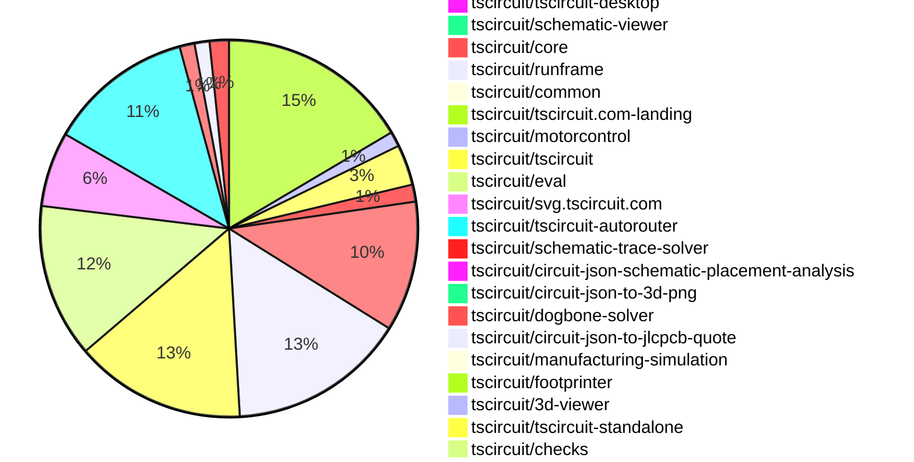

# contribution tracker

[contributions.tscircuit.com](https://contributions.tscircuit.com) ・ [tscircuit.com](https://tscircuit.com) ・ [Contribution Overviews](./contribution-overviews/) ・ [Changelogs](./changelogs/)

Generates weekly contribution overviews for tscircuit contributors. Check out all
the [contribution overviews here](./contribution-overviews/)
You can find AI-generated monthly changelogs in the [changelogs directory](./changelogs/)

- All PRs in the tscircuit org are scanned/summarized via an LLM
- The LLM classifies each Diff/PR as into a set of attributes for scoring
- All the PRs, summaries, and classifications are organized into charts and tables for [the website](https://contributions.tscircuit.com)

> Want to run locally? See the [Development Section](#development)

## Current Week

<!-- START_CURRENT_WEEK -->

# Contribution Overview 2026-11-10

The current week is shown below. There are 3 major sections:

- [Contributor Overview](#contributor-overview)
- [PRs by Repository](#prs-by-repository)
- [PRs by Contributor](#changes-by-contributor)
- [Scoring & Sponsorship Details](/docs/sponsorship-calculation-explanation.md)

## PRs by Repository

## Contributor Overview

| Contributor | 🐳 Major | 🐙 Minor | 🐌 Tiny | Score | ⭐ |
|-------------|---------|---------|---------|-------|-----|
| [ShiboSoftwareDev](#ShiboSoftwareDev) | 53 | 12 | 25 | 250 | 👑👑👑 |
| [seveibar](#seveibar) | 17 | 10 | 13 | 101 | 👑 |
| [Abse2001](#Abse2001) | 7 | 11 | 9 | 63 | ⭐⭐⭐ |
| [0hmX](#0hmX) | 9 | 4 | 1 | 46 | ⭐⭐ |
| [MustafaMulla29](#MustafaMulla29) | 5 | 6 | 16 | 45 | ⭐⭐ |
| [imrishabh18](#imrishabh18) | 2 | 9 | 4 | 31 | ⭐⭐ |
| [techmannih](#techmannih) | 3 | 2 | 3 | 19 | ⭐⭐ |
| [rushabhcodes](#rushabhcodes) | 2 | 4 | 1 | 17 | ⭐⭐ |
| [tscircuitbot](#tscircuitbot) | 0 | 0 | 379 | 15 | ⭐⭐ |
| [AnasSarkiz](#AnasSarkiz) | 0 | 4 | 0 | 8 | ⭐ |
| [GokulPandi-M](#GokulPandi-M) | 0 | 0 | 4 | 3.5 |  |
| [hrithik18k](#hrithik18k) | 0 | 0 | 1 | 1 |  |
| [abdalraof-albarbar](#abdalraof-albarbar) | 0 | 0 | 1 | 1 |  |

## Staff Pass Ratio (SPR)

| Contributor | Reviewed PRs | Rejections | Approvals | SPR |
|-------------|--------------|------------|-----------|-----|
| [ShiboSoftwareDev](#ShiboSoftwareDev) | 12 | 0 | 12 | 100.0% |
| [0hmX](#0hmX) | 11 | 1 | 10 | 90.9% |
| [Abse2001](#Abse2001) | 9 | 2 | 9 | 77.8% |
| [rushabhcodes](#rushabhcodes) | 4 | 2 | 4 | 50.0% |
| [techmannih](#techmannih) | 4 | 0 | 5 | 100.0% |
| [imrishabh18](#imrishabh18) | 3 | 0 | 3 | 100.0% |
| [MustafaMulla29](#MustafaMulla29) | 3 | 0 | 3 | 100.0% |
| [AnasSarkiz](#AnasSarkiz) | 2 | 1 | 1 | 50.0% |

ShiboSoftwareDev SPR PRs (12)

- [#3783](https://github.com/tscircuit/tscircuit-autorouter/pull/3783) fix: pass the board via copper minimum to node repair
- [#3770](https://github.com/tscircuit/tscircuit-autorouter/pull/3770) fix: preserve preloaded vias at routing cell boundaries
- [#3765](https://github.com/tscircuit/tscircuit-autorouter/pull/3765) fix: honor explicit via clearance in regional repair guard
- [#3760](https://github.com/tscircuit/tscircuit-autorouter/pull/3760) fix: honor declared via clearance when validating projection
- [#3733](https://github.com/tscircuit/tscircuit-autorouter/pull/3733) fix: preserve validated gaps in stitch paths
- [#3671](https://github.com/tscircuit/tscircuit-autorouter/pull/3671) Avoid repeated mesh scans during DDR port spacing
- [#3667](https://github.com/tscircuit/tscircuit-autorouter/pull/3667) Use faster DDR length-matching obstacle checks
- [#3664](https://github.com/tscircuit/tscircuit-autorouter/pull/3664) Restore physically clear BGA via columns at the gap threshold
- [#3693](https://github.com/tscircuit/tscircuit-autorouter/pull/3693) repro: ButterStick bus wires ignore allowed layers
- [#3660](https://github.com/tscircuit/tscircuit-autorouter/pull/3660) fix: retain H616 DDR repairs during final contact restoration
- [#201](https://github.com/tscircuit/high-density-repair03/pull/201) fix: preserve independent repairs during contact restoration
- [#90](https://github.com/tscircuit/length-matching-solver/pull/90) Skip distant pads before DDR meander clearance checks

0hmX SPR PRs (11)

- [#996](https://github.com/tscircuit/circuit-json/pull/996) fix: enforce ordered length-only differential pair buses
- [#5382](https://github.com/tscircuit/core/pull/5382) feat: include per-connection compute cost in autorouting events
- [#5413](https://github.com/tscircuit/core/pull/5413) fix: emit the ordered path of every multi-port trace
- [#5412](https://github.com/tscircuit/core/pull/5412) test: reproduce trace path order not emitted or routed
- [#5415](https://github.com/tscircuit/core/pull/5415) test: cover three-pad differential path routing data flow
- [#5760](https://github.com/tscircuit/cli/pull/5760) feat: capture per-connection compute cost in autorouter diagnostics
- [#3710](https://github.com/tscircuit/tscircuit-autorouter/pull/3710) fix: pass ordered differential lane hops to length matching
- [#3709](https://github.com/tscircuit/tscircuit-autorouter/pull/3709) fix: length-match ordered differential pair lanes
- [#3651](https://github.com/tscircuit/tscircuit-autorouter/pull/3651) Add a per-connection compute cost summary to the pipeline 9 solver
- [#3708](https://github.com/tscircuit/tscircuit-autorouter/pull/3708) fix: route connection path points in order
- [#315](https://github.com/tscircuit/tiny-hypergraph/pull/315) Report each connection's solo search iterations from DuplicateCongestedPortSolver

Abse2001 SPR PRs (9)

- [#5214](https://github.com/tscircuit/core/pull/5214) feat: implement finished panel size limits (#5067)
- [#5208](https://github.com/tscircuit/core/pull/5208) feat: implement panel tab child elements (#5067)
- [#5211](https://github.com/tscircuit/core/pull/5211) feat: implement tooling rail elements (#5067)
- [#5217](https://github.com/tscircuit/core/pull/5217) feat: V-score panel tabs with vScore (#5067)
- [#5205](https://github.com/tscircuit/core/pull/5205) feat: implement panel silkscreen (#5067)
- [#5202](https://github.com/tscircuit/core/pull/5202) feat: implement panel tooling holes and fiducials (#5067)
- [#246](https://github.com/tscircuit/circuit-json-to-gerber/pull/246) Merge cutouts that are flush with the board edge into the board outline
- [#632](https://github.com/tscircuit/jlcsearch/pull/632) Expose JLCPCB's Standard-only mark on verified parts
- [#5771](https://github.com/tscircuit/cli/pull/5771) Implement tsci quote estimate with the JLCPCB quote estimator

rushabhcodes SPR PRs (4)

- [#5400](https://github.com/tscircuit/core/pull/5400) fix: preserve authored pad layers in mixed-side footprints
- [#5375](https://github.com/tscircuit/core/pull/5375) [2/2] Preserve unbroken inner copper planes in remote autorouting
- [#5404](https://github.com/tscircuit/core/pull/5404) fix: preserve plated-slot rotation on flipped footprints
- [#5402](https://github.com/tscircuit/core/pull/5402) fix: render pcbtrace coordinate routes

techmannih SPR PRs (4)

- [#5343](https://github.com/tscircuit/core/pull/5343) Fix named-net routing via a phase-selected pin
- [#5341](https://github.com/tscircuit/core/pull/5341) Fix plated-hole solder paste ownership
- [#557](https://github.com/tscircuit/checks/pull/557) Use the board via-to-pad clearance for routing DRC
- [#5750](https://github.com/tscircuit/cli/pull/5750) Fix autorouter worker count in tsci build

imrishabh18 SPR PRs (3)

- [#635](https://github.com/tscircuit/jlcsearch/pull/635) Fix JSON output after D1 stock-sync retries
- [#638](https://github.com/tscircuit/jlcsearch/pull/638) Add a safe search-index-only rebuild action
- [#7](https://github.com/tscircuit/manufacturing-simulation/pull/7) Simulate the Amazon partnered carrier label at Ship-ready

MustafaMulla29 SPR PRs (3)

- [#5426](https://github.com/tscircuit/core/pull/5426) fix: preserve copper-plane connectivity at breakout endpoints
- [#5438](https://github.com/tscircuit/core/pull/5438) fix: keep board plane reservations independent of child groups
- [#268](https://github.com/tscircuit/fanout-solver/pull/268) fix: generate exact-angle dogbone sites for imported pad grids

AnasSarkiz SPR PRs (2)

- [#540](https://github.com/tscircuit/checks/pull/540) fix: recognize explicit pin role attributes as specified
- [#5780](https://github.com/tscircuit/cli/pull/5780) fix: warn when imports omit an explicit 3D model

> Note: AI evaluates PRs and assigns 1-3 star ratings automatically. 4 and 5 star ratings require manual staff review.

## Review Table

[reviews-received-hover]: ## "Number of reviews received for PRs for this contributor"
[approvals-received-hover]: ## "Number of approvals received for PRs this contributor authored"
[rejections-received-hover]: ## "Number of rejections received for PRs this contributor authored"
[prs-opened-hover]: ## "Number of PRs opened by this contributor"
[issues-created-hover]: ## "Number of issues created by this contributor"

| Contributor | Reviews Received | Approvals Received | Rejections Received | Approvals | Rejections Given | PRs Opened | PRs Merged | Issues Created |
|---|---|---|---|---|---|---|---|---|
| [0hmX](#0hmX) | 49 | 10 | 1 | 23 | 0 | 60 | 16 | 0 |
| [1932819331hy-debug](#1932819331hy-debug) | 0 | 0 | 0 | 0 | 0 | 33 | 0 | 0 |
| [abdalraof-albarbar](#abdalraof-albarbar) | 0 | 0 | 0 | 0 | 0 | 3 | 1 | 0 |
| [Abse2001](#Abse2001) | 10 | 9 | 0 | 4 | 0 | 39 | 27 | 0 |
| [ameenalqershi](#ameenalqershi) | 0 | 0 | 0 | 0 | 0 | 4 | 0 | 0 |
| [AnasSarkiz](#AnasSarkiz) | 5 | 4 | 1 | 0 | 0 | 11 | 4 | 0 |
| [Andresdev14](#Andresdev14) | 0 | 0 | 0 | 0 | 0 | 8 | 0 | 0 |
| [aswadi](#aswadi) | 0 | 0 | 0 | 0 | 0 | 15 | 0 | 0 |
| [BHAWESHBHASKAR](#BHAWESHBHASKAR) | 0 | 0 | 0 | 0 | 0 | 2 | 0 | 0 |
| [Burapa-J](#Burapa-J) | 0 | 0 | 0 | 0 | 0 | 8 | 0 | 0 |
| [cocvn157](#cocvn157) | 0 | 0 | 0 | 0 | 0 | 27 | 0 | 0 |
| [deep-bhikadiya](#deep-bhikadiya) | 0 | 0 | 0 | 0 | 0 | 1 | 0 | 0 |
| [Devesh36](#Devesh36) | 1 | 0 | 0 | 0 | 0 | 4 | 0 | 0 |
| [ghost](#ghost) | 0 | 0 | 0 | 0 | 0 | 1 | 0 | 0 |
| [GokulPandi-M](#GokulPandi-M) | 6 | 4 | 1 | 0 | 0 | 8 | 4 | 0 |
| [hrithik18k](#hrithik18k) | 0 | 0 | 0 | 0 | 0 | 1 | 1 | 0 |
| [imrishabh18](#imrishabh18) | 8 | 5 | 0 | 11 | 3 | 28 | 16 | 0 |
| [imyelo](#imyelo) | 0 | 0 | 0 | 0 | 0 | 2 | 0 | 0 |
| [jeffrey-graham](#jeffrey-graham) | 0 | 0 | 0 | 0 | 0 | 2 | 0 | 0 |
| [LBCron](#LBCron) | 0 | 0 | 0 | 0 | 0 | 6 | 0 | 0 |
| [mohan-bee](#mohan-bee) | 1 | 0 | 0 | 0 | 0 | 4 | 0 | 0 |
| [MustafaMulla29](#MustafaMulla29) | 12 | 11 | 1 | 4 | 1 | 34 | 27 | 0 |
| [nolanntibi-dot](#nolanntibi-dot) | 0 | 0 | 0 | 0 | 0 | 4 | 0 | 0 |
| [OLuHneschastniy](#OLuHneschastniy) | 0 | 0 | 0 | 0 | 0 | 6 | 0 | 0 |
| [rafagil11](#rafagil11) | 0 | 0 | 0 | 0 | 0 | 1 | 0 | 0 |
| [rushabhcodes](#rushabhcodes) | 14 | 4 | 2 | 0 | 0 | 34 | 8 | 0 |
| [sainath998](#sainath998) | 0 | 0 | 0 | 0 | 0 | 1 | 0 | 0 |
| [satoshinakamoto666666](#satoshinakamoto666666) | 0 | 0 | 0 | 0 | 0 | 1 | 0 | 0 |
| [seveibar](#seveibar) | 13 | 1 | 0 | 47 | 3 | 62 | 40 | 0 |
| [ShiboSoftwareDev](#ShiboSoftwareDev) | 36 | 36 | 0 | 2 | 0 | 143 | 91 | 0 |
| [singhaditya21](#singhaditya21) | 0 | 0 | 0 | 0 | 0 | 3 | 0 | 0 |
| [techmannih](#techmannih) | 23 | 7 | 1 | 0 | 0 | 30 | 8 | 0 |
| [tirumallaharish0200](#tirumallaharish0200) | 0 | 0 | 0 | 0 | 0 | 1 | 0 | 0 |
| [trixie010](#trixie010) | 0 | 0 | 0 | 0 | 0 | 2 | 0 | 0 |
| [tscircuitbot](#tscircuitbot) | 0 | 0 | 0 | 0 | 0 | 446 | 379 | 0 |
| [tungnguyen84](#tungnguyen84) | 0 | 0 | 0 | 0 | 0 | 2 | 0 | 0 |
| [ulixes](#ulixes) | 0 | 0 | 0 | 0 | 0 | 4 | 0 | 0 |
| [Umutplvn](#Umutplvn) | 0 | 0 | 0 | 0 | 0 | 1 | 0 | 0 |
| [voropaevv](#voropaevv) | 0 | 0 | 0 | 0 | 0 | 3 | 0 | 0 |
| [xtruel](#xtruel) | 0 | 0 | 0 | 0 | 0 | 13 | 0 | 0 |

## Changes by Repository

### [tscircuit/circuit-json](https://github.com/tscircuit/circuit-json)

| PR # | Impact | Rating | Contributor | Description |
|------|--------|--------|-------------|-------------|
| [#1004](https://github.com/tscircuit/circuit-json/pull/1004) | 🐳 Major | ⭐⭐⭐ | seveibar | Add optional schematic_group.show_boundary, schematic_port.schematic_group_id, and schematic_port.boundary_position to define expanded subcircuit boundaries and public terminal geometry. |

🐌 Tiny Contributions (1)

| PR # | Impact | Contributor | Description |
|------|--------|-------------|-------------|
| [#1005](https://github.com/tscircuit/circuit-json/pull/1005) | 🐌 Tiny | tscircuitbot | Automated package update |

### [tscircuit/props](https://github.com/tscircuit/props)

| PR # | Impact | Rating | Contributor | Description |
|------|--------|--------|-------------|-------------|
| [#1009](https://github.com/tscircuit/props/pull/1009) | 🐳 Major | ⭐⭐⭐ | seveibar | Adds assembly drawing capabilities with explosion views and reusable stage definitions, enhancing the drawing functionality for parts and assemblies. |

🐌 Tiny Contributions (3)

| PR # | Impact | Contributor | Description |
|------|--------|-------------|-------------|
| [#999](https://github.com/tscircuit/props/pull/999) | 🐌 Tiny | Abse2001 | Changes the paneltab component to use center offsets from board edges instead of a single offset, introducing new properties for better tab placement and width specification. |
| [#1000](https://github.com/tscircuit/props/pull/1000) | 🐌 Tiny | Abse2001 | Updates documentation to clarify that panel size limits now shape the grid layout, allowing auto-sized panels to grow and grids to rearrange based on specified limits. |
| [#1004](https://github.com/tscircuit/props/pull/1004) | 🐌 Tiny | 0hmX | Documents that trace paths should always be ordered, clarifying that the trace is routed as a chain from the first port to the last. |

### [tscircuit/tscircuit.com](https://github.com/tscircuit/tscircuit.com)

| PR # | Impact | Rating | Contributor | Description |
|------|--------|--------|-------------|-------------|
| [#5813](https://github.com/tscircuit/tscircuit.com/pull/5813) | 🐳 Major | ⭐⭐⭐ | seveibar | Adds a Customize link in the package About section for packages with a manifest, allowing users to navigate to the Customize page directly from the sidebar. |
| [#5812](https://github.com/tscircuit/tscircuit.com/pull/5812) | 🐳 Major | ⭐⭐⭐ | seveibar | Adds a new page for customizing package configurations, allowing users to interact with published configurations through controls generated from preview data. |
| [#5851](https://github.com/tscircuit/tscircuit.com/pull/5851) | 🐳 Major | ⭐⭐⭐ | seveibar | Adds a copyable, syntax-highlighted TSX usage example beneath the customization preview, using the selected variants parameters and the packages published default or named component export. |
| [#5815](https://github.com/tscircuit/tscircuit.com/pull/5815) | 🐳 Major | ⭐⭐⭐ | seveibar | Adds a Reference designs button to the datasheet header that links to the curated catalog of designs using the chip. |
| [#5811](https://github.com/tscircuit/tscircuit.com/pull/5811) | 🐳 Major | ⭐⭐⭐ | seveibar | Adds the data layer for packages whose build publishes distpreview.json, including hooks for loading manifests and managing package configurations. |
| [#5814](https://github.com/tscircuit/tscircuit.com/pull/5814) | 🐙 Minor | ⭐⭐ | seveibar | Adds two new pages for displaying reference designs for specific chips, enhancing the datasheet functionality. |
| [#5810](https://github.com/tscircuit/tscircuit.com/pull/5810) | 🐙 Minor | ⭐⭐ | seveibar | Adds change tracking between two circuits, allowing the Customize page to identify which schematic parts a configuration switch added or changed. |
| [#5852](https://github.com/tscircuit/tscircuit.com/pull/5852) | 🐙 Minor | ⭐⭐ | seveibar | Moves the TSX usage panel into the shared PackageConfigurationPreview to ensure both the datasheet reference-design pages and the package customize page display copyable code for the selected configuration. |
| [#5834](https://github.com/tscircuit/tscircuit.com/pull/5834) | 🐙 Minor | ⭐⭐ | seveibar | Draws dashed outlines around changed schematic parts on the Customize and reference-design pages for three seconds using the schematic viewers new props. |
| [#5809](https://github.com/tscircuit/tscircuit.com/pull/5809) | 🐙 Minor | ⭐⭐ | seveibar | Adds PackagePreviewScope, an optional context that supplies the release, preview file, circuit JSON and GLB for an embedded preview, allowing hooks to resolve identity without a provider. |
| [#5808](https://github.com/tscircuit/tscircuit.com/pull/5808) | 🐙 Minor | ⭐⭐ | seveibar | Adds support for loading gzip-compressed Circuit JSON preview files, allowing package pages to preview large circuits efficiently. |

🐌 Tiny Contributions (79)

| PR # | Impact | Contributor | Description |
|------|--------|-------------|-------------|
| [#5891](https://github.com/tscircuit/tscircuit.com/pull/5891) | 🐌 Tiny | seveibar | Replaces the screenshot on desktop with a dark mode conversation interface alongside the PCB view of the rp2040-motor-controller. |
| [#5890](https://github.com/tscircuit/tscircuit.com/pull/5890) | 🐌 Tiny | seveibar | Adds a new page at desktop for the tscircuit Desktop app, providing information about the app, download options, and features. |
| [#5896](https://github.com/tscircuit/tscircuit.com/pull/5896) | 🐌 Tiny | tscircuitbot | Updates the tscircuitrunframe package from version 0.0.3234 to 0.0.3235 |
| [#5895](https://github.com/tscircuit/tscircuit.com/pull/5895) | 🐌 Tiny | tscircuitbot | Updates the tscircuitrunframe package from version 0.0.3233 to 0.0.3234 |
| [#5894](https://github.com/tscircuit/tscircuit.com/pull/5894) | 🐌 Tiny | tscircuitbot | Updates the tscircuiteval package version from 0.0.1768 to 0.0.1769 in package.json |
| [#5893](https://github.com/tscircuit/tscircuit.com/pull/5893) | 🐌 Tiny | tscircuitbot | Updates the tscircuitrunframe package version from 0.0.3232 to 0.0.3233 |
| [#5892](https://github.com/tscircuit/tscircuit.com/pull/5892) | 🐌 Tiny | tscircuitbot | Automated package update |
| [#5889](https://github.com/tscircuit/tscircuit.com/pull/5889) | 🐌 Tiny | tscircuitbot | Automated package update |
| [#5888](https://github.com/tscircuit/tscircuit.com/pull/5888) | 🐌 Tiny | tscircuitbot | Updates the tscircuiteval package from version 0.0.1766 to 0.0.1767 |
| [#5887](https://github.com/tscircuit/tscircuit.com/pull/5887) | 🐌 Tiny | tscircuitbot | Updates the tscircuitrunframe package from version 0.0.3230 to 0.0.3231 |
| [#5886](https://github.com/tscircuit/tscircuit.com/pull/5886) | 🐌 Tiny | tscircuitbot | Updates the tscircuitrunframe package version from 0.0.3229 to 0.0.3230 |
| [#5885](https://github.com/tscircuit/tscircuit.com/pull/5885) | 🐌 Tiny | tscircuitbot | Updates the tscircuiteval package from version 0.0.1765 to 0.0.1766 |
| [#5884](https://github.com/tscircuit/tscircuit.com/pull/5884) | 🐌 Tiny | tscircuitbot | Updates the tscircuitrunframe package version from 0.0.3228 to 0.0.3229 in package.json |
| [#5883](https://github.com/tscircuit/tscircuit.com/pull/5883) | 🐌 Tiny | tscircuitbot | Updates the tscircuiteval package from version 0.0.1764 to 0.0.1765 |
| [#5882](https://github.com/tscircuit/tscircuit.com/pull/5882) | 🐌 Tiny | tscircuitbot | Updates the tscircuitrunframe package from version 0.0.3227 to 0.0.3228 |
| [#5881](https://github.com/tscircuit/tscircuit.com/pull/5881) | 🐌 Tiny | tscircuitbot | Updates the tscircuiteval package from version 0.0.1763 to 0.0.1764 |
| [#5880](https://github.com/tscircuit/tscircuit.com/pull/5880) | 🐌 Tiny | tscircuitbot | Updates the tscircuitrunframe package from version 0.0.3226 to 0.0.3227 |
| [#5879](https://github.com/tscircuit/tscircuit.com/pull/5879) | 🐌 Tiny | tscircuitbot | Updates the tscircuiteval package version from 0.0.1762 to 0.0.1763 in package.json |
| [#5878](https://github.com/tscircuit/tscircuit.com/pull/5878) | 🐌 Tiny | tscircuitbot | Updates the tscircuitrunframe package version from 0.0.3225 to 0.0.3226 in package.json |
| [#5877](https://github.com/tscircuit/tscircuit.com/pull/5877) | 🐌 Tiny | tscircuitbot | Updates the tscircuiteval package from version 0.0.1761 to 0.0.1762 |
| [#5876](https://github.com/tscircuit/tscircuit.com/pull/5876) | 🐌 Tiny | tscircuitbot | Updates the tscircuitrunframe package from version 0.0.3224 to 0.0.3225 |
| [#5875](https://github.com/tscircuit/tscircuit.com/pull/5875) | 🐌 Tiny | tscircuitbot | Updates the tscircuiteval package from version 0.0.1760 to 0.0.1761 in the package.json file. |
| [#5869](https://github.com/tscircuit/tscircuit.com/pull/5869) | 🐌 Tiny | tscircuitbot | Updates the tscircuiteval package from version 0.0.1757 to 0.0.1758 |
| [#5866](https://github.com/tscircuit/tscircuit.com/pull/5866) | 🐌 Tiny | tscircuitbot | Updates the tscircuitrunframe package version from 0.0.3219 to 0.0.3220 |
| [#5861](https://github.com/tscircuit/tscircuit.com/pull/5861) | 🐌 Tiny | tscircuitbot | Updates the tscircuitrunframe package from version 0.0.3216 to 0.0.3218 |
| [#5829](https://github.com/tscircuit/tscircuit.com/pull/5829) | 🐌 Tiny | tscircuitbot | Updates the tscircuiteval package from version 0.0.1741 to 0.0.1742 |
| [#5816](https://github.com/tscircuit/tscircuit.com/pull/5816) | 🐌 Tiny | tscircuitbot | Updates the tscircuiteval package from version 0.0.1735 to 0.0.1736 |
| [#5864](https://github.com/tscircuit/tscircuit.com/pull/5864) | 🐌 Tiny | tscircuitbot | Updates the tscircuitrunframe package version from 0.0.3218 to 0.0.3219 in package.json |
| [#5822](https://github.com/tscircuit/tscircuit.com/pull/5822) | 🐌 Tiny | tscircuitbot | Updates the tscircuiteval package from version 0.0.1738 to 0.0.1739 |
| [#5818](https://github.com/tscircuit/tscircuit.com/pull/5818) | 🐌 Tiny | tscircuitbot | Updates the tscircuiteval package version from 0.0.1736 to 0.0.1737 in package.json |
| [#5873](https://github.com/tscircuit/tscircuit.com/pull/5873) | 🐌 Tiny | tscircuitbot | Updates the tscircuiteval package version from 0.0.1759 to 0.0.1760 in package.json |
| [#5872](https://github.com/tscircuit/tscircuit.com/pull/5872) | 🐌 Tiny | tscircuitbot | Updates the tscircuitrunframe package from version 0.0.3222 to 0.0.3223 |
| [#5870](https://github.com/tscircuit/tscircuit.com/pull/5870) | 🐌 Tiny | tscircuitbot | Updates the tscircuitrunframe package from version 0.0.3221 to 0.0.3222 |
| [#5867](https://github.com/tscircuit/tscircuit.com/pull/5867) | 🐌 Tiny | tscircuitbot | Updates the tscircuiteval package from version 0.0.1756 to 0.0.1757 |
| [#5860](https://github.com/tscircuit/tscircuit.com/pull/5860) | 🐌 Tiny | tscircuitbot | Updates the tscircuiteval package from version 0.0.1753 to 0.0.1754 |
| [#5857](https://github.com/tscircuit/tscircuit.com/pull/5857) | 🐌 Tiny | tscircuitbot | Updates the tscircuitrunframe package from version 0.0.3215 to 0.0.3216 |
| [#5856](https://github.com/tscircuit/tscircuit.com/pull/5856) | 🐌 Tiny | tscircuitbot | Updates the tscircuiteval package from version 0.0.1751 to 0.0.1752 |
| [#5854](https://github.com/tscircuit/tscircuit.com/pull/5854) | 🐌 Tiny | tscircuitbot | Updates the tscircuiteval package version from 0.0.1750 to 0.0.1751 in package.json |
| [#5849](https://github.com/tscircuit/tscircuit.com/pull/5849) | 🐌 Tiny | tscircuitbot | Updates the tscircuiteval package version from 0.0.1749 to 0.0.1750 in package.json |
| [#5848](https://github.com/tscircuit/tscircuit.com/pull/5848) | 🐌 Tiny | tscircuitbot | Updates the tscircuitrunframe package from version 0.0.3212 to 0.0.3213 |
| [#5846](https://github.com/tscircuit/tscircuit.com/pull/5846) | 🐌 Tiny | tscircuitbot | Automated package update |
| [#5845](https://github.com/tscircuit/tscircuit.com/pull/5845) | 🐌 Tiny | tscircuitbot | Updates the tscircuiteval package from version 0.0.1747 to 0.0.1748 in the package.json file. |
| [#5844](https://github.com/tscircuit/tscircuit.com/pull/5844) | 🐌 Tiny | tscircuitbot | Updates the tscircuitrunframe package from version 0.0.3210 to 0.0.3211 |
| [#5843](https://github.com/tscircuit/tscircuit.com/pull/5843) | 🐌 Tiny | tscircuitbot | Updates the tscircuiteval package from version 0.0.1746 to 0.0.1747 |
| [#5842](https://github.com/tscircuit/tscircuit.com/pull/5842) | 🐌 Tiny | tscircuitbot | Updates the tscircuitrunframe package from version 0.0.3209 to 0.0.3210 |
| [#5840](https://github.com/tscircuit/tscircuit.com/pull/5840) | 🐌 Tiny | tscircuitbot | Updates the tscircuitrunframe package from version 0.0.3208 to 0.0.3209 |
| [#5832](https://github.com/tscircuit/tscircuit.com/pull/5832) | 🐌 Tiny | tscircuitbot | Updates the tscircuitrunframe package from version 0.0.3205 to 0.0.3206 |
| [#5830](https://github.com/tscircuit/tscircuit.com/pull/5830) | 🐌 Tiny | tscircuitbot | Updates the tscircuitrunframe package from version 0.0.3204 to 0.0.3205 |
| [#5828](https://github.com/tscircuit/tscircuit.com/pull/5828) | 🐌 Tiny | tscircuitbot | Updates the tscircuitrunframe package version from 0.0.3203 to 0.0.3204 |
| [#5825](https://github.com/tscircuit/tscircuit.com/pull/5825) | 🐌 Tiny | tscircuitbot | Updates the tscircuitrunframe package from version 0.0.3201 to 0.0.3202 |
| [#5824](https://github.com/tscircuit/tscircuit.com/pull/5824) | 🐌 Tiny | tscircuitbot | Updates the tscircuiteval package from version 0.0.1739 to 0.0.1740 |
| [#5817](https://github.com/tscircuit/tscircuit.com/pull/5817) | 🐌 Tiny | tscircuitbot | Updates the tscircuitrunframe package from version 0.0.3197 to 0.0.3198 |
| [#5806](https://github.com/tscircuit/tscircuit.com/pull/5806) | 🐌 Tiny | tscircuitbot | Updates the tscircuiteval package from version 0.0.1734 to 0.0.1735 in the package.json file. |
| [#5874](https://github.com/tscircuit/tscircuit.com/pull/5874) | 🐌 Tiny | tscircuitbot | Updates the tscircuitrunframe package from version 0.0.3223 to 0.0.3224 |
| [#5871](https://github.com/tscircuit/tscircuit.com/pull/5871) | 🐌 Tiny | tscircuitbot | Automated package update |
| [#5868](https://github.com/tscircuit/tscircuit.com/pull/5868) | 🐌 Tiny | tscircuitbot | Updates the tscircuitrunframe package from version 0.0.3220 to 0.0.3221 |
| [#5865](https://github.com/tscircuit/tscircuit.com/pull/5865) | 🐌 Tiny | tscircuitbot | Updates the tscircuiteval package from version 0.0.1755 to 0.0.1756 |
| [#5863](https://github.com/tscircuit/tscircuit.com/pull/5863) | 🐌 Tiny | tscircuitbot | Updates the tscircuiteval package from version 0.0.1754 to 0.0.1755 |
| [#5859](https://github.com/tscircuit/tscircuit.com/pull/5859) | 🐌 Tiny | tscircuitbot | Updates the tscircuiteval package from version 0.0.1752 to 0.0.1753 |
| [#5850](https://github.com/tscircuit/tscircuit.com/pull/5850) | 🐌 Tiny | tscircuitbot | Updates the tscircuitrunframe package from version 0.0.3213 to 0.0.3214 |
| [#5847](https://github.com/tscircuit/tscircuit.com/pull/5847) | 🐌 Tiny | tscircuitbot | Updates the tscircuiteval package from version 0.0.1748 to 0.0.1749 |
| [#5841](https://github.com/tscircuit/tscircuit.com/pull/5841) | 🐌 Tiny | tscircuitbot | Updates the tscircuiteval package from version 0.0.1745 to 0.0.1746 |
| [#5836](https://github.com/tscircuit/tscircuit.com/pull/5836) | 🐌 Tiny | tscircuitbot | Automated package update to version 0.0.227 |
| [#5831](https://github.com/tscircuit/tscircuit.com/pull/5831) | 🐌 Tiny | tscircuitbot | Automated package update |
| [#5827](https://github.com/tscircuit/tscircuit.com/pull/5827) | 🐌 Tiny | tscircuitbot | Updates the tscircuiteval package version from 0.0.1740 to 0.0.1741 in package.json |
| [#5823](https://github.com/tscircuit/tscircuit.com/pull/5823) | 🐌 Tiny | tscircuitbot | Updates the tscircuitrunframe package version from 0.0.3200 to 0.0.3201 in package.json |
| [#5821](https://github.com/tscircuit/tscircuit.com/pull/5821) | 🐌 Tiny | tscircuitbot | Updates the tscircuitrunframe package version from 0.0.3199 to 0.0.3200 in package.json |
| [#5819](https://github.com/tscircuit/tscircuit.com/pull/5819) | 🐌 Tiny | tscircuitbot | Updates the tscircuitrunframe package from version 0.0.3198 to 0.0.3199 |
| [#5803](https://github.com/tscircuit/tscircuit.com/pull/5803) | 🐌 Tiny | tscircuitbot | Updates the tscircuiteval package from version 0.0.1733 to 0.0.1734 |
| [#5802](https://github.com/tscircuit/tscircuit.com/pull/5802) | 🐌 Tiny | tscircuitbot | Updates the tscircuitrunframe package from version 0.0.3194 to 0.0.3195 |
| [#5855](https://github.com/tscircuit/tscircuit.com/pull/5855) | 🐌 Tiny | tscircuitbot | Updates the tscircuitrunframe package version from 0.0.3214 to 0.0.3215 |
| [#5839](https://github.com/tscircuit/tscircuit.com/pull/5839) | 🐌 Tiny | tscircuitbot | Updates the tscircuiteval package version from 0.0.1744 to 0.0.1745 in package.json |
| [#5820](https://github.com/tscircuit/tscircuit.com/pull/5820) | 🐌 Tiny | tscircuitbot | Updates the tscircuiteval package from version 0.0.1737 to 0.0.1738 |
| [#5804](https://github.com/tscircuit/tscircuit.com/pull/5804) | 🐌 Tiny | tscircuitbot | Updates the tscircuitrunframe package version from 0.0.3195 to 0.0.3196 in package.json |
| [#5838](https://github.com/tscircuit/tscircuit.com/pull/5838) | 🐌 Tiny | tscircuitbot | Updates the tscircuitrunframe package from version 0.0.3207 to 0.0.3208 and the tscircuitschematic-viewer package from version 2.0.108 to 2.0.109 |
| [#5837](https://github.com/tscircuit/tscircuit.com/pull/5837) | 🐌 Tiny | tscircuitbot | Updates the tscircuiteval package from version 0.0.1743 to 0.0.1744 and the tscircuitschematic-viewer package from version 2.0.110 to 2.0.108 in package.json |
| [#5835](https://github.com/tscircuit/tscircuit.com/pull/5835) | 🐌 Tiny | tscircuitbot | Automated package update |
| [#5807](https://github.com/tscircuit/tscircuit.com/pull/5807) | 🐌 Tiny | tscircuitbot | Updates the tscircuitrunframe package from version 0.0.3196 to 0.0.3197 |
| [#5826](https://github.com/tscircuit/tscircuit.com/pull/5826) | 🐌 Tiny | tscircuitbot | Updates the tscircuitrunframe package from version 0.0.3202 to 0.0.3203 |

### [tscircuit/jlcsearch](https://github.com/tscircuit/jlcsearch)

| PR # | Impact | Rating | Contributor | Description |
|------|--------|--------|-------------|-------------|
| [#637](https://github.com/tscircuit/jlcsearch/pull/637) | 🐳 Major | ⭐⭐⭐ | seveibar | Adds a Buzzers link on the home page and buzzerslist with package, Basic, and Preferred filters, and exposes the same results through the API at buzzerslist.json. |
| [#640](https://github.com/tscircuit/jlcsearch/pull/640) | 🐙 Minor | ⭐⭐ | imrishabh18 | Changes the search index initialization process to avoid reliance on Cloudflares bulk-import service by using the normal query API instead. |
| [#635](https://github.com/tscircuit/jlcsearch/pull/635) | 🐙 Minor | ⭐⭐ | imrishabh18 | Fixes JSON output handling in stock-sync job by separating successful and failed JSON attempts, ensuring valid JSON is returned to the stock job. |
| [#638](https://github.com/tscircuit/jlcsearch/pull/638) | 🐙 Minor | ⭐⭐ | imrishabh18 | Adds a manual GitHub Action to rebuild only the search index, without changing the component catalogue or stock. |
| [#636](https://github.com/tscircuit/jlcsearch/pull/636) | 🐙 Minor | ⭐⭐ | imrishabh18 | Caches dropdown values for resistor and capacitor pages to reduce load by skipping dropdown queries for JSON requests and caching HTML dropdown values for 15 minutes. |
| [#632](https://github.com/tscircuit/jlcsearch/pull/632) | 🐙 Minor | ⭐⭐ | Abse2001 | Adds is_standard_only to the verified component that exact-part lookups return, indicating whether a part is marked as Standard only by JLCPCB, which affects the assembly service selection for PCBA. |

🐌 Tiny Contributions (1)

| PR # | Impact | Contributor | Description |
|------|--------|-------------|-------------|
| [#639](https://github.com/tscircuit/jlcsearch/pull/639) | 🐌 Tiny | imrishabh18 | Prevents queued search-index rebuilds from being cancelled when a scheduled inventory refresh replaces them in the waiting queue by adding GitHubs queue: max setting to workflows sharing the production database queue. |

### [tscircuit/cli](https://github.com/tscircuit/cli)

| PR # | Impact | Rating | Contributor | Description |
|------|--------|--------|-------------|-------------|
| [#5773](https://github.com/tscircuit/cli/pull/5773) | 🐳 Major | ⭐⭐⭐ | seveibar | Only the first 10 errors (and warnings) of each type are logged; the rest are reported as a count, improving clarity in build error reporting. |
| [#5795](https://github.com/tscircuit/cli/pull/5795) | 🐳 Major | ⭐⭐⭐ | ShiboSoftwareDev | Adds error handling for missing Reacttscircuit dependencies, providing setup guidance for users when loading fails. |
| [#5771](https://github.com/tscircuit/cli/pull/5771) | 🐳 Major | ⭐⭐⭐ | Abse2001 | The tsci quote estimate command now produces a real JLCPCB estimate instead of a placeholder, providing detailed cost breakdowns for PCB fabrication, assembly, shipping, and taxes based on user-defined parameters. |
| [#5750](https://github.com/tscircuit/cli/pull/5750) | 🐳 Major | ⭐⭐⭐ | techmannih | Fixes the issue where the tsci build command rejected the --autorouter-threads option, allowing it to accept a positive integer to specify the number of solver workers for local autorouters. |
| [#5782](https://github.com/tscircuit/cli/pull/5782) | 🐙 Minor | ⭐⭐ | seveibar | Adds a warning in the tsci import process when a chip lacks a 3D model, suggesting a footprinter model instead. |
| [#5789](https://github.com/tscircuit/cli/pull/5789) | 🐙 Minor | ⭐⭐ | ShiboSoftwareDev | Fixes exit status for component imports when no match is found or the catalog is unavailable, ensuring proper error handling and diagnostics. |
| [#5760](https://github.com/tscircuit/cli/pull/5760) | 🐙 Minor | ⭐⭐ | 0hmX | Captures optional per-connection compute cost from autorouter progress, end, and error events in the existing CLI diagnostics, preserving the single-active-phase design and enhancing diagnostic output. |

🐌 Tiny Contributions (12)

| PR # | Impact | Contributor | Description |
|------|--------|-------------|-------------|
| [#5784](https://github.com/tscircuit/cli/pull/5784) | 🐌 Tiny | seveibar | Removes feature-specific sections from the README and tightens documentation rules for agents regarding README modifications. |
| [#5800](https://github.com/tscircuit/cli/pull/5800) | 🐌 Tiny | tscircuitbot | Automated package update |
| [#5790](https://github.com/tscircuit/cli/pull/5790) | 🐌 Tiny | tscircuitbot | Automated package update |
| [#5785](https://github.com/tscircuit/cli/pull/5785) | 🐌 Tiny | tscircuitbot | Automated package update |
| [#5781](https://github.com/tscircuit/cli/pull/5781) | 🐌 Tiny | tscircuitbot | Automated package update |
| [#5772](https://github.com/tscircuit/cli/pull/5772) | 🐌 Tiny | tscircuitbot | Automated package update |
| [#5766](https://github.com/tscircuit/cli/pull/5766) | 🐌 Tiny | tscircuitbot | Automated package update |
| [#5762](https://github.com/tscircuit/cli/pull/5762) | 🐌 Tiny | tscircuitbot | Automated package update |
| [#5770](https://github.com/tscircuit/cli/pull/5770) | 🐌 Tiny | MustafaMulla29 | Updates the CLIs pinned dependencies for circuit-json-to-kicad and circuit-json-schematic-placement-analysis to their latest versions, ensuring compatibility and incorporating recent fixes. |
| [#5794](https://github.com/tscircuit/cli/pull/5794) | 🐌 Tiny | ShiboSoftwareDev | Adds tests to reproduce the issue where missing React runtime does not provide project setup guidance, ensuring that the error handling is correctly documented and tested. |
| [#5788](https://github.com/tscircuit/cli/pull/5788) | 🐌 Tiny | ShiboSoftwareDev | Fixes the issue where the command tsci import OPA197 --jlcpcb exits with status 0 even when no component is imported due to an empty or unavailable catalog. |
| [#5749](https://github.com/tscircuit/cli/pull/5749) | 🐌 Tiny | techmannih | Fixes the build parser rejection of the --autorouter-threads option, allowing independent configuration of solver worker count and file concurrency. |

### [tscircuit/docs](https://github.com/tscircuit/docs)

| PR # | Impact | Rating | Contributor | Description |
|------|--------|--------|-------------|-------------|
| [#1026](https://github.com/tscircuit/docs/pull/1026) | 🐳 Major | ⭐⭐⭐ | seveibar | Documents CLI features that were removed from the README, ensuring users have access to all relevant command options and configurations. |

🐌 Tiny Contributions (2)

| PR # | Impact | Contributor | Description |
|------|--------|-------------|-------------|
| [#1024](https://github.com/tscircuit/docs/pull/1024) | 🐌 Tiny | seveibar | Adds the missing pin 1 dot to the ts logo in the SVG file, ensuring consistency with the logo used elsewhere. |
| [#1019](https://github.com/tscircuit/docs/pull/1019) | 🐌 Tiny | techmannih | Updates documentation to clarify the behavior of the routeRemaining setting in relation to the implicit routing phase and the 50-connection threshold. |

### [tscircuit/high-density-repair02](https://github.com/tscircuit/high-density-repair02)

| PR # | Impact | Rating | Contributor | Description |
|------|--------|--------|-------------|-------------|
| [#79](https://github.com/tscircuit/high-density-repair02/pull/79) | 🐳 Major | ⭐⭐⭐ | seveibar | Optimizes the exact distance calculations for node repair by caching and reusing spatial queries, significantly reducing compute time during autorouting. |
| [#85](https://github.com/tscircuit/high-density-repair02/pull/85) | 🐳 Major | ⭐⭐⭐ | ShiboSoftwareDev | Applies the stricter via copper minimum in the existing node repair while preserving its existing copper minimum, resolving missed native contact issues during routing. |
| [#83](https://github.com/tscircuit/high-density-repair02/pull/83) | 🐳 Major | ⭐⭐⭐ | ShiboSoftwareDev | Uses the requested minClearance for node repair and fixed-copper checks, ensuring conservative search bounds and guarding native round pads separately to prevent weakening existing obstacle constraints. |
| [#84](https://github.com/tscircuit/high-density-repair02/pull/84) | 🐙 Minor | ⭐⭐ | ShiboSoftwareDev | Reproduces a missed via copper minimum in ButterSticks native node repair, ensuring compliance with required copper edge spacing. |
| [#82](https://github.com/tscircuit/high-density-repair02/pull/82) | 🐙 Minor | ⭐⭐ | ShiboSoftwareDev | Capture iMX6 DDR repair using its requested 0.119 mm copper clearance, addressing four viatrace violations and introducing a via-in-pad violation. |

### [tscircuit/fanout-solver](https://github.com/tscircuit/fanout-solver)

| PR # | Impact | Rating | Contributor | Description |
|------|--------|--------|-------------|-------------|
| [#272](https://github.com/tscircuit/fanout-solver/pull/272) | 🐳 Major | ⭐⭐⭐ | seveibar | Fixes routing failures for local HDMI escapes by ensuring proper handling of blind and buried vias, allowing for four pad-to-via escapes without clearance violations. |
| [#252](https://github.com/tscircuit/fanout-solver/pull/252) | 🐳 Major | ⭐⭐⭐ | seveibar | Adds routeLocalSignalDogbones for routing both package terminals to local signal-layer vias before a fixed-layer interconnect solve, preserving existing boundary-routing behavior. |
| [#268](https://github.com/tscircuit/fanout-solver/pull/268) | 🐳 Major | ⭐⭐⭐ | MustafaMulla29 | Fixes failure to assign valid dogbone sites for pads in imported STM32MP157DAB1 footprint, ensuring all pads have legal candidates for routing. |
| [#262](https://github.com/tscircuit/fanout-solver/pull/262) | 🐳 Major | ⭐⭐⭐ | ShiboSoftwareDev | Fixes endpoint connectivity to respect a vias physical layers, allowing connections through the barrel beyond logical layer transitions. |
| [#267](https://github.com/tscircuit/fanout-solver/pull/267) | 🐙 Minor | ⭐⭐ | MustafaMulla29 | Found while building our four-motor USB-PD motherboard with the JLCPCB C1236721 STM32MP157DAB1 footprint. The existing matcher drops non-45 midpoint candidates on the imported pad grid, but does not generate nearby exact-angle alternatives. Ten pads have no usable candidates, including A10, and the complete assignment fails. This follows the repositorys captured-input and SVG snapshot pattern: an explicit TSX generator retains all 354 imported pads, a native SRJ fixture captures A10, and one test requests a distinct local escape for every physical pad to exercise joint assignment. The snapshot shows the full pad field and an A10 close-up. These 354 test requests are a geometry regression, not the motherboard netlist. No solver changes, new dependencies, configuration changes, manual copper, or saved routes. Validation: focused snapshot test passes while asserting the current failure; all three repository typecheck commands pass. Fix PR 268 is stacked on this branch (267  268). Related: tscircuitdogbone-solver17 fixes the callers angle-mode mismatch. This repro exercises fanouts existing directplane matcher independently. The separate local-signal API work in 252 also addresses imported grids, but does not change this main-branch matcher. |

🐌 Tiny Contributions (1)

| PR # | Impact | Contributor | Description |
|------|--------|-------------|-------------|
| [#271](https://github.com/tscircuit/fanout-solver/pull/271) | 🐌 Tiny | seveibar | Reproduces the issue where HDMI blind escapes are blocked by bottom decoupling pads, providing comprehensive tests and validation without altering the solvers production. |

### [tscircuit/bus-lanes-solver](https://github.com/tscircuit/bus-lanes-solver)

| PR # | Impact | Rating | Contributor | Description |
|------|--------|--------|-------------|-------------|
| [#182](https://github.com/tscircuit/bus-lanes-solver/pull/182) | 🐳 Major | ⭐⭐⭐ | seveibar | Fits demand-sized tuning banks to a populated board by allowing kinks in routing paths and adjusting bank layouts to accommodate obstacles from other components. |
| [#181](https://github.com/tscircuit/bus-lanes-solver/pull/181) | 🐳 Major | ⭐⭐⭐ | seveibar | Fixes HDMI routing failure due to local blind-via escapes being rejected by bottom-layer decoupling pads, updating the fanout-solver to check physical via spans and source-trace layers. |
| [#185](https://github.com/tscircuit/bus-lanes-solver/pull/185) | 🐳 Major | ⭐⭐⭐ | ShiboSoftwareDev | Fixes the issue where rotated rectangular pads block legal exits by accurately representing their geometry in the local pad frame while retaining the world bounding box for indexing. |
| [#179](https://github.com/tscircuit/bus-lanes-solver/pull/179) | 🐳 Major | ⭐⭐⭐ | ShiboSoftwareDev | Compares reachable via anchors with the existing multi-goal grid search before routing the branch to optimize the selection of trunk vias for RAM branches. |
| [#188](https://github.com/tscircuit/bus-lanes-solver/pull/188) | 🐳 Major | ⭐⭐⭐ | ShiboSoftwareDev | Fixes issue where multi-terminal DDR branches close pending pad exits needed for later signals, ensuring proper routing and connectivity. |
| [#187](https://github.com/tscircuit/bus-lanes-solver/pull/187) | 🐙 Minor | ⭐⭐ | ShiboSoftwareDev | Fixes the routing issue where the LDQS_N strobe pad is blocked by the DDR byte in the ButterStick circuit. |

🐌 Tiny Contributions (2)

| PR # | Impact | Contributor | Description |
|------|--------|-------------|-------------|
| [#184](https://github.com/tscircuit/bus-lanes-solver/pull/184) | 🐌 Tiny | ShiboSoftwareDev | Captures the unchanged second-byte SRJ with eight completed routes retained, addressing the stall issue on the second CPU data byte of the A13 TSXCore board. |
| [#178](https://github.com/tscircuit/bus-lanes-solver/pull/178) | 🐌 Tiny | ShiboSoftwareDev | Adds a test for ButterStick RAM branches to ensure they leave the native UDM pin reachable without changing production code. |

### [tscircuit/tscircuit-desktop](https://github.com/tscircuit/tscircuit-desktop)

| PR # | Impact | Rating | Contributor | Description |
|------|--------|--------|-------------|-------------|
| [#5](https://github.com/tscircuit/tscircuit-desktop/pull/5) | 🐳 Major | ⭐⭐⭐ | seveibar | Stacked on 4 (the t3 command rename). Merge that first; this one then shows only its own changes against main. The Circuit tab has its own row of views, in the apps style, where RunFrames header was: Source  PCB  Schematic  3D  System  Assembly. Source is first and shows the files text with the apps read-only viewer. RunFrames header is gone. The app tells RunFrame which view to draw; RunFrame reports what the rendered circuit contains. Views with nothing in them are greyed out. A system-only file greys out PCB, 3D and Assembly; a board without systemblock elements greys out System. When a file is first opened on an empty view, the app moves to the first view that has something. Clicking a greyed-out view opens a dialog with a short TSX example of what to add, and an Add to prompt button. For System it adds Add TSX systemblock elements to populate the System view. A file that does not run gets an error tab with RunFrames error list. Every view is greyed out, and their dialog shows the error with a Fix this error in  prompt. Once the file runs, the tab returns to the view it left. The viewer is bundled into the app. Nothing is loaded from runframe.tscircuit.com or a CDN to draw a circuit. viewer.json names what to bundle, and setup downloads it and checks its hashes: the tscircuit package, whose distbrowser.min.js is RunFrame with its eval worker inside, and manifold-3d for the 3D view. They are generated, not committed, like the skill. The app grows by about 64 MB. RunFrames own usage analytics (PostHog) are turned off in the bundled viewer, as the apps are, and RunFrame no longer asks jsDelivr which eval version is newest. It needs tscircuit 0.0.3179 or newer. The row of views needs a RunFrame that the page around it can drive. tscircuitrunframe6289 added that and 0.0.3179 is the first tscircuit release with it. viewer.json takes tscircuit: latest at build time, and setup stops with a clear message if it is given a version that is too old. Where the viewer runs RunFrame runs the projects code, so it must not share the apps origin: the apps session can start agents and terminals. The hosted viewer was on another site; a bundled one is not, so: In the desktop app the viewer is served on a host of its own, tscircuit-desktop:viewer. Checked from inside the frame: the apps page and storage are out of reach, fetching the apps files is refused, and so are requests to the local server. In a browser (tscircuit-desktop from a terminal) there is no second origin, so the frame is sandboxed without one. The PCB view does not draw there: it needs WebGPU in a worker, which a frame without an origin does not get. The other views work. One patch to T3 Codes protocol handler serves that host, with a content security policy that allows the eval RunFrame needs. Decisions for you The apps copy of tscircuit is used, not the projects. A project with its own tscircuit in node_modules is still rendered with the version the app was built with. This matters for projects that pin an older tscircuit: imrishabh18rp2040-motor-controller (pinned to 0.0.3102) stops in its own schematic check on the bundled version, and renders when given 0.0.3102s worker. Using the projects version is a follow-up, not part of this PR. RunFrames analytics are off in the app. They are yours, so flip TSCIRCUIT_TELEMETRY_DISABLED in frame.html if you want them. The READMEs privacy section says they are off. Source is read-only. It reuses the apps lightweight viewer. The full editor would need the file panels larger component. An error tab was added beyond the six views you listed. Without RunFrames header there was nowhere else for a syntax error to show. Still fetched from the web Part lookups for the components a circuit uses (jlcsearch.tscircuit.com, easyeda.com), and packages a circuit imports. This is tscircuit rendering, not the viewer loading itself. Fonts for 3D text (three files from jsDelivr), and occt-import-js if a board has a STEP model. RunFrame has a TSCIRCUIT_JSCDN_BASE_URL setting that would let these be bundled too; the font index does not go through it. Testing npm run check:app: typecheck of the three apps, lint, 162 tests, unused-code check. npm test: 19 script tests, one new, which builds the viewer from a fake registry and a pinned file and checks a changed file or a too-old RunFrame stops the build. Run in the dev app with tscircuit 0.0.3179, desktop: PCB, Schematic, 3D and Assembly. Every request was logged; none went to runframe.tscircuit.com, none fetched the worker or manifold-3d, and none went to PostHog. System, a syntax error and its fix were run on the earlier build of the same RunFrame change. The browser modes frame was driven by hand (same messages as the app sends) and rendered. The app itself was not opened in a browser. An earlier build of this branch (0.1.6-pr.5.6, with the pull requests RunFrame build) was installed on a Mac and every view checked there, dark theme included. A clean setup from this branch applies all 20 patches and bundles the viewer. Not checked: the packaged Mac build of this last commit. |
| [#1](https://github.com/tscircuit/tscircuit-desktop/pull/1) | 🐳 Major | ⭐⭐⭐ | seveibar | tscircuit desktop is T3 Code plus a small set of tscircuit changes. T3 Code lands about 180 commits a day, so this repo is not a fork: it holds only the difference and rebuilds the app from it. |
| [#6](https://github.com/tscircuit/tscircuit-desktop/pull/6) | 🐙 Minor | ⭐⭐ | seveibar | This PR changes the release process by signing the app with tscircuits Developer ID and notarizing it, allowing macOS to open downloaded copies without user intervention. |

🐌 Tiny Contributions (3)

| PR # | Impact | Contributor | Description |
|------|--------|-------------|-------------|
| [#4](https://github.com/tscircuit/tscircuit-desktop/pull/4) | 🐌 Tiny | seveibar | Renames the command from t3 to tscircuit-desktop to avoid conflicts with T3 Code, ensuring separate environment variables, project files, and git references for the two applications. |
| [#3](https://github.com/tscircuit/tscircuit-desktop/pull/3) | 🐌 Tiny | seveibar | Four changes that take tscircuit desktop from runs with npm run dev to an app you can download. |
| [#2](https://github.com/tscircuit/tscircuit-desktop/pull/2) | 🐌 Tiny | seveibar | The app is now called tscircuit desktop and carries tscircuits icon. It also has its own app ID, link scheme and data folders, so it can be installed beside T3 Code without sharing its data. |

### [tscircuit/schematic-viewer](https://github.com/tscircuit/schematic-viewer)

| PR # | Impact | Rating | Contributor | Description |
|------|--------|--------|-------------|-------------|
| [#312](https://github.com/tscircuit/schematic-viewer/pull/312) | 🐙 Minor | ⭐⭐ | seveibar | Adds two props to SchematicViewer to outline rendered schematic components and texts with a dashed blue outline based on provided IDs. |

### [tscircuit/core](https://github.com/tscircuit/core)

| PR # | Impact | Rating | Contributor | Description |
|------|--------|--------|-------------|-------------|
| [#5384](https://github.com/tscircuit/core/pull/5384) | 🐳 Major | ⭐⭐⭐ | imrishabh18 | Adds an optional ordered path of point IDs to the existing SRJ connection for each explicitly declared multi-pad differential trace, preserving matching explicit paths attached to named nets as their own SRJ connections. |
| [#5424](https://github.com/tscircuit/core/pull/5424) | 🐳 Major | ⭐⭐⭐ | MustafaMulla29 | After native copper-pour generation, the STM32s ground pads already connect through their escape vias and a shared ground plane. Core loses that physical connection when exporting breakout endpoints, so the native router requests redundant connections. This TSX repro uses U70s complete STM32MP157DAB1 footprint from our four-motor USB-CUSB-PD motherboard: All 354 literal pad definitions match the JLCPCB C1236721 import, including its original coordinates and sizes. All 104 motherboard GND assignments are retained, with semantic ball names from the board. The same six-layer arrangement, 20  20 mm breakout region, native dogbone settings and relevant tracevia rules are used. The chip remains at its motherboard position, (0, 20). A 24  24 mm inspection board contains the chip and one native inner1 ground pour. Other nets, other motherboard components and unused 3D assets are omitted. The test runs native dogbone routing  native ground-pour generation  core SRJ export  native point-pair generation. All 104 escape vias are generated afresh and checked geometrically against the same ground pour. Expected: 0 new routes; actual: 103 redundant requests. No patched solver, saved routes, injected copper or dependencyconfiguration changes. The snapshot separates existing copper from connection requests. The complete chip, TOP escape close-up and INNER1 plane close-up are pixel-identical before and after the fix. A separate aligned INNER3 panel shows the actual native requests as dashed pink lines. The written path follows F7 pad  short trace  F7 via  shared INNER1 plane  G6 via  short trace  G6 pad. Pink dashes mean connect these endpoints; they are neither copper nor a prescribed track shape. The test uses routeRemainingfalse: it skips full-board routing so native pour generation can complete, then tests the export of that existing copper. It does not reproduce or fix the motherboards initial routing iteration-limit failure, which occurs before the physical pours are generated. This defect was found when motherboard path search exhausted its budget on ground links before reaching DDR signals. The stacked fix is 5426; its matching full-STM32 snapshot changes 103 requests to 0. Validation: the updated native STM32 repro and full TypeScript check pass on both the repro and fix branches; changed-file formatting passes. Rendered beforeafter images were compared and all three physical-copper panels are pixel-identical. The existing copper-pour terminal-routing test passed in earlier verification. Every imported pad definition matches the motherboard source. The previously investigated full-suite failure is the existing AM62L direct-decoupling snapshot mismatch, also present on unchanged main: repro log(https:github.comtscircuitcoreactionsruns43183539146job131065071153), main log(https:github.comtscircuitcoreactionsruns43140285484job130925346524). That unrelated snapshot is unchanged. The full suite was not rerun locally for this fixture update. |
| [#5426](https://github.com/tscircuit/core/pull/5426) | 🐳 Major | ⭐⭐⭐ | MustafaMulla29 | Fixes copper-plane connectivity issues at breakout endpoints, preventing redundant routing requests in the autorouter. |
| [#5437](https://github.com/tscircuit/core/pull/5437) | 🐳 Major | ⭐⭐⭐ | MustafaMulla29 | Fixes incorrect board-level plane reservations caused by child groups affecting autorouting output. |
| [#5486](https://github.com/tscircuit/core/pull/5486) | 🐳 Major | ⭐⭐⭐ | ShiboSoftwareDev | Bumps the tscircuitcapacity-autorouter dependency from 0.0.1090 to 0.0.1092, incorporating fixes for same-net negotiation and board clearance propagation, while ensuring compatibility with native iMX6. |
| [#5442](https://github.com/tscircuit/core/pull/5442) | 🐳 Major | ⭐⭐⭐ | ShiboSoftwareDev | Bumps capacity-autorouter from 0.0.1083 to 0.0.1084 to bring in the regional portfolio candidate-validation fix, allowing the H616 SVREF region to reject invalid candidates and keep searching for a legal route. |
| [#5388](https://github.com/tscircuit/core/pull/5388) | 🐳 Major | ⭐⭐⭐ | ShiboSoftwareDev | Bumps tscircuitcapacity-autorouter from 0.0.1071 to 0.0.1074, incorporating fixes for faster DDR length-matching obstacle checks, retaining H616 DDR repairs, and restoring physically clear BGA via columns at the gap threshold. |
| [#5413](https://github.com/tscircuit/core/pull/5413) | 🐳 Major | ⭐⭐⭐ | 0hmX | Fixes the emission of ordered paths for every multi-port trace, ensuring that paths with 3 or more ports are correctly represented in the autorouting system. |
| [#5380](https://github.com/tscircuit/core/pull/5380) | 🐳 Major | ⭐⭐⭐ | 0hmX | Fixes autorouting failure when differential pairs are connected to nets that are not routed, leading to ratsnest lines and port-not-connected errors. |
| [#5412](https://github.com/tscircuit/core/pull/5412) | 🐳 Major | ⭐⭐⭐ | 0hmX | Reproduces a bug where trace paths are not emitted or routed in the correct order, specifically for paths involving multiple pins. |
| [#5399](https://github.com/tscircuit/core/pull/5399) | 🐳 Major | ⭐⭐⭐ | rushabhcodes | An explicit component layer collapses a mixed-side footprint onto one side. Centralize the duplicated SMT pad layer resolver without changing behavior, and capture the bug with a minimal four-pad example plus a real imported connector footprint. The real example is the Amphenol 132289 edge-mount SMA(https:github.comKiCadkicad-footprintsblob7ebfa6b23cc292a56f751b7b5f4a0e12eeef69ddConnector_Coaxial.prettySMA_Amphenol_132289_EdgeMount.kicad_modL39) from the pinned KiCad library: three SMT pads on F.Cu and two ground pads on B.Cu. This branch incorrectly emits all five pads on the components placement layer. A single three-pane image shows the PCB, 3D top, and 3D bottom, including the actual KiCad SMA STEP model(https:gitlab.comkicadlibrarieskicad-packages3D-blob77236890410eb655ba2e63e23f59a85cf45af290Connector_Coaxial.3dshapesSMA_Amphenol_132289_EdgeMount.step). The unmodified model is served locally during tests, and the connectors mount on opposite board edges. The real-component regression also exercises ordinary 0402 controls and cached placement once the dependent fix is applied. This work follows up on Jan Mrzeks November 9, 2026 email to Severin Ibarluzea, titled Re: mind.dump() Interest in work with tscircuit (new venture-backed EDA tool). Item 3 under Placement reported:  Setting layer on a component forces all of its pads onto that layer, so a mixed-side footprint loses its other-side pads. Both regressions use test.failing to record the known layer bug. Snapshot assertions run separately in beforeAll, so visual mismatches still fail CI. The dependent fix, 5400, removes the expected-failure markers and updates the snapshots. The minimal example uses a single redtop, bluebottom view with fixed pad positions; the real connectors three-pane image exposes the coincident ground pads on each face. !Broken baseline: PCB, 3D top, 3D bottom(https:raw.githubusercontent.comtscircuitcore4f7fd1c56ddcf9fd4a6bc95565ea237a0ffc2e52testsrepros__snapshots__amphenol-132289-mixed-side-pad-layers.snap.svg) Validation: both expected-failure regressions, all ten CI test shards, typecheck, build preview, and smoke checks pass. Part 1 of GitHub stack 5401(https:github.comtscircuitcorestack5401): main  5399  5400. |
| [#5375](https://github.com/tscircuit/core/pull/5375) | 🐳 Major | ⭐⭐⭐ | rushabhcodes | Preserves unbroken inner copper planes in remote autorouting by ensuring that raw Circuit JSON requests maintain the intended copper pour intent during routing processes. |
| [#5343](https://github.com/tscircuit/core/pull/5343) | 🐳 Major | ⭐⭐⭐ | techmannih | Fixes autorouting failure when a phase-selected pin does not route a named net connection, resulting in zero routed traces on the PCB. |
| [#5341](https://github.com/tscircuit/core/pull/5341) | 🐳 Major | ⭐⭐⭐ | techmannih | Fixes the ownership assignment for solder paste records associated with circular plated holes in KiCad exports, ensuring correct PCB component IDs are applied. |
| [#5483](https://github.com/tscircuit/core/pull/5483) | 🐙 Minor | ⭐⭐ | seveibar | Enables the use of a string cadModel as a footprinter model for normal components, allowing for procedural generation of 3D models based on the cadModel string, independent of the PCB footprint. |
| [#5455](https://github.com/tscircuit/core/pull/5455) | 🐙 Minor | ⭐⭐ | imrishabh18 | Updates the Footprinter to version 0.0.451 to ensure proper silkscreen placement for cathode-first LED footprints, fixing regression issues present in version 0.0.450. |
| [#5438](https://github.com/tscircuit/core/pull/5438) | 🐙 Minor | ⭐⭐ | MustafaMulla29 | Fixes incorrect board plane reservations by ensuring that child groups do not influence the boards routing dimensions when their subcircuit IDs match. |
| [#5214](https://github.com/tscircuit/core/pull/5214) | 🐙 Minor | ⭐⭐ | Abse2001 | Implements finished panel size limits that enforce minimum and maximum dimensions for panels, affecting layout and error reporting. |
| [#5208](https://github.com/tscircuit/core/pull/5208) | 🐙 Minor | ⭐⭐ | Abse2001 | Implements panel tab child elements only from issue 5067, allowing for better control of panel tab placements and interactions within the circuit design. |
| [#5211](https://github.com/tscircuit/core/pull/5211) | 🐙 Minor | ⭐⭐ | Abse2001 | Implements tooling rail elements only from issue 5067, allowing for the addition of a toolingrail component within a panel with specified dimensions and positioning constraints. |
| [#5217](https://github.com/tscircuit/core/pull/5217) | 🐙 Minor | ⭐⭐ | Abse2001 | Implements V-scored panel tabs that replace mouse bites with score lines along the board edge for panels using tab-routing and vScore. |
| [#5216](https://github.com/tscircuit/core/pull/5216) | 🐙 Minor | ⭐⭐ | Abse2001 | Reproduces the V-scored panel tabs portion of issue 5067, ensuring correct rendering of V-score lines in the panel layout. |
| [#5205](https://github.com/tscircuit/core/pull/5205) | 🐙 Minor | ⭐⭐ | Abse2001 | Implements panel silkscreen functionality, allowing silkscreen text to be placed in the panel frame of the PCB design. |
| [#5202](https://github.com/tscircuit/core/pull/5202) | 🐙 Minor | ⭐⭐ | Abse2001 | Implements panel tooling holes and fiducials only from issue 5067, updating the SVG output and allowing these elements in panels and subpanels. |
| [#5382](https://github.com/tscircuit/core/pull/5382) | 🐙 Minor | ⭐⭐ | 0hmX | Expose per-connection solo search compute cost on autorouting events, allowing for detailed performance metrics during routing processes. |
| [#5403](https://github.com/tscircuit/core/pull/5403) | 🐙 Minor | ⭐⭐ | rushabhcodes | A bottom-mounted USB-C connector rotated 30 currently has plated-slot long axes at 60, while its shell-hole centers and model mounting tabs require 120. Add real C165948 USB-C ports on opposite PCB faces and one three-pane snapshot showing the PCB, 3D from above, and 3D from below. Assert that the slot axes follow the connector and that every rendered mounting-tab tip fits inside a plated slot. Use the regenerated C165948 fixture from easyeda0.0.389 with OBJ metadata, including the corrected native model bounds and origin from easyeda-converter 540(https:github.comtscircuiteasyeda-converterpull540). Check in the OBJ for reproducible rendering and refresh the shared PCB snapshot to the converters current pill-shaped copper. The geometry regression uses test.failing to record the known rotation error. Snapshot validation runs separately in beforeAll, so snapshot mismatches still fail CI. The implementation fix, enabled regression, and corrected snapshots are in 5404. Local validation: All 25 related tests pass, including the expected failure and every test using the shared C165948 fixture. Running the regression as a regular test before the fix fails with expected 120 and received 60. Full TypeScript checking, Biome formatting, and git diff --check pass. Part 1 of GitHub stack 5405(https:github.comtscircuitcorestack5405). |
| [#5400](https://github.com/tscircuit/core/pull/5400) | 🐙 Minor | ⭐⭐ | rushabhcodes | Fixes the issue where an explicit component layer overwrites authored topbottom pad layers in mixed-side footprints, ensuring that pads without an explicit layer retain the component-layer default and preserving the correct pad layers during footprint flipping. |
| [#5404](https://github.com/tscircuit/core/pull/5404) | 🐙 Minor | ⭐⭐ | rushabhcodes | Fixes misalignment of plated-slot rotations for bottom-side components when flipped, ensuring correct alignment with the component. |
| [#5340](https://github.com/tscircuit/core/pull/5340) | 🐙 Minor | ⭐⭐ | techmannih | Fixes the issue where plated-hole solder paste ownership is not correctly assigned during the rendering process, leading to incorrect KiCad exports. |

🐌 Tiny Contributions (32)

| PR # | Impact | Contributor | Description |
|------|--------|-------------|-------------|
| [#5446](https://github.com/tscircuit/core/pull/5446) | 🐌 Tiny | tscircuitbot | Updates the version of the tscircuitchecks package from 0.0.276 to 0.0.277 in package.json |
| [#5432](https://github.com/tscircuit/core/pull/5432) | 🐌 Tiny | tscircuitbot | Updates the tscircuitchecks package to version 0.0.274 in package.json |
| [#5416](https://github.com/tscircuit/core/pull/5416) | 🐌 Tiny | tscircuitbot | Updates the version of the tscircuitfanout-solver package from 0.0.81 to 0.0.84 in package.json |
| [#5433](https://github.com/tscircuit/core/pull/5433) | 🐌 Tiny | tscircuitbot | Updates the version of the tscircuitchecks package from 0.0.273 to 0.0.274 in package.json |
| [#5436](https://github.com/tscircuit/core/pull/5436) | 🐌 Tiny | tscircuitbot | Updates the tscircuitchecks package from version 0.0.274 to 0.0.276 |
| [#5408](https://github.com/tscircuit/core/pull/5408) | 🐌 Tiny | MustafaMulla29 | Updates the tscircuitdogbone-solver CDN dependency from 0.0.2 to 0.0.4, addressing native dogbone escape blockers found with the STM32MP157DAB1 in the four-motor USB-PD motherboard. |
| [#5394](https://github.com/tscircuit/core/pull/5394) | 🐌 Tiny | MustafaMulla29 | Updates the tscircuitdogbone-solver dependency from version 0.0.1 to 0.0.2, which includes a fix for escape vias being incorrectly blocked by unbroken ground planes on other layers. |
| [#5487](https://github.com/tscircuit/core/pull/5487) | 🐌 Tiny | ShiboSoftwareDev | Bumps the tscircuitcapacity-autorouter dependency from 0.0.1092 to 0.0.1093 to include fixes for width regression and improvements in DDR routing. |
| [#5484](https://github.com/tscircuit/core/pull/5484) | 🐌 Tiny | ShiboSoftwareDev | Bumps tscircuitcapacity-autorouter from 0.0.1089 to 0.0.1090 to include fixes for routing issues with neighboring wire sections while preserving original DDR via connectivity. |
| [#5482](https://github.com/tscircuit/core/pull/5482) | 🐌 Tiny | ShiboSoftwareDev | Bumps tscircuitcapacity-autorouter from 0.0.1088 to 0.0.1089 to include tscircuittscircuit-autorouter3765, allowing regional repair to use the boards explicit via-to-pad clearance for ECP5 repairs. |
| [#5480](https://github.com/tscircuit/core/pull/5480) | 🐌 Tiny | ShiboSoftwareDev | Bumps capacity-autorouter from 0.0.1087 to 0.0.1088 to honor the boards declared via-to-pad clearance during projection validation, allowing the native ECP5 DDR repair to retain legal moved vias on its 0.089 mm board instead of being rejected by the implicit 0.1 mm guard. |
| [#5474](https://github.com/tscircuit/core/pull/5474) | 🐌 Tiny | ShiboSoftwareDev | Bumps capacity-autorouter from 0.0.1086 to 0.0.1087 to preserve valid inner-layer crossing positions when centering a solitary port would overlap preloaded DDR copper, including the merged H616 ZQ1 crossing fix from autorouter PR 3752. |
| [#5459](https://github.com/tscircuit/core/pull/5459) | 🐌 Tiny | ShiboSoftwareDev | Bumps the capacity-autorouter version from 0.0.1085 to 0.0.1086, incorporating three merged fixes related to BGA pitch estimation, DDR copper checks, and topology layer reuse. |
| [#5443](https://github.com/tscircuit/core/pull/5443) | 🐌 Tiny | ShiboSoftwareDev | Bumps the capacity-autorouter version from 0.0.1084 to 0.0.1085 to ensure validated gaps are represented in stitch paths and the native H616 C3 route reaches its bottom-layer terminal, while rejecting output that misses a tagged PCB terminal layer. |
| [#5441](https://github.com/tscircuit/core/pull/5441) | 🐌 Tiny | ShiboSoftwareDev | Pins the native DDR benchmark correction to ensure imported net membership no longer prescribes pad order while maintaining checks on all native terminals, geometry, rules, and phase assignments. |
| [#5427](https://github.com/tscircuit/core/pull/5427) | 🐌 Tiny | ShiboSoftwareDev | Updates the tscircuitcapacity-autorouter and tscircuitbus-lanes-solver dependencies to their latest versions, ensuring compatibility and incorporating recent improvements in routing and board tuning. |
| [#5398](https://github.com/tscircuit/core/pull/5398) | 🐌 Tiny | ShiboSoftwareDev | Bumps the tscircuitcapacity-autorouter dependency from version 0.0.1076 to 0.0.1077, ensuring safe H616 DDR repairs after restoring a colliding connection through the updated repair03 dependency. |
| [#5395](https://github.com/tscircuit/core/pull/5395) | 🐌 Tiny | ShiboSoftwareDev | Bumps tscircuitcapacity-autorouter from 0.0.1075 to 0.0.1076, including the DDR intersection fix from tscircuitmath-utils69. |
| [#5406](https://github.com/tscircuit/core/pull/5406) | 🐌 Tiny | ShiboSoftwareDev | Bumps the tscircuitcapacity-autorouter package from version 0.0.1077 to 0.0.1078, incorporating optimizations and fixes from previous pull requests. |
| [#5397](https://github.com/tscircuit/core/pull/5397) | 🐌 Tiny | ShiboSoftwareDev | Updates the bus-lanes-solver dependency from version 0.0.51 to 0.0.52, ensuring compatibility and incorporating recent fixes. |
| [#5396](https://github.com/tscircuit/core/pull/5396) | 🐌 Tiny | ShiboSoftwareDev | Pins math-utils to version 0.0.39 to resolve false overlap findings in the ButterStick contact checks. |
| [#5440](https://github.com/tscircuit/core/pull/5440) | 🐌 Tiny | ShiboSoftwareDev | Updates the capacity-autorouter and bus-lanes-solver packages to their latest versions, bringing in new features and fixes related to routing and connection paths. |
| [#5393](https://github.com/tscircuit/core/pull/5393) | 🐌 Tiny | ShiboSoftwareDev | Bumps tscircuitcapacity-autorouter from 0.0.1074 to 0.0.1075, improving DDR port spacing by reusing a node-ID index for ownership lookups instead of scanning the mesh repeatedly. |
| [#5213](https://github.com/tscircuit/core/pull/5213) | 🐌 Tiny | Abse2001 | Reproduces the finished panel size limits portion of issue 5067 by adding a test that verifies the grid layout constraints for panel size limits. |
| [#5207](https://github.com/tscircuit/core/pull/5207) | 🐌 Tiny | Abse2001 | Reproduces the panel tab child elements portion of issue 5067, ensuring the test renders correctly and captures the expected output. |
| [#5210](https://github.com/tscircuit/core/pull/5210) | 🐌 Tiny | Abse2001 | Reproduces the tooling rail elements portion of a previous issue, ensuring the test renders correctly and captures the expected output. |
| [#5204](https://github.com/tscircuit/core/pull/5204) | 🐌 Tiny | Abse2001 | Reproduces the panel silkscreen portion of issue 5067, ensuring the test renders correctly and captures the expected output. |
| [#5411](https://github.com/tscircuit/core/pull/5411) | 🐌 Tiny | Abse2001 | Updates tscircuitprops from 0.0.724 to published 0.0.728, in the development dependency and the existing matching override. |
| [#5201](https://github.com/tscircuit/core/pull/5201) | 🐌 Tiny | Abse2001 | Reproduces the panel tooling holes and fiducials portion of issue 5067, providing a test that captures the rendering error when the panel is rejected by Core. |
| [#5460](https://github.com/tscircuit/core/pull/5460) | 🐌 Tiny | GokulPandi-M | Updates the schematic-trace-solver dependency from version 0.0.238 to 0.0.246 to remove redundant terminal paths in generated schematics. |
| [#5374](https://github.com/tscircuit/core/pull/5374) | 🐌 Tiny | rushabhcodes | Reproduces a bug where raw remote solve and job requests lose copperpour unbroken intent before copper pours render, affecting signal routing on inner planes. |
| [#5342](https://github.com/tscircuit/core/pull/5342) | 🐌 Tiny | techmannih | Reproduces the routing behavior of a named-net by selecting a specific pin phase for autorouting, ensuring that only the designated pins are routed while deferring unrelated connections. |

### [tscircuit/runframe](https://github.com/tscircuit/runframe)

🐌 Tiny Contributions (83)

| PR # | Impact | Contributor | Description |
|------|--------|-------------|-------------|
| [#6290](https://github.com/tscircuit/runframe/pull/6290) | 🐌 Tiny | seveibar | The publish workflow failed on the merge of 6289, so that change is not on npm yet: run(https:github.comtscircuitrunframeactionsruns43563166003).  Cannot pull with rebase due to unstaged changes in the following files: libhooksstyles.generated.ts  6289 added the class roletabpanel:!rf-mt-0. Tailwind emits two rules for it, the variant and a plain .!rf-mt-0. The styles.generated.ts I committed in that PR had only the first, so bun run build in the workflow rewrote the file and pver release refused to continue with a modified tree. This PR is the file exactly as bun run build:css writes it on main: one rule added, nothing removed. Running the build a second time leaves it unchanged. Until this is merged, every publish from main fails the same way. |
| [#6289](https://github.com/tscircuit/runframe/pull/6289) | 🐌 Tiny | seveibar | tscircuit desktop frames RunFrame and is getting its own view tabs (Source, PCB, Schematic, 3D, System, Assembly) in the apps style. For that the page around RunFrame needs three things RunFrame did not offer: remove RunFrames header, choose the tab from outside, and know what a circuit contains. The app also wants to frame the RunFrame that the tscircuit package ships, in place of runframe.tscircuit.comiframe.html, so the standalone bundle learns to take its props the same way. |
| [#6301](https://github.com/tscircuit/runframe/pull/6301) | 🐌 Tiny | tscircuitbot | Automated package update |
| [#6300](https://github.com/tscircuit/runframe/pull/6300) | 🐌 Tiny | tscircuitbot | Automated package update |
| [#6299](https://github.com/tscircuit/runframe/pull/6299) | 🐌 Tiny | tscircuitbot | Automated package update |
| [#6298](https://github.com/tscircuit/runframe/pull/6298) | 🐌 Tiny | tscircuitbot | Updates the tscircuiteval package from version 0.0.1768 to 0.0.1769 |
| [#6297](https://github.com/tscircuit/runframe/pull/6297) | 🐌 Tiny | tscircuitbot | Automated package update |
| [#6296](https://github.com/tscircuit/runframe/pull/6296) | 🐌 Tiny | tscircuitbot | Updates the tscircuiteval package from version 0.0.1767 to 0.0.1768 |
| [#6295](https://github.com/tscircuit/runframe/pull/6295) | 🐌 Tiny | tscircuitbot | Automated package update |
| [#6294](https://github.com/tscircuit/runframe/pull/6294) | 🐌 Tiny | tscircuitbot | Updates the tscircuiteval package from version 0.0.1766 to 0.0.1767 |
| [#6291](https://github.com/tscircuit/runframe/pull/6291) | 🐌 Tiny | tscircuitbot | Automated package update |
| [#6288](https://github.com/tscircuit/runframe/pull/6288) | 🐌 Tiny | tscircuitbot | Automated package update |
| [#6287](https://github.com/tscircuit/runframe/pull/6287) | 🐌 Tiny | tscircuitbot | Updates the tscircuiteval package from version 0.0.1765 to 0.0.1766 |
| [#6286](https://github.com/tscircuit/runframe/pull/6286) | 🐌 Tiny | tscircuitbot | Automated package update |
| [#6285](https://github.com/tscircuit/runframe/pull/6285) | 🐌 Tiny | tscircuitbot | Updates the tscircuiteval package from version 0.0.1764 to 0.0.1765 |
| [#6282](https://github.com/tscircuit/runframe/pull/6282) | 🐌 Tiny | tscircuitbot | Automated package update |
| [#6281](https://github.com/tscircuit/runframe/pull/6281) | 🐌 Tiny | tscircuitbot | Updates the tscircuiteval package from version 0.0.1763 to 0.0.1764 in the package.json file. |
| [#6280](https://github.com/tscircuit/runframe/pull/6280) | 🐌 Tiny | tscircuitbot | Automated package update |
| [#6279](https://github.com/tscircuit/runframe/pull/6279) | 🐌 Tiny | tscircuitbot | Updates the tscircuiteval package from version 0.0.1762 to 0.0.1763 |
| [#6278](https://github.com/tscircuit/runframe/pull/6278) | 🐌 Tiny | tscircuitbot | Automated package update |
| [#6277](https://github.com/tscircuit/runframe/pull/6277) | 🐌 Tiny | tscircuitbot | Updates the tscircuiteval package from version 0.0.1761 to 0.0.1762 in the package.json file. |
| [#6276](https://github.com/tscircuit/runframe/pull/6276) | 🐌 Tiny | tscircuitbot | Automated package update |
| [#6275](https://github.com/tscircuit/runframe/pull/6275) | 🐌 Tiny | tscircuitbot | Updates the tscircuiteval package from version 0.0.1760 to 0.0.1761 in the package.json file. |
| [#6271](https://github.com/tscircuit/runframe/pull/6271) | 🐌 Tiny | tscircuitbot | Updates the tscircuiteval package from version 0.0.1758 to 0.0.1759 in the package.json file. |
| [#6269](https://github.com/tscircuit/runframe/pull/6269) | 🐌 Tiny | tscircuitbot | Updates the tscircuiteval package from version 0.0.1757 to 0.0.1758 |
| [#6261](https://github.com/tscircuit/runframe/pull/6261) | 🐌 Tiny | tscircuitbot | Updates the tscircuiteval package from version 0.0.1753 to 0.0.1754 |
| [#6253](https://github.com/tscircuit/runframe/pull/6253) | 🐌 Tiny | tscircuitbot | Updates the tscircuiteval package from version 0.0.1749 to 0.0.1750 |
| [#6248](https://github.com/tscircuit/runframe/pull/6248) | 🐌 Tiny | tscircuitbot | Automated package update |
| [#6226](https://github.com/tscircuit/runframe/pull/6226) | 🐌 Tiny | tscircuitbot | Updates the tscircuiteval package from version 0.0.1738 to 0.0.1739 |
| [#6272](https://github.com/tscircuit/runframe/pull/6272) | 🐌 Tiny | tscircuitbot | Automated package update |
| [#6268](https://github.com/tscircuit/runframe/pull/6268) | 🐌 Tiny | tscircuitbot | Automated package update |
| [#6265](https://github.com/tscircuit/runframe/pull/6265) | 🐌 Tiny | tscircuitbot | Updates the tscircuiteval package from version 0.0.1755 to 0.0.1756 |
| [#6263](https://github.com/tscircuit/runframe/pull/6263) | 🐌 Tiny | tscircuitbot | Updates the tscircuiteval package from version 0.0.1754 to 0.0.1755 in the package.json file. |
| [#6259](https://github.com/tscircuit/runframe/pull/6259) | 🐌 Tiny | tscircuitbot | Updates the tscircuiteval package from version 0.0.1752 to 0.0.1753 |
| [#6250](https://github.com/tscircuit/runframe/pull/6250) | 🐌 Tiny | tscircuitbot | Automated package update |
| [#6247](https://github.com/tscircuit/runframe/pull/6247) | 🐌 Tiny | tscircuitbot | Updates the tscircuiteval package from version 0.0.1746 to 0.0.1747 |
| [#6244](https://github.com/tscircuit/runframe/pull/6244) | 🐌 Tiny | tscircuitbot | Automated package update |
| [#6243](https://github.com/tscircuit/runframe/pull/6243) | 🐌 Tiny | tscircuitbot | Updates the tscircuiteval package from version 0.0.1744 to 0.0.1745 |
| [#6242](https://github.com/tscircuit/runframe/pull/6242) | 🐌 Tiny | tscircuitbot | Automated package update |
| [#6240](https://github.com/tscircuit/runframe/pull/6240) | 🐌 Tiny | tscircuitbot | Automated package update |
| [#6236](https://github.com/tscircuit/runframe/pull/6236) | 🐌 Tiny | tscircuitbot | Updates the tscircuiteval package from version 0.0.1742 to 0.0.1743 |
| [#6233](https://github.com/tscircuit/runframe/pull/6233) | 🐌 Tiny | tscircuitbot | Automated package update |
| [#6219](https://github.com/tscircuit/runframe/pull/6219) | 🐌 Tiny | tscircuitbot | Automated package update |
| [#6217](https://github.com/tscircuit/runframe/pull/6217) | 🐌 Tiny | tscircuitbot | Automated package update |
| [#6215](https://github.com/tscircuit/runframe/pull/6215) | 🐌 Tiny | tscircuitbot | Automated package update |
| [#6273](https://github.com/tscircuit/runframe/pull/6273) | 🐌 Tiny | tscircuitbot | Updates the tscircuiteval package from version 0.0.1759 to 0.0.1760 in the package.json file. |
| [#6267](https://github.com/tscircuit/runframe/pull/6267) | 🐌 Tiny | tscircuitbot | Updates the tscircuiteval package from version 0.0.1756 to 0.0.1757 |
| [#6262](https://github.com/tscircuit/runframe/pull/6262) | 🐌 Tiny | tscircuitbot | Automated package update |
| [#6260](https://github.com/tscircuit/runframe/pull/6260) | 🐌 Tiny | tscircuitbot | Automated package update |
| [#6258](https://github.com/tscircuit/runframe/pull/6258) | 🐌 Tiny | tscircuitbot | Automated package update |
| [#6257](https://github.com/tscircuit/runframe/pull/6257) | 🐌 Tiny | tscircuitbot | Updates the tscircuiteval package from version 0.0.1751 to 0.0.1752 |
| [#6256](https://github.com/tscircuit/runframe/pull/6256) | 🐌 Tiny | tscircuitbot | Automated package update |
| [#6255](https://github.com/tscircuit/runframe/pull/6255) | 🐌 Tiny | tscircuitbot | Updates the tscircuiteval package from version 0.0.1750 to 0.0.1751 |
| [#6252](https://github.com/tscircuit/runframe/pull/6252) | 🐌 Tiny | tscircuitbot | Automated package update |
| [#6251](https://github.com/tscircuit/runframe/pull/6251) | 🐌 Tiny | tscircuitbot | Updates the tscircuiteval package from version 0.0.1748 to 0.0.1749 |
| [#6249](https://github.com/tscircuit/runframe/pull/6249) | 🐌 Tiny | tscircuitbot | Updates the tscircuiteval package from version 0.0.1747 to 0.0.1748 |
| [#6245](https://github.com/tscircuit/runframe/pull/6245) | 🐌 Tiny | tscircuitbot | Updates the tscircuiteval package from version 0.0.1745 to 0.0.1746 |
| [#6239](https://github.com/tscircuit/runframe/pull/6239) | 🐌 Tiny | tscircuitbot | Updates the tscircuitschematic-viewer package from version 2.0.108 to 2.0.109 |
| [#6235](https://github.com/tscircuit/runframe/pull/6235) | 🐌 Tiny | tscircuitbot | Automated package update |
| [#6232](https://github.com/tscircuit/runframe/pull/6232) | 🐌 Tiny | tscircuitbot | Updates the tscircuiteval package from version 0.0.1740 to 0.0.1741 |
| [#6230](https://github.com/tscircuit/runframe/pull/6230) | 🐌 Tiny | tscircuitbot | Automated package update |
| [#6229](https://github.com/tscircuit/runframe/pull/6229) | 🐌 Tiny | tscircuitbot | Updates the tscircuiteval package from version 0.0.1739 to 0.0.1740 |
| [#6227](https://github.com/tscircuit/runframe/pull/6227) | 🐌 Tiny | tscircuitbot | Automated package update |
| [#6225](https://github.com/tscircuit/runframe/pull/6225) | 🐌 Tiny | tscircuitbot | Automated package update |
| [#6224](https://github.com/tscircuit/runframe/pull/6224) | 🐌 Tiny | tscircuitbot | Updates the tscircuiteval package from version 0.0.1737 to 0.0.1738 |
| [#6223](https://github.com/tscircuit/runframe/pull/6223) | 🐌 Tiny | tscircuitbot | Automated package update |
| [#6222](https://github.com/tscircuit/runframe/pull/6222) | 🐌 Tiny | tscircuitbot | Updates the tscircuiteval package from version 0.0.1736 to 0.0.1737 |
| [#6216](https://github.com/tscircuit/runframe/pull/6216) | 🐌 Tiny | tscircuitbot | Automated package update |
| [#6214](https://github.com/tscircuit/runframe/pull/6214) | 🐌 Tiny | tscircuitbot | Updates the circuit-json-to-gerber package from version 0.0.121 to 0.0.122 |
| [#6270](https://github.com/tscircuit/runframe/pull/6270) | 🐌 Tiny | tscircuitbot | Automated package update |
| [#6254](https://github.com/tscircuit/runframe/pull/6254) | 🐌 Tiny | tscircuitbot | Automated package update |
| [#6246](https://github.com/tscircuit/runframe/pull/6246) | 🐌 Tiny | tscircuitbot | Automated package update |
| [#6274](https://github.com/tscircuit/runframe/pull/6274) | 🐌 Tiny | tscircuitbot | Automated package update |
| [#6266](https://github.com/tscircuit/runframe/pull/6266) | 🐌 Tiny | tscircuitbot | Automated package update |
| [#6264](https://github.com/tscircuit/runframe/pull/6264) | 🐌 Tiny | tscircuitbot | Automated package update |
| [#6241](https://github.com/tscircuit/runframe/pull/6241) | 🐌 Tiny | tscircuitbot | Updates the tscircuiteval package from version 0.0.1743 to 0.0.1744 |
| [#6234](https://github.com/tscircuit/runframe/pull/6234) | 🐌 Tiny | tscircuitbot | Updates the tscircuiteval package from version 0.0.1741 to 0.0.1742 |
| [#6220](https://github.com/tscircuit/runframe/pull/6220) | 🐌 Tiny | tscircuitbot | Updates the tscircuiteval package from version 0.0.1735 to 0.0.1736 |
| [#6218](https://github.com/tscircuit/runframe/pull/6218) | 🐌 Tiny | tscircuitbot | Updates the tscircuiteval package from version 0.0.1734 to 0.0.1735 |
| [#6231](https://github.com/tscircuit/runframe/pull/6231) | 🐌 Tiny | tscircuitbot | Automated package update |
| [#6221](https://github.com/tscircuit/runframe/pull/6221) | 🐌 Tiny | tscircuitbot | Automated package update |
| [#6237](https://github.com/tscircuit/runframe/pull/6237) | 🐌 Tiny | tscircuitbot | Automated package update |
| [#6228](https://github.com/tscircuit/runframe/pull/6228) | 🐌 Tiny | GokulPandi-M | Moves schematic-symbols from devDependencies at 0.0.237 to runtime dependencies at 0.0.251 to ensure consumers receive the corrected dependency for four-pin crystal previews, fixing detached wires and overlapping labels. |

### [tscircuit/common](https://github.com/tscircuit/common)

🐌 Tiny Contributions (1)

| PR # | Impact | Contributor | Description |
|------|--------|-------------|-------------|
| [#112](https://github.com/tscircuit/common/pull/112) | 🐌 Tiny | seveibar | Adds an exported TscircuitLogo  for placing the tscircuit tsdot mark on a PCBs silkscreen, with customizable properties for size, position, rotation, and layer. |

### [tscircuit/tscircuit.com-landing](https://github.com/tscircuit/tscircuit.com-landing)

🐌 Tiny Contributions (1)

| PR # | Impact | Contributor | Description |
|------|--------|-------------|-------------|
| [#78](https://github.com/tscircuit/tscircuit.com-landing/pull/78) | 🐌 Tiny | seveibar | Adds tscircuit Desktop to the Product menu on the landing page, in the desktop header and the mobile menu, pointing to desktop. |

### [tscircuit/motorcontrol](https://github.com/tscircuit/motorcontrol)

🐌 Tiny Contributions (1)

| PR # | Impact | Contributor | Description |
|------|--------|-------------|-------------|
| [#45](https://github.com/tscircuit/motorcontrol/pull/45) | 🐌 Tiny | seveibar | Adds a printable NEMA17 spacer with 10 mm total height (1 mm base and four 9 mm sleeves), using the existing 42 mm face, 31 mm mounting pitch, 3.4 mm screw holes, and 22.6 mm center clearance. The Assets page now lists both spacer heights with distinct STL downloads and 3D preview controls. The shared OpenSCAD source and generator reproduce both variants. |

### [tscircuit/tscircuit](https://github.com/tscircuit/tscircuit)

🐌 Tiny Contributions (80)

| PR # | Impact | Contributor | Description |
|------|--------|-------------|-------------|
| [#6393](https://github.com/tscircuit/tscircuit/pull/6393) | 🐌 Tiny | tscircuitbot | Automated package update |
| [#6392](https://github.com/tscircuit/tscircuit/pull/6392) | 🐌 Tiny | tscircuitbot | Updates the tscircuitcli package version from 0.1.2457 to 0.1.2459 |
| [#6390](https://github.com/tscircuit/tscircuit/pull/6390) | 🐌 Tiny | tscircuitbot | Updates the version of the tscircuiteval and tscircuitrunframe packages in package.json |
| [#6388](https://github.com/tscircuit/tscircuit/pull/6388) | 🐌 Tiny | tscircuitbot | Updates the package version from 0.0.3180 to 0.0.3181 in package.json |
| [#6387](https://github.com/tscircuit/tscircuit/pull/6387) | 🐌 Tiny | tscircuitbot | Automated package update |
| [#6386](https://github.com/tscircuit/tscircuit/pull/6386) | 🐌 Tiny | tscircuitbot | Automated package update |
| [#6385](https://github.com/tscircuit/tscircuit/pull/6385) | 🐌 Tiny | tscircuitbot | Automated package update |
| [#6384](https://github.com/tscircuit/tscircuit/pull/6384) | 🐌 Tiny | tscircuitbot | Automated package update |
| [#6383](https://github.com/tscircuit/tscircuit/pull/6383) | 🐌 Tiny | tscircuitbot | Automated package update |
| [#6382](https://github.com/tscircuit/tscircuit/pull/6382) | 🐌 Tiny | tscircuitbot | Automated package update |
| [#6381](https://github.com/tscircuit/tscircuit/pull/6381) | 🐌 Tiny | tscircuitbot | Updates the tscircuitcli package to version 0.1.2457 in the package.json file. |
| [#6380](https://github.com/tscircuit/tscircuit/pull/6380) | 🐌 Tiny | tscircuitbot | Automated package update |
| [#6379](https://github.com/tscircuit/tscircuit/pull/6379) | 🐌 Tiny | tscircuitbot | Automated package update |
| [#6378](https://github.com/tscircuit/tscircuit/pull/6378) | 🐌 Tiny | tscircuitbot | Automated package update |
| [#6377](https://github.com/tscircuit/tscircuit/pull/6377) | 🐌 Tiny | tscircuitbot | Updates the tscircuitcli package to version 0.1.2456 |
| [#6376](https://github.com/tscircuit/tscircuit/pull/6376) | 🐌 Tiny | tscircuitbot | Updates the package version from 0.0.3174 to 0.0.3175 in package.json |
| [#6375](https://github.com/tscircuit/tscircuit/pull/6375) | 🐌 Tiny | tscircuitbot | Automated package update |
| [#6374](https://github.com/tscircuit/tscircuit/pull/6374) | 🐌 Tiny | tscircuitbot | Automated package update |
| [#6373](https://github.com/tscircuit/tscircuit/pull/6373) | 🐌 Tiny | tscircuitbot | Updates the tscircuitcli package version from 0.1.2454 to 0.1.2455 |
| [#6372](https://github.com/tscircuit/tscircuit/pull/6372) | 🐌 Tiny | tscircuitbot | Automated package update |
| [#6371](https://github.com/tscircuit/tscircuit/pull/6371) | 🐌 Tiny | tscircuitbot | Automated package update |
| [#6370](https://github.com/tscircuit/tscircuit/pull/6370) | 🐌 Tiny | tscircuitbot | Automated package update |
| [#6369](https://github.com/tscircuit/tscircuit/pull/6369) | 🐌 Tiny | tscircuitbot | Automated package update |
| [#6368](https://github.com/tscircuit/tscircuit/pull/6368) | 🐌 Tiny | tscircuitbot | Updates the package version from 0.0.3170 to 0.0.3171 in package.json |
| [#6367](https://github.com/tscircuit/tscircuit/pull/6367) | 🐌 Tiny | tscircuitbot | Automated package update |
| [#6321](https://github.com/tscircuit/tscircuit/pull/6321) | 🐌 Tiny | tscircuitbot | Automated package update |
| [#6365](https://github.com/tscircuit/tscircuit/pull/6365) | 🐌 Tiny | tscircuitbot | Automated package update |
| [#6346](https://github.com/tscircuit/tscircuit/pull/6346) | 🐌 Tiny | tscircuitbot | Automated package update |
| [#6366](https://github.com/tscircuit/tscircuit/pull/6366) | 🐌 Tiny | tscircuitbot | Automated package update |
| [#6362](https://github.com/tscircuit/tscircuit/pull/6362) | 🐌 Tiny | tscircuitbot | Updates the package version from 0.0.3167 to 0.0.3168 in package.json |
| [#6361](https://github.com/tscircuit/tscircuit/pull/6361) | 🐌 Tiny | tscircuitbot | Automated package update |
| [#6357](https://github.com/tscircuit/tscircuit/pull/6357) | 🐌 Tiny | tscircuitbot | Automated package update |
| [#6353](https://github.com/tscircuit/tscircuit/pull/6353) | 🐌 Tiny | tscircuitbot | Automated package update |
| [#6352](https://github.com/tscircuit/tscircuit/pull/6352) | 🐌 Tiny | tscircuitbot | Automated package update |
| [#6350](https://github.com/tscircuit/tscircuit/pull/6350) | 🐌 Tiny | tscircuitbot | Automated package update |
| [#6347](https://github.com/tscircuit/tscircuit/pull/6347) | 🐌 Tiny | tscircuitbot | Updates the tscircuitcli and tscircuitcore packages to their latest versions. |
| [#6343](https://github.com/tscircuit/tscircuit/pull/6343) | 🐌 Tiny | tscircuitbot | Updates the package version from 0.0.3158 to 0.0.3159 in package.json |
| [#6335](https://github.com/tscircuit/tscircuit/pull/6335) | 🐌 Tiny | tscircuitbot | Automated package update |
| [#6334](https://github.com/tscircuit/tscircuit/pull/6334) | 🐌 Tiny | tscircuitbot | Automated package update |
| [#6332](https://github.com/tscircuit/tscircuit/pull/6332) | 🐌 Tiny | tscircuitbot | Automated package update |
| [#6328](https://github.com/tscircuit/tscircuit/pull/6328) | 🐌 Tiny | tscircuitbot | Automated package update |
| [#6322](https://github.com/tscircuit/tscircuit/pull/6322) | 🐌 Tiny | tscircuitbot | Automated package update |
| [#6320](https://github.com/tscircuit/tscircuit/pull/6320) | 🐌 Tiny | tscircuitbot | Automated package update |
| [#6319](https://github.com/tscircuit/tscircuit/pull/6319) | 🐌 Tiny | tscircuitbot | Updates the version of the tscircuiteval and tscircuitrunframe packages in package.json |
| [#6318](https://github.com/tscircuit/tscircuit/pull/6318) | 🐌 Tiny | tscircuitbot | Automated package update |
| [#6317](https://github.com/tscircuit/tscircuit/pull/6317) | 🐌 Tiny | tscircuitbot | Automated package update |
| [#6316](https://github.com/tscircuit/tscircuit/pull/6316) | 🐌 Tiny | tscircuitbot | Automated package update |
| [#6314](https://github.com/tscircuit/tscircuit/pull/6314) | 🐌 Tiny | tscircuitbot | Automated package update |
| [#6360](https://github.com/tscircuit/tscircuit/pull/6360) | 🐌 Tiny | tscircuitbot | Automated package update |
| [#6359](https://github.com/tscircuit/tscircuit/pull/6359) | 🐌 Tiny | tscircuitbot | Automated package update |
| [#6358](https://github.com/tscircuit/tscircuit/pull/6358) | 🐌 Tiny | tscircuitbot | Automated package update |
| [#6351](https://github.com/tscircuit/tscircuit/pull/6351) | 🐌 Tiny | tscircuitbot | Automated package update |
| [#6341](https://github.com/tscircuit/tscircuit/pull/6341) | 🐌 Tiny | tscircuitbot | Automated package update |
| [#6337](https://github.com/tscircuit/tscircuit/pull/6337) | 🐌 Tiny | tscircuitbot | Automated package update |
| [#6336](https://github.com/tscircuit/tscircuit/pull/6336) | 🐌 Tiny | tscircuitbot | Automated package update |
| [#6333](https://github.com/tscircuit/tscircuit/pull/6333) | 🐌 Tiny | tscircuitbot | Automated package update |
| [#6331](https://github.com/tscircuit/tscircuit/pull/6331) | 🐌 Tiny | tscircuitbot | Automated package update |
| [#6330](https://github.com/tscircuit/tscircuit/pull/6330) | 🐌 Tiny | tscircuitbot | Automated package update |
| [#6329](https://github.com/tscircuit/tscircuit/pull/6329) | 🐌 Tiny | tscircuitbot | Automated package update |
| [#6326](https://github.com/tscircuit/tscircuit/pull/6326) | 🐌 Tiny | tscircuitbot | Automated package update |
| [#6324](https://github.com/tscircuit/tscircuit/pull/6324) | 🐌 Tiny | tscircuitbot | Automated package update |
| [#6364](https://github.com/tscircuit/tscircuit/pull/6364) | 🐌 Tiny | tscircuitbot | Automated package update |
| [#6348](https://github.com/tscircuit/tscircuit/pull/6348) | 🐌 Tiny | tscircuitbot | Automated package update |
| [#6355](https://github.com/tscircuit/tscircuit/pull/6355) | 🐌 Tiny | tscircuitbot | Automated package update |
| [#6315](https://github.com/tscircuit/tscircuit/pull/6315) | 🐌 Tiny | tscircuitbot | Updates the tscircuitcli package to version 0.1.2451 |
| [#6363](https://github.com/tscircuit/tscircuit/pull/6363) | 🐌 Tiny | tscircuitbot | Automated package update |
| [#6313](https://github.com/tscircuit/tscircuit/pull/6313) | 🐌 Tiny | tscircuitbot | Automated package update |
| [#6345](https://github.com/tscircuit/tscircuit/pull/6345) | 🐌 Tiny | tscircuitbot | Automated package update |
| [#6339](https://github.com/tscircuit/tscircuit/pull/6339) | 🐌 Tiny | tscircuitbot | Automated package update |
| [#6327](https://github.com/tscircuit/tscircuit/pull/6327) | 🐌 Tiny | tscircuitbot | Automated package update |
| [#6323](https://github.com/tscircuit/tscircuit/pull/6323) | 🐌 Tiny | tscircuitbot | Automated package update |
| [#6312](https://github.com/tscircuit/tscircuit/pull/6312) | 🐌 Tiny | tscircuitbot | Automated package update |
| [#6340](https://github.com/tscircuit/tscircuit/pull/6340) | 🐌 Tiny | tscircuitbot | Automated package update |
| [#6344](https://github.com/tscircuit/tscircuit/pull/6344) | 🐌 Tiny | imrishabh18 | Removes the bundle size check and its Slack notification workflow, along with their scripts, configuration, and tests. |
| [#6292](https://github.com/tscircuit/tscircuit/pull/6292) | 🐌 Tiny | imrishabh18 | Adds a size-growth rule to alert when a change lands on main and any measured size increases by more than 2 MB, with specific CI checks and Slack notifications for large increases. |
| [#6349](https://github.com/tscircuit/tscircuit/pull/6349) | 🐌 Tiny | MustafaMulla29 | Update tscircuitcore from 0.0.2343 to 0.0.2346 and tscircuiteval from 0.0.1744 to 0.0.1748, synchronizing fanout-solver and props versions as well as regenerating the lockfile. |
| [#6354](https://github.com/tscircuit/tscircuit/pull/6354) | 🐌 Tiny | MustafaMulla29 | Updates the direct kicadts dependency from 0.0.53 to 0.0.65, the latest published release, and refreshes its Bun lockfile entries. |
| [#6325](https://github.com/tscircuit/tscircuit/pull/6325) | 🐌 Tiny | MustafaMulla29 | Update the published dependencies in package.json to versions 0.0.2334 for tscircuitcore and 0.0.1739 for tscircuiteval, along with regenerating the lockfile. |
| [#6342](https://github.com/tscircuit/tscircuit/pull/6342) | 🐌 Tiny | ShiboSoftwareDev | Reduces production-install size by deduplicating dependencies after an autorouter update, resolving peer version conflicts and removing redundant lock entries. |
| [#6338](https://github.com/tscircuit/tscircuit/pull/6338) | 🐌 Tiny | ShiboSoftwareDev | Deduplicates dependencies in the project after an autorouter update to reduce production-install size by removing redundant lock entries. |

### [tscircuit/eval](https://github.com/tscircuit/eval)

🐌 Tiny Contributions (72)

| PR # | Impact | Contributor | Description |
|------|--------|-------------|-------------|
| [#5831](https://github.com/tscircuit/eval/pull/5831) | 🐌 Tiny | tscircuitbot | Automated package update |
| [#5830](https://github.com/tscircuit/eval/pull/5830) | 🐌 Tiny | tscircuitbot | Automated package update |
| [#5828](https://github.com/tscircuit/eval/pull/5828) | 🐌 Tiny | tscircuitbot | Automated package update |
| [#5827](https://github.com/tscircuit/eval/pull/5827) | 🐌 Tiny | tscircuitbot | Automated package update |
| [#5823](https://github.com/tscircuit/eval/pull/5823) | 🐌 Tiny | tscircuitbot | Updates the package version from 0.0.1767 to 0.0.1768 in package.json |
| [#5822](https://github.com/tscircuit/eval/pull/5822) | 🐌 Tiny | tscircuitbot | Updates the version of the tscircuitcore package from 0.0.2368 to 0.0.2369 in package.json |
| [#5820](https://github.com/tscircuit/eval/pull/5820) | 🐌 Tiny | tscircuitbot | Automated package update |
| [#5819](https://github.com/tscircuit/eval/pull/5819) | 🐌 Tiny | tscircuitbot | Updates the version of the tscircuitcore package from 0.0.2367 to 0.0.2368 in package.json |
| [#5817](https://github.com/tscircuit/eval/pull/5817) | 🐌 Tiny | tscircuitbot | Automated package update |
| [#5816](https://github.com/tscircuit/eval/pull/5816) | 🐌 Tiny | tscircuitbot | Updates the version of the tscircuitcore package from 0.0.2366 to 0.0.2367 in package.json |
| [#5814](https://github.com/tscircuit/eval/pull/5814) | 🐌 Tiny | tscircuitbot | Automated package update |
| [#5813](https://github.com/tscircuit/eval/pull/5813) | 🐌 Tiny | tscircuitbot | Automated package update |
| [#5811](https://github.com/tscircuit/eval/pull/5811) | 🐌 Tiny | tscircuitbot | Automated package update |
| [#5810](https://github.com/tscircuit/eval/pull/5810) | 🐌 Tiny | tscircuitbot | Automated package update |
| [#5808](https://github.com/tscircuit/eval/pull/5808) | 🐌 Tiny | tscircuitbot | Automated package update |
| [#5807](https://github.com/tscircuit/eval/pull/5807) | 🐌 Tiny | tscircuitbot | Automated package update |
| [#5805](https://github.com/tscircuit/eval/pull/5805) | 🐌 Tiny | tscircuitbot | Automated package update |
| [#5804](https://github.com/tscircuit/eval/pull/5804) | 🐌 Tiny | tscircuitbot | Updates the version of the tscircuitcore package from 0.0.2360 to 0.0.2361 in package.json |
| [#5790](https://github.com/tscircuit/eval/pull/5790) | 🐌 Tiny | tscircuitbot | Updates the version of the tscircuitcore package from 0.0.2356 to 0.0.2357 in package.json |
| [#5740](https://github.com/tscircuit/eval/pull/5740) | 🐌 Tiny | tscircuitbot | Updates the version of the tscircuitcore package from 0.0.2336 to 0.0.2337 in package.json |
| [#5726](https://github.com/tscircuit/eval/pull/5726) | 🐌 Tiny | tscircuitbot | Updates the version of tscircuitcapacity-autorouter from 0.0.1074 to 0.0.1075 and tscircuitcore from 0.0.2332 to 0.0.2333 in package.json |
| [#5800](https://github.com/tscircuit/eval/pull/5800) | 🐌 Tiny | tscircuitbot | Automated package update |
| [#5799](https://github.com/