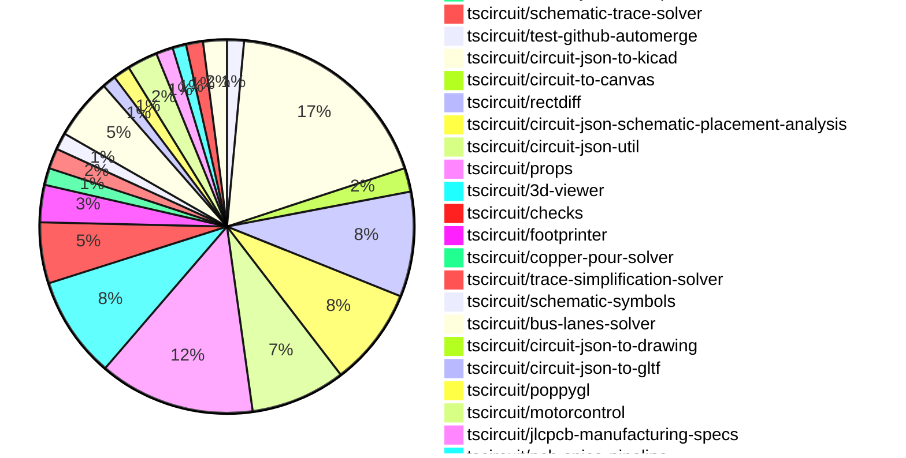

# contribution tracker

[contributions.tscircuit.com](https://contributions.tscircuit.com) ・ [tscircuit.com](https://tscircuit.com) ・ [Contribution Overviews](./contribution-overviews/) ・ [Changelogs](./changelogs/)

Generates weekly contribution overviews for tscircuit contributors. Check out all
the [contribution overviews here](./contribution-overviews/)
You can find AI-generated monthly changelogs in the [changelogs directory](./changelogs/)

- All PRs in the tscircuit org are scanned/summarized via an LLM
- The LLM classifies each Diff/PR as into a set of attributes for scoring
- All the PRs, summaries, and classifications are organized into charts and tables for [the website](https://contributions.tscircuit.com)

> Want to run locally? See the [Development Section](#development)

## Current Week

<!-- START_CURRENT_WEEK -->

# Contribution Overview 2026-10-20

The current week is shown below. There are 3 major sections:

- [Contributor Overview](#contributor-overview)
- [PRs by Repository](#prs-by-repository)
- [PRs by Contributor](#changes-by-contributor)
- [Scoring & Sponsorship Details](/docs/sponsorship-calculation-explanation.md)

## PRs by Repository

## Contributor Overview

| Contributor | 🐳 Major | 🐙 Minor | 🐌 Tiny | Score | ⭐ |
|-------------|---------|---------|---------|-------|-----|
| [seveibar](#seveibar) | 15 | 6 | 7 | 80 | ⭐⭐⭐ |
| [ShiboSoftwareDev](#ShiboSoftwareDev) | 5 | 0 | 3 | 35 | ⭐⭐ |
| [MustafaMulla29](#MustafaMulla29) | 2 | 5 | 15 | 31 | ⭐⭐ |
| [Abse2001](#Abse2001) | 1 | 6 | 8 | 30 | ⭐⭐ |
| [0hmX](#0hmX) | 5 | 1 | 3 | 26 | ⭐⭐ |
| [techmannih](#techmannih) | 5 | 1 | 1 | 24 | ⭐⭐ |
| [rushabhcodes](#rushabhcodes) | 0 | 7 | 5 | 20 | ⭐⭐ |
| [mohan-bee](#mohan-bee) | 1 | 4 | 5 | 20 | ⭐⭐ |
| [imrishabh18](#imrishabh18) | 2 | 1 | 3 | 14 | ⭐⭐ |
| [Devesh36](#Devesh36) | 0 | 5 | 3 | 14 | ⭐⭐ |
| [tscircuitbot](#tscircuitbot) | 0 | 0 | 237 | 12 | ⭐⭐ |
| [GokulPandi-M](#GokulPandi-M) | 2 | 1 | 2 | 12 | ⭐⭐ |
| [KrishnaX12](#KrishnaX12) | 1 | 0 | 1 | 5 | ⭐ |
| [AnasSarkiz](#AnasSarkiz) | 1 | 0 | 1 | 5 | ⭐ |
| [hrithik18k](#hrithik18k) | 0 | 0 | 3 | 3 |  |
| [anil08607](#anil08607) | 0 | 1 | 0 | 2 |  |

## Staff Pass Ratio (SPR)

| Contributor | Reviewed PRs | Rejections | Approvals | SPR |
|-------------|--------------|------------|-----------|-----|
| [Abse2001](#Abse2001) | 3 | 0 | 3 | 100.0% |
| [0hmX](#0hmX) | 2 | 0 | 2 | 100.0% |
| [MustafaMulla29](#MustafaMulla29) | 1 | 0 | 1 | 100.0% |
| [ShiboSoftwareDev](#ShiboSoftwareDev) | 1 | 0 | 1 | 100.0% |

Abse2001 SPR PRs (3)

- [#1090](https://github.com/tscircuit/pcb-viewer/pull/1090) Fix fabrication dimensions rendering on the wrong board side
- [#1063](https://github.com/tscircuit/3d-viewer/pull/1063) Fix green copper fallback on flex boards
- [#457](https://github.com/tscircuit/checks/pull/457) fix: check trace thickness against its own routed copper

0hmX SPR PRs (2)

- [#4765](https://github.com/tscircuit/core/pull/4765) Render external IBIS simulation declarations from TSX
- [#6](https://github.com/tscircuit/jlcpcb-manufacturing-specs/pull/6) Add JLCPCB physical stackups through 8 layers

MustafaMulla29 SPR PRs (1)

- [#338](https://github.com/tscircuit/circuit-json-schematic-placement-analysis/pull/338) Detect fuse connector misalignment

ShiboSoftwareDev SPR PRs (1)

- [#1108](https://github.com/tscircuit/pcb-viewer/pull/1108) Improve large-board interaction latency

> Note: AI evaluates PRs and assigns 1-3 star ratings automatically. 4 and 5 star ratings require manual staff review.

## Review Table

[reviews-received-hover]: ## "Number of reviews received for PRs for this contributor"
[approvals-received-hover]: ## "Number of approvals received for PRs this contributor authored"
[rejections-received-hover]: ## "Number of rejections received for PRs this contributor authored"
[prs-opened-hover]: ## "Number of PRs opened by this contributor"
[issues-created-hover]: ## "Number of issues created by this contributor"

| Contributor | Reviews Received | Approvals Received | Rejections Received | Approvals | Rejections Given | PRs Opened | PRs Merged | Issues Created |
|---|---|---|---|---|---|---|---|---|
| [0hmX](#0hmX) | 19 | 3 | 0 | 8 | 0 | 16 | 9 | 0 |
| [Abse2001](#Abse2001) | 7 | 7 | 0 | 6 | 0 | 21 | 15 | 0 |
| [agent-102](#agent-102) | 0 | 0 | 0 | 0 | 0 | 1 | 0 | 0 |
| [AnasSarkiz](#AnasSarkiz) | 2 | 2 | 0 | 0 | 0 | 3 | 2 | 0 |
| [anil08607](#anil08607) | 2 | 2 | 0 | 0 | 0 | 4 | 1 | 0 |
| [bacourosp](#bacourosp) | 0 | 0 | 0 | 0 | 0 | 2 | 0 | 0 |
| [Devesh36](#Devesh36) | 13 | 9 | 0 | 1 | 0 | 11 | 8 | 0 |
| [dinoksb](#dinoksb) | 0 | 0 | 0 | 0 | 0 | 2 | 0 | 0 |
| [duongynhi000005-oss](#duongynhi000005-oss) | 0 | 0 | 0 | 0 | 0 | 2 | 0 | 0 |
| [godgamerex3-boop](#godgamerex3-boop) | 0 | 0 | 0 | 0 | 0 | 4 | 0 | 0 |
| [GokulPandi-M](#GokulPandi-M) | 8 | 7 | 0 | 0 | 0 | 5 | 5 | 0 |
| [hrithik18k](#hrithik18k) | 14 | 6 | 4 | 0 | 0 | 10 | 3 | 0 |
| [imrishabh18](#imrishabh18) | 3 | 3 | 0 | 19 | 6 | 11 | 6 | 0 |
| [KrishnaX12](#KrishnaX12) | 4 | 3 | 0 | 0 | 0 | 5 | 2 | 0 |
| [Lingu17](#Lingu17) | 0 | 0 | 0 | 0 | 0 | 3 | 0 | 0 |
| [mohan-bee](#mohan-bee) | 8 | 4 | 4 | 4 | 0 | 34 | 10 | 0 |
| [MustafaMulla29](#MustafaMulla29) | 13 | 9 | 0 | 9 | 2 | 30 | 22 | 0 |
| [rushabhcodes](#rushabhcodes) | 34 | 7 | 0 | 3 | 0 | 22 | 12 | 0 |
| [seveibar](#seveibar) | 13 | 1 | 0 | 11 | 0 | 48 | 28 | 0 |
| [ShiboSoftwareDev](#ShiboSoftwareDev) | 4 | 4 | 0 | 12 | 0 | 32 | 8 | 0 |
| [Shmanya](#Shmanya) | 0 | 0 | 0 | 0 | 0 | 1 | 0 | 0 |
| [shubhook](#shubhook) | 0 | 0 | 0 | 0 | 0 | 1 | 0 | 0 |
| [techmannih](#techmannih) | 13 | 6 | 1 | 1 | 1 | 14 | 7 | 0 |
| [trixie010](#trixie010) | 1 | 1 | 0 | 0 | 0 | 3 | 0 | 0 |
| [tscircuitbot](#tscircuitbot) | 0 | 0 | 0 | 0 | 0 | 304 | 237 | 0 |

## Changes by Repository

### [tscircuit/pcb-viewer](https://github.com/tscircuit/pcb-viewer)

| PR # | Impact | Rating | Contributor | Description |
|------|--------|--------|-------------|-------------|
| [#1108](https://github.com/tscircuit/pcb-viewer/pull/1108) | 🐳 Major | ⭐⭐⭐ | ShiboSoftwareDev | Caches primitive and trace lookups instead of rescanning the full Circuit JSON during hover and navigation. Camera updates are also limited to one React update per animation frame. The spatial index preserves original primitive order, so overlapping same-layer hits keep their existing selection priority. Median of six fixed-build runs, compared with the three-run baseline, on the 100,548-element TMDS62LEVM fixture:  Interaction  Before  After  Speedup   ---  ---:  ---:  ---:   Hover  489 ms  58 ms  8.5   20 zoom events  1,366 ms  699 ms  2.0   20 drag steps  1,766 ms  384 ms  4.6   React render time during navigation  1,997 ms  90 ms  22.3 |
| [#1090](https://github.com/tscircuit/pcb-viewer/pull/1090) | 🐙 Minor | ⭐⭐ | Abse2001 | Fixes rendering issue where fabrication dimensions assigned to one board side were incorrectly displayed on the opposite side in the PCB viewer. |

🐌 Tiny Contributions (3)

| PR # | Impact | Contributor | Description |
|------|--------|-------------|-------------|
| [#1115](https://github.com/tscircuit/pcb-viewer/pull/1115) | 🐌 Tiny | tscircuitbot | Automated package update |
| [#1110](https://github.com/tscircuit/pcb-viewer/pull/1110) | 🐌 Tiny | tscircuitbot | Automated package update |
| [#1107](https://github.com/tscircuit/pcb-viewer/pull/1107) | 🐌 Tiny | ShiboSoftwareDev | Adds a browser benchmark using the full 100,548-element TMDS62LEVM board to measure interaction latency before optimization. |

### [tscircuit/tscircuit](https://github.com/tscircuit/tscircuit)

🐌 Tiny Contributions (63)

| PR # | Impact | Contributor | Description |
|------|--------|-------------|-------------|
| [#6000](https://github.com/tscircuit/tscircuit/pull/6000) | 🐌 Tiny | tscircuitbot | Updates the package version from 0.0.3002 to 0.0.3003 in package.json |
| [#5999](https://github.com/tscircuit/tscircuit/pull/5999) | 🐌 Tiny | tscircuitbot | Updates the tscircuitcli package version from 0.1.2399 to 0.1.2400 |
| [#5998](https://github.com/tscircuit/tscircuit/pull/5998) | 🐌 Tiny | tscircuitbot | Automated package update |
| [#5997](https://github.com/tscircuit/tscircuit/pull/5997) | 🐌 Tiny | tscircuitbot | Updates the tscircuitcli package from version 0.1.2398 to 0.1.2399 and the tscircuitrunframe package from version 0.0.3054 to 0.0.3055. |
| [#5996](https://github.com/tscircuit/tscircuit/pull/5996) | 🐌 Tiny | tscircuitbot | Automated package update |
| [#5995](https://github.com/tscircuit/tscircuit/pull/5995) | 🐌 Tiny | tscircuitbot | Automated package update |
| [#5994](https://github.com/tscircuit/tscircuit/pull/5994) | 🐌 Tiny | tscircuitbot | Automated package update |
| [#5993](https://github.com/tscircuit/tscircuit/pull/5993) | 🐌 Tiny | tscircuitbot | Updates the tscircuitcli package to version 0.1.2398 in the package.json file |
| [#5992](https://github.com/tscircuit/tscircuit/pull/5992) | 🐌 Tiny | tscircuitbot | Automated package update |
| [#5991](https://github.com/tscircuit/tscircuit/pull/5991) | 🐌 Tiny | tscircuitbot | Automated package update |
| [#5990](https://github.com/tscircuit/tscircuit/pull/5990) | 🐌 Tiny | tscircuitbot | Automated package update |
| [#5989](https://github.com/tscircuit/tscircuit/pull/5989) | 🐌 Tiny | tscircuitbot | Automated package update |
| [#5987](https://github.com/tscircuit/tscircuit/pull/5987) | 🐌 Tiny | tscircuitbot | Automated package update |
| [#5986](https://github.com/tscircuit/tscircuit/pull/5986) | 🐌 Tiny | tscircuitbot | Automated package update |
| [#5984](https://github.com/tscircuit/tscircuit/pull/5984) | 🐌 Tiny | tscircuitbot | Updates the tscircuitcli package to version 0.1.2395 in package.json |
| [#5983](https://github.com/tscircuit/tscircuit/pull/5983) | 🐌 Tiny | tscircuitbot | Automated package update |
| [#5979](https://github.com/tscircuit/tscircuit/pull/5979) | 🐌 Tiny | tscircuitbot | Automated package update |
| [#5978](https://github.com/tscircuit/tscircuit/pull/5978) | 🐌 Tiny | tscircuitbot | Updates the tscircuitcli package to version 0.1.2393 |
| [#5976](https://github.com/tscircuit/tscircuit/pull/5976) | 🐌 Tiny | tscircuitbot | Automated package update |
| [#5963](https://github.com/tscircuit/tscircuit/pull/5963) | 🐌 Tiny | tscircuitbot | Updates the tscircuitcli package to version 0.1.2390 |
| [#5959](https://github.com/tscircuit/tscircuit/pull/5959) | 🐌 Tiny | tscircuitbot | Automated package update |
| [#5958](https://github.com/tscircuit/tscircuit/pull/5958) | 🐌 Tiny | tscircuitbot | Updates the tscircuitcli package version from 0.1.2388 to 0.1.2389 |
| [#5956](https://github.com/tscircuit/tscircuit/pull/5956) | 🐌 Tiny | tscircuitbot | Updates the versions of several dependencies in the package.json file. |
| [#5954](https://github.com/tscircuit/tscircuit/pull/5954) | 🐌 Tiny | tscircuitbot | Automated package update |
| [#5953](https://github.com/tscircuit/tscircuit/pull/5953) | 🐌 Tiny | tscircuitbot | Automated package update |
| [#5952](https://github.com/tscircuit/tscircuit/pull/5952) | 🐌 Tiny | tscircuitbot | Updates the tscircuitcli package version from 0.1.2386 to 0.1.2387 |
| [#5951](https://github.com/tscircuit/tscircuit/pull/5951) | 🐌 Tiny | tscircuitbot | Automated package update |
| [#5950](https://github.com/tscircuit/tscircuit/pull/5950) | 🐌 Tiny | tscircuitbot | Automated package update |
| [#5948](https://github.com/tscircuit/tscircuit/pull/5948) | 🐌 Tiny | tscircuitbot | Updates the tscircuitcli package to version 0.1.2386 |
| [#5944](https://github.com/tscircuit/tscircuit/pull/5944) | 🐌 Tiny | tscircuitbot | Updates the tscircuitcli package to version 0.1.2385 |
| [#5942](https://github.com/tscircuit/tscircuit/pull/5942) | 🐌 Tiny | tscircuitbot | Automated package update |
| [#5940](https://github.com/tscircuit/tscircuit/pull/5940) | 🐌 Tiny | tscircuitbot | Updates the tscircuitcli package to version 0.1.2384 |
| [#5938](https://github.com/tscircuit/tscircuit/pull/5938) | 🐌 Tiny | tscircuitbot | Updates the tscircuitcli package from version 0.1.2382 to 0.1.2383 and the tscircuitrunframe package from version 0.0.3033 to 0.0.3034 in package.json |
| [#5937](https://github.com/tscircuit/tscircuit/pull/5937) | 🐌 Tiny | tscircuitbot | Automated package update |
| [#5985](https://github.com/tscircuit/tscircuit/pull/5985) | 🐌 Tiny | tscircuitbot | Automated package update |
| [#5980](https://github.com/tscircuit/tscircuit/pull/5980) | 🐌 Tiny | tscircuitbot | Automated package update |
| [#5975](https://github.com/tscircuit/tscircuit/pull/5975) | 🐌 Tiny | tscircuitbot | Automated package update |
| [#5973](https://github.com/tscircuit/tscircuit/pull/5973) | 🐌 Tiny | tscircuitbot | Automated package update |
| [#5971](https://github.com/tscircuit/tscircuit/pull/5971) | 🐌 Tiny | tscircuitbot | Automated package update |
| [#5970](https://github.com/tscircuit/tscircuit/pull/5970) | 🐌 Tiny | tscircuitbot | Updates the tscircuitcli package to version 0.1.2392 |
| [#5969](https://github.com/tscircuit/tscircuit/pull/5969) | 🐌 Tiny | tscircuitbot | Automated package update |
| [#5968](https://github.com/tscircuit/tscircuit/pull/5968) | 🐌 Tiny | tscircuitbot | Automated package update |
| [#5965](https://github.com/tscircuit/tscircuit/pull/5965) | 🐌 Tiny | tscircuitbot | Automated package update |
| [#5964](https://github.com/tscircuit/tscircuit/pull/5964) | 🐌 Tiny | tscircuitbot | Automated package update |
| [#5962](https://github.com/tscircuit/tscircuit/pull/5962) | 🐌 Tiny | tscircuitbot | Automated package update |
| [#5961](https://github.com/tscircuit/tscircuit/pull/5961) | 🐌 Tiny | tscircuitbot | Automated package update |
| [#5957](https://github.com/tscircuit/tscircuit/pull/5957) | 🐌 Tiny | tscircuitbot | Automated package update |
| [#5949](https://github.com/tscircuit/tscircuit/pull/5949) | 🐌 Tiny | tscircuitbot | Automated package update |
| [#5945](https://github.com/tscircuit/tscircuit/pull/5945) | 🐌 Tiny | tscircuitbot | Automated package update |
| [#5943](https://github.com/tscircuit/tscircuit/pull/5943) | 🐌 Tiny | tscircuitbot | Automated package update |
| [#5941](https://github.com/tscircuit/tscircuit/pull/5941) | 🐌 Tiny | tscircuitbot | Automated package update |
| [#5939](https://github.com/tscircuit/tscircuit/pull/5939) | 🐌 Tiny | tscircuitbot | Automated package update |
| [#5936](https://github.com/tscircuit/tscircuit/pull/5936) | 🐌 Tiny | tscircuitbot | Automated package update |
| [#5982](https://github.com/tscircuit/tscircuit/pull/5982) | 🐌 Tiny | tscircuitbot | Updates the tscircuitcli package from version 0.1.2393 to 0.1.2394 |
| [#5981](https://github.com/tscircuit/tscircuit/pull/5981) | 🐌 Tiny | tscircuitbot | Automated package update |
| [#5967](https://github.com/tscircuit/tscircuit/pull/5967) | 🐌 Tiny | tscircuitbot | Automated package update |
| [#5966](https://github.com/tscircuit/tscircuit/pull/5966) | 🐌 Tiny | tscircuitbot | Updates the tscircuitcli package to version 0.1.2391 |
| [#5955](https://github.com/tscircuit/tscircuit/pull/5955) | 🐌 Tiny | tscircuitbot | Automated package update |
| [#5947](https://github.com/tscircuit/tscircuit/pull/5947) | 🐌 Tiny | tscircuitbot | Automated package update |
| [#5946](https://github.com/tscircuit/tscircuit/pull/5946) | 🐌 Tiny | tscircuitbot | Automated package update |
| [#5972](https://github.com/tscircuit/tscircuit/pull/5972) | 🐌 Tiny | MustafaMulla29 | Updates the dependencies for tscircuitcore, tscircuiteval, and tscircuitchecks to their latest versions. |
| [#5960](https://github.com/tscircuit/tscircuit/pull/5960) | 🐌 Tiny | MustafaMulla29 | Updates the tscircuitcircuit-json-util dependency from version 0.0.123 to 0.0.125, incorporating the isRouteViaCoveredByPhysicalVia helper for enhanced functionality in subsequent releases. |
| [#5974](https://github.com/tscircuit/tscircuit/pull/5974) | 🐌 Tiny | MustafaMulla29 | Update tscircuitcircuit-json-util from 0.0.123 to 0.0.126 and refresh the Bun lockfile, resolving parsel-js dependency from 1.2.2 to 1.2.3. |

### [tscircuit/circuit-json](https://github.com/tscircuit/circuit-json)

| PR # | Impact | Rating | Contributor | Description |
|------|--------|--------|-------------|-------------|
| [#918](https://github.com/tscircuit/circuit-json/pull/918) | 🐳 Major | ⭐⭐⭐ | seveibar | Proposes configuration-only drawing_page, drawing_part_view, and drawing_page_title_block elements. Pages contain numeric mm dimensions and optional ISO A0A4  ANSI AE size and orientation metadata; dimensions must match a named size. Custom dimensions remain supported. Part views reference a page and optional source groupcomponents, with camera direction, paper viewport, scale, hidden edges and section-plane configuration. Title blocks carry document metadata and a page reference, with positive sheet counts and numbering validation. No drawing_artifact, images, model URLs, or exporter-output records. References: ISO 5457  ASME Y14.1 for sheets, ISO 7200:2004 for title-block metadata, and Autodesks documented sheet dimensions. Documentation links the standards and distinguishes interoperability conventions from full template compliance. All enum values use snake_case. Also keeps Zod available as a runtime dependency. Validation: 502 tests, build, typecheck, Zod lint, snake_case checks, generated documentation, and one visual snapshot per new drawing test file. Consumers: https:github.comtscircuitpropspull951 and https:github.comtscircuitcircuit-json-to-drawingpull1. |
| [#911](https://github.com/tscircuit/circuit-json/pull/911) | 🐳 Major | ⭐⭐⭐ | 0hmX | Adds a new pcb_stackup element to Circuit JSON for carrying resolved physical layer data alongside the board, allowing consumers to access material properties without needing to re-resolve templates or read side files. |

🐌 Tiny Contributions (5)

| PR # | Impact | Contributor | Description |
|------|--------|-------------|-------------|
| [#920](https://github.com/tscircuit/circuit-json/pull/920) | 🐌 Tiny | tscircuitbot | Automated package update |
| [#916](https://github.com/tscircuit/circuit-json/pull/916) | 🐌 Tiny | tscircuitbot | Automated package update |
| [#915](https://github.com/tscircuit/circuit-json/pull/915) | 🐌 Tiny | tscircuitbot | Automated package update |
| [#913](https://github.com/tscircuit/circuit-json/pull/913) | 🐌 Tiny | Abse2001 | Adds optional footprint origin to PCB components, allowing for independent placement from copper bounds while maintaining backward compatibility with older records. |
| [#914](https://github.com/tscircuit/circuit-json/pull/914) | 🐌 Tiny | Abse2001 | Adds optional footprint origin to PCB components, allowing for independent placement from copper bounds while maintaining existing semantics. |

### [tscircuit/core](https://github.com/tscircuit/core)

| PR # | Impact | Rating | Contributor | Description |
|------|--------|--------|-------------|-------------|
| [#4807](https://github.com/tscircuit/core/pull/4807) | 🐳 Major | ⭐⭐⭐ | Abse2001 | Preserves authored footprint origins for CAD placement, ensuring accurate positioning of components during layout. |
| [#4631](https://github.com/tscircuit/core/pull/4631) | 🐳 Major | ⭐⭐⭐ | seveibar | Adds a core implementation of assembly.explosion.stage and assembly.explosion.move, including multi-target moves and rendered constrained-assembly examples. The upstream props and PoppyGL changes are merged. This PR uses their published npm releases.  Multiple targets targetRefs accepts either a comma-separated string or an array: tsx assembly.explosion.move targetRefsshade, collar offZ60mm  assembly.explosion.move targetRefsshade, collar offZ60mm   Props trims and normalizes either form to targetRefs: string. Existing targetRef remains a single-target input alias; supply exactly one selector prop. Core resolves and validates every target before evaluating progress, then moves the union of the selected subtrees using one displacement in the stage owners frame. Duplicate references and overlapping parentchild selections move each part and reference surface only once. Each distinct selected target gets its own guide, anchored before the instruction moves any target. Model-less container centroids include prior independent movements of their children. All targets share the instructions progress, and evaluation leaves assembled Circuit JSON and props unchanged. !Comma-separated and array targets, shared progress, and legacy compatibility(https:raw.githubusercontent.comtscircuitcoreb16362715bac0d1e544dc2b51eb785e44770bb66testsassembly__snapshots__assembly-explosion-target-refs-annotated.snap.png)  Staged rendering getAssemblyExplosion(circuit,  throughStageRef?, stageProgress? ) derives an immutable CAD view after mounting constraints resolve. Stages use a stable topological sort with authored order as fallback; missingambiguous references, cycles, duplicate stages, and invalid move targets produce named diagnostics. Parent movement carries descendant CAD and reference-surface centers. Repeated evaluation and backward scrubbing reconstruct the assembled starting state. Existing examples lift an intact constrained cover, move it aside, and then remove its cap in the displaced subassembly frame. Frame tests cover upright, inverted, and tilted mounts against emitted reference directions, with guide endpoints checked against emitted GLTF translations. Run bun scriptsrender-assembly-explosion.tsx workassembly-explosion-preview to export those four PNGGLBJSON states.  Dependencies tscircuitprops: 0.0.707 in dev dependencies and overrides, including the merged stagemove API and targetRefs normalization. poppygl: 0.0.36, including the merged explosion guide and arrow APIs. Updated with main and resolved the package conflict. The existing dependency check is preserved and passes with these registry versions. The compatibility refresh also removes the unsupported write: false option from the existing Bun browser-bundle test; it continues to inspect the returned bundle without an output directory.  Validation 69 assembly regressions and 4 namespaced assembly regressions pass (73 total), using Bun 1.4.0 and the published npm packages. Three new tests cover stringarraylegacy selectors, shared progress, overlap and duplicate handling in a mounted frame, reference-surface translation without orientation changes, pre-move centroids, and validation of later-stage targets. Both new annotated visual snapshots were inspected and pass on comparison. Full CI is green on the updated branch: all ten test groups, full typecheck, dependency check, distribution smoke tests, package preview build, and deployment. Local package build (including declarations), 73 assemblynamespaced regressions, browser-bundle regression, changed-TypeScript formatting, and feature diff checks pass. Behavior and approval tracking are documented in docsassembly-explosion.md. This prototype supports mechanical CAD translations and rejects PCBcable-containing targets. Swept-path collision verification remains unimplemented (collisionCheckStatus: not_implemented); diagrams do not certify assembly clearance. |
| [#4834](https://github.com/tscircuit/core/pull/4834) | 🐳 Major | ⭐⭐⭐ | seveibar | Updates props to 0.0.706 and consumes platform.autorouterThreads for local Pipeline9 routing, enabling worker-backed solveAsync for routing with counts above one, while retaining existing paths for counts of one or omitted. |
| [#4833](https://github.com/tscircuit/core/pull/4833) | 🐳 Major | ⭐⭐⭐ | seveibar | Fixes the omission of bus minLength and maxLength from source_bus and router input, ensuring proper routing constraints are applied. |
| [#4765](https://github.com/tscircuit/core/pull/4765) | 🐳 Major | ⭐⭐⭐ | 0hmX | Add native TSX declarations for IBIS models, binary traffic, and eye requests, exporting them as Circuit JSON for the local PCB extractionSPICE runner. Existing spiceEnginepcb_spice selects that backend; no executionMode prop or execution_mode record field is introduced. The built-in render phase skips that backend while native experiments continue to execute. Models use the shared Asset object and explicit vendor componentpinmodel names. Core maps port labels to physical source_port_id values, translates Boolean directionoutput-enable states, and preserves the requested IBIS data column and package parasitics choice. Reference roles identify physical supplyclamp ports. Duplicate physical pin mappings, unmapped referencemodel keys, stimuli without an enabled output, and pin states without exactly one model binding are rejected. Model binding validation runs after all declarations render, so JSX order does not matter. Dependencies  merge order: https:github.comtscircuitcircuit-jsonpull908, https:github.comtscircuitpropspull945, then this PR. The verified preview pins must be replaced with published versions before merging. The repository dependency guard remains unchanged. Validation: all 43 targeted simulation tests pass, including eight IBIS integration tests and a PCB snapshot. Schemaprops suites pass (479 and 687 tests). Independent Opus review confirmed the schema review changes and both additional pin-binding fixes. TypeScript and the package build (ESM and declarations) pass. GitHub build, smoke-test, type-check, and all ten test shards pass. No new enums, ternaries, docs, or README edits are included. Rendering does not fetch assets, install tools, or execute external solvers. CLIlocal-runner wiring and CSVHTML result commands remain follow-ups. No Python or solver binaries are added; the prototype backends three-selected-trace limit is unchanged. |
| [#4843](https://github.com/tscircuit/core/pull/4843) | 🐳 Major | ⭐⭐⭐ | GokulPandi-M | Adopts skew-tolerant pin 1 analysis for two-pad footprints to ensure accurate orientation detection in LED and diode components. |
| [#4763](https://github.com/tscircuit/core/pull/4763) | 🐳 Major | ⭐⭐⭐ | KrishnaX12 | Watchys J3 display connector has distinct physical pins 8 and 17 labelled GND. The full circuit routes copper, but autorouting:end omits pcbTracePaths and reports PCB port selector is not unique: .J3  port.GND. Includes the full PCBelectrical circuit from my Watchy v1.2.12 board(https:tscircuit.comkrishnax12watchy-eink-smartwatchreleases2b57e298-6436-4480-8eff-a1421b557830), alongside the original two-pad reduction. The self-contained TSX fixture retains the full circuit, footprints, wiring, board outline, pours and keepouts. J2 is moved from the right edge to the clear left-edge position (-12, 0), rotated 270, to resolve its out-of-board placement error without disabling placement checks; all other component placements and J3 pin labels are unchanged. STEP models and the non-electrical display assembly are omitted. The full circuit is kept in one fixture file alongside its test and PCB snapshot. The full-board test uses the normal autorouter, verifies that J3 has two GND ports and that copper was generated, and asserts the actual export failure. Its PCB snapshot displays that emitted error. routeRemaining enables the full route. Placement checks remain enabled, and the test asserts there are no component-outside-board or autorouting errors. It does not claim all post-routing manufacturing checks pass. No production code or dependencies are changed. Validation: Full Watchy reproduction and existing minimal reproduction pass. Biome, TypeScript, build and diff checks pass. Full-board PCB snapshot rendered and visually inspected. Run: bun test testsreprosrepro-watchy-duplicate-ground-label-path-export.test.tsx. Fix: 4764. Merge this reproduction first; the fixs exportreplay assertions must then be rebased over these failure assertions. |
| [#4541](https://github.com/tscircuit/core/pull/4541) | 🐳 Major | ⭐⭐⭐ | mohan-bee | Fixes PCB trace saving failure when using custom schematic symbols by correcting the port selector logic. |
| [#4812](https://github.com/tscircuit/core/pull/4812) | 🐙 Minor | ⭐⭐ | MustafaMulla29 | Reproduces inline schematic text positions for labels away from their wires in the TB67S579FTG breakout, validating current behavior with comprehensive tests and snapshots. |
| [#4811](https://github.com/tscircuit/core/pull/4811) | 🐙 Minor | ⭐⭐ | MustafaMulla29 | Saves inline text positions on schematic wires, preserving alignment and relationships, while updating the schematic-trace-solver dependency. |
| [#4826](https://github.com/tscircuit/core/pull/4826) | 🐙 Minor | ⭐⭐ | 0hmX | Resolves JLCPCB stackups from fabricatorPreset and the boards layer count, thickness, and material using tscircuitjlcpcb-manufacturing-specs, ensuring proper stackup handling for imported boards and maintaining existing construction data. |
| [#4831](https://github.com/tscircuit/core/pull/4831) | 🐙 Minor | ⭐⭐ | rushabhcodes | Fixes the issue where polygon plated holes did not retain their rotation during Circuit JSON reconstruction, ensuring correct rendering and alignment with the chips rotation. |
| [#4830](https://github.com/tscircuit/core/pull/4830) | 🐙 Minor | ⭐⭐ | rushabhcodes | Reproduces a bug where polygon plated-hole pads do not retain correct rotation, leading to copper misalignment with the silkscreen outline. |
| [#4818](https://github.com/tscircuit/core/pull/4818) | 🐙 Minor | ⭐⭐ | Devesh36 | Fixes polygon-pad overlap in PCB flex layout by accurately calculating bounds for nonrectangular polygons and circular primitives, ensuring proper spacing between pads. |
| [#4816](https://github.com/tscircuit/core/pull/4816) | 🐙 Minor | ⭐⭐ | Devesh36 | Fixes the LED outline rotation reproduced in 4622, ensuring that rotating LED footprints also rotates their corresponding silkscreen rectangles correctly. |
| [#4817](https://github.com/tscircuit/core/pull/4817) | 🐙 Minor | ⭐⭐ | Devesh36 | Fixes the connector mounting-slot rotation reproduced in 4623, ensuring vertical mounting slots align with silkscreen guides and pads when a connector is rotated 90. |
| [#4699](https://github.com/tscircuit/core/pull/4699) | 🐙 Minor | ⭐⭐ | mohan-bee | Fixes the issue where metal-lined connector holes in four-layer boards inside panels do not connect to the inner copper layers, only recording the top and bottom layers. |
| [#4700](https://github.com/tscircuit/core/pull/4700) | 🐙 Minor | ⭐⭐ | mohan-bee | Reproduces missing inner copper layers on plated connector holes inside native panels, ensuring that both inner and outer layers are correctly represented in the test. |

🐌 Tiny Contributions (13)

| PR # | Impact | Contributor | Description |
|------|--------|-------------|-------------|
| [#4808](https://github.com/tscircuit/core/pull/4808) | 🐌 Tiny | tscircuitbot | Updates the version of the tscircuitchecks package from 0.0.258 to 0.0.259 in package.json |
| [#4822](https://github.com/tscircuit/core/pull/4822) | 🐌 Tiny | tscircuitbot | Updates the version of the tscircuitchecks package from 0.0.260 to 0.0.261 in package.json |
| [#4820](https://github.com/tscircuit/core/pull/4820) | 🐌 Tiny | tscircuitbot | Updates the version of the tscircuitchecks package from 0.0.259 to 0.0.260 in package.json |
| [#4819](https://github.com/tscircuit/core/pull/4819) | 🐌 Tiny | tscircuitbot | Updates the version of the tscircuitchecks package from 0.0.259 to 0.0.260 in package.json |
| [#4809](https://github.com/tscircuit/core/pull/4809) | 🐌 Tiny | tscircuitbot | Updates the version of the tscircuitchecks package from 0.0.258 to 0.0.259 in package.json |
| [#4810](https://github.com/tscircuit/core/pull/4810) | 🐌 Tiny | seveibar | Updates tscircuitcapacity-autorouter from 0.0.988 to 0.0.996, bringing in the released Pipeline9 SolverRuntime support from tscircuittscircuit-autorouter3125. |
| [#4805](https://github.com/tscircuit/core/pull/4805) | 🐌 Tiny | seveibar | Updates the bundled tscircuitbus-lanes-solver from version 0.0.21 to 0.0.27, incorporating fixes for AM3352 byte routing stalls and default-layer escapes. |
| [#4825](https://github.com/tscircuit/core/pull/4825) | 🐌 Tiny | rushabhcodes | Updates circuit-to-svg to version 0.0.453, fixing rotated polygon plated holes and PCB bounds for traces containing vias, and refreshes SVG snapshots for display-label and SOIC8 fanout phase. |
| [#4838](https://github.com/tscircuit/core/pull/4838) | 🐌 Tiny | techmannih | Updates tscircuitcapacity-autorouter from 0.0.996 to 0.0.999, matching autorouter main. |
| [#4673](https://github.com/tscircuit/core/pull/4673) | 🐌 Tiny | Devesh36 | Reproduces a bug where the PCB note rectangle does not rotate with its parent chip, demonstrating the issue with a test case and snapshot. |
| [#4814](https://github.com/tscircuit/core/pull/4814) | 🐌 Tiny | mohan-bee | Updates the schematic trace solver dependency from version 0.0.230 to 0.0.236. |
| [#4815](https://github.com/tscircuit/core/pull/4815) | 🐌 Tiny | mohan-bee | Updates the tscircuitmatchpack dependency to version 0.0.100 in the package.json file. |
| [#4540](https://github.com/tscircuit/core/pull/4540) | 🐌 Tiny | mohan-bee | Reproduces the saved PCB path export failure observed with the LoRaLink custom schematic symbol. |

### [tscircuit/tscircuit.com](https://github.com/tscircuit/tscircuit.com)

| PR # | Impact | Rating | Contributor | Description |
|------|--------|--------|-------------|-------------|
| [#5553](https://github.com/tscircuit/tscircuit.com/pull/5553) | 🐳 Major | ⭐⭐⭐ | seveibar | Package 3D previews now prefer the selected releases 3d.glb file instead of downloading individual CAD models, improving efficiency and performance. |
| [#5495](https://github.com/tscircuit/tscircuit.com/pull/5495) | 🐙 Minor | ⭐⭐ | anil08607 | Fixes the issue where downloading a hierarchical KiCad project only included the root schematic file, ensuring all child schematic sheets are included in the download. |

🐌 Tiny Contributions (27)

| PR # | Impact | Contributor | Description |
|------|--------|-------------|-------------|
| [#5558](https://github.com/tscircuit/tscircuit.com/pull/5558) | 🐌 Tiny | tscircuitbot | Automated package update |
| [#5557](https://github.com/tscircuit/tscircuit.com/pull/5557) | 🐌 Tiny | tscircuitbot | Automated package update |
| [#5555](https://github.com/tscircuit/tscircuit.com/pull/5555) | 🐌 Tiny | tscircuitbot | Automated package update |
| [#5552](https://github.com/tscircuit/tscircuit.com/pull/5552) | 🐌 Tiny | tscircuitbot | Automated package update |
| [#5551](https://github.com/tscircuit/tscircuit.com/pull/5551) | 🐌 Tiny | tscircuitbot | Updates the tscircuiteval package from version 0.0.1650 to 0.0.1652. |
| [#5549](https://github.com/tscircuit/tscircuit.com/pull/5549) | 🐌 Tiny | tscircuitbot | Automated package update |
| [#5547](https://github.com/tscircuit/tscircuit.com/pull/5547) | 🐌 Tiny | tscircuitbot | Automated package update |
| [#5546](https://github.com/tscircuit/tscircuit.com/pull/5546) | 🐌 Tiny | tscircuitbot | Updates the tscircuitrunframe package to version 0.0.3047 |
| [#5519](https://github.com/tscircuit/tscircuit.com/pull/5519) | 🐌 Tiny | tscircuitbot | Updates the tscircuiteval package from version 0.0.1640 to 0.0.1641 |
| [#5542](https://github.com/tscircuit/tscircuit.com/pull/5542) | 🐌 Tiny | tscircuitbot | Updates the tscircuitrunframe package version from 0.0.3044 to 0.0.3046 |
| [#5540](https://github.com/tscircuit/tscircuit.com/pull/5540) | 🐌 Tiny | tscircuitbot | Automated package update |
| [#5534](https://github.com/tscircuit/tscircuit.com/pull/5534) | 🐌 Tiny | tscircuitbot | Automated package update |
| [#5531](https://github.com/tscircuit/tscircuit.com/pull/5531) | 🐌 Tiny | tscircuitbot | Updates the tscircuitrunframe package from version 0.0.3038 to 0.0.3039 |
| [#5528](https://github.com/tscircuit/tscircuit.com/pull/5528) | 🐌 Tiny | tscircuitbot | Updates the tscircuiteval package from version 0.0.1643 to 0.0.1644 in the package.json file. |
| [#5526](https://github.com/tscircuit/tscircuit.com/pull/5526) | 🐌 Tiny | tscircuitbot | Updates the tscircuiteval package from version 0.0.1642 to 0.0.1643 |
| [#5524](https://github.com/tscircuit/tscircuit.com/pull/5524) | 🐌 Tiny | tscircuitbot | Updates the tscircuitrunframe package to version 0.0.3035 |
| [#5541](https://github.com/tscircuit/tscircuit.com/pull/5541) | 🐌 Tiny | tscircuitbot | Updates the tscircuiteval package from version 0.0.1649 to 0.0.1650 |
| [#5539](https://github.com/tscircuit/tscircuit.com/pull/5539) | 🐌 Tiny | tscircuitbot | Automated package update |
| [#5537](https://github.com/tscircuit/tscircuit.com/pull/5537) | 🐌 Tiny | tscircuitbot | Updates the tscircuitrunframe package from version 0.0.3042 to 0.0.3043 |
| [#5536](https://github.com/tscircuit/tscircuit.com/pull/5536) | 🐌 Tiny | tscircuitbot | Updates the tscircuitrunframe package from version 0.0.3041 to 0.0.3042 |
| [#5533](https://github.com/tscircuit/tscircuit.com/pull/5533) | 🐌 Tiny | tscircuitbot | Automated package update |
| [#5530](https://github.com/tscircuit/tscircuit.com/pull/5530) | 🐌 Tiny | tscircuitbot | Updates the tscircuiteval package from version 0.0.1644 to 0.0.1645 |
| [#5529](https://github.com/tscircuit/tscircuit.com/pull/5529) | 🐌 Tiny | tscircuitbot | Updates the tscircuitrunframe package from version 0.0.3036 to 0.0.3038 |
| [#5525](https://github.com/tscircuit/tscircuit.com/pull/5525) | 🐌 Tiny | tscircuitbot | Automated package update |
| [#5523](https://github.com/tscircuit/tscircuit.com/pull/5523) | 🐌 Tiny | tscircuitbot | Automated package update |
| [#5522](https://github.com/tscircuit/tscircuit.com/pull/5522) | 🐌 Tiny | tscircuitbot | Updates the tscircuiteval package from version 0.0.1641 to 0.0.1642 |
| [#5521](https://github.com/tscircuit/tscircuit.com/pull/5521) | 🐌 Tiny | tscircuitbot | Automated package update |

### [tscircuit/eval](https://github.com/tscircuit/eval)

🐌 Tiny Contributions (28)

| PR # | Impact | Contributor | Description |
|------|--------|-------------|-------------|
| [#5374](https://github.com/tscircuit/eval/pull/5374) | 🐌 Tiny | tscircuitbot | Automated package update |
| [#5373](https://github.com/tscircuit/eval/pull/5373) | 🐌 Tiny | tscircuitbot | Automated package update |
| [#5371](https://github.com/tscircuit/eval/pull/5371) | 🐌 Tiny | tscircuitbot | Automated package update |
| [#5370](https://github.com/tscircuit/eval/pull/5370) | 🐌 Tiny | tscircuitbot | Automated package update |
| [#5368](https://github.com/tscircuit/eval/pull/5368) | 🐌 Tiny | tscircuitbot | Automated package update |
| [#5367](https://github.com/tscircuit/eval/pull/5367) | 🐌 Tiny | tscircuitbot | Updates the version of the tscircuitcore package from 0.0.2191 to 0.0.2192 in package.json |
| [#5365](https://github.com/tscircuit/eval/pull/5365) | 🐌 Tiny | tscircuitbot | Automated package update |
| [#5364](https://github.com/tscircuit/eval/pull/5364) | 🐌 Tiny | tscircuitbot | Automated package update |
| [#5362](https://github.com/tscircuit/eval/pull/5362) | 🐌 Tiny | tscircuitbot | Automated package update |
| [#5358](https://github.com/tscircuit/eval/pull/5358) | 🐌 Tiny | tscircuitbot | Automated package update |
| [#5356](https://github.com/tscircuit/eval/pull/5356) | 🐌 Tiny | tscircuitbot | Automated package update |
| [#5352](https://github.com/tscircuit/eval/pull/5352) | 🐌 Tiny | tscircuitbot | Automated package update |
| [#5361](https://github.com/tscircuit/eval/pull/5361) | 🐌 Tiny | tscircuitbot | Automated package update |
| [#5359](https://github.com/tscircuit/eval/pull/5359) | 🐌 Tiny | tscircuitbot | Automated package update |
| [#5355](https://github.com/tscircuit/eval/pull/5355) | 🐌 Tiny | tscircuitbot | Automated package update |
| [#5351](https://github.com/tscircuit/eval/pull/5351) | 🐌 Tiny | tscircuitbot | Updates package dependencies to their latest versions as part of routine maintenance. |
| [#5349](https://github.com/tscircuit/eval/pull/5349) | 🐌 Tiny | tscircuitbot | Automated package update |
| [#5348](https://github.com/tscircuit/eval/pull/5348) | 🐌 Tiny | tscircuitbot | Updates the version of the tscircuitcore package from 0.0.2184 to 0.0.2185 in package.json |
| [#5346](https://github.com/tscircuit/eval/pull/5346) | 🐌 Tiny | tscircuitbot | Automated package update |
| [#5345](https://github.com/tscircuit/eval/pull/5345) | 🐌 Tiny | tscircuitbot | Automated package update |
| [#5343](https://github.com/tscircuit/eval/pull/5343) | 🐌 Tiny | tscircuitbot | Automated package update |
| [#5342](https://github.com/tscircuit/eval/pull/5342) | 🐌 Tiny | tscircuitbot | Automated package update |
| [#5340](https://github.com/tscircuit/eval/pull/5340) | 🐌 Tiny | tscircuitbot | Automated package update |
| [#5339](https://github.com/tscircuit/eval/pull/5339) | 🐌 Tiny | tscircuitbot | Updates package dependencies to their latest versions as part of routine maintenance. |
| [#5337](https://github.com/tscircuit/eval/pull/5337) | 🐌 Tiny | tscircuitbot | Automated package update |
| [#5336](https://github.com/tscircuit/eval/pull/5336) | 🐌 Tiny | tscircuitbot | Automated package update |
| [#5334](https://github.com/tscircuit/eval/pull/5334) | 🐌 Tiny | tscircuitbot | Automated package update |
| [#5333](https://github.com/tscircuit/eval/pull/5333) | 🐌 Tiny | tscircuitbot | Updates the version of the tscircuitcore package from 0.0.2179 to 0.0.2180 in package.json |

### [tscircuit/runframe](https://github.com/tscircuit/runframe)

🐌 Tiny Contributions (46)

| PR # | Impact | Contributor | Description |
|------|--------|-------------|-------------|
| [#5884](https://github.com/tscircuit/runframe/pull/5884) | 🐌 Tiny | tscircuitbot | Automated package update |
| [#5883](https://github.com/tscircuit/runframe/pull/5883) | 🐌 Tiny | tscircuitbot | Updates the circuit-json-to-kicad package version from 0.0.248 to 0.0.249 in package.json |
| [#5881](https://github.com/tscircuit/runframe/pull/5881) | 🐌 Tiny | tscircuitbot | Automated package update |
| [#5880](https://github.com/tscircuit/runframe/pull/5880) | 🐌 Tiny | tscircuitbot | Updates the tscircuiteval package from version 0.0.1653 to 0.0.1654 |
| [#5878](https://github.com/tscircuit/runframe/pull/5878) | 🐌 Tiny | tscircuitbot | Automated package update |
| [#5877](https://github.com/tscircuit/runframe/pull/5877) | 🐌 Tiny | tscircuitbot | Updates the tscircuiteval package from version 0.0.1652 to 0.0.1653 |
| [#5876](https://github.com/tscircuit/runframe/pull/5876) | 🐌 Tiny | tscircuitbot | Automated package update |
| [#5875](https://github.com/tscircuit/runframe/pull/5875) | 🐌 Tiny | tscircuitbot | Updates the tscircuiteval package from version 0.0.1651 to 0.0.1652 |
| [#5874](https://github.com/tscircuit/runframe/pull/5874) | 🐌 Tiny | tscircuitbot | Automated package update |
| [#5873](https://github.com/tscircuit/runframe/pull/5873) | 🐌 Tiny | tscircuitbot | Automated package update |
| [#5872](https://github.com/tscircuit/runframe/pull/5872) | 🐌 Tiny | tscircuitbot | Automated package update |
| [#5871](https://github.com/tscircuit/runframe/pull/5871) | 🐌 Tiny | tscircuitbot | Automated package update |
| [#5870](https://github.com/tscircuit/runframe/pull/5870) | 🐌 Tiny | tscircuitbot | Automated package update |
| [#5869](https://github.com/tscircuit/runframe/pull/5869) | 🐌 Tiny | tscircuitbot | Automated package update |
| [#5868](https://github.com/tscircuit/runframe/pull/5868) | 🐌 Tiny | tscircuitbot | Automated package update |
| [#5867](https://github.com/tscircuit/runframe/pull/5867) | 🐌 Tiny | tscircuitbot | Updates the tscircuitpcb-viewer package to version 1.11.431 |
| [#5848](https://github.com/tscircuit/runframe/pull/5848) | 🐌 Tiny | tscircuitbot | Updates the tscircuiteval package from version 0.0.1644 to 0.0.1645 |
| [#5840](https://github.com/tscircuit/runframe/pull/5840) | 🐌 Tiny | tscircuitbot | Automated package update |
| [#5866](https://github.com/tscircuit/runframe/pull/5866) | 🐌 Tiny | tscircuitbot | Automated package update |
| [#5865](https://github.com/tscircuit/runframe/pull/5865) | 🐌 Tiny | tscircuitbot | Updates the tscircuiteval package from version 0.0.1649 to 0.0.1650 in the package.json file. |
| [#5864](https://github.com/tscircuit/runframe/pull/5864) | 🐌 Tiny | tscircuitbot | Automated package update |
| [#5863](https://github.com/tscircuit/runframe/pull/5863) | 🐌 Tiny | tscircuitbot | Updates the tscircuiteval package from version 0.0.1647 to 0.0.1649 in the package.json file. |
| [#5862](https://github.com/tscircuit/runframe/pull/5862) | 🐌 Tiny | tscircuitbot | Automated package update |
| [#5861](https://github.com/tscircuit/runframe/pull/5861) | 🐌 Tiny | tscircuitbot | Updates the circuit-json-to-kicad package version from 0.0.246 to 0.0.248 in package.json |
| [#5858](https://github.com/tscircuit/runframe/pull/5858) | 🐌 Tiny | tscircuitbot | Automated package update |
| [#5856](https://github.com/tscircuit/runframe/pull/5856) | 🐌 Tiny | tscircuitbot | Automated package update |
| [#5855](https://github.com/tscircuit/runframe/pull/5855) | 🐌 Tiny | tscircuitbot | Updates the tscircuiteval package from version 0.0.1646 to 0.0.1647 |
| [#5854](https://github.com/tscircuit/runframe/pull/5854) | 🐌 Tiny | tscircuitbot | Automated package update |
| [#5853](https://github.com/tscircuit/runframe/pull/5853) | 🐌 Tiny | tscircuitbot | Updates the circuit-json-to-kicad package version from 0.0.244 to 0.0.246 in package.json |
| [#5851](https://github.com/tscircuit/runframe/pull/5851) | 🐌 Tiny | tscircuitbot | Automated package update |
| [#5850](https://github.com/tscircuit/runframe/pull/5850) | 🐌 Tiny | tscircuitbot | Updates the tscircuiteval package from version 0.0.1645 to 0.0.1646 |
| [#5849](https://github.com/tscircuit/runframe/pull/5849) | 🐌 Tiny | tscircuitbot | Automated package update |
| [#5846](https://github.com/tscircuit/runframe/pull/5846) | 🐌 Tiny | tscircuitbot | Updates the tscircuiteval package from version 0.0.1643 to 0.0.1644 |
| [#5845](https://github.com/tscircuit/runframe/pull/5845) | 🐌 Tiny | tscircuitbot | Automated package update |
| [#5843](https://github.com/tscircuit/runframe/pull/5843) | 🐌 Tiny | tscircuitbot | Automated package update |
| [#5842](https://github.com/tscircuit/runframe/pull/5842) | 🐌 Tiny | tscircuitbot | Updates the circuit-json-to-kicad package version from 0.0.243 to 0.0.244 in package.json |
| [#5839](https://github.com/tscircuit/runframe/pull/5839) | 🐌 Tiny | tscircuitbot | Updates the circuit-json-to-kicad package version from 0.0.242 to 0.0.243 in package.json |
| [#5837](https://github.com/tscircuit/runframe/pull/5837) | 🐌 Tiny | tscircuitbot | Automated package update |
| [#5836](https://github.com/tscircuit/runframe/pull/5836) | 🐌 Tiny | tscircuitbot | Updates the tscircuiteval package from version 0.0.1641 to 0.0.1642 |
| [#5835](https://github.com/tscircuit/runframe/pull/5835) | 🐌 Tiny | tscircuitbot | Automated package update |
| [#5834](https://github.com/tscircuit/runframe/pull/5834) | 🐌 Tiny | tscircuitbot | Automated package update |
| [#5833](https://github.com/tscircuit/runframe/pull/5833) | 🐌 Tiny | tscircuitbot | Automated package update |
| [#5832](https://github.com/tscircuit/runframe/pull/5832) | 🐌 Tiny | tscircuitbot | Updates the tscircuiteval package from version 0.0.1640 to 0.0.1641 |
| [#5847](https://github.com/tscircuit/runframe/pull/5847) | 🐌 Tiny | tscircuitbot | Automated package update |
| [#5844](https://github.com/tscircuit/runframe/pull/5844) | 🐌 Tiny | tscircuitbot | Updates the tscircuiteval package from version 0.0.1642 to 0.0.1643 |
| [#5857](https://github.com/tscircuit/runframe/pull/5857) | 🐌 Tiny | imrishabh18 | Updates the tscircuit3d-viewer dependency from version 0.0.627 to 0.0.628 in package.json. |

### [tscircuit/cli](https://github.com/tscircuit/cli)

| PR # | Impact | Rating | Contributor | Description |
|------|--------|--------|-------------|-------------|
| [#5445](https://github.com/tscircuit/cli/pull/5445) | 🐳 Major | ⭐⭐⭐ | AnasSarkiz | Add project-configured iframe tabs to dev and static sites, allowing external pages to be configured as RunFrame views and refreshed automatically during development. |
| [#5516](https://github.com/tscircuit/cli/pull/5516) | 🐙 Minor | ⭐⭐ | GokulPandi-M | Fixes the package entry point in newly initialized projects to correctly point to the generated circuit file instead of a nonexistent file. |

🐌 Tiny Contributions (28)

| PR # | Impact | Contributor | Description |
|------|--------|-------------|-------------|
| [#5539](https://github.com/tscircuit/cli/pull/5539) | 🐌 Tiny | tscircuitbot | Automated package update |
| [#5538](https://github.com/tscircuit/cli/pull/5538) | 🐌 Tiny | tscircuitbot | Updates the tscircuitrunframe package version from 0.0.3053 to 0.0.3054 in package.json |
| [#5536](https://github.com/tscircuit/cli/pull/5536) | 🐌 Tiny | tscircuitbot | Updates the tscircuitrunframe package version from 0.0.3052 to 0.0.3053 in package.json |
| [#5535](https://github.com/tscircuit/cli/pull/5535) | 🐌 Tiny | tscircuitbot | Automated package update |
| [#5533](https://github.com/tscircuit/cli/pull/5533) | 🐌 Tiny | tscircuitbot | Updates the tscircuitrunframe package from version 0.0.3051 to 0.0.3052 |
| [#5531](https://github.com/tscircuit/cli/pull/5531) | 🐌 Tiny | tscircuitbot | Automated package update |
| [#5530](https://github.com/tscircuit/cli/pull/5530) | 🐌 Tiny | tscircuitbot | Updates the tscircuitrunframe package version from 0.0.3046 to 0.0.3051 in package.json |
| [#5524](https://github.com/tscircuit/cli/pull/5524) | 🐌 Tiny | tscircuitbot | Automated package update |
| [#5523](https://github.com/tscircuit/cli/pull/5523) | 🐌 Tiny | tscircuitbot | Updates the tscircuitrunframe package version from 0.0.3044 to 0.0.3046 in package.json |
| [#5521](https://github.com/tscircuit/cli/pull/5521) | 🐌 Tiny | tscircuitbot | Automated package update |
| [#5520](https://github.com/tscircuit/cli/pull/5520) | 🐌 Tiny | tscircuitbot | Updates the tscircuitrunframe package from version 0.0.3043 to 0.0.3044 |
| [#5519](https://github.com/tscircuit/cli/pull/5519) | 🐌 Tiny | tscircuitbot | Automated package update |
| [#5518](https://github.com/tscircuit/cli/pull/5518) | 🐌 Tiny | tscircuitbot | Updates the tscircuitrunframe package version from 0.0.3041 to 0.0.3043 in package.json |
| [#5514](https://github.com/tscircuit/cli/pull/5514) | 🐌 Tiny | tscircuitbot | Automated package update |
| [#5513](https://github.com/tscircuit/cli/pull/5513) | 🐌 Tiny | tscircuitbot | Updates the tscircuitrunframe package version from 0.0.3040 to 0.0.3041 in package.json |
| [#5511](https://github.com/tscircuit/cli/pull/5511) | 🐌 Tiny | tscircuitbot | Automated package update |
| [#5510](https://github.com/tscircuit/cli/pull/5510) | 🐌 Tiny | tscircuitbot | Updates the tscircuitrunframe package version from 0.0.3038 to 0.0.3040 in package.json |
| [#5507](https://github.com/tscircuit/cli/pull/5507) | 🐌 Tiny | tscircuitbot | Updates the tscircuitrunframe package version from 0.0.3036 to 0.0.3038 in package.json |
| [#5505](https://github.com/tscircuit/cli/pull/5505) | 🐌 Tiny | tscircuitbot | Automated package update |
| [#5504](https://github.com/tscircuit/cli/pull/5504) | 🐌 Tiny | tscircuitbot | Updates the tscircuitrunframe package to version 0.0.3036 in package.json |
| [#5503](https://github.com/tscircuit/cli/pull/5503) | 🐌 Tiny | tscircuitbot | Automated package update |
| [#5499](https://github.com/tscircuit/cli/pull/5499) | 🐌 Tiny | tscircuitbot | Updates the tscircuitrunframe package version from 0.0.3034 to 0.0.3035 in package.json |
| [#5498](https://github.com/tscircuit/cli/pull/5498) | 🐌 Tiny | tscircuitbot | Automated package update |
| [#5497](https://github.com/tscircuit/cli/pull/5497) | 🐌 Tiny | tscircuitbot | Updates the tscircuitrunframe package version from 0.0.3032 to 0.0.3034 in package.json |
| [#5493](https://github.com/tscircuit/cli/pull/5493) | 🐌 Tiny | tscircuitbot | Updates the tscircuitrunframe package from version 0.0.3031 to 0.0.3032 |
| [#5496](https://github.com/tscircuit/cli/pull/5496) | 🐌 Tiny | tscircuitbot | Automated package update |
| [#5512](https://github.com/tscircuit/cli/pull/5512) | 🐌 Tiny | GokulPandi-M | Reproduces a bug where tsci init generates a project with a package.json that incorrectly points to a nonexistent main file, causing confusion for users and tools. |
| [#5532](https://github.com/tscircuit/cli/pull/5532) | 🐌 Tiny | AnasSarkiz | Update the CLIs easyeda dependency from 0.0.379 to 0.0.380 and refresh its Bun lockfile entry, picking up the converter fix that preserves non-plated hole shapes and rotation in generated TSX. |

### [tscircuit/svg.tscircuit.com](https://github.com/tscircuit/svg.tscircuit.com)

🐌 Tiny Contributions (18)

| PR # | Impact | Contributor | Description |
|------|--------|-------------|-------------|
| [#2726](https://github.com/tscircuit/svg.tscircuit.com/pull/2726) | 🐌 Tiny | tscircuitbot | Updates the tscircuit package version from 0.0.2992 to 0.0.2995 in package.json |
| [#2722](https://github.com/tscircuit/svg.tscircuit.com/pull/2722) | 🐌 Tiny | tscircuitbot | Updates the tscircuit package version from 0.0.2987 to 0.0.2990 in package.json |
| [#2719](https://github.com/tscircuit/svg.tscircuit.com/pull/2719) | 🐌 Tiny | tscircuitbot | Updates the tscircuit package version from 0.0.2986 to 0.0.2987 in package.json |
| [#2718](https://github.com/tscircuit/svg.tscircuit.com/pull/2718) | 🐌 Tiny | tscircuitbot | Updates the tscircuit package version from 0.0.2985 to 0.0.2986 in package.json |
| [#2717](https://github.com/tscircuit/svg.tscircuit.com/pull/2717) | 🐌 Tiny | tscircuitbot | Updates the tscircuit package version from 0.0.2983 to 0.0.2985 in package.json |
| [#2715](https://github.com/tscircuit/svg.tscircuit.com/pull/2715) | 🐌 Tiny | tscircuitbot | Updates the tscircuit package version from 0.0.2982 to 0.0.2983 in package.json |
| [#2714](https://github.com/tscircuit/svg.tscircuit.com/pull/2714) | 🐌 Tiny | tscircuitbot | Updates the tscircuit package version from 0.0.2981 to 0.0.2982 in package.json |
| [#2713](https://github.com/tscircuit/svg.tscircuit.com/pull/2713) | 🐌 Tiny | tscircuitbot | Updates the tscircuit package version from 0.0.2980 to 0.0.2981 in package.json |
| [#2712](https://github.com/tscircuit/svg.tscircuit.com/pull/2712) | 🐌 Tiny | tscircuitbot | Updates the tscircuit package version from 0.0.2979 to 0.0.2980 in package.json |
| [#2711](https://github.com/tscircuit/svg.tscircuit.com/pull/2711) | 🐌 Tiny | tscircuitbot | Updates the tscircuit package version from 0.0.2978 to 0.0.2979 in package.json |
| [#2710](https://github.com/tscircuit/svg.tscircuit.com/pull/2710) | 🐌 Tiny | tscircuitbot | Updates the tscircuit package version from 0.0.2977 to 0.0.2978 in package.json |
| [#2709](https://github.com/tscircuit/svg.tscircuit.com/pull/2709) | 🐌 Tiny | tscircuitbot | Updates the tscircuit package version from 0.0.2976 to 0.0.2977 in package.json |
| [#2708](https://github.com/tscircuit/svg.tscircuit.com/pull/2708) | 🐌 Tiny | tscircuitbot | Updates the tscircuit package version from 0.0.2975 to 0.0.2976 in package.json |
| [#2707](https://github.com/tscircuit/svg.tscircuit.com/pull/2707) | 🐌 Tiny | tscircuitbot | Updates the tscircuit package version from 0.0.2974 to 0.0.2975 in package.json |
| [#2705](https://github.com/tscircuit/svg.tscircuit.com/pull/2705) | 🐌 Tiny | tscircuitbot | Updates the tscircuit package version from 0.0.2971 to 0.0.2973 in package.json |
| [#2704](https://github.com/tscircuit/svg.tscircuit.com/pull/2704) | 🐌 Tiny | tscircuitbot | Automated package update |
| [#2723](https://github.com/tscircuit/svg.tscircuit.com/pull/2723) | 🐌 Tiny | tscircuitbot | Updates the tscircuit package version from 0.0.2990 to 0.0.2992 in package.json |
| [#2706](https://github.com/tscircuit/svg.tscircuit.com/pull/2706) | 🐌 Tiny | tscircuitbot | Updates the tscircuit package version from 0.0.2973 to 0.0.2974 in package.json |

### [tscircuit/tscircuit-autorouter](https://github.com/tscircuit/tscircuit-autorouter)

| PR # | Impact | Rating | Contributor | Description |
|------|--------|--------|-------------|-------------|
| [#3172](https://github.com/tscircuit/tscircuit-autorouter/pull/3172) | 🐳 Major | ⭐⭐⭐ | ShiboSoftwareDev | Checks pad bounds before expensive net-connectivity lookups, allowing distant pads to be rejected early, improving routing performance. |
| [#3144](https://github.com/tscircuit/tscircuit-autorouter/pull/3144) | 🐳 Major | ⭐⭐⭐ | ShiboSoftwareDev | Fixes issues with board109 outline blockers and preserves fixed collar vias during repair, resulting in significant reductions in void rectangles and sliver blockers. |
| [#3125](https://github.com/tscircuit/tscircuit-autorouter/pull/3125) | 🐳 Major | ⭐⭐⭐ | seveibar | Pipeline9 can route independent high-density batches through a host-owned SolverRuntime while retaining its existing synchronous solvestep behavior. |
| [#3174](https://github.com/tscircuit/tscircuit-autorouter/pull/3174) | 🐳 Major | ⭐⭐⭐ | techmannih | Fixes solar-chargerGame Boy quality regression caused by rolling back an entire board for one new pad contact by pinning the high-density-repair03 to the latest merged main commit, preventing new trace-to-obstacle copper overlaps while preserving independent improvements. |
| [#3165](https://github.com/tscircuit/tscircuit-autorouter/pull/3165) | 🐳 Major | ⭐⭐⭐ | techmannih | Updates the autorouter to incorporate upstream changes from repair03, ensuring compatibility and preserving clearance and via behavior while addressing specific bug reports and enhancing test coverage. |
| [#3164](https://github.com/tscircuit/tscircuit-autorouter/pull/3164) | 🐙 Minor | ⭐⭐ | seveibar | A benchmark comparison now runs four fresh passes sequentially on the same machine: base inline, PR inline, base with four routing workers, and PR with four routing workers, providing detailed performance metrics for each configuration. |

🐌 Tiny Contributions (5)

| PR # | Impact | Contributor | Description |
|------|--------|-------------|-------------|
| [#3181](https://github.com/tscircuit/tscircuit-autorouter/pull/3181) | 🐌 Tiny | tscircuitbot | Automated package update |
| [#3173](https://github.com/tscircuit/tscircuit-autorouter/pull/3173) | 🐌 Tiny | tscircuitbot | Automated package update |
| [#3166](https://github.com/tscircuit/tscircuit-autorouter/pull/3166) | 🐌 Tiny | tscircuitbot | Automated package update |
| [#3161](https://github.com/tscircuit/tscircuit-autorouter/pull/3161) | 🐌 Tiny | tscircuitbot | Automated package update |
| [#3167](https://github.com/tscircuit/tscircuit-autorouter/pull/3167) | 🐌 Tiny | tscircuitbot | Automated package update |

### [tscircuit/circuit-json-to-step](https://github.com/tscircuit/circuit-json-to-step)

| PR # | Impact | Rating | Contributor | Description |
|------|--------|--------|-------------|-------------|
| [#169](https://github.com/tscircuit/circuit-json-to-step/pull/169) | 🐙 Minor | ⭐⭐ | Devesh36 | Fixes the missing rectangular mounting hole reproduced in 152, ensuring that exporting a board with a rectangular opening retains the opening instead of producing a solid board. |
| [#168](https://github.com/tscircuit/circuit-json-to-step/pull/168) | 🐙 Minor | ⭐⭐ | Devesh36 | Fixes the imported STEP color override bug where a printed part requesting colorff6600 now exports orange instead of keeping the STEP files original blue. |

🐌 Tiny Contributions (3)

| PR # | Impact | Contributor | Description |
|------|--------|-------------|-------------|
| [#171](https://github.com/tscircuit/circuit-json-to-step/pull/171) | 🐌 Tiny | tscircuitbot | Automated package update |
| [#172](https://github.com/tscircuit/circuit-json-to-step/pull/172) | 🐌 Tiny | tscircuitbot | Automated package update |
| [#155](https://github.com/tscircuit/circuit-json-to-step/pull/155) | 🐌 Tiny | Devesh36 | Fixes the incorrect placement of a bottom-mounted STEP component that appears above the PCB during export, ensuring it sits below the board as intended. |

### [tscircuit/schematic-trace-solver](https://github.com/tscircuit/schematic-trace-solver)

| PR # | Impact | Rating | Contributor | Description |
|------|--------|--------|-------------|-------------|
| [#1339](https://github.com/tscircuit/schematic-trace-solver/pull/1339) | 🐳 Major | ⭐⭐⭐ | MustafaMulla29 | Fixes inline label attachment points on routed traces to ensure accurate alignment and attachment, preventing misplacement when labels span jogs in the traces. |
| [#1343](https://github.com/tscircuit/schematic-trace-solver/pull/1343) | 🐙 Minor | ⭐⭐ | mohan-bee | Extends VM trace branches to connect at clean T-junctions, ensuring proper connectivity and eliminating overlaps after cleanup. |

🐌 Tiny Contributions (4)

| PR # | Impact | Contributor | Description |
|------|--------|-------------|-------------|
| [#1347](https://github.com/tscircuit/schematic-trace-solver/pull/1347) | 🐌 Tiny | tscircuitbot | Updates the package version to v0.0.237 for jscdn publication. |
| [#1345](https://github.com/tscircuit/schematic-trace-solver/pull/1345) | 🐌 Tiny | tscircuitbot | Updates the package version from 0.0.234 to 0.0.236 in package.json for jscdn publishing. |
| [#1344](https://github.com/tscircuit/schematic-trace-solver/pull/1344) | 🐌 Tiny | MustafaMulla29 | Reproduce inline attachment points falling off bent wires in cores existing TB67S579FTG breakout. Only J4s schematic position changes, from (7, -0.4) to (4.6, 0.5); the captured solver input retains the original components and connections. The test generates an overview and a close-up of OUT_A_P  OUT_B_P. Dashed boxes show the solvers actual text bounds, and blue dots show its returned anchorPoint. On the current implementation, both dots are 0.1 mm off their wires. The guides use graphics-debug only in the test and do not change routing or placement. The repro also includes a vertical layout of the same TB67 circuit, captured from a layout variant of cores existing repro-tb67s579ftg-inline-net-labels.test.tsx circuit. Components and connections are unchanged; normal schematic layout props place the pin rows at the topbottom and J4 above U1. Open repro-core-tb67s579ftg-vertical-inline-label-attachments-detail.snap.svg: both blue attachment points are 0.1 mm off their wires before the fix. This PR records the current behavior and passes without the fix. It adds the regression tests, captured inputs, and snapshots without changing the solver implementation. The fix in 1339 will be stacked on this branch, adding on-wire assertions and updating these same snapshots so reviewers can see the points move onto the wires while the text boxes stay in place. Validation: the repro test and bunx tsc --noEmit pass on the unmodified solver implementation. Straight vertical terminal coverage: repro-core-tb67s579ftg-vertical-inline-label-attachments-straight-stub.snap.svg shows AGC_OUT from that same captured input, with the text bounds and attachment point. Its attachment is already on the straight wire on main, so this snapshot is unchanged by 1339. |
| [#1340](https://github.com/tscircuit/schematic-trace-solver/pull/1340) | 🐌 Tiny | mohan-bee | Adds a new test case and input JSON for the Gimbal One power sheet routing in the schematic trace solver. |

### [tscircuit/test-github-automerge](https://github.com/tscircuit/test-github-automerge)

🐌 Tiny Contributions (5)

| PR # | Impact | Contributor | Description |
|------|--------|-------------|-------------|
| [#104](https://github.com/tscircuit/test-github-automerge/pull/104) | 🐌 Tiny | tscircuitbot | Updates the tscircuitcircuit-json-util package from version 0.0.126 to 0.0.127 in the project dependencies. |
| [#100](https://github.com/tscircuit/test-github-automerge/pull/100) | 🐌 Tiny | tscircuitbot | Updates the tscircuitcircuit-json-util package to version 0.0.125 in the project dependencies. |
| [#99](https://github.com/tscircuit/test-github-automerge/pull/99) | 🐌 Tiny | tscircuitbot | Automated package update |
| [#97](https://github.com/tscircuit/test-github-automerge/pull/97) | 🐌 Tiny | tscircuitbot | Updates the tscircuitcircuit-json-util package from version 0.0.122 to 0.0.123 in the development dependencies. |
| [#103](https://github.com/tscircuit/test-github-automerge/pull/103) | 🐌 Tiny | tscircuitbot | Updates the tscircuitcircuit-json-util package from version 0.0.125 to 0.0.126 |

### [tscircuit/circuit-json-to-kicad](https://github.com/tscircuit/circuit-json-to-kicad)

🐌 Tiny Contributions (18)

| PR # | Impact | Contributor | Description |
|------|--------|-------------|-------------|
| [#730](https://github.com/tscircuit/circuit-json-to-kicad/pull/730) | 🐌 Tiny | tscircuitbot | Automated package update |
| [#727](https://github.com/tscircuit/circuit-json-to-kicad/pull/727) | 🐌 Tiny | tscircuitbot | Automated package update |
| [#717](https://github.com/tscircuit/circuit-json-to-kicad/pull/717) | 🐌 Tiny | tscircuitbot | Automated package update |
| [#714](https://github.com/tscircuit/circuit-json-to-kicad/pull/714) | 🐌 Tiny | tscircuitbot | Updates the package version from v0.0.243 to v0.0.244 in package.json |
| [#724](https://github.com/tscircuit/circuit-json-to-kicad/pull/724) | 🐌 Tiny | tscircuitbot | Automated package update |
| [#720](https://github.com/tscircuit/circuit-json-to-kicad/pull/720) | 🐌 Tiny | tscircuitbot | Automated package update |
| [#713](https://github.com/tscircuit/circuit-json-to-kicad/pull/713) | 🐌 Tiny | Abse2001 | Fixes KiCad footprint placement by using authored footprint origins instead of default center positions, ensuring accurate geometry offsets during export. |
| [#711](https://github.com/tscircuit/circuit-json-to-kicad/pull/711) | 🐌 Tiny | Abse2001 | Fixes the KiCad board-default export gap in tscircuitcore3903. |
| [#732](https://github.com/tscircuit/circuit-json-to-kicad/pull/732) | 🐌 Tiny | MustafaMulla29 | Restores the USB logo and socket outline inside the basics06-usb-c-connectors KiCad symbol. |
| [#658](https://github.com/tscircuit/circuit-json-to-kicad/pull/658) | 🐌 Tiny | MustafaMulla29 | Fixes connectivity issues in KiCad by converting trace-backed text into local electrical labels, ensuring proper connections between components. |
| [#692](https://github.com/tscircuit/circuit-json-to-kicad/pull/692) | 🐌 Tiny | MustafaMulla29 | Reproduces a bug where two resistor pins labeled as SIGNAL are left electrically disconnected in the exported KiCad schematic. |
| [#723](https://github.com/tscircuit/circuit-json-to-kicad/pull/723) | 🐌 Tiny | MustafaMulla29 | Update tscircuit from 0.0.2210 to 0.0.2984, which includes tscircuitcircuit-json-util0.0.125 from tscircuittscircuit5960. This makes the released via coverage helper available through the existing dependency before updating 697. Align the existing circuit-json dependency to 0.0.529; the newer core imports schema exports missing from 0.0.480. Use the main tscircuit import in seven tests whose older alias returns incompatible Circuit JSON types. The alias declaration remains unchanged. Refresh affected PCB, schematic, and 3D snapshots and capacitor footprintmodel expectations (cap0402, cap0603, cap0805). The two changed generated-system SVGs use the actual Linux CI output. Pin Biome to 2.5.15, the version used by the last passing main CI run, to avoid unrelated MarkdownYAML formatting changes from 2.6.2. No converter implementation, test tolerances, or assertions were removed. Known issue deferred from this PR: the newer pushbutton symbol origin shifts pins when exporting older saved Circuit JSON. KiCads netlist confirms that S1.1 and S1.2 become isolated in the blood-pressure-monitor fixture. These snapshots record the current output; they do not fix the connectivity issue. The converter compatibility fix will be handled separately. Validation: typecheck, build, and formatting of tracked files pass. The first Linux CI run passed 221 of 223 tests, with only the two SVG snapshot comparisons failing. Those snapshots are now refreshed from the CI artifacts; the new CI run is pending. Local macOS KiCad also has four exact SVG comparison failures reproduced on unchanged main. An existing wire gap in the legacy simple-circuit JSON fixture also reproduces with the original dependencies and is outside this dependency update. |
| [#716](https://github.com/tscircuit/circuit-json-to-kicad/pull/716) | 🐌 Tiny | MustafaMulla29 | Update tscircuit from 0.0.2046 to 0.0.2210, which supplies connectivity-map 0.0.27 and math-utils 0.0.36 through the existing dependency. Refresh seven reviewed Linux KiCad SVG snapshots for bundled symbol changes, plus the MOSFET library-ID expectation and equivalent footprint angle (-90  270). |
| [#696](https://github.com/tscircuit/circuit-json-to-kicad/pull/696) | 🐌 Tiny | MustafaMulla29 | Reproduces duplicate inner-layer vias from TSX with a focused test that verifies the count and positions of physical and exported vias. |
| [#697](https://github.com/tscircuit/circuit-json-to-kicad/pull/697) | 🐌 Tiny | MustafaMulla29 | Fixes duplicate route transitions by ensuring that only unique physical vias are exported, reducing the number of exported vias from 10 to 6 when they overlap at the same positions. |
| [#722](https://github.com/tscircuit/circuit-json-to-kicad/pull/722) | 🐌 Tiny | hrithik18k | Reproduces the issue where standalone PCB note rectangles, lines, and paths rendered correctly in Circuit JSON disappear during KiCad export, ensuring board annotations remain visible after export. |
| [#715](https://github.com/tscircuit/circuit-json-to-kicad/pull/715) | 🐌 Tiny | hrithik18k | Preserves standalone PCB notes in KiCad exports by exporting them through the fabrication-text converter, maintaining their attributes while ensuring component notes are exported once. |
| [#709](https://github.com/tscircuit/circuit-json-to-kicad/pull/709) | 🐌 Tiny | hrithik18k | Reproduces a bug where standalone PCB notes are dropped during KiCad export, ensuring that both board-level and footprint notes are preserved in the exported output. |

### [tscircuit/circuit-to-canvas](https://github.com/tscircuit/circuit-to-canvas)

| PR # | Impact | Rating | Contributor | Description |
|------|--------|--------|-------------|-------------|
| [#313](https://github.com/tscircuit/circuit-to-canvas/pull/313) | 🐙 Minor | ⭐⭐ | rushabhcodes | Fixes the issue where rotating a component with polygon plated holes does not rotate its copper, drill offsets, and soldermask openings, ensuring they align correctly in the 3D viewer. |

🐌 Tiny Contributions (2)

| PR # | Impact | Contributor | Description |
|------|--------|-------------|-------------|
| [#316](https://github.com/tscircuit/circuit-to-canvas/pull/316) | 🐌 Tiny | tscircuitbot | Automated package update |
| [#312](https://github.com/tscircuit/circuit-to-canvas/pull/312) | 🐌 Tiny | rushabhcodes | Fixes rendering issue where polygon plated holes ignore counter-clockwise rotation, affecting both 2D and 3D views. |

### [tscircuit/rectdiff](https://github.com/tscircuit/rectdiff)

| PR # | Impact | Rating | Contributor | Description |
|------|--------|--------|-------------|-------------|
| [#166](https://github.com/tscircuit/rectdiff/pull/166) | 🐳 Major | ⭐⭐⭐ | ShiboSoftwareDev | Fixes floating-point slivers in outline grid coordinates for board109 by coalescing near-identical coordinates, significantly reducing redundant blockers. |

🐌 Tiny Contributions (3)

| PR # | Impact | Contributor | Description |
|------|--------|-------------|-------------|
| [#169](https://github.com/tscircuit/rectdiff/pull/169) | 🐌 Tiny | tscircuitbot | Automated package update |
| [#170](https://github.com/tscircuit/rectdiff/pull/170) | 🐌 Tiny | ShiboSoftwareDev | Fixes formatting issues in the README and release workflow to ensure compliance with Biome 2.6.2 formatting checks. |
| [#165](https://github.com/tscircuit/rectdiff/pull/165) | 🐌 Tiny | ShiboSoftwareDev | Reproduces a bug where board 109s circular outline generates excessive void rectangles, including many below the minimum width, by adding a regression test and fixture without changing production code. |

### [tscircuit/circuit-json-schematic-placement-analysis](https://github.com/tscircuit/circuit-json-schematic-placement-analysis)

| PR # | Impact | Rating | Contributor | Description |
|------|--------|--------|-------------|-------------|
| [#338](https://github.com/tscircuit/circuit-json-schematic-placement-analysis/pull/338) | 🐳 Major | ⭐⭐⭐ | MustafaMulla29 | Detects misalignment of fuse connectors and ensures proper alignment with grounded two-pin headers in schematic designs. |
| [#336](https://github.com/tscircuit/circuit-json-schematic-placement-analysis/pull/336) | 🐙 Minor | ⭐⭐ | MustafaMulla29 | Detects misalignment between a transistor and LED in a rail-to-rail indicator branch, ensuring proper alignment for electrical connections. |

🐌 Tiny Contributions (3)

| PR # | Impact | Contributor | Description |
|------|--------|-------------|-------------|
| [#347](https://github.com/tscircuit/circuit-json-schematic-placement-analysis/pull/347) | 🐌 Tiny | tscircuitbot | Automated package update |
| [#337](https://github.com/tscircuit/circuit-json-schematic-placement-analysis/pull/337) | 🐌 Tiny | MustafaMulla29 | Reproduces the phone-stand boards F_QIJ_QI connection as a runnable TSX extract, preserving original coordinates and pin geometry while omitting other circuitry and PCB placements. |
| [#335](https://github.com/tscircuit/circuit-json-schematic-placement-analysis/pull/335) | 🐌 Tiny | MustafaMulla29 | Reproduces the tracker transistor LED placement with original positions and pin connections for the ESP32 GPS trackers NETLIGHT indicator. |

### [tscircuit/circuit-json-util](https://github.com/tscircuit/circuit-json-util)

| PR # | Impact | Rating | Contributor | Description |
|------|--------|--------|-------------|-------------|
| [#220](https://github.com/tscircuit/circuit-json-util/pull/220) | 🐳 Major | ⭐⭐⭐ | GokulPandi-M | Allows the analyzer to infer pin 1 orientation for two-pad footprints with slight coordinate differences, improving compatibility with polarized components. |
| [#257](https://github.com/tscircuit/circuit-json-util/pull/257) | 🐙 Minor | ⭐⭐ | Abse2001 | Applies the existing PCB transformation matrix to the footprint origin of PCB components, ensuring it remains attached during transformations. |
| [#258](https://github.com/tscircuit/circuit-json-util/pull/258) | 🐙 Minor | ⭐⭐ | MustafaMulla29 | Add isRouteViaCoveredByPhysicalVia to check whether a physical via covers a traces layer transition at the same coordinates and with compatible diameters. |
| [#263](https://github.com/tscircuit/circuit-json-util/pull/263) | 🐙 Minor | ⭐⭐ | rushabhcodes | Fixes the orientation of silkscreen text labels to follow the correct rotation after mirroring components, ensuring readability and proper alignment in PCB designs. |
| [#262](https://github.com/tscircuit/circuit-json-util/pull/262) | 🐙 Minor | ⭐⭐ | rushabhcodes | Fixes the issue where mirroring a tilted 0603 resistor did not adjust the SMT pad angles accordingly, ensuring that rotated and reflected pads maintain their correct orientation. |
| [#260](https://github.com/tscircuit/circuit-json-util/pull/260) | 🐙 Minor | ⭐⭐ | rushabhcodes | Fixes courtyard rectangle orientation to correctly follow mirrored placements by reusing the existing rectangle-orientation helper. |

🐌 Tiny Contributions (3)

| PR # | Impact | Contributor | Description |
|------|--------|-------------|-------------|
| [#256](https://github.com/tscircuit/circuit-json-util/pull/256) | 🐌 Tiny | Abse2001 | Transforms footprint origins of PCB components through the existing PCB matrix to align with physical pads during translation, rotation, and reflection, while keeping older records unchanged. |
| [#221](https://github.com/tscircuit/circuit-json-util/pull/221) | 🐌 Tiny | GokulPandi-M | Reproduces a bug where the analyzer fails to determine pin 1 orientation for slightly skewed two-pad LED and diode footprints due to small coordinate differences, without changing the analyzers functionality. |
| [#259](https://github.com/tscircuit/circuit-json-util/pull/259) | 🐌 Tiny | rushabhcodes | Captures transform failures for a rotated 30 0603 resistor, including issues with courtyard orientation, SMT pad angles, and label placement, while adding regression tests for these cases. |

### [tscircuit/props](https://github.com/tscircuit/props)

| PR # | Impact | Rating | Contributor | Description |
|------|--------|--------|-------------|-------------|
| [#951](https://github.com/tscircuit/props/pull/951) | 🐳 Major | ⭐⭐⭐ | seveibar | Adds assembly.drawing.page, assembly.drawing.partview, and optional assembly.drawing.titleblock schemas for creating assembly drawings with specified dimensions and layout. |
| [#936](https://github.com/tscircuit/props/pull/936) | 🐳 Major | ⭐⭐⭐ | seveibar | Adds props for assembly.explosion.stage and assembly.explosion.move to enable staged disassembly and movement of subassemblies in TSX. |
| [#948](https://github.com/tscircuit/props/pull/948) | 🐙 Minor | ⭐⭐ | Abse2001 | Adds validation for symbol viewboxes to ensure they contain required bounds, improving error diagnostics for malformed inputs. |
| [#949](https://github.com/tscircuit/props/pull/949) | 🐙 Minor | ⭐⭐ | seveibar | Platforms can now specify a local autorouting thread request with platformConfig:  autorouterThreads: 4 . The optional value must be a positive safe integer: 1 requests inline solving, and omission preserves the host default. Parsed values are preserved alongside cloudautorouter settings; browsers remain single-threaded. This PR defines the config contract; supporting hosts must consume it to activate workers. Includes input validation coverage and regenerated READMEprops overview documentation. Ran all four required generation scripts; full suite: 712 passed, 0 failed. Type checking, formatting, and package build pass. |

🐌 Tiny Contributions (1)

| PR # | Impact | Contributor | Description |
|------|--------|-------------|-------------|
| [#945](https://github.com/tscircuit/props/pull/945) | 🐌 Tiny | 0hmX | Add typed ibismodel, analog.digitalstimulus, and analog.eyediagram declarations plus per-experiment IBIS pin states on analog.transientsimulation. |

### [tscircuit/3d-viewer](https://github.com/tscircuit/3d-viewer)

| PR # | Impact | Rating | Contributor | Description |
|------|--------|--------|-------------|-------------|
| [#1066](https://github.com/tscircuit/3d-viewer/pull/1066) | 🐳 Major | ⭐⭐⭐ | seveibar | Adds draggable XYZ section planes for generated scenes and pre-rendered glbUrlglbData scenes. Create sections from Advanced  Section View in the right-click menu; Advanced also contains the engine switch for generated scenes. The inactive Section toolbar button is removed. Users can drag the plane or arrow, enter a millimeter offset, flip the retained side, and look perpendicular to the cut. Cut faces use diagonal hatching with holes and cavities left empty; downloaded glTFs include the clipped geometry and caps. Merged main while preserving GLB loading, component metadata, and picking. Sourcevisibility changes invalidate pending caps immediately, and temporary material overrides are restored before GLB disposal. Fixed perpendicular dragging and moved section controls away from the orientation cube so it cannot intercept their clicks. Validation: CI tests, typechecking, formatting, and Graphite review pass. All four Chromium browser tests pass: dragging without camera movement plus closeclear, JSCAD sections, Manifold sections, and GLB URL cuts with patterned caps and no extra GLB loads during section operations. The generated-scene and GLB tests create sections through the Advanced submenu. The URL integration test uses the real GLB loader and scene attachment with transformed meshes, caps, sectioned export, metadata picking, hideunhide, source replacement, and resource disposal. Package JavaScript and declaration builds pass locally. Browser checks run with bun run test:sections. Successful browser run(https:github.comtscircuit3d-vieweractionsruns39658536420) includes screenshots and the Playwright report. |
| [#1067](https://github.com/tscircuit/3d-viewer/pull/1067) | 🐳 Major | ⭐⭐⭐ | seveibar | Package previews currently rebuild the board and fetch individual component models before showing a scene. Add glbUrl and glbData inputs to CadViewer so callers can display a self-contained, pre-rendered circuit-json-to-gltf GLB directly: tsx CadViewer glbUrlpreviewsboard.glb   This path bypasses board generation and individual model loading, restores the exporters coordinate frame, fits the camera, and retains orbitcamera controls. Component node extras.tscircuit provides name tooltips, per-instance hiding, and schematic navigation without Circuit JSON. Existing GLBs without metadata still render. Geometry engine, board layer, and fold controls are omitted for baked scenes. Source changes abort pending downloads and dispose owned geometrymaterialstextures. Downloads time out after 30 seconds, failures display errors, and A-to-B-to-A source changes cannot reuse disposed scenes. Companion exporter change: https:github.comtscircuitcircuit-json-to-gltfpull261. No new exporter version is required to render an existing GLB; component identity features require metadata-enabled exports. Validation: 12 focused tests pass for actual GLB parsing, coordinate placement, shared-mesh instance selection, schematic identity, one-request loading, load errorscancellation, source replacement, and resource disposal, plus existing picking regressions. bunx tsc --noEmit and bun run build pass. Browser-verified hover names and hiding with a regenerated rushabhcodesfidget-counter assembly. The bundled GLB was generated from the pinned 1.0.12 Circuit JSON and 27 downloaded OBJ models using the companion exporter, with metadata for all 38 components. Hidden enclosure meshes are excluded from hover registration so parts underneath remain reachable. This adds library support; switching tscircuit.com previews to use published GLBs is separate consumer work. Live assembly demo: https:3d-viewer-git-feat-prerendered-glb-tscircuit.vercel.appiframe.html?idprerendered-glb--fidget-counterviewModestory The GLB is served from prerendered-glbfidget-counter.glb on that deployment. |
| [#1063](https://github.com/tscircuit/3d-viewer/pull/1063) | 🐙 Minor | ⭐⭐ | Abse2001 | Fixes the fallback color for flex boards without a custom mask color to use an amber and copper blend instead of FR4 green. |

🐌 Tiny Contributions (1)

| PR # | Impact | Contributor | Description |
|------|--------|-------------|-------------|
| [#1062](https://github.com/tscircuit/3d-viewer/pull/1062) | 🐌 Tiny | imrishabh18 | Fixes rendering issues in the 3D viewer for flex PCB tails with nonparallel bend axes by updating flex-utils and restoring Float32 boundary precision. |

### [tscircuit/checks](https://github.com/tscircuit/checks)

| PR # | Impact | Rating | Contributor | Description |
|------|--------|--------|-------------|-------------|
| [#457](https://github.com/tscircuit/checks/pull/457) | 🐙 Minor | ⭐⭐ | Abse2001 | Fixes incorrect warnings when traces sharing a net request different widths by ensuring checks are made against their own routed segments. |
| [#458](https://github.com/tscircuit/checks/pull/458) | 🐙 Minor | ⭐⭐ | Abse2001 | Fixes routing width checks to match the owning source trace instead of all traces on the same net, ensuring accurate thickness validation for PCB traces. |
| [#460](https://github.com/tscircuit/checks/pull/460) | 🐙 Minor | ⭐⭐ | MustafaMulla29 | Fixes copper-contact DRC crashes when checks and a geometry producer load independent Flatten instances by reconstructing foreign polygons with the local Polygon constructor through Flattens supported JSON representation. |

🐌 Tiny Contributions (2)

| PR # | Impact | Contributor | Description |
|------|--------|-------------|-------------|
| [#459](https://github.com/tscircuit/checks/pull/459) | 🐌 Tiny | MustafaMulla29 | Reproduces a routing DRC crash caused by a copper-pour boundary issue in the RP2040 BLDC motor-controller board. |
| [#455](https://github.com/tscircuit/checks/pull/455) | 🐌 Tiny | rushabhcodes | Update circuit-to-svg from 0.0.416 to 0.0.453 and refresh 58 affected PCB SVG snapshots for the embedded alphabet font now used for PCB note text. |

### [tscircuit/footprinter](https://github.com/tscircuit/footprinter)

🐌 Tiny Contributions (1)

| PR # | Impact | Contributor | Description |
|------|--------|-------------|-------------|
| [#933](https://github.com/tscircuit/footprinter/pull/933) | 🐌 Tiny | Abse2001 | Adds a polarized option to generic capacitor footprints, allowing for a positive pin marking and specific silkscreen placement without altering existing pad geometry. |

### [tscircuit/copper-pour-solver](https://github.com/tscircuit/copper-pour-solver)

🐌 Tiny Contributions (2)

| PR # | Impact | Contributor | Description |
|------|--------|-------------|-------------|
| [#129](https://github.com/tscircuit/copper-pour-solver/pull/129) | 🐌 Tiny | Abse2001 | Fixes the release-checkout regression by changing the checkout reference from a commit SHA to the attached main branch, ensuring version commits are preserved in automatic release PRs. |
| [#128](https://github.com/tscircuit/copper-pour-solver/pull/128) | 🐌 Tiny | Abse2001 | Fixes the automatic release version-bump process to ensure proper versioning and publication of releases without errors. |

### [tscircuit/trace-simplification-solver](https://github.com/tscircuit/trace-simplification-solver)

| PR # | Impact | Rating | Contributor | Description |
|------|--------|--------|-------------|-------------|
| [#45](https://github.com/tscircuit/trace-simplification-solver/pull/45) | 🐳 Major | ⭐⭐⭐ | ShiboSoftwareDev | Checks pad bounds before net connectivity when marking vias and layer transitions, resulting in a significant reduction in trace simplification time from 6.72s to 2.63s with identical output and iteration count. |

### [tscircuit/schematic-symbols](https://github.com/tscircuit/schematic-symbols)

🐌 Tiny Contributions (1)

| PR # | Impact | Contributor | Description |
|------|--------|-------------|-------------|
| [#507](https://github.com/tscircuit/schematic-symbols/pull/507) | 🐌 Tiny | MustafaMulla29 | Add directional variants for the default Zener diode, including right, up, left, and down orientations, while keeping legacy symbols unchanged. |

### [tscircuit/bus-lanes-solver](https://github.com/tscircuit/bus-lanes-solver)

| PR # | Impact | Rating | Contributor | Description |
|------|--------|--------|-------------|-------------|
| [#73](https://github.com/tscircuit/bus-lanes-solver/pull/73) | 🐳 Major | ⭐⭐⭐ | seveibar | The eleven-placement benchmark spends substantial time rescanning unchanged copper, comparing distant curve chords, and rebuilding sparse compaction constraints. Add spatial broad phases, request-local conflictgeometry reuse, early dominance pruning, in-place Pareto label compaction, and sparse constraint cleanup. An explicit existing return type also fixes portable declaration generation. |
| [#74](https://github.com/tscircuit/bus-lanes-solver/pull/74) | 🐳 Major | ⭐⭐⭐ | seveibar | This PR implements early rejection of incompatible native escape domains in the AM3352 hard-length surface routing, preventing unnecessary carrier negotiation on incompatible pair seeds. |
| [#71](https://github.com/tscircuit/bus-lanes-solver/pull/71) | 🐳 Major | ⭐⭐⭐ | seveibar | Stacked on 70. Hard length-limited native surface buses can abandon a viable pair seed when ordinary escape domains are empty. This expands only empty domains and regenerates a blocking generated pair around a computed ordinary route. Supplied copper, the other pairs, manufacturing limits and final matchingcoupling acceptance remain fixed. Unbounded legacy buses retain their established search.  Benchmark effect  fresh 1111 verified All eleven samples freshly solve and pass independent acceptance on both base and head. No saved routes or retained prior completions were used in this run. The AM3352 benchmark (1111) check and all other CI checks are green. Completed Blacksmith run and raw artifacts(https:github.comtscircuitbus-lanes-solveractionsruns39712244629). Base: f965d0041703021d851728b29fc0f6c71be8d805 (the stacked PR base; labelled Main in the generated report). Head: 9fc917db35777dd31250ca300084abfdfc456275 (final production code remains 378a1cd29dcd6fcf1f96d6a685298de1473c08a6). Same base harness and fixtures for both solvers; basehead sequentially on the same dedicated Blacksmith 4-vCPU Ubuntu 24.04 runner per sample, alternating order across samples. Bun 1.4.0, identical 2 GiB JSC heap settings, 3,600-second solver budget per samplerevision. Dependencies installed before timing. Eleven cases run on separate runners. Completion: 1111  1111, zero timeouts, zero failures, zero lost completions. Every case passes 4747-signal connectivity, DRC, full-copper bus skew (0.635 mm), differential-pair skew (0.127 mm), pair coupling, output-shape checks, input immutability and preservation of all 161 fixed power tracesviaspad joins. All basehead input hashes, iteration counts and complete validation measurements are identical, including quality metrics and CA matching in inner-layers-complete-ca. Measured P50: 54.625  55.921 s (2.4); P95: 712.410  702.274 s (1.4). Total solve time across cases: 2,203.472  2,117.484 s (3.9). This is one paired run, not a statistical speedup claim; the legacy search and validation measurements are preserved. Slow cases complete: outer-layers 585.006  543.994 s; control-inner1 839.815  860.553 s. The earlier capped searches and saved-output proof are historical evidence, superseded here by fresh final-revision completion.  Targeted native effect and remaining scope Controlled candidate-stage comparison on the same public-fixture pair seed improves 03  33 assignments: D13, CSn0, and both together. Base returns no candidate in 0.2700.1960.167 s; final policy finds candidates in 1.32514.34015.547 s. This fixes feasibility at additional search cost. All six paired conductors remain; inputs are unchanged. Parameters and targeted measurements(https:github.comtscircuitbus-lanes-solverblob9fc917db35777dd31250ca300084abfdfc456275docsnative-ordinary-escape-feedbacktargeted-comparison.json). The full 40-ordinary-signal native board trial still exhausts its child search after 263.158 s  262,136 yields. The eleven legacy benchmark placements pass; the complete native AM3352 board remains unrouted.  CI and contributor requirements Every PR automatically runs the paired eleven-case benchmark on Blacksmith. Each sample gets a one-hour budget per solver and a 150-minute job timeout. The final stable AM3352 benchmark (1111) check fails on incompletemismatched artifacts, failed worker jobs, timeouts or any unaccepted head sample. New pushes cancel stale runs and start a fresh check. Reportslogs are retained for 30 days and the complete comparison is published in the workflow summary. AGENTS.md requires benchmark-effect analysis before any merge and fresh 1111 Blacksmith acceptance on every PR. Reportingworkflow changes have no production solver effect. No changes have been merged. Validation: full CI 501 tests pass, 0 fail, plus formatting, typecheck, package validation and package preview. Fresh focused reprofixexpanded-site validation: 12 tests  2,822 assertions pass. Benchmark harness unit tests: 22 tests  346 assertions pass. The acceptance step was also checked to reject empty and incomplete reports before succeeding on all eleven fresh CI results. details summaryComplete paired benchmark report, per-case runtimes, skews and fixture hashessummary AM3352 benchmark for PR 71  workflow artifacts(https:github.comtscircuitbus-lanes-solveractionsruns39712244629) Main: f965d0041703021d851728b29fc0f6c71be8d805  PR: 9fc917db35777dd31250ca300084abfdfc456275  timeout budget: 3600 s per sample. Controller: f965d0041703021d851728b29fc0f6c71be8d805. Lost completions (main accepted, PR not accepted): none. Gained completions: none. Budgeted time to valid completion  all 11 canonical samples Acceptance requires solving strictly before the timeout budget. An accepted sample contributes min(actual solve time, timeout budget). Every failure, timeout, crash, missing artifact, or invalid result contributes the full budget. These are completion-aware budgeted values, not percentiles of actual elapsed durations.  Metric  Main  PR  Change   ---  ---:  ---:  ---:   Completion  1111 (100.0)  1111 (100.0)  0.0 pp   Timeouts  0  0  0   Other failures  0  0  0   P50 time  54.625 s  55.921 s  2.4   P80 time  210.227 s  181.284 s  -13.8   P90 time  585.006 s  543.994 s  -7.0   P95 time  712.410 s  702.274 s  -1.4  Completion changes are percentage points (pp); timing changes are relative percentages, with negative values faster. Other failures include crashes, invalid results, and missing artifacts. Actual solve time on the same 11 samples accepted on both revisions  Metric  Main  PR  Change   ---  ---:  ---:  ---:   P50 time  54.625 s  55.921 s  2.4   P80 time  210.227 s  181.284 s  -13.8   P90 time  585.006 s  543.994 s  -7.0   P95 time  712.410 s  702.274 s  -1.4  Percentiles use linear interpolation at (n  1)  p. A PR change has no percentage when the main value is zero.  Sample  Main status  actual elapsed  PR status  actual elapsed  Completion   ---  ---  ---  ---   control  accepted (4747 signals; DRC passed)  solve 36.684 s  wall 38.402 s  accepted (4747 signals; DRC passed)  solve 32.435 s  wall 33.741 s  both accepted   control-inner1  accepted (4747 signals; DRC passed)  solve 839.815 s  wall 841.284 s  accepted (4747 signals; DRC passed)  solve 860.553 s  wall 862.152 s  both accepted   right  accepted (4747 signals; DRC passed)  solve 20.353 s  wall 22.021 s  accepted (4747 signals; DRC passed)  solve 21.132 s  wall 22.824 s  both accepted   left  accepted (4747 signals; DRC passed)  solve 25.040 s  wall 27.554 s  accepted (4747 signals; DRC passed)  solve 24.906 s  wall 27.197 s  both accepted   above  accepted (4747 signals; DRC passed)  solve 35.857 s  wall 38.448 s  accepted (4747 signals; DRC passed)  solve 32.710 s  wall 34.771 s  both accepted   inner-layers  accepted (4747 signals; DRC passed)  solve 37.663 s  wall 38.848 s  accepted (4747 signals; DRC passed)  solve 35.873 s  wall 37.132 s  both accepted   inner-layers-right  accepted (4747 signals; DRC passed)  solve 54.625 s  wall 55.929 s  accepted (4747 signals; DRC passed)  solve 55.921 s  wall 57.174 s  both accepted   inner-layers-left  accepted (4747 signals; DRC passed)  solve 172.938 s  wall 177.307 s  accepted (4747 signals; DRC passed)  solve 148.862 s  wall 151.910 s  both accepted   inner-layers-above  accepted (4747 signals; DRC passed)  solve 185.266 s  wall 187.952 s  accepted (4747 signals; DRC passed)  solve 179.815 s  wall 182.210 s  both accepted   inner-layers-complete-ca  accepted (4747 signals; DRC passed)  solve 210.227 s  wall 217.694 s  accepted (4747 signals; DRC passed)  solve 181.284 s  wall 187.847 s  both accepted   outer-layers  accepted (4747 signals; DRC passed)  solve 585.006 s  wall 587.470 s  accepted (4747 signals; DRC passed)  solve 543.994 s  wall 546.445 s  both accepted  Accepted total-copper bus and differential-pair skews (skew  tolerance, mm)  Sample  Main buses  PR buses  Main pairs  PR pairs   ---  ---  ---  ---  ---   control  DDR95;BYTE0: 0.6350  0.6350brDDR95;BYTE1: 0.6350  0.6350  DDR95;BYTE0: 0.6350  0.6350brDDR95;BYTE1: 0.6350  0.6350  pair95;0: 0.0779  0.1270brpair95;1: 0.1269  0.1270brpair95;2: 0.0728  0.1270  pair95;0: 0.0779  0.1270brpair95;1: 0.1269  0.1270brpair95;2: 0.0728  0.1270   control-inner1  DDR95;BYTE0: 0.6350  0.6350brDDR95;BYTE1: 0.6350  0.6350  DDR95;BYTE0: 0.6350  0.6350brDDR95;BYTE1: 0.6350  0.6350  pair95;0: 0.0489  0.1270brpair95;1: 0.0047  0.1270brpair95;2: 0.0028  0.1270  pair95;0: 0.0489  0.1270brpair95;1: 0.0047  0.1270brpair95;2: 0.0028  0.1270   right  DDR95;BYTE0: 0.6350  0.6350brDDR95;BYTE1: 0.6350  0.6350  DDR95;BYTE0: 0.6350  0.6350brDDR95;BYTE1: 0.6350  0.6350  pair95;0: 0.0960  0.1270brpair95;1: 0.1218  0.1270brpair95;2: 0.1026  0.1270  pair95;0: 0.0960  0.1270brpair95;1: 0.1218  0.1270brpair95;2: 0.1026  0.1270   left  DDR95;BYTE0: 0.6350  0.6350brDDR95;BYTE1: 0.5111  0.6350  DDR95;BYTE0: 0.6350  0.6350brDDR95;BYTE1: 0.5111  0.6350  pair95;0: 0.0105  0.1270brpair95;1: 0.1270  0.1270brpair95;2: 0.1054  0.1270  pair95;0: 0.0105  0.1270brpair95;1: 0.1270  0.1270brpair95;2: 0.1054  0.1270   above  DDR95;BYTE0: 0.6350  0.6350brDDR95;BYTE1: 0.6350  0.6350  DDR95;BYTE0: 0.6350  0.6350brDDR95;BYTE1: 0.6350  0.6350  pair95;0: 0.1270  0.1270brpair95;1: 0.1270  0.1270brpair95;2: 0.1270  0.1270  pair95;0: 0.1270  0.1270brpair95;1: 0.1270  0.1270brpair95;2: 0.1270  0.1270   inner-layers  DDR95;BYTE0: 0.6350  0.6350brDDR95;BYTE1: 0.6350  0.6350  DDR95;BYTE0: 0.6350  0.6350brDDR95;BYTE1: 0.6350  0.6350  pair95;0: 0.0779  0.1270brpair95;1: 0.1269  0.1270brpair95;2: 0.1270  0.1270  pair95;0: 0.0779  0.1270brpair95;1: 0.1269  0.1270brpair95;2: 0.1270  0.1270   inner-layers-right  DDR95;BYTE0: 0.6350  0.6350brDDR95;BYTE1: 0.6350  0.6350  DDR95;BYTE0: 0.6350  0.6350brDDR95;BYTE1: 0.6350  0.6350  pair95;0: 0.1270  0.1270brpair95;1: 0.1270  0.1270brpair95;2: 0.1270  0.1270  pair95;0: 0.1270  0.1270brpair95;1: 0.1270  0.1270brpair95;2: 0.1270  0.1270   inner-layers-left  DDR95;BYTE0: 0.6350  0.6350brDDR95;BYTE1: 0.6350  0.6350  DDR95;BYTE0: 0.6350  0.6350brDDR95;BYTE1: 0.6350  0.6350  pair95;0: 0.1270  0.1270brpair95;1: 0.0000  0.1270brpair95;2: 0.1054  0.1270  pair95;0: 0.1270  0.1270brpair95;1: 0.0000  0.1270brpair95;2: 0.1054  0.1270   inner-layers-above  DDR95;BYTE0: 0.6350  0.6350brDDR95;BYTE1: 0.6350  0.6350  DDR95;BYTE0: 0.6350  0.6350brDDR95;BYTE1: 0.6350  0.6350  pair95;0: 0.1269  0.1270brpair95;1: 0.1270  0.1270brpair95;2: 0.0000  0.1270  pair95;0: 0.1269  0.1270brpair95;1: 0.1270  0.1270brpair95;2: 0.0000  0.1270   inner-layers-complete-ca  DDR95;BYTE0: 0.6350  0.6350brDDR95;BYTE1: 0.6350  0.6350brDDR95;ADDR95;CTRL95;CK: 0.6350  0.6350  DDR95;BYTE0: 0.6350  0.6350brDDR95;BYTE1: 0.6350  0.6350brDDR95;ADDR95;CTRL95;CK: 0.6350  0.6350  pair95;0: 0.0754  0.1270brpair95;1: 0.0000  0.1270brpair95;2: 0.0664  0.1270  pair95;0: 0.0754  0.1270brpair95;1: 0.0000  0.1270brpair95;2: 0.0664  0.1270   outer-layers  DDR95;BYTE0: 0.6350  0.6350brDDR95;BYTE1: 0.6350  0.6350  DDR95;BYTE0: 0.6350  0.6350brDDR95;BYTE1: 0.6350  0.6350  pair95;0: 0.0192  0.1270brpair95;1: 0.1270  0.1270brpair95;2: 0.1270  0.1270  pair95;0: 0.0192  0.1270brpair95;1: 0.1270  0.1270brpair95;2: 0.1270  0.1270  detailssummaryFixture input SHA-256 hashessummary  Sample  Main input  PR input   ---  ---  ---   control  b7a4e9d09a22fe0ed131a544548b14eef20fbf4e88b6dc6ffaa11ca44e6bfe59  b7a4e9d09a22fe0ed131a544548b14eef20fbf4e88b6dc6ffaa11ca44e6bfe59   control-inner1  14b5b318540ce7bac367cf22338abd7f9fffd2f7ce6c2a12f903116f50ca9bde  14b5b318540ce7bac367cf22338abd7f9fffd2f7ce6c2a12f903116f50ca9bde   right  78c22c8d818ee2c2abe2eec9c6b6e408161a9d0eaf09afbafc3242e71e8f5778  78c22c8d818ee2c2abe2eec9c6b6e408161a9d0eaf09afbafc3242e71e8f5778   left  6042ca0f0889a983a6ccf8f929a6a46b18cc57134e1b9f3b49c19063b936caa5  6042ca0f0889a983a6ccf8f929a6a46b18cc57134e1b9f3b49c19063b936caa5   above  20fc884f08accd368e4ce049ab3fc180a1926f425787a504dbc4040f651bfa69  20fc884f08accd368e4ce049ab3fc180a1926f425787a504dbc4040f651bfa69   inner-layers  1b91e6c5207e4b7e132aa5ac246e94777f926c7beab8675adf0356634b8280ad  1b91e6c5207e4b7e132aa5ac246e94777f926c7beab8675adf0356634b8280ad   inner-layers-right  2eaf3dedcd84fbfed10262f4d4c99370a0ca00a7a060f87b7a1cdcba9de37a8e  2eaf3dedcd84fbfed10262f4d4c99370a0ca00a7a060f87b7a1cdcba9de37a8e   inner-layers-left  1c3db8ee018bc9