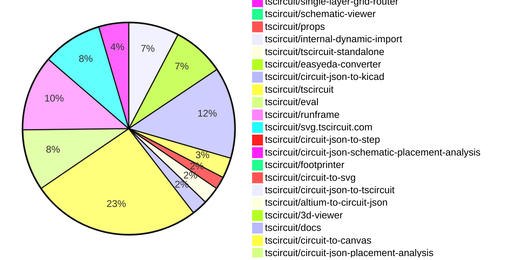

# contribution tracker

[contributions.tscircuit.com](https://contributions.tscircuit.com) ・ [tscircuit.com](https://tscircuit.com) ・ [Contribution Overviews](./contribution-overviews/) ・ [Changelogs](./changelogs/)

Generates weekly contribution overviews for tscircuit contributors. Check out all
the [contribution overviews here](./contribution-overviews/)
You can find AI-generated monthly changelogs in the [changelogs directory](./changelogs/)

- All PRs in the tscircuit org are scanned/summarized via an LLM
- The LLM classifies each Diff/PR as into a set of attributes for scoring
- All the PRs, summaries, and classifications are organized into charts and tables for [the website](https://contributions.tscircuit.com)

> Want to run locally? See the [Development Section](#development)

## Current Week

<!-- START_CURRENT_WEEK -->

# Contribution Overview 2026-10-13

The current week is shown below. There are 3 major sections:

- [Contributor Overview](#contributor-overview)
- [PRs by Repository](#prs-by-repository)
- [PRs by Contributor](#changes-by-contributor)
- [Scoring & Sponsorship Details](/docs/sponsorship-calculation-explanation.md)

## PRs by Repository

## Contributor Overview

| Contributor | 🐳 Major | 🐙 Minor | 🐌 Tiny | Score | ⭐ |
|-------------|---------|---------|---------|-------|-----|
| [seveibar](#seveibar) | 16 | 7 | 12 | 91 | 👑 |
| [imrishabh18](#imrishabh18) | 10 | 11 | 12 | 75 | ⭐⭐⭐ |
| [MustafaMulla29](#MustafaMulla29) | 5 | 6 | 14 | 45 | ⭐⭐ |
| [ShiboSoftwareDev](#ShiboSoftwareDev) | 2 | 6 | 1 | 31 | ⭐⭐ |
| [techmannih](#techmannih) | 6 | 1 | 4 | 31 | ⭐⭐ |
| [rushabhcodes](#rushabhcodes) | 1 | 6 | 4 | 21 | ⭐⭐ |
| [tscircuitbot](#tscircuitbot) | 0 | 0 | 315 | 18 | ⭐⭐ |
| [Abse2001](#Abse2001) | 0 | 1 | 0 | 14 | ⭐⭐ |
| [0hmX](#0hmX) | 2 | 1 | 2 | 12 | ⭐⭐ |
| [GokulPandi-M](#GokulPandi-M) | 0 | 3 | 2 | 8 | ⭐ |
| [Devesh36](#Devesh36) | 0 | 1 | 5 | 8 | ⭐ |
| [AnasSarkiz](#AnasSarkiz) | 1 | 1 | 2 | 8 | ⭐ |
| [trixie010](#trixie010) | 1 | 1 | 0 | 6 | ⭐ |
| [hrithik18k](#hrithik18k) | 0 | 1 | 0 | 2 |  |
| [anil08607](#anil08607) | 0 | 1 | 0 | 2 |  |
| [raykholo](#raykholo) | 0 | 0 | 1 | 1 |  |

## Staff Pass Ratio (SPR)

| Contributor | Reviewed PRs | Rejections | Approvals | SPR |
|-------------|--------------|------------|-----------|-----|
| [imrishabh18](#imrishabh18) | 12 | 0 | 12 | 100.0% |
| [MustafaMulla29](#MustafaMulla29) | 8 | 1 | 8 | 87.5% |
| [rushabhcodes](#rushabhcodes) | 5 | 0 | 5 | 100.0% |
| [techmannih](#techmannih) | 3 | 2 | 2 | 33.3% |
| [trixie010](#trixie010) | 2 | 0 | 2 | 100.0% |
| [0hmX](#0hmX) | 1 | 0 | 1 | 100.0% |
| [Abse2001](#Abse2001) | 1 | 0 | 1 | 100.0% |
| [raykholo](#raykholo) | 1 | 0 | 1 | 100.0% |

imrishabh18 SPR PRs (12)

- [#5390](https://github.com/tscircuit/cli/pull/5390) Route standalone imports through the baked asset server
- [#5395](https://github.com/tscircuit/cli/pull/5395) Search baked datasheets in standalone
- [#5384](https://github.com/tscircuit/cli/pull/5384) Use embedded eval worker configuration for standalone dev
- [#5388](https://github.com/tscircuit/cli/pull/5388) Block network fallbacks for standalone imports
- [#5368](https://github.com/tscircuit/cli/pull/5368) Serve baked assets and expose parts-engine base URLs
- [#5344](https://github.com/tscircuit/cli/pull/5344) Copy prepared JS CDN packages for static site builds
- [#5348](https://github.com/tscircuit/cli/pull/5348) Serve prepared JS CDN packages in tsci dev
- [#5324](https://github.com/tscircuit/cli/pull/5324) Add --jscdn-base-url to static site builds
- [#67](https://github.com/tscircuit/parts-engine/pull/67) Support configurable provider base URLs
- [#38](https://github.com/tscircuit/internal-dynamic-import/pull/38) Support window.TSCIRCUIT_JSCDN_BASE_URL for browser imports
- [#16](https://github.com/tscircuit/tscircuit-standalone/pull/16) Add macOS terminal installation without browser quarantine
- [#11](https://github.com/tscircuit/tscircuit-standalone/pull/11) Launch shared CLI with bundled RunFrame JS CDN packages

MustafaMulla29 SPR PRs (8)

- [#4649](https://github.com/tscircuit/core/pull/4649) Preserve required schematic branches when removing redundant net-label wires
- [#4596](https://github.com/tscircuit/core/pull/4596) Add standalone solder paste apertures
- [#291](https://github.com/tscircuit/circuit-json-schematic-placement-analysis/pull/291) feat: detect misaligned parallel diode capacitor pairs
- [#288](https://github.com/tscircuit/circuit-json-schematic-placement-analysis/pull/288) feat: detect parallel LED branches drawn inline
- [#284](https://github.com/tscircuit/circuit-json-schematic-placement-analysis/pull/284) feat: detect resistors separated from crystals
- [#271](https://github.com/tscircuit/circuit-json-schematic-placement-analysis/pull/271) feat: detect ungrouped switch RC networks
- [#249](https://github.com/tscircuit/circuit-json-schematic-placement-analysis/pull/249) feat: detect separated switch diodes and excessive matrix spacing
- [#277](https://github.com/tscircuit/circuit-json-schematic-placement-analysis/pull/277) feat: detect inline parallel capacitor pairs

rushabhcodes SPR PRs (5)

- [#930](https://github.com/tscircuit/footprinter/pull/930) fix: parse explicit polarity pins in LED footprint strings
- [#4624](https://github.com/tscircuit/core/pull/4624) fix: honor oval plated-hole rotation during autorouting
- [#4571](https://github.com/tscircuit/core/pull/4571) Fix footprint keepouts staying behind after PCB layout
- [#4570](https://github.com/tscircuit/core/pull/4570) fix: respect rotated pad geometry when assigning routed source traces
- [#857](https://github.com/tscircuit/circuit-to-svg/pull/857) fix: default polygon-pad drill offsets to zero

techmannih SPR PRs (3)

- [#4641](https://github.com/tscircuit/core/pull/4641) Fix polygon cutout coverage gaps in generated routing obstacles
- [#4597](https://github.com/tscircuit/core/pull/4597) Preserve native keepout outlines with verified autorouter coverage
- [#3054](https://github.com/tscircuit/tscircuit-autorouter/pull/3054) Preserve coverage of unconnected rotated keepouts

trixie010 SPR PRs (2)

- [#598](https://github.com/tscircuit/easyeda-converter/pull/598) fix: stop emitting a duplicate pcb_cutout for every HOLE record
- [#149](https://github.com/tscircuit/circuit-json-to-step/pull/149) fix: honour pcb_plated_hole drill offset and route every variant

0hmX SPR PRs (1)

- [#4529](https://github.com/tscircuit/core/pull/4529) fix: report disallowed blind/buried vias in manual paths

Abse2001 SPR PRs (1)

- [#197](https://github.com/tscircuit/circuit-json-to-gerber/pull/197) Preserve filled fabrication polarity artwork on a real LED board

raykholo SPR PRs (1)

- [#636](https://github.com/tscircuit/circuit-json-to-kicad/pull/636) Export pcb_via tenting to KiCad vias

> Note: AI evaluates PRs and assigns 1-3 star ratings automatically. 4 and 5 star ratings require manual staff review.

## Review Table

[reviews-received-hover]: ## "Number of reviews received for PRs for this contributor"
[approvals-received-hover]: ## "Number of approvals received for PRs this contributor authored"
[rejections-received-hover]: ## "Number of rejections received for PRs this contributor authored"
[prs-opened-hover]: ## "Number of PRs opened by this contributor"
[issues-created-hover]: ## "Number of issues created by this contributor"

| Contributor | Reviews Received | Approvals Received | Rejections Received | Approvals | Rejections Given | PRs Opened | PRs Merged | Issues Created |
|---|---|---|---|---|---|---|---|---|
| [0hmX](#0hmX) | 2 | 1 | 0 | 1 | 0 | 12 | 5 | 0 |
| [Abse2001](#Abse2001) | 1 | 1 | 0 | 12 | 0 | 9 | 1 | 0 |
| [adamscarmccoy-boop](#adamscarmccoy-boop) | 0 | 0 | 0 | 0 | 0 | 3 | 0 | 0 |
| [AnasSarkiz](#AnasSarkiz) | 3 | 3 | 0 | 0 | 0 | 4 | 4 | 0 |
| [anil08607](#anil08607) | 6 | 2 | 1 | 0 | 0 | 4 | 1 | 0 |
| [atani](#atani) | 24 | 0 | 0 | 0 | 0 | 16 | 0 | 0 |
| [CloudCorpRecords](#CloudCorpRecords) | 0 | 0 | 0 | 0 | 0 | 2 | 0 | 0 |
| [CreedTech](#CreedTech) | 0 | 0 | 0 | 0 | 0 | 1 | 0 | 0 |
| [daniellachev](#daniellachev) | 0 | 0 | 0 | 0 | 0 | 1 | 0 | 0 |
| [deus-intus](#deus-intus) | 0 | 0 | 0 | 0 | 0 | 1 | 0 | 0 |
| [Devesh36](#Devesh36) | 12 | 6 | 1 | 1 | 0 | 19 | 6 | 0 |
| [duongynhi000005-oss](#duongynhi000005-oss) | 0 | 0 | 0 | 0 | 0 | 31 | 0 | 0 |
| [elcuervo171234](#elcuervo171234) | 0 | 0 | 0 | 0 | 0 | 1 | 0 | 0 |
| [exantiv](#exantiv) | 0 | 0 | 0 | 0 | 0 | 1 | 0 | 0 |
| [GokulPandi-M](#GokulPandi-M) | 6 | 6 | 0 | 0 | 0 | 6 | 5 | 0 |
| [hrithik18k](#hrithik18k) | 2 | 1 | 1 | 0 | 0 | 9 | 1 | 0 |
| [imrishabh18](#imrishabh18) | 16 | 14 | 0 | 12 | 7 | 44 | 33 | 0 |
| [jloa-dev](#jloa-dev) | 0 | 0 | 0 | 0 | 0 | 2 | 0 | 0 |
| [KrishnaX12](#KrishnaX12) | 0 | 0 | 0 | 0 | 0 | 1 | 0 | 0 |
| [LuisaW07](#LuisaW07) | 0 | 0 | 0 | 0 | 0 | 1 | 0 | 0 |
| [mohan-bee](#mohan-bee) | 3 | 1 | 1 | 1 | 0 | 25 | 0 | 0 |
| [MustafaMulla29](#MustafaMulla29) | 15 | 11 | 1 | 8 | 1 | 29 | 25 | 0 |
| [oziass](#oziass) | 0 | 0 | 0 | 0 | 0 | 1 | 0 | 0 |
| [Pr1yansu](#Pr1yansu) | 0 | 0 | 0 | 0 | 0 | 4 | 0 | 0 |
| [prajwal-0706](#prajwal-0706) | 0 | 0 | 0 | 0 | 0 | 3 | 0 | 0 |
| [Ratanlavate](#Ratanlavate) | 0 | 0 | 0 | 0 | 0 | 1 | 0 | 0 |
| [raykholo](#raykholo) | 2 | 2 | 0 | 0 | 0 | 6 | 2 | 0 |
| [rushabhcodes](#rushabhcodes) | 45 | 17 | 0 | 1 | 0 | 17 | 12 | 0 |
| [Sayandevxyz](#Sayandevxyz) | 0 | 0 | 0 | 0 | 0 | 5 | 0 | 0 |
| [seveibar](#seveibar) | 8 | 1 | 0 | 37 | 1 | 59 | 35 | 0 |
| [ShiboSoftwareDev](#ShiboSoftwareDev) | 11 | 8 | 0 | 10 | 0 | 107 | 9 | 0 |
| [smartcalsystems-sketch](#smartcalsystems-sketch) | 0 | 0 | 0 | 0 | 0 | 4 | 0 | 0 |
| [tarazum](#tarazum) | 0 | 0 | 0 | 0 | 0 | 1 | 0 | 0 |
| [techmannih](#techmannih) | 19 | 8 | 1 | 2 | 1 | 20 | 11 | 0 |
| [trixie010](#trixie010) | 7 | 3 | 4 | 0 | 0 | 6 | 2 | 0 |
| [tscircuitbot](#tscircuitbot) | 0 | 0 | 0 | 0 | 0 | 405 | 315 | 0 |
| [vreview](#vreview) | 0 | 0 | 0 | 0 | 0 | 1 | 0 | 0 |

## Changes by Repository

### [tscircuit/core](https://github.com/tscircuit/core)

| PR # | Impact | Rating | Contributor | Description |
|------|--------|--------|-------------|-------------|
| [#4667](https://github.com/tscircuit/core/pull/4667) | 🐳 Major | ⭐⭐⭐ | seveibar | Supplier Circuit JSON can contain permanent internal pin groups, but core discards those groups while importing the footprint. Retain the groups as derived component metadata, resolve supplier-local source-port IDs to component pin names, and use them for emitted source connectivity and missing-trace checks. Explicit internallyConnectedPins, including , takes precedence without mutating user props or imported Circuit JSON. Groundpower connection queries now follow permanent internal contacts on both ends of a trace; overlapping groups are traversed transitively. Ground attributes and aliases take precedence over fallback power-name detection, so a ground ball address such as V3 does not disable automatic decoupling trace limits when reached through an internal group. Push buttons opt into parts-engine datasheet enrichment so a four-terminal switch can share AB and CD without connecting its momentary switch terminals. Runtime datasheet enrichment requires the parts-engine change in https:github.comtscircuitparts-enginepull68 to be published and used by the calling parts engine. This PR consumes the existing Circuit JSON internal-connection field and needs no schema change. Source design-rule checks also compare the explicit internallyConnectedPins prop against datasheet groups and warn when a reported connection is missing from the declaration. For example: The datasheet reports pins A and B are internally connected, but the internallyConnectedPins prop isnt set on SW1. Imported defaults do not suppress this warning. Empty or incomplete declarations warn too; pin aliases, numbers, and transitive groups count as equivalent declarations. Warnings update or disappear when the declaration changes, and respect the DRC disable controls. Custom-footprint chips, pushbuttons, and op amps can fetch comparison metadata even without pinAttributes; supplier-footprint imports reuse their existing metadata request. Fetching comparison facts does not replace custom geometry or mutate props. Validation: 25 focused tests pass, including suppliercustom footprint warnings, missing and empty declarations, equivalent aliasestransitive groups, disabled checks, warning updates, imported connectivity, and existing datasheet pin-attribute checks. Labeled PCB snapshots are included and visually reviewed. Package build, typecheck, and formatting pass. Related PRs: website https:github.comtscircuittscircuit.compull5454; core https:github.comtscircuitcorepull4667; CLI https:github.comtscircuitclipull5397; parts engine https:github.comtscircuitparts-enginepull68. Homepage smoke test: rebuilt the exact homepage releases of seveibarnrf-smart-watch0.1.1, imrishabh18rp2040-motor-controller1.0.41, absewifi-smart-switch1.0.29, and absegameboy1.0.15 against the PR and its base, using the same cached live network responses and the parts-engine internal-pin support. All 274 components rendered with identical diagnostics after the routing-disable fix. This check keeps autorouting disabled. Async datasheet validation now respects routing-disable controls on update, preventing routing diagnostics during a disabled-routing render. A regression test covers both platform and board controls. seveibarf1c100s-linux-dev-board1.9.2 fails on both versions before rendering: its routingBoundaryRef callback calls the absent internal method doInitialPcbImplicitCopperPourRender. This existing compatibility issue prevents a complete smoke test of that board. |
| [#4604](https://github.com/tscircuit/core/pull/4604) | 🐳 Major | ⭐⭐⭐ | seveibar | Allows chips and connectors to use physical BGA ball names directly in pinLabels, connections, footprint hints, schematic arrangements, and pin styles, resolving previous issues with alias resolution. |
| [#4603](https://github.com/tscircuit/core/pull/4603) | 🐳 Major | ⭐⭐⭐ | seveibar | Fixes autorouting failure by resolving bare trace names and explicit trace selectors, ensuring proper diagnostics for unmatched or ambiguous selectors. |
| [#4624](https://github.com/tscircuit/core/pull/4624) | 🐳 Major | ⭐⭐⭐ | rushabhcodes | Fixes autorouting issues by ensuring that oval plated-hole dimensions are correctly rotated and used as routing obstacles during PCB design. |
| [#4596](https://github.com/tscircuit/core/pull/4596) | 🐳 Major | ⭐⭐⭐ | MustafaMulla29 | Problem and change solderpaste is defined by tscircuitprops, but Core rejects it as an unregistered element. This adds the native primitive so one continuous copper pad can carry several independent stencil apertures. The renderer uses the existing props and pcb_solder_paste schemas, supports rectangles and circles on either outer layer, and preserves parent rotations, footprint flips, layout movement, and removal. Cached subcircuits retain independent apertures and their orientation, including suppressed full-pad openings. User props remain immutable. Uses the published tscircuitcircuit-json-util0.0.122, which includes https:github.comtscircuitcircuit-json-utilpull238. Cached PCB primitives use the shared transform utility. Circuit JSON import retains an apertures existing rotation as derived state because authored solder-paste props only expose axis-aligned shapes. Cached circular through-hole paste is restored as independent paste geometry, so inflated round holes must not generate it again. This uses Cores existing _isInflatedFromCircuitJson state. Two focused regressions verify that a mixed footprint keeps three automatic paste records and that an explicitly overlapping aperture is preserved, with caching on and off. Each new regression has its own file and labeled snapshot. Pill and oval generation are unchanged. Includes ten solder-paste tests, including a six-window pattern over a single exposed copper pad. Updated to mains isSmt support; keeps tscircuitprops0.0.701 and the released paste transformation fix. Fixes 3577.  Validation All 10 solder-paste tests pass. The two new cache regressions failed before the fix (5 instead of 3 records, and 6 instead of 4). Focused suite: 34 pass, 1 existing pill-paste snapshot mismatch. The 0.12 mismatch reproduces on unchanged main f518678 with the same dependencies and produces an identical diff image; its snapshot is unchanged. Existing isSmt tests, manual-via regression, and standalone primitive caching pass. The manual-via test now matches main exactly. Polygon plated-hole test and both new snapshot comparisons pass after removing ternaries from the newly touched primitive. bunx tsc --noEmit, bun run build, and bun run smoke-test:dist pass. bun run format, git diff --check, and INPUT_PACKAGE_TYPEinternal_lib bunx tscircuitdependency-check pass. Zero ternaries in the 17 changed TSTSX files. The neighboring polygon-paste caching snapshot previously showed a 0.04 mismatch on both this PR and unchanged code with the same dependencies. That baseline is unchanged. The full test suite was not rerun for this update.  Scope This implements Core rendering and Circuit JSON importcache support. It does not change downstream Gerber or KiCad exporters; they must consume independent pcb_solder_paste records to preserve these apertures. |
| [#4669](https://github.com/tscircuit/core/pull/4669) | 🐳 Major | ⭐⭐⭐ | techmannih | Preserves native keepout outlines and improves autorouter coverage by implementing an approved patch from a previous pull request, ensuring no uncovered stroke points and reducing obstacles significantly. |
| [#4602](https://github.com/tscircuit/core/pull/4602) | 🐳 Major | ⭐⭐⭐ | techmannih | Records the behavior of Sample024s five open keepout arcs expanding into 1,430 SRJ obstacles while leaving sampled points uncovered, with visual reproductions and tests. |
| [#4597](https://github.com/tscircuit/core/pull/4597) | 🐳 Major | ⭐⭐⭐ | techmannih | Reduces the number of SRJ obstacles from 1430 to 475 for open keepout arcs while ensuring full coverage during autorouting. |
| [#4636](https://github.com/tscircuit/core/pull/4636) | 🐙 Minor | ⭐⭐ | seveibar | Exposed testprobe pads can now use smtpad noSolderPaste  to omit pcb_solder_paste while keeping copper exposed, affecting all six pad shapes and ensuring proper paste creation checks. |
| [#4571](https://github.com/tscircuit/core/pull/4571) | 🐙 Minor | ⭐⭐ | rushabhcodes | Fixes the issue where footprint keepouts do not move with their associated PCB components during layout, allowing copper to intrude into designated clearance areas. |
| [#4570](https://github.com/tscircuit/core/pull/4570) | 🐙 Minor | ⭐⭐ | rushabhcodes | Fixes incorrect source trace assignments for routed traces on rotated SMT pads, resolving trace-continuity validation failures. |
| [#4632](https://github.com/tscircuit/core/pull/4632) | 🐙 Minor | ⭐⭐ | ShiboSoftwareDev | Fixes incorrect source trace attribution for routed endpoints overlapping adjacent pads in PCB designs. |
| [#4627](https://github.com/tscircuit/core/pull/4627) | 🐙 Minor | ⭐⭐ | ShiboSoftwareDev | Prefers exact PCB-port matches for routed endpoints to avoid incorrect source trace attribution when endpoints fall inside adjacent pads. |
| [#4621](https://github.com/tscircuit/core/pull/4621) | 🐙 Minor | ⭐⭐ | ShiboSoftwareDev | Fixes the issue where a requested teardrop is missing when routed copper is attributed to another source trace on the same physical net. |
| [#4619](https://github.com/tscircuit/core/pull/4619) | 🐙 Minor | ⭐⭐ | ShiboSoftwareDev | Fixes the issue where teardrops for equivalent source traces were not rendered correctly, leading to missing teardrops on routed copper. |
| [#4623](https://github.com/tscircuit/core/pull/4623) | 🐙 Minor | ⭐⭐ | Devesh36 | Fixes the issue where mounting slots do not rotate with the connector footprint in PCB designs, ensuring visual consistency in the layout. |
| [#4649](https://github.com/tscircuit/core/pull/4649) | 🐙 Minor | ⭐⭐ | MustafaMulla29 | Preserves required schematic branches and routes when removing redundant net-label wires, ensuring connectivity to fixed net labels without altering source-net connectivity. |
| [#4648](https://github.com/tscircuit/core/pull/4648) | 🐙 Minor | ⭐⭐ | MustafaMulla29 | Reproduces the dangling EP trace below U_PDs explicit GND symbol in the PD sheet, preserving schematic symbols and connections without altering production behavior. |
| [#4645](https://github.com/tscircuit/core/pull/4645) | 🐙 Minor | ⭐⭐ | MustafaMulla29 | Fixes the issue of extra built-in terminals being created when a custom symbol declares its own ports, preventing false unconnected-pin warnings. |
| [#4656](https://github.com/tscircuit/core/pull/4656) | 🐙 Minor | ⭐⭐ | imrishabh18 | Fixes alignment of generated rounded board outlines with the resolved board center during rendering, preventing false outside-board errors. |
| [#4593](https://github.com/tscircuit/core/pull/4593) | 🐙 Minor | ⭐⭐ | hrithik18k | Modifies solder paste generation logic to respect the isSmt property, preventing unwanted paste for through-hole components while retaining paste for mixed footprints. |
| [#4529](https://github.com/tscircuit/core/pull/4529) | 🐙 Minor | ⭐⭐ | 0hmX | Reports disallowed blind or buried vias in manual paths when the board disables them, preserving saved copper and aggregating all disallowed vias. |

🐌 Tiny Contributions (10)

| PR # | Impact | Contributor | Description |
|------|--------|-------------|-------------|
| [#4609](https://github.com/tscircuit/core/pull/4609) | 🐌 Tiny | seveibar | Updates tscircuitcapacity-autorouter from 0.0.974 to 0.0.982. |
| [#4665](https://github.com/tscircuit/core/pull/4665) | 🐌 Tiny | tscircuitbot | Updates the tscircuitchecks package from version 0.0.253 to 0.0.255 in package.json |
| [#4618](https://github.com/tscircuit/core/pull/4618) | 🐌 Tiny | rushabhcodes | Reproduces a bug where CC traces of a rotated USB-C connector touch grounded shield slots, providing a comprehensive test to validate the issue. |
| [#4617](https://github.com/tscircuit/core/pull/4617) | 🐌 Tiny | rushabhcodes | Update the circuit-json development dependency and override from 0.0.525 to 0.0.528, ensuring the installed schema and public types recognize the ownership field for components. |
| [#4557](https://github.com/tscircuit/core/pull/4557) | 🐌 Tiny | GokulPandi-M | Fixes rendering issue where a female pinheader with an explicit footprint incorrectly renders male pins instead of female sockets in 3D. |
| [#4682](https://github.com/tscircuit/core/pull/4682) | 🐌 Tiny | Devesh36 | Updates tscircuitfootprinter from 0.0.431 to 0.0.440, ensuring core uses the latest footprint definitions and fixes. |
| [#4671](https://github.com/tscircuit/core/pull/4671) | 🐌 Tiny | Devesh36 | Fixes overlapping copper pads in the imported ESD5Z5.0T1G TVS footprint when using a 0.8 mm flex gap. |
| [#4622](https://github.com/tscircuit/core/pull/4622) | 🐌 Tiny | Devesh36 | Reproduces a bug where LED silkscreen rectangles do not rotate with their corresponding pads when set at 45 degrees. |
| [#4644](https://github.com/tscircuit/core/pull/4644) | 🐌 Tiny | MustafaMulla29 | Fixes the issue where the custom DPDT symbol incorrectly inherits an extra phantom pin4, leading to missing trace warnings. |
| [#4666](https://github.com/tscircuit/core/pull/4666) | 🐌 Tiny | imrishabh18 | Updates the tscircuitchecks dependency to version 0.0.256 and aligns existing fixtures with courtyard-aware boundary checks, including adjustments to board dimensions and validation of routing fixtures. |

### [tscircuit/checks](https://github.com/tscircuit/checks)

| PR # | Impact | Rating | Contributor | Description |
|------|--------|--------|-------------|-------------|
| [#427](https://github.com/tscircuit/checks/pull/427) | 🐳 Major | ⭐⭐⭐ | seveibar | Reduces unnecessary computation in continuity validation by deferring the construction of the physical trace graph until needed, optimizing the process of checking connectivity between traces. |
| [#433](https://github.com/tscircuit/checks/pull/433) | 🐳 Major | ⭐⭐⭐ | imrishabh18 | Fixes incorrect reporting of component overhangs by using actual footprint geometry for boundary checks instead of bounding rectangles. |

### [tscircuit/tscircuit.com](https://github.com/tscircuit/tscircuit.com)

| PR # | Impact | Rating | Contributor | Description |
|------|--------|--------|-------------|-------------|
| [#5454](https://github.com/tscircuit/tscircuit.com/pull/5454) | 🐳 Major | ⭐⭐⭐ | seveibar | Displays each pins permanently connected contacts in the datasheet, makes them searchable, and includes internallyConnectedPins in the generated TSX component. |

🐌 Tiny Contributions (32)

| PR # | Impact | Contributor | Description |
|------|--------|-------------|-------------|
| [#5437](https://github.com/tscircuit/tscircuit.com/pull/5437) | 🐌 Tiny | seveibar | Removes the blue introduction label, the entire Downloads and versions section, and the closing local-project sentence, while adjusting typography for consistency. |
| [#5467](https://github.com/tscircuit/tscircuit.com/pull/5467) | 🐌 Tiny | tscircuitbot | Updates the tscircuitrunframe package from version 0.0.3002 to 0.0.3003 |
| [#5463](https://github.com/tscircuit/tscircuit.com/pull/5463) | 🐌 Tiny | tscircuitbot | Updates the tscircuitrunframe package from version 0.0.3001 to 0.0.3002 |
| [#5462](https://github.com/tscircuit/tscircuit.com/pull/5462) | 🐌 Tiny | tscircuitbot | Updates the tscircuitrunframe package from version 0.0.3000 to 0.0.3001 |
| [#5461](https://github.com/tscircuit/tscircuit.com/pull/5461) | 🐌 Tiny | tscircuitbot | Automated package update |
| [#5460](https://github.com/tscircuit/tscircuit.com/pull/5460) | 🐌 Tiny | tscircuitbot | Automated package update |
| [#5459](https://github.com/tscircuit/tscircuit.com/pull/5459) | 🐌 Tiny | tscircuitbot | Automated package update |
| [#5458](https://github.com/tscircuit/tscircuit.com/pull/5458) | 🐌 Tiny | tscircuitbot | Updates the tscircuitrunframe package version from 0.0.2998 to 0.0.2999 in package.json |
| [#5457](https://github.com/tscircuit/tscircuit.com/pull/5457) | 🐌 Tiny | tscircuitbot | Updates the tscircuiteval package from version 0.0.1622 to 0.0.1623 in the package.json file. |
| [#5456](https://github.com/tscircuit/tscircuit.com/pull/5456) | 🐌 Tiny | tscircuitbot | Updates the tscircuitrunframe package from version 0.0.2997 to 0.0.2998 |
| [#5453](https://github.com/tscircuit/tscircuit.com/pull/5453) | 🐌 Tiny | tscircuitbot | Automated package update |
| [#5452](https://github.com/tscircuit/tscircuit.com/pull/5452) | 🐌 Tiny | tscircuitbot | Updates the tscircuiteval package from version 0.0.1619 to 0.0.1622 in the package.json file. |
| [#5451](https://github.com/tscircuit/tscircuit.com/pull/5451) | 🐌 Tiny | tscircuitbot | Updates the tscircuitrunframe package to version 0.0.2996 |
| [#5449](https://github.com/tscircuit/tscircuit.com/pull/5449) | 🐌 Tiny | tscircuitbot | Automated package update |
| [#5446](https://github.com/tscircuit/tscircuit.com/pull/5446) | 🐌 Tiny | tscircuitbot | Updates the tscircuitrunframe package from version 0.0.2992 to 0.0.2993 |
| [#5445](https://github.com/tscircuit/tscircuit.com/pull/5445) | 🐌 Tiny | tscircuitbot | Updates the tscircuiteval package from version 0.0.1616 to 0.0.1618. |
| [#5427](https://github.com/tscircuit/tscircuit.com/pull/5427) | 🐌 Tiny | tscircuitbot | Updates the tscircuiteval package from version 0.0.1611 to 0.0.1612 in the package.json file. |
| [#5444](https://github.com/tscircuit/tscircuit.com/pull/5444) | 🐌 Tiny | tscircuitbot | Automated package update |
| [#5441](https://github.com/tscircuit/tscircuit.com/pull/5441) | 🐌 Tiny | tscircuitbot | Updates the tscircuiteval package from version 0.0.1613 to 0.0.1616 |
| [#5429](https://github.com/tscircuit/tscircuit.com/pull/5429) | 🐌 Tiny | tscircuitbot | Automated package update |
| [#5447](https://github.com/tscircuit/tscircuit.com/pull/5447) | 🐌 Tiny | tscircuitbot | Updates the tscircuiteval package from version 0.0.1618 to 0.0.1619 |
| [#5426](https://github.com/tscircuit/tscircuit.com/pull/5426) | 🐌 Tiny | tscircuitbot | Automated package update |
| [#5436](https://github.com/tscircuit/tscircuit.com/pull/5436) | 🐌 Tiny | tscircuitbot | Automated package update |
| [#5434](https://github.com/tscircuit/tscircuit.com/pull/5434) | 🐌 Tiny | tscircuitbot | Automated package update |
| [#5425](https://github.com/tscircuit/tscircuit.com/pull/5425) | 🐌 Tiny | tscircuitbot | Updates the tscircuiteval package from version 0.0.1609 to 0.0.1611 |
| [#5424](https://github.com/tscircuit/tscircuit.com/pull/5424) | 🐌 Tiny | tscircuitbot | Automated package update |
| [#5422](https://github.com/tscircuit/tscircuit.com/pull/5422) | 🐌 Tiny | tscircuitbot | Automated package update |
| [#5421](https://github.com/tscircuit/tscircuit.com/pull/5421) | 🐌 Tiny | tscircuitbot | Updates the tscircuiteval package from version 0.0.1607 to 0.0.1609 in the package.json file. |
| [#5420](https://github.com/tscircuit/tscircuit.com/pull/5420) | 🐌 Tiny | tscircuitbot | Updates the tscircuitrunframe package to version 0.0.2981 |
| [#5419](https://github.com/tscircuit/tscircuit.com/pull/5419) | 🐌 Tiny | tscircuitbot | Automated package update |
| [#5433](https://github.com/tscircuit/tscircuit.com/pull/5433) | 🐌 Tiny | tscircuitbot | Updates the tscircuitrunframe package to version 0.0.2987 in package.json |
| [#5465](https://github.com/tscircuit/tscircuit.com/pull/5465) | 🐌 Tiny | Devesh36 | Remove tscircuitprompt-benchmarks and the obsolete srccomponentspackage-portCodeEditor.tsx, as requested in review. The website already uses WorkspaceCodeEditor from tscircuitmonaco-code-editor, and nothing imports the old editor. Deleting the old editor removes the last import of prompt-benchmarks, resolving the typecheck error from removing the dependency. Regenerate bun.lock to prune dependencies that are no longer needed. |

### [tscircuit/cli](https://github.com/tscircuit/cli)

| PR # | Impact | Rating | Contributor | Description |
|------|--------|--------|-------------|-------------|
| [#5397](https://github.com/tscircuit/cli/pull/5397) | 🐳 Major | ⭐⭐⭐ | seveibar | Fetches and validates datasheet pin attributes and permanent internal pin groups, passing them as typed options to easyedas convertRawEasyToTsx. |
| [#5384](https://github.com/tscircuit/cli/pull/5384) | 🐳 Major | ⭐⭐⭐ | imrishabh18 | When TSCIRCUIT_STANDALONE1, serve the bundled RunFrame and preset the CLIs pinned eval version through the existing TSCIRCUIT_LATEST_EVAL_VERSION global. Disable online version selection, telemetry, and hosted page resources. Normal CLI behavior is unchanged. |
| [#5368](https://github.com/tscircuit/cli/pull/5368) | 🐳 Major | ⭐⭐⭐ | imrishabh18 | Starts a loopback asset server for every command when TSCIRCUIT_BAKED_ASSET_SERVER_DIR is set, sets provider base URLs, and honors them in CLI searchimport lookups. |
| [#5324](https://github.com/tscircuit/cli/pull/5324) | 🐳 Major | ⭐⭐⭐ | imrishabh18 | Add --jscdn-base-url url to tsci build, allowing users to set the JS CDN base URL for dynamic imports in the generated static site. |
| [#5371](https://github.com/tscircuit/cli/pull/5371) | 🐙 Minor | ⭐⭐ | rushabhcodes | Fixes the issue where the diode identity and polarity were lost during the import of footprint strings, ensuring accurate representation in the PCB design. |
| [#5410](https://github.com/tscircuit/cli/pull/5410) | 🐙 Minor | ⭐⭐ | GokulPandi-M | Fixes KiCad export to preserve the root schematic when a child sheet has the same name as the project, preventing loss of hierarchy in exported projects. |
| [#5236](https://github.com/tscircuit/cli/pull/5236) | 🐙 Minor | ⭐⭐ | GokulPandi-M | Fixes KiCad export to include hierarchical child schematics, preventing blank pages when opening child sheets. |
| [#5218](https://github.com/tscircuit/cli/pull/5218) | 🐙 Minor | ⭐⭐ | GokulPandi-M | Fixes the issue where KiCad exports do not include hierarchical child schematic files, resulting in blank pages when attempting to open them. |
| [#5390](https://github.com/tscircuit/cli/pull/5390) | 🐙 Minor | ⭐⭐ | imrishabh18 | Replaces the standalone import bailout with platformFetch routing to the local baked asset server, allowing EasyEDA requests, model downloads, and registry requests to stay local while handling missing baked responses appropriately. |
| [#5380](https://github.com/tscircuit/cli/pull/5380) | 🐙 Minor | ⭐⭐ | imrishabh18 | Adds functionality to import generated datasheet TSX files in standalone mode, saving them to the imports directory before searching JLCSearch. |
| [#5388](https://github.com/tscircuit/cli/pull/5388) | 🐙 Minor | ⭐⭐ | imrishabh18 | Standalone imports that cannot use the baked TSX now exit with code 1 and display a message indicating unavailability in tscircuit standalone, preventing fallback to online sources. |
| [#5350](https://github.com/tscircuit/cli/pull/5350) | 🐙 Minor | ⭐⭐ | imrishabh18 | Copies prepared JS CDN packages to distjscdn when TSCIRCUIT_STANDALONE is set, allowing for automatic site builds with a default base URL. |
| [#5344](https://github.com/tscircuit/cli/pull/5344) | 🐙 Minor | ⭐⭐ | imrishabh18 | Copies prepared JS CDN packages from TSCIRCUIT_JSCDN_DIR into distjscdn for static site builds, preserving paths and contents without downloading or rebuilding packages. |
| [#5348](https://github.com/tscircuit/cli/pull/5348) | 🐙 Minor | ⭐⭐ | imrishabh18 | Serve prepared packages from TSCIRCUIT_JSCDN_DIR at jscdn and set window.TSCIRCUIT_JSCDN_BASE_URL  jscdn before runframe loads, with support for local testing via --jscdn-dir path. |

🐌 Tiny Contributions (44)

| PR # | Impact | Contributor | Description |
|------|--------|-------------|-------------|
| [#5419](https://github.com/tscircuit/cli/pull/5419) | 🐌 Tiny | tscircuitbot | Automated package update |
| [#5418](https://github.com/tscircuit/cli/pull/5418) | 🐌 Tiny | tscircuitbot | Automated package update |
| [#5413](https://github.com/tscircuit/cli/pull/5413) | 🐌 Tiny | tscircuitbot | Automated package update |
| [#5412](https://github.com/tscircuit/cli/pull/5412) | 🐌 Tiny | tscircuitbot | Updates the tscircuitrunframe package from version 0.0.3002 to 0.0.3003 |
| [#5411](https://github.com/tscircuit/cli/pull/5411) | 🐌 Tiny | tscircuitbot | Automated package update |
| [#5409](https://github.com/tscircuit/cli/pull/5409) | 🐌 Tiny | tscircuitbot | Updates the tscircuitrunframe package version from 0.0.3001 to 0.0.3002 in package.json |
| [#5407](https://github.com/tscircuit/cli/pull/5407) | 🐌 Tiny | tscircuitbot | Automated package update |
| [#5405](https://github.com/tscircuit/cli/pull/5405) | 🐌 Tiny | tscircuitbot | Automated package update |
| [#5404](https://github.com/tscircuit/cli/pull/5404) | 🐌 Tiny | tscircuitbot | Updates the version of the tscircuitrunframe package from 0.0.3000 to 0.0.3001 in package.json |
| [#5403](https://github.com/tscircuit/cli/pull/5403) | 🐌 Tiny | tscircuitbot | Automated package update |
| [#5402](https://github.com/tscircuit/cli/pull/5402) | 🐌 Tiny | tscircuitbot | Updates the tscircuitrunframe package version from 0.0.2999 to 0.0.3000 in package.json |
| [#5400](https://github.com/tscircuit/cli/pull/5400) | 🐌 Tiny | tscircuitbot | Automated package update |
| [#5399](https://github.com/tscircuit/cli/pull/5399) | 🐌 Tiny | tscircuitbot | Updates the tscircuitrunframe package version from 0.0.2997 to 0.0.2999 in package.json |
| [#5396](https://github.com/tscircuit/cli/pull/5396) | 🐌 Tiny | tscircuitbot | Automated package update |
| [#5389](https://github.com/tscircuit/cli/pull/5389) | 🐌 Tiny | tscircuitbot | Automated package update |
| [#5383](https://github.com/tscircuit/cli/pull/5383) | 🐌 Tiny | tscircuitbot | Automated package update |
| [#5379](https://github.com/tscircuit/cli/pull/5379) | 🐌 Tiny | tscircuitbot | Automated package update |
| [#5391](https://github.com/tscircuit/cli/pull/5391) | 🐌 Tiny | tscircuitbot | Updates the tscircuitrunframe package version from 0.0.2995 to 0.0.2997 in package.json |
| [#5387](https://github.com/tscircuit/cli/pull/5387) | 🐌 Tiny | tscircuitbot | Automated package update |
| [#5337](https://github.com/tscircuit/cli/pull/5337) | 🐌 Tiny | tscircuitbot | Automated package update |
| [#5334](https://github.com/tscircuit/cli/pull/5334) | 🐌 Tiny | tscircuitbot | Updates the tscircuitrunframe package to version 0.0.2980 in package.json |
| [#5361](https://github.com/tscircuit/cli/pull/5361) | 🐌 Tiny | tscircuitbot | Updates the tscircuitrunframe package from version 0.0.2988 to 0.0.2989 |
| [#5359](https://github.com/tscircuit/cli/pull/5359) | 🐌 Tiny | tscircuitbot | Updates the tscircuitrunframe package from version 0.0.2987 to 0.0.2988 |
| [#5357](https://github.com/tscircuit/cli/pull/5357) | 🐌 Tiny | tscircuitbot | Updates the tscircuitrunframe package to version 0.0.2987 in the package.json file |
| [#5356](https://github.com/tscircuit/cli/pull/5356) | 🐌 Tiny | tscircuitbot | Automated package update |
| [#5355](https://github.com/tscircuit/cli/pull/5355) | 🐌 Tiny | tscircuitbot | Updates the tscircuitrunframe package to version 0.0.2986 |
| [#5354](https://github.com/tscircuit/cli/pull/5354) | 🐌 Tiny | tscircuitbot | Automated package update |
| [#5353](https://github.com/tscircuit/cli/pull/5353) | 🐌 Tiny | tscircuitbot | Updates the tscircuitrunframe package from version 0.0.2984 to 0.0.2985 |
| [#5347](https://github.com/tscircuit/cli/pull/5347) | 🐌 Tiny | tscircuitbot | Automated package update |
| [#5345](https://github.com/tscircuit/cli/pull/5345) | 🐌 Tiny | tscircuitbot | Updates the tscircuitrunframe package version from 0.0.2983 to 0.0.2984 in package.json |
| [#5342](https://github.com/tscircuit/cli/pull/5342) | 🐌 Tiny | tscircuitbot | Updates the tscircuitrunframe package from version 0.0.2982 to 0.0.2983 |
| [#5336](https://github.com/tscircuit/cli/pull/5336) | 🐌 Tiny | tscircuitbot | Updates the tscircuitrunframe package from version 0.0.2980 to 0.0.2981 |
| [#5335](https://github.com/tscircuit/cli/pull/5335) | 🐌 Tiny | tscircuitbot | Automated package update |
| [#5362](https://github.com/tscircuit/cli/pull/5362) | 🐌 Tiny | tscircuitbot | Automated package update |
| [#5358](https://github.com/tscircuit/cli/pull/5358) | 🐌 Tiny | tscircuitbot | Automated package update |
| [#5349](https://github.com/tscircuit/cli/pull/5349) | 🐌 Tiny | tscircuitbot | Automated package update |
| [#5343](https://github.com/tscircuit/cli/pull/5343) | 🐌 Tiny | tscircuitbot | Automated package update |
| [#5340](https://github.com/tscircuit/cli/pull/5340) | 🐌 Tiny | tscircuitbot | Automated package update |
| [#5351](https://github.com/tscircuit/cli/pull/5351) | 🐌 Tiny | tscircuitbot | Automated package update |
| [#5370](https://github.com/tscircuit/cli/pull/5370) | 🐌 Tiny | rushabhcodes | Reproduces a bug where the import of the C82046 component loses diode identity and polarity markings during the import process. |
| [#5417](https://github.com/tscircuit/cli/pull/5417) | 🐌 Tiny | MustafaMulla29 | Updates the dependency for circuit-json-schematic-placement-analysis from version 0.0.50 to 0.0.68, ensuring compatibility with existing tarball URL formats and updating related metadata in the bun.lock file. |
| [#5406](https://github.com/tscircuit/cli/pull/5406) | 🐌 Tiny | MustafaMulla29 | Updates circuit-json-to-kicad from 0.0.230 to 0.0.235 and kicadts from 0.0.47 to 0.0.58 to resolve CLI startup failure due to missing exports. |
| [#5363](https://github.com/tscircuit/cli/pull/5363) | 🐌 Tiny | imrishabh18 | Excludes the running executable from initial file synchronization and filesystem watching during tsci dev, preventing upload timeouts. |
| [#5378](https://github.com/tscircuit/cli/pull/5378) | 🐌 Tiny | imrishabh18 | Update tscircuiteval to 0.0.1619 and tscircuitrunframe to 0.0.2995 to consume the merged parts-engine base URL support in the CLI and browser worker. |

### [tscircuit/tscircuit-autorouter](https://github.com/tscircuit/tscircuit-autorouter)

| PR # | Impact | Rating | Contributor | Description |
|------|--------|--------|-------------|-------------|
| [#2998](https://github.com/tscircuit/tscircuit-autorouter/pull/2998) | 🐳 Major | ⭐⭐⭐ | seveibar | Adds a post-repair cleanup stage that commits only valid improvements and preserves route endpoints while reducing via counts in autorouting. |
| [#3098](https://github.com/tscircuit/tscircuit-autorouter/pull/3098) | 🐳 Major | ⭐⭐⭐ | techmannih | Applies the approved rotated keepout fix from 3054 to main, preventing Pipeline9 from routing through uncovered portions of an unconnected rotated keepout. |
| [#3054](https://github.com/tscircuit/tscircuit-autorouter/pull/3054) | 🐳 Major | ⭐⭐⭐ | techmannih | Fixes autorouting failure when routing around unconnected rotated keepouts by ensuring proper clearance is maintained without increasing approximation rectangle count. |

🐌 Tiny Contributions (10)

| PR # | Impact | Contributor | Description |
|------|--------|-------------|-------------|
| [#3063](https://github.com/tscircuit/tscircuit-autorouter/pull/3063) | 🐌 Tiny | seveibar | Updates the tscircuitchecks dependency to version 0.0.255 to recover via-cleanup performance by incorporating continuity geometry optimization. |
| [#3044](https://github.com/tscircuit/tscircuit-autorouter/pull/3044) | 🐌 Tiny | seveibar | Updates the trace simplification solver dependency to a specific upstream commit, improving the handling of routed-copper vias and related cache test instrumentation. |
| [#3052](https://github.com/tscircuit/tscircuit-autorouter/pull/3052) | 🐌 Tiny | seveibar | Updates the dependency on tscircuitchecks to version 0.0.249 and modifies two tests for upstream readable-name diagnostics, ensuring tracegap assertions and structured trace-pair identity are retained. |
| [#3064](https://github.com/tscircuit/tscircuit-autorouter/pull/3064) | 🐌 Tiny | seveibar | Updates the high-density-repair02 dependency to optimize sequential repair by implementing conservative obstacle pruning, cached clearances, boundary checks, and reused spatial-query hits, while preserving candidate ordering and acceptance checks. |
| [#3100](https://github.com/tscircuit/tscircuit-autorouter/pull/3100) | 🐌 Tiny | tscircuitbot | Automated package update |
| [#3097](https://github.com/tscircuit/tscircuit-autorouter/pull/3097) | 🐌 Tiny | tscircuitbot | Automated package update |
| [#3069](https://github.com/tscircuit/tscircuit-autorouter/pull/3069) | 🐌 Tiny | tscircuitbot | Automated package update |
| [#3062](https://github.com/tscircuit/tscircuit-autorouter/pull/3062) | 🐌 Tiny | tscircuitbot | Automated package update |
| [#3057](https://github.com/tscircuit/tscircuit-autorouter/pull/3057) | 🐌 Tiny | tscircuitbot | Automated package update |
| [#3055](https://github.com/tscircuit/tscircuit-autorouter/pull/3055) | 🐌 Tiny | techmannih | Reproduces a bug where Pipeline9 incorrectly routes traces through a rotated keepout area, adding tests and fixtures to validate the issue without changing production code. |

### [tscircuit/parts-engine](https://github.com/tscircuit/parts-engine)

| PR # | Impact | Rating | Contributor | Description |
|------|--------|--------|-------------|-------------|
| [#68](https://github.com/tscircuit/parts-engine/pull/68) | 🐳 Major | ⭐⭐⭐ | seveibar | Preserves internal pin connections from datasheets by converting them to source_component.internally_connected_source_port_ids and ensuring complete groups are published during reconciliation. |
| [#67](https://github.com/tscircuit/parts-engine/pull/67) | 🐙 Minor | ⭐⭐ | imrishabh18 | Allows JLC, DigiKey, Mouser, and datasheet requests to use serialized base URL options or their TSCIRCUIT__BASE_URL environment variables, preserving local server path prefixes and isolating cached responses by request URL. |

### [tscircuit/circuit-json-to-gltf](https://github.com/tscircuit/circuit-json-to-gltf)

| PR # | Impact | Rating | Contributor | Description |
|------|--------|--------|-------------|-------------|
| [#256](https://github.com/tscircuit/circuit-json-to-gltf/pull/256) | 🐳 Major | ⭐⭐⭐ | seveibar | Fixes GLB import issues by correctly decoding interleaved vertex data and applying glTF normalization for various component types, ensuring accurate rendering of positions and normals. |

🐌 Tiny Contributions (1)

| PR # | Impact | Contributor | Description |
|------|--------|-------------|-------------|
| [#257](https://github.com/tscircuit/circuit-json-to-gltf/pull/257) | 🐌 Tiny | seveibar | Reproduces issue 255 through generated component GLBs, convertCircuitJsonToGltf, and PoppyGL, capturing broken behavior in GLB accessors for further debugging and fixing. |

### [tscircuit/bus-lanes-solver](https://github.com/tscircuit/bus-lanes-solver)

| PR # | Impact | Rating | Contributor | Description |
|------|--------|--------|-------------|-------------|
| [#59](https://github.com/tscircuit/bus-lanes-solver/pull/59) | 🐳 Major | ⭐⭐⭐ | seveibar | Stacked on 58, targeting its repro branch. A routable near-horizontal pair can return null when centerline shortening reverses one offset rail and creates a 135 corner. Add an optional validity predicate to the ordinary reducer and check conventional turns and self-clearance on both paired rails. Shortcuts preserve already-valid rails while allowing progressive repair of initially invalid paths. Ordinary callers retain their behavior and final routing validation remains in place. Add the exact repro as coupled-offset-shortening, the twelfth case in both the default CLI benchmark and the shared main-versus-PR manifest. It routes through each selected revisions public pipeline, with independent requirements for 2 signals, no fixed copper or buses, and one matched pair. The eleven AM3352 cases retain their original 47-signal161-fixed-fanout checks. Tests cover revision selection, failedcontradictory solver states, missing cases, strict reports and completion statistics. Validation: Original repro unchanged: 3 tests  86 assertions pass. Current benchmarkregression suite: 35 tests  987 assertions across 7 files pass; type checking and the full 338-file format check pass. The actual new benchmark worker fails on pre-fix revision 7726294 with coupled_routing_failed (02 signals), and passes on the fix (22, full DRCconnectivitycouplingmatching, 0 mm pair skew, 68.263 ms solve). A fresh AM3352 control run passes 4747 signals with full DRCmatching and all 161 fixed fanouts preserved: 42.978 s solve. Total-copper byte-bus skews are approximately 0.635 mm; pair skews are 0.077868, 0.126884 and 0.072830 mm. The prior completed eleven-case AM3352 run and all eleven inspected PNGs remain unchanged. A separate fully validated reduced-case PNGSVG and native worker report are added; its PNG was opened and inspected. See measurements, native reports and completed snapshots(https:github.comtscircuitbus-lanes-solverblobd61928ea9b2ab6640b06932d10fdcf25b3dbcdc0docscoupled-offset-shortening-fixREADME.md). The historical eleven-case run is not presented as a newly rerun twelve-case aggregate. Its mixed GC settings remain documented, and its original JSON capture stays byte-for-byte intact. GitHub benchmark uses the trusted default-branch harness: it will include the new case after this harnessmanifest change reaches main. |

### [tscircuit/motorcontrol](https://github.com/tscircuit/motorcontrol)

| PR # | Impact | Rating | Contributor | Description |
|------|--------|--------|-------------|-------------|
| [#17](https://github.com/tscircuit/motorcontrol/pull/17) | 🐳 Major | ⭐⭐⭐ | seveibar | The published NEMA23 1.3.2 board has a different driver, GPIO map, current scale and power interlocks from the DRV8825 controller. Add a separate MOTOR_BOARDnema23_drv8452 native C target and matching controls on the bench, single-motor and gantry pages. This PR is based on 16s current-capture work. The profile uses the published STEPDIRSPIRGBbuzzer wiring, nominal 0.2 VA current sensing, a conservative 1 A peak current default and a verified fixed 116 driver configuration. Both regular telemetry and high-rate graph frames use the boards current scale. Driver SPI is checked with ARM low before motion; fault clearing is limited to explicit power arming. Sensorless stall detection and the DNP encoder are not enabled. POWER_ARMARMWAKEbuffer enable boot low. Voltage changes isolate and discharge the rail for 12 seconds, then require fresh PD communicationprotocolcurrent checks. PG is ignored by default so a deasserted signal cannot prevent the first software voltage request. The UI exposes optional strict PG gating, and changing it disarms the rail. Raw PG telemetry remains separate from the override and measured voltage remains unavailable. Power needs explicit arming below 55C; 60C folds current back and 70C or sensoreFusedriverSPI failure latches off the rail. HeartbeatUSB loss disarms. The buffer is disabled after disarm, communication failure or any latched fault. Validation: Both ARM targets built; UBSan motionprotocolsettingscurrent and new production NEMA23 parserpowerSPI tests passed. All 45 Python regressions and dashboardjogpositionssongcurrent-graphcontrol tests passed. CI builds both board profiles and runs ASanUBSan. Flashed two physical NEMA23 controllers. The second (e6658c344b0a562a) is connected to a motor and reported healthy temperaturecurrent sensing, approximately 100k ADC samplessec per winding, a 1 A peak default, and disabled motorpower rail. Driver-disabled PIO tests emitted exact counts at 1k64k200k settings with zero queue underruns while current data streamed. With PG ignored, the second board completed a 15 V request and reported a 3 A PD contract. Protected-rail and SPI readback checks passed. At a 1 A peak limit it completed ten full steps forward and ten back (18 commanded each way) at 20 full stepssec, with 160 counted pulses each direction and about 0.7 A measured in an energized winding. The user confirmed seeing forwardreverse motion. Test ended stopped and disarmed. Actual rail voltage, calibrated current and loaded positional accuracy remain unmeasured. Matching UI deployed to https:motorcontrol.tscircuit.com; explicit armcurrent controls preserve legacy board behavior. |
| [#16](https://github.com/tscircuit/motorcontrol/pull/16) | 🐳 Major | ⭐⭐⭐ | seveibar | Add winding-current graphs to the bench, single-motor and gantry pages, backed by native ADCDMA capture at 100,000 samplessec per winding. The browser shows ten seconds of signed current, preserving peak ranges and weighted averages without streaming every raw reading. Legacy firmware falls back to regular telemetry. |
| [#15](https://github.com/tscircuit/motorcontrol/pull/15) | 🐳 Major | ⭐⭐⭐ | seveibar | DRV8825 controllers currently generate STEP edges in MicroPython, so higher requested speeds can exceed the interpreters pulse throughput. Add a native Pico SDK C application that generates pulses in PIO and counts emitted edges with a separate PIO state machine and DMA. The application retains protocol 3, the existing dashboardgantry commands, 400 ms ramps, deferred GOTO starts, RGBUSB-PD controls, alarms, songs, and temperaturedriverheartbeatwatchdog protections. Native settings use two reserved flash sectors with checksum and partial-write recovery. A build fingerprint identifies the image on live boards. The legacy DRV8847 MicroPython implementation remains available; this native image targets the DRV8825RGB PCB. Validation: Cross-built the UF2 with Pico SDK 2.3.1; native motion, protocolprotection, and settings tests passed with UBSan. Existing 45 Python tests and dashboard, song, single-motor, gantry, and saved-position checks passed. Flashed both physical controllers and checked their build fingerprints. Driver-disabled electrical tests emitted exact requested counts at 1k, 64k, 128k, and 200k physical pulsessec with zero PIO queue underruns. At the 200k setting, observed throughput was approximately 199.7k pulsessec on both boards. Verified heartbeat expiry and USB disconnect stop pulse generation, heartbeats do not resume it, settings survive restart, and restarts return to disabled 5 V with fresh position sessions. No shaft movement or loaded mechanical performance was tested. Independent pulse-widthjitter measurement, loaded torque, and physical positional accuracy remain unverified. CI adds host native tests and an ARM UF2 build. |
| [#13](https://github.com/tscircuit/motorcontrol/pull/13) | 🐳 Major | ⭐⭐⭐ | seveibar | The latest RP2040 motor controller uses DRV8825 STEPDIR, transistor-driven RGB outputs, winding-current ADC inputs and GPIO-controlled CH224K voltage selection. The firmware and dashboard, single-motor jog and gantry pages now support that board while retaining the original DRV8847 profile. Startup keeps the motor disabled at 5 V. Voltage changes disable the driver and enforce a settling interval; temperature, heartbeat, watchdog and driver-fault protection remain active. Automatic RGB status and manual colors are available, with alarms taking priority. The hardware fixes 116 microsteps; larger selected increments group pulses and saved-position GOTO uses the finest supported increment. Validation: 45 Python tests and all dashboardjogGOTOsong checks pass; CI stages both board profiles. On board e66568714f117e21, all 21 uploaded files matched SHA-256. Live Web Serial controls applied RGB settings and the user confirmed LED operation. With the replacement charger and an explicit 9 V request, two 800-microstep forwardreverse moves completed with exact commanded counts, about 0.87 A peak absolute winding samples and no reported faults; the user confirmed the motor spun. Temperature stayed around 28 C and the motor was stopped afterward. Use 9 V with the tested charger. A 15 V request yielded a measured 9 V input and no movement; the actual PG behavior was not measured. Voltage telemetry represents the request and settling timer, not measured rail voltage. Current samples are uncalibrated, and high-speedloadphysical return accuracy remain unverified. |
| [#14](https://github.com/tscircuit/motorcontrol/pull/14) | 🐳 Major | ⭐⭐⭐ | seveibar | The single-motor jogging page now exposes supported quarter, 18 and 116 step sizes with angular increments and RPM estimates. Speed labels follow the selected increment, and saved-position GOTO converts that speed to its finest supported increment so changing step size does not silently change return speed. |
| [#19](https://github.com/tscircuit/motorcontrol/pull/19) | 🐙 Minor | ⭐⭐ | seveibar | All motor-control pages now use the same temperaturecurrent widget. Temperature remains visible on boards without current sensing; capable boards show both plots over the same rolling ten seconds, with the alarm threshold marked on temperature. The bench retains its existing five-minute history as well. |
| [#18](https://github.com/tscircuit/motorcontrol/pull/18) | 🐙 Minor | ⭐⭐ | seveibar | Adds a native CPIO target for the retained second-generation NEMA17 DRV8847 board. The firmware drives its four bridge inputs using the historical fullhalf-step phase sequence, while retaining the current sites protocol 3 jogging, fixed 400 ms ramps, prepared GOTO, settings and buzzer interfaces. Unsupported PDRGBcurrentpulse-test controls are excluded and rejected. Organizes board definitions under firmware-cboardsnema17-drv8847, nema17-drv8825-1.0.42, and nema23-drv8452-1.3.2. The DRV8847 PCB release number is unknown, so its directory uses the confirmed driver identity. The oldest NEMA17 generation remains retired. Existing build selectorsdefaults, dashboard files, STEPDIR backend and NEMA23 power module are preserved. Validation: All three RP2040 UF2 targets cross-build with Pico SDK 2.3.1. Native host tests (UBSan), 45 Python tests, and all dashboardgantry tests pass. Added production-backend tests cover historical phases, exact counts, reverseretarget, wakeprepared timing, braking and every Stopcount-tail boundary. Actual C telemetry is fed through the unchanged single-motor page to test capability gating, jog and exact half-step GOTO. For the latest DRV8825 target, allocated applicationprofile object sections and their relocations match the original code compiled with the same configuration. Its motion source and the entire dist tree are unchanged. Deployed pagescript bytes match the tested sources. Connected board e6658c344b809535 identified as DRV8847 before flashing. Backed up all 40 MicroPython files, flashed native build bc3182f626237f17, and verified its name (Gantry X), alarm threshold (55 C), valid 27 C sensing and disabled startup. USB needed a reconnect after the initial UF2 copy. Live tests completed ten full steps forwardbackward at 20 stepssec and two prepared four-half-step moves, with exact PIO transition counts, zero reported underruns, no reported faults and commanded position returning to zero. Left stopped. These are electrical coil-command counts; shaft movement, loaded accuracy and waveforms are not independently established. |

🐌 Tiny Contributions (1)

| PR # | Impact | Contributor | Description |
|------|--------|-------------|-------------|
| [#20](https://github.com/tscircuit/motorcontrol/pull/20) | 🐌 Tiny | seveibar | Motor power enable could be disabled by dashboard checks or rejected because the eFuse fault signal stays low while the protected rail is off. Keep Enable available while connected and stopped, report firmware errors, and validate the eFuse after enabling the rail with a bounded startup timeout. Version the firmware as 1.0.1 and show each connected controllers firmware version and upgrade indicator. Enable requests 20 V when no motor voltage has been selected and arms after negotiation. Disconnect, stale telemetry, failed requests and power-off cancel queued enable requests. Firmware still requires a verified PDcurrent contract, valid temperature, protected-rail power-good and driver checks. Persistent eFuse faults latch power off. Move jog controls above charts and collapse secondary settings, charts and saved positions. Validation: 45 Python tests; dashboard, board-control, firmware-version, current-chart, song, single-motor, gantry, saved-position and DRV8847 dashboard suites; JavaScript syntax checks; native firmware tests and local NEMA23 firmware build. Version 1.0.1 was flashed and re-identified on the connected NEMA23 controller; physical arming and motor motion have not been tested. |

### [tscircuit/single-layer-grid-router](https://github.com/tscircuit/single-layer-grid-router)

| PR # | Impact | Rating | Contributor | Description |
|------|--------|--------|-------------|-------------|
| [#1](https://github.com/tscircuit/single-layer-grid-router/pull/1) | 🐳 Major | ⭐⭐⭐ | seveibar | Add a single-layer PCB grid routing solver and custom tscircuit algorithmFn. The supplied 74HC00 breakout is reconstructed as a fixture and solves all 14 nets through 20 branches, entirely on one copper layer, without vias or jumpers. The solver extends BaseSolver, uses conservative clearance-aware A, groups shared electrical terminals, and retries deterministic net orders after ripping up generated copper. The event adapter supports async routing, progress, cancellationrestart, and synchronous solves. Include a React Cosmos debugger and handbookplop bootstrap configuration. Every test has a committed visual SVG snapshot, with brief test bodies and setupverification in testsfixtures; AGENTS.md documents this rule. The board dimensions are estimated from the screenshot and documented in the fixture and README. Validation: 11 Bun tests passed, including a real tscircuit layers1 integration, independent continuous connectivityclearance checks, existing copper, rotated obstacles, off-grid terminals, rip-up retries, and failurecancellation behavior. Type checking, format checking, and the Cosmos production export passed. All SVG snapshots were visually inspected. |

### [tscircuit/schematic-viewer](https://github.com/tscircuit/schematic-viewer)

| PR # | Impact | Rating | Contributor | Description |
|------|--------|--------|-------------|-------------|
| [#291](https://github.com/tscircuit/schematic-viewer/pull/291) | 🐙 Minor | ⭐⭐ | seveibar | Fixes dropdown menus appearing behind schematic toolbar controls due to z-index conflict by raising the view-menu layer to 110. |

### [tscircuit/props](https://github.com/tscircuit/props)

| PR # | Impact | Rating | Contributor | Description |
|------|--------|--------|-------------|-------------|
| [#938](https://github.com/tscircuit/props/pull/938) | 🐙 Minor | ⭐⭐ | seveibar | Adds noSolderPaste?: boolean to the TypeScript interfaces and Zod schemas for every smtpad shape: rect, rotated rect, circle, pill, rotated pill, and polygon, allowing TSX authors to express testprobe pads with exposed copper and no solder paste. |

### [tscircuit/internal-dynamic-import](https://github.com/tscircuit/internal-dynamic-import)

| PR # | Impact | Rating | Contributor | Description |
|------|--------|--------|-------------|-------------|
| [#37](https://github.com/tscircuit/internal-dynamic-import/pull/37) | 🐙 Minor | ⭐⭐ | seveibar | Adds support for lazy loading of JSCAD STEP and Parasolid exporters, including versioned imports and declaration synchronization. |
| [#38](https://github.com/tscircuit/internal-dynamic-import/pull/38) | 🐙 Minor | ⭐⭐ | imrishabh18 | Allows hosts to set window.TSCIRCUIT_JSCDN_BASE_URL for importing optional modules, enabling a standalone CLI to serve bundled dependencies without custom importers. |

🐌 Tiny Contributions (2)

| PR # | Impact | Contributor | Description |
|------|--------|-------------|-------------|
| [#40](https://github.com/tscircuit/internal-dynamic-import/pull/40) | 🐌 Tiny | seveibar | Fixes the issue where exporter declaration snapshots were not aligned with the installed published packages, causing build failures during releases. |
| [#39](https://github.com/tscircuit/internal-dynamic-import/pull/39) | 🐌 Tiny | tscircuitbot | Automated package update |

### [tscircuit/tscircuit-standalone](https://github.com/tscircuit/tscircuit-standalone)

| PR # | Impact | Rating | Contributor | Description |
|------|--------|--------|-------------|-------------|
| [#18](https://github.com/tscircuit/tscircuit-standalone/pull/18) | 🐳 Major | ⭐⭐⭐ | imrishabh18 | Publish direct binaries for all five targets and link to them first in release notes. Keep optional archives, companion license notices, and checksums for every asset. Documentation edits are limited to the download table and usagechecksum details. |
| [#15](https://github.com/tscircuit/tscircuit-standalone/pull/15) | 🐳 Major | ⭐⭐⭐ | imrishabh18 | Embed complete datasheet API responses, including generated TSX and pin attributes, and set TSCIRCUIT_BAKED_ASSET_SERVER_DIR to their extracted directory before launching the shared CLI. Reuse the catalog downloader and asset embedding, update the CLI pin to its merged server support, and share the baked snapshot across release targets. |
| [#16](https://github.com/tscircuit/tscircuit-standalone/pull/16) | 🐳 Major | ⭐⭐⭐ | imrishabh18 | Add a macOS terminal installer that downloads a specified release with curl, selects arm64 or x64 automatically, verifies the selected archive against SHA256SUMS before extracting, and preserves all redistribution notices. |
| [#11](https://github.com/tscircuit/tscircuit-standalone/pull/11) | 🐳 Major | ⭐⭐⭐ | imrishabh18 | The standalone executable now launches the shared tscircuitcli and supplies the prepared JS CDN directory expected by its merged devsite support. The CLI dependency is pinned to merged commit fc0f4e0739ce3b93b1fb1c332387c9ce9449ae98 (tscircuitcli5350). At build time, follow that CLIs RunFrame dependency graph to discover internal-dynamic-import calls, bundle the 11 requested packages from existing dependencies, and reuse the browserWASM adapters. At startup, extract the embedded files into a temporary directory and set TSCIRCUIT_STANDALONE1 and TSCIRCUIT_JSCDN_DIR before loading the CLI. tsci dev serves jscdn; tsci build --site automatically copies the files into distjscdn. Asset URLs remain relative for sites hosted below a subpath. Include the shared CLIs buildsnapshot workers and runtime module registration. Use portable RollupResvg WASM loaders for compilation. The previous prototype CLI remains available from source; the README and CI now describe and exercise the shared CLI. This bundles the JS CDN packages, not every remote service used by the CLI or RunFrame. No CLI package.json dependencies are added. Validation: Typechecks and the two small JS CDN unit tests pass. Compiled executable smoke passes on macOS arm64Bun 1.3.14: versionhelp, sequential and worker TSX builds, PNG output, automatic site copying, and real tsci dev, with no project dependencies or runtime on PATH. Chromium imports all 11 bundled packages and runs a WASM-backed FDM exporter from both dev and nested static-site URLs, with external browser requests blocked. Linux x64 cross-compilation and license inventory pass with CIs pinned Bun 1.3.12; the graph contains no native .node addons. Bun 1.3.12s compiled executables could not run on this Mac, so native local smoke used 1.3.14. Existing suite: 149 pass; one existing archive test requires GNU tar (--sortname), unavailable with this Macs BSD tar. Ubuntu CI covers the full suite, loopback-only browser check, and five compilation targets. |
| [#10](https://github.com/tscircuit/tscircuit-standalone/pull/10) | 🐙 Minor | ⭐⭐ | seveibar | Fixes the LED fixtures warning emissions to ensure only the correct components emit manufacturer-part-number warnings, allowing successful nightly release qualifications. |
| [#14](https://github.com/tscircuit/tscircuit-standalone/pull/14) | 🐙 Minor | ⭐⭐ | imrishabh18 | Fixes startup issues for the development environment when the standalone binary is located within the project directory, ensuring the executable is excluded during the process. |

🐌 Tiny Contributions (5)

| PR # | Impact | Contributor | Description |
|------|--------|-------------|-------------|
| [#12](https://github.com/tscircuit/tscircuit-standalone/pull/12) | 🐌 Tiny | seveibar | Add a manual standalone release workflow that allows users to publish prereleases with a specific version or the latest version, even if a daily release has already been published. |
| [#19](https://github.com/tscircuit/tscircuit-standalone/pull/19) | 🐌 Tiny | imrishabh18 | Pins the CLI to a specific commit to ensure unavailable standalone imports return a representative message instead of falling back to EasyEDA or the registry. |
| [#17](https://github.com/tscircuit/tscircuit-standalone/pull/17) | 🐌 Tiny | imrishabh18 | Embed the CLIs eval worker through RunFrames existing INJECT_TSCIRCUIT_EVAL_WEB_WORKER_BLOB_URL placeholder during binary compilation, allowing the browser to start the embedded code from a Blob URL without a separate worker file or endpoint. |
| [#20](https://github.com/tscircuit/tscircuit-standalone/pull/20) | 🐌 Tiny | imrishabh18 | Updates the macOS installer example in the README to always download the latest published release using GitHubs releases API instead of a fixed dated release. |
| [#13](https://github.com/tscircuit/tscircuit-standalone/pull/13) | 🐌 Tiny | imrishabh18 | Fixes macOS standalone binaries being killed on startup due to malformed signature by updating Bun version and ensuring proper signing and verification of binaries. |

### [tscircuit/easyeda-converter](https://github.com/tscircuit/easyeda-converter)

| PR # | Impact | Rating | Contributor | Description |
|------|--------|--------|-------------|-------------|
| [#598](https://github.com/tscircuit/easyeda-converter/pull/598) | 🐙 Minor | ⭐⭐ | trixie010 | Fixes the issue of duplicate pcb_cutout emissions for each HOLE record in EasyEDA, ensuring that only a single pcb_hole is reported for component mounting holes. |

🐌 Tiny Contributions (1)

| PR # | Impact | Contributor | Description |
|------|--------|-------------|-------------|
| [#603](https://github.com/tscircuit/easyeda-converter/pull/603) | 🐌 Tiny | seveibar | Adds a typed internallyConnectedPins option to convertRawEasyToTsx, convertBetterEasyToTsx, and generateTypescriptComponent, allowing for better handling of internally connected pins in EasyEDA components. |

### [tscircuit/circuit-json-to-kicad](https://github.com/tscircuit/circuit-json-to-kicad)

🐌 Tiny Contributions (10)

| PR # | Impact | Contributor | Description |
|------|--------|-------------|-------------|
| [#634](https://github.com/tscircuit/circuit-json-to-kicad/pull/634) | 🐌 Tiny | seveibar | Ensures physical ball names such as A1 are consistent across KiCad PCB pads, library symbol pins, and placed symbol pin instances, preventing disconnection between schematic and footprint. |
| [#659](https://github.com/tscircuit/circuit-json-to-kicad/pull/659) | 🐌 Tiny | tscircuitbot | Automated package update |
| [#653](https://github.com/tscircuit/circuit-json-to-kicad/pull/653) | 🐌 Tiny | tscircuitbot | Automated package update |
| [#637](https://github.com/tscircuit/circuit-json-to-kicad/pull/637) | 🐌 Tiny | tscircuitbot | Automated package update |
| [#630](https://github.com/tscircuit/circuit-json-to-kicad/pull/630) | 🐌 Tiny | GokulPandi-M | Fixes filename collisions in hierarchical schematics by reserving the root filename and renaming child filenames accordingly to prevent overwriting. |
| [#647](https://github.com/tscircuit/circuit-json-to-kicad/pull/647) | 🐌 Tiny | MustafaMulla29 | Fixes the export path for custom footprints with prefixed metadata names to ensure they are correctly classified in the project library. |
| [#645](https://github.com/tscircuit/circuit-json-to-kicad/pull/645) | 🐌 Tiny | MustafaMulla29 | Fixes the export paths for custom footprints with prefixes, ensuring both prefixed and unprefixed versions are correctly exported and validated in the library. |
| [#644](https://github.com/tscircuit/circuit-json-to-kicad/pull/644) | 🐌 Tiny | MustafaMulla29 | Fixes incorrect reference display for custom symbols in KiCad export, ensuring each instance shows its correct reference instead of duplicating the first instances reference. |
| [#643](https://github.com/tscircuit/circuit-json-to-kicad/pull/643) | 🐌 Tiny | MustafaMulla29 | Reproduces a bug where shared custom symbol reference labels incorrectly display the same reference for multiple instances in KiCad. |
| [#596](https://github.com/tscircuit/circuit-json-to-kicad/pull/596) | 🐌 Tiny | raykholo | Fixes the issue where multiple instances of the same library symbol with different pin numbering share a single lib id, causing incorrect symbol resolution in KiCad. |

### [tscircuit/tscircuit](https://github.com/tscircuit/tscircuit)

🐌 Tiny Contributions (108)

| PR # | Impact | Contributor | Description |
|------|--------|-------------|-------------|
| [#5752](https://github.com/tscircuit/tscircuit/pull/5752) | 🐌 Tiny | tscircuitbot | Automated package update |
| [#5751](https://github.com/tscircuit/tscircuit/pull/5751) | 🐌 Tiny | tscircuitbot | Updates the tscircuitcli package version from 0.1.2353 to 0.1.2354 in package.json |
| [#5750](https://github.com/tscircuit/tscircuit/pull/5750) | 🐌 Tiny | tscircuitbot | Updates the package version from 0.0.2920 to 0.0.2921 in package.json |
| [#5749](https://github.com/tscircuit/tscircuit/pull/5749) | 🐌 Tiny | tscircuitbot | Automated package update |
| [#5748](https://github.com/tscircuit/tscircuit/pull/5748) | 🐌 Tiny | tscircuitbot | Automated package update |
| [#5747](https://github.com/tscircuit/tscircuit/pull/5747) | 🐌 Tiny | tscircuitbot | Updates the tscircuitcli package version from 0.1.2352 to 0.1.2353 |
| [#5746](https://github.com/tscircuit/tscircuit/pull/5746) | 🐌 Tiny | tscircuitbot | Automated package update |
| [#5745](https://github.com/tscircuit/tscircuit/pull/5745) | 🐌 Tiny | tscircuitbot | Automated package update |
| [#5744](https://github.com/tscircuit/tscircuit/pull/5744) | 🐌 Tiny | tscircuitbot | Automated package update |
| [#5743](https://github.com/tscircuit/tscircuit/pull/5743) | 🐌 Tiny | tscircuitbot | Updates the tscircuitcli package to version 0.1.2352 in the package.json file |
| [#5742](https://github.com/tscircuit/tscircuit/pull/5742) | 🐌 Tiny | tscircuitbot | Automated package update |
| [#5741](https://github.com/tscircuit/tscircuit/pull/5741) | 🐌 Tiny | tscircuitbot | Automated package update |
| [#5740](https://github.com/tscircuit/tscircuit/pull/5740) | 🐌 Tiny | tscircuitbot | Updates the package version from 0.0.2915 to 0.0.2916 in package.json |
| [#5739](https://github.com/tscircuit/tscircuit/pull/5739) | 🐌 Tiny | tscircuitbot | Updates the tscircuitcli package to version 0.1.2351 |
| [#5738](https://github.com/tscircuit/tscircuit/pull/5738) | 🐌 Tiny | tscircuitbot | Automated package update |
| [#5737](https://github.com/tscircuit/tscircuit/pull/5737) | 🐌 Tiny | tscircuitbot | Updates the tscircuitcli package from version 0.1.2349 to 0.1.2350 and the tscircuitrunframe package from version 0.0.3002 to 0.0.3003 in package.json |
| [#5736](https://github.com/tscircuit/tscircuit/pull/5736) | 🐌 Tiny | tscircuitbot | Automated package update |
| [#5735](https://github.com/tscircuit/tscircuit/pull/5735) | 🐌 Tiny | tscircuitbot | Automated package update |
| [#5734](https://github.com/tscircuit/tscircuit/pull/5734) | 🐌 Tiny | tscircuitbot | Automated package update |
| [#5733](https://github.com/tscircuit/tscircuit/pull/5733) | 🐌 Tiny | tscircuitbot | Updates the tscircuitcli package to version 0.1.2349 in package.json |
| [#5732](https://github.com/tscircuit/tscircuit/pull/5732) | 🐌 Tiny | tscircuitbot | Automated package update |
| [#5731](https://github.com/tscircuit/tscircuit/pull/5731) | 🐌 Tiny | tscircuitbot | Automated package update |
| [#5730](https://github.com/tscircuit/tscircuit/pull/5730) | 🐌 Tiny | tscircuitbot | Automated package update |
| [#5729](https://github.com/tscircuit/tscircuit/pull/5729) | 🐌 Tiny | tscircuitbot | Updates the tscircuitcli package to version 0.1.2348 in the package.json file |
| [#5728](https://github.com/tscircuit/tscircuit/pull/5728) | 🐌 Tiny | tscircuitbot | Automated package update |
| [#5727](https://github.com/tscircuit/tscircuit/pull/5727) | 🐌 Tiny | tscircuitbot | Updates the versions of several dependencies in the package.json file. |
| [#5724](https://github.com/tscircuit/tscircuit/pull/5724) | 🐌 Tiny | tscircuitbot | Automated package update |
| [#5723](https://github.com/tscircuit/tscircuit/pull/5723) | 🐌 Tiny | tscircuitbot | Updates the tscircuitcli package to version 0.1.2347 in the package.json file |
| [#5722](https://github.com/tscircuit/tscircuit/pull/5722) | 🐌 Tiny | tscircuitbot | Automated package update |
| [#5721](https://github.com/tscircuit/tscircuit/pull/5721) | 🐌 Tiny | tscircuitbot | Automated package update |
| [#5720](https://github.com/tscircuit/tscircuit/pull/5720) | 🐌 Tiny | tscircuitbot | Automated package update |
| [#5719](https://github.com/tscircuit/tscircuit/pull/5719) | 🐌 Tiny | tscircuitbot | Updates the tscircuitcli package version from 0.1.2344 to 0.1.2345 in package.json |
| [#5718](https://github.com/tscircuit/tscircuit/pull/5718) | 🐌 Tiny | tscircuitbot | Automated package update |
| [#5717](https://github.com/tscircuit/tscircuit/pull/5717) | 🐌 Tiny | tscircuitbot | Automated package update |
| [#5715](https://github.com/tscircuit/tscircuit/pull/5715) | 🐌 Tiny | tscircuitbot | Updates the tscircuitcli package version from 0.1.2343 to 0.1.2344 |
| [#5714](https://github.com/tscircuit/tscircuit/pull/5714) | 🐌 Tiny | tscircuitbot | Automated package update |
| [#5713](https://github.com/tscircuit/tscircuit/pull/5713) | 🐌 Tiny | tscircuitbot | Automated package update |
| [#5687](https://github.com/tscircuit/tscircuit/pull/5687) | 🐌 Tiny | tscircuitbot | Updates the package version from 0.0.2890 to 0.0.2891 in package.json |
| [#5711](https://github.com/tscircuit/tscircuit/pull/5711) | 🐌 Tiny | tscircuitbot | Automated package update |
| [#5702](https://github.com/tscircuit/tscircuit/pull/5702) | 🐌 Tiny | tscircuitbot | Automated package update |
| [#5712](https://github.com/tscircuit/tscircuit/pull/5712) | 🐌 Tiny | tscircuitbot | Updates the package version from 0.0.2902 to 0.0.2903 in package.json |
| [#5709](https://github.com/tscircuit/tscircuit/pull/5709) | 🐌 Tiny | tscircuitbot | Updates the version of the tscircuitcli and other related packages in package.json |
| [#5708](https://github.com/tscircuit/tscircuit/pull/5708) | 🐌 Tiny | tscircuitbot | Automated package update |
| [#5707](https://github.com/tscircuit/tscircuit/pull/5707) | 🐌 Tiny | tscircuitbot | Automated package update |
| [#5706](https://github.com/tscircuit/tscircuit/pull/5706) | 🐌 Tiny | tscircuitbot | Automated package update to version 0.0.2900 |
| [#5705](https://github.com/tscircuit/tscircuit/pull/5705) | 🐌 Tiny | tscircuitbot | Updates the tscircuitcli package to version 0.1.2341 |
| [#5703](https://github.com/tscircuit/tscircuit/pull/5703) | 🐌 Tiny | tscircuitbot | Updates the package version from 0.0.2898 to 0.0.2899 in package.json |
| [#5701](https://github.com/tscircuit/tscircuit/pull/5701) | 🐌 Tiny | tscircuitbot | Automated package update |
| [#5699](https://github.com/tscircuit/tscircuit/pull/5699) | 🐌 Tiny | tscircuitbot | Updates the package version from 0.0.2896 to 0.0.2897 in package.json |
| [#5697](https://github.com/tscircuit/tscircuit/pull/5697) | 🐌 Tiny | tscircuitbot | Automated package update |
| [#5696](https://github.com/tscircuit/tscircuit/pull/5696) | 🐌 Tiny | tscircuitbot | Automated package update |
| [#5695](https://github.com/tscircuit/tscircuit/pull/5695) | 🐌 Tiny | tscircuitbot | Automated package update |
| [#5692](https://github.com/tscircuit/tscircuit/pull/5692) | 🐌 Tiny | tscircuitbot | Updates the tscircuitcli package to version 0.1.2337 |
| [#5710](https://github.com/tscircuit/tscircuit/pull/5710) | 🐌 Tiny | tscircuitbot | Automated package update |
| [#5700](https://github.com/tscircuit/tscircuit/pull/5700) | 🐌 Tiny | tscircuitbot | Automated package update |
| [#5698](https://github.com/tscircuit/tscircuit/pull/5698) | 🐌 Tiny | tscircuitbot | Updates the tscircuitcli package to version 0.1.2339 |
| [#5693](https://github.com/tscircuit/tscircuit/pull/5693) | 🐌 Tiny | tscircuitbot | Automated package update |
| [#5691](https://github.com/tscircuit/tscircuit/pull/5691) | 🐌 Tiny | tscircuitbot | Automated package update |
| [#5690](https://github.com/tscircuit/tscircuit/pull/5690) | 🐌 Tiny | tscircuitbot | Automated package update |
| [#5689](https://github.com/tscircuit/tscircuit/pull/5689) | 🐌 Tiny | tscircuitbot | Automated package update |
| [#5688](https://github.com/tscircuit/tscircuit/pull/5688) | 🐌 Tiny | tscircuitbot | Updates the tscircuitcli package from version 0.1.2334 to 0.1.2335 |
| [#5694](https://github.com/tscircuit/tscircuit/pull/5694) | 🐌 Tiny | tscircuitbot | Automated package update |
| [#5686](https://github.com/tscircuit/tscircuit/pull/5686) | 🐌 Tiny | tscircuitbot | Automated package update |
| [#5684](https://github.com/tscircuit/tscircuit/pull/5684) | 🐌 Tiny | tscircuitbot | Updates the tscircuitcli package to version 0.1.2334 |
| [#5683](https://github.com/tscircuit/tscircuit/pull/5683) | 🐌 Tiny | tscircuitbot | Automated package update |
| [#5681](https://github.com/tscircuit/tscircuit/pull/5681) | 🐌 Tiny | tscircuitbot | Updates the tscircuitcli package from version 0.1.2331 to 0.1.2332 and the tscircuitrunframe package from version 0.0.2988 to 0.0.2989 in package.json |
| [#5680](https://github.com/tscircuit/tscircuit/pull/5680) | 🐌 Tiny | tscircuitbot | Automated package update |
| [#5679](https://github.com/tscircuit/tscircuit/pull/5679) | 🐌 Tiny | tscircuitbot | Automated package update |
| [#5673](https://github.com/tscircuit/tscircuit/pull/5673) | 🐌 Tiny | tscircuitbot | Updates the tscircuitcli package to version 0.1.2331 in the package.json file. |
| [#5671](https://github.com/tscircuit/tscircuit/pull/5671) | 🐌 Tiny | tscircuitbot | Automated package update |
| [#5664](https://github.com/tscircuit/tscircuit/pull/5664) | 🐌 Tiny | tscircuitbot | Updates the tscircuitcli package to version 0.1.2330 in the package.json file. |
| [#5663](https://github.com/tscircuit/tscircuit/pull/5663) | 🐌 Tiny | tscircuitbot | Updates the package version from 0.0.2881 to 0.0.2882 in package.json |
| [#5660](https://github.com/tscircuit/tscircuit/pull/5660) | 🐌 Tiny | tscircuitbot | Updates the tscircuitcli package version from 0.1.2328 to 0.1.2329 |
| [#5658](https://github.com/tscircuit/tscircuit/pull/5658) | 🐌 Tiny | tscircuitbot | Automated package update |
| [#5652](https://github.com/tscircuit/tscircuit/pull/5652) | 🐌 Tiny | tscircuitbot | Updates the tscircuitcli package version from 0.1.2325 to 0.1.2327 |
| [#5647](https://github.com/tscircuit/tscircuit/pull/5647) | 🐌 Tiny | tscircuitbot | Automated package update |
| [#5645](https://github.com/tscircuit/tscircuit/pull/5645) | 🐌 Tiny | tscircuitbot | Automated package update |
| [#5641](https://github.com/tscircuit/tscircuit/pull/5641) | 🐌 Tiny | tscircuitbot | Updates the tscircuitcli package to version 0.1.2322 in the package.json file |
| [#5636](https://github.com/tscircuit/tscircuit/pull/5636) | 🐌 Tiny | tscircuitbot | Updates the tscircuitcli package to version 0.1.2321 |
| [#5634](https://github.com/tscircuit/tscircuit/pull/5634) | 🐌 Tiny | tscircuitbot | Automated package update |
| [#5685](https://github.com/tscircuit/tscircuit/pull/5685) | 🐌 Tiny | tscircuitbot | Automated package update |
| [#5682](https://github.com/tscircuit/tscircuit/pull/5682) | 🐌 Tiny | tscircuitbot | Automated package update |
| [#5678](https://github.com/tscircuit/tscircuit/pull/5678) | 🐌 Tiny | tscircuitbot | Automated package update |
| [#5674](https://github.com/tscircuit/tscircuit/pull/5674) | 🐌 Tiny | tscircuitbot | Automated package update |
| [#5672](https://github.com/tscircuit/tscircuit/pull/5672) | 🐌 Tiny | tscircuitbot | Updates the package version from 0.0.2883 to 0.0.2884 in package.json |
| [#5665](https://github.com/tscircuit/tscircuit/pull/5665) | 🐌 Tiny | tscircuitbot | Updates the package version from 0.0.2882 to 0.0.2883 in package.json |
| [#5662](https://github.com/tscircuit/tscircuit/pull/5662) | 🐌 Tiny | tscircuitbot | Automated package update |
| [#5661](https://github.com/tscircuit/tscircuit/pull/5661) | 🐌 Tiny | tscircuitbot | Automated package update |
| [#5659](https://github.com/tscircuit/tscircuit/pull/5659) | 🐌 Tiny | tscircuitbot | Updates the package version from 0.0.2879 to 0.0.2880 in package.json |
| [#5657](https://github.com/tscircuit/tscircuit/pull/5657) | 🐌 Tiny | tscircuitbot | Automated package update |
| [#5656](https://github.com/tscircuit/tscircuit/pull/5656) | 🐌 Tiny | tscircuitbot | Updates the tscircuitcli package to version 0.1.2328 |
| [#5655](https://github.com/tscircuit/tscircuit/pull/5655) | 🐌 Tiny | tscircuitbot | Automated package update |
| [#5654](https://github.com/tscircuit/tscircuit/pull/5654) | 🐌 Tiny | tscircuitbot | Automated package update |
| [#5653](https://github.com/tscircuit/tscircuit/pull/5653) | 🐌 Tiny | tscircuitbot | Automated package update |
| [#5651](https://github.com/tscircuit/tscircuit/pull/5651) | 🐌 Tiny | tscircuitbot | Automated package update |
| [#5650](https://github.com/tscircuit/tscircuit/pull/5650) | 🐌 Tiny | tscircuitbot | Automated package update |
| [#5648](https://github.com/tscircuit/tscircuit/pull/5648) | 🐌 Tiny | tscircuitbot | Automated package update |
| [#5646](https://github.com/tscircuit/tscircuit/pull/5646) | 🐌 Tiny | tscircuitbot | Automated package update |
| [#5644](https://github.com/tscircuit/tscircuit/pull/5644) | 🐌 Tiny | tscircuitbot | Automated package update |
| [#5643](https://github.com/tscircuit/tscircuit/pull/5643) | 🐌 Tiny | tscircuitbot | Automated package update |
| [#5642](https://github.com/tscircuit/tscircuit/pull/5642) | 🐌 Tiny | tscircuitbot | Updates the package version from 0.0.2871 to 0.0.2872 in package.json |
| [#5638](https://github.com/tscircuit/tscircuit/pull/5638) | 🐌 Tiny | tscircuitbot | Automated package update |
| [#5637](https://github.com/tscircuit/tscircuit/pull/5637) | 🐌 Tiny | tscircuitbot | Automated package update |
| [#5635](https://github.com/tscircuit/tscircuit/pull/5635) | 🐌 Tiny | tscircuitbot | Automated package update |
| [#5633](https://github.com/tscircuit/tscircuit/pull/5633) | 🐌 Tiny | tscircuitbot | Automated package update |
| [#5632](https://github.com/tscircuit/tscircuit/pull/5632) | 🐌 Tiny | tscircuitbot | Updates the tscircuitcli package to version 0.1.2320 in the package.json file. |
| [#5677](https://github.com/tscircuit/tscircuit/pull/5677) | 🐌 Tiny | tscircuitbot | Automated package update |
| [#5639](https://github.com/tscircuit/tscircuit/pull/5639) | 🐌 Tiny | tscircuitbot | Automated package update |

### [tscircuit/eval](https://github.com/tscircuit/eval)

| PR # | Impact | Rating | Contributor | Description |
|------|--------|--------|-------------|-------------|
| [#5252](https://github.com/tscircuit/eval/pull/5252) | 🐙 Minor | ⭐⭐ | imrishabh18 | Allows CircuitRunner and createCircuitWebWorker to pass serializable jlcSearchBaseUrl and datasheetApiBaseUrl options into the default parts engine, preserving custom engines and EasyEDA proxy configuration, while updating the parts-engine dependency to 0.0.39. |

🐌 Tiny Contributions (38)

| PR # | Impact | Contributor | Description |
|------|--------|-------------|-------------|
| [#5288](https://github.com/tscircuit/eval/pull/5288) | 🐌 Tiny | tscircuitbot | Automated package update |
| [#5287](https://github.com/tscircuit/eval/pull/5287) | 🐌 Tiny | tscircuitbot | Automated package update |
| [#5284](https://github.com/tscircuit/eval/pull/5284) | 🐌 Tiny | tscircuitbot | Automated package update |
| [#5283](https://github.com/tscircuit/eval/pull/5283) | 🐌 Tiny | tscircuitbot | Updates the version of the tscircuitcore package from 0.0.2163 to 0.0.2164 in package.json |
| [#5281](https://github.com/tscircuit/eval/pull/5281) | 🐌 Tiny | tscircuitbot | Automated package update |
| [#5280](https://github.com/tscircuit/eval/pull/5280) | 🐌 Tiny | tscircuitbot | Automated package update |
| [#5278](https://github.com/tscircuit/eval/pull/5278) | 🐌 Tiny | tscircuitbot | Automated package update |
| [#5277](https://github.com/tscircuit/eval/pull/5277) | 🐌 Tiny | tscircuitbot | Updates package dependencies to their latest versions as part of routine maintenance. |
| [#5275](https://github.com/tscircuit/eval/pull/5275) | 🐌 Tiny | tscircuitbot | Automated package update |
| [#5267](https://github.com/tscircuit/eval/pull/5267) | 🐌 Tiny | tscircuitbot | Automated package update |
| [#5261](https://github.com/tscircuit/eval/pull/5261) | 🐌 Tiny | tscircuitbot | Updates the version of the tscircuitcore package from 0.0.2154 to 0.0.2156 in package.json |
| [#5256](https://github.com/tscircuit/eval/pull/5256) | 🐌 Tiny | tscircuitbot | Automated package update |
| [#5253](https://github.com/tscircuit/eval/pull/5253) | 🐌 Tiny | tscircuitbot | Automated package update |
| [#5251](https://github.com/tscircuit/eval/pull/5251) | 🐌 Tiny | tscircuitbot | Updates the version of the tscircuitcore package from 0.0.2152 to 0.0.2153 in package.json |
| [#5271](https://github.com/tscircuit/eval/pull/5271) | 🐌 Tiny | tscircuitbot | Automated package update |
| [#5268](https://github.com/tscircuit/eval/pull/5268) | 🐌 Tiny | tscircuitbot | Automated package update to version 0.0.1622 |
| [#5262](https://github.com/tscircuit/eval/pull/5262) | 🐌 Tiny | tscircuitbot | Automated package version bump from 0.0.1619 to 0.0.1620 |
| [#5257](https://github.com/tscircuit/eval/pull/5257) | 🐌 Tiny | tscircuitbot | Automated package update to version 0.0.1619 |
| [#5270](https://github.com/tscircuit/eval/pull/5270) | 🐌 Tiny | tscircuitbot | Updates the version of the tscircuitcore package from 0.0.2158 to 0.0.2159 in package.json |
| [#5265](https://github.com/tscircuit/eval/pull/5265) | 🐌 Tiny | tscircuitbot | Automated package update |
| [#5264](https://github.com/tscircuit/eval/pull/5264) | 🐌 Tiny | tscircuitbot | Updates the version of the tscircuitcore package from 0.0.2156 to 0.0.2157 in package.json |
| [#5255](https://github.com/tscircuit/eval/pull/5255) | 🐌 Tiny | tscircuitbot | Updates the version of the tscircuitcore package from 0.0.2153 to 0.0.2154 in package.json |
| [#5236](https://github.com/tscircuit/eval/pull/5236) | 🐌 Tiny | tscircuitbot | Updates the version of the tscircuitcore package from 0.0.2147 to 0.0.2148 in package.json |
| [#5230](https://github.com/tscircuit/eval/pull/5230) | 🐌 Tiny | tscircuitbot | Updates the version of the tscircuitcore and tscircuitprops packages in package.json |
| [#5245](https://github.com/tscircuit/eval/pull/5245) | 🐌 Tiny | tscircuitbot | Automated package update |
| [#5243](https://github.com/tscircuit/eval/pull/5243) | 🐌 Tiny | tscircuitbot | Automated package update |
| [#5249](https://github.com/tscircuit/eval/pull/5249) | 🐌 Tiny | tscircuitbot | Automated package update to version 0.0.1616 |
| [#5248](https://github.com/tscircuit/eval/pull/5248) | 🐌 Tiny | tscircuitbot | Automated package update |
| [#5246](https://github.com/tscircuit/eval/pull/5246) | 🐌 Tiny | tscircuitbot | Automated package update to version 0.0.1615 |
| [#5240](https://github.com/tscircuit/eval/pull/5240) | 🐌 Tiny | tscircuitbot | Automated package update |
| [#5239](https://github.com/tscircuit/eval/pull/5239) | 🐌 Tiny | tscircuitbot | Updates the version of the tscircuitcore package from 0.0.2148 to 0.0.2149 |
| [#5237](https://github.com/tscircuit/eval/pull/5237) | 🐌 Tiny | tscircuitbot | Automated package update |
| [#5234](https://github.com/tscircuit/eval/pull/5234) | 🐌 Tiny | tscircuitbot | Automated package update |
| [#5233](https://github.com/tscircuit/eval/pull/5233) | 🐌 Tiny | tscircuitbot | Automated package update |
| [#5231](https://github.com/tscircuit/eval/pull/5231) | 🐌 Tiny | tscircuitbot | Automated package update |
| [#5228](https://github.com/tscircuit/eval/pull/5228) | 🐌 Tiny | tscircuitbot | Automated package update |
| [#5242](https://github.com/tscircuit/eval/pull/5242) | 🐌 Tiny | tscircuitbot | Automated package update |
| [#5227](https://github.com/tscircuit/eval/pull/5227) | 🐌 Tiny | tscircuitbot | Updates the version of the tscircuitcore package from 0.0.2144 to 0.0.2145 in package.json |

### [tscircuit/runframe](https://github.com/tscircuit/runframe)

🐌 Tiny Contributions (48)

| PR # | Impact | Contributor | Description |
|------|--------|-------------|-------------|
| [#5767](https://github.com/tscircuit/runframe/pull/5767) | 🐌 Tiny | tscircuitbot | Automated package update |
| [#5766](https://github.com/tscircuit/runframe/pull/5766) | 🐌 Tiny | tscircuitbot | Updates the tscircuiteval package from version 0.0.1625 to 0.0.1626 |
| [#5764](https://github.com/tscircuit/runframe/pull/5764) | 🐌 Tiny | tscircuitbot | Automated package update |
| [#5763](https://github.com/tscircuit/runframe/pull/5763) | 🐌 Tiny | tscircuitbot | Updates the circuit-json-to-kicad package version from 0.0.234 to 0.0.235 in package.json |
| [#5761](https://github.com/tscircuit/runframe/pull/5761) | 🐌 Tiny | tscircuitbot | Automated package update |
| [#5760](https://github.com/tscircuit/runframe/pull/5760) | 🐌 Tiny | tscircuitbot | Updates the tscircuiteval package from version 0.0.1624 to 0.0.1625 |
| [#5759](https://github.com/tscircuit/runframe/pull/5759) | 🐌 Tiny | tscircuitbot | Automated package update |
| [#5758](https://github.com/tscircuit/runframe/pull/5758) | 🐌 Tiny | tscircuitbot | Updates the tscircuiteval package from version 0.0.1623 to 0.0.1624 |
| [#5757](https://github.com/tscircuit/runframe/pull/5757) | 🐌 Tiny | tscircuitbot | Automated package update |
| [#5756](https://github.com/tscircuit/runframe/pull/5756) | 🐌 Tiny | tscircuitbot | Updates the tscircuiteval package from version 0.0.1622 to 0.0.1623 |
| [#5755](https://github.com/tscircuit/runframe/pull/5755) | 🐌 Tiny | tscircuitbot | Automated package update |
| [#5754](https://github.com/tscircuit/runframe/pull/5754) | 🐌 Tiny | tscircuitbot | Updates the circuit-json-to-kicad package version from 0.0.231 to 0.0.234 in package.json |
| [#5749](https://github.com/tscircuit/runframe/pull/5749) | 🐌 Tiny | tscircuitbot | Updates the tscircuiteval package from version 0.0.1620 to 0.0.1621 |
| [#5752](https://github.com/tscircuit/runframe/pull/5752) | 🐌 Tiny | tscircuitbot | Automated package update |
| [#5751](https://github.com/tscircuit/runframe/pull/5751) | 🐌 Tiny | tscircuitbot | Updates the tscircuiteval package from version 0.0.1621 to 0.0.1622 in the package.json file. |
| [#5750](https://github.com/tscircuit/runframe/pull/5750) | 🐌 Tiny | tscircuitbot | Automated package update |
| [#5748](https://github.com/tscircuit/runframe/pull/5748) | 🐌 Tiny | tscircuitbot | Automated package update |
| [#5747](https://github.com/tscircuit/runframe/pull/5747) | 🐌 Tiny | tscircuitbot | Updates the tscircuiteval package from version 0.0.1619 to 0.0.1620 |
| [#5745](https://github.com/tscircuit/runframe/pull/5745) | 🐌 Tiny | tscircuitbot | Automated package update |
| [#5744](https://github.com/tscircuit/runframe/pull/5744) | 🐌 Tiny | tscircuitbot | Automated package update |
| [#5743](https://github.com/tscircuit/runframe/pull/5743) | 🐌 Tiny | tscircuitbot | Updates the tscircuiteval package from version 0.0.1617 to 0.0.1618 |
| [#5742](https://github.com/tscircuit/runframe/pull/5742) | 🐌 Tiny | tscircuitbot | Updates the package version from 0.0.2992 to 0.0.2993 in package.json |
| [#5741](https://github.com/tscircuit/runframe/pull/5741) | 🐌 Tiny | tscircuitbot | Automated package update |
| [#5740](https://github.com/tscircuit/runframe/pull/5740) | 🐌 Tiny | tscircuitbot | Automated package update |
| [#5738](https://github.com/tscircuit/runframe/pull/5738) | 🐌 Tiny | tscircuitbot | Updates the tscircuiteval package from version 0.0.1615 to 0.0.1616 |
| [#5724](https://github.com/tscircuit/runframe/pull/5724) | 🐌 Tiny | tscircuitbot | Updates the tscircuiteval package from version 0.0.1611 to 0.0.1612 in the package.json file. |
| [#5736](https://github.com/tscircuit/runframe/pull/5736) | 🐌 Tiny | tscircuitbot | Updates the circuit-json-to-kicad package version from 0.0.229 to 0.0.231 in package.json |
| [#5734](https://github.com/tscircuit/runframe/pull/5734) | 🐌 Tiny | tscircuitbot | Automated package update |
| [#5733](https://github.com/tscircuit/runframe/pull/5733) | 🐌 Tiny | tscircuitbot | Automated package update |
| [#5731](https://github.com/tscircuit/runframe/pull/5731) | 🐌 Tiny | tscircuitbot | Automated package update |
| [#5730](https://github.com/tscircuit/runframe/pull/5730) | 🐌 Tiny | tscircuitbot | Automated package update |
| [#5729](https://github.com/tscircuit/runframe/pull/5729) | 🐌 Tiny | tscircuitbot | Updates the tscircuiteval package from version 0.0.1613 to 0.0.1614 |
| [#5719](https://github.com/tscircuit/runframe/pull/5719) | 🐌 Tiny | tscircuitbot | Updates the tscircuiteval package from version 0.0.1609 to 0.0.1610 |
| [#5714](https://github.com/tscircuit/runframe/pull/5714) | 🐌 Tiny | tscircuitbot | Automated package update |
| [#5737](https://github.com/tscircuit/runframe/pull/5737) | 🐌 Tiny | tscircuitbot | Automated package update |
| [#5732](https://github.com/tscircuit/runframe/pull/5732) | 🐌 Tiny | tscircuitbot | Automated package update |
| [#5727](https://github.com/tscircuit/runframe/pull/5727) | 🐌 Tiny | tscircuitbot | Automated package update |
| [#5725](https://github.com/tscircuit/runframe/pull/5725) | 🐌 Tiny | tscircuitbot | Automated package update |
| [#5721](https://github.com/tscircuit/runframe/pull/5721) | 🐌 Tiny | tscircuitbot | Automated package update |
| [#5720](https://github.com/tscircuit/runframe/pull/5720) | 🐌 Tiny | tscircuitbot | Automated package update |
| [#5718](https://github.com/tscircuit/runframe/pull/5718) | 🐌 Tiny | tscircuitbot | Automated package update |
| [#5713](https://github.com/tscircuit/runframe/pull/5713) | 🐌 Tiny | tscircuitbot | Updates the tscircuiteval package from version 0.0.1607 to 0.0.1608 |
| [#5726](https://github.com/tscircuit/runframe/pull/5726) | 🐌 Tiny | tscircuitbot | Automated package update |
| [#5722](https://github.com/tscircuit/runframe/pull/5722) | 🐌 Tiny | tscircuitbot | Automated package update |
| [#5717](https://github.com/tscircuit/runframe/pull/5717) | 🐌 Tiny | tscircuitbot | Updates the tscircuiteval package from version 0.0.1608 to 0.0.1609 |
| [#5716](https://github.com/tscircuit/runframe/pull/5716) | 🐌 Tiny | tscircuitbot | Automated package update |
| [#5739](https://github.com/tscircuit/runframe/pull/5739) | 🐌 Tiny | imrishabh18 | Forwards TSCIRCUIT_JLCSEARCH_BASE_URL and TSCIRCUIT_DATASHEET_API_BASE_URL from the page to evals partsEngineOptions whenever a worker is created, reusing existing lifecycle tests to cover configured and absent URLs. |
| [#5715](https://github.com/tscircuit/runframe/pull/5715) | 🐌 Tiny | imrishabh18 | Updates the tscircuitinternal-dynamic-import package from version 0.0.15 to 0.0.18 and tscircuitprops from 0.0.697 to 0.0.702, enabling support for local JS CDN imports with a new base URL configuration. |

### [tscircuit/svg.tscircuit.com](https://github.com/tscircuit/svg.tscircuit.com)

🐌 Tiny Contributions (38)

| PR # | Impact | Contributor | Description |
|------|--------|-------------|-------------|
| [#2651](https://github.com/tscircuit/svg.tscircuit.com/pull/2651) | 🐌 Tiny | tscircuitbot | Updates the tscircuit package version from 0.0.2912 to 0.0.2913 in package.json |
| [#2650](https://github.com/tscircuit/svg.tscircuit.com/pull/2650) | 🐌 Tiny | tscircuitbot | Updates the tscircuit package version from 0.0.2910 to 0.0.2912 in package.json |
| [#2648](https://github.com/tscircuit/svg.tscircuit.com/pull/2648) | 🐌 Tiny | tscircuitbot | Updates the tscircuit package version from 0.0.2909 to 0.0.2910 in package.json |
| [#2647](https://github.com/tscircuit/svg.tscircuit.com/pull/2647) | 🐌 Tiny | tscircuitbot | Updates the tscircuit package version from 0.0.2908 to 0.0.2909 in package.json |
| [#2646](https://github.com/tscircuit/svg.tscircuit.com/pull/2646) | 🐌 Tiny | tscircuitbot | Updates the tscircuit package version from 0.0.2907 to 0.0.2908 in package.json |
| [#2645](https://github.com/tscircuit/svg.tscircuit.com/pull/2645) | 🐌 Tiny | tscircuitbot | Updates the tscircuit package version from 0.0.2906 to 0.0.2907 in package.json |
| [#2644](https://github.com/tscircuit/svg.tscircuit.com/pull/2644) | 🐌 Tiny | tscircuitbot | Updates the tscircuit package version from 0.0.2905 to 0.0.2906 in package.json |
| [#2643](https://github.com/tscircuit/svg.tscircuit.com/pull/2643) | 🐌 Tiny | tscircuitbot | Updates the tscircuit package version from 0.0.2903 to 0.0.2905 in package.json |
| [#2642](https://github.com/tscircuit/svg.tscircuit.com/pull/2642) | 🐌 Tiny | tscircuitbot | Updates the tscircuit package version from 0.0.2902 to 0.0.2903 in package.json |
| [#2641](https://github.com/tscircuit/svg.tscircuit.com/pull/2641) | 🐌 Tiny | tscircuitbot | Updates the tscircuit package version from 0.0.2901 to 0.0.2902 in package.json |
| [#2640](https://github.com/tscircuit/svg.tscircuit.com/pull/2640) | 🐌 Tiny | tscircuitbot | Updates the tscircuit package version from 0.0.2900 to 0.0.2901 in package.json |
| [#2639](https://github.com/tscircuit/svg.tscircuit.com/pull/2639) | 🐌 Tiny | tscircuitbot | Updates the tscircuit package version from 0.0.2899 to 0.0.2900 in package.json |
| [#2638](https://github.com/tscircuit/svg.tscircuit.com/pull/2638) | 🐌 Tiny | tscircuitbot | Updates the tscircuit package version from 0.0.2897 to 0.0.2899 in package.json |
| [#2636](https://github.com/tscircuit/svg.tscircuit.com/pull/2636) | 🐌 Tiny | tscircuitbot | Updates the tscircuit package version from 0.0.2896 to 0