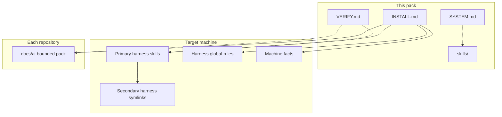

# AI Memory Skillpack

**The memory plane for Codex.**

A bounded, fail-closed project-memory system for [Codex CLI](https://github.com/openai/codex). Optional [Claude Code](https://code.claude.com/docs/en/overview) support on the same skill source.

[English](README.md) · [中文](README.zh.md)

[](LICENSE)
[](https://github.com/tudoumashu/ai-memory-skillpack/tags)
[](https://github.com/openai/codex)
[](INSTALL.md)

> An agent should remember a project the way a careful engineer does: a short brief, a map, a list of traps — not a diary that never ends.

Codex already writes code, reviews diffs, and triages failures. What it still lacks, out of the box, is a **durable, size-capped, attributed memory of the repo** that the next session can trust. This pack is that layer: skills, a constitution, an installer Codex can run unaided, and a verifier that fails closed.

Clone, then tell Codex:

> Read `INSTALL.md` in this pack and follow it to install the memory system on this machine.

No GUI. The installer is a program for the agent. Installs are reversible. No wiki? Only the project-memory skill is enabled.

## Why this belongs in the Codex ecosystem

Codex is strongest when the repo already knows how it wants to be maintained. This pack is that contract, written so an agent can **install, obey, and prove** it.

| Codex maintainer job | What this pack makes mechanical |
| --- | --- |
| Review a PR without rereading the whole tree | HOT snapshot + WARM `rg`, not a dump of `docs/ai/` |
| Keep releases and runbooks true | Bounded `docs/ai/` with replace-guards, not append-only notes |
| Survive a second session on the same repo | Handoff is one page, replaced in place; git is the ledger |
| Not leak secrets into “memory” | Constitution + sanitizer gate; writers are forbidden to store secret values |
| Upgrade the memory system later | Receipt hashes; your edits are kept; old packs are archived, not destroyed |

It is first-class Codex infrastructure: `AGENTS.md` sections, Codex skills, an agent-executable `INSTALL.md`, and `VERIFY.md` as acceptance — the same shape as a serious maintainer toolchain, not a prompt pack you paste once and forget.

## The failure it removes

Agents either forget the project between sessions, or they “remember” by appending to handoff notes and changelogs. Those files have no ceiling. The next session burns tens — sometimes hundreds — of thousands of tokens on yesterday’s residue before any real work starts.

That is not memory. It is context pollution with a git history.

| Naive agent notes | This system |
| --- | --- |
| Append-only handoff, unbounded | One-page snapshot, replaced in place |
| Parallel changelog files | Git commits are the ledger |
| Dump `docs/ai/` into context | HOT / WARM / COLD — most files are not read |
| Silent overwrite on upgrade | Receipt-based hash compare; your edits stay |
| “It installed, probably” | `VERIFY.md`: exit-code assertions, not vibes |

## What you get

- **A constitution, not a vibe.** [`SYSTEM.md`](SYSTEM.md) is the spec: tiers, byte budgets, attribution, replace-guards, “do not write secrets.” Skills do not outrank it.
- **An agent-native installer.** [`INSTALL.md`](INSTALL.md) is for Codex to execute: adapt paths, merge global rules, enable repos, write a machine receipt, roll back.
- **A verifier, not a checklist.** [`VERIFY.md`](VERIFY.md) is assertions with real exit codes. Pack bytes are pinned by [`SHA256SUMS`](SHA256SUMS).
- **One skill source, two harnesses.** Codex holds the files; a second harness gets symlinks. No forked copies.
- **Fail-closed upgrades.** Fresh / upgrade / migrate are different contracts. Older packs are sealed first.
- **Secret-hygiene as a boundary.** The optional coach path sanitizes learning records before they can reach a central wiki. The regression suite exists because this was treated as a security gate.

## Architecture

Four layers. Each has one job.



| Layer | What | Sharing rule |
| --- | --- | --- |
| Procedures | `ai-project-memory`, `llm-wiki`, `project-mastery-coach` | Real files on the primary harness; symlinks on the second |
| Machine facts | Local tooling baseline | One file; both harnesses point at it |
| Per-harness rules | Codex `AGENTS.md` / Claude `CLAUDE.md` memory sections | Separate on purpose — harness defaults are not identical |
| Repo packs | Per-repo `docs/ai/` | Independent; templates in `repo-templates/` |

### Read policy

| Tier | When it is read | Examples |
| --- | --- | --- |
| **HOT** | Whole-file, every session | `project-card.md`, `handoff.md` |
| **WARM** | `rg` to a section, never whole-file by default | architecture, runbook, gotchas, current ADRs |
| **COLD** | Only when the user explicitly traces history | `history/`, reports, screenshots, superseded ADRs |

Handoff is a **single snapshot** under a replace-guard (`flock` on an absolute lock path). It is not a log.

## Security and quality bar

This is the part a maintainer cannot fake with a prettier README.

- **Secrets never enter memory files.** The constitution forbids it. Shape-based sanitizers are a backstop, not the policy.
- **Upgrades cannot silently clobber your edits.** The install receipt is a hash table. Mismatches are reported and kept.
- **Acceptance is executable.** `VERIFY.md` fails closed. `tests/` exists so closed review findings cannot regress.
- **Integrity is pinned.** `sha256sum -c SHA256SUMS` is the first install gate.
- **Attribution is mandatory.** Every memory write carries a stable `harness/model` actor. History is not rewritten to flatter the present.

## Design tenets

Enforced in spec and in the verifier:

1. **Governance must cost less than the mess it prevents.** No mechanism without a reproduced failure.
2. **Closed failures become assertions.** A finding that is not executable will come back.
3. **Archive, do not destroy.** Over-budget files go to `history/`. Migrations seal first.
4. **Writers do not store secret values.** Sanitizers are the second line.

## Install

```bash
git clone https://github.com/tudoumashu/ai-memory-skillpack.git
cd ai-memory-skillpack
sha256sum -c SHA256SUMS
```

**Requirements:** Linux or WSL, bash ≥ 4.4, `git`, `rg`, `sha256sum`. Python ≥ 3.10 only for `project-mastery-coach`. macOS needs GNU `sha256sum` / `flock` / `readlink -f` and a newer bash, or the installer stops.

Then tell Codex:

> Read `INSTALL.md` in this pack and follow it to install the memory system on this machine.

| Case | Contract |
| --- | --- |
| **Fresh** | Never overwrite existing files; only merge and add |
| **Upgrade** | Receipt hashes decide what the pack may replace; your edits stay |
| **Migrate** | Archive the old pack first; content is not destroyed |

Adapter table, receipt schema, rollback: [`INSTALL.md`](INSTALL.md). Acceptance: [`VERIFY.md`](VERIFY.md).

No Obsidian vault? The installer skips `llm-wiki` and `project-mastery-coach` and installs **only** `ai-project-memory`. Wiki lint/query scripts are not in this repo.

Shipped skills contain **example** absolute paths and actor strings. Those are adapter source values, not a requirement to use those directories or models.

## Skills

| Skill | Role | When it installs |
| --- | --- | --- |
| **`ai-project-memory`** | Bounded `docs/ai/` in each repo: card, handoff, architecture, runbook, gotchas, ADRs | Always |
| **`llm-wiki`** | Query and write-back a local central wiki | Only with a wiki root that matches the contract |
| **`project-mastery-coach`** | Optional ownership training: question bank, spaced repetition, dashboards | Wiki + Python ≥ 3.10 |

If a skill text conflicts with [`SYSTEM.md`](SYSTEM.md), the constitution plus the machine’s adapter values win.

## Active maintenance

What you can verify in this repository without trusting a pitch:

- Tagged releases through **v1.25.1**; pack identity **v1.25**
- Agent-executable installer, constitution, and post-install verifier checked in as first-class files
- Coach-script regression suite under [`tests/`](tests/)
- MIT license, public source, no telemetry in the pack

```bash
sha256sum -c SHA256SUMS
bash tests/run.sh python3 skills/project-mastery-coach/scripts/project_mastery_state.py
```

Change a listed file → regenerate `SHA256SUMS`, or the installer integrity gate fails.

## Repository

| Path | Role |
| --- | --- |
| [`INSTALL.md`](INSTALL.md) | Agent-executable installer |
| [`SYSTEM.md`](SYSTEM.md) | Constitution |
| [`VERIFY.md`](VERIFY.md) | Post-install assertions |
| [`skills/`](skills/) | Skill sources |
| [`global/`](global/) | Harness global memory sections |
| [`repo-templates/`](repo-templates/) | Per-repo AGENTS section, Claude shim, ignore files |
| [`migration/`](migration/) | Procedure for machines that already have an older pack |
| [`tests/`](tests/) | Coach-script regression suite |
| [`SHA256SUMS`](SHA256SUMS) | Pack integrity |
| [`LICENSE`](LICENSE) | MIT |

## License

[MIT](LICENSE)
