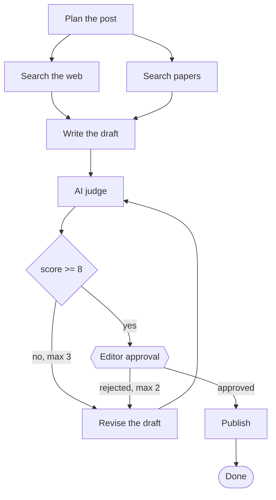
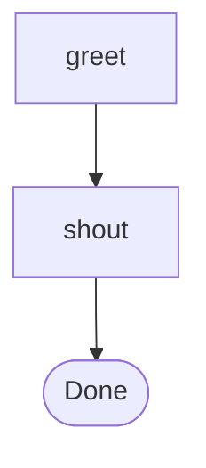

<p align="center">
  <a href="https://typemaid.pages.dev"></a>
</p>

<h1 align="center">TypeMaid</h1>

<p align="center">
  <b>Transform your Mermaid diagrams into AI workflows.</b><br>
  A TypeScript SDK: draw the flow, type each step, and run it with any LLM.
</p>

<p align="center">
  <a href="https://www.npmjs.com/package/typemaid"></a>
  <a href="https://www.npmjs.com/package/typemaid"></a>
  <a href="https://github.com/typemaid/typemaid/stargazers"></a>
  
  <a href="https://typemaid.pages.dev/docs/models/#providers"></a>
  <a href="https://github.com/typemaid/typemaid/blob/main/LICENSE.md"></a>
</p>

<p align="center">
  <a href="https://github.com/typemaid/typemaid/blob/main/.github/media/typemaid-launch.mp4">
    
  </a>
  <br>
  <sub>▶ <a href="https://github.com/typemaid/typemaid/blob/main/.github/media/typemaid-launch.mp4">Watch the 40-second launch video with sound</a></sub>
</p>

<p align="center">
  <a href="https://typemaid.pages.dev"><b>Website</b></a> ·
  <a href="https://typemaid.pages.dev/docs/getting-started/"><b>Quickstart</b></a> ·
  <a href="https://typemaid.pages.dev/docs/examples/research-writer/"><b>AI example</b></a> ·
  <a href="https://typemaid.pages.dev/docs/models/#providers"><b>Providers</b></a> ·
  <a href="https://typemaid.pages.dev/docs/"><b>Docs</b></a>
</p>

## A real AI workflow

The diagram is the program. Agents plan and write, two searches run at the same time, an AI judge scores the draft until it is good enough, and an editor approves it:



Each box is a typed export. An agent is a prompt and a Zod schema for the answer:

```ts
export const judge = agent({
  instructions: 'You are a strict editor. Score drafts from 1 to 10.',
  prompt: 'Score this draft and say what to improve:\n\n{draft}',
  output: z.object({ score: z.number(), feedback: z.string() }),
});
```

Run it with any AI SDK model: OpenAI, Anthropic, Gemini, Ollama, LiteLLM and more. It pauses for the editor, is saved, and resumes later:

```ts
const result = await run('./research-writer.mmd', tools, { topic: 'typed AI workflows' }, { model: openai('gpt-5-mini'), store });
// { status: 'paused', waitingAt: [{ node: 'approve', options: ['approved', 'rejected'] }] }
await resume(result.runId, tools, { decision: 'approved' }, { model: openai('gpt-5-mini'), store });
```

The full example, with its tests: [`examples/research-writer`](https://github.com/typemaid/typemaid/tree/main/examples/research-writer).

## Overview

typemaid runs workflows whose shape you can see. The flow lives in a `.mmd` file that any Mermaid viewer can draw; each box in the diagram is a TypeScript function checked with Zod.

- **The diagram is the program.** Branches, loops, parallel steps and for-each blocks are written in Mermaid. The control flow is compiled to plain JSON, so no model decides which step runs next.
- **Typed steps.** Each step declares its input and output with Zod. Problems in the diagram or the tools are reported before anything runs, with file, line and a suggested fix.
- **Pause and resume.** A run can wait for a person, be saved to SQLite, Postgres or libSQL, and continue later, even in another process.
- **Any LLM.** Agent steps and model calls inside tools use the Vercel AI SDK, so any provider it supports works: OpenAI, Anthropic, Gemini, Ollama, LiteLLM and more.
- **A viewer.** `typemaid view` opens a local, read-only page that draws your workflows, lists their steps and shows problems.

```
flows/hello.mmd   ──►   tools.ts (typed steps)   ──►   run()  ──►  completed | paused | failed
```

**Docs:** [getting started](https://typemaid.pages.dev/docs/getting-started/) · [durability](https://typemaid.pages.dev/docs/durability/) · [retries](https://typemaid.pages.dev/docs/retries/) · [stores](https://typemaid.pages.dev/docs/stores/) · [models](https://typemaid.pages.dev/docs/models/) · [FAQ](https://typemaid.pages.dev/docs/faq/)

Status: v0. The API may still change before 1.0; breaking changes are listed in the release notes.

## Install

```bash
npm i typemaid
```

npm and Bun install Zod with it. With pnpm or Yarn, add Zod yourself: `pnpm add typemaid zod`. Zod 4.2 or newer is required.

The workflow viewer is a separate, optional package, so projects that only run workflows stay small:

```bash
npm install -D @typemaid/view
```

| Runtime | What works | Checked by |
|---|---|---|
| Node 22+ | Everything | `bun run runtimes` on Node 22 and 24 |
| Bun 1.2+ | Everything | the test suite |
| Browsers, edge workers (Cloudflare, Vercel Edge) | The core: compile, check, run, pause and resume. Pass the diagram as text, not a file path. No SQLite store, CLI or viewer. | a sandbox with no Node APIs |
| Deno | Expected to work like Node; not tested yet | not checked |

The package is ES modules only. `require('typemaid')` works on Node 22.12+ and Bun.

| Import | What it is |
|---|---|
| `typemaid` | `run`, `resume`, `compile`, `check`, `tool`, `agent`, `human`, the memory store |
| `typemaid/ai` | `defineAI`: set the model once, for agent steps and for model calls inside tools |
| `typemaid/sqlite` | a store that keeps runs in a SQLite file |
| `typemaid/node` | file helpers used by the CLI and the viewer: find diagram files and load the tools file next to them |
| `@typemaid/view` | the workflow viewer (separate package) |
| `@typemaid/postgres` | a store that keeps runs in Postgres (separate package) |
| `@typemaid/libsql` | a store that keeps runs in libSQL or Turso (separate package) |

```
flows/hello.mmd     the diagram: what runs, in what order
flows/tools.ts       the steps: typed with Zod
index.ts             one call to run()
```

**`hello.mmd`** is plain Mermaid. It previews in any Mermaid viewer.



**`tools.ts`**: each node name in the diagram is an export here.

```ts
import { z } from 'zod';
import { tool } from 'typemaid';

export const greet = tool({
  input: z.object({ name: z.string() }),
  output: z.object({ greeting: z.string() }),
  run: ({ name }) => ({ greeting: `Hello, ${name}` }),
});

export const shout = tool({
  input: z.object({ greeting: z.string() }),
  output: z.object({ loud: z.string() }),
  run: ({ greeting }) => ({ loud: `${greeting.toUpperCase()}!` }),
});
```

**`index.ts`**

```ts
import { run } from 'typemaid';
import * as tools from './flows/tools.ts';

const result = await run('./flows/hello.mmd', tools, { name: 'Ada' });
// { status: 'completed', runId: '…', output: { name: 'Ada', greeting: 'Hello, Ada', loud: 'HELLO, ADA!' } }
```

Run it with Bun, which reads TypeScript directly:

```bash
bun index.ts
```

Or from the command line:

```bash
bunx typemaid run flows/hello.mmd --input '{"name":"Ada"}'
```

Bun is the tool used to develop and test this package. The built package also runs on Node 22.18 or newer.

## How data moves

Every step's output is merged into one shared set of fields. A step receives the fields its `input` schema names, picked out by name. Fields that no step produces must be passed to `run()`; you get an error before anything runs if one is missing.

## What you can draw

| In the diagram | Meaning |
|---|---|
| `a --> b` | run `a`, then `b` |
| `name[Any text]` | a step; `name` is the export it runs, the text is only a label |
| `first[$double]` | a step that runs the export `double` (to use one tool at two nodes) |
| `ok{"score >= 8"}` or `ok{passes}` | a decision; needs two arrows labelled `yes` and `no` |
| `ok -->\|no, max 5\| draft` | an arrow back makes a loop; every loop needs a `max` |
| two unlabelled arrows out of one node | run both branches at the same time; they join where they meet |
| arrows labelled `approved` / `rejected` out of a step | the step's `decision` output picks one |
| `([Done])` | a start or end marker; runs nothing |
| no `:::start` anywhere | the flow starts at the one node with no arrow into it; if every node is in a loop, at the node written first |
| `:::start` on several nodes | named entry points: `run(flow, tools, input, { start: 'webhook' })` |
| `subgraph each["for email in emails"]` + `class each foreach` | run the block once per list item, a few at a time |
| `:::agent`, `:::human` | optional; checked against what the export really is |

Conditions can compare fields with numbers (`10`, `-2.5`), text and `true`/`false`/`null` using `== != > >= < <=`, combine with `and or not`, use brackets, read nested fields (`user.age`) and `.length`. Text goes in single quotes: `{"status == 'ok'"}`. Or name an exported function `(ctx) => boolean`.

Anything else Mermaid allows (other arrow styles, `&`, click actions, directives, other shapes) is rejected with a message, never silently ignored. Styling lines (`classDef`, `style`, `linkStyle`, `direction`, frontmatter) are allowed and have no effect.

## Kinds of step

```ts
import { human, tool } from 'typemaid';

// Your code. `ctx.key` is the same if the step is retried or re-run after a crash.
export const charge = tool({
  input: z.object({ amount: z.number() }),
  output: z.object({ receipt: z.string() }),
  retries: 2,
  timeoutMs: 10_000,
  run: ({ amount }, ctx) => payments.charge(amount, { idempotencyKey: ctx.key, signal: ctx.signal }),
});

// Pauses the run until someone answers.
export const approve = human({ resume: z.object({ note: z.string().optional() }) });
```

## Model calls

Model calls go through the [Vercel AI SDK](https://ai-sdk.dev), so any provider it supports works. Install it and one provider:

```bash
npm install ai @ai-sdk/openai
```

Choose the model once, in your tools file:

```ts
import { openai } from '@ai-sdk/openai';
import { defineAI } from 'typemaid/ai';

export const ai = defineAI({ model: openai('gpt-5-mini') });
```

The provider is imported from the AI SDK's own package (`@ai-sdk/openai`, `@ai-sdk/anthropic`, `@ai-sdk/google`, ...). This package does not re-export them, so you install only the ones you use and control their versions.

**An agent step** asks the model for structured output. `{text}` is filled in from the shared fields.

```ts
export const summarize = ai.agent({
  instructions: 'You write short, factual summaries.',
  prompt: 'Summarize as bullet points:\n\n{text}',
  output: z.object({ bullets: z.array(z.string()) }),
});
```

**Inside any tool**, call the model with `ai.ask` (a checked object) or `ai.text` (plain text). Pass the tool's `ctx`, so the call is cancelled if the step times out or the run is cancelled.

```ts
export const triage = tool({
  input: z.object({ review: z.string() }),
  output: z.object({ sentiment: z.enum(['positive', 'negative']), reply: z.string() }),
  run: async ({ review }, ctx) => {
    const { sentiment } = await ai.ask(ctx, {
      prompt: `Is this review positive or negative? "${review}"`,
      output: z.object({ sentiment: z.enum(['positive', 'negative']) }),
    });
    const reply = await ai.text(ctx, { prompt: `Reply in one sentence to this ${sentiment} review: "${review}"` });
    return { sentiment, reply };
  },
});
```

**An agent can use AI SDK tools** while it works out its answer. A limit on turns is required.

```ts
import { tool as aiTool } from 'ai';

const stock = aiTool({
  description: 'Look up how many units are in stock.',
  inputSchema: z.object({ product: z.string() }),
  execute: async ({ product }) => inventory.count(product),
});

export const check = ai.agent({
  prompt: 'How many units of {product} are in stock?',
  tools: { stock },
  maxSteps: 4,
  output: z.object({ units: z.number() }),
});
```

What to know:

- Answers are checked against `output`. If one does not fit, the model is asked once more and told what was wrong; after that the step fails.
- Without `defineAI`, pass a model per agent (`agent({ model, ... })`) or per run (`run(flow, tools, input, { model })`). Inside tools, `ctx.ask` and `ctx.text` use that model.
- In tests, replace the model with a function: `run(flow, tools, input, { runAgent: async (request) => ({ bullets: ['a'] }) })`.
- The AI SDK is loaded only when a model call actually runs, so flows without model calls do not need it installed.

## Results, pausing and resuming

`run()` returns one of three shapes:

```ts
{ status: 'completed', runId, output }
{ status: 'paused',    runId, waitingAt: [{ node, fields, options }] }
{ status: 'failed',    runId, error: { code, message, node } }
```

```ts
import { resume } from 'typemaid';
import { sqliteStore } from 'typemaid/sqlite';

const store = sqliteStore('./runs.db');
const paused = await run('./flows/triage.mmd', tools, { ticketId: 'T-1' }, { store });
// later, even in another process:
await resume(paused.runId, tools, { decision: 'approved', note: 'ok' }, { store });
```

`resume()` also retries a failed run from the step that failed, and continues a run whose process died.

Without a `store`, runs are kept in memory and lost when the process exits. From the command line, pass `--store runs.db` to `run` if the flow can pause.

If the diagram text comes from someone you do not trust, call `compile(text)` yourself and pass the result to `run()`. A plain string passed to `run()` is read as a file when it ends in `.mmd` or `.mermaid` (or starts with `file:`), and as diagram text otherwise.

## Checking

```bash
bunx typemaid check flows
```

Reports problems with file, line and a suggested fix, and exits 1 on errors (`--json` for tools). It works in stages: all syntax problems first; once the syntax is clean, all structure problems (loops, starts, parallel blocks); then all tool and data problems.

```
flows/hello.mmd:2:13  error E1201  The box `shuot` needs a tool named `shuot`, and there is none in the tools you passed. Did you mean `shout`?
   2 |   greet --> shuot
     |             ^
```

The same checks run automatically inside `run()`.

## Seeing your workflows

```bash
npm install -D @typemaid/view
```

```bash
bunx typemaid view flows
```

Opens a page that draws your workflows. Give it one file and it opens on that diagram; give it a folder and it lists every workflow in it. The page updates when you save a file.


- **Diagram:** your Mermaid drawn by Mermaid itself, in its classic layout, with pan and zoom. Click a step to see what it reads, what it writes and where it goes next.
- **Steps:** every step in a table, with its kind and fields.
- **Problems:** the same checks as `check`, with a link to the line.
- **Source** and **Data:** the file with problem lines marked, and the raw data behind the page.
- Light and dark themes; works offline.

From code:

```ts
import { view } from '@typemaid/view';

const viewer = await view('./flows', { open: true });
console.log(viewer.url);
// later
await viewer.close();
```

What to know:

- **This computer only, read-only.** The page is served on `127.0.0.1`, accepts only read requests, refuses other websites and unexpected host names, and loads nothing from the internet.
- **Step details come from your tools file,** so that file's code is loaded. Pass `--no-tools` (or `tools: false`) to draw diagrams without loading any code.
- **No run history yet.** The viewer shows what a workflow is, not what its runs did. That, and exporting a single HTML file, come next.

### How the viewer is put together

The viewer lives in its own package, `packages/view`, published as `@typemaid/view`. It depends on the core; the core never depends on it. Both carry the same version and are released together. Without it, `typemaid view` prints how to install it.

The page is not tied to how the SDK works inside. It reads one small, versioned JSON format over HTTP, and that is all it knows.

| Piece (in `packages/view`) | Job |
|---|---|
| `src/contract.ts` | The JSON format. No imports. Has a `schemaVersion`. |
| `src/project.ts` | The one place that turns SDK results into that format. |
| `src/source.ts`, `source-fs.ts` | Where data comes from. Today: files on disk. |
| `src/handler.ts` | A standard `(Request) => Response` function serving `/api/v1/...` and the page. |
| `src/index.ts` | `view()`: starts a local server around the handler. |
| `ui/` | The page itself, built ahead of time into `dist/ui`. |

A hosted version can reuse the same page by serving the same `/api/v1` format from somewhere else. Tests enforce the boundaries: the viewer reaches the core only through `typemaid` and `typemaid/node`, the page may import only types from the contract, and the handler may import only the contract.

The page is built with only Mermaid's flowchart support. The other diagram types, the maths renderer and the larger layout engines are left out, which keeps it under 1 MB. The build fails if the page grows past 1.5 MB.

## Guarantees and limits (v0)

- **Deterministic control flow.** The diagram is compiled to plain JSON; no model decides which step runs next.
- **At least once.** If the process dies after a step ran but before its result was saved, that step runs again on resume. Use `ctx.key` with APIs that support idempotency keys.
- **A run finishes on the diagram it started with**, even if the file changes while it is paused.
- **For-each blocks are saved as a whole.** A crash in the middle re-runs the whole block. Human steps are not allowed inside one yet.
- **Values are JSON.** Dates become strings; `undefined` is dropped.
- Not built yet: schedules, generated types for `run()`, nested subgraphs, error arrows, `timeout` arrows, run history in the viewer.

## Development

Bun is used for installing packages, running code and testing.

```bash
bun install
```

```bash
bun run test
```

```bash
bun run test:live
```

```bash
bun run smoke
```

- `bun run view examples`: opens the viewer on the examples, straight from source.
- `bun run test`: builds, then runs unit, golden, property and crash tests with Bun's test runner; compares every accepted diagram with the official Mermaid parser. Set `UPDATE_GOLDEN=1` to rewrite the stored expected files.
- `bun run test:live`: one real model call. Needs `.env.live` (see `.env.example`). It is not named `.env` because Bun loads `.env` automatically, which would make every test run call the model.
- `bun run runtimes`: runs one program against the built package on Bun, each installed Node version, and a sandbox with no Node APIs.
- `bun run smoke`: packs every package, installs the core alone in an empty project and runs it there (and on Node, if installed), then adds the viewer and the two stores and checks those too.
- `bun run lint:pkg`: publint and Are The Types Wrong.
- Examples run directly: `bun examples/hello/index.ts`.

## Renaming

The product name, CLI name and accepted file extensions live in `src/brand.ts` (plus `package.json`). Stored runs and error codes do not contain the name. A test fails if the name appears anywhere else in `src/`. The viewer package also names the core in its imports and its `package.json`.

## Licence

Functional Source License 1.1, MIT future licence (`FSL-1.1-MIT`), in `LICENSE.md`.

- You may use, copy and modify this software, including inside your own commercial products.
- You may not offer it, or something built from it, as a commercial product or service that competes with it.
- Each release becomes available under the MIT licence two years after it is published.

The viewer page bundles third-party libraries (Mermaid, Preact and their dependencies), which remain under their own licences. Their licence texts are written to `packages/view/THIRD-PARTY-NOTICES.md` by the build and ship with that package.
