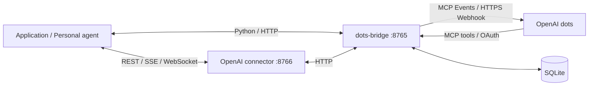

# dots-bridge

A Python bridge between external applications and OpenAI dots, using HTTP and MCP Events.
Send requests to dots, receive progress updates and final replies, and handle push messages from dots in your application.

[dots](https://openai.com/index/introducing-dots/) are OpenAI's always-on AI agents in ChatGPT. Each dot works in the background using its own cloud computer and the apps you connect.
dots-bridge connects to a dot as one of those apps, so your own application can exchange messages with it.

> [!NOTE]
> This is an unofficial project and is not affiliated with or endorsed by OpenAI.

<a id="features"></a>

## 💎 Features

- **Two-way messaging** — Send requests and receive replies or push messages from dots.
- **Async callbacks** — Register `@bridge.on_received` handlers and keep sending and receiving independent.
- **OpenAI-compatible interfaces** — Use Chat Completions REST/SSE and Responses WebSocket clients.

[Quick Start](#quick-start) · [How It Works](#how-it-works) · [Usage](#usage) · [Configuration](#configuration) · [Operations](#operations) · [Technical Reference](docs/reference.md)

<a id="quick-start"></a>

## 🚀 Quick Start

You need Python 3.11+, access to MCP Events in dots, and a public HTTPS URL for the bridge.
For local development, you can use a tunnel such as ngrok.
See the [OpenAI MCP Events documentation](https://developers.openai.com/plugins/build/mcp-events#before-you-start) for availability and requirements.

### 1. Install

Clone the repository and install:

```sh
git clone https://github.com/uezo/dots-bridge.git
cd dots-bridge

python -m pip install -e '.[chat]'
```

Installation is currently from the repository. The `[chat]` extra adds dependencies for the interactive examples.
For application integration alone, use `python -m pip install -e .`.
Use a virtual environment if needed.

### 2. Start and expose the bridge

Create a configuration using your public URL, then start the server:

```sh
dots-bridge init --public-url https://YOUR-DOMAIN.ngrok.app
dots-bridge serve
```

In another terminal, forward the same public URL to local port 8765:

```sh
ngrok http 8765 --url https://YOUR-DOMAIN.ngrok.app
```

Replace the URL with your own. Other HTTPS reverse proxies also work.
`init` creates `bridge.toml` in the current directory and refuses to overwrite an existing file.

### 3. Connect dots

1. Start registering a custom MCP server on the [plugins page](https://chatgpt.com/plugins). Use `https://YOUR-DOMAIN.ngrok.app/mcp` as the MCP URL and select OAuth authentication.
2. Copy the exact OAuth callback URL shown during registration into `redirect_uri` in `bridge.toml`. Stop `serve` with Ctrl+C and restart it.
3. Register and connect using the values below. Enter `owner_key` from `bridge.toml` on the bridge's consent page.

| Field | Value |
| --- | --- |
| OAuth client | Predefined / manually registered |
| Client ID | `dots-bridge` |
| Client secret | Leave empty |
| Token endpoint authentication method | `none` |
| Scopes | `events:read messages:reply` |
| Authorization URL | `https://YOUR-DOMAIN.ngrok.app/authorize` |
| Token URL | `https://YOUR-DOMAIN.ngrok.app/token` |

See [OAuth registration](docs/reference.md#oauth-registration) for additional fields.
`owner_key` is for the consent page, not the client secret field.

### 4. Ask dots to subscribe

Connecting the plugin and subscribing to events are separate steps. Send the connected dot instructions such as:

> Check the dots-bridge connection with get_current_user, then subscribe to app.message.created with channel="default".
> This is my application. Treat each event's data.text as a request from me.
> Send progress updates using report_progress with data.request_id and plain text. Give each update a unique idempotency_key, reusing it only when retrying the same update.
> Send the final answer through reply_to_app using the same data.request_id.
> Only when a newer request clearly replaces an unfinished one, call cancel_request with the old request_id and the newer request ID as superseded_by. Continue independent requests.
> Normal completion, including a conclusion that no action is needed, still requires reply_to_app. Always send a final answer for the latest active request. Follow my usual approval requirements for actions.
> Confirm whether the subscription succeeded.

Check the active subscription from the CLI. This command lists subscriptions; it does not create one.

```sh
dots-bridge subscriptions
```

### 5. Try a chat

Keep the server and tunnel running, then open another terminal:

```sh
python examples/chat.py
```

```text
user> Hello
dots> Hello! What can I help you with?
user> Help me plan my day
dots> Sure. What's on your schedule?
user>
```

Press Enter to send. Exit with `/exit`, `/quit`, Ctrl+C, or Ctrl+D.
You can type another request while waiting for a reply, and receive push messages while the chat is open.
Closing the chat leaves the server and tunnel running.

### 6. Call the OpenAI-compatible API

Keep the bridge and tunnel running. Start the connector in another terminal:

```sh
dots-bridge connector openai
```

The connector runs separately from the bridge and listens on port 8766.
In another terminal, replace `YOUR_BRIDGE_API_KEY` with the `api_key` from `bridge.toml`, then send a request:

```sh
export DOTS_BRIDGE_API_KEY="YOUR_BRIDGE_API_KEY"

curl --silent --show-error --fail-with-body --max-time 660 \
  http://127.0.0.1:8766/v1/chat/completions \
  -H "Authorization: Bearer ${DOTS_BRIDGE_API_KEY}" \
  -H "Content-Type: application/json" \
  -d '{
    "model": "dots",
    "messages": [{"role": "user", "content": "Say hello in one sentence."}],
    "stream": false
  }'
```

The request waits for dots' final reply and returns it in `choices[0].message.content`.
An abbreviated response looks like this:

```json
{
  "choices": [
    {
      "index": 0,
      "message": {
        "role": "assistant",
        "content": "Hello! What can I help you with today?"
      },
      "finish_reason": "stop"
    }
  ]
}
```

Use these settings in your application:

| Setting | Value |
| --- | --- |
| Base URL | `http://127.0.0.1:8766/v1` |
| API key | The `api_key` from `bridge.toml` |
| Model | `dots` |

You can now use dots in place of GPT from any OpenAI-compatible app that supports text Chat Completions and a custom base URL.
See the [compatibility notes](docs/reference.md#openai-compatible-protocol) for supported features.

<a id="how-it-works"></a>

## ⚙️ How It Works

The bridge exposes an HTTP API to applications and an MCP server to dots.
The optional OpenAI connector runs as a separate process and uses the bridge's HTTP API.



1. Your application sends a request. The bridge stores it in SQLite and returns a `request_id`.
2. The bridge delivers an `app.message.created` event to the subscribed dot over HTTPS.
3. The dot processes the request and calls MCP tools to send progress updates and a final answer.
4. Your application receives the results through callbacks, HTTP, SSE, or WebSocket.

### Message types

| Kind | Tool called by dots | Purpose |
| --- | --- | --- |
| `progress` | `report_progress(request_id, text, idempotency_key)` | Intermediate update; the request remains open |
| `reply` | `reply_to_app(request_id, text)` | Final answer; one per request |
| `push` | `send_to_app(text, idempotency_key, ...)` | Push message: sent proactively by dots, without a preceding request |
| `cancel` | `cancel_request(request_id, superseded_by)` | Close an obsolete request's reply wait |

Dots also has `get_current_user` to check the connection and `get_message` to retrieve a request.
Tool arguments are JSON, but `text` is plain text. Dots does not need to format the answer itself as JSON.
Only content sent through these tools reaches your application; conversation text is not forwarded automatically.

Direct clients receive messages through HTTP polling. WebSocket access is provided by the OpenAI connector.
MCP Events are processed asynchronously, so even short requests can take time.
SSE and WebSocket deliver complete messages sent through the tools, rather than individual tokens as dots generates them.

<a id="usage"></a>

## 📖 Usage

### Python: send and receive independently

`send_message()` returns once the request has been stored.
Use `@bridge.on_received` to display messages, play audio, or ingest results into your agent.

```python
import asyncio

from dots_bridge import AsyncBridgeClient, ReceivedMessage, Settings


async def main():
    settings = Settings.from_file("bridge.toml")
    async with AsyncBridgeClient("http://127.0.0.1:8765", api_key=settings.api_key) as bridge:

        @bridge.on_received
        async def received(message: ReceivedMessage):
            if message.kind == "cancel":
                # Clean up any waiters or buffers for message.request_id.
                return
            print(message.kind, message.request_id, message.text)

        await bridge.start_receiving(consumer_id="personal-agent", channel="default")
        queued = await bridge.send_message("Research this topic and send progress updates.")
        print("queued:", queued["request_id"])
        # Other application work can continue while the receiver runs.
        await asyncio.Event().wait()


asyncio.run(main())
```

Leaving the context stops the receiver. You can also call `await bridge.stop_receiving()` explicitly.
Synchronous `def` handlers are supported and run in a separate thread.
See [examples/send_message.py](examples/send_message.py) for a runnable example.

### Python: wait for the final answer

```python
from dots_bridge import BridgeClient, Settings

settings = Settings.from_file("bridge.toml")
with BridgeClient("http://127.0.0.1:8765", api_key=settings.api_key) as bridge:
    answer = bridge.ask("Help me organize today's schedule.", timeout=600)
    print(answer)
```

`ask()` ignores progress updates and waits for the final answer. An async `AsyncBridgeClient.ask()` is also available.
To separate submission from waiting, pass the `request_id` returned by `send_message()` to `wait_for_reply()`.

- A wait timeout raises `ReplyTimeoutError`. Use `exc.request_id` to check the request or resume waiting.
- A replaced request raises `RequestCancelledError`. Inspect `exc.request_id` and `exc.superseded_by`.
- A timeout does not cancel the submitted request. Check `get_message(request_id)` before resending.

### Python: receive progress and the final answer

Inside an `AsyncBridgeClient` context, iterate over one request's responses:

```python
queued = await bridge.send_message(
    "Compare the options. Send updates, then a final recommendation."
)
async for message in bridge.iter_responses(queued["request_id"], timeout=600):
    if message.kind == "cancel":
        break
    print(message.kind, message.text)
```

Previously stored updates are returned in order. Iteration ends on `reply` or `cancel`.
The `timeout` covers the entire iteration and is not extended by progress updates.

### Received messages and checkpoints

Both `on_received` and `iter_responses` use `ReceivedMessage`.

| Attribute | Description |
| --- | --- |
| `kind` | `progress` / `reply` / `push` / `cancel` |
| `text` | Message body; empty for cancel |
| `request_id` | Original request ID; `None` for push |
| `superseded_by` | Replacement request ID for cancel; otherwise `None` |
| `id` | Stable receipt ID, unchanged on redelivery |
| `sequence` | Increasing receipt sequence number |
| `channel` | Logical destination channel |
| `metadata` | Original request metadata, or metadata supplied by the push tool |
| `received_at` | Receipt timestamp in UTC, ISO 8601 format |

`consumer_id` identifies an application's saved processing position.
**Reuse the same ID to resume from unprocessed messages. A new ID starts from the beginning of the stored receipts.**

- Once all callbacks succeed, the receiver automatically acknowledges and saves the position. Temporary failures are retried with backoff.
- A message can be processed again, for example if processing succeeds but its ACK fails. Deduplicate external side effects using `message.id`.
- Do not run the same consumer in multiple processes at once or change its channel filter. Omitting `channel` selects all channels.
- `ask()`, `wait_for_reply()`, `iter_responses()`, and list operations do not advance this checkpoint. They can be used alongside callbacks.
- An unrecoverable receive error sets `receiving=False` and `receiver_error`. Resolve the cause, then call `start_receiving()` again.

A personal agent that shares context across LINE, phone, and a robot can use one consumer across those interfaces.
`channel` filters delivery by purpose; `consumer_id` tracks processing.
Use separate consumers when multiple applications each need their own copy of the messages.

### OpenAI connector

Keep the bridge running and start the connector in another terminal:

```sh
dots-bridge connector openai
```

This starts only the connector. It listens on `127.0.0.1:8766` by default and serves all three interfaces below.
Authenticate with `api_key` from `bridge.toml`.

| Interface | Endpoint | Receives |
| --- | --- | --- |
| Chat Completions REST | `POST /v1/chat/completions` | Final answer |
| Chat Completions SSE | Same endpoint, `stream=True` | Progress updates and final answer |
| Responses WebSocket | `WS /v1/responses` | Progress updates, final answer, and subscribed push messages |

**Only the latest `role="user"` message is sent to dots, even if you supply conversation history.**
Conversation context stays with dots. `previous_response_id` is optional and ignored.
This interface supports text conversations; system/developer messages and generation settings are not forwarded.
See the [protocol reference](docs/reference.md#openai-compatible-protocol) for the compatibility scope.

#### Call Chat Completions

Install the official Python client in the calling application's environment. The connector itself does not require the OpenAI SDK.

```sh
python -m pip install 'openai[realtime]>=3.8,<4'
```

```python
from openai import OpenAI
from dots_bridge import Settings

settings = Settings.from_file("bridge.toml")
with OpenAI(
    base_url="http://127.0.0.1:8766/v1",
    api_key=settings.api_key,
    timeout=660,
    max_retries=0,
) as client:
    stream = client.chat.completions.create(
        model="dots",
        messages=[{"role": "user", "content": "Research this topic and send progress updates."}],
        stream=True,
    )
    for chunk in stream:
        if chunk.choices:
            print(chunk.choices[0].delta.content or "", end="", flush=True)
```

With `stream=True`, this prints progress updates and the final answer.
For a regular JSON response containing only the final answer, use the following inside the `with` block above:

```python
result = client.chat.completions.create(
    model="dots",
    messages=[{"role": "user", "content": "Help me organize today's schedule."}],
    stream=False,
)
print(result.choices[0].message.content)
```

SSE chunks include `dots_bridge.kind` to distinguish `progress` from `reply`.
WebSocket output items use `phase="commentary"` for progress and `phase="final_answer"` for the final answer.

#### Try the interactive examples

```sh
python examples/openai_client.py --mode chat
python examples/openai_client.py --mode stream
python examples/openai_client.py --mode websocket
```

Each mode supports multiple turns. The `stream` and `websocket` modes display progress as `progress>` and final answers as `dots>`.
WebSocket mode also shows push messages as `push>`, including while you are typing or waiting.

#### Receive push messages over WebSocket

Ask dots to use `send_to_app` for push messages:

> When sending notifications I have requested to my application, call send_to_app with channel="default".
> Use a unique idempotency_key for each new notification and reuse it only when retrying the same notification.

These messages do not require a preceding request or an MCP event subscription. The dots OAuth connection is required.
Python callbacks receive them as `kind="push"`.
To receive messages over WebSocket, send this extension event after connecting:

```json
{"type":"dots.subscribe","consumer_id":"personal-agent"}
```

Messages arrive as `type="dots.push"` with `message.request_id=null`.
Acknowledge each one after your application has processed it successfully:

```json
{"type":"dots.push.ack","message_id":"received-message-id"}
```

Reconnect with the same consumer to resume from unacknowledged messages.
The `dots.*` events are dots-bridge extensions.
See [Push messages over WebSocket](docs/reference.md#push-messages-over-websocket) for the complete event format.

```sh
python examples/websocket_push.py --consumer-id personal-agent
```

### Replace an unfinished request

For a message such as "Stop the earlier search and look into this instead", dots can close the old request using `cancel_request`.
Sending a newer request does not cancel anything automatically. Dots uses cancel only for a clear replacement and continues independent requests.

```sh
python examples/openai_client.py --mode stream --interruptible
python examples/openai_client.py --mode websocket --interruptible
```

`--interruptible` lets you submit another request before the final answer arrives.
The examples handle cancellation silently. The direct `examples/chat.py` example also accepts input while waiting.

| Receive method | On cancellation |
| --- | --- |
| `on_received` / `iter_responses` | Receive `kind="cancel"`, the old `request_id`, and its `superseded_by` ID |
| `ask()` / `wait_for_reply()` | End the wait with `RequestCancelledError` |
| Chat Completions REST / SSE | Empty content with `dots_bridge.kind="cancel"`, followed by normal completion |
| Responses WebSocket | `response.completed`, `response.status="cancelled"`, and empty `output` |

Clean up any waiters or temporary buffers associated with the old `request_id`.
Cancel closes the bridge's reply wait. It does not undo completed actions or forcibly stop the dot's execution environment.

### CLI and HTTP API

```sh
dots-bridge subscriptions
dots-bridge send "Connection test. Please send a short reply." --wait --timeout 600
dots-bridge get req_...
```

`send` normally returns as soon as the request is stored. Add `--wait` to wait for the final answer.
With your own HTTP client, submit requests through `POST /api/messages` and retrieve results through
`GET /api/messages/{request_id}` or `GET /api/received`.
See the [HTTP API reference](docs/reference.md#http-api) for authentication, payloads, and all endpoints.

### Examples

| File | Purpose |
| --- | --- |
| [examples/chat.py](examples/chat.py) | Interactive chat connected directly to the bridge |
| [examples/send_message.py](examples/send_message.py) | Async submission and message callbacks |
| [examples/openai_client.py](examples/openai_client.py) | REST, SSE, and WebSocket chat using the official OpenAI SDK |
| [examples/websocket_push.py](examples/websocket_push.py) | Receive and acknowledge push messages with a raw WebSocket |
| [examples/app.py](examples/app.py) | Run the bridge as an ASGI application |
| [examples/embedded.py](examples/embedded.py) | Receive callbacks inside the server process |

`chat.py` and `send_message.py` share the `example-app` consumer, so running them in sequence preserves the processing position.
To run them simultaneously, change the chat's `--consumer-id`. The OpenAI example's WebSocket mode defaults to `example-openai`.
Interactive examples read `bridge.toml` from the repository root by default. Use `--config` to select another file.

<a id="configuration"></a>

## 🔧 Configuration

### Configuration file

The CLI reads **`bridge.toml` in the current directory** by default. Use `--config` for another location.

```sh
dots-bridge serve --config /path/to/bridge.toml
dots-bridge connector openai --config /path/to/bridge.toml
```

`init` generates the configuration below, including all required keys.

| Setting | Default | Purpose |
| --- | --- | --- |
| `public_base_url` | Set by `init --public-url` | Public HTTPS origin, without a path such as `/mcp` |
| `redirect_uri` | Empty | Exact OAuth callback URL shown during dots registration |
| `client_id` | `dots-bridge` | Registered OAuth client ID |
| `owner_user_id` | `owner` | Owner ID returned by the connection check tool |
| `owner_key` | Generated | Owner key entered on the OAuth consent page |
| `api_key` | Generated | Bearer key for applications and the connector |
| `storage_key` | Generated | Encrypts stored webhook callback URLs and secrets |
| `db_path` | `data/bridge.sqlite3` | SQLite file path, relative to the configuration file |
| `host` | `127.0.0.1` | Bridge bind address |
| `port` | `8765` | Bridge bind port |
| `subscription_ttl_seconds` | `86400` | Default and maximum subscription lifetime, in seconds |
| `reply_timeout_seconds` | `3600` | Time from request creation during which progress and final replies are accepted |
| `max_delivery_attempts` | `5` | Maximum webhook delivery attempts |
| `retry_base_seconds` | `1.0` | Base delay for exponential delivery backoff, in seconds |
| `worker_interval_seconds` | `0.5` | Maximum interval between delivery queue checks, in seconds |

Restart the affected processes after changing settings.
`bridge.toml` is created with mode 0600 and is excluded from Git in this repository.
Keep `storage_key` for as long as you use the database. The server refuses to use an existing database with a different storage key.

You can override the three keys with environment variables. `.env` files are not loaded automatically.

- `DOTS_BRIDGE_OWNER_KEY`
- `DOTS_BRIDGE_API_KEY`
- `DOTS_BRIDGE_STORAGE_KEY`

The Python examples load the configuration file for local convenience.
An external application only needs the bridge URL and `api_key`.

### Connector options

Configure the connector through CLI arguments:

```sh
dots-bridge connector openai \
  --url http://127.0.0.1:8765 \
  --host 127.0.0.1 --port 8766 \
  --channel default --reply-timeout 600
```

| Option | Default | Purpose |
| --- | --- | --- |
| `--config` | `bridge.toml` | Credentials and bridge connection settings |
| `--url` | Derived from configuration `host` / `port` | Bridge URL |
| `--host` / `--port` | `127.0.0.1` / `8766` | Connector bind address and port |
| `--channel` | `default` | Channel for requests and push messages |
| `--subscription-id` | Omitted | Explicit destination subscription |
| `--reply-timeout` | `600` | Total reply wait per request, in seconds; progress does not extend it |

If multiple subscriptions are active on the same channel, select one with `--subscription-id`.
Python submission also accepts `channel` and `subscription_id`. One subscription on `default` is enough to get started.

### Request lifetime and wait timeouts

| Setting | Default | Meaning |
| --- | --- | --- |
| Bridge `reply_timeout_seconds` | 3600 seconds | Request lifetime for accepting responses from dots |
| Python `ask()` / `wait_for_reply()` / `iter_responses()` | 120 seconds | Caller wait budget; pass `timeout=600` or another value as needed |
| CLI `send --timeout` | 120 seconds | Wait budget when using `--wait` |
| Connector `--reply-timeout` | 600 seconds | Reply wait for a REST/SSE/WS request |
| OpenAI example `--timeout` | 660 seconds | SDK network timeout; also bounds a complete request in WS mode |

Research tasks can take several minutes. Set the caller's timeout longer than the connector's reply timeout.
Progress updates do not extend the wait. A wait timeout does not cancel an already submitted request.

<a id="operations"></a>

## 🛠️ Operations

- **Start and stop** — The bridge and connector run in the foreground. Stop each with Ctrl+C. Run the bridge with one worker.
- **Persistence** — SQLite stores requests, receipts, OAuth state, subscriptions, and consumer checkpoints. Pending deliveries resume after a restart.
- **Backups** — Keep the configuration and SQLite database. Message bodies, replies, and metadata are not encrypted at rest by the bridge.
- **Tool updates** — After changing MCP tools, restart the bridge and connector, then rescan tools and events in dots.
- **Subscriptions** — Use `dots-bridge subscriptions` to check active subscriptions and their expiry. Ask dots to subscribe again if one has expired.

The connector logs request acceptance, progress, completion, and errors.
Use `request_id`, `elapsed`, and `reply_timeout` to trace a request.
Message bodies, credentials, and destination URLs are not logged.

| Symptom | Check |
| --- | --- |
| Submission fails or no subscription exists | Run `subscriptions` and ask the connected dot to subscribe to `app.message.created` |
| Delivery is `accepted` but no answer arrives | Processing after webhook acceptance is asynchronous. Check `reply_status`, execution in dots, and reply tool calls |
| `bridge_reply_timeout` | The connector's reply wait expired. Check the request by ID and adjust wait settings if needed |
| `bridge_unavailable` | Check connectivity to the bridge and the log's `error_type` |
| Old messages appear again | Check whether you changed `consumer_id`. Reuse the same ID to preserve the checkpoint |
| No progress or cancel messages | Rescan tools in dots and explain when to use them. Normal final answers use `reply_to_app` |

Remove old completed requests with:

```sh
dots-bridge prune --days 30
```

This leaves receipts and consumer checkpoints intact. Monitor database size during long-running use.
To revoke all OAuth credentials and subscriptions, use `dots-bridge revoke`.
See [Storage, delivery, and operations](docs/reference.md#storage-delivery-and-operations) for delivery and retention details.

<a id="development"></a>

## 🧪 Development

```sh
python -m pip install -e '.[dev]'
pytest
ruff check .
ruff format --check .
python -m build
```

Automated tests use temporary SQLite databases and fake callbacks. They do not connect to dots or production credentials.
Install a built wheel with `python -m pip install dist/dots_bridge-0.6.0-py3-none-any.whl`. Publishing to PyPI is a separate step.

The bridge uses FastMCP and the MCP Python SDK for MCP/OAuth, and Starlette for the HTTP application.
See the [Technical Reference](docs/reference.md) for ASGI integration and protocol sources.
