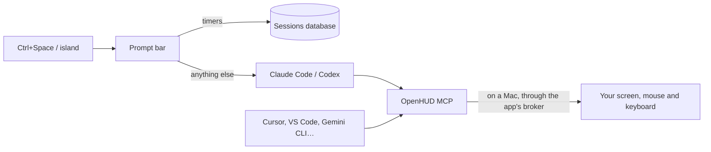

<p align="center">
  
</p>

<h1 align="center">OpenHUD</h1>

<p align="center"><b>The heads-up display for AI agents.</b><br>
OpenHUD lets Claude Code, Codex, Cursor or any MCP agent see your screen, move the mouse and type,<br>
so it can do anything that needs a person at the computer, or teach you how while you click.</p>

<p align="center">
  <a href="https://github.com/ultron-hq/openhud/actions/workflows/ci.yml"></a>
  
  <a href="https://github.com/ultron-hq/openhud/releases/latest"></a>
  <a href="#license"></a>
</p>

<p align="center"><a href="https://openhud.vercel.app">Website</a> · <a href="https://openhud.vercel.app/docs">Docs</a> · <a href="https://discord.gg/32uFQ8PUQB">Discord</a> · <a href="#install">Install</a> · <a href="ROADMAP.md">Roadmap</a> · <a href="CONTRIBUTING.md">Contributing</a></p>

## Install

| | |
| --- | --- |
| **macOS** (the app, with everything inside) | `curl -fsSL https://openhud.vercel.app/mac.sh \| sh` |
| **Windows** | `irm https://openhud.vercel.app/install.ps1 \| iex` |
| **Linux** | `curl -fsSL https://openhud.vercel.app/install.sh \| sh` |

Or download the `.dmg`, Windows setup or Linux `.AppImage`/`.deb` from the
[latest release](https://github.com/ultron-hq/openhud/releases/latest). Setup connects your AI apps;
on a Mac you allow Screen Recording and Accessibility **once, for OpenHUD**, and every AI app works
through it.

Then ask your agent:

```
/openhud        fill in this form from invoice.pdf
/openhud-teach  show me how to add RSI on TradingView
/openhud-post   announce v2 on X with ~/Videos/demo.mp4
```

> [!NOTE]
> OpenHUD started as **Ultron**, a personal desktop agent written in Python (a flip-clock island,
> a Ctrl+Space prompt bar, voice, memory). Its Hands, the part that lets an AI use the computer,
> became this project. The rest of that app is being rewritten here in Rust, one unit at a time,
> each checked against the original before it ships with
> [rust-anything](https://github.com/erkamyaman/rust-anything). See the [roadmap](ROADMAP.md).

## How OpenHUD works

Claude Code, Codex and other agents can edit files but can't click. OpenHUD gives them a mouse
and keyboard: an [MCP](https://modelcontextprotocol.io) server that lets any agent see the screen,
click, scroll and type. It works in a loop: a screenshot (the pointer marked by a red ring), one
action, then another look to check it worked.

**Setup** (it runs after install, and again any time you run `openhud`):

1. checks this computer can be seen and controlled,
2. finds your agents and connects every one: **Claude Code, Codex, Cursor, VS Code, Windsurf,
   Claude Desktop and Gemini CLI**. It merges into their configs and never replaces another
   server without asking,
3. adds the three skills to Claude Code and Codex and tells you what to ask first.

Agents confirm each action unless you opt in (answer "y" in setup, or `openhud setup --approve`).
Every config is backed up once (`.bak`) before the first change.

**On a Mac**, the OpenHUD app runs Hands for every agent, so macOS asks for Screen Recording and
Accessibility once, for OpenHUD, instead of once for Terminal, iTerm, Cursor, Claude and the rest.

**You always see it working.** While an agent works, an orange frame glows around the screen and a
"OpenHUD is using your mouse" tag follows the pointer. Both are click-through and hidden from the
agent's own screenshots.

**Skills**

| Skill | What it does |
| --- | --- |
| `/openhud` | Do it for me: forms, settings, apps without an API |
| `/openhud-teach` | Show me how: a glowing box and caption on each button; you do the clicking |
| `/openhud-post` | Post on X, LinkedIn, Threads or Bluesky from your own logged-in browser |

**Commands**

| Command | What it does |
| --- | --- |
| `openhud` | Setup again (connects agents you installed since) |
| `openhud stop` / `resume` | Kill switch: every click and keystroke is refused until you resume |
| `openhud log` | What it did, most recent last |
| `openhud doctor` | Check the screen, input and permissions |
| `openhud agents` | Which agents are connected |
| `openhud connect <agent>` / `disconnect <agent>` | One agent at a time |
| `openhud skills` | Reinstall the skills |

**Safety:** the kill switch, a read-only mode (`OPENHUD_READONLY=1`, Teach still works), a rate
limit, no shell tool, and a local log of every action in which typed text is stored only as its
length. All 18 tools are in the [docs](https://openhud.vercel.app/docs#tools).

**Tested** on every change on real Windows, macOS (Apple silicon and Intel) and Ubuntu desktops,
and before releases on Ubuntu, Debian, Fedora, Arch, openSUSE and Alpine.

## Build from source

Any OS with Rust 1.85+ (on Linux the app also needs WebKitGTK:
`sudo apt install libwebkit2gtk-4.1-dev libayatana-appindicator3-dev librsvg2-dev libxdo-dev`):

```sh
git clone https://github.com/ultron-hq/openhud
cd openhud
cargo build --release -p openhud          # the MCP server and CLI
cargo build --release -p openhud-app      # the desktop app
```

## The desktop app

The OpenHUD app (`.dmg`, Windows setup, `.AppImage`/`.deb`, with the MCP server inside) adds:

- **The island:** a small flip clock at the top of the screen. It shows the time, or your timer.
- **<kbd>Ctrl</kbd>+<kbd>Space</kbd>:** a prompt bar. Timers ("start a 25 minute timer for
  review"), the stopwatch, pause, resume and stop are answered on the spot and logged; anything
  else goes to Claude Code or Codex, which can use the computer through OpenHUD.
- **A welcome window** on first run: move to Applications (Mac), connect your AI apps in one
  click, allow the two Mac permissions once, start at login.



Coming from the original app, unit by unit: memory, the router and app matching, voice, and the
reports. The plan is in [ROADMAP.md](ROADMAP.md), the decisions in
[rust/DECISIONS.md](rust/DECISIONS.md), and each unit's status in [rust/MAP.md](rust/MAP.md).

## Models

| Provider | Needs |
| --- | --- |
| Claude Code CLI (default) | `claude` on your `PATH`, your Claude plan |
| Codex CLI | `codex` on your `PATH` |
| Local (Ollama or any OpenAI-compatible server) | the server's URL |
| API key (Anthropic, OpenAI, Gemini, OpenRouter, …) | a key, stored in your OS keychain |

Each role (router, desktop agent, team) can use a different one. See [docs/providers.md](docs/providers.md).

## Safety

OpenHUD can move your mouse and type. Every change must keep these rules:

- Actions that delete, send, buy or post run only when the request came from you, never from
  text it read on screen or in a web page.
- `touch ~/.cache/openhud/hands.stop` (or the tray's **Stop**) halts all desktop control at once.
- Every action is logged locally; typed text is never logged.
- Abilities it writes for itself run in a WebAssembly sandbox with only the permissions you grant.

Found a security problem? See [SECURITY.md](SECURITY.md).

## Contributing

Come say hi and see what's coming on [Discord](https://discord.gg/32uFQ8PUQB).

Contributions are welcome, from a typo to a whole platform backend. Start with
[CONTRIBUTING.md](CONTRIBUTING.md), pick an `open` unit in [rust/MAP.md](rust/MAP.md) or an issue
labelled `good first issue`, and say in the issue that you are taking it.

## License

Licensed under either of [Apache License 2.0](LICENSE-APACHE) or [MIT license](LICENSE-MIT) at
your option. Unless you state otherwise, any contribution you submit for inclusion is dual
licensed as above, without any additional terms or conditions.
