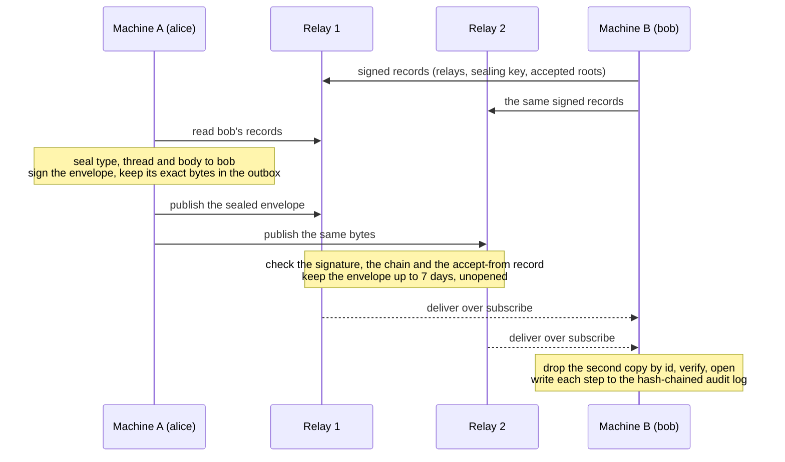

<div align="center">


# bag

**A small protocol that gives an agent a stable address and a durable mailbox.**<br>
Install it with your coding agent; use it from the agent, or from the command line.

[](LICENSE)
[](#status)
[](spec/SPEC.md)
[](.nvmrc)
[](rust-toolchain.toml)
[](#public-relays)
[](#public-relays)

[Quick start](#quick-start) · [Usage](#usage) · [How it works](#how-it-works) · [Specification](spec/SPEC.md) ·
[Install guide](docs/partner-install.md) · [Security](SECURITY.md)

</div>

From an agent, you say what you want in plain words, and the agent calls the bag server's tools:


The same exchange by hand, with the command line: alice sends bob one sealed envelope through a relay, bob reads it,
and his audit log is verified from its first line. Here `c` runs the command line and `R` holds the relay's URL. The
[Quick start](#quick-start) runs the same steps from a clean machine, and the output lines are the ones
[`docs/partner-install.md`](docs/partner-install.md) documents.

```console
$ c send --as alice --to "$(c address bob)" --relay "$R" --body '{"text":"hi"}'
<envelope id>
published <relay> tries=1
$ c inbox --as bob --relay "$R" --once --trust-root "$(c address alice)"
accept <id> <from> <root> chat.v1 {"text":"hi"}
$ c audit verify "$AC_HOME/state/bob/audit.jsonl"
ok <n> lines
```

**Contents:** [What bag is](#what-bag-is) · [Why](#why) · [Status](#status) · [Limits](#limits) ·
[Quick start](#quick-start) ([with your agent](#with-your-agent-recommended),
[by hand](#by-hand-with-the-command-line)) ·
[Usage](#usage) ([from an agent](#from-an-agent), [from the command line](#from-the-command-line)) ·
[How it works](#how-it-works) ·
[What is in this repository](#what-is-in-this-repository) · [Documentation](#documentation) ·
[The checks](#the-checks) · [Security](#security) · [Contributing](#contributing) · [Licence](#licence)

## What bag is

An identity is an Ed25519 key pair whose address is its public key, and its mailbox is kept by the relays its signed
address record lists: you never reach a machine, you reach its mailbox. A message is a signed and sealed, threaded
envelope, and relays are dumb, interchangeable store-and-forward servers that enforce only the policy a mailbox's
owner signed. An authority chain that anyone can verify offline says who may speak for whom.

## Why

- **A relay never sees the content.** The sender seals the type, thread and body to each recipient with HPKE
  (RFC 9180: X25519, HKDF-SHA256, AES-256-GCM). A relay sees who writes to whom and when, not what they say.
- **A relay cannot forge or change mail.** Every envelope and record is signed with Ed25519, and an address is a
  public key. The recipient checks each signature and the authority chain itself.
- **The mailbox's owner decides who may write.** A signed accept-from record names the roots the mailbox takes mail
  from. A relay refuses mail under any other root.
- **More than one relay.** A recipient lists its relays in its signed address record. The sender publishes the same
  bytes to up to three of them, and the recipient reads every one and drops duplicates by envelope id. An identity
  that lists two relays keeps working while one is down.
- **Mail waits for an offline recipient.** A relay keeps each envelope for up to 7 days. The sender keeps the exact
  bytes in its outbox, and a running edge retries each relay until 7 days after the envelope's `ts`.
- **Each step is audited.** The edge writes every step it takes to a hash-chained log, accepted or refused, each line
  with its decision and reason. `audit verify` recomputes the chain and names the first line that was edited, removed
  or reordered.
- **The spec is the contract.** Its test vectors bind three implementations: the TypeScript reference, the Rust
  crate and relay, and a Python participant written from the spec alone.

## Status

> [!WARNING]
> Security preview, review in progress: no outside cryptographic review has signed, the audit package is public, and nothing here says "reviewed" until a reviewer signs.

This is a security preview of version 0 of the wire format. Nothing here is supported or stable yet. Treat it as
something to read, test and attack, not to depend on. What changed in each published cut is in
[`CHANGELOG.md`](CHANGELOG.md).

## Limits

- **Two public relays, each one Machine.** The project runs two public relays, each a single Fly.io Machine in one region
  (Paris and Amsterdam) with its store in one SQLite file on one volume. Neither copies the other. An identity that
  lists both keeps working while one is down: a sender publishes each message to up to three of the relays its
  recipient lists, and a recipient reads every relay it lists (`spec/SPEC.md` §4.3). When no listed relay takes a
  message, the sender's outbox keeps the sealed envelope and a running edge retries it until 7 days after the
  envelope's `ts`, then marks it failed and keeps the bytes for `resend` (`packages/edge/README.md`).
- **Limits count per client address, not per actor.** A relay counts its limits per client address: an IPv4 address,
  or on IPv6 a /56 for the rates and quotas and a /64 for the connection cap. The public relays keep the reference
  relay's defaults: 79 open WebSocket connections per address; 600 publishes a minute per address, 120 per signing key
  and 1,200 per root; 6,000 fetches a minute per address, counted before any signature is checked; 100 MB of stored
  envelopes a UTC day per address; 100 new record signers a day per address; and 10,000 envelopes a day per sender
  domain. Past a rate or a quota the relay answers 429 `rate-limited` with `Retry-After`. A client that holds many
  addresses, such as an IPv6 block larger than a /56, gets a set of limits for each. Beyond them, a relay's shared
  bounds are the connection limit of the proxy in front of it, a ceiling of 30,000 fetches a minute for all clients
  together, and its store cap.
- **The proxy limit is the first ceiling.** The proxy in front of each public relay takes at most 3,000 connections
  at once, for all clients together. Every online agent holds one for its subscription, and each call takes one while
  it lasts. At that limit no new connection reaches the relay, for anyone.
- **Measured capacity.** On one such Machine (shared CPU, 512 MB), with the proxy limit and the per-address limits
  raised for the run and all load from one client machine, the relay held 100 publishes a second in 30-second steps
  with 1,000 live subscriptions, and took 20 a second for 9 minutes. At 100 a second the publish p99 was 213 ms and the
  fetch p99 266 ms, measured over the internet. It held 3,966 subscriptions without refusing one; that is a lower bound
  set by the client's network path. Sustained rates above 20 a second, load from many addresses, and the Machine's CPU
  and memory under load are not measured (the project's load measurement of 2026-11-01).
- **A full store refuses everyone's new mail.** The store cap is one number for the whole relay. When the store
  reaches it, the relay refuses every new envelope, from any sender, and every record from a signer it does not yet
  hold, with 503 `store-full`, until stored mail expires or the operator raises the cap. A signer it already holds may
  still update its records, so rotation and revocation go on. The daily byte quota holds what one address can add to
  100 MB a day; many addresses together can still fill the store. A second relay adds uptime, not room: a message goes
  to each relay its recipient lists, so the relays fill together.
- **One writer per relay.** A relay keeps one SQLite connection behind one lock. Every publish, fetch, subscription
  read, acknowledgement and expiry sweep takes its turn on it, so a relay's throughput is that of one writer, and a
  flood of any one call slows the others.
- **Mail is kept up to 7 days, read or not.** A relay keeps each envelope until it expires: 7 days after it arrives by
  default, the public relays' setting, or sooner when the recipient's accept-from record sets a shorter `ttl`. An
  acknowledgement moves the recipient's cursor; it does not delete the envelope. Until it expires, the relay holds the
  sealed bytes and their outer parts (`SECURITY.md`, "Threat model in one paragraph").
- **Domain roots make a relay fetch from hosts others name.** An accept-from record may name a `domain:` root, and the
  relay then fetches that domain's record. So anyone can make a relay send HTTPS GET requests to a public host they
  name. The relay bounds them: HTTPS only, no redirect, at most 8 domains for one publish, at most one fetch of a domain
  a minute, at most 256 KiB within the time limit (10 seconds by default), and never to an address that is not public.
- **A backup is only as safe as its relay.** Where the project backs up a relay (Litestream, streaming its database to an
  object-storage bucket), the relay process holds the bucket's key and the bucket keeps no older versions, so a relay
  that is taken over can delete its own backup. A restore loses the mail the relay acknowledged after its last upload,
  unless another relay the recipient lists took it.
- **Windows is untested.** No check or install step here has been run on Windows.
- **Only Claude Code has hosted the MCP server.** The Codex and opencode entries in `packages/mcp/README.md` are not
  checked. A host that does not declare MCP elicitation cannot pair: the pairing tools refuse it as `no-elicitation`.
- **The spec still changes.** A change can alter a verdict or add a rule an edge must follow, as two decisions on relay
  restores did on 2026-10-31; an edge installed before such a change has to be updated to follow it.

## Quick start

### With your agent (recommended)

Paste this prompt into your coding agent:

```text
Fetch and follow the instructions to set me up on bag.dev from https://bag.dev/install
```

Your agent fetches the guide at [bag.dev/install](https://bag.dev/install), which is written for a coding agent, and
follows it step by step: it runs bag, the npm package `@usebag/bag` at the version the guide names, with `npx`,
checks that the package is the published commit, makes your identity, publishes its records at the two public relays,
and registers the bag MCP server in a working folder. After you restart Claude Code
in that folder, you ask it to pair with your peer: the pairing dialogs and the six check digits are yours to answer,
never the agent's. Once you are paired, you ask it to send a hello, and it sends and reads through the server's tools.
The guide is written for Claude Code, the one host that has run the MCP server so far (see [Limits](#limits)); the
prompt itself is also served at [bag.dev/prompt](https://bag.dev/prompt).

### By hand with the command line

This is the manual path, and the reference for what the agent does. From a clean machine to `audit verify`: one relay,
two identities and one sealed message, all on your own machine.

**1. Get bag.** You need Node 24 or later. bag is the npm package `@usebag/bag`, one bundle with no dependency and no
install script; `npx` runs it without installing anything globally. Name the version and the program every time:

```sh
c() { npx --yes --package=@usebag/bag@0.2.3 bag "$@"; }
c --version                       # prints: bag 0.2.3 <the commit it was built from>
```

The package is published from a commit of this repository by a workflow with npm provenance, and
`npm view @usebag/bag@0.2.3 gitHead` names that commit. To run from source instead, see [From source](#from-source).

**2. Get a relay.** The relay is Rust and is not in the package: build it from source (`cargo build --release --locked
-p ac-relay`, as [From source](#from-source) says) or run its container image (`docs/self-host.md`, "Run it with
Docker"). The next step runs the binary from a build.

**3. Start a relay.** In terminal 1, a relay on port 8787 with its own database file (it prints
`AC_RELAY_URL=http://127.0.0.1:8787`):

```sh
target/release/ac-relay --port 8787 --db "${TMPDIR:-/tmp}/ac-cut-relay.sqlite"
```

**4. Make two identities.** In terminal 2, two local identities, alice and bob, with their keys in a throwaway home:

```sh
R=http://127.0.0.1:8787
export AC_HOME="${TMPDIR:-/tmp}/ac-cut-home"
c health "$R"                     # prints: ok
c keygen alice && c keygen bob    # each prints the address only, never a key
```

**5. Publish bob's records.** Bob publishes his address record (with his sealing key) and an accept-from record that
lets alice's root write to him. Each `publish` prints `ok <kind> <signer>`.

```sh
c record address bob --relay "$R" --sealing-key --out "$AC_HOME/bob.json" && c publish "$R" "$AC_HOME/bob.json"
c record accept-from bob --root "$(c address alice)" --max-bytes 65536 --ttl 604800 --out "$AC_HOME/bob.accept.json" \
  && c publish "$R" "$AC_HOME/bob.accept.json"
```

**6. Send, read and verify.** Alice sends one sealed envelope (it prints the envelope id, then
`published <relay> tries=1`), bob reads it from his inbox (`accept <id> <from> <root> <type> <body>`), and bob's
audit log is verified from its first line:

```sh
c send --as alice --to "$(c address bob)" --relay "$R" --type chat.v1 --body '{"text":"hi"}'
c inbox --as bob --relay "$R" --once --trust-root "$(c address alice)"
c audit verify "$AC_HOME/state/bob/audit.jsonl"       # prints: ok <n> lines
```

Stop the relay with Ctrl-C. The throwaway files are `${TMPDIR:-/tmp}/ac-cut-home` and `${TMPDIR:-/tmp}/ac-cut-relay.sqlite`.

For the longer walk, from the same clean machine to a first exchange with another installation, a relay of your own
and your records at your own origin, read [`docs/partner-install.md`](docs/partner-install.md).

### From source

Every byte the package runs can be built and checked here. Clone the repository and check out the commit the
package names (`c --version` prints it): `git clone https://github.com/usebag/bag.git bag`, `cd bag`, `git checkout --detach <commit>`.
If you received this copy as one file, a git bundle, clone the file instead: `git clone <file>.bundle bag`, `cd bag`,
then check it with `git bundle verify ../<file>.bundle`, which must print `../<file>.bundle is okay`.

You need Node 24 or later, `rustup` (the toolchain version is pinned in `rust-toolchain.toml`, and rustup installs it
on the first `cargo` call), and bash. Run everything from the root of this directory:

```sh
npm ci
cargo build --release --locked -p ac-relay
c() { node packages/cli/src/main.ts "$@"; }
c help                            # prints every command
```

From source, the command line is `node packages/cli/src/main.ts`, the MCP server `node packages/mcp/src/main.ts` and
the A2A bridge `node packages/a2a/src/main.ts`. `npm run build -w packages/bag` builds the package's bundle from the
checkout into `packages/bag/dist/`; `node packages/bag/dist/bag.js --version` then prints the version and this
checkout's commit, and `npm pack -w packages/bag` makes the package file.

## Usage

The command line and the MCP server are two ways to be one identity. Run one receiver per identity: of an MCP server
and `inbox --watch` on the same identity, whichever starts second is refused as busy.

### From an agent

This is the recommended way to use bag. Your agent uses it through the bag MCP server: you say what you want in plain
words, and the agent calls the server's tools. The setup prompt in the [Quick start](#quick-start) installs the server
and registers it for you.

`packages/mcp` is one MCP server over stdio. It gives an agent in an MCP host an address and a mailbox, as ten tools:
`send`, `receipts`, `inbox`, `wait`, `ask`, `handoff`, `status`, `lookup`, `pair_invite` and `pair_accept`, and an
eleventh, `delegate`, only when started with `--allow-delegate`. One server holds up to 64 identities. `host install`
writes the registration, and nothing it writes holds a key. Run from the package, it first copies bag to the
`package` folder of the bag home and writes that path, so the registration does not depend on npm's cache:

```sh
c host install claude-code --as alice --relay "$R" --project /path/to/your/project
```

It writes the server into the project's `.mcp.json`, and a `SessionStart` and a `Stop` hook into its
`.claude/settings.json`, which let a waiting session see new mail. [`packages/mcp/README.md`](packages/mcp/README.md),
"Install", gives the same by hand and for other hosts.

| say to your agent | the tool it calls |
|---|---|
| "Pair with my peer, and call them ben." | `pair_invite` or `pair_accept`, with dialogs only you answer |
| "Send ben a hello." | `send`, to the petname you gave |
| "Ask ben what 6 x 7 is, and wait for the answer." | `ask`, which waits up to 300 seconds a call for the answer |
| "Wait for a message." | `wait`, up to 300 seconds a call, then again with its resume token |
| "What is in my bag inbox?" | `inbox`: the accepted messages, oldest first |
| "Show the bag status." | `status`: the address, relays, trust roots, counts and subscriptions |

#### Claude Code plugin

The plugin is not in this release. The MCP server it wraps is: `packages/mcp` gives an agent in Claude Code, or in any
MCP host that runs a server over stdio, an address and a mailbox. `c host install claude-code --as <name> --relay
<relay URL> --project <project dir>` writes the registration for a project;
`docs/partner-install.md`, section 5c, walks through it, and `packages/mcp/README.md`, "Install", gives the same by hand
(`claude mcp add`) and for other hosts.

### From the command line

The package's command line is the bin `bag`; the guides wrap it in a shell function, `c`:

```sh
c() { npx --yes --package=@usebag/bag@0.2.3 bag "$@"; }
c help          # prints every command
```

From source it is `node packages/cli/src/main.ts` ([From source](#from-source)).

| to | commands |
|---|---|
| make and list identities | `keygen`, `address`, `keys list`, `keys rotate` |
| sign and publish records, and keep them alive | `record address`, `record accept-from`, `publish`, `record keep` |
| send and receive | `send`, `resend`, `inbox --once`, `inbox --watch` |
| pair with another person's identity | `peer invite`, `peer accept`, `unpair` |
| name peers and find their records | `name add`, `lookup` |
| put an agent on your organisation's domain | `onboard`, `delegate` |
| connect an agent host | `host install claude-code`, `host install codex` |
| check | `health`, `status`, `audit verify` |

Errors exit 1 with `bag: <code>: <detail>` on stderr. [`packages/cli/README.md`](packages/cli/README.md) documents
the commands and their flags, and Appendix A of [`spec/SPEC.md`](spec/SPEC.md) lists every code.

### Public relays

Two public relays run: `https://relay1.bag.dev`, in Paris, and `https://relay2.bag.dev`, in Amsterdam. Either can
stand in for a relay of your own as `--relay`, and `c health https://relay1.bag.dev` checks one. Each is a single
machine with the limits listed under [Limits](#limits).

### Pairing with another installation

Two people on two machines pair their identities with a one-use code and six check digits, through a rendezvous
relay.

From an agent, ask it to pair with your peer and say what to call them. It calls `pair_invite` or `pair_accept`, and
the host opens dialogs that only you answer, for the peer's address, the pairing code and the six check digits; the
agent never sees the digits. A host that cannot show those dialogs cannot pair (see [Limits](#limits)).

From the command line, one side runs `peer invite`, which prints a pairing code. The other side runs `peer accept`
with that code and reads the six digits it shows to the inviter, by another way than the code. The inviter types them.
Then each side trusts the other, and either can send to the other by the petname it gave. Here `R` is a relay both
machines can reach:

```sh
c peer invite --as me --relay "$R" --name ben                    # prints: pairing code <code>
c peer accept --as me --relay "$R" --name ana '<pairing code>'   # on the other machine
c send --as me --to ben --relay "$R" --type chat.v1 --body '{"text":"hello"}'
```

When you already know the peer's address, add `--for <address>` to bind the invitation to it.
[`docs/partner-install.md`](docs/partner-install.md), section 5b, walks through the whole exchange.

### The A2A binding

`packages/a2a` lets an unmodified A2A 1.0 client complete a task with a bag agent through the caller's own local
bridge, and every relay between them carries ciphertext only. [`packages/a2a/README.md`](packages/a2a/README.md)
describes the bridge and the message type.

### A participant in Python

`examples/python-join` is a participant written in Python from the spec alone, sharing no code with the reference.
Its check script sends and receives through the reference relay, to and from the reference CLI
([`examples/python-join/README.md`](examples/python-join/README.md)).

### Telemetry

Telemetry is off until a person turns it on. There is one choice and one install id per machine, whatever home a
command uses. While it is on, each finished UTC day's report goes once to `telemetry.bag.dev`, from 01:05 UTC the next
day: from a command line, which starts the sender in the background and does not wait for it, or from a running MCP
server or bridge.

- `c telemetry status` prints on or off, what decided it, the choice, the install id, the local counts' size in bytes
  and the last day sent.
- `c telemetry preview` prints the exact report that would be sent for today, or `--date` up to 7 days back, and its
  size in bytes.
- `c telemetry on` makes the install id, or keeps it; `c telemetry off` deletes the id and the local counts, and
  opens no connection.
- `c telemetry forget` asks `telemetry.bag.dev` to erase every report sent under the id, then turns telemetry off.

A report covers one UTC day of one machine in at most 4,096 bytes: the install id, the build, the OS, the CPU
architecture, the Node major and the host kind, each from a closed list, and counts of commands and tool calls (with
their outcome codes and durations), audit lines, relay calls, MCP sessions, A2A bridge requests and pairings, and the
machine's peers: how many were paired under 7 days before the day's end or longer, and how many of each it wrote to
in the 7 days before. Each count is rounded down to a power of two. It never holds an address, a key, a message, a
path, a hostname or an IP address. While no choice is made, or one made before peers were counted, a notice prints
once per machine on stderr. `AC_TELEMETRY=off`, or `DO_NOT_TRACK` or `CI` set
to any value but empty, `0`, `false`, `no` or `off`, keeps it off whatever the choice. The privacy page is
[bag.dev/privacy](https://bag.dev/privacy).

## How it works

Each side runs an edge: the command line, the MCP server, or code of its own on `packages/edge`. The edge signs and
opens with keys kept on its own machine, keeps an outbox and an inbox, and writes every step to its audit log. A relay
stores sealed envelopes and signed records, and holds a mailbox open for a subscriber. It cannot read what you send.




1. Bob publishes signed records to each relay he lists: an address record that names those relays, his sealing key,
   and an accept-from record that names the roots he takes mail from. An address record lives a day at most, so
   `record keep`, or the MCP server with `--keep-alive-records`, signs it again.
2. Alice's edge reads bob's records, seals the type, thread and body to bob's sealing key, signs the envelope and
   keeps its exact bytes in her outbox.
3. It publishes the same bytes to up to three of bob's relays. Each relay checks the signature, the authority chain
   and bob's accept-from record, then keeps the envelope for up to 7 days.
4. Bob's edge subscribes to every relay he lists, drops a second copy by its id, verifies the envelope and its root,
   opens it, and writes each step to a hash-chained log that `audit verify` recomputes.

An organisation can anchor its root key at its own domain and name agents under it with handles such as
`jane@example.org` ([`docs/onboarding.md`](docs/onboarding.md)).

| a relay sees | a relay never sees |
|---|---|
| the version, id, sender and recipient addresses, the authority chain (every hop's keys, caveats and expiry), the cipher suite, the timestamp, sizes, timing and the client's IP address | the message type, the thread and the body |

## What is in this repository

| path | what |
|---|---|
| `spec/SPEC.md` | the specification: the contract everything else follows |
| `spec/vectors/` | test vectors every implementation must reproduce byte for byte |
| `spec/adversarial/` | differential cases: inputs where two readers must give the same verdict |
| `packages/core` | the pure core in TypeScript, with no I/O: canonical form, keys, HPKE sealing, envelopes, chains, records |
| `packages/edge` | the agent-side library: outbox, inbox, address resolution, pins, policy, the audit log, its stores and transports |
| `packages/cli` | the command line on the edge, run as `node packages/cli/src/main.ts` (`help` lists every command) |
| `packages/bag` | the npm package `@usebag/bag`: the build that bundles the command line (`bag`), the MCP server (`bag-mcp`) and the A2A bridge (`bag-a2a`) into one package with no dependency |
| `packages/mcp` | an MCP server on the edge: an address and a mailbox inside an MCP host |
| `packages/a2a` | the A2A binding: an unmodified A2A 1.0 client completes a task with a bag agent through the caller's own local bridge, every relay between them carrying ciphertext only |
| `packages/e2e` | end-to-end scenarios against the real relay process |
| `crates/ac-core`, `crates/ac-relay` | the Rust verification crate and the reference relay, binary `ac-relay` |
| `examples/python-join` | a participant written in Python from the spec alone, sharing no code with the reference |
| `scripts/` | the check script (`last_step.sh`), its checks, and a second, independent Python verifier of the vectors |
| `docs/` | the install guide, the onboarding guide, the self-hosting guide, and the audit package: the threat model and the review summary |
| `deploy/` | scripts that make an org key and its record, sign a handle record and write the A2A extension file, and two example orgs' public records; `deploy/docker/` builds and runs the relay as a container |

Some comments and READMEs under `packages/` and `crates/` point to files that are not in this repository (an
operations guide, notes). Read those references as notes; nothing here needs them to build or run.

## Documentation

| document | what it covers |
|---|---|
| [`spec/SPEC.md`](spec/SPEC.md) | the specification: canonical form, identities, sealing, the envelope, the authority chain, records, the relay API, edge requirements, security considerations, error codes |
| [`spec/vectors/`](spec/vectors) | the test vectors every implementation must reproduce byte for byte |
| [`spec/adversarial/README.md`](spec/adversarial/README.md) | the differential cases and the contract their three readers follow |
| [`docs/partner-install.md`](docs/partner-install.md) | the step-by-step install: identities, a relay, records, sending, a first exchange with another installation, an agent host, your record at your own origin |
| [`docs/onboarding.md`](docs/onboarding.md) | one agent on your organisation's own domain with one command, `onboard` |
| [`docs/self-host.md`](docs/self-host.md) | running your own relay: with Docker (built or pulled), build, a TLS front, backups and restore, limits, health, metrics and logs, pointing identities, agents and pairing at it, two relays, upgrades, hardening, every flag |
| [`docs/inside-a-company.md`](docs/inside-a-company.md) | using bag inside a company: the security team first, your own relays inside the network, company identities and an allow-list of who may write, telemetry off, the public relays only with approval, and running behind a company proxy |
| [`packages/cli/README.md`](packages/cli/README.md) | the commands of the CLI and their flags |
| [`packages/mcp/README.md`](packages/mcp/README.md) | the MCP server: identities, flags, tools, and its install in each host |
| [`packages/edge/README.md`](packages/edge/README.md) | the agent-side library: sending, receiving, the outbox, the audit log |
| [`packages/a2a/README.md`](packages/a2a/README.md) | the A2A 1.0 binding and its local bridge |
| [`examples/python-join/README.md`](examples/python-join/README.md) | the Python participant and its check script |
| [`docs/audit/threat-model.md`](docs/audit/threat-model.md) | the threat model and its residual risks |
| [`docs/audit/stream-10-review.md`](docs/audit/stream-10-review.md) | the two adversarial review rounds, their findings, and what was built and what deferred |
| [`CHANGELOG.md`](CHANGELOG.md) | what changed in each published cut |
| [`docs/release.md`](docs/release.md) | how a release is made: version numbers, cadence, the steps and who approves each, checking a release, undoing one |

## The checks

```sh
scripts/last_step.sh
```

Run it bare from the root, and do not pipe it into `tail` or `head`, which hides the exit status. It sets up what it needs (`node_modules`, a `.venv` from `scripts/requirements-dev.txt`,
which needs Python 3.11 or later; `cargo-llvm-cov` and `cargo-deny` for Rust, whose install commands it prints when
they are missing), then runs 18 checks: Biome lint and format, `tsc -b`, the unit tests with 90 percent coverage
floors, the end-to-end suite, the vectors regenerated byte for byte and verified by the Python reader, the Python
join example, rustfmt, clippy with warnings as errors, the Rust tests and their coverage floors, a 7-day cooldown on
locked crates, cargo-deny, dependency direction, coverage-ignore comments, size ceilings, the Python tests and the
adversarial cases. It prints a summary and exits 0 only when every check is green. A skipped test counts as red. The
crate-age check reads crates.io, so it needs network access.

## Security

The security testing call is open at https://bag.dev/security-testing, with the version and commit to test and the
safe harbour. To report a security issue, read [`SECURITY.md`](SECURITY.md) first. Please do not open a public issue
for one. Report it privately through the repository's Security tab ("Report a vulnerability") or by mail to the
project's security address, `security@bag.dev`.

The audit package is public: the threat model, [`docs/audit/threat-model.md`](docs/audit/threat-model.md), and the
summary of two adversarial review rounds, [`docs/audit/stream-10-review.md`](docs/audit/stream-10-review.md).
Section 10 of [`spec/SPEC.md`](spec/SPEC.md), "Security considerations", is the authority on what the protocol does
and does not protect.

## Contributing

Issues and patches are welcome by the route in [`CONTRIBUTING.md`](CONTRIBUTING.md). Sign off each commit under the
Developer Certificate of Origin (`git commit -s`); there is no contributor licence agreement. By taking part you agree
to follow [`CODE_OF_CONDUCT.md`](CODE_OF_CONDUCT.md), the Contributor Covenant 2.1. Changes to the frozen core of the
spec, what goes on the wire and what is signed or hashed (§2, the `ed25519:` address format of §3, which every signed
preimage embeds, §4 to §7, and the request preimages of §8.3, §8.5 and §8.10), need a new wire version; the relay's
behaviour and limits (§8) and the edge requirements (§9) are pre-release and freeze at version 1.

## Licence

Apache-2.0, see [`LICENSE`](LICENSE). Copyright 2026 The bag Authors; the authors are listed in [`AUTHORS`](AUTHORS).
Third-party material and its licences are listed in [`THIRD-PARTY.md`](THIRD-PARTY.md).
