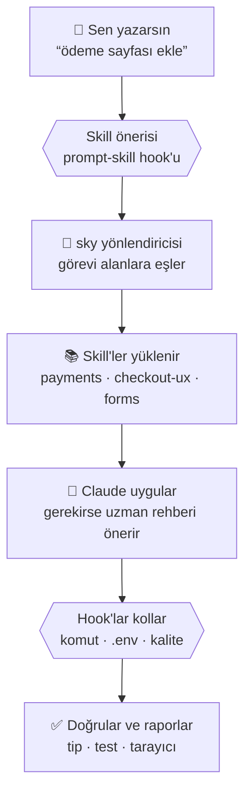

<div align="center">


# Sky

### Her şey dahil. Başka bir şey arama.

**Claude Code için Türkçe, her şey dahil geliştirici eklentisi.**<br>
Web'den mobile, altyapıdan tasarıma kadar tek kurulum, sıfır bağımlılık.

<br>


<br>


<a href="LICENSE"></a>
<a href="https://github.com/vSkyfall/sky/stargazers"></a>

<br><br>

[Kurulum](#-kurulum) · [Sky Pano](#-sky-pano) · [Nasıl çalışır](#-nasıl-çalışır) · [Neler var](#-neler-var) · [Komutlar](#️-komutlar) · [Hook'lar](#️-koruyucu-hooklar) · [SSS](#-sık-sorulan-sorular)

<br>


<sub>Sky Pano'da 25 saniye: takımyıldızda gezinme, <code>⌘K</code> ile “ödeme” araması, ayrıntı paneli, tek tuşla tema, alan filtresi.</sub>

</div>

<br>

<table align="center">
<tr>
<td align="center" width="16%"><h3>214</h3><sub>skill</sub></td>
<td align="center" width="16%"><h3>3</h3><sub>Türkçe agent</sub></td>
<td align="center" width="16%"><h3>25</h3><sub>komut</sub></td>
<td align="center" width="16%"><h3>8</h3><sub>koruyucu hook</sub></td>
<td align="center" width="16%"><h3>90 bin</h3><sub>kelimelik rehber</sub></td>
<td align="center" width="16%"><h3>0</h3><sub>bağımlılık</sub></td>
</tr>
</table>

## ✦ Neden Sky?

Claude Code tek başına zaten güçlü. Sky ona **ne zaman neyi nasıl yapacağını bilen bir ekip** ekler: her alan için
yazılmış rehberler, uzman denetim rehberleri, tek satırlık komutlar ve arkanı kollayan otomatik kontroller.
Sky'ı kuran bir geliştiricinin başka bir eklenti aramasına gerek kalmaz.

<table>
<tr>
<td width="33%" valign="top">

**🧠 214 skill**<br>
<sub>Türkiye'ye özgü 17 skill'i Claude gerektiğinde kendisi yükler. Next.js'ten Kubernetes'e diğer rehberler, bağlamı şişirmesin diye <code>/sky:</code> ile elle açılır.</sub>

</td>
<td width="33%" valign="top">

**🤖 3 Türkçe agent**<br>
<sub>Türkçe düzeltmen, çevirmen ve metin yazarı. Mimar, güvenlik denetçisi, test yazarı gibi 32 uzman rehber <code>/sky:</code> ile elle açılır.</sub>

</td>
<td width="33%" valign="top">

**⌨️ 25 komut**<br>
<sub><code>/sky-new</code> ile proje başlat, <code>/sky-polish</code> ile cilala, <code>/sky-review</code> ile incele. Sık işler tek satırda.</sub>

</td>
</tr>
<tr>
<td valign="top">

**🛡️ 8 koruyucu hook**<br>
<sub>Tehlikeli komutta onay ister, sahte paketi yakalar, <code>.env</code>'i korur, kaliteyi ve erişilebilirliği denetler.</sub>

</td>
<td valign="top">

**🇹🇷 Baştan Türkçe**<br>
<sub>iyzico, PayTR, e-Fatura, kargo, KVKK, TCKN/IBAN, Türkçe İ/ı, sen/siz tutarlılığı. Çeviri değil, Türkiye için yazıldı.</sub>

</td>
<td valign="top">

**🌌 Sky Pano**<br>
<sub>Her şeyi tek sayfada gösteren canlı yerel pano. <code>npm start</code> yaz, tarayıcıda keşfet.</sub>

</td>
</tr>
</table>

## ⚡ Kurulum

```bash
claude plugin marketplace add vSkyfall/sky
claude plugin install sky@sky
```

Claude Code'u yeniden başlat ve ilk komutunu yaz:

```text
/sky:sky-new kuaför randevu sitesi
```

> [!TIP]
> Klonladığın bir kopyadan kurmak istersen `vSkyfall/sky` yerine klasörün yolunu yaz. Güncellemek için:
> `claude plugin marketplace update sky && claude plugin update sky@sky`

**Günlük kullanım**

- `/sky:sky <görev>` her şeyin giriş noktasıdır. Görevi doğru skill'lere yönlendirir.
- Türkiye'ye özgü skill'ler ilgili isteklerde kendiliğinden devreye girer. Diğerlerini adıyla açarsın: `/sky:sky-nextjs`.
- Uzman rehberleri de komutla açarsın: `/sky:sky-architect` ile planla, `/sky:sky-security-reviewer` ile denetle.

## 🌌 Sky Pano

Sky'daki her şeyi gösteren yerel pano. Her skill bir yıldız, her alan bir takımyıldız.
Arama, filtre, ayrıntı paneli, çapraz bağlantılar, açık ve koyu tema; telefonda da çalışır.

```bash
git clone https://github.com/vSkyfall/sky.git
cd sky
npm start
```

Tarayıcında **http://localhost:4242** açılır. `npm install` gerekmez, yalnızca Node 18 veya üstü yeter.

```text
  ✦ Sky Pano v5.0.0

  ➜  Yerel:  http://localhost:4242
  ➜  Veri:   http://localhost:4242/api/data.json

  214 skill · 3 agent · 25 komut · 8 hook · 90.842 kelime
  Dosyalar anlık izleniyor; değişince sayfa kendini yeniler. Durdurmak için Ctrl+C.
```

<picture>
  <source media="(prefers-color-scheme: dark)" srcset="docs/gorseller/kapak-koyu.jpg">
  <source media="(prefers-color-scheme: light)" srcset="docs/gorseller/kapak-acik.jpg">
  
</picture>

<p align="center"><sub>Genel bakış. GitHub temana göre açık ya da koyu hâli gösterilir.</sub></p>

<table>
<tr>
<td width="50%" valign="top">

<br><sub><b>Skill kütüphanesi.</b> 12 alana göre gruplanmış kartlar, alan filtreleri ve Türkçe karakterden bağımsız arama.</sub>
</td>
<td width="50%" valign="top">

<br><sub><b>Ayrıntı paneli.</b> Ne zaman devreye girdiği, tetikleyici kelimeler, bağlantılar ve rehberin tamamı.</sub>
</td>
</tr>
<tr>
<td valign="top">

<br><sub><b><code>⌘K</code> araması.</b> Skill, agent, komut ve hook'larda aynı anda arar; klavyeyle gezilir.</sub>
</td>
<td valign="top">

<br><sub><b>Hook zaman çizelgesi.</b> Oturum başından tur sonuna her koruma; kaynak kodu ve kapatma komutuyla.</sub>
</td>
</tr>
<tr>
<td valign="top">

<br><sub><b>Uzman ekip.</b> Sky 4'ün agent ekranı. Sky 5'te bu ekibin 32'si elle açılan uzman rehberlere dönüştü.</sub>
</td>
<td valign="top">

<br><sub><b>İlkeler.</b> Sky'ın her görevde izlediği beş adım ve değişmez kuralları.</sub>
</td>
</tr>
</table>

<p align="center">
&nbsp;
&nbsp;

<br><sub>Telefonda da tam çalışır: genel bakış, ayrıntı paneli ve komutlar.</sub>
</p>

**Pano komutları**

| Komut | Ne yapar |
|---|---|
| `npm start` | Yerel sunucuyu başlatır, tarayıcıyı açar ve dosyaları izler |
| `PORT=3000 npm start` | Başka bir portta açar. 4242 doluysa sıradaki boş port kendiliğinden seçilir |
| `npm start -- --no-open` | Tarayıcıyı açmadan başlatır |
| `npm run build` | Sunucusuz tek dosya üretir: `dashboard/index.html`. Çift tıklayıp açabilirsin |
| `npm run validate` | Eklentiyi Claude Code'un doğrulayıcısıyla denetler |

**Klavye kısayolları**

| Tuş | Ne yapar |
|---|---|
| <kbd>⌘</kbd> <kbd>K</kbd> · <kbd>Ctrl</kbd> <kbd>K</kbd> | Her şeyde ara |
| <kbd>/</kbd> | Bulunduğun listede ara |
| <kbd>T</kbd> | Açık ve koyu tema arasında geçiş |
| <kbd>←</kbd> <kbd>→</kbd> | Ayrıntı panelinde önceki ve sonraki öğe |
| <kbd>Esc</kbd> | Paneli ya da aramayı kapat |

> [!NOTE]
> Sunucu yalnızca `127.0.0.1` adresine bağlanır, ağdaki başka cihazlar erişemez. Bir skill, agent, komut, hook ya da
> sayfa şablonunu değiştirdiğinde pano kendini yeniler; kaldığın yer ve tema korunur.
> Claude Code içinden `/sky:sky-pano` tek dosyalık sürümü derleyip açar.

## 🧭 Nasıl çalışır?



1. **Bağlam:** Oturum açılınca Sky projeni tanır (Next.js mi, Laravel mi, Docker var mı) ve ilgili skill'leri hatırlatır.
2. **Yönlendirme:** İsteğindeki kelimelerden doğru skill'ler seçilir. Türkçe ve İngilizce kelimeler birlikte tanınır.
3. **Uygulama:** Claude rehbere göre çalışır. Gerekirse sana ilgili uzman rehberi önerir, örneğin `/sky:sky-architect`.
4. **Koruma:** Yıkıcı bir komut, şüpheli bir paket ya da `.env` yazımı onayından geçmeden çalışmaz.
5. **Doğrulama:** Tip kontrolü, test ve tarayıcıda deneme yapılır. Ne doğrulandığı ve ne doğrulanmadığı dürüstçe söylenir.

## 🪶 Yalın yapı

Sky, her oturumda Claude'un bağlamına gereksiz yük bindirmemek için iki tür skill kullanır.

| Tür | Ne zaman yüklenir | Hangileri |
|---|---|---|
| **Otomatik** | Claude ilgili bir istek görünce kendisi yükler | Türkiye'ye özgü 17 skill ve `sky` yönlendiricisi |
| **Elle çağrılan** | Yalnızca sen `/sky:<ad>` yazınca açılır, o zamana kadar bağlama girmez | Diğer 196 skill ve 25 komut |

Otomatik olanlar: `sky-tr-integrations`, `sky-payments`, `sky-checkout-ux`, `sky-ecommerce`, `sky-pricing-page`,
`sky-notifications`, `sky-privacy-engineering`, `sky-ethical-ux`, `sky-forms`, `sky-regex`, `sky-maps-geo`, `sky-date-time`,
`sky-i18n`, `sky-ux-writing`, `sky-freelance`, `sky-small-business-site`, `sky-seo`.

Sky 4'teki 35 agent'tan 32'si elle açılan uzman rehberlere dönüştü; Türkçe metin işleri için 3 agent kaldı. Öneri hook'u
ilgili bir elle çağrılan rehber bulursa Claude bunu sana komut olarak önerir.

Aynı 6 görevle (Sonnet, koşul başına 3 tekrar) yapılan ölçüm:

| | Sky'sız | Sky 4 | Sky 5 |
|---|---|---|---|
| Boş bir istekte Sky'ın ek yükü | — | 14.072 token | 2.627 token |
| Görev başına ortalama maliyet | $0.078 | $0.142 | $0.093 |
| Görev sırasında kendiliğinden yüklenen skill | — | 0 | 6, hepsi ilgili |

## 📚 Neler var?

Türkiye'ye özgü 17 skill otomatik yüklenir; bu listedeki diğer skill'leri `/sky:<ad>` ile açarsın. Skill'ler alanlara göre gruplu. Başlığa tıklayınca liste açılır. Tam yönlendirme tablosu:
[skills/sky/SKILL.md](skills/sky/SKILL.md).

<details>
<summary><b>🧭 Çekirdek</b> · 1 skill</summary>

<br>

| Skill | Ne işe yarar |
|---|---|
| `sky` | Sky ana yönlendiricisi — web/fullstack geliştirme, UI tasarımı ve ürün işleri için giriş noktası. |

</details>

<details>
<summary><b>🖥️ Frontend</b> · 39 skill</summary>

<br>

| Skill | Ne işe yarar |
|---|---|
| `sky-3d` | Web'de 3D ve etkileyici görseller: Three.js / React Three Fiber / drei ile hero sahneleri, ürün görüntüleyici (döndür… |
| `sky-angular` | Modern Angular (17+): standalone bileşenler, sinyaller (signal, computed, effect, input/output sinyalleri), yeni kontrol… |
| `sky-astro` | Astro ile içerik odaklı siteler: adalar (islands) mimarisi ve client: yönergeleri, content collections (tip güvenli… |
| `sky-browser-apis` | Modern tarayıcı API'leri ile "native uygulama" hissi: Web Share (paylaş menüsü), Clipboard, Popover API ve &lt;dialog&gt… |
| `sky-browser-extension` | Tarayıcı eklentisi geliştirme: WXT ile Chrome/Firefox/Edge eklentisi, Manifest V3, içerik scriptleri ve Shadow DOM ile… |
| `sky-canvas` | Canvas ve SVG ile çizim etkileşimleri: imza alanı, serbest çizim/beyaz tahta, görsel düzenleme (metin, sticker, filtre)… |
| `sky-cpp` | Modern C++ (17/20/23) ve C: CMake ile proje yapısı ve bağımlılıklar (vcpkg, Conan, FetchContent), RAII ve akıllı… |
| `sky-css-modern` | Modern CSS ile JS'siz büyü: container queries, :has() seçicisi, cascade layers, subgrid, anchor positioning, scroll-driven… |
| `sky-date-time` | Tarih ve saat mühendisliği: saklama (timestamptz, UTC, date-only), saat dilimleri, Temporal ve date-fns, göreli zaman ("3 dk… |
| `sky-drag-drop` | Sürükle-bırak etkileşimleri: dnd-kit ile sıralanabilir listeler, kanban panosu (sütunlar arası taşıma), ızgara yeniden… |
| `sky-editor` | Zengin metin editörü ve içerik yazımı: TipTap / Lexical / Plate / BlockNote seçimi, Notion tarzı slash menüsü, blok editör… |
| `sky-elixir` | Elixir ve Phoenix: OTP temelleri (süreçler, GenServer, Supervisor, "bırak çöksün"), pattern matching ve pipe ile idiomatik… |
| `sky-forms` | Form mimarisi ve UX'i: React Hook Form + Zod, Server Actions ile form, istemci+sunucu doğrulama, hata mesajı yazımı, alan… |
| `sky-htmx` | Sunucu tarafı render + HTMX/Alpine.js ile hafif etkileşim ("hypermedia" yaklaşımı): hx-get/ hx-post/hx-target/hx-swap, kısmi… |
| `sky-i18n` | Çok dilli web uygulaması (öncelikle Türkçe/İngilizce): next-intl ile locale routing, mesaj dosyaları ve ICU biçimi… |
| `sky-infinite-lists` | Uzun listeler ve akışlar: sonsuz kaydırma vs "Daha fazla göster" vs sayfalama kararı, cursor tabanlı sayfalama… |
| `sky-java` | Modern Java (17/21+) dil ve araçları (framework'ten bağımsız): Maven/Gradle proje yapısı, record'lar, sealed tipler ve… |
| `sky-maps-geo` | Harita ve konum: MapLibre / Leaflet / Google Maps seçimi, ücretsiz karo sağlayıcıları, işaretçi kümeleme, "bana en yakın"… |
| `sky-media` | Görsel ve video işleme: yükleme akışı (önizleme, kırpma, döndürme, sıkıştırma), avatar kırpıcı, sharp ile sunucu dönüşümleri… |
| `sky-mobile-app` | Web projesinden mobil uygulamaya: PWA mı, Capacitor ile sarmalama mı, Expo (React Native) mı kararı; Expo Router, paylaşılan… |
| `sky-nextjs` | Derin Next.js (App Router, 15/16): önbellek katmanları ve revalidation, statik/dinamik render, Server/Client Component… |
| `sky-print-pdf` | PDF üretimi ve yazdırma: fatura, makbuz, teklif, rapor, sertifika, bilet ve kargo etiketi PDF'leri; react-pdf vs Playwright… |
| `sky-pwa` | Progressive Web App: web uygulamasını telefona "uygulama gibi" kurulabilir yapma; manifest, ikon seti, Serwist ile service… |
| `sky-react-native` | React Native (Expo) ile uygulama geliştirme derinlemesine: Expo Router (sekme, stack, modal, derin bağlantı), stil ve… |
| `sky-react-router` | React Router v7 (Remix'in devamı) framework modu: dosya/konfig tabanlı route'lar, loader ve action'lar, tip güvenli route… |
| `sky-rsc-streaming` | React Server Components ve streaming ileri seviye: Suspense sınırı tasarımı, veri waterfall'larını yok etme, paralel veri… |
| `sky-search` | Uygulama içi arama: Postgres full-text (tsvector, ts_rank) ve pg_trgm bulanık arama, Meilisearch/Typesense/Algolia ne zaman… |
| `sky-state` | State mimarisi: hangi veri nerede yaşar (URL, sunucu cache, form, yerel UI, global istemci, kalıcı), state'i türetme… |
| `sky-svelte` | Svelte 5 ve SvelteKit: rünler ($state, $derived, $effect, $props, $bindable), snippet'ler, bileşen kalıpları, SvelteKit… |
| `sky-tailwind` | Tailwind CSS v4 derinlemesine: CSS-first yapılandırma (@import "tailwindcss", @theme, @utility, @variant, @custom-variant)… |
| `sky-testing` | Web uygulamaları için test stratejisi: test piramidi, neyin test edileceği, Vitest + Testing Library bileşen testleri, MSW… |
| `sky-typescript` | Web projeleri için TypeScript kalıpları: strict ayarlar, discriminated union ile durum modelleme, Zod'dan tip türetme… |
| `sky-vue` | Vue 3 ve Nuxt: Composition API ve &lt;script setup&gt;, ref/reactive/computed/watch doğru kullanımı, reaktivite tuzakları… |
| `sky-wasm` | WebAssembly'yi web uygulamasında kullanma: ne zaman gerçekten gerekli, Rust → wasm-bindgen/ wasm-pack, C/C++ → Emscripten… |
| `sky-web-audio` | Web'de ses ve müzik uygulamaları: Web Audio API (AudioContext, düğüm grafiği, gain, filtre, analyser), otomatik oynatma… |
| `sky-web-components` | Web Components ve framework'süz bileşenler: Custom Elements yaşam döngüsü, Shadow DOM ve stil kapsülleme (::part, CSS… |
| `sky-web-fonts` | Web font mühendisliği ve tipografi eşleşmeleri: font seçimi (Google Fonts, Fontshare, dökümhaneler), Türkçe karakter testi… |
| `sky-web-stack` | Web/fullstack stack seçimi ve frontend mimarisi: React, Next.js (App Router), Vite, TypeScript, klasör yapısı, state… |
| `sky-webrtc` | WebRTC ile görüntülü/sesli görüşme, ekran paylaşımı ve P2P veri: getUserMedia ve izin akışı, RTCPeerConnection, sinyalleşme… |

</details>

<details>
<summary><b>🗄️ Backend & Veri</b> · 34 skill</summary>

<br>

| Skill | Ne işe yarar |
|---|---|
| `sky-ai-ux` | AI özellikleri için arayüz kalıpları: streaming yanıt gösterimi, düşünme/adım göstergeleri, düzenlenebilir ve kabul/ret… |
| `sky-audit-history` | Değişiklik geçmişi ve denetim: audit log tasarımı (kim, ne, ne zaman, nereden), alan bazlı önce/sonra farkı, kayıt… |
| `sky-auth` | Kimlik doğrulama ve yetkilendirme: Auth.js (NextAuth) / Better Auth / Supabase Auth / Clerk seçimi ve kurulumu, oturum… |
| `sky-auth-ux` | Giriş ve kayıt ekranlarının UX'i: tek ekran e-posta önce akışı, sosyal giriş butonları sırası ve tasarımı, passkey önerisi… |
| `sky-backend-api` | Backend ve API tasarımı: REST/route handler/Server Action/tRPC uç noktaları, girdi doğrulama, hata modeli, kimlik doğrulama… |
| `sky-caching` | Önbellekleme mühendisliği: hangi katmanda (tarayıcı, CDN, Next Data Cache, uygulama, Redis, DB), cache-aside ve… |
| `sky-chat-product` | Uygulama içi mesajlaşma ürünü: konuşma/oda/thread veri modeli, birebir ve grup sohbet, okundu bilgisi ve "yazıyor…"… |
| `sky-checkout-ux` | Ödeme akışı UX'i ve dönüşüm: tek sayfa vs adımlı checkout, misafir ödeme, adres formu (TR il/ilçe), kargo seçenekleri… |
| `sky-cms` | İçerik yönetimi: headless CMS seçimi (Payload, Sanity, Strapi, Keystatic, Contentful), içerik modeli tasarımı (sayfa… |
| `sky-data` | Veritabanı katmanı: şema tasarımı, ilişkiler, migration, indeksleme, sorgu performansı, N+1, transaction, soft delete, çok… |
| `sky-data-analysis` | Veri analizi (geliştirici için): DuckDB ile CSV/Parquet/JSON üzerinde SQL, Python pandas ve polars, Jupyter/marimo… |
| `sky-ecommerce` | E-ticaret: ürün/varyant/seçenek modeli, stok ve rezervasyon, sepet (misafir + giriş yapmış birleştirme), ödeme akışı… |
| `sky-feature-flags` | Özellik bayrakları ve deneyler: PostHog / GrowthBook / Unleash / Vercel Flags / kendi tablo seçimi, boolean ve çok varyantlı… |
| `sky-graphql` | GraphQL API: ne zaman REST/tRPC yerine, şema tasarımı (tipler, input'lar, nullability, pagination connection'ları, hata… |
| `sky-import-export` | Toplu veri içe/dışa aktarım: CSV ve Excel (xlsx) içe aktarma sihirbazı (yükle → sütun eşle → önizle → doğrula → içe aktar)… |
| `sky-jobs` | Arka plan işleri ve zamanlanmış görevler: Inngest / Trigger.dev / BullMQ / pg-boss / QStash / Vercel Cron seçimi, iş… |
| `sky-metering-quotas` | Plan limitleri, kullanım ölçümü ve kotalar: entitlement (plan → özellik/limit) tablosu, sayaç tasarımı (gerçek zamanlı vs… |
| `sky-mongodb` | MongoDB ile çalışma: ne zaman doğru seçim (ve ne zaman Postgres daha iyi), doküman modelleme (gömme vs referans, erişim… |
| `sky-multitenancy` | SaaS çok kiracılı yapı (org/takım/çalışma alanı): veri modeli (organizations, memberships, invitations), rol ve izin… |
| `sky-notifications` | Bildirim sistemleri: işlemsel e-posta (Resend + react-email, alan doğrulama SPF/DKIM/DMARC, şablonlar, teslim… |
| `sky-payments` | Ödeme entegrasyonu: Stripe (Checkout, abonelik, Customer Portal, webhook) ve iyzico (Checkout Form, 3D Secure, taksit)… |
| `sky-privacy-engineering` | KVKK/GDPR'ın mühendislik tarafı: kişisel veri envanteri ve sınıflandırma, veri minimizasyonu, saklama süreleri ve otomatik… |
| `sky-public-api` | Dışa açık API ürünü: API anahtarı oluşturma/döndürme/kapsamları, OAuth uygulamaları, katmanlı rate limit ve kota başlıkları… |
| `sky-realtime` | Gerçek zamanlı özellikler: polling / SSE / WebSocket / Supabase Realtime / Pusher-Ably / Liveblocks seçimi, Next.js ve… |
| `sky-resilience` | Dayanıklılık kalıpları: zaman aşımı (timeout) her dış çağrıda, akıllı yeniden deneme (üstel geri çekilme + jitter… |
| `sky-scheduling` | Randevu ve rezervasyon motoru: hizmet/personel/kaynak modeli, uygun slot üretimi (çalışma saatleri, molalar, tamponlar… |
| `sky-security` | Derin uygulama güvenliği: tehdit modelleme (STRIDE kısaca), OWASP Top 10 denetim rehberi, Content-Security-Policy yazma… |
| `sky-sql` | Ham SQL ustalığı (Postgres): CTE ve recursive sorgular, window fonksiyonları (sıralama, hareketli ortalama, önceki satır)… |
| `sky-sqlite` | SQLite'ı üretimde ve uygulamalarda kullanma: ne zaman yeterli (çoğu zaman sanıldığından fazla), WAL modu ve doğru PRAGMA… |
| `sky-storage` | Dosya depolama: S3 / Cloudflare R2 / Supabase Storage / UploadThing seçimi, presigned URL ile doğrudan yükleme, çok parçalı… |
| `sky-supabase` | Derin Supabase: proje yapısı, @supabase/ssr ile Next.js entegrasyonu, RLS politika kalıpları (sahiplik, org üyeliği, rol… |
| `sky-tr-integrations` | Türkiye'ye özgü entegrasyonlar: e-Fatura/e-Arşiv entegratörleri (Paraşüt, BizimHesap, Logo, Uyumsoft, Foriba), kargo… |
| `sky-trpc` | tRPC ile uçtan uca tip güvenli API: router ve procedure yapısı, context (oturum, db), middleware ile korumalı/rol bazlı… |
| `sky-webhooks-out` | Giden webhook sistemi kurma (kendi kullanıcılarına/ortaklarına olay gönderme): olay kataloğu ve yük şeması, abonelik… |

</details>

<details>
<summary><b>🎨 Tasarım & UX</b> · 22 skill</summary>

<br>

| Skill | Ne işe yarar |
|---|---|
| `sky-a11y` | Web erişilebilirliği (WCAG 2.2 AA): semantik HTML, klavye ile kullanım, odak yönetimi, ARIA kalıpları (dialog, menu, tabs… |
| `sky-brand` | Markadan tasarım sistemine: marka kişiliği (3 sıfat), logodan renk paleti türetme, tip eşleşmesi, ses tonu, logo kullanım… |
| `sky-color` | Renk mühendisliği: oklch ile algısal olarak düzgün palet ölçekleri üretme, kontrast hesabı (WCAG 2.x ve APCA), açık temadan… |
| `sky-dashboard` | Panel ve admin arayüzleri: uygulama kabuğu (sidebar, topbar, içerik), bilgi hiyerarşisi ve yoğunluk, KPI kartları, TanStack… |
| `sky-dataviz` | Web'de veri görselleştirme: soruya göre grafik türü seçimi, Recharts / visx / ECharts / Observable Plot tercihi… |
| `sky-design-system` | Bileşen kütüphanesi ve tasarım sistemi mimarisi: üç katmanlı token (primitive → semantic → component), Tailwind v4 @theme… |
| `sky-email-design` | HTML e-posta tasarımı ve kodlaması: react-email / MJML ile tablolu düzen, e-posta istemcisi farkları (Outlook, Gmail, Apple… |
| `sky-ethical-ux` | Etik ve güven veren tasarım: karanlık kalıplardan (dark patterns) kaçınma — gizli ücretler, zorlaştırılmış abonelik iptali… |
| `sky-figma` | Figma ile koda köprü: tasarım dosyasını okuma (Dev Mode, ölçüler, değişkenler), Figma Variables ↔ CSS token senkronu (Tokens… |
| `sky-gamification` | Oyunlaştırma ve motivasyon tasarımı: ilerleme çubukları, seriler (streak), rozetler ve başarımlar, seviyeler ve puanlar… |
| `sky-icons` | İkon sistemi: ikon seti seçimi (Lucide, Phosphor, Tabler, Heroicons, Iconoir), tek set kuralı, boyut ve çizgi kalınlığı… |
| `sky-landing` | Landing ve pazarlama sayfaları: dönüşüm odaklı bölüm sırası, hero, değer önerisi metni, özellik ızgarası, sosyal kanıt… |
| `sky-mobile-ux` | Mobil web UX: başparmak bölgesi ve alt navigasyon, bottom sheet ve kaydırma jestleri, safe area (çentik/home indicator)… |
| `sky-motion` | Arayüz hareketi: süre ve easing ölçeği, giriş/çıkış geçişleri, mikro etkileşimler, sayfa geçişleri, liste animasyonları… |
| `sky-motion-assets` | Hazır animasyon varlıkları: Lottie (dotLottie), Rive (etkileşimli state machine animasyonları), animasyonlu SVG ve CSS… |
| `sky-navigation-ia` | Bilgi mimarisi ve navigasyon: kart sıralama ile menü yapısı, birincil/ikincil/yardımcı navigasyon, sekme vs sayfa vs… |
| `sky-onboarding` | Kullanıcı aktivasyonu ve ilk deneyim: "aha anı"nı tanımlama, kayıt sonrası akış, kişiselleştirme soruları, kurulum kontrol… |
| `sky-pricing-page` | Fiyatlandırma sayfası tasarımı ve psikolojisi: plan sayısı (3 kuralı), önerilen plan vurgusu, çapa (anchor) fiyat… |
| `sky-states-library` | Arayüz durumları kütüphanesi: boş durum (ilk kullanım, filtre sonucu boş, temizlenmiş), yükleniyor (iskelet, spinner… |
| `sky-ui-craft` | Arayüz zanaatı: görsel hiyerarşi, tipografi ölçeği, renk sistemi ve tasarım token'ları, boşluk ritmi, yarıçap/gölge, bileşen… |
| `sky-ux-heuristics` | UX değerlendirme bilgisi ve sezgisel denetim: Nielsen'in 10 sezgisi, Fitts ve Hick yasaları, bilişsel yük ve Miller, Jakob… |
| `sky-ux-writing` | Arayüz metni (mikro metin) yazımı, Türkçe odaklı: ses ve ton, sen/siz kararı, buton etiketleri, hata ve doğrulama mesajları… |

</details>

<details>
<summary><b>📦 Ürün & Proje</b> · 8 skill</summary>

<br>

| Skill | Ne işe yarar |
|---|---|
| `sky-changelog` | Değişiklik günlüğü ve "Yenilikler": herkese açık changelog sayfası (görselli, kategorili), uygulama içi yenilikler paneli ve… |
| `sky-docs-site` | Dokümantasyon sitesi: Fumadocs / Starlight / Nextra / Mintlify seçimi, bilgi yapısı (başlangıç, rehberler, referans… |
| `sky-event-site` | Etkinlik ve davet siteleri: düğün/nişan davetiyesi, doğum günü, konferans, meetup, mezuniyet, lansman; geri sayım… |
| `sky-launch` | Ürün lansmanı (teknik + iletişim): bekleme listesi ve davet sistemi (referans ile sırada yükselme), lansman günü trafik… |
| `sky-lms` | Online kurs / eğitim platformu: kurs → bölüm → ders modeli, video ders (HLS, ilerleme kaydetme, kaldığın yerden devam)… |
| `sky-portfolio` | Kişisel site ve portfolyo: geliştirici, tasarımcı, fotoğrafçı, yazar veya serbest çalışan için akılda kalan kişisel site… |
| `sky-saas-blueprint` | Sıfırdan SaaS kurma yol haritası (meta-skill): doğru sırayla auth → org/takım → plan ve ödeme → onboarding → çekirdek… |
| `sky-small-business-site` | Küçük işletme siteleri (klinik, diş hekimi, kuaför, güzellik salonu, restoran/kafe, avukat, emlakçı, oto servis, spor… |

</details>

<details>
<summary><b>🔤 Diller</b> · 14 skill</summary>

<br>

| Skill | Ne işe yarar |
|---|---|
| `sky-android` | Native Android (Kotlin): Jetpack Compose UI, tek yönlü veri akışı ve ViewModel + StateFlow, coroutines ve Flow, Room… |
| `sky-desktop-app` | Masaüstü uygulama: Tauri 2 ve Electron seçimi, ana süreç/arayüz iletişimi (Tauri komutları, Electron IPC + contextBridge)… |
| `sky-django` | Django ve Django REST Framework: proje/app yapısı, ayarların ortamlara bölünmesi, modeller ve migration'lar, ORM performansı… |
| `sky-dotnet` | C# ve .NET ile backend: ASP.NET Core Minimal API ve controller seçimi, DI yaşam süreleri, Options deseni, EF Core… |
| `sky-fastapi` | FastAPI ile API geliştirme: proje yapısı (router, service, repository), Pydantic v2 şemaları (giriş/çıkış ayrımı)… |
| `sky-flutter` | Flutter ve Dart: feature-first proje yapısı, widget performansı (const, rebuild sınırları), durum yönetimi (Riverpod, Bloc)… |
| `sky-go` | Go geliştirme: modül ve proje düzeni (cmd/, internal/), hata yönetimi (wrap, errors.Is/As), context ile iptal ve zaman… |
| `sky-ios` | Native iOS (Swift): SwiftUI, Observation (@Observable) ile durum, async/await ve Swift 6 strict concurrency (Sendable… |
| `sky-laravel` | Laravel geliştirme: proje yapısı ve Artisan, Eloquent modelleri, ilişkiler ve N+1 önleme (with, preventLazyLoading)… |
| `sky-node-backend` | Node.js / Bun / Deno ile bağımsız backend servisi: Hono, Fastify, Express, NestJS seçimi, proje yapısı, Zod doğrulama… |
| `sky-python` | Modern Python geliştirme: uv ile proje ve bağımlılık yönetimi, pyproject.toml, src düzeni, ruff (lint + format), tip… |
| `sky-rails` | Ruby on Rails: konvansiyonlar, Active Record ilişkileri ve N+1 (includes, strict_loading), migration ve DB kısıtları, strong… |
| `sky-rust` | Rust geliştirme: cargo ve workspace, sahiplik/ödünç alma kalıpları ve borrow checker ile barışık tasarım, hata yönetimi… |
| `sky-spring` | Java/Kotlin ile Spring Boot 3: alan bazlı paket yapısı, REST controller, DTO olarak record'lar, Bean Validation, servis… |

</details>

<details>
<summary><b>☁️ Altyapı & Bulut</b> · 18 skill</summary>

<br>

| Skill | Ne işe yarar |
|---|---|
| `sky-ansible` | Ansible ile sunucu yapılandırma otomasyonu: envanter, playbook ve roller, idempotent görevler, değişkenler ve şablonlar… |
| `sky-aws` | AWS'yi web uygulaması için pratik kullanma: hesap güvenliği (root kilitleme, IAM Identity Center, MFA), IAM en az yetki ve… |
| `sky-azure` | Microsoft Azure ile web uygulaması: abonelik/kaynak grupları ve Entra ID (kimlik), managed identity ile anahtarsız erişim… |
| `sky-baas` | Hazır backend servisleri (BaaS) ile hızlı geliştirme: Firebase (Auth, Firestore, Storage, Cloud Functions, FCM, güvenlik… |
| `sky-cloudflare` | Cloudflare geliştirici platformu: Workers (edge'de kod), Pages ve statik varlıklar, Hono ile Workers API, D1 (SQLite), R2… |
| `sky-docker` | Docker ve Compose ustalığı: her dil için çok aşamalı (multi-stage) Dockerfile kalıpları (Node, Python/uv, Go, Rust, Java)… |
| `sky-gcp` | Google Cloud ile web uygulaması: proje/organizasyon ve IAM (servis hesapları, Workload Identity Federation ile anahtarsız… |
| `sky-github-actions` | GitHub Actions ileri seviye: iş akışı yapısı ve tetikleyiciler, önbellek (setup-* cache, actions/cache), matris build'ler… |
| `sky-http` | HTTP ve web ağ temelleri (geliştirici gözüyle): istek/yanıt anatomisi, yöntemler ve idempotency, durum kodlarının doğru… |
| `sky-iac` | Altyapıyı kodla yönetme (IaC): Terraform/OpenTofu ve Pulumi seçimi, proje yapısı ve modüller, uzak state ve kilitleme… |
| `sky-iot` | IoT ve gömülü projeler: ESP32/ESP8266, Arduino, Raspberry Pi, Raspberry Pi Pico seçimi; PlatformIO / Arduino IDE / ESP-IDF /… |
| `sky-kubernetes` | Kubernetes ile uygulama çalıştırma: ne zaman gerçekten gerekli, Deployment/Service/Ingress/ ConfigMap/Secret temelleri… |
| `sky-linux-server` | VPS / Linux sunucu yönetimi: ilk kurulum ve sertleştirme (SSH anahtar, root girişi kapalı, ufw, fail2ban, otomatik güvenlik… |
| `sky-load-testing` | Yük ve performans testi: hedef belirleme (RPS, eşzamanlı kullanıcı, p95 gecikme, hata oranı), k6 ile senaryo yazma… |
| `sky-microservices` | Dağıtık sistem ve mikroservis kararları: modüler monolit önce, servis sınırlarını alanlara göre çizme, senkron (HTTP/gRPC)… |
| `sky-secrets` | Sır (secret) yönetimi uçtan uca: hangi bilgi sırdır, .env ve .env.example düzeni, geliştirici makinesinde sırlar (1Password… |
| `sky-shopify` | Shopify geliştirme: Online Store 2.0 temaları (Liquid, sections, blocks, JSON şablonlar, theme editor ayarları), Shopify… |
| `sky-wordpress` | WordPress geliştirme: blok (Gutenberg) teması ve theme.json, özel blok geliştirme (@wordpress/scripts, block.json), tema ve… |

</details>

<details>
<summary><b>🤖 AI & ML</b> · 8 skill</summary>

<br>

| Skill | Ne işe yarar |
|---|---|
| `sky-ai` | Uygulamaya yapay zekâ özelliği ekleme: Claude API (Anthropic SDK) ve Vercel AI SDK ile streaming sohbet, yapılandırılmış… |
| `sky-ai-agents` | Ürün içine AI ajanı yerleştirme: çok adımlı görev yapan asistan (araç seçimi, planlama, döngü), Claude Agent SDK / Managed… |
| `sky-ai-eval` | AI özelliklerini ölçme ve iyileştirme: altın test seti oluşturma, kural tabanlı ve LLM-judge değerlendiriciler, RAG… |
| `sky-data-pipelines` | Veri hatları ve analitik altyapı: ETL vs ELT, operasyonel DB'den analitik depoya veri taşıma (CDC, toplu yükleme… |
| `sky-local-llm` | Yerel ve açık ağırlıklı LLM'leri çalıştırma: Ollama, llama.cpp, LM Studio, vLLM, MLX (Apple Silicon) seçimi, model ve… |
| `sky-ml` | Uygulamalı makine öğrenmesi (geliştirici için): problemi doğru çerçeveleme (sınıflandırma, regresyon, öneri, anomali, zaman… |
| `sky-redis` | Redis (ve Valkey/Upstash/Dragonfly) derinlemesine: veri yapıları ve doğru kullanım (string, hash, list, set, sorted set… |
| `sky-vector-db` | Vektör veritabanları ve benzerlik araması: pgvector (önce Postgres), Qdrant, Weaviate, Pinecone, Chroma, LanceDB… |

</details>

<details>
<summary><b>🛠️ Mühendislik</b> · 29 skill</summary>

<br>

| Skill | Ne işe yarar |
|---|---|
| `sky-algorithms` | Algoritma ve veri yapıları (pratik ve mülakat): Big-O sezgisi, doğru veri yapısını seçme (dizi, hash map/set, yığın, kuyruk… |
| `sky-architecture-docs` | Mimari dokümantasyon: README yapısı, ADR (mimari karar kaydı) şablonu ve ne zaman yazılır, C4 modeli ile Mermaid… |
| `sky-architecture-patterns` | Uygulama mimarisi kalıpları: katmanlı mimari (handler → servis → repository), modüler monolit, hexagonal / ports &amp… |
| `sky-bots` | Sohbet botları ve entegrasyonlar: Telegram (grammY), Discord (discord.js — slash komutlar, butonlar, modallar), Slack (Bolt… |
| `sky-claude-md` | Proje için CLAUDE.md (ve AGENTS.md) yazma ve bakımı: projeyi Claude'a 2 dakikada tanıtan yapı (amaç, stack, komutlar, klasör… |
| `sky-cli-tools` | Komut satırı aracı geliştirme (Node/TS ağırlıklı, Python/Go notlarıyla): argüman ayrıştırma (commander, citty, yargs)… |
| `sky-code-review` | Kod incelemesi (review) yapma ve alma: neye bakılır (doğruluk, güvenlik, veri kaybı, yetki, performans, test, okunurluk… |
| `sky-code-style` | Kod stili ve otomatik kalite araçları: Biome vs ESLint (flat config) + Prettier seçimi, önerilen kural setleri… |
| `sky-debug` | Web uygulamalarında hata ayıklama yöntemi ve tanı tabloları: yeniden üret → izole et → hipotez → doğrula → düzelt →… |
| `sky-deploy` | Web uygulaması dağıtımı ve CI/CD: Vercel / Cloudflare / Docker+VPS (Coolify, Dokploy) / Fly / Railway seçimi, ortam… |
| `sky-explain` | Öğretme ve açıklama modu: kod tabanını, bir dosyayı, kavramı veya hatayı Türkçe olarak seviyeye uygun açıklama… |
| `sky-git` | Git iş akışı ve kurtarma: dal stratejisi (trunk-based, kısa ömürlü dallar), Conventional Commits ve iyi commit mesajı, küçük… |
| `sky-handoff` | Projeyi müşteriye veya başka ekibe teslim etme: teslim paketi (erişimler, hesaplar, alan adı, barındırma, ödeme ve e-posta… |
| `sky-js-async` | JavaScript asenkron programlama ustalığı: Promise zincirleri ve async/await, paralel vs sıralı çalıştırma (Promise.all… |
| `sky-monorepo` | Monorepo kurma ve yönetme: ne zaman monorepo, pnpm workspaces yapısı (apps/ ve packages/), Turborepo ile görev orkestrasyonu… |
| `sky-node-performance` | Node.js/Bun sunucu performansı: event loop gecikmesini ölçme, CPU profilleme (--cpu-prof, Chrome DevTools, clinic.js, 0x… |
| `sky-npm-library` | npm paketi / TypeScript kütüphanesi yayınlama: paket yapısı, package.json exports alanı (ESM/ CJS, alt yollar, types)… |
| `sky-observability` | Üretimde görünürlük: hata izleme (Sentry — Next.js kurulumu, source map, release, kullanıcı bağlamı, replay maskeleme)… |
| `sky-perf` | Web performansı: Core Web Vitals (LCP, INP, CLS), bundle boyutu ve kod bölme, görsel ve font optimizasyonu, React render… |
| `sky-planning` | Geliştirici için iş planlama: belirsiz isteği netleştirme, işi dikey dilimlere bölme, bağımlılık ve risk sıralaması (en… |
| `sky-refactor` | Güvenli yeniden düzenleme (refactor): önce karakterizasyon testleri, küçük adımlar ve her adımda yeşil testler, büyük… |
| `sky-regex` | Düzenli ifadeler: okunur regex yazma (adlandırılmış gruplar, x/verbose biçimi yerine parçalama), sık kalıplar (Türk telefon… |
| `sky-scraping` | Etik ve sağlam web kazıma (scraping) ve veri toplama: önce resmi API/açık veri, robots.txt ve kullanım şartları, kişisel… |
| `sky-seo` | Teknik ve içerik SEO'su: taranabilirlik (robots, sitemap, canonical, noindex), render stratejisi, Next.js metadata ve dosya… |
| `sky-shell` | Kabuk betikleri ve terminal verimliliği: güvenli bash betiği iskeleti (set -euo pipefail, trap, tırnaklama), argüman ve hata… |
| `sky-system-design` | Sistem tasarımı (gerçek projeler ve mülakatlar için): gereksinimleri netleştirme, kapasite tahmini (QPS, depolama, bant… |
| `sky-tdd` | Test güdümlü geliştirme (TDD) iş akışı: kırmızı → yeşil → yeniden düzenle döngüsü, önce hangi testin yazılacağı (test… |
| `sky-upgrades` | Sürüm yükseltme ve göç rehberi: Next.js sürüm yükseltmeleri (Pages → App Router dahil), React 18 → 19, CRA → Vite… |
| `sky-web-games` | Tarayıcı oyunları geliştirme (özgün oyunlar): motor seçimi (Phaser, PixiJS, Kaplay, Three.js/ R3F, saf Canvas), oyun döngüsü… |

</details>

<details>
<summary><b>🔐 Güvenlik</b> · 2 skill</summary>

<br>

| Skill | Ne işe yarar |
|---|---|
| `sky-crypto` | Uygulamalı kriptografi (geliştirici için, savunma amaçlı): parola saklama (argon2id/bcrypt), rastgelelik (kriptografik… |
| `sky-web3` | Web3 ve blok zinciri uygulama geliştirme: EVM temelleri (hesap, işlem, gas, ağ), cüzdan bağlama (wagmi + viem… |

</details>

<details>
<summary><b>💼 Kariyer</b> · 4 skill</summary>

<br>

| Skill | Ne işe yarar |
|---|---|
| `sky-freelance` | Serbest yazılım geliştiriciliği ve küçük ajans işleri (Türkiye bağlamı dahil): müşteri bulma ve niş, kapsam belirleme ve… |
| `sky-interview-prep` | Yazılım geliştirici iş görüşmesi ve kariyer hazırlığı: görüşme türleri (kodlama, sistem tasarımı, davranışsal… |
| `sky-open-source` | Açık kaynak projesi yayınlama ve sürdürme: lisans seçimi (MIT/Apache-2.0/AGPL ve etkileri), depoyu halka hazırlama (sır… |
| `sky-tech-writing` | Teknik yazım ve geliştirici içeriği: net ve tarayılabilir yazı ilkeleri, tutorial / how-to / referans / açıklama ayrımı… |

</details>

<details>
<summary><b>✨ Claude Code</b> · 3 skill</summary>

<br>

| Skill | Ne işe yarar |
|---|---|
| `sky-claude-code` | Claude Code'u verimli kullanma (iş akışı rehberi): iyi istek yazma, plan modu ve onaylı planlar, CLAUDE.md ve bellek, izin… |
| `sky-mcp-server` | MCP (Model Context Protocol) sunucusu yazma: kavramlar (tools, resources, prompts), TypeScript SDK ile sunucu (Zod girdi… |
| `sky-skill-authoring` | Claude Code için skill, komut, agent, hook ve eklenti yazma: SKILL.md biçimi (frontmatter, tetikleyici açıklama yazımı)… |

</details>

### 🤖 Agent'lar ve uzman rehberler

Agent aracıyla çalışan 3 Türkçe agent:

| Agent | Ne zaman çağrılır |
|---|---|
| `sky-copywriter` | Türkçe arayüz ve pazarlama metni |
| `sky-translator` | i18n mesaj dosyalarını çevirme |
| `sky-turkish-proofreader` | Türkçe yazım, İ/ı, ekler, sen/siz |

<details>
<summary><b>32 uzman rehber</b> · Sky 4'te agent'tı, artık elle açılır · listeyi aç</summary>

<br>

| Komut | Ne zaman |
|---|---|
| `/sky:sky-a11y-auditor` | UI ve erişilebilirlik denetimi |
| `/sky:sky-api-reviewer` | backend, veritabanı, güvenlik denetimi |
| `/sky:sky-architect` | kod yazmadan önce mimari plan |
| `/sky:sky-browser-qa` | tarayıcıda akışları gerçekten deneme |
| `/sky:sky-build-fixer` | kırık build/tip hatası, en küçük düzeltme |
| `/sky:sky-builder` | net görevi uçtan uca uygulama |
| `/sky:sky-code-reviewer` | genel kod incelemesi (her dil) |
| `/sky:sky-codebase-mapper` | dokümantasyon ve kod haritası |
| `/sky:sky-critic` | büyük karardan önce itiraz/risk turu |
| `/sky:sky-db-reviewer` | backend, veritabanı, güvenlik denetimi |
| `/sky:sky-debugger` | kök neden bulma + regresyon testi |
| `/sky:sky-designer` | tasarım yönü ve token seti |
| `/sky:sky-devops-engineer` | Docker, K8s, Terraform, Ansible, GCP/Azure, CI, sunucu yapılandırması |
| `/sky:sky-doc-writer` | dokümantasyon ve kod haritası |
| `/sky:sky-explainer` | seviyeye uygun Türkçe açıklama |
| `/sky:sky-frontend-reviewer` | Vue/Svelte/Angular/Astro inceleme |
| `/sky:sky-go-reviewer` | dile özgü inceleme |
| `/sky:sky-iot-engineer` | ESP32/Arduino/Pi firmware ve bağlantı |
| `/sky:sky-java-reviewer` | Java/Kotlin ve PHP/Laravel inceleme |
| `/sky:sky-ml-engineer` | ML/RAG görevi kurma ve değerlendirme |
| `/sky:sky-mobile-reviewer` | iOS / Android / Flutter / React Native inceleme |
| `/sky:sky-perf-auditor` | performans ve SEO denetimi |
| `/sky:sky-php-reviewer` | Java/Kotlin ve PHP/Laravel inceleme |
| `/sky:sky-product-manager` | fikri PRD'ye çevirme |
| `/sky:sky-python-reviewer` | dile özgü inceleme |
| `/sky:sky-refactorer` | davranışı koruyarak sadeleştirme |
| `/sky:sky-release-manager` | yayın hazırlığı, changelog, geri alma planı |
| `/sky:sky-rust-reviewer` | dile özgü inceleme |
| `/sky:sky-security-reviewer` | backend, veritabanı, güvenlik denetimi |
| `/sky:sky-seo-auditor` | performans ve SEO denetimi |
| `/sky:sky-tester` | test boşluklarını doldurma |
| `/sky:sky-ui-reviewer` | UI ve erişilebilirlik denetimi |

</details>

## ⌨️ Komutlar

Komutu yaz, ardından ne istediğini ekle. Örnek: `/sky:sky-new kuaför randevu sitesi`.

| Komut | Ne yapar |
|---|---|
| `/sky:sky-ai` | Uygulamaya bir AI özelliği ekle — kullanım senaryosu, model seçimi, streaming/structured output/tool use/RAG mimarisi, güvenlik, maliyet… |
| `/sky:sky-api` | Sky ile bir API uç noktası veya server action oluştur — şema, kimlik, yetki, servis katmanı, hata modeli ve testlerle birlikte. |
| `/sky:sky-brand` | Sky marka kiti — kişilik, renk paleti (oklch, açık/koyu, kontrastlı), font eşleşmesi, tokens.css, favicon/OG/ikon seti ve marka sayfası… |
| `/sky:sky-changelog` | Son sürümden bu yana yapılan değişikliklerden kullanıcı dostu changelog ve teknik sürüm notu çıkar, sürüm numarası öner; değişiklikleri… |
| `/sky:sky-check` | Teslim öncesi Sky kontrolü — typecheck, lint, test, build, güvenlik taraması, UI kontrolü ve diff incelemesi; GEÇTİ/KALDI raporu. |
| `/sky:sky-commit` | Sahnelenmiş değişikliklerden Conventional Commits uyumlu commit mesajı hazırla, kalıntı kontrolü yap ve onayla commit'le; gerekirse… |
| `/sky:sky-component` | Sky tasarım sistemine uygun yeni bir UI bileşeni oluştur — cva varyantları, tüm durumlar, erişilebilirlik, test ve örnek/story ile. |
| `/sky:sky-debug` | Sky hata ayıklama — hatayı yeniden üret, kök nedeni kanıtla, en küçük düzeltmeyi yap ve regresyon testi yaz. |
| `/sky:sky-docker` | Projeyi Dockerize et — dile uygun çok aşamalı Dockerfile, .dockerignore, healthcheck, yerel geliştirme için docker compose (DB, Redis… |
| `/sky:sky-explain` | Bir dosyayı, fonksiyonu, kavramı, hata mesajını veya tüm kod tabanını seviyeye uygun Türkçe açıklar — özet, benzetme, örnek, adım adım… |
| `/sky:sky-fix-build` | Kırık build'i, typecheck'i veya lint'i en küçük düzeltmelerle yeşile döndür — susturma (any/ts-ignore/disable) yok, davranış değişikliği… |
| `/sky:sky-landing` | Sky ile dönüşüm odaklı bir landing sayfası oluştur — bölüm iskeleti, metin, token'lı tasarım, SEO meta ve JSON-LD dahil. |
| `/sky:sky-new` | Sky ile yeni bir web projesi başlat — stack seç, iskeleti kur, token'ları, env doğrulamayı, temel layout'u ve test altyapısını ekle. |
| `/sky:sky-onboard` | Mevcut bir kod tabanını keşfet ve yeni gelen (veya AI) için harita çıkar — stack, giriş noktaları, klasör sorumlulukları, veri modeli, auth… |
| `/sky:sky-page` | Sky ile yeni bir sayfa/route oluştur — veri çekme, metadata (SEO/OG), loading/error/boş durumlar, yetki, responsive düzen ve testle… |
| `/sky:sky-pano` | Sky Pano'yu aç — tüm skill, agent, komut ve hook'ları gösteren yerel, aranabilir sayfayı derleyip tarayıcıda açar. |
| `/sky:sky-perf` | Sky performans turu — ölç, darboğazı bul, düzelt, tekrar ölç; önce/sonra Core Web Vitals ve bundle tablosu üretir. |
| `/sky:sky-plan` | Bir işi uygulamadan önce planla — netleştir, dikey dilimlere böl, riskleri ve bilinmeyenleri çıkar, her dilim için bitti ölçütü ve tahmin… |
| `/sky:sky-polish` | Bir ekranı veya bileşeni Sky UI standartlarına göre cilala — token'lar, tipografi, boşluk, durumlar, dark mode, hareket ve responsive. |
| `/sky:sky-readme` | Proje için koddan doğrulanmış bir README oluştur veya güncelle — ne/neden, hızlı başlangıç, mimari (Mermaid), komutlar, ortam değişkenleri… |
| `/sky:sky-review` | Sky kod incelemesi — mevcut değişiklikleri (veya verilen PR/dalı) öncelik sırasıyla inceler, dil/alan denetçilerini devreye sokar ve… |
| `/sky:sky-seo-audit` | Sky SEO denetimi — teknik SEO, metadata, JSON-LD, sitemap/robots, slug/yönlendirme, hreflang ve yerel SEO kontrolü; öncelikli düzeltme… |
| `/sky:sky-tdd` | Bir özelliği veya hata düzeltmesini TDD ile uygula — önce davranış listesi, sonra başarısız testler (kullanıcıya gösterilir), sonra en… |
| `/sky:sky-ui-audit` | Sky UI + erişilebilirlik denetimi — sky-ui-reviewer yöntemi ve otomatik axe taramasıyla önem sıralı rapor üretir, kod değiştirmez. |
| `/sky:sky-upgrade` | Bir bağımlılığı, framework'ü veya dil sürümünü güvenle yükselt — resmi codemod, adım adım göç, kırılma noktaları ve doğrulama… |

## 🛡️ Koruyucu hook'lar

Hook'lar sen çalışırken arka planda devreye girer. **Hiçbiri kodunu kendiliğinden değiştirmez:** ya uyarır ya da
onay ister.

| An | Hook | Ne yapar |
|---|---|---|
| Oturum başlar | **Stack tanıma**<br><sub>`session-start.js`</sub> | Oturum başında projeyi tarar (package.json, pyproject, go.mod, Cargo.toml, Dockerfile, Terraform, workflow'lar…). Stack özetini ve ilgili Sky skill'lerini bağlama ekler; CLAUDE.md yoksa hatırlatır. |
| Sen yazarsın | **Skill önerisi**<br><sub>`prompt-skill.js`</sub> | Yazdığın isteğe bakıp en fazla 4 ilgili skill önerir. Türkçe İ/ı dönüşümüne dayanıklıdır; / ile başlayan komutlara karışmaz. |
| Araç çalışmadan önce<br><sub>Bash</sub> | **Tehlike & paket kalkanı**<br><sub>`pre-bash.js`</sub> | rm -rf, force push, reset --hard, DROP/TRUNCATE, veri kaybettiren migration, prod deploy, npm publish ve curl \| sh gibi komutlarda onay ister. Paket kurulumunda typosquat, 30 günden yeni ve kayıt defterinde olmayan paketleri yakalar. |
| Araç çalışmadan önce<br><sub>Edit · Write · MultiEdit</sub> | **.env koruması**<br><sub>`pre-write.js`</sub> | .env dosyalarına yazmadan önce onay ister; .example, .sample, .template ve .defaults serbesttir. |
| Dosya düzenlendikten sonra<br><sub>Edit · Write · MultiEdit</sub> | **Web kalite kontrolü**<br><sub>`sky-quality.js`</sub> | console.log, any, tıklanabilir div, alt metni olmayan görsel, outline:none, ham hex renk, keyfi Tailwind değeri, dangerouslySetInnerHTML, istemciye sızan gizli anahtar ve güvensiz ham SQL. |
| Dosya düzenlendikten sonra<br><sub>Edit · Write · MultiEdit</sub> | **Güvenlik, SEO & kontrast**<br><sub>`post-edit.js`</sub> | Yıkıcı migration, yetki kontrolü olmayan route/server action, imzasız webhook, metadata'sız sayfa, ham &lt;img&gt;, istemciye sızan sunucu modülü, WCAG kontrastı, sen/siz karışımı ve çevrilmemiş arayüz metni. |
| Dosya düzenlendikten sonra<br><sub>Edit · Write · MultiEdit</sub> | **Dil kalite kontrolü**<br><sub>`lang-quality.js`</sub> | Python, Go, Rust, PHP, Ruby, Dart, Kotlin, Swift, Dockerfile ve GitHub Actions dosyalarında dile özgü tuzaklar: bare except, panic, unwrap, dd(), sabitlenmemiş imaj ve action, eksik izinler… |
| Tur biter | **Kalıntı taraması**<br><sub>`stop.js`</sub> | Tur sonunda yalnızca eklenen satırlarda console.log, debugger, .only, @ts-ignore, dbg!, dd() ve atlanmış testleri arar. Bir kez durdurup temizletir, döngüye girmez. |

Stack tanıma `package.json`'ın yanında `pyproject.toml`, `go.mod`, `Cargo.toml`, `composer.json`, `Gemfile`,
`pom.xml`/Gradle, `*.csproj`, `pubspec.yaml`, `Dockerfile`, Terraform, `wrangler.toml`, monorepo ve CI dosyalarını da tanır.

**Kapatmak istersen**

```bash
# Tüm Sky hook'larını kapat
SKY_HOOKS=off claude

# Yalnızca seçtiklerini kapat
SKY_HOOKS_DISABLE=stop,lang claude
```

Anahtarlar: `danger`, `packages`, `env`, `post-edit`, `lang`, `stop`, `session`, `prompt`.

## 🇹🇷 Türkiye'ye özel

| Konu | Nerede |
|---|---|
| iyzico, PayTR, Stripe; abonelik ve iade | `sky-payments`, `sky-checkout-ux` |
| e-Fatura, e-Arşiv, kargo, Netgsm, İYS, WhatsApp Business | `sky-tr-integrations` |
| KVKK, açık rıza, veri saklama | `sky-privacy-engineering` |
| TCKN ve IBAN doğrulama, Türkçe adres formları | `sky-forms`, `sky-tr-integrations` |
| Türkçe İ/ı, sıralama, arama, tarih ve para biçimleri | `sky-i18n`, `sky-search`, `sky-date-time` |
| Sen/siz tutarlılığı, Türkçe arayüz metni | `sky-ux-writing`, `sky-turkish-proofreader` |
| Freelance teklif, fatura, sözleşme iskeleti | `sky-freelance` |

> ⚖️ Sky hukuki, mali veya vergi danışmanlığı değildir. Ayrıntılar için [Sorumluluk reddi](#️-sorumluluk-reddi) bölümüne bak.

## 📏 İlkeler

Sky her görevde bu döngüyle çalışır:

1. **Bağlamı oku:** `package.json`, framework config, mevcut bileşen/stil kalıpları, `CLAUDE.md`. Projenin zaten kullandığı kütüphaneyi kullan; yenisini eklemeden önce gerekçesini söyle.
2. **Küçük plan:** 3–7 adım. Belirsiz ve kullanıcıya ait bir karar varsa (ör. ödeme sağlayıcısı) sor; geleneksel bir varsayılanı olan şeyi sorma, seç ve belirt.
3. **Uygula:** çevredeki kodun isimlendirmesine, yorum yoğunluğuna ve stiline uy.
4. **Doğrula:** tip kontrolü, lint, test, build; UI ise tarayıcıda gerçekten aç, mobil (375px) ve masaüstü genişlikte, açık ve koyu temada bak. Konsol hatası bırakma.
5. **Raporla:** ne değişti, nasıl doğrulandı, ne doğrulanmadı. Dürüst ol.

Ve şu kurallardan taviz vermez:

- **Tip güvenliği:** TypeScript `strict`; dış sınırda çalışma zamanı doğrulaması (Zod/Valibot).
- **Tasarım token'ları:** renk, boşluk, yarıçap, gölge, font boyutu bileşene gömülmez.
- **Her durum tasarlanır:** boş, yükleniyor, hata, başarı, devre dışı, odak, hover, uzun metin.
- **Erişilebilirlik varsayılandır:** semantik HTML, görünür odak, etiketli alanlar, 4.5:1 kontrast, reduced-motion.
- **Mobil önce:** 375px'te yatay kaydırma yok; dokunma hedefleri ≥ 44px.
- **Gizli anahtar istemciye gitmez;:** yetki her istekte sunucuda kontrol edilir; kiracı verisi izole.
- **Performans bütçesi:** LCP &lt; 2.5s, INP &lt; 200ms, CLS &lt; 0.1.
- **Dürüst tasarım:** karanlık kalıp yok, sahte istatistik/yorum/logo yok (bkz. `sky-ethical-ux`).
- **Hukuki metinler:** (KVKK, sözleşme) Sky'ın işi değil — iskeleti kur, hukukçuya yönlendir.
- **Küçük, geri alınabilir adımlar.:** Büyük yeniden yazımları önce öner, sonra yap.

## ❓ Sık sorulan sorular

<details>
<summary><b><code>npm start</code> “package.json bulunamadı” diyor.</b></summary>

<br>

Yanlış klasördesin. Reponun kök klasörüne, yani `sky` klasörüne gir ve tekrar dene:

```bash
cd sky
npm start
```

</details>

<details>
<summary><b>4242 portu dolu ya da başka bir port istiyorum.</b></summary>

<br>

Port doluysa Sky sıradaki boş portu kendisi seçer ve terminalde adresini yazar. Sabit bir port için:
`PORT=3000 npm start`.

</details>

<details>
<summary><b><code>npm install</code> çalıştırmam gerekiyor mu?</b></summary>

<br>

Hayır. Sky'ın hiçbir bağımlılığı yok. Hook'lar, pano sunucusu ve derleyici yalnızca Node'un kendi modüllerini kullanır.

</details>

<details>
<summary><b>Bir hook işimi bölüyor, nasıl kapatırım?</b></summary>

<br>

Hepsini `SKY_HOOKS=off` ile, tek tek `SKY_HOOKS_DISABLE=stop,lang` gibi kapatabilirsin. Ayrıntılar
[Koruyucu hook'lar](#️-koruyucu-hooklar) bölümünde.

</details>

<details>
<summary><b>Sky internete bağlanıyor mu?</b></summary>

<br>

Çok az. Pano yazı tiplerini Google Fonts'tan çeker; çevrimdışıysan sistem fontunu kullanır. Paket kalkanı, kurulan
bir paketin yaşını ve varlığını öğrenmek için `npm view` çalıştırır. Bunun dışında hiçbir şey dışarı gönderilmez.

</details>

<details>
<summary><b>Değişikliklerim Claude Code'da görünmüyor.</b></summary>

<br>

Eklentiyi güncelle ve Claude Code'u yeniden başlat:
`claude plugin marketplace update sky && claude plugin update sky@sky`. Pano ise değişiklikleri anında gösterir.

</details>

## 🧩 Genişletme

Yeni bir skill eklemek üç adım:

1. `skills/sky-<ad>/SKILL.md` dosyasını oluştur. Başındaki bilgi bloğunda `name` ve ne zaman kullanılacağını anlatan
   bir `description` olsun.
2. `skills/sky/SKILL.md` yönlendirme tablosuna bir satır ekle. İstersen `hooks/prompt-skill.js` içindeki kelime
   haritasına tetikleyici kelimeler de ekle.
3. Pano açıksa yeni skill anında görünür. Claude Code için `claude plugin update sky@sky` çalıştır.

Pano, yönlendirme tablosunda olmayan bir skill görürse terminalde uyarır.

## ⚖️ Sorumluluk reddi

Sky bir geliştirici aracıdır; **hukuki, mali veya vergi danışmanlığı değildir.**

- KVKK, e-Fatura, e-Arşiv, KDV, Tüketici Kanunu, ETK ve benzeri konulardaki içerikler genel bilgi ve teknik
  rehberlik amaçlıdır. Güncel olmayabilir, eksik ya da hatalı olabilir.
- Sky ile geliştirilen yazılımın mevzuata uygunluğundan, o yazılımı geliştiren ve işleten taraf sorumludur.
  Sky'ı kullanmak bir uygunluk garantisi değildir.
- Kişisel veri işleyen, fatura kesen veya ödeme alan bir sistemi canlıya almadan önce bir hukukçuya ve mali
  müşavire danış.
- Sky, [MIT lisansıyla](LICENSE) "olduğu gibi" ve hiçbir garanti verilmeden sunulur; lisans metnindeki garanti ve
  sorumluluk reddi geçerlidir.

## 📁 Proje yapısı

```text
sky/
├── .claude-plugin/     eklenti ve pazar tanımı
├── skills/             214 skill (17'si otomatik); her biri bir klasör ve SKILL.md
├── agents/             3 Türkçe agent
├── commands/           25 /sky komutu
├── hooks/              8 koruyucu hook ve hooks.json
├── dashboard/          Sky Pano: sunucu, derleyici ve sayfa şablonu
├── docs/gorseller/     README görselleri
├── package.json        npm start, build, validate
└── README.md
```

<br>

<div align="center">


<sub><b>Sky</b> · v5.0.0 · <a href="LICENSE">MIT lisansı</a> · Türkiye'de, Türkçe yazıldı.</sub>

<sub>Sky işine yaradıysa bir ⭐ bırak; daha çok geliştiriciye ulaşmasına yardım eder.</sub>

</div>
