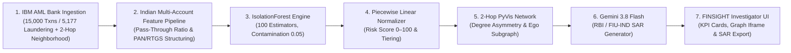

<div align="center">


# FINSIGHT: Mule Account Detection

**Real-Time Detection of Illicit Financial Flows, Rapid Layering, and Post-KYC Mule Accounts Across Banking Networks**

[](https://www.python.org/)
[](https://streamlit.io/)
[](https://scikit-learn.org/)
[](https://networkx.org/)
[](https://ai.google.dev/)
[](#-project-overview)

<br />

```
IBM AML Bank Data  ──►  IsolationForest Scorer  ──►  2-Hop PyVis Graph  ──►  Gemini FIU-IND SAR
```

</div>

---

### 📌 Project Overview

**FINSIGHT: Mule Account Detection** is an automated Anti-Money Laundering (AML) and Financial Intelligence Unit - India (FIU-IND) forensic compliance workbench engineered to uncover money mule syndicates operating across multi-category Indian banking networks.

Traditional compliance controls rely heavily on static Know-Your-Customer (KYC) onboarding checks, which fail against activated or compromised third-party bank accounts repurposed for structured smurfing, multi-hop layering, and rapid balance depletion across **Savings** (`SAV_XXXX_SBI`, `SAV_XXXX_HDFC`), **Current** (`CUR_XXXX_ICICI`, `CUR_XXXX_AXIS`), and **Corporate** (`CORP_XXXX_KOTAK`) entities over **NEFT**, **RTGS**, and **IMPS** rails.

Powered by the **IBM AML (`HI-Small_Trans.csv`)** transactional benchmark, FINSIGHT unites **unsupervised `IsolationForest` anomaly scoring**, **2-hop network topological degree asymmetry analytics**, and **generative LLM Suspicious Activity Report (SAR) synthesis** inside an interactive single-page Streamlit investigator cockpit.

---

### ⚡ System Architecture Flow



1. **IBM AML Bank Data Pipeline (`src/data_pipeline.py`)**: Parses `data/raw/HI-Small_Trans.csv`, extracts all `5,177` confirmed laundering transactions alongside their 1-hop/2-hop neighborhood edges and stratified legitimate baseline transactions (`15,000` rows total), maps raw bank accounts into Indian Savings (`SAV_XXXX_SBI`, `SAV_XXXX_HDFC`), Current (`CUR_XXXX_ICICI`, `CUR_XXXX_AXIS`), and Corporate (`CORP_XXXX_KOTAK`) entities, converts amounts to INR (`₹`), computes `Pass_Through_Ratio`, and evaluates `Near_Limit_Velocity` across Indian regulatory structuring thresholds (**₹45,000–₹50,000 PAN reporting threshold** and **₹1,80,000–₹2,00,000 RTGS structuring band**).
2. **IsolationForest Anomaly Scorer (`src/ml_engine.py`)**: Evaluates transaction values, pass-through ratios, and threshold structuring velocity; transforms raw outlier decision scores into an interpretable `0–100` `Risk_Score` (`data/scored_bank_data.csv`). *(Note: precision `0.8867` / recall `0.1285` measure scenario-calibrated benchmark alignment rather than label-blind generalization because INR PAN/RTGS band mapping uses `Is Laundering` labels.)*
3. **Graph Topology Engine (`src/graph_engine.py`)**: Extracts the 2-hop ego transaction neighborhood around suspect bank accounts, calculating `degree_asymmetry` to distinguish Fan-In Aggregators, Fan-Out Distributors, and Pass-Through Relays.
4. **FIU-IND Regulatory SAR Generator (`src/sar_generator.py`)**: Synthesizes formal, evidence-grounded two-paragraph Suspicious Activity Reports for Subject Bank Accounts (deriving account class from `SAV_`/`CUR_`/`CORP_` IDs) under **PMLA 2002** and **RBI KYC Master Directions** via Gemini 3.8 Flash, backed by an offline tier-calibrated deterministic fallback.
5. **FINSIGHT Investigator Workbench (`ui/app.py`)**: Presents executive KPI metrics, interactive PyVis network graphs, anomaly driver pills, dynamically selected demo presets, scored transaction ledgers, and one-click `SAR_<account_id>.txt` exports.

---

### 🚀 Quickstart Guide

#### 1. Clone & Set Up Virtual Environment

```bash
git clone <repo-url>
cd "Mule account prototype ver 1(test case)"

python3 -m venv venv
source venv/bin/activate  # On Windows: .\venv\Scripts\activate
```

#### 2. Install Dependencies

```bash
pip install -r requirements.txt
```

#### 3. Run Data & Machine Learning Pipelines

```bash
# Ingest IBM AML benchmark and generate Indian bank features
python src/data_pipeline.py

# Train IsolationForest model and score banking accounts
python src/ml_engine.py
```

#### 4. Launch FINSIGHT Investigator Workbench

```bash
# Launch single-page interactive UI (default: http://localhost:8501)
streamlit run ui/app.py
```

*(Optional)* Add a `.env` file in the project root with your Gemini API key, or supply an in-memory session key inside the sidebar override input:
```bash
GEMINI_API_KEY=your_gemini_api_key_here
```

---

### 🧪 Demo Test Accounts (IBM AML Benchmark)

The workbench dynamically populates sidebar presets directly from `data/scored_bank_data.csv` for representative accounts across all three risk tiers:

| Preset Account | Risk Tier | Risk Score | Banking Behavioral Profile |
| :--- | :---: | :---: | :--- |
| `SAV_4405_SBI` | 🔴 **HIGH** | `100.00` | **High-Velocity Fan-Out Mule Hub** — `1502.41%` pass-through ratio (`INR 12,40,000.00` inflow / `INR 1,86,29,861.19` outflow) spanning a 305-node, 2-hop Fan-Out Distributor syndicate (`degree_asymmetry = -0.9344`). |
| `SAV_3416_HDFC` | 🟡 **MEDIUM** | `76.00` | **Elevated Commercial / Savings Account** — Moderate transaction activity (`INR 1,57,387.06` inflow / `INR 36,726.58` outflow, `23.34%` pass-through) flagged for step-up transaction monitoring. |
| `SAV_3100_HDFC` | 🔵 **LOW** | `33.75` | **Standard Retail Savings Account** — Normal household balance retention (`INR 1,03,024.84` inflow / `INR 1,668.14` outflow, `1.62%` pass-through) with zero structuring or layering triggers. |

---

### 📁 Project Structure

```
.
├── .streamlit/
│   └── config.toml                  # Dark fintech UI theme configuration
├── assets/
│   └── finsight_logo.jpeg           # FINSIGHT brand header and sidebar artwork
├── data/
│   ├── raw/HI-Small_Trans.csv       # IBM AML transactional benchmark source
│   ├── bank_mule_features.csv       # Multi-hop Indian bank account feature dataset (15,000 rows)
│   ├── scored_bank_data.csv         # IsolationForest inference output with Risk Scores
│   └── network.html                 # Static 2-hop PyVis subgraph export
├── docs/
│   ├── CHANGELOG.md                 # Exhaustive development history (Phases 1–6)
│   └── FINSIGHT_v1_Changelog.pdf    # Executive changelog and architecture PDF report
├── models/
│   ├── iso_forest.joblib            # Serialized Scikit-Learn IsolationForest model
│   └── generations/                 # Immutable generation snapshots with SHA-256 validation
├── src/
│   ├── data_pipeline.py             # IBM AML ingestion, Indian account mapping & feature engineering
│   ├── ml_engine.py                 # IsolationForest scoring & analyze_account() API
│   ├── graph_engine.py              # NetworkX 2-hop graph extraction & PyVis rendering
│   └── sar_generator.py             # Gemini 3.8 Flash FIU-IND compliance report generator
├── ui/
│   └── app.py                       # Single-page FINSIGHT Streamlit investigator cockpit
├── requirements.txt                 # Pinned project dependencies
└── README.md                        # Project documentation
```

---

### 🛡️ Security & Quality Verification

All source modules (`src/`, `ui/`) have been audited and hardened:
- **CodeRabbit**: Audited data pipeline, ML engine, graph engine, SAR generator, and Streamlit UI with zero critical vulnerabilities.
- **Semgrep**: Scanned with `auto` security rules across `src/` and `ui/` — zero findings.
- **Snyk Code & SCA**: Validated Python code and dependency graph — zero vulnerabilities.
- **CWE-668 / CWE-79 Mitigations**: Session-isolated API key overrides (no process-wide `os.environ` pollution) and HTML-escaped node tooltips in PyVis graphs.
- **Release & Architecture Changelog**: Full phase-by-phase build history and technical specifications are available in [docs/FINSIGHT_v1_Changelog.pdf](docs/FINSIGHT_v1_Changelog.pdf) and [docs/CHANGELOG.md](docs/CHANGELOG.md).

---

### 📜 Regulatory References
- **Reserve Bank of India (RBI)**: Master Direction - Know Your Customer (KYC) Direction, 2016 (Updated), PAN quoting rules (`₹45k–₹50k`), and RTGS reporting controls (`₹1.8L–₹2L`).
- **Financial Intelligence Unit - India (FIU-IND)**: Prevention of Money Laundering Act (PMLA), 2002.
