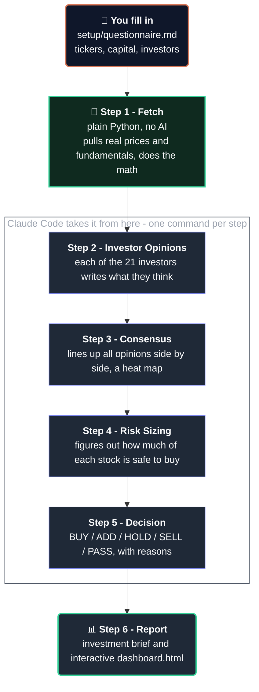

# Investment Council

[](LICENSE)
[](https://claude.com/claude-code)
[](requirements.txt)
[](_config/investor-personas)
[](#please-read-this)

Investment Council is a tool that helps you research stocks. You give it a list of stock tickers (like `AAPL` for Apple) and how much money you have to invest. It then looks at each stock through the eyes of **21 famous investors** — people like Warren Buffett and Michael Burry — and tells you what each one would think.

It runs on [Claude Code](https://claude.com/claude-code), a tool that lets an AI read and write files on your computer step by step.

This tool does not buy or sell anything for you. It does not need a paid subscription besides Claude Code. It is for learning and research only — not real financial advice.


**Want to see it in action first?** Check out [`examples/sample-run/`](examples/sample-run/). It has a full sample report and an interactive dashboard, built with made-up stock data (the picture above is from it). You can look at that before you run anything yourself.

## Why I built this

Most "AI stock picker" tools just give you one opinion. That opinion sounds confident, but it's really just one point of view dressed up to sound smart.

Investment Council does something different. It asks the same question to 21 different investors, each with their own style. One might love a stock. Another might hate it. You get to see all of that — including where they disagree — instead of one flat answer.

The disagreement is actually the useful part. If 5 out of 6 investors like a stock and one doesn't, that tells you something real.

This tool is also **not a black box**. Every step writes its work to a plain text file before the next step starts. You can open any of these files, read what it decided, change your mind about a piece of it, and the next step will use your correction. Nothing happens in secret.

## How it works

The tool runs in six steps, one after another. You can stop and check the work after each step before moving to the next one.



You check the work after every step — nothing moves to the next one without you looking first.

**The numbers are never made up.** Step 1 is a plain Python script. It pulls real numbers (like stock price and profit margin) and does the math itself. The AI never invents a number — it only writes the reasoning in plain English, on top of numbers it was already given.

## Quickstart

### 1. Install the two things you need

```bash
pip install -r requirements.txt
```

### 2. Fill in your settings

Open [`setup/questionnaire.md`](setup/questionnaire.md) and fill in:

- `TICKERS` — the stocks or funds you want to look at
- `CAPITAL` — how much money you have to invest
- `INVESTORS` — which of the 21 investors to use (or just write `all`)
- `HOLDINGS` (optional) — stocks you already own, if you want advice on those too

### 3. Pull the real data

```bash
python stages/01_fetch/fetch.py
```

This grabs live prices and numbers from Yahoo Finance. It's free, and you don't need an account or a password.

### 4. Run the rest in Claude Code

Open this folder in Claude Code. Then type each of these, one at a time, and wait for each to finish:

```text
Run stage 02 — analyst signals
Run stage 03 — consensus
Run stage 04 — risk
Run stage 05 — decision
Run stage 06 — report
```

After each step, look at what it wrote. If you disagree with anything, change it before you move to the next step.

### 5. Read your report

Your finished report is here: `stages/06_report/output/investment_brief.md`. There's also a `dashboard.html` file in the same folder — open it in any web browser to see it laid out visually.

Want more detail on every step? Read [`HOW_TO_USE.md`](HOW_TO_USE.md).

## What makes this more than a simple prompt


- **21 real investor styles, not just names.** Each investor has their own scoring rules, based on how they actually think about money. Michael Burry looks for hidden risk. Peter Lynch looks for simple businesses growing faster than people expect.
- **Math and opinions are kept separate.** A plain Python script does all the number crunching. The AI only adds the reasoning on top. A checker script (`validate.py`) makes sure the two never drift apart.
- **It knows about taxes.** If you tell it what you already own, it's smart about which account to sell from first, so you don't pay tax you didn't need to. It recognizes both Canadian accounts (TFSA, RRSP, LIRA) and American accounts (401k, IRA, Roth IRA, Brokerage) out of the box — other countries' account types work too, they just default to being treated as taxable until you add them to the list.
- **It pays attention to the bigger picture.** It checks current interest rates every time it runs, so investors who care about the economy (like Druckenmiller or Soros) have real numbers to react to, not guesses.

## What's in this folder

```text
investment-council/
├── CLAUDE.md                    ← tells the AI how this whole thing works
├── CONTEXT.md                   ← a map of which step does what
├── HOW_TO_USE.md                ← the full, detailed guide
├── setup/questionnaire.md       ← you fill this in before each run
├── _config/
│   ├── investor-personas/       ← the 21 investor styles + 1 fund checker
│   ├── risk-rules.md            ← how much of each stock is safe to buy
│   └── portfolio-rules.md       ← how BUY/SELL/HOLD decisions get made
├── stages/
│   ├── 01_fetch/                ← pulls real data and does the math
│   ├── 02_analyst_signals/      ← each investor's opinion
│   ├── 03_consensus/            ← the heat map of agreement/disagreement
│   ├── 04_risk/                 ← how big each position should be
│   ├── 05_decision/             ← the actual BUY/SELL/HOLD calls
│   └── 06_report/               ← the final report + dashboard
├── archive_run.py               ← saves an old run before you start a new one
└── validate.py                  ← checks nothing has drifted out of sync
```

## What you need

- Python 3.9 or newer, plus two small packages (`pip install -r requirements.txt` installs them)
- [Claude Code](https://claude.com/claude-code) — no other paid AI subscription needed

## Does it work with ChatGPT or other AI tools?

This was built and tested using Claude Code. But it's not tied to Claude in a technical sense — it's really just plain text instructions plus a Python script, so any AI coding tool that can read and write files on your computer (like Cursor, Aider, Windsurf, or OpenAI's Codex CLI) should be able to run it too.

One thing to know: plain ChatGPT in your browser can't run this. It has no way to reach files on your computer.

One small difference you might notice: Step 2 normally has the AI open 21 separate mini-conversations at once (one per investor), which is a Claude Code feature. Other tools may need to go through the investors one at a time instead — that's already explained inside `stages/02_analyst_signals/CONTEXT.md`.

## Please read this

This project is for learning and research only. It does not buy or sell real stocks for you. Nothing it writes is financial advice. Always do your own research, and talk to a real financial advisor before you make investing decisions.

## License

[MIT](LICENSE) — free to use, copy, and change.
