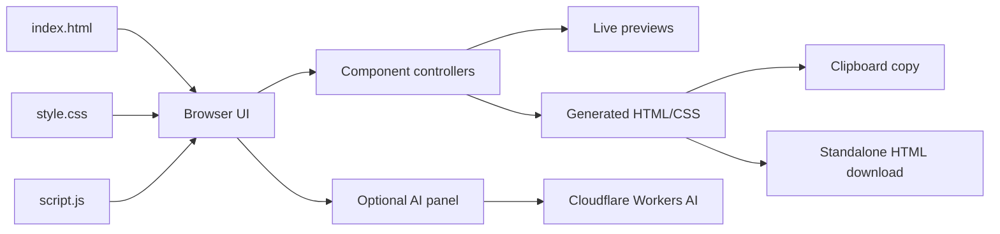

<div align="center">

```text
   _____               __  __  __
  / ____|             |  \/  |/ _|
 | |     _ __ __ _  __| \  / | |_
 | |    | '__/ _` |/ _` |\/| |  _|
 | |____| | | (_| | (_| |  | | |
  \_____|_|  \__,_|\__,_|  |_|_|
```

# CraftUI

**A browser-based UI component playground for crafting, customizing, previewing, and exporting HTML and CSS.**

[](https://github.com/vincenzo-afk/CraftUI/actions/workflows/validate.yml)
[](LICENSE)
[](https://github.com/vincenzo-afk/CraftUI/stargazers)

[Repository](https://github.com/vincenzo-afk/CraftUI) · [Issues](https://github.com/vincenzo-afk/CraftUI/issues) · [New issue](https://github.com/vincenzo-afk/CraftUI/issues/new)

</div>

## <a name="table-of-contents"></a>Table of Contents

- [About the Project](#about-the-project)
- [Tech Stack](#tech-stack)
- [Getting Started](#getting-started)
- [Usage](#usage)
- [API Reference](#api-reference)
- [Project Structure](#project-structure)
- [Features and Roadmap](#features-and-roadmap)
- [Testing](#testing)
- [Deployment](#deployment)
- [Contributing](#contributing)
- [Security](#security)
- [License](#license)
- [Acknowledgments](#acknowledgments)

---

## <a name="about-the-project"></a>About the Project

CraftUI is a self-contained static web application for experimenting with common user-interface patterns without a build system or package installation. It provides live previews for buttons, cards, modals, loaders, shadows, and gradients. Each section exposes controls that update the preview and generate copyable HTML and CSS output.

The playground also includes an optional client-side integration with Cloudflare Workers AI using the `@cf/moonshotai/kimi-k2.6` model. Users can enter a custom prompt, generate code for an individual component, or request a combined output for all six component areas.

### Key capabilities

- Live controls for six UI categories: buttons, cards, modals, loaders, shadows, and gradients.
- Multiple variants and adjustable properties such as size, radius, color, opacity, animation, and shadow intensity.
- Dark and light themes with the selected theme persisted in browser `localStorage`.
- Responsive navigation with a mobile sidebar and scroll-spy behavior.
- Syntax-highlighted generated HTML and CSS output.
- Copy-to-clipboard and standalone HTML export for each component section.
- Optional Cloudflare Workers AI generation with a typewriter-style response panel.
- Reduced-motion styling and semantic labels for the main interactive controls.

### Architecture overview



CraftUI runs entirely in the browser. The optional AI path sends the prompt and the supplied Cloudflare credentials directly from the browser to the Cloudflare Workers AI endpoint; there is no application server, database, or repository-hosted API in this project.

---

## <a name="tech-stack"></a>Tech Stack

| Area | Technology | Verified usage |
|---|---|---|
| Frontend | HTML5 | Application markup and semantic structure in `index.html`. |
| Frontend | CSS3 | Themes, responsive layout, component previews, animations, and reduced-motion styles in `style.css`. |
| Frontend | Vanilla JavaScript | State management, event handling, rendering, code generation, clipboard, downloads, and AI requests in `script.js`. |
| External service | Cloudflare Workers AI | Optional code generation through the `@cf/moonshotai/kimi-k2.6` model. |
| Validation | Node.js syntax check | The repository workflow validates `script.js` with `node --check`. |
| License | MIT | Declared in `LICENSE`. |

No package manifest, lockfile, framework dependency, database, container definition, or server-side runtime is present in the repository.

---

## <a name="getting-started"></a>Getting Started

### Prerequisites

For local development, install a modern web browser and a simple static HTTP server. Python 3 is sufficient because it includes the standard-library `http.server` module. Node.js is optional and is used by the validation workflow for JavaScript syntax checking.

The core playground does not require an API key. Cloudflare credentials are required only for the optional AI generation controls.

### Installation

Clone the repository and start a local static server from the project root:

```bash
git clone https://github.com/vincenzo-afk/CraftUI.git
cd CraftUI
python3 -m http.server 8000
```

Open [http://localhost:8000](http://localhost:8000) in a browser. Using a local HTTP server is recommended because browser APIs such as clipboard access work more reliably in a served origin than when opening `index.html` directly from the filesystem.

### Configuration

The committed `.env.example` documents these Cloudflare values:

| Variable | Purpose | Current runtime behavior |
|---|---|---|
| `CLOUDFLARE_ACCOUNT_ID` | Cloudflare account identifier used to address the Workers AI endpoint. | The current static app asks for the value in the AI panel; it does not load `.env` files automatically. |
| `CLOUDFLARE_API_TOKEN` | Cloudflare API bearer token used for the AI request. | The current static app asks for the value in the AI panel and stores it in browser `localStorage` when changed. |

To use AI generation, expand the **Kimi K2.6 AI Assistant** panel, enter the Cloudflare Account ID and API token, enter a prompt, and select **Send to Kimi K2.6**. The **Generate All with AI** button sends the current configuration for all six component areas. Individual sections also expose an **AI Generate** button.

Do not commit a real token or publish a broad-scope token in a public static deployment. Because this is a client-only application, any credential entered into the panel is available to the browser and is persisted locally under the keys `craftui-cf-key` and `craftui-cf-id`.

---

## <a name="usage"></a>Usage

After the page loads, choose a component section from the sidebar. Adjust its controls to change the live preview and generated code. The generated output appears below the preview in a code panel.

| Action | How to use it |
|---|---|
| Change a component | Select a section such as Buttons, Cards, or Gradients and adjust its controls. |
| Switch theme | Select the theme toggle in the top navigation. The selection is persisted locally. |
| Copy code | Select **Copy** in a component’s code panel. |
| Export code | Select **Export** to download a standalone HTML file named `ui-playground-<component>-<timestamp>.html`. |
| Generate code with AI | Configure Cloudflare credentials in the AI panel, then use the global or per-section AI action. |
| Navigate on mobile | Use the hamburger button to open the responsive sidebar. |

The generated snippets are intended as starting points that can be copied into another HTML document. Exported files include a minimal HTML document wrapper and the selected component output.

---

## <a name="api-reference"></a>API Reference

CraftUI has no local HTTP API. When AI generation is used, the browser sends a `POST` request to the Cloudflare Workers AI Run API using this URL pattern:

```text
https://api.cloudflare.com/client/v4/accounts/{account_id}/ai/run/@cf/moonshotai/kimi-k2.6
```

The request is implemented in `script.js` as follows:

| Item | Value |
|---|---|
| Method | `POST` |
| Authentication | `Authorization: Bearer {api_token}` |
| Content type | `application/json` |
| Model | `@cf/moonshotai/kimi-k2.6` |
| Body fields | `messages`, `max_tokens: 4096`, and `temperature: 0.7` |
| Response extraction | `result.response`, with a fallback to `choices[0].message.content` |

The request body contains a system instruction asking for production-ready HTML and CSS code and a user message containing the custom or component-specific prompt. Non-successful responses are shown in the application as an AI error toast. Refer to [Cloudflare Workers AI documentation](https://developers.cloudflare.com/workers-ai/) for account, token, model, and platform requirements.

---

## <a name="project-structure"></a>Project Structure

```text
CraftUI/
├── .env.example       # Documented Cloudflare configuration names
├── .gitignore         # Environment and operating-system exclusions
├── .github/
│   ├── workflows/
│   │   └── validate.yml
│   └── pull_request_template.md
├── CONTRIBUTING.md    # Local development and contribution workflow
├── LICENSE            # MIT license
├── README.md          # Project documentation
├── SECURITY.md        # Security reporting guidance
├── index.html         # Static application entry point and UI markup
├── script.js          # State, controllers, code generation, AI, copy, and export logic
└── style.css          # Theme, layout, responsive, preview, and animation styles
```

The application has no build output directory. The browser loads `style.css` and `script.js` directly from `index.html`.

---

## <a name="features-and-roadmap"></a>Features and Roadmap

### Implemented

- [x] Interactive button variants, sizes, loading state, icon toggle, and color control.
- [x] Card variants, radius, shadow intensity, width, title, body text, and badge control.
- [x] Modal sizes, overlay opacity, animation style, overlay-close behavior, and keyboard dismissal.
- [x] Seven loader previews, including spinner, dots, pulse, skeleton, progress, bars, and orbit.
- [x] Ten shadow examples with configurable color, blur, spread, and offsets.
- [x] Ten gradient presets with linear, radial, conic, angle, and color controls.
- [x] Light/dark theme switching, responsive layout, copy, export, and optional AI generation.

### Known limitations

- The project has no server-side proxy, so Cloudflare credentials are entered and used in the browser.
- The repository does not define a package manager, automated unit-test suite, or production deployment configuration.
- The AI feature depends on the availability and permissions of the configured Cloudflare account and model.

There is no separate roadmap or changelog file in the repository. Future work should be tracked through [GitHub Issues](https://github.com/vincenzo-afk/CraftUI/issues).

---

## <a name="testing"></a>Testing

No automated test suite is currently defined. The repository includes a lightweight validation workflow that checks JavaScript syntax using Node.js.

Run the same local validation command with:

```bash
node --check script.js
```

For a manual smoke test, start the local server, open the application, switch themes, visit each sidebar section, adjust representative controls, open and close the modal, copy a generated snippet, and export one component. AI generation can be tested separately after configuring valid Cloudflare credentials.

---

## <a name="deployment"></a>Deployment

CraftUI is a static site and can be deployed to any host that serves HTML, CSS, and JavaScript files. No build step is required. Upload the repository contents, configure the host to serve `index.html`, and ensure that the deployed site uses HTTPS if clipboard access or AI requests are required by the browser.

Because the AI integration is client-side, a static deployment does not conceal the Cloudflare token. Use a narrowly scoped token and consider a server-side proxy before deploying the AI feature for untrusted users.

---

## <a name="contributing"></a>Contributing

Contributions are welcome through pull requests. Begin with the setup and validation steps in [CONTRIBUTING.md](CONTRIBUTING.md), keep changes focused, and verify that the static application still loads without console errors.

Please review the repository’s [pull-request template](.github/pull_request_template.md) before opening a pull request. For security-sensitive reports, follow [SECURITY.md](SECURITY.md) instead of opening a public issue.

---

## <a name="security"></a>Security

Please read [SECURITY.md](SECURITY.md) before reporting a vulnerability. Never commit `.env` files, Cloudflare tokens, or other credentials. The AI panel stores entered credentials in browser `localStorage`; clear the site’s local storage after testing on a shared machine.

---

## <a name="license"></a>License

CraftUI is distributed under the [MIT License](LICENSE). The copyright notice in the repository is:

> Copyright (c) 2026 BHARANI KUMAR S

---

## <a name="acknowledgments"></a>Acknowledgments

CraftUI is implemented with browser-native HTML, CSS, and JavaScript APIs. The optional AI workflow uses Cloudflare Workers AI and the `@cf/moonshotai/kimi-k2.6` model. The repository’s initial project history identifies **BHARANI KUMAR S** as the project author.

---

<div align="center">

[Back to top](#craftui)

</div>
