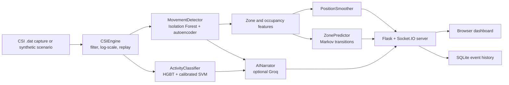

<div align="center">

```text
 ███████╗██╗  ██╗ █████╗ ██████╗  ██████╗ ██╗    ██╗ ██████╗ ██╗  ██╗ ██████╗ ███████╗████████╗
 ██╔════╝██║  ██║██╔══██╗██╔══██╗██╔═══██╗██║    ██║██╔═══██╗██║  ██║██╔═══██╗██╔════╝╚══██╔══╝
 ███████╗███████║███████║██║  ██║██║   ██║██║ █╗ ██║██║   ██║███████║██║   ██║███████╗   ██║
 ╚════██║██╔══██║██╔══██║██║  ██║██║   ██║██║███╗██║██║   ██║██╔══██║██║   ██║╚════██║   ██║
 ███████║██║  ██║██║  ██║██████╔╝╚██████╔╝╚███╔███╔╝╚██████╔╝██║  ██║╚██████╔╝███████║   ██║
 ╚══════╝╚═╝  ╚═╝╚═╝  ╚═╝╚═════╝  ╚═════╝  ╚══╝╚══╝  ╚═════╝ ╚═╝  ╚═╝ ╚═════╝ ╚══════╝   ╚═╝
```

# SHADOWGHOST

**WiFi channel-state-information sensing for presence, occupancy, zones, and activity.**

[](https://github.com/vincenzo-afk/SHADOWGHOST/actions/workflows/ci.yml)
[](LICENSE)
[](https://www.python.org/)

[Report a bug](https://github.com/vincenzo-afk/SHADOWGHOST/issues/new?template=bug_report.md) · [Request a feature](https://github.com/vincenzo-afk/SHADOWGHOST/issues/new?template=feature_request.md) · [View source](https://github.com/vincenzo-afk/SHADOWGHOST)

</div>

## <a name="table-of-contents"></a>Table of Contents

1. [About the Project](#about-the-project)
2. [Tech Stack](#tech-stack)
3. [Getting Started](#getting-started)
4. [Usage](#usage)
5. [API Reference](#api-reference)
6. [Project Structure](#project-structure)
7. [Features and Roadmap](#features-and-roadmap)
8. [Testing](#testing)
9. [Deployment](#deployment)
10. [Contributing](#contributing)
11. [Security](#security)
12. [License](#license)
13. [Acknowledgments](#acknowledgments)
14. [Footer](#footer)

---

## <a name="about-the-project"></a>About the Project

SHADOWGHOST is a local Python application that replays or simulates WiFi **Channel State Information (CSI)** and turns the resulting 56-subcarrier amplitude frames into a live browser dashboard. The backend combines anomaly detection, spatial zone estimation, occupancy peak counting, activity classification, temporal smoothing, next-zone prediction, SQLite event logging, and optional Groq-powered narration.

The application is designed to run without a camera and without a wearable sensor. When CSIKit or compatible `.dat` captures are unavailable, the replay engine generates deterministic synthetic scenarios so that the dashboard and model pipeline can be evaluated locally. This repository does not include raw CSI captures; `.dat` files are intentionally ignored by Git.

### Key capabilities

- Replays six supported scenarios: `walking`, `sitting`, `standing`, `pacing`, `empty`, and `crowd`.
- Computes movement scores using an Isolation Forest and an autoencoder-style `MLPRegressor` reconstruction model trained on empty-room frames.
- Maps signal energy to `LEFT`, `CENTER`, and `RIGHT` zones and estimates occupancy from spatial peaks.
- Classifies activity with a feature pipeline that includes time-domain statistics, FFT bands, optional wavelets, phase-derived features, spectral entropy, cross-zone correlations, short-window features, and transition rate.
- Smooths zone and activity outputs for display, predicts likely next zones with a Markov transition model, and writes periodic events to SQLite.
- Streams live frames over Flask-SocketIO to a vanilla HTML, CSS, and JavaScript dashboard.
- Uses Groq optionally for situation reports, activity-label validation, disagreement tracking, and anomaly explanations.

### Architecture



### Dashboard

The frontend is served directly by the Flask application. It contains status indicators, anomaly-source bars, occupancy and motion state, scenario controls, zone-energy views, a subcarrier waterfall, activity confidence, SITREP output, event history, recording controls, reset controls, and a theme toggle.

There is no hosted demo or deployment configuration in this repository. Run the application locally to view the dashboard at `http://localhost:5000`.

---

## <a name="tech-stack"></a>Tech Stack

| Area | Technologies | Versions or source of truth |
|---|---|---|
| Backend | Python, Flask, Flask-SocketIO, Flask-CORS | Python 3.10+ is used by the project documentation; package versions are `Flask 3.0.0`, `Flask-SocketIO 5.3.6`, and `Flask-CORS 4.0.0` in `requirements.txt`. |
| Signal and machine learning | NumPy, SciPy, scikit-learn, PyWavelets | Listed in `requirements.txt`; these dependencies are currently not fully pinned. |
| Frontend | Vanilla HTML, CSS, JavaScript, Canvas, Socket.IO client served by the application | No frontend package manager is used. |
| Storage | SQLite | Python standard-library `sqlite3`; database file is `shadowghost.db`. |
| Optional integration | Groq SDK | `groq>=0.4.0`; enabled only when `GROQ_API_KEY` is set and the SDK imports successfully. |
| Optional CSI input | CSIKit | Commented optional dependency in `requirements.txt`; the engine falls back to synthetic frames if it is unavailable. |
| Configuration | python-dotenv | Loads `.env` from the repository root. |
| System metrics | psutil | Used by `/api/health` for process memory and CPU readings. |

The project uses [Flask](https://flask.palletsprojects.com/), [Flask-SocketIO](https://flask-socketio.readthedocs.io/), [scikit-learn](https://scikit-learn.org/), [SciPy](https://scipy.org/), [PyWavelets](https://pywavelets.readthedocs.io/), and the [Groq Python SDK](https://github.com/groq/groq-python). Their documentation is the appropriate reference for library-level behavior.

---

## <a name="getting-started"></a>Getting Started

### Prerequisites

You need Python 3.10 or newer, a shell with virtual-environment support, and a modern browser. Real WiFi captures are optional because the default runtime can generate synthetic CSI frames. A Groq API key is also optional; without it, the dashboard remains usable and the AI narrator reports offline status.

### Installation

Clone the repository and create an isolated virtual environment:

```bash
git clone https://github.com/vincenzo-afk/SHADOWGHOST.git
cd SHADOWGHOST
python3 -m venv .venv
source .venv/bin/activate
python -m pip install --upgrade pip
python -m pip install -r requirements.txt
```

Start the local server from the repository root:

```bash
python backend/app.py
```

Open [http://localhost:5000](http://localhost:5000) in a browser. The server computes an empty-room baseline and trains missing detector or classifier artifacts during startup. The application stores its SQLite database at `shadowghost.db` and creates model artifacts under `models/` when training occurs; both are ignored by Git.

### Configuration

Copy the example file and edit only the values you need:

```bash
cp .env.example .env
```

| Variable | Required | Default | Purpose |
|---|---:|---|---|
| `GROQ_API_KEY` | No | Empty | Enables optional Groq narration and label validation. |
| `GROQ_MODEL` | No | `llama-3.3-70b-versatile` | Groq model name passed to chat completions. |
| `SIMULATION_MODE` | No | `true` | Controls the simulation-mode status exposed to the dashboard and API. |
| `SECRET_KEY` | Recommended for deployed use | Development fallback | Flask session/signing secret. Set a private value outside local development. |

`SIMULATION_MODE` is not a hardware switch by itself. Scenario loading uses CSIKit and configured `.dat` paths when available and otherwise uses the built-in synthetic generator. Raw `.dat` captures should not be committed because `.gitignore` excludes them.

### Optional CSIKit data

The repository does not ship `.dat` captures. To experiment with compatible captures, install CSIKit in the virtual environment and place scenario files under `data/` using the names expected by `backend/config.py`: `walking.dat`, `sitting.dat`, `standing.dat`, `pacing.dat`, `empty.dat`, and `crowd.dat`. Confirm the file format and hardware reader required by your capture source before use.

### Rebuilding model artifacts

Run the standalone training script whenever feature extraction or scenario generation changes:

```bash
python scripts/train_models.py
```

The script rebuilds the detector and activity-classifier artifacts, prints a classification report and confusion matrix, and saves generated files under `models/`. The server also checks the saved classifier feature size and retrains it when a stale artifact is detected.

---

## <a name="usage"></a>Usage

After the server starts, the browser dashboard connects to the Socket.IO endpoint and begins with the `walking` scenario. Use the scenario controls in the interface or call the REST endpoint directly:

```bash
curl http://localhost:5000/api/scenario/pacing
curl http://localhost:5000/api/status
curl http://localhost:5000/api/health
```

The server returns live `frame` events over Socket.IO. Each payload includes movement and anomaly scores, zone and occupancy estimates, activity labels and confidence values, predicted next zone, transition rate, subcarrier amplitudes, the active scenario, timestamps, and optional narrator fields.

To inspect recent SQLite-backed events:

```bash
curl 'http://localhost:5000/api/history?limit=20'
curl http://localhost:5000/api/stats
```

To clear the recorded event history:

```bash
curl -X POST http://localhost:5000/api/reset
```

To change the activity smoothing threshold, send a JSON body between `0.05` and `0.95`:

```bash
curl http://localhost:5000/api/config
curl -X POST http://localhost:5000/api/config \
  -H 'Content-Type: application/json' \
  -d '{"activity_conf_threshold": 0.45}'
```

To record a compact newline-delimited JSON session under `recordings/`:

```bash
curl -X POST http://localhost:5000/api/record/start
curl http://localhost:5000/api/record/status
curl -X POST http://localhost:5000/api/record/stop
```

Recording files are runtime artifacts and are ignored by Git. Do not use the unauthenticated development server or the permissive cross-origin configuration as-is on an internet-facing deployment.

---

## <a name="api-reference"></a>API Reference

The REST API is local and unauthenticated. It is intended for the bundled dashboard and development integrations. There is currently no rate limiting, authentication middleware, or versioned API prefix.

### Endpoints

| Method | Path | Description |
|---|---|---|
| `GET` | `/` | Serves `frontend/index.html`. |
| `GET` | `/<path:filename>` | Serves frontend static assets. |
| `GET` | `/api/scenario/<name>` | Loads one of the configured scenarios. Unknown names return `404`. |
| `GET` | `/api/history?limit=100` | Returns recent SQLite event rows, newest first. |
| `GET` | `/api/stats` | Returns last-hour totals, detections, average anomaly, average variance, and the transition matrix. |
| `GET` | `/api/disagreements` | Returns recent Groq-versus-classifier disagreements and a summary. |
| `POST` | `/api/reset` | Deletes all rows from the local event table and resets smoothing state. |
| `POST` | `/api/record/start` | Starts NDJSON recording under `recordings/`. Returns `400` if already recording. |
| `POST` | `/api/record/stop` | Stops recording and returns the file path. Returns `400` if not recording. |
| `GET` | `/api/record/status` | Reports whether recording is active and the current file path. |
| `GET` | `/api/health` | Returns measured FPS, process metrics, model status, database size, and simulation status. |
| `GET` | `/api/config` | Returns the current live activity confidence threshold. |
| `POST` | `/api/config` | Updates `activity_conf_threshold`, clamped to `0.05`–`0.95`. |
| `GET` | `/api/status` | Returns engine state, scenario, frame count, detector state, and AI availability. |

### Example responses

`GET /api/status` returns a response shaped like this:

```json
{
  "running": true,
  "scenario": "walking",
  "frame": 123,
  "trained": true,
  "ai_online": false
}
```

`GET /api/health` includes operational fields such as:

```json
{
  "status": "ok",
  "fps_measured": 9.98,
  "fps_target": 10.0,
  "frame_count": 123,
  "engine_running": true,
  "detector_trained": true,
  "classifier_trained": true,
  "ai_online": false,
  "recording": false,
  "sim_mode": true
}
```

The exact numeric values are runtime-dependent. `GET /api/history` returns SQLite rows with fields including `id`, `timestamp`, `scenario`, `movement`, `zone`, `activity`, `confidence`, `anomaly`, `variance`, and `sitrep`.

---

## <a name="project-structure"></a>Project Structure

```text
SHADOWGHOST/
├── .github/
│   ├── pull_request_template.md
│   └── workflows/ci.yml
├── backend/
│   ├── ai_narrator.py       Optional Groq reports and label validation
│   ├── app.py               Flask, REST, Socket.IO, startup, and shutdown
│   ├── classifier.py        HGBT/SVM activity-classification pipeline
│   ├── config.py            Paths, scenarios, thresholds, and environment
│   ├── csi_engine.py        CSI replay and synthetic frame generation
│   ├── db.py                SQLite event persistence and aggregation
│   ├── detector.py          Isolation Forest, autoencoder, zones, occupancy
│   ├── predictor.py         Markov next-zone prediction and transition rate
│   └── smoother.py          Position, velocity, and label smoothing
├── frontend/
│   ├── index.html           Dashboard markup
│   ├── script.js            Socket.IO client and Canvas/dashboard logic
│   └── style.css            Dashboard presentation
├── scripts/
│   └── train_models.py      Detector and classifier training
├── data/                    Optional local `.dat` captures; ignored by Git
├── models/                  Generated model artifacts; ignored by Git
├── recordings/              Generated NDJSON sessions; ignored by Git
├── .env.example             Environment-variable template
├── .gitignore               Runtime, Python, IDE, and secret exclusions
├── CONTRIBUTING.md          Local development and pull-request guidance
├── LICENSE                  Apache License 2.0
├── README.md                Project documentation
├── SECURITY.md              Vulnerability-reporting guidance
└── requirements.txt         Python dependencies
```

---

## <a name="features-and-roadmap"></a>Features and Roadmap

### Implemented

| Status | Capability |
|---|---|
| ✅ | Synthetic CSI generation for six scenarios and optional CSIKit replay path |
| ✅ | Empty-room baseline with slow adaptive drift correction |
| ✅ | Isolation Forest plus autoencoder anomaly scoring |
| ✅ | Three-zone energy mapping, center-of-mass position, and peak-based occupancy estimate |
| ✅ | HGBT and calibrated SVM ensemble with persisted feature-size validation |
| ✅ | Position, activity, and occupancy smoothing |
| ✅ | Markov transition matrix and rolling transition-rate feature |
| ✅ | Optional Groq SITREP, activity validation, and anomaly explanation |
| ✅ | SQLite history, statistics, reset, and NDJSON recording endpoints |
| ✅ | Browser dashboard served by Flask with live Socket.IO frames |

### Known limitations and next steps

The project currently has no automated unit or integration test suite, no container or deployment manifest, and no authentication or rate limiting on its REST and Socket.IO interfaces. The checked-in dependency requirements also leave several scientific packages unpinned. These are intentional follow-up areas for a deployment that needs reproducible environments or network exposure.

The next practical improvements are to add tests around feature extraction and API handlers, pin and audit dependencies, add an authenticated production serving path, and validate the model pipeline against real CSI captures rather than only synthetic scenarios.

The repository history serves as the changelog; review the [commit history](https://github.com/vincenzo-afk/SHADOWGHOST/commits/main) for implementation changes.

---

## <a name="testing"></a>Testing

No formal test directory or test runner is currently present. The CI workflow therefore performs syntax validation for the Python source and training script:

```bash
python -m compileall backend scripts
```

For a functional smoke check, install the requirements and start the server with `python backend/app.py`. Verify the dashboard loads, then query `/api/status` and `/api/health`. Model training can be exercised separately with `python scripts/train_models.py`; it generates synthetic data and may take longer than the syntax check.

---

## <a name="deployment"></a>Deployment

No Dockerfile, process manager configuration, cloud manifest, or production web-server configuration is included. The supported deployment path in this repository is local or self-hosted execution of `python backend/app.py` behind an appropriate reverse proxy and process manager.

Before exposing the service beyond a trusted development network, set a private `SECRET_KEY`, restrict `CORS` to known origins, add authentication and rate limiting, protect the recording and reset endpoints, and run behind a production WSGI/Socket.IO deployment configuration. The current application intentionally favors a simple local demonstration setup and should not be treated as a hardened internet-facing service.

---

## <a name="contributing"></a>Contributing

Contributions are welcome when they improve reproducibility, sensing quality, documentation, or operational safety. Begin with the repository's [contribution guide](CONTRIBUTING.md), open an issue for substantial changes, and keep pull requests focused.

The project uses a lightweight Conventional Commits style for new commits, such as `fix: handle empty CSI frames` or `docs: clarify Groq configuration`. Pull requests should explain the intent, list the validation performed, identify documentation changes, and call out security or behavioral impacts.

---

## <a name="security"></a>Security

SHADOWGHOST processes sensing data and optional third-party API credentials. Never commit `.env` files, API keys, raw captures, databases, model artifacts, or recordings. The application is unauthenticated by default and enables permissive cross-origin requests for local dashboard use, so network exposure requires additional controls.

Read [SECURITY.md](SECURITY.md) for the vulnerability-reporting process. For dependency behavior, consult the upstream documentation for [Groq](https://console.groq.com/docs/quickstart), [Flask](https://flask.palletsprojects.com/), and [Flask-SocketIO](https://flask-socketio.readthedocs.io/).

---

## <a name="license"></a>License

SHADOWGHOST is released under the [Apache License 2.0](LICENSE). The repository does not assign a separate copyright holder in its documentation; consult the `LICENSE` file for the complete legal text.

---

## <a name="acknowledgments"></a>Acknowledgments

The project uses open-source Python and browser technologies listed in the [Tech Stack](#tech-stack). The signal-processing and machine-learning pipeline is implemented in the repository's `backend/` modules, with CSI replay and synthetic generation in `backend/csi_engine.py`.

The repository is maintained under the GitHub account [@vincenzo-afk](https://github.com/vincenzo-afk). Contributions visible in the repository history are credited through Git history and GitHub's contributor aggregation.

---

## <a name="footer"></a>Footer

[Back to top](#shadowghost)

Project repository: [github.com/vincenzo-afk/SHADOWGHOST](https://github.com/vincenzo-afk/SHADOWGHOST)

Built by [vincenzo-afk](https://github.com/vincenzo-afk).

### References

[1]: https://docs.github.com/en/repositories/managing-your-repositorys-settings-and-features/customizing-your-repository/classifying-your-repository-with-topics "GitHub repository topics guidance"
[2]: https://flask.palletsprojects.com/ "Flask documentation"
[3]: https://flask-socketio.readthedocs.io/ "Flask-SocketIO documentation"
[4]: https://scikit-learn.org/ "scikit-learn documentation"
[5]: https://pywavelets.readthedocs.io/ "PyWavelets documentation"
[6]: https://console.groq.com/docs/quickstart "Groq API quickstart"

GitHub topic selection for this repository follows the platform's topic guidance: topics are lowercase, hyphenated, repository-specific labels rather than generic metadata [1].
