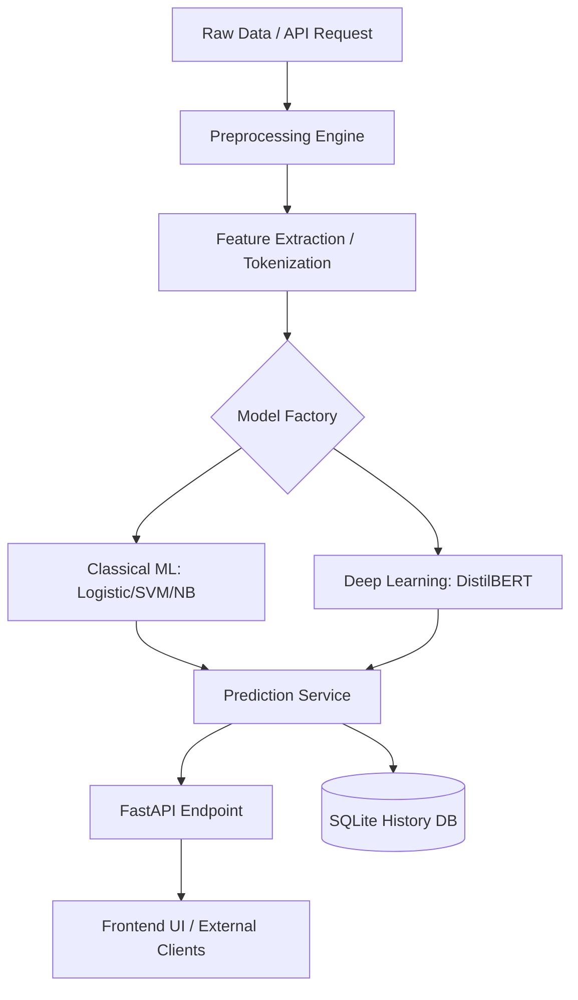

# TruthNet: AI-Powered Fake News Detection

TruthNet is a comprehensive, production-grade machine learning framework designed to identify and classify news articles as **Real** or **Fake**. By leveraging both classical statistical methods and state-of-the-art transformer architectures, TruthNet provides high-accuracy predictions accompanied by explainability signals to help users understand the reasoning behind every classification.

---

## Table of Contents
1. [Overview](#overview)
2. [Key Features](#key-features)
3. [Architecture](#architecture)
4. [Performance Benchmarks](#performance-benchmarks)
5. [Installation](#installation)
6. [Configuration](#configuration)
7. [Training Pipeline](#training-pipeline)
8. [API Documentation](#api-documentation)
9. [Frontend Interface](#frontend-interface)
10. [Contributing](#contributing)
11. [License](#license)

---

## Overview

In an era of rapid information dissemination, the proliferation of misinformation poses a significant challenge to public discourse. **TruthNet** addresses this by providing a robust, scalable API and web interface for news verification. It processes raw article text through a sophisticated preprocessing pipeline and classifies it using a suite of trained models, ranging from efficient Logistic Regression to deep-learning DistilBERT transformers.

> **Disclaimer**: TruthNet is intended for research and educational purposes. No automated classifier is a substitute for professional fact-checking. Treat predictions as a signal, not a verdict.

## Key Features

- **Multi-Model Support**: Choose between Logistic Regression, Naive Bayes, SVM, and DistilBERT.
- **Explainability**: Integrated feature importance and confidence scoring for every prediction.
- **RESTful API**: Built with FastAPI, providing high-performance endpoints for real-time inference.
- **Extensible Pipeline**: Modular data loaders and preprocessors for easy integration of new datasets.
- **Interactive Frontend**: A clean, responsive web interface for instant article analysis.
- **Persistence**: Built-in SQLite history tracking for auditing and analysis.

## Architecture

TruthNet follows a modular architecture separating concerns between data processing, model management, and service delivery:



## Performance Benchmarks

The following metrics were achieved using the `mrm8488/fake-news` dataset (approx. 38,600 articles):

| Model | Accuracy | Precision | Recall | F1-Score |
| :--- | :--- | :--- | :--- | :--- |
| **DistilBERT** | 100.0%* | 100.0% | 100.0% | 100.0% |
| **SVM** | 99.34% | 99.35% | 99.20% | 99.27% |
| **Logistic Regression** | 98.67% | 99.04% | 98.01% | 98.52% |
| **Naive Bayes** | 95.33% | 94.37% | 95.34% | 94.85% |

*\*Note: DistilBERT was fine-tuned on a representative subset to optimize training efficiency.*

## Installation

### Prerequisites
- Python 3.10+
- Virtual Environment (recommended)

### Setup
```bash
# Clone the repository
git clone https://github.com/vincenzo-afk/TruthNet.git
cd TruthNet

# Create and activate virtual environment
python -m venv venv
source venv/bin/activate  # On Windows: venv\Scripts\activate

# Install dependencies
pip install -r requirements.txt
```

## Configuration

TruthNet uses environment variables for configuration. Copy the example file and adjust as needed:

```bash
cp .env.example .env
```

### Key Variables
| Variable | Description | Default |
| :--- | :--- | :--- |
| `MODEL_TYPE` | Default model for training/API | `logistic` |
| `API_PORT` | Port for the FastAPI server | `8000` |
| `DATASET_PATH` | Path to the training CSV/JSON | `datasets/dataset.csv` |

## Training Pipeline

The training pipeline is fully automated and supports various model architectures.

```bash
# Train the default model (Logistic Regression)
python training/train.py

# Train a specific model with a custom dataset
python training/train.py --model svm --dataset path/to/data.csv

# Fine-tune the transformer model
python training/train.py --model distilbert
```

## API Documentation

Once the server is running, interactive Swagger documentation is available at `/docs`.

### Primary Endpoints
- `GET /health`: Check system and model status.
- `POST /predict`: Submit an article for classification.
- `GET /history`: Retrieve recent prediction history.

### Sample Request
```json
{
  "title": "Breaking News",
  "text": "Full article content goes here..."
}
```

## Frontend Interface

TruthNet includes a built-in frontend accessible at the root URL (`http://localhost:8000`). It provides:
- A simple text area for article input.
- Real-time prediction visualization.
- Confidence meters and explainability highlights.

## Contributing

We welcome contributions! Please follow these steps:
1. Fork the repository.
2. Create a feature branch (`git checkout -b feature/AmazingFeature`).
3. Commit your changes (`git commit -m 'Add AmazingFeature'`).
4. Push to the branch (`git push origin feature/AmazingFeature`).
5. Open a Pull Request.

## License

Distributed under the MIT License. See `LICENSE` for more information.

---
Developed by **vincenzo-afk**
