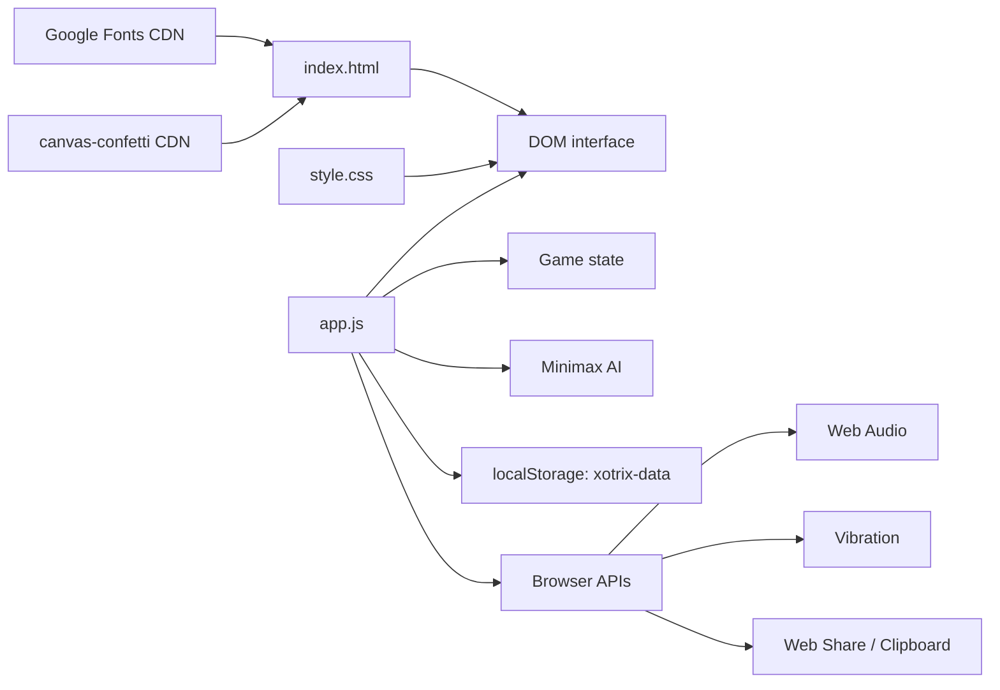

<div align="center">

# XOTrix

**A polished, browser-native Tic-Tac-Toe game with configurable AI, replays, statistics, themes, and shareable matches.**

[](https://github.com/vincenzo-afk/XOTrix/actions/workflows/validate.yml)
[](LICENSE)
[](https://xo-trix.vercel.app)

[Live Demo](https://xo-trix.vercel.app) · [Report a bug](https://github.com/vincenzo-afk/XOTrix/issues/new?template=bug_report.yml) · [Request a feature](https://github.com/vincenzo-afk/XOTrix/issues/new?template=feature_request.yml)

</div>

## <a name="table-of-contents"></a>Table of Contents

- [About the Project](#about-the-project)
- [Tech Stack](#tech-stack)
- [Getting Started](#getting-started)
- [Usage](#usage)
- [API Reference](#api-reference)
- [Project Structure](#project-structure)
- [Features and Roadmap](#features-and-roadmap)
- [Testing](#testing)
- [Deployment](#deployment)
- [Contributing](#contributing)
- [Security](#security)
- [License](#license)
- [Acknowledgments](#acknowledgments)
- [References](#references)
- [Footer](#footer)

---

## <a name="about-the-project"></a>About the Project

XOTrix is a client-side Tic-Tac-Toe game that runs directly in a modern web browser. It is designed as a small, dependency-light static project: the HTML document provides the interface, `app.js` manages gameplay and persistence, and `style.css` provides themes, responsive layout, animation, and visual states.

The game supports local two-player sessions, human-versus-bot play, and bot-versus-bot demonstrations. The bot uses minimax with alpha-beta pruning, difficulty-specific search depths, and a small opening book for Master difficulty. Match state, personal statistics, settings, themes, achievements, and scores are stored in the browser under the `xotrix-data` `localStorage` key; there is no server-side account or database.

### Key Features

- Human vs Human, Human vs Bot, and Bot vs Bot modes.
- Beginner, Intermediate, Advanced, and Master bot difficulty levels.
- Minimax with alpha-beta pruning, plus Master-level opening responses.
- Undo, reset, move history, replay navigation, and replay URLs using the `?replay=` query parameter.
- Local statistics including games played, wins, losses, draws, win rate, streaks, fastest win, and Elo rating.
- Six visual themes: Neon, Glass, Retro, Minimal, Forest, and Sunset.
- Browser sound effects through the Web Audio API, optional vibration feedback, confetti on wins, and Web Share or clipboard sharing when supported by the browser.
- Responsive layout with keyboard navigation, number-key cell selection, `U` for undo, and `R` for reset.

### Architecture Overview



### Screenshots

The repository currently contains no checked-in screenshot assets. The live interface is available at the [XOTrix demo](https://xo-trix.vercel.app).

---

## <a name="tech-stack"></a>Tech Stack

| Area | Technologies used | Evidence in repository |
|---|---|---|
| Frontend | HTML5, CSS3, vanilla JavaScript | `index.html`, `style.css`, `app.js` |
| AI engine | Minimax, alpha-beta pruning, opening-book responses | `app.js` (`AI` and `OPENING_BOOK`) |
| Browser storage | Web Storage API (`localStorage`) | `app.js` (`saveStats` and `loadStats`) |
| Browser integrations | Web Audio API, Vibration API, Web Share API, Clipboard API | `app.js` (`AudioEngine`, `vibrate`, `shareGame`) |
| External assets | Google Fonts and `canvas-confetti` 1.6.0 from jsDelivr | `index.html` |
| Backend and database | None | Static client-side application |
| Build system | None | No package manifest, bundler, or build configuration is committed |

---

## <a name="getting-started"></a>Getting Started

### Prerequisites

You need a modern browser with JavaScript enabled. For local development, use Python 3 or another static-file HTTP server. No Node.js installation, package manager, API key, database, or environment variable is required by the application.

### Installation

Clone the repository and enter its directory:

```bash
git clone https://github.com/vincenzo-afk/XOTrix.git
cd XOTrix
```

Because the project is static, it can be opened directly from `index.html`. Running a local HTTP server is recommended because it gives browser sharing and relative asset loading behavior closer to a deployed site:

```bash
python3 -m http.server 8000
```

Open [http://localhost:8000](http://localhost:8000) in a browser.

### Configuration

XOTrix has no `.env` file and reads no environment variables. User preferences and statistics are stored locally in the browser.

| Stored data | Storage key | Purpose |
|---|---|---|
| Game statistics | `xotrix-data` | Wins, losses, draws, streaks, fastest win, and Elo rating |
| Achievements | `xotrix-data` | Achievement unlock state |
| Preferences | `xotrix-data` | Theme, sound, volume, haptics, and player scores |

To clear local data, open the browser developer tools and remove the `xotrix-data` entry from `localStorage` for the site. This permanently resets the saved statistics and preferences for that browser origin.

---

## <a name="usage"></a>Usage

After opening the app, choose a game mode from the sidebar and select a bot difficulty when a bot mode is active. Click a cell to place a mark. In Human vs Bot mode, the optional **Bot plays first** setting starts the bot as `X`.

Use **Undo** to remove the most recent move, **Reset** to start a new board, and **History** to inspect moves and navigate through a replay. **Share** creates a URL containing the played cell sequence. Loading that URL with a `replay` query parameter reconstructs the recorded moves.

Examples:

```text
# Start a local server from the repository root
python3 -m http.server 8000

# Open a replay containing moves 4, 0, 8, 2, and 6
http://localhost:8000/?replay=40826
```

The replay format is a sequence of digits from `0` through `8`, where each digit identifies a board cell in row-major order:

```text
0 1 2
3 4 5
6 7 8
```

Keyboard controls are available when a board cell is focused:

| Key | Action |
|---|---|
| Arrow keys | Move focus around the board |
| Enter or Space | Place the current mark |
| `1`–`9` | Select a board cell directly |
| `U` | Undo the latest move |
| `R` | Reset the current game |

---

## <a name="api-reference"></a>API Reference

XOTrix does not expose an HTTP API, backend route, or public JavaScript package API. Its only URL-level interface is the replay query parameter:

| Interface | Format | Description |
|---|---|---|
| Replay URL | `/?replay=<digits>` | Reconstructs valid, non-duplicate board moves from the digit sequence |

The app uses browser APIs rather than authenticated network requests. Browser support varies for sharing, clipboard writes, audio playback, and vibration; unsupported capabilities are skipped or fall back where the implementation provides a fallback.

---

## <a name="project-structure"></a>Project Structure

<details>
<summary>Show the repository tree</summary>

```text
XOTrix/
├── .github/
│   ├── ISSUE_TEMPLATE/
│   │   ├── bug_report.yml
│   │   └── feature_request.yml
│   ├── workflows/
│   │   └── validate.yml
│   └── pull_request_template.md
├── app.js
├── index.html
├── style.css
├── CODE_OF_CONDUCT.md
├── CONTRIBUTING.md
├── LICENSE
├── README.md
└── SECURITY.md
```

</details>

| File | Responsibility |
|---|---|
| `index.html` | Static application shell, controls, board, modals, and CDN asset references |
| `app.js` | Game state, AI, user interaction, replay, statistics, persistence, audio, and feedback |
| `style.css` | Layout, themes, responsive breakpoints, animations, and component styling |
| `LICENSE` | MIT license and copyright notice |
| `.github/` | Validation workflow and contribution templates |

---

## <a name="features-and-roadmap"></a>Features and Roadmap

### Implemented

- ✅ Local Tic-Tac-Toe gameplay with three active modes.
- ✅ Four bot difficulty levels backed by minimax search.
- ✅ Undo, reset, move history, replay navigation, and shareable replay URLs.
- ✅ Local statistics, Elo calculation for bot matches, streak tracking, and achievement unlock state.
- ✅ Six themes, responsive layout, sound effects, optional haptics, and win animation.
- ✅ Basic keyboard interaction and browser-only persistence.

### Known limitations

- The project has no multiplayer networking, user accounts, backend, leaderboard service, or synchronized cloud data.
- Challenge Mode currently provides timer warning styling rather than a separate win condition or server-enforced time limit.
- Tournament and leaderboard elements are present in the HTML interface but are not backed by a complete tournament or online ranking workflow.
- The browser must support the relevant Web APIs for audio, vibration, sharing, and clipboard behavior; unsupported APIs may be unavailable.

### Roadmap

The repository does not define a formal roadmap. Potential future work should be tracked through [GitHub issues](https://github.com/vincenzo-afk/XOTrix/issues) and should preserve the project’s static, dependency-light architecture unless a backend is intentionally introduced.

For repository history, see the [commit log](https://github.com/vincenzo-afk/XOTrix/commits/main).

---

## <a name="testing"></a>Testing

No automated test framework or test suite is currently committed. The repository includes a lightweight GitHub Actions validation workflow that checks JavaScript syntax and verifies the required static files.

Run the same local checks from the repository root:

```bash
node --check app.js
test -f index.html && test -f style.css && test -f app.js
```

For manual validation, serve the project locally and exercise each active game mode, bot difficulty, reset and undo controls, replay navigation, theme selection, local persistence, and share behavior in a supported browser.

---

## <a name="deployment"></a>Deployment

XOTrix is a static site and does not require a build step. Upload `index.html`, `app.js`, and `style.css` to any static hosting provider, or connect the repository to a static deployment service.

The repository metadata currently lists [https://xo-trix.vercel.app](https://xo-trix.vercel.app) as the project homepage. No Vercel configuration file is committed, so provider-specific settings must be configured in the hosting dashboard or deployment environment.

A generic static deployment should publish the repository root as the site directory and use `index.html` as the entry document. No server-side secrets should be added because the application has no environment-variable configuration.

---

## <a name="contributing"></a>Contributing

Contributions are welcome when they improve gameplay, accessibility, visual quality, documentation, or maintainability without introducing unsupported claims. Please read [CONTRIBUTING.md](CONTRIBUTING.md) before opening a pull request and follow the [Code of Conduct](CODE_OF_CONDUCT.md).

The expected workflow is to create a focused branch, make a small coherent change, run the documented validation commands, and open a pull request that explains the user impact and testing performed. Use branch names such as `feature/short-description`, `fix/short-description`, or `docs/short-description`. Conventional Commit-style messages are recommended, for example `fix: prevent invalid replay moves`.

---

## <a name="security"></a>Security

XOTrix is a browser-only application and does not process accounts, payments, secrets, or server-side personal data. The primary security considerations are dependency integrity for the CDN assets, safe handling of browser storage, and avoiding unsafe changes to client-side DOM behavior.

Please do not publish a vulnerability in a public issue. Use the repository’s [private security advisory page](https://github.com/vincenzo-afk/XOTrix/security/advisories/new) when available. If private advisories are unavailable, contact the repository owner through [GitHub](https://github.com/vincenzo-afk). See [SECURITY.md](SECURITY.md) for the reporting policy.

---

## <a name="license"></a>License

XOTrix is distributed under the [MIT License](LICENSE).

Copyright (c) 2026 BHARANI KUMAR S.

---

## <a name="acknowledgments"></a>Acknowledgments

The project’s existing license identifies **BHARANI KUMAR S** as the copyright holder. The repository is maintained under the GitHub account [vincenzo-afk](https://github.com/vincenzo-afk). External assets are loaded from [Google Fonts](https://fonts.google.com/) and [canvas-confetti](https://github.com/catdad/canvas-confetti) through jsDelivr, as declared in `index.html`.

---

## <a name="references"></a>References

[1]: https://developer.mozilla.org/en-US/docs/Web/API/Window/localStorage "MDN: Window.localStorage"
[2]: https://developer.mozilla.org/en-US/docs/Web/API/Web_Audio_API "MDN: Web Audio API"
[3]: https://developer.mozilla.org/en-US/docs/Web/API/Navigator/share "MDN: Navigator.share()"
[4]: https://docs.github.com/en/repositories/creating-and-managing-repositories/licensing-a-repository "GitHub: Licensing a repository"

The browser capabilities referenced above are documented by the [Web Storage API][1], [Web Audio API][2], and [Web Share API][3]. The repository’s license is preserved as committed in `LICENSE`, with general GitHub licensing guidance available from GitHub’s documentation.[4]

---

## <a name="footer"></a>Footer

[Back to top](#xotrix)

- **Repository:** [vincenzo-afk/XOTrix](https://github.com/vincenzo-afk/XOTrix)
- **Website:** [xo-trix.vercel.app](https://xo-trix.vercel.app)
- **Issues:** [GitHub Issues](https://github.com/vincenzo-afk/XOTrix/issues)

Built for the XOTrix project by **BHARANI KUMAR S** and contributors.
