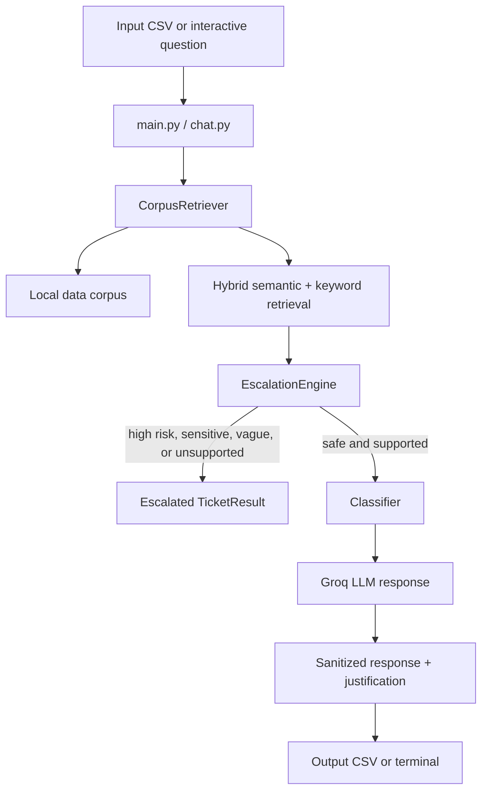

# HackerRank Orchestrate

> A terminal-based, multi-domain support-ticket triage agent grounded in a local support corpus.

[](https://github.com/vincenzo-afk/hackerrank-agent/actions/workflows/ci.yml) [](https://www.python.org/) [](https://groq.com/)

[Repository](https://github.com/vincenzo-afk/hackerrank-agent) · [Problem statement](./problem_statement.md) · [Evaluation criteria](./evalutation_criteria.md) · [Report a bug](https://github.com/vincenzo-afk/hackerrank-agent/issues/new?template=bug_report.md) · [Request a feature](https://github.com/vincenzo-afk/hackerrank-agent/issues/new?template=feature_request.md)

## <a name="table-of-contents"></a>Table of Contents

1. [About the project](#about-the-project)
2. [Tech stack](#tech-stack)
3. [Getting started](#getting-started)
4. [Usage](#usage)
5. [API reference](#api-reference)
6. [Project structure](#project-structure)
7. [Features and roadmap](#features-and-roadmap)
8. [Testing](#testing)
9. [Deployment](#deployment)
10. [Contributing](#contributing)
11. [Security](#security)
12. [License](#license)
13. [Acknowledgments](#acknowledgments)
14. [References](#references)

---

## <a name="about-the-project"></a>About the Project

**HackerRank Orchestrate** processes support tickets for three domains—HackerRank, Claude, and Visa—using only the documentation shipped under [`data/`](./data/). It classifies each ticket, retrieves relevant documentation, generates a grounded response when appropriate, and escalates high-risk, sensitive, unsupported, or ambiguous requests instead of guessing.

The repository was created for the HackerRank Orchestrate challenge. The implementation is intentionally terminal-based and exposes both a batch CSV workflow and an interactive chat workflow. The required ticket schema and evaluation rubric remain available in [`problem_statement.md`](./problem_statement.md) and [`evalutation_criteria.md`](./evalutation_criteria.md).

### Key capabilities

- **Hybrid retrieval:** combines Sentence Transformers semantic similarity with a lightweight keyword score and an optional company-domain boost.
- **Corpus grounding:** reads supported local files from `data/`, strips HTML noise, flattens JSON, and keeps source filenames in the justification.
- **Safety-first escalation:** checks for prompt injection, destructive commands, sensitive personally identifiable information (PII), fraud, identity theft, access-boundary requests, score manipulation, outages, unsupported security reports, and insufficient context.
- **Two operating modes:** triage a CSV in batch or ask questions through an interactive REPL with conversation history and company context.
- **Configurable operation:** model, retrieval, retry, chat-history, and escalation-pattern settings are read from environment variables.
- **Reproducible artifacts:** embedding vectors and metadata are cached locally and ignored by Git.

### Architecture overview



The project does not expose an HTTP server or public API. Its runtime interface is the Python command line.

---

## <a name="tech-stack"></a>Tech Stack

| Area | Technologies used in this repository |
|---|---|
| Runtime | Python; the implementation documentation targets Python 3.9–3.12 |
| LLM integration | `groq>=0.9.0`; default model `llama-3.3-70b-versatile` |
| Retrieval | `sentence-transformers>=3.0.0`, `scikit-learn>=1.4.0`, `numpy>=1.26.0,<2` |
| Data and files | `pandas>=2.0.0`, CSV, Markdown, text, HTML, JSON |
| Parsing and utilities | `beautifulsoup4>=4.12.0`, `python-dotenv>=1.0.0`, `tqdm>=4.66.0` |
| Storage | Local files under `data/`; local embedding cache in `data/embeddings_cache.npy` and `data/embeddings_cache.meta.json` |
| Automation | GitHub Actions syntax-check workflow under `.github/workflows/ci.yml` |

The versions above are the lower bounds declared in [`code/requirements.txt`](./code/requirements.txt), not a lockfile. The repository does not currently include a `pyproject.toml`, `setup.py`, or lockfile.

---

## <a name="getting-started"></a>Getting Started

### Prerequisites

You need Git, Python 3.9–3.12, and a Groq API key for generated responses. The embedding model may download on its first uncached run, so the initial indexing step requires network access and enough local disk space for the model and cache. Subsequent runs can reuse the local embedding cache when the corpus and retrieval settings are unchanged.

### Installation

```bash
git clone https://github.com/vincenzo-afk/hackerrank-agent.git
cd hackerrank-agent

python -m venv .venv
source .venv/bin/activate          # Windows PowerShell: .venv\Scripts\Activate.ps1
python -m pip install --upgrade pip
python -m pip install -r code/requirements.txt
```

Copy the environment template and set the required key:

```bash
cp .env.example .env
# Edit .env and set GROQ_API_KEY to your own key.
```

The application reads the repository-local `.env` file through `python-dotenv`. Never commit `.env` or place API keys in source files.

### Configuration

The following variables are supported by the implementation. Optional values default to the values shown in [`.env.example`](./.env.example).

| Variable | Required | Purpose |
|---|---:|---|
| `GROQ_API_KEY` | Yes for LLM replies | Authenticates Groq requests. If absent, tickets are escalated when a generated response is required. |
| `GROQ_MODEL` | No | Groq model name; default `llama-3.3-70b-versatile`. |
| `GROQ_TEMPERATURE` | No | Generation temperature; default `0.0`. |
| `GROQ_MAX_TOKENS` | No | Maximum generated tokens; default `600`. |
| `GROQ_MAX_RETRIES` | No | Maximum LLM attempts; default `3`. |
| `GROQ_RETRY_BACKOFF` | No | Exponential retry base in seconds; default `5.0`. |
| `GROQ_RATE_LIMIT_WAIT_CAP` | No | Maximum wait for a rate-limit retry; default `120.0` seconds. |
| `EMBEDDING_MODEL` | No | Sentence Transformers model; default `all-MiniLM-L6-v2`. |
| `EMBEDDING_BATCH_SIZE` | No | Embedding batch size; default `64`. |
| `CHUNK_CHARS` | No | Target document chunk size; default `1200`. |
| `OVERLAP_CHARS` | No | Chunk overlap; default `200`. |
| `MIN_SCORE` | No | Minimum hybrid retrieval score; default `0.25`. |
| `RETRIEVAL_TOP_K` | No | Default retrieval result count; default `6`. |
| `COMPANY_BOOST` | No | Multiplier for matching company-domain chunks; default `1.5`. |
| `HYBRID_ALPHA` | No | Semantic/keyword blend where `1.0` is semantic-only and `0.0` is keyword-only; default `0.7`. |
| `CHAT_HISTORY_TURNS` | No | Prior interactive turns sent to the LLM; default `6`. |
| `DEBUG_RUN_ID` | No | Label for NDJSON debug records. |
| `ESCALATION_*_EXTRA` | No | Semicolon-separated regular expressions that extend the built-in escalation categories; see [`.env.example`](./.env.example) for the complete category list. |

---

## <a name="usage"></a>Usage

### Batch CSV mode

The default input is `support_tickets/support_tickets.csv`; the default output is `support_tickets/output.csv`.

```bash
python code/main.py
```

For the development sample, the `--sample` flag switches both paths to `support_tickets/sample_support_tickets.csv` and `support_tickets/sample_output.csv`:

```bash
python code/main.py --sample
```

Use custom paths or rebuild the embedding index explicitly:

```bash
python code/main.py --input path/to/tickets.csv --output path/to/output.csv
python code/main.py --reindex
```

Input CSV files must contain these columns:

| Column | Description |
|---|---|
| `Issue` | Main ticket body or question |
| `Subject` | Optional or noisy ticket subject |
| `Company` | `HackerRank`, `Claude`, `Visa`, or `None` |

The output CSV contains exactly these columns:

| Column | Description |
|---|---|
| `status` | `replied` or `escalated` |
| `product_area` | Classified support category |
| `response` | User-facing answer or escalation message |
| `justification` | Concise routing and grounding explanation |
| `request_type` | `product_issue`, `feature_request`, `bug`, or `invalid` |

### Interactive chat mode

```bash
python code/chat.py
python code/chat.py --company hackerrank
python code/chat.py --company claude
python code/chat.py --company visa
python code/chat.py --reindex
```

Inside the REPL, enter a support question or use one of the implemented commands:

| Command | Behavior |
|---|---|
| `help` | Display the command reference |
| `clear` | Clear the terminal and redraw the banner |
| `history` | Show the current conversation history |
| `company` | Show the current company context |
| `company <name>` | Set `hackerrank`, `claude`, `visa`, or `none` as context |
| `quit` or `exit` | End the session |

The interactive mode keeps display history and sends a bounded number of prior user/assistant turns to the LLM, controlled by `CHAT_HISTORY_TURNS`.

---

## <a name="api-reference"></a>API Reference

This project does not implement an HTTP API, web server, database schema, or network route. The supported interface is the two command-line entry points described in [Usage](#usage). Groq is called as an outbound dependency through the `groq` Python client; the application does not expose that provider as its own API.

---

## <a name="project-structure"></a>Project Structure

```text
.
├── .env.example                 # Configuration template with defaults
├── .github/
│   ├── ISSUE_TEMPLATE/          # Bug and feature-request templates
│   ├── pull_request_template.md # Pull-request checklist
│   └── workflows/ci.yml         # Python syntax-check workflow
├── AGENTS.md                    # Repository instructions for coding agents
├── CLAUDE.md                    # Project-specific assistant notes
├── README.md                   # Project documentation
├── code/
│   ├── agent.py                # End-to-end triage orchestration and Groq calls
│   ├── chat.py                 # Interactive REPL entry point
│   ├── classifier.py           # Company, product-area, and request-type heuristics
│   ├── escalation.py           # Safety and unsupported-request rules
│   ├── main.py                # Batch CSV entry point
│   ├── prompts.py             # System and response prompt templates
│   ├── retriever.py            # Corpus loading, chunking, embeddings, and retrieval
│   ├── utils.py               # CSV I/O, normalization, sanitization, and debug logs
│   ├── README.md              # Implementation-focused usage notes
│   └── requirements.txt       # Runtime dependency lower bounds
├── data/                       # Local support corpus for HackerRank, Claude, and Visa
├── problem_statement.md        # Challenge requirements and schemas
├── evalutation_criteria.md     # Evaluation rubric (filename preserved as shipped)
└── support_tickets/            # Input samples and expected/output CSV artifacts
```

The retriever accepts `.txt`, `.md`, `.html`, `.htm`, `.json`, and `.csv` corpus files. Generated embedding caches, debug logs, virtual environments, and local `.env` files are ignored by Git.

---

## <a name="features-and-roadmap"></a>Features and Roadmap

### Implemented

- ✅ Batch CSV processing with configurable input and output paths.
- ✅ Interactive terminal chat with company context switching and bounded conversation memory.
- ✅ Local corpus ingestion with HTML cleanup and JSON flattening.
- ✅ Cached Sentence Transformers embeddings.
- ✅ Hybrid semantic and keyword retrieval with company-aware scoring.
- ✅ Rule-based escalation before and after retrieval.
- ✅ Plain-text response sanitization and traceable source-file justifications.
- ✅ Configurable retry handling for Groq rate limits.

### Known limitations

- Product-area classification is heuristic and can misclassify uncommon phrasing.
- Requests outside the local corpus are intentionally escalated or answered as out of scope.
- Non-English injection detection may over-escalate legitimate non-English tickets.
- The first uncached embedding build can take several minutes depending on hardware and model-download speed.
- There is no automated semantic-quality evaluation suite in the repository; the provided challenge rubric evaluates generated output separately.

### Roadmap

Potential future work includes adding unit tests for classifier and escalation rules, introducing a lockfile for reproducible dependency resolution, and adding an offline evaluation command that compares generated CSVs against labeled samples. These items are suggestions, not implemented features.

For historical changes, see the [commit history](https://github.com/vincenzo-afk/hackerrank-agent/commits/main).

---

## <a name="testing"></a>Testing

The repository currently has no dedicated test directory or test runner. The included continuous-integration workflow performs a Python bytecode compilation check across `code/`:

```bash
python -m compileall -q code
```

For an application-level smoke check, run the sample batch command after installing dependencies and configuring `GROQ_API_KEY`:

```bash
python code/main.py --sample
```

The sample run builds or loads the local embedding index, processes `support_tickets/sample_support_tickets.csv`, and writes `support_tickets/sample_output.csv`. Generated CSV output and local logs remain ignored unless already tracked.

---

## <a name="deployment"></a>Deployment

No Dockerfile, package entry point, cloud deployment configuration, or web-service configuration is included. The supported deployment model is a Python environment on a machine that can read the repository-local corpus and, when response generation is required, reach Groq’s API.

A minimal self-managed deployment is:

```bash
git clone https://github.com/vincenzo-afk/hackerrank-agent.git
cd hackerrank-agent
python -m venv .venv
source .venv/bin/activate
python -m pip install -r code/requirements.txt
cp .env.example .env
# Set GROQ_API_KEY in .env.
python code/main.py --input /path/to/tickets.csv --output /path/to/output.csv
```

Treat `.env`, generated logs, embedding caches, and output files as local runtime data. Do not publish them as part of a deployment artifact unless the data has been reviewed and intentionally approved.

---

## <a name="contributing"></a>Contributing

Contributions should preserve the terminal workflow, keep answers grounded in the supplied corpus, and avoid adding unsupported claims. Before opening a pull request, create a virtual environment, install the requirements, run the syntax check, and run the sample batch command when the change affects runtime behavior.

```bash
python -m compileall -q code
python code/main.py --sample
```

Use a focused branch name such as `feat/retrieval-tuning`, `fix/escalation-rule`, or `docs/readme-update`. Pull requests should explain the intent, list validation commands and results, identify documentation changes, and call out behavior or security implications. Conventional Commit-style prefixes such as `feat:`, `fix:`, `docs:`, `test:`, and `chore:` are preferred for new commits.

See [`CONTRIBUTING.md`](./CONTRIBUTING.md) and the [pull-request template](./.github/pull_request_template.md) for the repository checklist.

---

## <a name="security"></a>Security

The agent is designed to reduce unsafe automated responses by escalating prompt-injection attempts, destructive requests, highly sensitive PII, fraud and identity-theft reports, access-boundary requests, score or decision manipulation, outages, unsupported security reports, and insufficiently grounded requests. This is application behavior, not a guarantee that every unsafe input will be detected.

Never commit API keys or personal data. Report a suspected vulnerability privately by following [`SECURITY.md`](./SECURITY.md). Do not use public issues for secrets, exploit details, payment data, card numbers, or other sensitive information.

---

## <a name="license"></a>License

This repository does not currently include a `LICENSE` file. No open-source license should be inferred from the public visibility of the repository. If you intend to reuse or redistribute the project, obtain permission from the copyright holder or add an explicit license first. See GitHub’s [licensing guidance](https://docs.github.com/en/communities/setting-up-your-project-for-healthy-contributions/adding-a-license-to-a-repository) for background.

---

## <a name="acknowledgments"></a>Acknowledgments

The repository was developed for the HackerRank Orchestrate challenge and includes support documentation for HackerRank, Claude, and Visa. The implementation uses the open-source Python packages listed in [`code/requirements.txt`](./code/requirements.txt), including Sentence Transformers for embeddings, scikit-learn for cosine similarity, Beautiful Soup for HTML cleanup, pandas for CSV handling, and tqdm for progress reporting.

The current Git history includes contributions attributed to Shloka Shah, `anxkhn-hacker`, and `vincenzo-afk`. The attribution is preserved as recorded by Git.

---

## <a name="references"></a>References

[1]: https://docs.github.com/en/repositories/managing-your-repositorys-settings-and-features/customizing-your-repository/classifying-your-repository-with-topics "GitHub: Classifying your repository with topics"
[2]: https://docs.python.org/3/ "Python 3 documentation"
[3]: https://console.groq.com/docs/quickstart "Groq API quickstart"
[4]: https://docs.github.com/en/communities/setting-up-your-project-for-healthy-contributions/adding-a-license-to-a-repository "GitHub: Adding a license to a repository"

[Back to top](#hackerrank-orchestrate)

---

**Built by [vincenzo-afk](https://github.com/vincenzo-afk).**
