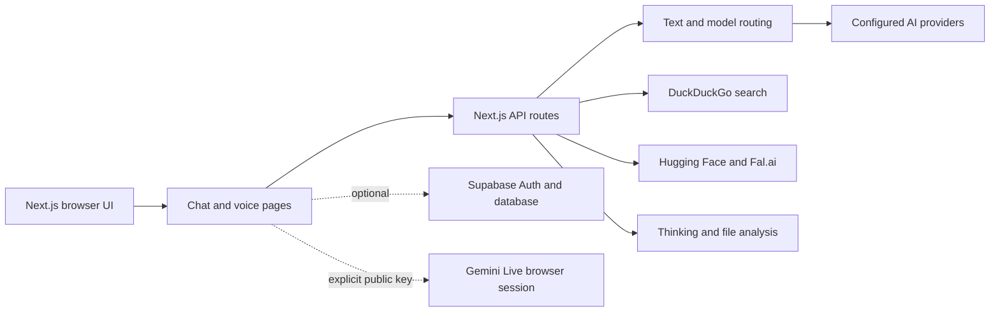

# Vanta

> A Next.js interface for multi-provider AI chat, search, reasoning, image generation, video generation, and browser voice interaction.

[](https://github.com/vincenzo-afk/vanta/actions/workflows/ci.yml)
[](LICENSE)
[](package.json)

[Repository](https://github.com/vincenzo-afk/vanta) · [Report a bug](https://github.com/vincenzo-afk/vanta/issues/new?template=bug_report.md) · [Request a feature](https://github.com/vincenzo-afk/vanta/issues/new?template=feature_request.md)

## Contents

- [About the project](#about-the-project)
- [Tech stack](#tech-stack)
- [Getting started](#getting-started)
- [Usage](#usage)
- [API reference](#api-reference)
- [Project structure](#project-structure)
- [Features and limitations](#features-and-limitations)
- [Testing and validation](#testing-and-validation)
- [Deployment](#deployment)
- [Contributing](#contributing)
- [Security](#security)
- [License](#license)
- [Acknowledgments](#acknowledgments)

## About the project

Vanta is a private-package, public-repository web application built with the Next.js App Router. The active interface combines a chat workspace with model selection, search augmentation, reasoning analysis, image and video generation, file analysis, chat history, theme settings, and a dedicated real-time voice page.

The application keeps provider credentials on the server for API routes. The Gemini Live voice page is an exception: it connects from the browser and therefore requires an explicitly configured `NEXT_PUBLIC_GOOGLE_AI_KEY`. That key should be restricted by origin and API in Google Cloud; no server-side credential is used as a browser fallback.

### Key capabilities

- Multi-provider text generation through OpenRouter, Google AI, xAI, DeepSeek, Perplexity, and Hugging Face integrations present in the source code.
- Automatic intent routing for conversation, coding, analysis, search, image, and video requests.
- ✅ Real free web search through DuckDuckGo HTML results, public-page crawling, bounded readable-text extraction, source links, and search snippets.
- Persistent user memory for explicit facts such as `Remember that I prefer concise answers`, plus the existing profile notes in Settings.
- Image, PDF, TXT, Markdown, CSV, JSON, XML, and HTML uploads up to 8 MB; compatible models receive the content as multimodal input or extracted text.
- Capability-aware upload routing: Vanta Best sends attachments to configured Gemini multimodal models, while text-only selections return a readable explanation instead of silently failing.
- Image generation through Hugging Face Inference with a Fal.ai fallback path.
- Queued video generation and status polling through Fal.ai.
- Thinking analysis with structured JSON output and provider fallback.
- Browser voice interaction through the Google Gemini Live SDK.
- Local chat-history, model, image-gallery, and voice-settings stores using Zustand and browser storage.
- Supabase authentication and persistence helpers when the optional Supabase variables are configured.

### Architecture overview



## Tech stack

| Area | Technologies verified in the repository |
|---|---|
| Framework | Next.js 16.3.2 with the App Router |
| Language | TypeScript 5.x; React 19.2.0; React DOM 19.2.0 |
| Styling | Tailwind CSS 4.x, PostCSS, `tw-animate-css` |
| UI and motion | Radix UI, Framer Motion 12.23.25, Motion 12.23.25, Lucide React |
| State | Zustand 5.0.9 and browser local storage |
| AI and media | `@google/genai`, `@huggingface/inference`, OpenRouter-compatible HTTP providers, Fal.ai HTTP endpoints |
| Optional authentication and persistence | Supabase JavaScript client 2.86.2 |
| Visual effects | `@tsparticles/engine`, `@tsparticles/react`, `@tsparticles/slim`, Three.js |
| Package manager | npm, using the committed `package-lock.json` |
| CI | GitHub Actions workflow at `.github/workflows/ci.yml` |

## Getting started

### Prerequisites

Install Node.js 22 or a compatible current Node.js release supported by Next.js 16. Use npm because the repository includes `package-lock.json` and the CI workflow runs `npm ci`.

At least one server-side text provider key is required for chat responses. Image and video generation require their corresponding provider credentials. Voice interaction requires the browser-side Gemini Live key described below.

### Installation

```bash
git clone https://github.com/vincenzo-afk/vanta.git
cd vanta
npm ci
cp .env.example .env.local
```

Edit `.env.local` and add only the provider credentials needed for the features you intend to use. Start the development server with:

```bash
npm run dev
```

Open [***REMOVED***](***REMOVED***).

### Configuration

`.env.local` is ignored by Git. Never commit it or place credentials in TypeScript source files.

| Variable | Scope | Purpose |
|---|---|---|
| `NEXT_PUBLIC_SITE_URL` | Browser/server | Site URL used in OpenRouter request metadata and local configuration. |
| `NEXT_PUBLIC_SITE_NAME` | Browser/server | Site name used in local configuration. |
| `NEXT_PUBLIC_GOOGLE_AI_KEY` | Browser | Explicit public key required by the Gemini Live browser session. Restrict it in Google Cloud. |
| `OPENROUTER_API_KEY` | Server | OpenRouter text models and model discovery. |
| `FAL_API_KEY` or `FAL_AI_API_KEY` | Server | Fal.ai image and video generation. |
| `PERPLEXITY_API_KEY` | Server | Perplexity text provider. |
| `CHATZ_API_KEY` | Server | ChatZ provider configuration. |
| `GOOGLE_AI_API_KEY` | Server | Google AI text generation and model discovery. |
| `RUNWAY_API_KEY` | Server | Runway provider configuration. |
| `INFIP_API_KEY` | Server | Infip provider configuration. |
| `SERP_API_KEY` | Server | Serp provider configuration. |
| `XAI_API_KEY` or `GROK_API_KEY` | Server | xAI/Grok text generation and model discovery. |
| `HF_TOKEN` or `HUGGINGFACE_API_KEY` | Server | Hugging Face text and image inference. |
| `DEEPSEEK_API_KEY` | Server | DeepSeek text generation and model discovery. |
| `IPGEOLOCATION_API_KEY` | Server | Optional utility-provider configuration. |
| `ALPHAVANTAGE_API_KEY` | Server | Optional utility-provider configuration. |
| `NEWS_API_KEY` | Server | Optional utility-provider configuration. |
| `EXCHANGERATE_API_KEY` | Server | Optional utility-provider configuration. |
| `PEXELS_API_KEY` | Server | Optional utility-provider configuration. |
| `NEXT_PUBLIC_SUPABASE_URL` | Browser/server | Enables the optional Supabase client. |
| `NEXT_PUBLIC_SUPABASE_ANON_KEY` | Browser/server | Supabase anonymous client key used with the configured project URL. |

### Upload and memory behavior

The composer accepts images and common document formats up to 8 MB. Images and PDFs are encoded only for the active request. Text documents are converted to a bounded text part in the browser. Extracted text from uploaded documents is chunked, embedded locally, and stored in the persisted `vanta-vector-index` store for semantic retrieval. Raw binary attachment data is not written to chat history; only file name, MIME type, and size metadata are persisted there.

`Remember that ...` and clear personal statements such as `I prefer concise answers` are saved as explicit memories when **Reference saved memories** is enabled. Profile notes entered under **Settings → Personalization → About you** are also embedded as a profile item. Saved memory records remain in the browser’s persisted Zustand store and can be removed individually or cleared together. At request time, Vanta retrieves the highest-scoring document and memory chunks for the user’s query and sends only that bounded context to the selected AI provider.


Providers without configured credentials are skipped or return a clear configuration error; the static model catalog remains available.

## Usage

The main page is available at `/`. The dedicated voice experience is available at `/voice`. Pricing and theme demonstration pages are available at `/pricing` and `/theme-demo`.

The chat composer supports normal messages and can route requests to search, thinking, image, or video workflows. Enable **Search** to query the public web without a paid search API key. Vanta searches DuckDuckGo, fetches up to four public result pages, extracts bounded readable text, and shows source cards with links and snippets below the response. Search evidence is also passed into both normal model responses and the deep-thinking workflow. Upload an image or supported document with the paperclip control, then ask a question about it. The model selector retrieves the combined model catalog from `/api/models` and allows the user to choose a specific model when available.

To save a memory, write an explicit request such as `Remember that I prefer concise answers`, or add profile information under Settings → Personalization → About you. Saved memories are kept in the browser’s persisted Zustand store, can be removed individually, and are included only when **Reference saved memories** is enabled. Raw uploaded file data is used for the active request and is not written to chat history; only attachment name, type, and size metadata are persisted.

If an uploaded file cannot be read, the selected model is text-only, or no configured multimodal provider is available, the assistant returns a normal text response explaining the reason and the next action instead of returning an empty answer.

For a local production-style run:

```bash
npm run build
npm start
```

## API reference

All routes are implemented in `src/app/api`. They accept and return JSON unless noted otherwise.

| Method | Path | Request fields observed in the handler | Purpose |
|---|---|---|---|
| `GET` | `/api/models` | None | Returns the static and dynamically discovered model catalog with counts. |
| `GET` | `/api/text` | None | Returns available text-model metadata. |
| `POST` | `/api/text` | `messages` with string or multimodal content parts; optional `model`, `temperature`, `max_tokens`, `customInstructions`, `nickname`, `memory` | Generates a text response, analyzes compatible uploads, or returns an image/video routing intent. |
| `POST` | `/api/search` | `query` | Returns DuckDuckGo-backed search results and a summary. |
| `POST` | `/api/think` | `query` | Produces structured thinking analysis through configured providers. |
| `POST` | `/api/cot` | `query`, optional `context` | Generates chain-of-thought-style analysis for the application UI. |
| `POST` | `/api/analyze` | `file`, optional `fileName`, `mimeType` | Classifies submitted base64 file data and returns a lightweight analysis. |
| `GET` | `/api/image` | None | Lists image models. |
| `POST` | `/api/image` | `prompt`, optional `model`, `width`, `height`, `enhance` | Generates an image through the configured image providers. |
| `GET` | `/api/video` | None | Lists video models. |
| `POST` | `/api/video` | `prompt`, optional `model`, `imageUrl` | Submits and polls a Fal.ai video-generation request. |
| `POST` | `/api/generate` | `type`, `prompt` | Compatibility wrapper that delegates to `/api/image` or `/api/video`. |

### Example: text generation

```bash
curl -X POST ***REMOVED***/api/text \
  -H 'Content-Type: application/json' \
  -d '{
    "messages": [
      {"role": "user", "content": "Explain dependency injection in one paragraph."}
    ],
    "model": "vanta-best",
    "temperature": 0.7,
    "max_tokens": 512
  }'
```

### Example: search

```bash
curl -X POST ***REMOVED***/api/search \
  -H 'Content-Type: application/json' \
  -d '{"query":"Next.js App Router documentation"}'
```

### Example: upload-aware text request

The `messages` array can contain OpenAI-style image parts or Vanta document parts. `vanta-best` routes uploads to a configured Gemini multimodal model; a selected model without multimodal capability returns a text explanation instead of an empty result.

```bash
curl -X POST http://localhost:3000/api/text \\
  -H 'Content-Type: application/json' \\
  -d '{
    "messages": [{
      "role": "user",
      "content": [
        {"type":"text","text":"What is the main subject of this image?"},
        {"type":"image_url","image_url":{"url":"data:image/png;base64,<BASE64_DATA>"}}
      ]
    }],
    "model": "vanta-best",
    "memory": "User profile: The user prefers concise answers."
  }'
```

For a PDF or office document, use a `document` content part with `filename`, `mimeType`, and base64 `data`. Text documents are converted to a bounded text part in the browser before the request. If the file cannot be read or no compatible provider is configured, the API returns `success: false` together with a user-readable `content` and `error`.

### Example: image generation

```bash
curl -X POST ***REMOVED***/api/image \
  -H 'Content-Type: application/json' \
  -d '{"prompt":"A minimal purple and cyan neural interface, abstract digital art","enhance":true}'
```

Invalid or incomplete requests return a JSON error with an HTTP 400 status. Provider failures are represented by the route-specific error response; the exact fallback behavior is implemented in each handler.

## Project structure

```text
vanta/
├── src/app/
│   ├── api/                 # Server-side JSON routes for text, search, media, and analysis
│   ├── page.tsx             # Main chat workspace
│   ├── voice/page.tsx       # Gemini Live voice interface
│   ├── pricing/page.tsx     # Pricing page
│   └── theme-demo/page.tsx  # Theme demonstration page
├── src/components/         # Shared application and UI components
├── src/contexts/            # Client-side settings contexts
├── src/hooks/               # Browser hooks for media queries and voice interaction
├── src/lib/                 # Provider clients, model registry, stores, auth, and utilities
├── public/                  # Static assets
├── deleted/voices/          # Archived legacy voice implementation, excluded from active TypeScript compilation and linting
├── .github/workflows/       # GitHub Actions validation workflow
├── .env.example             # Safe configuration template
├── next.config.ts           # Next.js image-host configuration
├── package.json             # Scripts and direct dependencies
├── package-lock.json        # Reproducible npm dependency lockfile
└── tsconfig.json             # TypeScript compiler configuration
```

## Features and limitations

### Implemented

- ✅ Next.js App Router application with responsive chat UI.
- ✅ Model catalog and provider-aware model selection.
- ✅ Text, search, thinking, file-analysis, image, and video API routes.
- ✅ Optional Supabase authentication and persistence helpers.
- ✅ Browser voice page using the Google Gemini Live SDK.
- ✅ Local settings, chat history, model state, image-gallery, and bounded persistent-memory stores.
- ✅ Explicit memory capture for user facts, with per-memory removal and clear-all controls in Settings.
- ✅ Image, PDF, Word, Excel, PowerPoint, TXT, Markdown, CSV, JSON, XML, and HTML upload handling.
- ✅ Capability-aware multimodal routing with readable text errors when a selected model cannot analyze an upload.
- ✅ Custom local vector search over extracted document chunks and saved memory items using deterministic hashed embeddings and cosine similarity.
- ✅ Automated lint, TypeScript, and production-build validation in GitHub Actions.
- ✅ Free search mode with public-page crawling, bounded extraction, grounded context, and clickable source cards.

### Known limitations

- The repository does not currently include an automated unit or integration test suite.
- The available provider model list depends on which credentials are configured and whether external provider requests succeed.
- Free web search depends on DuckDuckGo being reachable from the server; pages that block automated fetching remain available as search snippets only.
- Crawling is limited to public HTTP(S) pages, two redirects, four pages per query, 2 MB per page, and 8,000 characters of extracted text per page.
- The voice experience requires a browser-accessible Gemini Live key and microphone permission.
- PDF attachments currently require a configured Google AI server key and a Gemini multimodal model; text-only or non-Google selections return an explanatory text error.
- The repository contains no Docker, Kubernetes, or platform-specific deployment manifest.
- The file-analysis route provides lightweight classification and preview behavior; it is not a full document parser.
- Vector search is local and lexical/hash-based rather than a hosted neural embedding service; it requires no additional API key and is scoped to the browser’s persisted index.

## Testing and validation

The repository currently has no `test` script or test directory. Run the available validation commands locally:

```bash
npm run lint
npx tsc --noEmit
npm run build
```

The GitHub Actions workflow runs these same checks on pushes and pull requests targeting `main`.

## Deployment

No deployment manifest is committed. Any Node.js host that supports Next.js 16 can use the following production commands after installing the same environment variables used locally:

```bash
npm ci
npm run build
npm start
```

Keep server-side provider keys in the hosting provider's secret manager. If enabling voice, configure `NEXT_PUBLIC_GOOGLE_AI_KEY` as a restricted browser key rather than reusing a server-only credential.

## Contributing

Read [CONTRIBUTING.md](CONTRIBUTING.md) before opening a pull request. The repository uses feature branches and pull requests, and the pull-request template asks contributors to describe intent, testing, documentation changes, breaking changes, and security impact.

For local development:

```bash
npm ci
npm run dev
```

Before submitting a change, run linting, TypeScript validation, and the production build. Use concise commit messages that explain the change, and update documentation when behavior or configuration changes.

## Security

Do not commit `.env.local`, API tokens, browser keys, or generated credentials. Use `.env.example` as the configuration reference. If a secret has been committed, revoke it at the provider immediately and replace it through the environment configuration.

Report vulnerabilities privately to the repository maintainer at `itsmebk2007@gmail.com` rather than opening a public issue. See [SECURITY.md](SECURITY.md) for the reporting policy.

## License

Vanta is distributed under the [Apache License 2.0](LICENSE).

## Acknowledgments

The project uses and integrates open-source libraries including Next.js, React, TypeScript, Tailwind CSS, Radix UI, Framer Motion, Lucide React, Zustand, Three.js, tsParticles, the Google Generative AI SDK, the Hugging Face Inference SDK, and the Supabase JavaScript client. Provider names and API behavior remain subject to their respective services' terms and documentation.

## Contact and links

- **Repository:** [vincenzo-afk/vanta](https://github.com/vincenzo-afk/vanta)
- **Issues:** [GitHub Issues](https://github.com/vincenzo-afk/vanta/issues)
- **Security contact:** `itsmebk2007@gmail.com`

[Back to top](#vanta)
