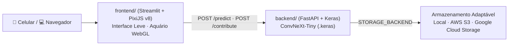

<p align="center">
  
</p>

<h1 align="center">🐟 FishID Studio</h1>

<p align="center">
  🇧🇷 <strong>Português</strong> &nbsp;·&nbsp; 🇺🇸 <a href="README.en.md">English</a>
</p>

<p align="center">
  
  &nbsp;&nbsp;&nbsp;&nbsp;&nbsp;
  
</p>

<p align="center">
  <strong>Pesquisa de Mestrado em Computação Aplicada · UNIVALI · LEMA (Laboratório de Estudos Marinhos Aplicados)</strong><br/>
  Modelo Deep Learning para Identificação de Espécies de Peixes Marinhos<br/>
  <strong>Autor:</strong> <a href="https://github.com/viniciusscience"><strong>José Vinícius da Silva de Souza</strong></a> &nbsp;·&nbsp; <strong>Coautor e Orientador:</strong> <a href="https://github.com/rodrigosantana"><strong>Prof. Dr. Rodrigo Sant'Ana</strong></a>
</p>

<p align="center">
  
  
  
  
  
  <a href="https://github.com/viniciusscience/fishid-studio/actions/workflows/ci.yml"></a>
  <a href="https://doi.org/10.5281/zenodo.24451918"></a>
  
  <a href="https://github.com/sponsors/viniciusscience"></a>
</p>

**FishID Studio** é uma plataforma aberta de visão computacional voltada à **identificação automatizada de grandes peixes migratórios marinhos** por meio de fotos, câmera de celular e vídeos. O projeto nasceu como pesquisa de mestrado em Computação Aplicada, combinando rigor científico (*ConvNeXt-Tiny*, explicabilidade via *Grad-CAM*, auto-segmentação *YOLO-World + SAM 2* e rastreamento *ByteTrack*) com uma interface imersiva em **PixiJS v8 WebGL** responsiva para empresas, pesquisadores e ciência cidadã.

---

## 🐟 Classificação Automática de Espécies em Tempo Real

Identificação inteligente de **10 grandes espécies pelágicas migratórias** (atuns, agulhões, espadarte e dourado-do-mar) com nome popular, nome científico, grupo taxonômico e ranking Top-3 de probabilidades:

<p align="center">
  
</p>

---

## 🎬 Demonstração Real — Monitoramento Eletrônico & Biometria no Convés

Análise automatizada de vídeos reais de embarcações pesqueiras (**Monitoramento Eletrônico — EM**), realizando **contagem consolidada de indivíduos**, **medição de comprimento ponta a ponta acompanhando a curvatura do corpo**, **margem de erro estimada (±%)** e **calibração interativa `px ↔ cm`**:

<p align="center">
  
</p>

<p align="center">
  <br/>
  <sub><i>Auditoria visual em recolhimento diurno: contorno automático do corpo inteiro e curva da coluna vertebral.</i></sub>
</p>

<p align="center">
  <br/>
  <sub><i>Auditoria visual em recolhimento na madrugada: medição de alta qualidade (±3,2%) com 0% de oclusão.</i></sub>
</p>

---

## 🌊 Destaques Visuais do Aquário Interativo

A interface traz um aquário **WebGL 60 FPS** construído com **PixiJS v8** e malha deformável (`PIXI.MeshRope`), onde grandes espécies pelágicas fotorrealistas nadam com ondulação orgânica de cauda, raios cáusticos de luz solar e colunas de microbolhas atrás dos painéis translúcidos:

| Marlim-azul (*Makaira nigricans*) | Agulhão-vela (*Istiophorus platypterus*) | Dourado-do-mar (*Coryphaena hippurus*) | Albacora-laje (*Thunnus albacares*) |
| :---: | :---: | :---: | :---: |
|  |  |  |  |

---

## 🌍 Alinhamento com os ODS da ONU (Agenda 2030)

Esta pesquisa contribui diretamente para os **Objetivos de Desenvolvimento Sustentável (ODS)** da ONU:

- **🌊 ODS 14 — Vida na Água:** apoia a conservação e o uso sustentável dos oceanos e recursos marinhos, facilitando o monitoramento taxonômico de grandes peixes migratórios e o combate à pesca predatória ou não reportada.
- **⚙️ ODS 9 — Indústria, Inovação e Infraestrutura:** aplica Inteligência Artificial de ponta de forma aberta e acessível ao setor pesqueiro e acadêmico.
- **♻️ ODS 12 — Consumo e Produção Responsáveis:** fortalece a rastreabilidade e a transparência na identificação de espécies marinhas.

---

## 🐠 Espécies Reconhecidas Atualmente (10 Espécies Pelágicas)

O modelo atual foi treinado com mais de **6.200 imagens** distribuídas entre 10 grandes espécies migratórias:

| # | Nome Popular (PT-BR) | Nome Científico | Grupo |
| :-: | :--- | :--- | :--- |
| 1 | **Dourado-do-mar** | *Coryphaena hippurus* | Pelágico |
| 2 | **Agulhão-vela (Peixe-vela)** | *Istiophorus platypterus* | Peixe de bico |
| 3 | **Agulhão-branco (Marlim-branco)** | *Kajikia albida* | Peixe de bico |
| 4 | **Bonito-listrado** | *Katsuwonus pelamis* | Atum |
| 5 | **Agulhão-negro (Marlim-azul)** | *Makaira nigricans* | Peixe de bico |
| 6 | **Agulhão-verde (Bico-longo)** | *Tetrapturus pfluegeri* | Peixe de bico |
| 7 | **Albacora-branca** | *Thunnus alalunga* | Atum |
| 8 | **Albacora-laje** | *Thunnus albacares* | Atum |
| 9 | **Albacora-bandolim** | *Thunnus obesus* | Atum |
| 10 | **Espadarte (Meca)** | *Xiphias gladius* | Peixe de bico |

---

## ✨ Principais Recursos

- **🌊 Aquário WebGL Realista (`PixiJS v8`):** peixes pelágicos fotorrealistas com nado articulado via `MeshRope`, 3 planos de profundidade, raios cáusticos e colunas de microbolhas.
- **📸 Captura pela Câmera do Celular e Upload:** interface 100% responsiva pensada para uso rápido em campo, embarcações e empresas.
- **🐠 Galeria Interativa:** navegação sob demanda com filtro por espécie e sorteio instantâneo para demonstração.
- **🎥 Análise de Vídeos (MP4 / MOV):** anotação automática frame a frame com OpenCV, conversão H.264 via `ffmpeg`, resumo por espécie e download do vídeo anotado.
- **📊 Monitoramento Eletrônico (EM) — Contagem & Biometria:** aba dedicada no FishID Studio para auditar vídeos longos de embarcações pesqueiras (`monitoramento_em.py`), exibindo contagem consolidada anti-oclusão, comprimento médio com estimativa de erro (`±%`), classe do peixe, calibração interativa `px → cm`, galeria de auditoria visual (`SAM 2.1` + curva da coluna vertebral) e vídeo HUD.
- **🤝 Aprendizado Contínuo com Filtro de Qualidade:** validação automática de nitidez, brilho, contraste e resolução (`backend/storage.py`) separando fotos confirmadas de revisão humana, com armazenamento adaptável (**Local**, **AWS S3 / R2** ou **Google Cloud Storage**) controlado via variáveis de ambiente.
- **🔬 Pipeline Científico Reprodutível:**
  - `ConvNeXt_Tiny_Otimizado_Mestrado.ipynb` — preservação morfológica (`resize_with_pad`), `mixed_float16`, `CosineDecay`, `MixUp`, `TTA` e **Grad-CAM comparativo**.
  - `segmentar_peixes_auto.py` — auto-segmentação e recorte turbo em lote (`YOLO-World` + `SAM 2.1`, FP16 e I/O paralelo).
  - `rastrear_peixes_auto.py` — rastreamento multi-peixe em vídeo (`YOLO-World` + `ByteTrack`), CSV de trajetórias e auto-rotulagem YOLO.
  - `monitoramento_em.py` — pipeline v5 de Monitoramento Eletrônico para vídeos longos (`YOLOv8l-Worldv2` com `agnostic_nms` + `ByteTrack` + consolidação espaço-temporal + `SAM 2.1` refinado por ponto interior + medição curva pela crista `distanceTransform²` + filtro HSV anti-boias + vídeo HUD).
  - `rodar_suite_benchmark.py` — suíte automatizada de 10 experimentos controlados (ablação, cenas diurnas/noturnas e testes de estresse anti-falso positivo) com registro centralizado em `experimentos_em/`.

---

## 🏗️ Arquitetura do Projeto



```text
projeto-mestrado/
├── backend/                               # API FastAPI + Modelo Keras + Pipeline de Coleta
│   ├── main.py                            # Endpoints /health, /info, /predict e /contribute
│   ├── storage.py                         # Validação de qualidade + storage (local | s3 | gcs)
│   ├── requirements.txt                   # Dependências do backend
│   ├── Dockerfile                         # Container do backend
│   └── models/                            # Coloque aqui o arquivo modelo.keras
│
├── frontend/                              # Interface Web FishID Studio (leve, sem TensorFlow)
│   ├── app.py                             # Aplicação Streamlit + Aquário WebGL PixiJS v8
│   ├── requirements.txt                   # Dependências leves da interface
│   ├── packages.txt                       # Dependências de sistema (ffmpeg, fonts-dejavu-core)
│   ├── Dockerfile                         # Container do frontend
│   ├── .streamlit/config.toml             # Tema visual Clean Studio
│   └── assets/bg/*_real.png               # Sprites fotorrealistas transparentes dos peixes
│
├── docs/
│   ├── fishid_aquarium_banner.gif         # Banner animado do aquário para apresentação
│   ├── fishid_classificacao_demo.gif      # GIF animado de classificação de espécies (UNIVALI · LEMA)
│   ├── fishid_em_demo.gif                 # GIF demo real de Monitoramento Eletrônico (UNIVALI · LEMA)
│   ├── em_biometria_destaque_1.jpg        # Card de auditoria de biometria (recolhimento diurno)
│   └── em_biometria_destaque_2.jpg        # Card de auditoria de biometria (recolhimento noturno)
│
├── docker-compose.yml                     # Orquestração local (frontend + backend)
├── .env.example                           # Modelo limpo de variáveis de ambiente
├── ConvNeXt_Tiny_Otimizado_Mestrado.ipynb # Notebook de treinamento e análise Grad-CAM
├── segmentar_peixes_auto.py               # Auto-segmentação em lote (YOLO-World + SAM 2.1)
├── rastrear_peixes_auto.py                # Rastreamento multi-peixe em vídeo (ByteTrack)
├── monitoramento_em.py                    # Pipeline v5 EM (contagem, biometria curva e HUD)
├── rodar_suite_benchmark.py               # Suíte controlada de 10 experimentos + comparativo
└── LICENSE                                # Licença MIT e Direitos Autorais
```

---

## 💻 Execução Local (Docker)

1. Copie o modelo de variáveis de ambiente:

```bash
cp .env.example .env
```

2. Suba a aplicação localmente:

```bash
docker compose up --build
```

- **Interface Web:** `http://localhost:8080`
- **API / Documentação Swagger:** `http://localhost:8000/docs`

> Todas as integrações (modelo `.keras`, destino de coleta `STORAGE_BACKEND=local|s3|gcs`, galeria opcional, contatos e apoio à pesquisa) são configuradas exclusivamente pelo arquivo `.env` local (ignorado pelo Git).

---

## ☕ Apoie a Pesquisa Científica & Consultoria / Parcerias (EM & Visão Computacional)

O **FishID Studio** é um projeto acadêmico **100% aberto e gratuito (MIT)**. Se a ferramenta auxiliou sua pesquisa, empresa ou iniciativa de conservação marinha:
- ⭐ **Deixe uma Star no GitHub** para aumentar a visibilidade da ciência aberta no Brasil!
- 💖 **Torne-se um Patrocinador ([GitHub Sponsors](https://github.com/sponsors/viniciusscience))** ou use o botão **☕ Apoie a Pesquisa** no topo da interface web (Pix / Internacional) — patrocinadores têm destaque oficial no README e prioridade no roadmap!

### 🏢 Soluções Customizadas, P&D e Implantação Industrial (Enterprise & Pesqueira)
Precisa adaptar o pipeline do **FishID Studio** para a sua operação pesqueira, órgão ambiental, consultoria oceanográfica ou frota de embarcações? Oferecemos suporte especializado e consultoria técnica para:
- 🎯 **Fine-Tuning Customizado (Novas Espécies & Regiões):** Treinamento de modelos `ConvNeXt` / `YOLO-World` / `SAM 2.1` para espécies costeiras, continentais ou demersais específicas da sua região.
- 🚢 **Implantação de Monitoramento Eletrônico (EM) On-Premise / Edge GPU:** Calibração de câmeras de convés (`px ↔ cm`), integração com sistemas de bordo, auditoria automatizada de desembarque e relatórios regulatórios.
- 🔌 **Integração via API & Cloud (`AWS S3` / `GCS` / `FastAPI`):** Arquitetura escalável para processamento em lote de vídeos de viagens pesqueiras.
- 📬 **Contato comercial / parcerias de P&D:** [LinkedIn — José Vinícius](https://www.linkedin.com/in/viniciecomp/) · [GitHub Discussions](https://github.com/viniciusscience/fishid-studio/discussions) · [GitHub Sponsors](https://github.com/sponsors/viniciusscience)

---

## 🤝 Contribuidores da Comunidade

Agradecemos a todos os pesquisadores e desenvolvedores que contribuem com código, testes e melhorias no **FishID Studio**:

<p align="center">
  <a href="https://github.com/viniciusscience/fishid-studio/graphs/contributors">
    
  </a>
</p>

---

## 📈 Evolução da Comunidade (Star History)

<p align="center">
  <a href="https://star-history.com/#viniciusscience/fishid-studio&Date">
    <picture>
      <source media="(prefers-color-scheme: dark)" srcset="https://api.star-history.com/svg?repos=viniciusscience/fishid-studio&type=Date&theme=dark" />
      <source media="(prefers-color-scheme: light)" srcset="https://api.star-history.com/svg?repos=viniciusscience/fishid-studio&type=Date" />
      
    </picture>
  </a>
</p>

---

## 📖 Como Citar e Referências

```bibtex
@software{souza2026fishidstudio,
  author       = {José Vinícius da Silva de Souza and Rodrigo Sant'Ana},
  title        = {FishID Studio: Deep Learning e Monitoramento Eletrônico para Identificação e Biometria de Peixes Marinhos},
  year         = {2026},
  version      = {v1.0.0},
  publisher    = {Zenodo},
  doi          = {10.5281/zenodo.24451918},
  url          = {https://doi.org/10.5281/zenodo.24451918},
  institution  = {Universidade do Vale do Itajaí (UNIVALI) — Laboratório de Estudos Marinhos Aplicados (LEMA)}
}
```

- **Liu, Z. et al. (2022).** *A ConvNet for the 2020s (ConvNeXt).* IEEE/CVF CVPR.
- **Selvaraju, R. R. et al. (2017).** *Grad-CAM: Visual Explanations from Deep Networks via Gradient-based Localization.* ICCV.
- **Álvarez-Ellacuría, A. et al. (2019).** *Image-based, unsupervised estimation of fish size from commercial landings using deep learning.* ICES Journal of Marine Science.
- **Froese, R. (2006).** *Cube law, condition factor and weight-length relationships: history, meta-analysis and recommendations.* Journal of Applied Ichthyology, 22(4), 241–253.

---

## ©️ Direitos Autorais e Licença

**Copyright © 2026 José Vinícius da Silva de Souza e Rodrigo Sant'Ana (LEMA · UNIVALI).** Todos os direitos reservados conforme os termos da **Licença MIT** ([LICENSE](LICENSE)).

- **Uso do código-fonte:** livre para uso acadêmico, educacional, comercial, modificação e redistribuição, **desde que mantido o aviso de direitos autorais e atribuição aos autores, ao LEMA e à pesquisa de mestrado na UNIVALI**.
- **Bases de dados e imagens:** as imagens de treinamento provenientes de fontes abertas (como *iNaturalist* e *FishBase*) seguem suas respectivas licenças originais. Fotos enviadas voluntariamente pelos usuários por meio do recurso *"Aprendizado contínuo"* são coletadas mediante consentimento explícito exclusivamente para fins de pesquisa científica, aprimoramento do modelo e expansão do catálogo de espécies.
- **Aviso técnico:** as identificações geradas pelo modelo têm caráter de apoio à decisão e monitoramento científico, não substituindo laudos taxonômicos oficiais em contextos regulatórios.
