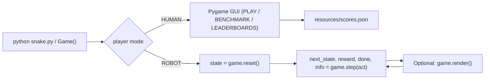

<a id="top"></a>

<div align="center">

<picture>
  <source media="(prefers-color-scheme: dark)" srcset="https://raw.githubusercontent.com/voaneves/snake-on-pygame/master/assets/logo/logo-dark.svg" />
  <source media="(prefers-color-scheme: light)" srcset="https://raw.githubusercontent.com/voaneves/snake-on-pygame/master/assets/logo/logo-light.svg" />
  
</picture>

<h1>Snake on Pygame</h1>

<p>
  <strong>Classic Snake in Python and Pygame, playable by humans across three speed modes or driven by RL agents via a Gym-style API.</strong><br />
  <sub>
    Human benchmark leaderboard &amp; agent sandbox —
    <kbd>Python 3.8+</kbd> · <kbd>Pygame</kbd> · <kbd>NumPy</kbd> · <kbd>Pandas</kbd> · <kbd>Gym-Style API</kbd>
  </sub>
</p>

<p>
  <a href="https://voaneves.github.io/snake-on-pygame/"><picture><source media="(prefers-color-scheme: dark)" srcset="https://raw.githubusercontent.com/voaneves/snake-on-pygame/master/assets/buttons/landing-dark.svg" /></picture></a>
  <a href="https://github.com/voaneves/snake-on-pygame/archive/refs/heads/master.zip"><picture><source media="(prefers-color-scheme: dark)" srcset="https://raw.githubusercontent.com/voaneves/snake-on-pygame/master/assets/buttons/play-dark.svg" /></picture></a>
</p>

<p><sub>Need something like this? <a href="https://voaneves.com/en/#contact"><strong>Let's talk →</strong></a></sub></p>

<p>
  <a href="./setup.py"></a>
  <a href="https://github.com/voaneves/snake-arena"></a>
  <a href="./LICENSE"></a>
  <a href="https://github.com/voaneves/snake-on-pygame/issues"></a>
</p>

<p>
  <a href="#playing">Playing</a> ·
  <a href="#ai-agents">AI Agents</a> ·
  <a href="#execution-flow">Flow</a> ·
  <a href="#successor">RL Successor</a> ·
  <a href="#acknowledgments">Acknowledgments</a> ·
  <a href="#contact">Contact</a>
</p>

</div>

<picture>
  <source media="(prefers-color-scheme: dark)" srcset="https://raw.githubusercontent.com/voaneves/snake-on-pygame/master/assets/brand/rule-dark.svg" />
  <source media="(prefers-color-scheme: light)" srcset="https://raw.githubusercontent.com/voaneves/snake-on-pygame/master/assets/brand/rule-light.svg" />
  
</picture>

<a id="playing"></a>
## Playing

Launch one command to play Snake locally across `EASY`, `MEDIUM`, and `HARD` modes or record a 10-match benchmark score against AI baselines.

> [!IMPORTANT]
> **Looking for modern Reinforcement Learning &amp; Keras 3 benchmarks on Snake?**
> Check out the active successor: **[`voaneves/snake-arena`](https://github.com/voaneves/snake-arena)** — a reproducible **Keras 3 + TensorFlow** benchmark comparing **14 RL algorithms** over a vectorized pure-NumPy simulator (`~286k steps/s`, 1,383 automated test cases, and 25 Colab/Kaggle notebooks).

<p align="center">
  
</p>

### Prerequisites &amp; Running

Requires **Python 3.8+** and dependencies declared in [`setup.py`](./setup.py) (`pygame`, `numpy`, `pandas`):

```bash
git clone https://github.com/voaneves/snake-on-pygame.git
cd snake-on-pygame
pip install pygame numpy pandas
python snake.py
```

Inside the GUI menu you can switch between **PLAY** (single match), **BENCHMARK** (10 consecutive matches tracking average score and steps saved to [`resources/scores.json`](./resources/scores.json)), and **LEADERBOARDS**. Pull requests adding human benchmark runs are welcome.

<a id="ai-agents"></a>
## AI Agents &amp; Gym-Style API

[`snake.py`](./snake.py) exposes a `Game` class following a Gym-inspired `reset()` / `step(action)` / `render()` interface compatible with any Python framework.

<dl>
  <dt><code>game.nb_actions</code> / <code>game.action_space</code></dt>
  <dd><code>5</code> for absolute cardinal directions (left, right, up, down, idle) or <code>3</code> when <code>relative_pos=True</code> (left, straight, right).</dd>
  <dt><code>game.observation_space</code> &amp; <code>game.state()</code></dt>
  <dd>Exposes board array shape <code>(board_size**2,)</code> alongside the current <code>(board_size, board_size)</code> NumPy state grid.</dd>
  <dt><code>game.food_pos</code>, <code>game.steps</code>, <code>game.snake.length</code></dt>
  <dd>Real-time food <code>[x, y]</code> coordinates, episode steps elapsed, and snake body length (starts at <code>3</code>).</dd>
</dl>

```python
import random
from snake import Game

game = Game(
    player="ROBOT",
    board_size=10,
    local_state=False,
    relative_pos=False,
)

for episode in range(5):
    state = game.reset()
    while not game.game_over:
        action = random.randrange(game.nb_actions)
        next_state, reward, done, info = game.step(action)
        # agent.train(state, action, reward, next_state, done)
        state = next_state
```

<p align="center">
  
</p>

<a id="execution-flow"></a>
## Execution Flow &amp; Project Map



<a id="successor"></a>
## Modern RL Successor &amp; Archive

| Generation | Repository | Focus |
| :--- | :--- | :--- |
| **Classic Game Engine** | [`voaneves/snake-on-pygame`](https://github.com/voaneves/snake-on-pygame) | Interactive Pygame arcade engine, human benchmarks &amp; Gym API |
| **Legacy Notebooks** | [`voaneves/colab-rl`](https://github.com/voaneves/colab-rl) | Early TensorFlow/Keras notebook experiments (`run_dqn.py`) |
| **Modern RL Benchmark** | [`voaneves/snake-arena`](https://github.com/voaneves/snake-arena) | Headless vectorized NumPy simulator + 14 Keras 3 RL algorithms |

<a id="acknowledgments"></a>
## Contributing &amp; Acknowledgments

Contributions, bug fixes, and leaderboard PRs to [`resources/scores.json`](./resources/scores.json) are welcome via [issues](https://github.com/voaneves/snake-on-pygame/issues) and pull requests.

- [**@farizrahman4u**](https://github.com/farizrahman4u) — [`qlearning4k`](https://github.com/farizrahman4u/qlearning4k) Snake implementation used as the initial codebase foundation[^1].
- [**@chuyangliu**](https://github.com/chuyangliu) — Inspiration for the relative-action steering framing[^2].

<a id="contact"></a>
## Contact

<p>
  <a href="https://voaneves.com/en/#contact"><picture><source media="(prefers-color-scheme: dark)" srcset="https://raw.githubusercontent.com/voaneves/snake-on-pygame/master/assets/buttons/hire-dark.svg" /></picture></a>
  <a href="https://voaneves.com/en/"><picture><source media="(prefers-color-scheme: dark)" srcset="https://raw.githubusercontent.com/voaneves/snake-on-pygame/master/assets/buttons/site-dark.svg" /></picture></a>
</p>

<a href="https://linkedin.com/in/voaneves">LinkedIn</a> · <a href="mailto:victorneves478@gmail.com">E-mail</a>

<p align="center">
  
</p>

<p align="center"><sub>Released under the <a href="https://github.com/voaneves/snake-on-pygame/blob/master/LICENSE">MIT License</a> © 2026 <a href="https://github.com/voaneves">Victor Neves</a> · <strong>VOANEVES.</strong></sub></p>

<p align="center"><sub><a href="#top">↑ Back to top</a></sub></p>

[^1]: Initial board mechanics adapted from `farizrahman4u/qlearning4k`.
[^2]: Egocentric turn actions (`left`, `straight`, `right`) inspired by `@chuyangliu`.
