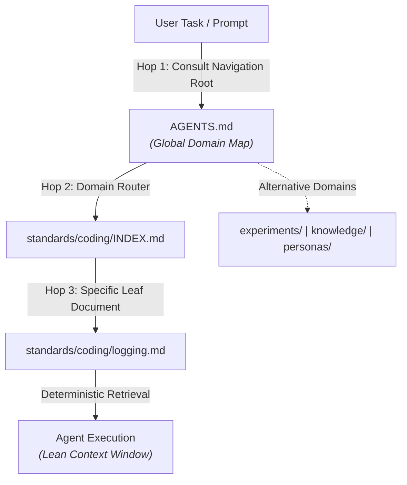

# Engram

A shared second brain for you and all agents working with you — a living, navigable knowledge base that grows across tasks, projects, and time. Engram provides a structured environment for agents to read context, record experiments, and update standards efficiently without exceeding token limits or context windows.

Engram is designed for one person: it is your own memory across all of your own projects. Storing an employer's or a client's confidential information is outside its scope.

## Why Engram?

By structuring knowledge into a hierarchical B-Tree index (≤ 3 hops from root), Engram eliminates the need for brute-force context scanning. A pilot study of four exploratory experiments compared an agent that read Engram's project memory before planning with the same agent without it. In the three experiments used for that comparison, on three models, the agent with the memory used **36–83% fewer tokens**. On the canonical bug-report prompt, every run without memory first proposed a client-side fix that fails at the real data scale, while the runs with the project document planned the server-side design. Each arm was run once, on one codebase and one bug that the memory covered, so these are directional results and not tested effect sizes. See [WHITEPAPER.md](./WHITEPAPER.md) for the data, the method, and the limitations.

## What this is

This repository is a structured knowledge base organized for **efficient agent navigation**. Agents and humans alike can find relevant context, contribute new knowledge, and update outdated understanding — all without needing to read the entire repository:

* **Standards** — how we write code, design systems, and run workflows
* **Experiments** — hypotheses tested, methods, results, and conclusions
* **Goals** — milestones and objectives we want to achieve
* **Knowledge** — accumulated learnings, domain expertise, and reference material
* **Tools** — knowledge about specific tools, APIs, services, and frameworks
* **Projects** — high-level context and architectural constraints about active and past projects
* **Investigations** — exploratory spikes, root-cause analyses, and tool evaluations, kept as immutable snapshots
* **Personas** — specialized agent roles, quality bars, and hand-offs

> **Note on Included Content:** The coding standards and personas included in this template are lightweight demonstrations of the framework in action. They are fully intended to be overwritten. If you disagree with a principle, use the agent skills to supersede it. Engram adapts to *your* specific workflow and engineering philosophy.

---

## Quickstart: Creating Your Private Second Brain

Keep your own Engram in a **Private** repository. That is a second layer of protection, not permission to store confidential information: the Information Boundary in [agent-strategies.md](standards/workflow/agent-strategies.md#information-boundary) requires every entry to be safe to publish.

### 1. Create from Template (1-Click)
1. Click the green **[Use this template]** button at the top of this repository (or select **Create a new repository**).
2. Set repository visibility to **Private** and name your repository (e.g. `engram` or `agent-memory`).
3. Click **Create repository**.

*(Note: If you want to contribute improvements back to the public Engram framework itself, use the standard **Fork** button instead.)*

### 2. Workspace Directory Structure
Clone your private Engram repository alongside your project repositories in your local workspace:

```text
~/workspace/
├── engram/             # Your private second brain
├── web-application/    # Active project 1
└── api-backend/        # Active project 2
```

### 3. Start from a Clean Slate

The template ships with example content so that each domain can be seen in use. Delete what you do not want, remove the matching rows from the `INDEX.md` named below, then run the `validate-memory` skill to confirm that no link is left dangling.

| Remove | What it is | Index to update |
|:---|:---|:---|
| `experiments/1801/`, `experiments/1971/` | Historical demo experiments | `experiments/INDEX.md` (status table and contents) |
| `knowledge/physics/` | Demo knowledge subdomain; the two demo experiments link to it, so remove them together | `knowledge/INDEX.md` |
| `experiments/future/future-004-string-theory-multiverse.md` | Demo future experiment | `experiments/future/INDEX.md` |
| `goals/milestones/ms-001-open-source-release.md` | Engram's own release milestone | `goals/milestones/INDEX.md` |
| `experiments/2026/`, `projects/sift.md`, `WHITEPAPER.md` | Engram's own benchmarks, the project document they were run against, and the paper that reports them. Optional: keep all three or remove all three. | `experiments/INDEX.md`, `projects/INDEX.md`; the whitepaper references in this README |

The community files (`CONTRIBUTING.md`, `CODE_OF_CONDUCT.md`, `SECURITY.md`, `.github/ISSUE_TEMPLATE/`, `.github/CODEOWNERS`) describe the public Engram project, not your copy: delete them or replace them with your own.

The standards, personas, and tool guides are working examples. Keep the ones that match how you work and supersede the rest.

---

## Connecting Your AI Agents

Engram functions as a shared memory node for all projects in your workspace. Agents access Engram via standard relative paths (`../engram/AGENTS.md`).

### The Universal Engram Rule

Add this base instruction to your AI coding assistant:

> **Universal Context Injection:**  
> *"Before exploring code or planning tasks in this repository, read the global domain map at `../engram/AGENTS.md`. Follow the B-Tree navigation protocol to locate applicable project constraints, coding standards, and persona guidelines. Maximize token efficiency by delegating isolated research to sub-agents."*

### Agent Configuration Matrix

| Agent / Harness | Where to Configure | Configuration Method |
|:---|:---|:---|
| **Cline / Roo Code** | `Settings → Custom Instructions` | Add the Universal Rule to **Global Custom Instructions** (or place in `.clinerules` in each project root). |
| **Claude Code** | `CLAUDE.md` / `~/.claude/CLAUDE.md` | Add the Universal Rule to the project `CLAUDE.md`, or to `~/.claude/CLAUDE.md` to apply it to every project. |
| **Antigravity / Gemini** | `~/.gemini/GEMINI.md` | Add the Universal Rule to your global rules file. |
| **Cursor / Windsurf** | `.cursorrules` / `.windsurfrules` | Paste the Universal Rule into the system prompt or project rules file. |
| **OpenAI Codex / Custom CLI** | System Prompt / Global Rules | Inject `../engram/AGENTS.md` into the agent's initialization prompt. |

---

## Design Principles

* **B-Tree Navigation**: Every directory has an `INDEX.md`; any document is reachable in ≤ 3 hops from `AGENTS.md`.
* **Zero Heavy Dependencies**: Pure Markdown + Git. No vector databases, embeddings, or cloud memory subscriptions required.
* **Predictable Token Cost**: Agents read the root, one or two indexes, and the one leaf document a task needs, however large the repository grows.
* **Mutable by Design**: Knowledge is superseded, revised, and deleted as systems evolve.
* **Git is the Archive**: Superseded documents are deleted; `git log` and `git show` recover historical context.

### The 3-Hop Navigation Protocol



---

## Repository Structure

```text
engram/
├── AGENTS.md                 Start here (navigation root & domain map)
├── WHITEPAPER.md             Pilot study: design & exploratory benchmark results
├── standards/                Coding, design, and workflow standards
├── experiments/              Empirical benchmarks (+ future/ for planned)
├── goals/                    Milestones and objectives
├── knowledge/                Accumulated domain expertise
├── tools/                    Tool and API integration guides
├── projects/                 Active and past project constraints
├── investigations/           Spikes, root-cause analyses, tool evaluations
├── personas/                 Specialized agent roles & quality bars
├── scratch/                  Ephemeral rough working notes
└── .agents/skills/           Automated memory maintenance skills
```

---

## How to Navigate & Contribute

Start at **[`AGENTS.md`](./AGENTS.md)** — it is the root of the B-Tree index and defines the reading protocol, contribution workflow, and frontmatter schemas.

Use the built-in skills in [`.agents/skills/`](./.agents/skills/) to maintain the memory base:

| Task | Skill |
|:---|:---|
| Add or revise a standard | `update-standards` |
| Record a completed experiment | `add-experiment` |
| Log a planned future experiment | `add-experiment` (future mode) |
| Add general domain knowledge | `add-knowledge` |
| Add tool/service knowledge | `add-tool` |
| Add project constraints | `add-project` |
| Conduct and record an investigation | `conduct-investigation` |
| Triage scratch notes | `triage-scratch` |
| Check structural integrity | `validate-memory` |
| Audit a document | `review-document` |
| Review a new or changed skill | `skill-review` |
| Commit and push changes | `sync-memory` |

---

## Supporting Our Research

Our empirical benchmarks are independently conducted on local hardware and cloud endpoints. If you or your organization would like to support ongoing agent-memory research, contribute compute time, or provide high-VRAM hardware testbeds (such as workstation GPUs or dedicated inference servers) to accelerate testing across emerging frontier models, please get in touch by opening an issue in this repository.

---

## License

Distributed under the [MIT License](./LICENSE).

---

A **[Void Whiskers](https://github.com/void-whiskers)** Open Source Project.
