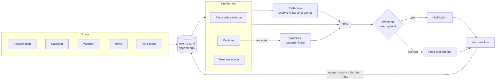
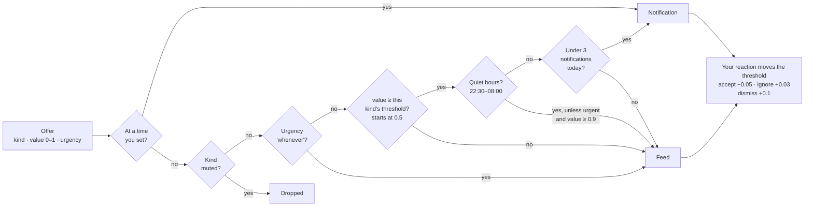

# moqi

[](https://github.com/wangcao-hub/moqi/actions/workflows/ci.yml) [](https://www.npmjs.com/package/moqi-agent) [](./LICENSE)

**A personal agent you don't have to ask.** moqi (默契, "tacit understanding") learns you from everyday life, speaks up first when it matters, and gets better at both the more you use it.

[中文文档](./README.zh-CN.md) · [Design (Chinese)](./docs/design.md) · Built on [taugraph](https://github.com/wangcao-hub/taugraph)

Most assistants wait to be asked. moqi works the other way round. Every couple of hours, and soon after you talk to it, it thinks about you on its own: what it could do for you, what it should ask to understand you better, which news matters to you. Ask the same thing three mornings in a row and on the fourth it tells you unasked; if it will rain tomorrow it reminds you the evening before. Tell it what you have to do and it keeps the list: a reminder at the time you set always arrives, and what you did not finish moves to tomorrow. It also knows when to stay quiet: no interruptions at night, at most three a day, and less of whatever you keep dismissing.

The core is plain TypeScript with no Node-only APIs, so the same code runs on a computer and inside a phone app.

## How it works

Everything moqi sees, says and does is an event in one append-only log. The user model is replayed from that log. Anything moqi wants to tell you becomes an **offer** that has to earn its way to your attention, and your reaction goes back into the log.



How one offer reaches you. A todo reminder at the time you set goes straight to a notification; every other offer passes these checks. The numbers are the defaults, and every kind of offer learns its own threshold.



## Design choices

| Choice                                                                                                                                                                                                                                                                                                                                                                              | Why                                                                                                                                                                                                                                                                          |
| ----------------------------------------------------------------------------------------------------------------------------------------------------------------------------------------------------------------------------------------------------------------------------------------------------------------------------------------------------------------------------------- | ---------------------------------------------------------------------------------------------------------------------------------------------------------------------------------------------------------------------------------------------------------------------------- |
| **It thinks on its own.** Every two hours while you are awake, and ten minutes after a conversation settles, moqi asks the model for up to three ideas: something to do for you (with the action ready, one tap sets it up), a question to know you better (two a day at most), or news from your feeds that matters to you.                                                        | Being proactive means thinking when nobody asks. Ideas go through the same gate as everything else, only ones that matter today may interrupt, none repeats within a week, and the console shows every idea and why it was or was not sent.                                  |
| **It learns while you are away.** Up to three times a day, when you have been quiet for half an hour, moqi studies. With new reactions to review, it works out lessons ("weather reminders before 7 am get accepted") and retires ones proven wrong; otherwise it picks a topic from your profile, reads one or two articles its feeds point to, and keeps notes with their source. | Getting better at helping you takes practice, not only memory. Lessons and notes go into every chat and reflection; the Memory tab shows each with its source, and you can delete any. It reads only articles its own feeds listed, so a model cannot send it anywhere else. |
| **Speaking up has a cost.** Every proactive message is an offer with a value. It interrupts you only if it beats its kind's learned threshold, is outside quiet hours and fits the daily budget.                                                                                                                                                                                    | Proactive without being noisy. What you keep dismissing gets rarer, what you accept gets through more easily.                                                                                                                                                                |
| **Your own times are kept.** A todo with a time you set reminds you then, in quiet hours and past the daily budget, and does not use it up. Unfinished todos roll over and show how long they were put off; at 21:00 moqi lists what is left.                                                                                                                                       | Quiet hours and the budget hold moqi's own initiative back. A time you chose is your consent to be interrupted.                                                                                                                                                              |
| **Trust is earned per kind of action.** Each kind climbs `inform → suggest → auto-undo → auto`. Three approvals in a row and moqi asks to move up; one refusal drops it back to `suggest`. Ordinary actions (new folder, new file, move, rename, clipboard, watches, removing todos) can also be set to run without asking in Settings.                                             | There is no global "autonomous mode". Checking the weather can run on its own while anything that changes the world still asks. Forgetting is capped at `suggest`.                                                                                                           |
| **Dangerous actions are yours to unlock.** Write tools from MCP servers and A2A agents are asked every time, showing exactly what they would do. You can unlock one in Settings, or all of one server's at once (a second tap confirms); moqi never offers to. Even then, a turn that has read a web page, a file or another agent's message asks again.                            | Instructions hidden in what moqi reads must not be able to act on your computer. A server you installed already runs with your permissions, so its read-only labels are trusted; whether a write is harmless is only your call.                                              |
| **A site is granted once per turn, or for good.** On the web, moqi asks before opening each site, then browses and clicks there without asking. Answer "以后都允许" and it stops asking about that site; Settings lists remembered sites and removes them. Typing, forms, uploads and scripts are asked every time.                                                                 | What could carry your words away is what the model writes itself: addresses and text. Links on a page come from the page, whose author does not know your details.                                                                                                           |
| **Coding tasks come back as a branch.** A coding agent works in a worktree of its own and moqi commits the result there. You read the changes in the feed and merge with one tap on the button that names the branch, or throw the branch away.                                                                                                                                     | An agent can touch a dozen files at once. A branch is something you can look at whole and drop whole, and it never gets in the way of what you are doing in the project.                                                                                                     |
| **Memories carry evidence.** A fact becomes long-term after three confirmations and fades after 30 days without one. A contradiction becomes a question for you.                                                                                                                                                                                                                    | The model never silently overwrites what it knows about you.                                                                                                                                                                                                                 |
| **Repetition becomes automation.** Use the same tool with the same arguments on 3 of the last 14 days, each time within an hour of the usual time, and moqi offers to do it for you.                                                                                                                                                                                                | You don't set up automations; moqi notices the habit and asks once.                                                                                                                                                                                                          |
| **Watches are deterministic flows.** A watch runs as a [taugraph](https://github.com/wangcao-hub/taugraph) graph: check (read), compare (code), alert (the only write step). No model call.                                                                                                                                                                                         | Watches are cheap and predictable, and replaying a run never alerts you twice.                                                                                                                                                                                               |
| **Learning stays off the answer path.** Facts are extracted by a separate background request every three turns.                                                                                                                                                                                                                                                                     | Replies never wait for memory, and a small local model doesn't have to answer and extract in one go.                                                                                                                                                                         |
| **One log is the whole state.**                                                                                                                                                                                                                                                                                                                                                     | Backing up is copying one file, debugging is reading it, and syncing devices later means syncing this log.                                                                                                                                                                   |

## Quick start

Requires Node.js 22 or later. The npm package is `moqi-agent`; the command it installs is `moqi`.

```
npm install -g moqi-agent
moqi             # starts moqi in the background and opens its console in your browser
```


The console lives at **http://moqi.localhost:6674** (6674 spells MOQI on a phone keypad). The first time, `moqi` opens it with a key in the link; the browser remembers the key, so afterwards typing the address is enough. If your browser does not resolve `moqi.localhost`, use `http://localhost:6674`.

It has five tabs: **Chat**, **Todos** (today, later and recently done: tick off, delete, or add one with an optional day and reminder time), **Feed** (what moqi wants to tell you, its questions with an answer box, and "moqi 在想": every idea it had and what became of it), **Memory** (what it remembers about you, what it learned on its own, and what it watches for you; delete anything wrong) and **Settings**. The first time, it opens on Settings: pick a model, press "test connection", search for your city, pick news feeds, save. Changes apply at once, without a restart. The console's own text is in Chinese for now.

In **Chat** you can paste, drop or pick up to four images with a message. moqi checks once whether your model can see (it shows the model a red square and asks its colour) and greys out the image button when it cannot; DeepSeek's `deepseek-flash` can. Images stay under `~/.moqi/media` and go only to your model. Answers are formatted: lists, bold, code with a copy button, tables and link cards, with no HTML and nothing loaded from outside. Images that tools bring back, such as browser and macOS screenshots or pictures from an MCP server, show under the answer and open large on a tap. In **Feed**, cards you have handled stay under "看过的" for 30 days with their links and what became of them, and a merged coding task can still show its changes.


Any OpenAI-compatible model works. A local Ollama needs no key: `qwen3:4b` (2.5 GB) runs anywhere, and [Muse Glimmer](https://ollama.com/library/muse-glimmer), Meta's open-weights model for always-on local agents, thinks far better if you have the room (about 18 GB on disk, 24 GB of memory or more). DeepSeek, Qwen and other hosted models need a key. If replies get cut off as a conversation grows, give Ollama a larger context window, e.g. `OLLAMA_CONTEXT_LENGTH=16384 ollama serve`.

| Command       | What it does                                                                                                         |
| ------------- | -------------------------------------------------------------------------------------------------------------------- |
| `moqi`        | Starts moqi in the background if it is not running, then opens the console                                           |
| `moqi stop`   | Stops the background moqi                                                                                            |
| `moqi brief`  | Prints today's briefing                                                                                              |
| `moqi chat`   | Chats in the terminal, when the background moqi is not running (`/brief`, `/offers`, `/accept <id>`, `/memory`, ...) |
| `moqi daemon` | Runs in the foreground without opening a browser, for launchd, systemd or pm2                                        |
| `moqi mcp`    | An MCP server over stdio, so other agents can talk to moqi (see below)                                               |
| `moqi a2a`    | Prints moqi's A2A agent card and key, for agents that speak A2A                                                      |
| `moqi init`   | Writes a config template, for machines without a browser                                                             |

The background moqi reaches you through system notifications (macOS, Linux) and the console's feed. One moqi owns a home directory at a time; the console, `moqi brief` and (later) the phone all go through it.

Things to say, for a start (moqi answers in Chinese):

| Say                                      | What happens                                                                 |
| ---------------------------------------- | ---------------------------------------------------------------------------- |
| `我住在深圳南山，在一家互联网公司做产品` | It remembers where you live and what you do                                  |
| `半小时后提醒我给妈妈回电话`             | A todo with a reminder in 30 minutes; it arrives on time, quiet hours or not |
| `明天下午三点提醒我交报告`               | The same for tomorrow at 15:00; it is in tomorrow's briefing too             |
| `每天早上告诉我天气`                     | A watch; moqi asks once in the console before it sets it up                  |

## Abilities: the web, your files, your Mac

Turn them on under Settings → 能力包. What changes things is still asked first (see Design choices).

| Ability       | What moqi can do                                                                                              | How it is kept safe                                                                                                                                                                                                                                                         |
| ------------- | ------------------------------------------------------------------------------------------------------------- | --------------------------------------------------------------------------------------------------------------------------------------------------------------------------------------------------------------------------------------------------------------------------- |
| Browser       | Open pages, read them, click, go back, switch tabs; type and fill forms when you agree                        | Playwright's MCP server with its own Chrome profile, never your everyday one. Each site is asked once per turn, or remembered when you choose "以后都允许"; typing, forms, uploads, scripts and sites you did not grant are asked every time                                |
| Files         | List, read, make folders and new files, move, rename, move to the Trash                                       | Only in the folders you pick. Never overwrites, never changes what a file holds, never deletes for good; symlinks cannot lead outside                                                                                                                                       |
| macOS         | Open apps, show a file in Finder, screenshot to the Desktop, volume, clipboard, and the Shortcuts you tick    | Fixed commands with your words passed as data, no free AppleScript or shell. Each shortcut is its own dangerous tool you can unlock one by one                                                                                                                              |
| Coding agents | Hand a coding task to Kiro CLI or Claude Code for a project you set up; look at the changes, merge or discard | A branch and worktree of its own per task, never your project directory until you merge. Edits only in the worktree, only the commands you list; Claude Code's commands run in its sandbox, offline unless you allow it (Kiro does not cut the network for listed commands) |

## Working with other agents (MCP and A2A)

### Other agents use moqi over MCP

Your coding agent knows what you are working on; moqi knows you. `moqi mcp` connects the two over the Model Context Protocol. It starts moqi in the background if needed and talks to it, so moqi's log keeps one writer.

| Tool            | What another agent can do with it                                                                                             |
| --------------- | ----------------------------------------------------------------------------------------------------------------------------- |
| `moqi_profile`  | Read what moqi knows about you, to personalize its work                                                                       |
| `moqi_remember` | Record a lasting fact it learned about you; repeats confirm it, contradictions go to you                                      |
| `moqi_tell`     | Tell you something ("the build finished"): moqi decides between a notification and its feed, and you can mute one agent alone |
| `moqi_todo`     | Put a task on your todo list ("review PR #12" tomorrow at 15:00); moqi shows which agent added it                             |
| `moqi_ask`      | Talk to moqi: it answers with what it knows and its tools (weather, calendar, news); actions still wait for your approval     |
| `moqi_feed`     | See what moqi is waiting to tell or ask you                                                                                   |
| `moqi_briefing` | Today's briefing                                                                                                              |

**moqi finds them itself.** It looks for Kiro, Cursor, Claude Code, Claude Desktop, VS Code, Windsurf and Gemini CLI where they keep their settings, and for any other agent with an MCP config in your home directory. When it finds some, it asks once in the feed ("发现你电脑上有 Kiro、Cursor，要接入 moqi 吗？"); one tap connects them all. The console's settings list every agent found, with a button to connect or disconnect each. moqi adds a single `moqi` entry, keeps everything else in the file and its permissions, backs the file up once as `.moqi-backup`, and does not touch a file it cannot parse. The entry uses absolute paths, so apps started from the Dock find moqi without a shell `PATH`. Start a new session in the agent, or refresh its MCP settings, to use it.

By hand, if you prefer: `kiro-cli mcp add --name moqi --command moqi --args mcp`; in `~/.cursor/mcp.json` `{ "mcpServers": { "moqi": { "command": "moqi", "args": ["mcp"] } } }`; for Claude Code `claude mcp add moqi -- moqi mcp`.

### Other agents talk to moqi over A2A

The running moqi publishes an [A2A](https://a2a-protocol.org) agent card at `http://moqi.localhost:6674/.well-known/agent-card.json` and takes `SendMessage` (A2A 1.0) and `message/send` (0.3) over JSON-RPC. Requests need moqi's A2A key as `Authorization: Bearer <key>`; `moqi a2a` and the Settings tab show it. The key is separate from the console's, so it opens nothing else. A message from another agent enters the conversation marked as that agent's (`【name】…`), so moqi never takes it for your words, and actions it leads to still wait for your approval. moqi answers with a message, not a long-running task.

### moqi uses other agents' tools (MCP) and agents (A2A)

- **MCP servers** in `mcp.servers` become moqi's tools in chat and, if read-only, in watches. Tools a server marks read-only run freely; the others are dangerous and asked every time until you unlock them in Settings (see Design choices). moqi also notices the MCP servers your other agents have configured (Cursor's, say) and offers once to use them too; Settings list them with a button each. stdio servers only for now.
- **A2A agents** in `a2a.agents` become tools named `ask_<name>`. What moqi sends is shared with that agent, so each call is asked first until you trust it.

## Configuration

The Settings tab writes `~/.moqi/config.json`; you can also edit it by hand (the directory can be changed with `MOQI_HOME`):

```json
{
  "model": { "baseURL": "http://127.0.0.1:11434/v1", "model": "qwen3:4b", "noThink": true },
  "persona": "Keep answers short.",
  "briefingAt": "08:00",
  "todoReviewAt": "21:00",
  "quiet": { "from": "22:30", "to": "08:00" },
  "dailyBudget": 3,
  "weather": { "latitude": 22.54, "longitude": 113.93, "place": "Shenzhen" },
  "calendar": { "ics": "~/calendar.ics" },
  "news": { "feeds": [{ "name": "少数派", "url": "https://sspai.com/feed" }] },
  "mcp": {
    "servers": {
      "files": { "command": "npx", "args": ["-y", "@modelcontextprotocol/server-filesystem", "/Users/me/Documents"] }
    }
  },
  "a2a": { "agents": [{ "name": "travel", "url": "https://travel.example", "key": "…" }] }
}
```

| Field                 | Default                 | Meaning                                                                                                                                                                                                                 |
| --------------------- | ----------------------- | ----------------------------------------------------------------------------------------------------------------------------------------------------------------------------------------------------------------------- |
| `model`               | none                    | OpenAI-compatible endpoint: `baseURL`, `model`, optional `apiKey`. Without a model, briefings and watches still work; chat does not.                                                                                    |
| `model.noThink`       | off                     | For Qwen3-style models that think first: background requests get the `/no_think` switch.                                                                                                                                |
| `persona`             | none                    | Who moqi is to you; put at the top of the system prompt.                                                                                                                                                                |
| `briefingAt`          | `"08:00"`               | Time of the daily briefing; `null` turns it off.                                                                                                                                                                        |
| `todoReviewAt`        | `"21:00"`               | Time of the evening look at unfinished todos; `null` turns it off.                                                                                                                                                      |
| `quiet`               | 22:30 to 08:00          | Quiet hours: offers wait in the feed unless they are urgent and worth 0.9 or more.                                                                                                                                      |
| `dailyBudget`         | `3`                     | Most notifications per day.                                                                                                                                                                                             |
| `weather`             | no place                | Weather plugin (Open-Meteo, no key): `{ latitude, longitude, place }` is your own place. The weather tool also answers for any city it is asked about, and when moqi knows you live elsewhere it offers once to switch. |
| `calendar`            | off                     | Calendar plugin reading a local `.ics` file.                                                                                                                                                                            |
| `news`                | 少数派, IT之家, Solidot | News plugin: RSS or Atom feeds to read headlines from; `{ "feeds": [] }` turns it off. The console also offers 爱范儿 and Hacker News.                                                                                  |
| `model.effort`        | none                    | `low`, `medium` or `high`: reasoning strength for background work, for models that support it (Muse Glimmer, gpt-oss).                                                                                                  |
| `model.sendReasoning` | on                      | In tool loops, send the model's own reasoning back as `reasoning_content`; DeepSeek V4 and Kimi need it. `false` turns it off for endpoints that refuse the field, such as Groq and Cerebras.                           |
| `mcp.servers`         | none                    | MCP servers (stdio) moqi may use, by name: `command`, `args`, `env`, `cwd`                                                                                                                                              |
| `a2a.agents`          | none                    | A2A agents moqi may ask: `name`, `url` (the agent or its card), optional `key`                                                                                                                                          |

Environment variables: `MOQI_BASE_URL` with `MOQI_MODEL` replaces the model; `MOQI_API_KEY` supplies the key so it stays out of the file.

## What it does unasked

| When                                                          | What                                                                                              | From                   |
| ------------------------------------------------------------- | ------------------------------------------------------------------------------------------------- | ---------------------- |
| Every morning (`briefingAt`)                                  | A briefing: today's calendar and weather, things kept for you, decisions waiting, today's watches | core                   |
| Every two hours, and soon after a chat                        | Ideas: something to do for you, a question to know you better, news that matters to you           | core (reflection)      |
| A few times a day, while you are away                         | Studies: lessons from how you reacted, notes from articles that matter to you                     | core (study)           |
| You ask the same thing at about the same time on several days | Offers to tell you every day without being asked; accepting creates a watch                       | core (routines)        |
| A watch is due                                                | Checks, compares with last time, tells you if it changed (or every time)                          | core (a taugraph flow) |
| Two memories contradict                                       | Asks which one is right                                                                           | core                   |
| Three approvals in a row for one kind of action               | Offers to do that kind of action without asking                                                   | core                   |
| At the time you set for a todo                                | Reminds you, whatever the quiet hours and budget                                                  | core (todos)           |
| In the evening (`todoReviewAt`)                               | Lists today's unfinished todos; they roll over to tomorrow                                        | core (todos)           |
| You add the same todo on three days                           | Offers to remind you every day instead                                                            | core (todos)           |
| You mention something you have to do                          | Asks whether to put it on your todo list                                                          | core (reflection)      |
| After 8 pm, if tomorrow needs an umbrella                     | Says so                                                                                           | weather plugin         |
| 30 minutes before an event                                    | Says it is coming                                                                                 | calendar plugin        |

## Use it as a library

```
npm install moqi-agent zod
```

A plugin contributes tools, a section of the daily briefing and work for each heartbeat:

```ts
import { defineTool, Moqi, openAICompatible, type Plugin } from "moqi-agent";
import { weatherPlugin } from "moqi-agent/plugins";
import { z } from "zod";

const water: Plugin = {
  name: "water",
  tools: [
    defineTool({
      name: "water_log",
      description: "How many glasses of water the user drank today",
      input: z.object({}),
      effect: "read",
      run: () => ({ value: "3", headline: "3 glasses today" }),
    }),
  ],
  briefing: () => ({ title: "Water", lines: ["Only 3 glasses yesterday"] }),
  tick: (ctx) => {
    // Look at the world and call ctx.offer(...) when there is something to say.
    // moqi decides whether it becomes a notification, waits in the feed, or is dropped.
  },
};

const moqi = new Moqi({
  model: openAICompatible({ baseURL: "http://127.0.0.1:11434/v1", model: "qwen3:4b" }),
  plugins: [weatherPlugin({ latitude: 22.54, longitude: 113.93, place: "Shenzhen" }), water],
  deliver: (offer, surface) => console.log(surface, offer.title), // surface is "notify" or "feed"
});

console.log(await moqi.chat("Do I need an umbrella tomorrow?"));
setInterval(() => void moqi.tick(), 60_000); // the proactive heartbeat
```

`effect: "read"` tools run freely and can be used by watches. `"write"` tools start at "ask first" and earn trust; pass `confirm: (question) => Promise<boolean>` to ask the user, otherwise unearned writes are refused. State lives in memory by default; `fileEventStore` from `moqi-agent/node` keeps it in a JSONL file.

`model` takes any taugraph `LLMModel` (`{ id, complete(request, { signal }) }`); `openAICompatible` covers OpenAI-compatible endpoints. Each conversation turn runs as a [`taugraph/agent`](https://github.com/wangcao-hub/taugraph) run and each watch as a taugraph flow; pass `onTrace` to receive their traces, event by event.

## Data and privacy

All state is replayed from `~/.moqi/events.jsonl`, one event per line, append-only. API keys never go into the log, and `config.json` is created readable only by you.

Each conversation turn and each watch run also leaves a trace under `~/.moqi/runs/`, one JSONL file per run, with every request to the model (the system prompt with your memories, the conversation), its reply, and every tool call with what it returned (files, the clipboard, web pages). Traces are for looking back and later for replaying real conversations after a change; the log stays the only record of state. They are kept 30 days. The folder is readable only by you. Images appear in them as `media:<id>` references, not as image data.

The console listens on `127.0.0.1` only. Its address carries a random key after `#`, so the key never reaches a server log; every API call must present it, requests whose `Host` is not this machine are refused (against DNS rebinding), and the page loads nothing from outside under a strict Content Security Policy. A saved API key is never sent to the page.

What leaves your computer: requests to the model endpoint you configured (the conversation plus the memories and headlines moqi includes in the prompt), your configured coordinates sent to Open-Meteo if the weather plugin is on, plain downloads of the news feeds you picked and of the articles moqi studies from them, and what moqi sends to A2A agents you added (each time with your approval). MCP servers you add run on your computer with your permissions. With a local model and no A2A agents, nothing about you leaves at all. The console and A2A listen on `127.0.0.1` only, so other computers cannot reach them.

## Status and limits

moqi runs on a computer: core, console, CLI, weather, calendar and news plugins, notifications, todos and reminders, watches, routines, reflection and study, and MCP and A2A in both directions.

- The phone app and multi-device sync are next. The core already follows the rules needed to run on a phone, and a test enforces them.
- Repeating calendar events (RRULE) are not expanded yet.
- macOS actions and Shortcuts work on macOS only; Linux has the browser and files.
- Notifications have no buttons (on macOS they come from `osascript`). Tick a reminder off in the console's Feed or Todos tab, or tell moqi in chat.
- Todos do not repeat. For something every day or every week, ask for a reminder in those words and moqi sets up a watch.
- Small local models (4B) sometimes record one-off requests as facts. Check with `/memory`; ask moqi to forget anything wrong.
- Reflection is only as good as the model. With `qwen3:4b` a reflection takes about a minute and yields one to three ideas, sometimes none; a bigger model, such as [Muse Glimmer](https://ollama.com/library/muse-glimmer) locally or a hosted one, thinks much better.
- `auto-undo` currently means "do it and tell you"; undoing is the matching cancel action.
- The terminal chat (`moqi chat`) does not attach to the background moqi yet; use the console while it runs.
- A2A: JSON-RPC only, answers as messages (no streaming, tasks or push notifications). MCP client: stdio servers only, tools only (no resources or prompts).

## Development

```
pnpm install
pnpm check      # typecheck, lint, tests (pinned to Asia/Shanghai)
```

## License

[Apache License 2.0](./LICENSE). You may use, change and redistribute moqi, also in commercial products. If you ship moqi or a work based on it, include the [LICENSE](./LICENSE) and [NOTICE](./NOTICE) files, so the credit to moqi travels with your copy, and mark the files you changed.

Versions up to 0.5.0 were released under the MIT License, and those copies stay under it.
