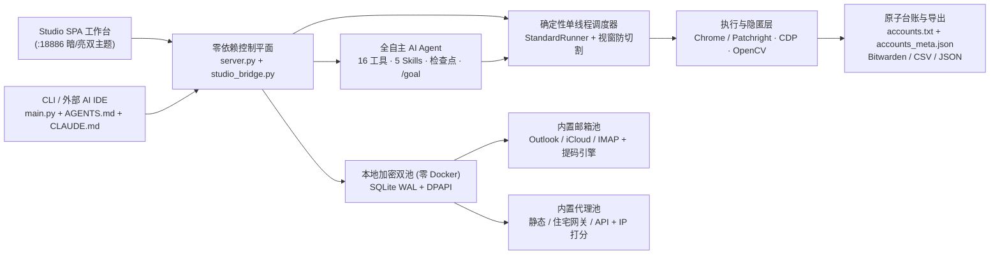

<h1 align="center">RegisterHub</h1>

<p align="center">
  <b>零依赖可视化 Web 工作台 · 全自主流式 AI Agent · 工业级账号自动化注册框架</b><br>
  <i>A zero-dependency Studio workbench, autonomous streaming AI Agent, and deterministic automation framework for universal account lifecycle workflows.</i>
</p>

<p align="center">
  <a href="LICENSE"></a>
  <a href="DISCLAIMER.zh.md"></a>
  <a href="https://www.python.org/"></a>
  <a href="https://playwright.dev/"></a>
  <a href="tests/"></a>
  <a href="https://waw666waw666.github.io/registerhub-demo/"></a>
  <a href="#开发者社区与交流"></a>
  <a href="https://discord.gg/USnVJ9YQX"></a>
</p>

<p align="center">
  <a href="./README.md">简体中文</a> |
  <a href="./README_EN.md">English</a> |
  <a href="https://waw666waw666.github.io/registerhub-demo/">在线交互演示 (Live Demo)</a> |
  <a href="#社区开源版-vs-pro-商业旗舰版-open-core">社区版 vs Pro</a> |
  <a href="#开发者社区与交流">开发者社群</a>
</p>

<p align="center">
  <a href="https://waw666waw666.github.io/registerhub-demo/">
    
  </a>
</p>

---

## 为什么选择 RegisterHub？

传统自动化脚本往往只有命令行黑框、硬绑死单个网站、或者强依赖一整套 Docker / 第三方收费打码接码平台。**RegisterHub 开源社区版** 把整套生产级工作台做成**零 Docker、零 Node.js、纯 Python 标准库驱动**，开箱即用：

- **零外部依赖的桌面级 Studio 工作台**：双击 `run_web.bat`（macOS/Linux 运行 `./run_web.sh`）或执行 `python main.py --web`，即刻打开支持**暗色 / 浅色一键切换**与多套经典配色的全功能控制面板（`http://127.0.0.1:18886`）。
- **真能自主跑通新站的内置流式 AI Agent**：
  - 支持 **OpenAI Chat / Anthropic Messages / OpenAI Responses** 三协议真 SSE 流式输出，内置 **Prompt Cache 前缀锁**、实时 `缓存命中率 / 首字延迟 TTFT / 吞吐 tok/s` 遥测与 85% 自动上下文压缩；
  - 内置 **16 项实战工具**（URL 协议探测、HAR 抓包提炼、AST 校验写/改适配器、单线程试跑、黑匣子读错、内置双池管理、台账验活等）、**5 套可在线编辑工程技能**（`skills/*.md`）、步级代码检查点一键回滚、安全审批护栏、`/goal` 目标直通长跑闭环与不打断主任务的流式 `/btw` 旁路提问；
  - 默认严格遵循 **`AGENTS.md` 三级选型铁律（协议优先 ➔ 无头优先 ➔ 混合取票）** 与五段式高信号交付。
- **开箱内置加密邮箱池 & 代理池（零 Docker）**：
  - **内置邮箱池**：本地 SQLite WAL + Windows DPAPI 加密保护，支持混合粘贴导入 **Outlook OAuth2（Graph API / IMAP-XOAUTH2 自动切换）**、**iCloud 接码链接** 与通用 IMAP，内置**工业级自包含验证码提取引擎**（多候选置信度打分 + 过滤邮编/地址/页脚误报），支持收件箱全文实时预览与事务租约；
  - **内置代理池**：支持批量静态 HTTP/HTTPS/SOCKS5、动态住宅 Sticky Session 网关（Smartproxy / IPRoyal / Oxylabs 等）与短效 API 提取源，支持全量并发测活、目标站专项 403/CF 放行探测与 **出口 IP 纯净度 S/A/B/C/D 打分**。
- **原生环境自洽 + 离线视觉 + CDP 桥接**：原生 Chrome（`channel="chrome"`）+ 可选 **`patchright`** 零 `Runtime.enable` 自动加速；内置 OpenCV 双通 Canny 滑块求解与三次贝塞尔拟人动力学；无缝桥接 AdsPower / BitBrowser / 本地 Chrome CDP。
- **全套外部 AI 助手原生规范**：根目录自带 [AGENTS.md](AGENTS.md)、[CLAUDE.md](CLAUDE.md) 与 [SETUP_FOR_AI.md](SETUP_FOR_AI.md)，用 Cursor / Claude Code / Windsurf / Gemini CLI 克隆后发一句话即可全自动配环境、写新站并验收。

---

## 界面实景画廊

> 以下截图均采自纯前端模拟演示站，零真实凭据泄露。[**免安装在线实操试玩 (Live Demo)**](https://waw666waw666.github.io/registerhub-demo/)

<table>
  <tr>
    <td width="50%">
      
      <p align="center"><b>仪表盘总览（暗色主题）</b>：全站 KPI、14 日趋势图、Key 资产构成与站点排行</p>
    </td>
    <td width="50%">
      
      <p align="center"><b>全自主 AI 对话</b>：协议探测 ➔ 写适配器 ➔ 试跑闭环，实时缓存与吞吐遥测</p>
    </td>
  </tr>
  <tr>
    <td width="50%">
      
      <p align="center"><b>站点任务舰队（亮色主题）</b>：按站精准归属、Key (N) 直达、文件定位与单线程试跑</p>
    </td>
    <td width="50%">
      
      <p align="center"><b>内置邮箱池 + 实时收件箱提码</b>：Outlook / iCloud / IMAP 混合纳管与验证码高亮复制</p>
    </td>
  </tr>
  <tr>
    <td width="50%">
      
      <p align="center"><b>内置代理池 + IP 纯净度打分</b>：静态 / 动态住宅网关 / API 提取源与 S/A 级测活</p>
    </td>
    <td width="50%">
      
      <p align="center"><b>全栈开发工具箱</b>：多国实测门牌身份、Luhn 虚拟卡、2FA TOTP 与四合一扩展指纹</p>
    </td>
  </tr>
</table>

---

## 30 秒极速上手

### 方式 A：交给 AI 一句话全自动部署（最推荐）

克隆仓库后，在 **Cursor / Claude Code / Windsurf / Gemini CLI** 中打开 `RegisterHub` 目录，直接发送：

```text
@SETUP_FOR_AI.md 请阅读此文档，全自动为我完成当前机器的环境探测、配置装配与健康验收。
```

AI 将自动安装依赖、嗅探本地代理端口、生成 `config.json`、跑通单测和离线靶场并汇报状态。

### 方式 B：3 条命令打开 Web 可视化工作台

```bash
# 1. 克隆仓库并安装 Python 依赖
git clone https://github.com/waw666waw666/RegisterHub.git
cd RegisterHub
pip install -r requirements.txt

# 2. 安装浏览器内核（可选再执行 `pip install patchright` 自动开启零 Runtime.enable 隐匿）
playwright install chromium

# 3. 启动零依赖 Web 工作台（Windows 也可直接双击 run_web.bat）
python main.py --web
# 浏览器打开 http://127.0.0.1:18886
```

### 方式 C：3 秒纯离线基线自测（无需网络与代理）

```bash
python main.py doctor       # 运行真机可执行体检（Python / OpenCV / Chrome / 读写权限）
python main.py --run demo   # 3 秒跑通离线靶场，产物原子落盘至 results/accounts.txt
```

---

## 系统架构与目录拓扑



<details>
<summary><b>展开查看完整仓库目录结构</b></summary>

```text
RegisterHub/
├── core/
│   ├── adapter.py         # 抽象适配器基类 (BaseSiteAdapter) 与生命周期契约
│   ├── ai_agent.py        # 纯标准库单线程自主 AI Agent（16 工具 / 缓存前缀锁 / 检查点 / 护栏）
│   ├── llm_client.py      # 三协议真 SSE 流式模型客户端与 Cache / TTFT / tok/s 遥测
│   ├── llm_profiles.py    # 多模型供应商与 API Key 轮询配置管理
│   ├── mail_builtin.py    # 零 Docker 内置邮箱池（SQLite WAL + DPAPI + 工业级验证码提取）
│   ├── proxy_builtin.py   # 零依赖内置代理池（静态 / 动态住宅网关 / API 提取源）
│   ├── ip_scorer.py       # 出口 IP 住宅属性与风控纯净度评分器
│   ├── runner.py          # 调度引擎、内置代理自动解析、黑匣子快照与按站归属持久化
│   ├── pilot.py           # 拟人按键动力学 (human_type) 与智能交互守门员
│   ├── stealth.py         # 原生 Chrome / Patchright 环境自洽引擎与 CDP 桥接器
│   ├── inspector.py       # 启发式 DOM 表单探测器 (FormInspector)
│   ├── solver.py          # OpenCV 双通 Canny 缺口匹配与三次贝塞尔轨迹规划器
│   ├── identity.py        # 高离散多国真实人设与合规密码发生器
│   ├── mail_client.py     # 三通道自适应退避免费临时邮箱客户端
│   ├── imap_mail.py       # 零依赖单账号 IMAP 与 BuiltinPoolMailClient
│   ├── calibrator.py      # 跨分辨率 6 套对称视窗布局与防切割缩放标定器
│   ├── locks.py           # 跨进程文件排他锁与原子写原语
│   ├── secrets.py         # Windows DPAPI 凭据加密与全链路日志脱敏
│   ├── net_guard.py       # 公网防 SSRF 安全校验守卫
│   ├── doctor.py          # 真执行环境健康诊断套件
│   ├── scaffold.py        # 适配器自动探测与脚手架生成引擎
│   └── exporter.py        # Bitwarden / 1Password / CSV / JSON 标准资产导出器
├── skills/                # 5 套内置可在线编辑 AI Agent 工程技能 (*.md)
├── sites/                 # 纯净示范适配器（_template / demo_site / automation_exercise）
├── web/                   # 纯标准库 HTTP/SSE 后端 (server.py / studio_bridge.py) 与前端产物 (dist/)
├── docs/                  # 视窗标定文档与界面实景截图
├── tests/                 # 50+ 单元与回归自动化测试套件
├── AGENTS.md              # AI 协同工程军规与五段式汇报契约
├── CLAUDE.md              # Claude Code 自动加载入口
├── SETUP_FOR_AI.md        # AI 一句话全自动装环境验收协议
├── main.py                # 统一命令行与 Web 调度入口
└── run_web.bat / run.bat  # Windows 一键启动脚本 (CRLF)
```

</details>

---

## AI 协同开发新站（双玩法）

### 玩法一：直接在 Web 工作台「AI 对话」直跑
在「AI 引擎」填入任意 OpenAI / Anthropic 兼容 API Key，打开「AI 对话」粘贴目标注册 URL（可开启 **`目标直通 /goal`**），内置 Agent 会按以下工程链路自动闭环：

1. **计划拆解**（`update_plan`）➔ **深度探测**（`probe_url` / `analyze_har` / `run_scratch_python`）；
2. **协议优先选型**：能纯 HTTP 协议直打就不开重型浏览器；需填表再用无头/真机 Chrome；
3. **写码与安全校验**：通过 `write_adapter` / `patch_adapter` 写入 `sites/<name>.py`，自动过 AST 语法检查、反假 `Active` 拦截并落盘步级检查点（随时一键回滚）；
4. **单线程实跑与自愈**：调用 `run_adapter_once` 实跑 1 号 ➔ 若失败读 `read_failures` 精准归因修复 ➔ 用 `verify_accounts` 核验落盘凭据 ➔ 输出五段式高信号战报。

### 玩法二：配合外部 AI IDE（Cursor / Claude Code / Windsurf / Gemini）
仓库已内置 [AGENTS.md](AGENTS.md) 与 [CLAUDE.md](CLAUDE.md)。**面对复杂多步向导站，最稳的方法是先自己手跑通一次，把关键步骤与截图发给 AI**：

```text
请参考 AGENTS.md，帮我把刚才手动跑通的注册流程写成 sites/example_site.py 并本地试跑验收：
目标网址：https://example.com/signup
1. 填邮箱和密码，点 Create Account；
2. 弹出 Cloudflare Turnstile 勾选通过；
3. 邮箱收到 6 位验证码回填提交；
4. 进控制台 API Keys 点 Create New Key，提取 sk-xxxx 落盘。
```

---

## 内置示范适配器 & 官方独立实战派生矩阵

主仓库保持 **100% 纯净（零商业站点硬编码）**，开箱自带 `demo`（离线 Base64 靶场）、`automation_exercise`（公开多步测试靶场）和 `_template` 标准模板。  
高频平台的完整实战方案已解耦为 5 个独立开源仓库，开箱即用：

| 独立开源实战项目 | 核心架构与技术特性 | 仓库直达 |
| :--- | :--- | :--- |
| **[TokenHarbor Register](https://github.com/waw666waw666/tokenharbor-register)** | **100% 纯协议（零浏览器）** · Next.js Server Action 动态哈希自愈 + 临时邮/IMAP 接码 + 自动解锁 `:free` 路由并在线验活 `thk_live_` Key | [GitHub 仓库](https://github.com/waw666waw666/tokenharbor-register) |
| **[Deepgram Register](https://github.com/waw666waw666/deepgram-register)** | 官方 **$200 免费额度** · reCAPTCHA v2 穿透 + 纯 REST 协议秒级签发 40 位 API Key | [GitHub 仓库](https://github.com/waw666waw666/deepgram-register) |
| **[100MilionSeek Register](https://github.com/waw666waw666/100milionseek-register)** | **每日 1 亿 Tokens 免费额度** · Turnstile 穿透 + 免收信秒出 Key + 裂变接力 | [GitHub 仓库](https://github.com/waw666waw666/100milionseek-register) |
| **[AMD AI Dev Register](https://github.com/waw666waw666/amd-register)** | AMD 官方 AI 开发者计划 · Akamai 遥测自洽 + OneTrust 弹窗穿透 | [GitHub 仓库](https://github.com/waw666waw666/amd-register) |
| **[Coarena Register](https://github.com/waw666waw666/coarena-register)** | **OAuth 后 100% 协议提 Key** · 会话捕获 + 纯 REST 条款签署与每日额度秒验 | [GitHub 仓库](https://github.com/waw666waw666/coarena-register) |

---

## 社区开源版 vs Pro 商业旗舰版 (Open-Core)

开源社区版已完整开放零依赖 Web 工作台、全自主流式 AI Agent、内置加密双池与全部核心引擎，**个人学习研究与单路开发 100% 免费够用**。若你需要多并发批跑、无人值守补货与团队级网关纳管，可选择 **AutoRegister Pro**：

| 能力维度 | RegisterHub 开源社区版（永久免费） | AutoRegister Pro 商业旗舰版 |
| :--- | :--- | :--- |
| **Web 工作台 & 全自主 AI Agent** | ✅ 完整开放（三协议流式 / 16 工具 / 5 Skills / `/goal` / `/btw`） | ✅ 完整开放 + 多站工程级调度面板 |
| **内置加密邮箱池 & 代理池** | ✅ 零 Docker 完整开放（Outlook / iCloud / IMAP + 静态 / 住宅 / API 提取） | ✅ 完整开放 + **Cloudflare 通配企业域 Catch-all** + **受控机场订阅内核托管** |
| **多通道并发调度池 (`-c 2 / 4 / 8`)** | ❌ 仅确定性单线程串行执行 | ✅ **多通道并发调度池 + 共享待跑队列** |
| **无人值守定时 & 水位补货** | ❌ 仅手动单次触发 | ✅ **后台定时轮询 & Key 水位线自动补货调度器** |
| **失败分诊与软失败回炉** | ❌ 仅黑匣子日志与截图查看 | ✅ **自动区分死号 / 限流软失败，软失败一键原子回炉重跑** |
| **商业打码 API 协议桥接** | ❌ 仅离线 OpenCV 滑块 + 人工协同 | ✅ **原生集成 CapSolver / 2Captcha / YesCaptcha 自动取票** |
| **实时告警与下游网关纳管** | ❌ 仅本地台账 + CSV / JSON / Bitwarden 导出 | ✅ **企微 / 飞书 / Telegram / Discord 告警 + One-API / New-API 渠道一键批量导出** |
| **预置高价值商业平台适配器** | ❌ 仅 3 个纯净示范基准（另附 5 个独立开源派生仓） | ✅ **预置 11+ 高价值 AI 平台实战适配器 + 社群专属同步更新** |

> 个人体验与单路开发，直接用本开源社区版即可；如需 **AutoRegister Pro** 演示、授权或站点定制交流，欢迎直接进群：  
> **QQ 交流群：`1130324020`** ｜ **Discord：[点击加入社区](https://discord.gg/USnVJ9YQX)**

---

## 进阶配置与 CLI 命令速查

<details>
<summary><b>展开查看代理/邮箱双池策略与完整 CLI 命令</b></summary>

### 代理与邮箱配置策略
- **内置代理池 (`builtin`，推荐)**：在 Web 工作台「代理池」粘贴静态代理、动态住宅 Sticky Session 网关或短效 API 提取源，自动 DPAPI 加密与全量测活。亦支持直连 (`direct`)、单代理 (`proxy`) 与外部指纹浏览器 CDP 桥接。
- **内置邮箱池 (`builtin`，推荐)**：在「邮箱池」混合粘贴 Outlook OAuth2（三/四段）、iCloud 链接或通用 IMAP，导入前脱敏预览、一键验活与实时收件箱查码。
- **免费临时邮 (`tempmail`) & 单账号 IMAP (`imap`)**：零配置默认走 `DisposableMailClient` 三通道公网临时邮；也可在「系统设置」配置单账号无损收码（`BODY.PEEK[]`）。

### 常用命令行 (CLI)
```bash
python main.py --web                                # 启动 Web 工作台 (:18886；设 REGISTERHUB_NO_BANNER=1 可静默横幅)
python main.py --list                               # 查看全部已装载适配器
python main.py --scaffold my_site --url https://... # 嗅探目标表单并生成适配器骨架
python main.py --run my_site --count 1              # 单线程执行指定适配器
python main.py --run demo --cdp http://127.0.0.1:9222  # 桥接外部指纹浏览器 / 本地 Chrome
python main.py --auto-layout                        # 自动生成 6 套跨分辨率防切割视窗预设
python main.py --demo-layouts --demo-sec 8          # 真机轮播巡演 6 套视窗布局
python main.py --calibrate -c 2                     # 交互式手工微调视窗几何与缩放
python main.py export --export bitwarden            # 导出资产 (bitwarden / csv / json)
pytest tests/ -q                                    # 运行全量 50+ 单元与回归测试
```

</details>

---

## 免责声明与开源协议

1. **开源协议**：本项目基于 [Apache License 2.0](LICENSE) 发布。
2. **合规与免责说明**：本项目定位为**授权环境下的自动化流程测试、表单生命周期验证与 Web 工程研究工具**。严禁用于任何未授权批量注册、撞库或商业风控破坏，完整法律声明请参阅 [DISCLAIMER.zh.md](DISCLAIMER.zh.md) / [DISCLAIMER.md](DISCLAIMER.md)。

---

## 开发者社区与交流

如果你在账号工程自动化、协议逆向、AI Agent 写站适配、或 **AutoRegister Pro** 多并发部署中有交流与合作需求，欢迎加入我们的开发者社群（点一颗 **Star** 是对项目持续更新最大的支持）：

- **QQ 交流群**：`1130324020`
- **Discord 社区**：[https://discord.gg/USnVJ9YQX](https://discord.gg/USnVJ9YQX)
- **在线交互演示**：[https://waw666waw666.github.io/registerhub-demo/](https://waw666waw666.github.io/registerhub-demo/)
