<h1 align="center">🧠 NeuroVault</h1>

<p align="center">
  
</p>

<p align="center">
  <strong>A 3D + 2D, interactive Retrieval-Augmented Generation (RAG) lab.</strong><br />
  Ask your documents questions, <em>see</em> how the answer was found, and fly through the embedding space.
</p>

<p align="center">
  <a href="https://github.com/webhavi/neurovault-rag"></a>
  
  
  
  
  
  
  
  
  
</p>

---

## 🧭 Click-to-Explore Map

> Everything below is organised as a guided tour. Click a link to jump, and click any **▶ arrow** to expand hidden details.

| # | Stop | What you get | Style |
|---|---|---|---|
| 1 | [Big Picture](#-1-the-big-picture) | One diagram of the whole system | 🟦 2D |
| 2 | [3D Layer Stack](#-2-the-3d-layer-stack) | The system as stacked slabs | 🧊 3D |
| 3 | [Architecture, Step by Step](#-3-architecture-step-by-step) | 6 colour-coded steps | 🟦 2D |
| 4 | [9-Stage Retrieval Pipeline](#-4-the-9-stage-retrieval-pipeline) | What happens to one question | 🟦 2D |
| 5 | [Life of a Request](#-5-life-of-a-chat-request) | Sequence diagram | 🟦 2D |
| 6 | [3D Neural Scene](#-6-the-3d-neural-network-scene) | 5-9-13-9-4 topology | 🧊 3D |
| 7 | [3D Embedding Space](#-7-the-3d-embedding-space-pca) | Vectors you can orbit | 🧊 3D |
| 8 | [BYOK Privacy Flow](#-8-bring-your-own-key-byok) | Where your key goes (and doesn't) | 🟦 2D |
| 9 | [Quick Start](#-9-quick-start) | Run it in minutes | ⚙️ |
| 10 | [Reference](#-10-reference) | Env, API, tests, deploy, FAQ | 📚 |

---

## 🎨 Colour Legend

Every diagram in this README uses the same colours, so you always know which layer you are looking at.

| Colour | Layer | Meaning |
|:---:|---|---|
| 🟦 **Cyan** | Frontend | What you see and click |
| 🟪 **Violet** | Edge | Routing and proxying |
| 🟩 **Green** | Backend | FastAPI routers and services |
| 🟨 **Amber** | Storage | Files and the Chroma vector DB |
| 🟥 **Pink** | AI models | Embeddings and LLM providers |
| 🔷 **Blue** | Math | Cosine similarity, MMR, PCA |

---

## 🌍 1. The Big Picture

NeuroVault answers **only** from your indexed documents. If the answer is not in them, it says so instead of guessing.

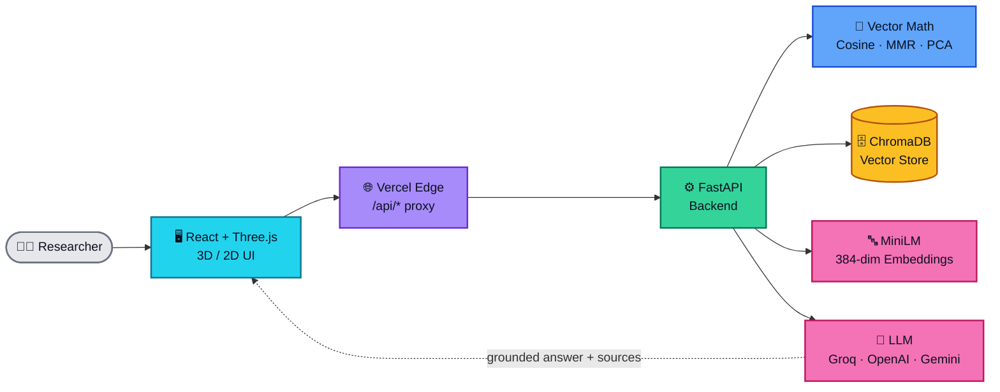

### ✨ Why it feels different

| 🎯 Strict grounding | 🧠 See the brain | 🌌 Fly through vectors | 🔑 Your key, your browser |
|---|---|---|---|
| Answers come only from retrieved chunks, with file, page and preview. | An interactive 3D neural network explains data from tensors to logits. | Real 384-dim embeddings projected to 3D with PCA. | API keys live in `localStorage` and are never stored server-side. |

---

## 🧊 2. The 3D Layer Stack

Think of NeuroVault as six slabs. A request falls from the top slab to the bottom one, and the answer climbs back up.

```text
   ┌──────────────────────────────────────────────────┐
  ╱                                                  ╱│
 ┌──────────────────────────────────────────────────┐ │
 │ L1  FRONTEND     React · Three.js · Tailwind     │ │
 └──────────────────────────────────────────────────┘╱
                           ▼
   ┌──────────────────────────────────────────────────┐
  ╱                                                  ╱│
 ┌──────────────────────────────────────────────────┐ │
 │ L2  EDGE         Vercel rewrites /api/*          │ │
 └──────────────────────────────────────────────────┘╱
                           ▼
   ┌──────────────────────────────────────────────────┐
  ╱                                                  ╱│
 ┌──────────────────────────────────────────────────┐ │
 │ L3  BACKEND      FastAPI · LangChain · Pydantic  │ │
 └──────────────────────────────────────────────────┘╱
                           ▼
   ┌──────────────────────────────────────────────────┐
  ╱                                                  ╱│
 ┌──────────────────────────────────────────────────┐ │
 │ L4  VECTOR MATH  Cosine · MMR · SVD-PCA          │ │
 └──────────────────────────────────────────────────┘╱
                           ▼
   ┌──────────────────────────────────────────────────┐
  ╱                                                  ╱│
 ┌──────────────────────────────────────────────────┐ │
 │ L5  STORAGE      ChromaDB · MiniLM 384-dim       │ │
 └──────────────────────────────────────────────────┘╱
                           ▼
   ┌──────────────────────────────────────────────────┐
  ╱                                                  ╱│
 ┌──────────────────────────────────────────────────┐ │
 │ L6  AI MODELS    Groq · OpenAI · Gemini          │ │
 └──────────────────────────────────────────────────┘╱
```

### 🔀 2D vs 3D: what renders where

| View | Where it appears | 3D version | 2D fallback |
|---|---|---|---|
| Neural network | Hero dashboard | Three.js scene with a node inspector | Sleek SVG visualizer |
| Embedding space | Embeddings tab | Orbitable PCA scatter | Conceptual clustering when idle |
| Retrieval pipeline | Retrieval tab | n/a | 9-stage step monitor |
| Chat | Chat tab | n/a | Source cards and Markdown |

> The SVG fallback activates automatically when **WebGL is unavailable** or **reduced motion** is preferred.

---

## 🏗️ 3. Architecture, Step by Step

Six steps, one colour per layer. Open each step to see its diagram.

<details open>
<summary><b>🟦 Step 1: The Frontend (what you touch)</b></summary>

<br />

React 18 + Vite + TypeScript. Six feature areas share one glassmorphic UI kit.

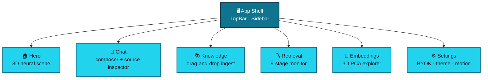

</details>

<details>
<summary><b>🟪 Step 2: The Edge (how requests travel)</b></summary>

<br />

In production the SPA lives on Vercel. Vercel rewrites `/api/*` to the backend on Render, so the browser sees one origin and CORS stays simple.

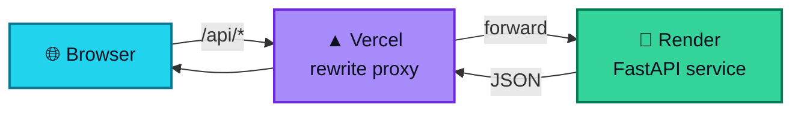

</details>

<details>
<summary><b>🟩 Step 3: The Backend (routers and services)</b></summary>

<br />

A FastAPI app factory wires four routers to three core services. Every error uses one envelope: `{"detail": {"code": "...", "message": "..."}}`.

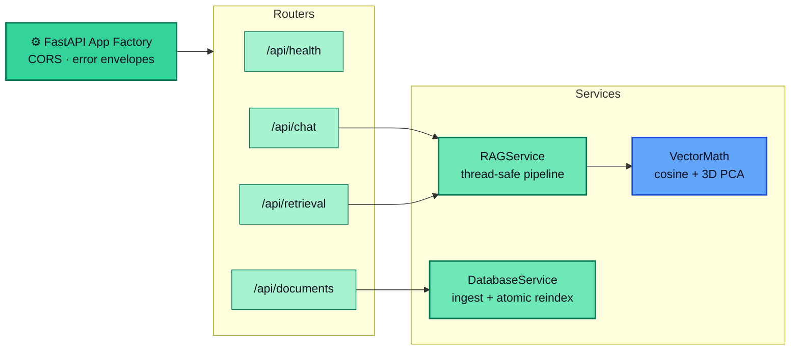

</details>

<details>
<summary><b>🟨 Step 4: Ingestion (documents become vectors)</b></summary>

<br />

Upload a `.pdf`, `.md` or `.txt`. A background job does the work, and the UI polls its status. Re-indexing first deletes old chunks, so duplicates never appear.

```mermaid
flowchart LR
    A["📤 Upload<br/>.pdf .md .txt"] --> B["🛡️ Validate<br/>type + size ≤ 25 MB"]
    B --> C["🧹 Sanitize"]
    C --> D["✂️ Split<br/>1000 chars · 200 overlap"]
    D --> E["🔤 Embed<br/>MiniLM 384-dim"]
    E --> F["🗑️ Delete old chunks<br/>for this source"]
    F --> G[("🗄️ Add to Chroma")]
    G --> H["📡 Job status<br/>polled by UI"]

    classDef client fill:#22d3ee,stroke:#0e7490,color:#0b1020,stroke-width:2px
    classDef api fill:#34d399,stroke:#047857,color:#0b1020,stroke-width:2px
    classDef ai fill:#f472b6,stroke:#be185d,color:#0b1020,stroke-width:2px
    classDef store fill:#fbbf24,stroke:#b45309,color:#0b1020,stroke-width:2px
    class A,H client
    class B,C,D api
    class E ai
    class F,G store
```

> 💡 On 512 MB cloud tiers, boot-time auto-seeding has file-size guards to avoid out-of-memory crashes.

</details>

<details>
<summary><b>🟥 Step 5: The Models (embeddings and LLM)</b></summary>

<br />

Two kinds of model work together. Embeddings run in the backend. The LLM is chosen per request.

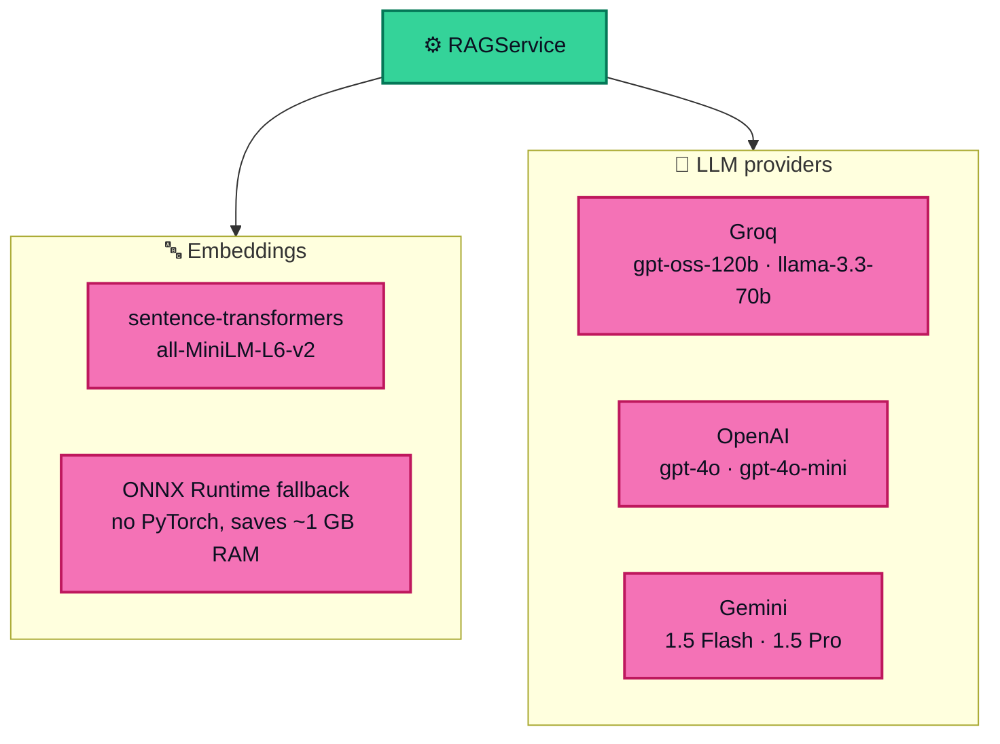

</details>

<details>
<summary><b>🔷 Step 6: The Math (ranking and projecting)</b></summary>

<br />

Three pieces of math power retrieval and visualisation.

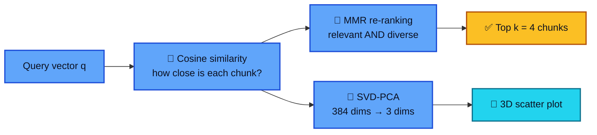

</details>

---

## 🔍 4. The 9-Stage Retrieval Pipeline

The Retrieval tab shows each stage with **measured** timings (embedding, vector search and MMR). Nothing is mocked.

```mermaid
flowchart LR
    S1["1️⃣ Validate<br/>question"] --> S2["2️⃣ Normalize<br/>query"]
    S2 --> S3["3️⃣ Embed<br/>query"]
    S3 --> S4["4️⃣ Chroma<br/>similarity search"]
    S4 --> S5["5️⃣ MMR<br/>re-rank"]
    S5 --> S6["6️⃣ Select<br/>candidates"]
    S6 --> S7["7️⃣ Build<br/>context window"]
    S7 --> S8["8️⃣ LLM<br/>prompt synthesis"]
    S8 --> S9["9️⃣ Assemble<br/>final response"]

    classDef a fill:#34d399,stroke:#047857,color:#0b1020,stroke-width:2px
    classDef b fill:#f472b6,stroke:#be185d,color:#0b1020,stroke-width:2px
    classDef c fill:#fbbf24,stroke:#b45309,color:#0b1020,stroke-width:2px
    classDef d fill:#60a5fa,stroke:#1d4ed8,color:#0b1020,stroke-width:2px
    classDef e fill:#22d3ee,stroke:#0e7490,color:#0b1020,stroke-width:2px

    class S1,S2 a
    class S3 b
    class S4 c
    class S5,S6 d
    class S7,S8 b
    class S9 e
```

| Stage | Colour | What happens | Timed in UI |
|:---:|:---:|---|:---:|
| 1 to 2 | 🟩 | Check the question, then clean it up | |
| 3 | 🟥 | Turn the question into a 384-dim vector | ✅ |
| 4 | 🟨 | Fetch `fetch_k = 10` candidates from Chroma | ✅ |
| 5 to 6 | 🔷 | MMR keeps `k = 4` chunks that are relevant **and** different | ✅ |
| 7 to 8 | 🟥 | Pack chunks into a context-only prompt for the LLM | |
| 9 | 🟦 | Return the answer plus source cards | |

---

## 🎬 5. Life of a Chat Request

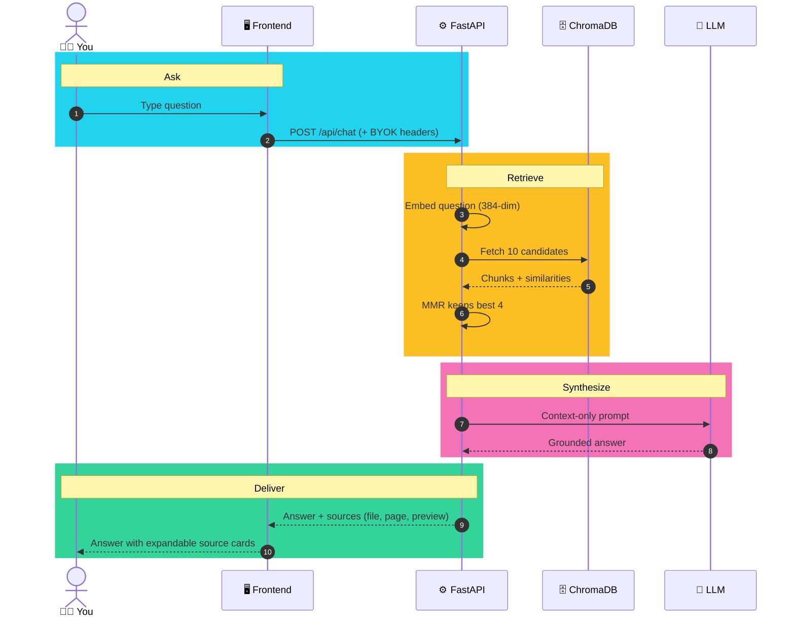

<details>
<summary><b>🧯 What if something is missing? (degraded mode)</b></summary>

<br />

| Situation | What still works | What stops |
|---|---|---|
| No LLM key | Document discovery, ingestion, vector search, 3D PCA | Chat returns `503 provider_not_configured` |
| Empty vector store | UI, settings, neural scene | Chat returns `503 empty_vector_store` |
| No WebGL / reduced motion | Everything, with the SVG visualizer | 3D canvas |
| Answer not in documents | Honest fallback message | Hallucinated answers (by design) |

</details>

---

## 🧠 6. The 3D Neural Network Scene

The hero dashboard renders an interactive **5 – 9 – 13 – 9 – 4** network with React Three Fiber. Click a node to see what that layer represents, from input tensors to output logits.

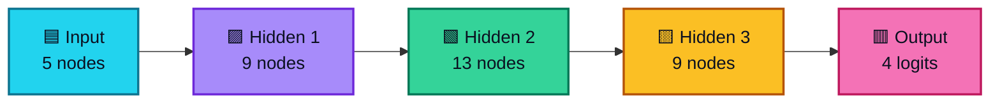

---

## 🌌 7. The 3D Embedding Space (PCA)

Each chunk is a point in 384 dimensions. We squash that to 3 so you can orbit it.

```text
              Z (PC3)
               │        ◆ Q  = your question
               │      ● ●    = the 4 chunks MMR picked
               │    ○   ○    = other candidates (of 10)
               │  ○       ○
               │ ○
               └──────────────── Y (PC2)
              ╱
             ╱
            X (PC1)
```

**Interact:** pan, zoom and rotate, and hover a point to see its live cosine similarity.
**Dual mode:** real PCA coordinates during an active trace, conceptual clusters when idle.

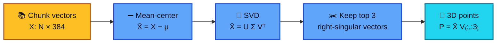

<details>
<summary><b>📐 Show the formulas</b></summary>

<br />

**Cosine similarity** between query $\mathbf{q}$ and chunk $\mathbf{d}_i$:

$$\text{Sim}(\mathbf{q}, \mathbf{d}_i) = \frac{\mathbf{q} \cdot \mathbf{d}_i}{\|\mathbf{q}\|_2 \|\mathbf{d}_i\|_2}$$

**Maximal Marginal Relevance** (picks relevant chunks that are not repeats of each other):

$$\text{MMR} = \arg\max_{\mathbf{d}_i \in C \setminus S} \left[ \lambda \cdot \text{Sim}(\mathbf{q}, \mathbf{d}_i) - (1 - \lambda) \max_{\mathbf{d}_j \in S} \text{Sim}(\mathbf{d}_i, \mathbf{d}_j) \right]$$

With $\lambda = 0.5$, $k = 4$ and $\text{fetch\_k} = 10$.

**PCA via SVD:**

$$\bar{X} = X - \mu, \qquad \bar{X} = U \Sigma V^T, \qquad P_{3D} = \bar{X} V_{:, :3}$$

</details>

---

## 🔑 8. Bring Your Own Key (BYOK)

Your key never touches the server's disk. It stays in your browser and travels per request over TLS.

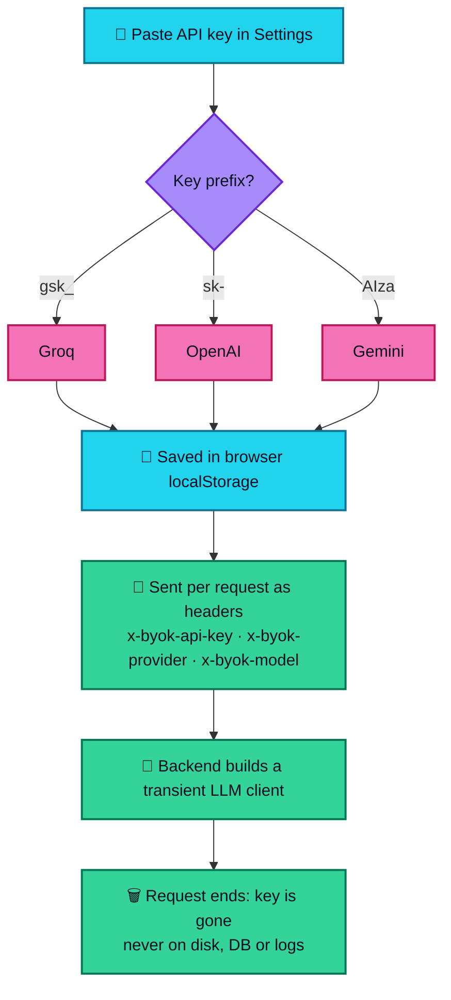

---

## 🚀 9. Quick Start

**You need:** Python 3.10+ (3.11 recommended), Node.js 18+ or Bun 1.2+, Git. An LLM key is optional (see degraded mode above).

<details open>
<summary><b>🪟 One-click Windows launch</b></summary>

<br />

1. Run `start_backend.bat`. It sets up the virtual environment and starts FastAPI at `http://127.0.0.1:8000`.
2. Run `start_frontend.bat`. It starts Vite at `http://localhost:5173`.
3. Open **http://localhost:5173**.

</details>

<details>
<summary><b>🐧🍎🪟 Manual setup (any OS)</b></summary>

<br />

**Backend**

```bash
cd neurovault/backend
python -m venv .venv

# Linux / macOS
source .venv/bin/activate
# Windows PowerShell
.\.venv\Scripts\Activate.ps1

pip install -r requirements.txt
cp .env.example .env          # optionally set GROQ_API_KEY=gsk_...

uvicorn app.main:app --host 127.0.0.1 --port 8000 --reload
```

Swagger docs: `http://127.0.0.1:8000/docs`

**Frontend** (new terminal)

```bash
cd neurovault/frontend
bun install        # or: npm install
bun run dev        # or: npm run dev
```

Open `http://localhost:5173`.

</details>

---

## 📚 10. Reference

<details>
<summary><b>⚙️ Environment variables</b></summary>

<br />

**Backend** (`neurovault/backend/.env`)

| Variable | Default | Description |
|---|---|---|
| `GROQ_API_KEY` | *None* | Optional server-side Groq key (chat works without it when using BYOK). |
| `GROQ_MODEL` | `openai/gpt-oss-120b` | Groq model (`llama-3.3-70b-versatile` also supported). |
| `EMBEDDING_MODEL` | `sentence-transformers/all-MiniLM-L6-v2` | 384-dim embedding model. |
| `CHROMA_PERSIST_DIRECTORY` | `chroma_db` | Where Chroma persists data. |
| `COLLECTION_NAME` | `langchain` | Chroma collection name. |
| `SEARCH_TYPE` | `mmr` | `mmr` or `similarity`. |
| `RETRIEVER_K` | `4` | Chunks sent to the prompt. |
| `RETRIEVER_FETCH_K` | `10` | Candidate pool before MMR. |
| `RETRIEVER_LAMBDA_MULT` | `0.5` | 0 = max diversity, 1 = max similarity. |
| `CHUNK_SIZE` | `1000` | Characters per chunk. |
| `CHUNK_OVERLAP` | `200` | Overlap between chunks. |
| `MAX_UPLOAD_MB` | `25` | Upload size limit. |
| `ALLOWED_EXTENSIONS` | `.pdf,.txt,.md` | Accepted file types. |
| `CORS_ORIGINS` | `*` | Allowed frontend origins. |
| `AUTO_SEED_ON_STARTUP` | `true` | Seed an empty store from `document_loaders`. |

**Frontend** (`neurovault/frontend/.env`)

| Variable | Default | Description |
|---|---|---|
| `VITE_API_BASE_URL` | `http://localhost:8000` | Backend base URL. |
| `VITE_BASE_PATH` | `/` | Public base path. |

</details>

<details>
<summary><b>📡 API endpoints</b></summary>

<br />

| Method | Endpoint | Description |
|:---:|---|---|
| `GET` | `/api/health` | Health of vector store, models and disk |
| `POST` | `/api/chat` | Grounded RAG answer. Body: `{"question": "...", "byok_api_key": "...", "byok_provider": "groq"}` |
| `GET` | `/api/documents` | Documents on disk merged with index status |
| `POST` | `/api/documents/ingest` | Upload a file (`multipart/form-data`, field `file`) for background ingestion |
| `GET` | `/api/documents/ingest/jobs/{id}` | Poll an ingestion job |
| `POST` | `/api/documents/reindex` | Atomic re-index. Body: `{"source": "deeplearning.pdf"}` |
| `GET` | `/api/retrieval/config` | Active retrieval settings |
| `POST` | `/api/retrieval/trace` | Query embedding, candidates, MMR and 3D PCA coordinates |
| `GET` | `/api/stats` | Total chunks and per-document breakdown |

</details>

<details>
<summary><b>🗂️ Repository structure</b></summary>

<br />

```text
neurovault-project/
├── neurovault/
│   ├── backend/
│   │   ├── app/
│   │   │   ├── main.py                  # App factory, CORS, lifespan, SPA serving
│   │   │   ├── config.py                # Typed settings
│   │   │   ├── schemas.py               # Pydantic contracts
│   │   │   ├── services/
│   │   │   │   ├── rag_service.py       # Embeddings, Chroma, MMR, LLM
│   │   │   │   ├── database_service.py  # Discovery, chunking, atomic re-index
│   │   │   │   └── vector_math.py       # Cosine + SVD-PCA
│   │   │   └── routers/
│   │   │       ├── health.py
│   │   │       ├── chat.py
│   │   │       ├── documents.py
│   │   │       └── retrieval.py
│   │   ├── tests/
│   │   ├── requirements.txt
│   │   ├── requirements-render.txt
│   │   └── .env.example
│   ├── frontend/
│   │   ├── src/
│   │   │   ├── components/ (neural, layout, ui)
│   │   │   ├── features/   (hero, chat, knowledge, retrieval, embeddings, settings)
│   │   │   ├── hooks/
│   │   │   └── lib/
│   │   ├── tests/
│   │   ├── package.json
│   │   └── vite.config.ts
│   ├── chroma_db/
│   └── document_loaders/
├── document_loaders/
├── scripts/                             # verify_e2e.py, check_imports.py, screenshots
├── start_backend.bat
├── start_frontend.bat
├── render.yaml
├── vercel.json
└── README.md
```

</details>

<details>
<summary><b>🧪 Testing</b></summary>

<br />

```bash
# Backend (FastAPI + Chroma + mocked providers)
cd neurovault/backend && pytest

# Frontend
cd neurovault/frontend
bun run typecheck
bun run test

# Live end-to-end: health, index, 384d PCA trace, grounded chat
python scripts/verify_e2e.py
```

</details>

<details>
<summary><b>🚢 Deployment (Render + Vercel)</b></summary>

<br />

**Backend on Render**

1. Connect the repo to [Render](https://render.com/) and deploy as a **Blueprint** using [`render.yaml`](render.yaml).
2. Render provisions Python 3.11 with ONNX MiniLM embeddings, a web service rooted at `neurovault/backend`, and health checks on `/api/health`.

**Frontend on Vercel**

1. Import the repo into [Vercel](https://vercel.com/) (config in [`vercel.json`](vercel.json)).
2. Root directory: `neurovault/frontend`. Build: `bun run build` (or `npm run build`). Output: `dist`.
3. Set `VITE_API_BASE_URL` to your backend, for example `https://neurovault-rag.onrender.com`.
4. Vercel proxies `/api/*` to the backend.

</details>

<details>
<summary><b>❓ Troubleshooting</b></summary>

<br />

| Problem | Cause | Fix |
|---|---|---|
| `503 provider_not_configured` | No LLM key on server or client | Add a key in **Settings**, or set `GROQ_API_KEY` in the backend `.env` |
| `503 empty_vector_store` | Nothing indexed yet | Upload a PDF, TXT or MD in **Knowledge Library** and wait for ingestion |
| Port 8000 or 5173 busy | Another process is using it | Run `uvicorn app.main:app --port 8001` and set `VITE_API_BASE_URL=http://localhost:8001` |
| PowerShell blocks `Activate.ps1` | Execution policy | `Set-ExecutionPolicy -Scope CurrentUser -ExecutionPolicy RemoteSigned` |
| Out of memory on a 512 MB host | PyTorch is heavy | Install `requirements-render.txt` (ONNX MiniLM) |

</details>

---

## 🧰 Tech Stack at a Glance

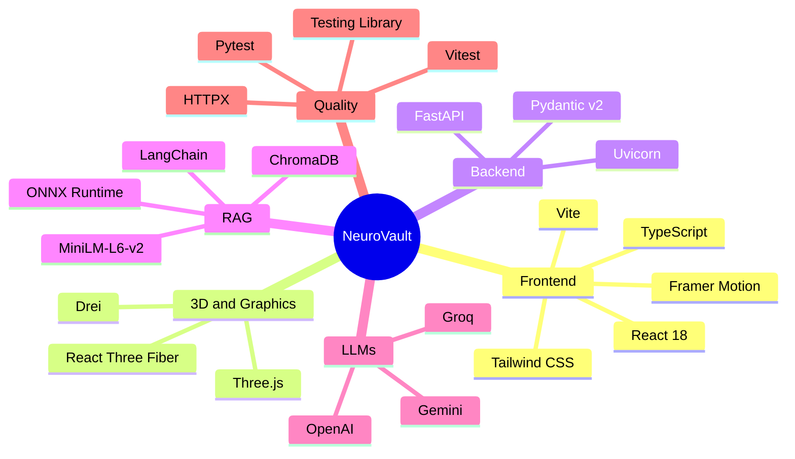

---

## 🧑‍🔬 A Day with NeuroVault

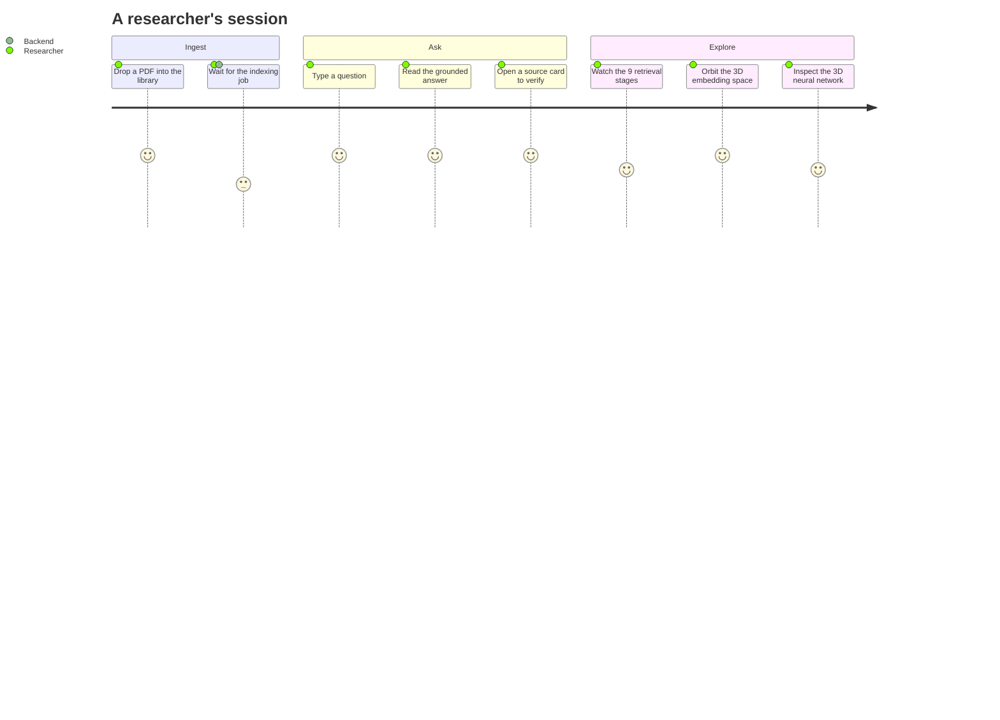

---

## 📸 Visual Showcase

<div align="center">
  <table>
    <tr>
      <td width="50%">
        <h4 align="center">Hero Dashboard and 3D Neural Scene</h4>
        
      </td>
      <td width="50%">
        <h4 align="center">Chat with Source Verification</h4>
        
      </td>
    </tr>
    <tr>
      <td width="50%">
        <h4 align="center">3D Embedding Space (PCA)</h4>
        
      </td>
      <td width="50%">
        <h4 align="center">Mobile Responsive</h4>
        
      </td>
    </tr>
  </table>
</div>

---

## 📄 License

MIT. See [LICENSE](LICENSE).

<p align="center">
  Built with ☕, Python, React, and mathematics by the <strong>NeuroVault Team</strong>.<br />
  ⭐ Star the repo if it helps your research.
</p>
