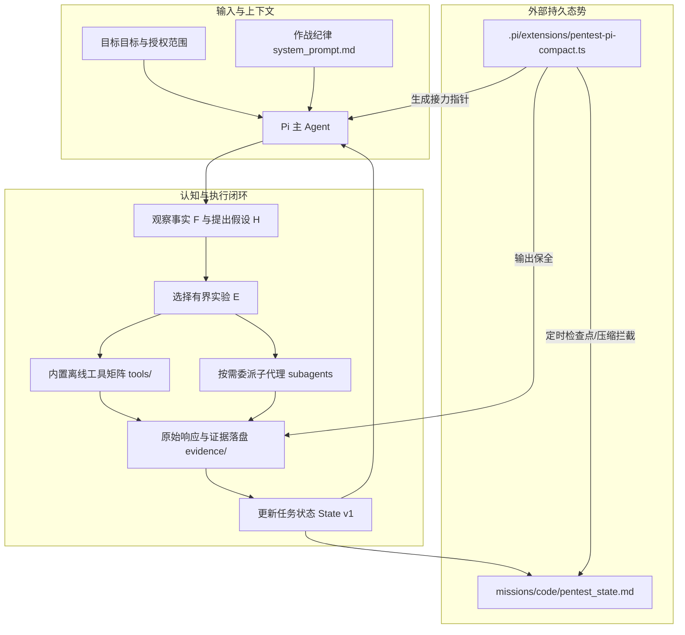

<p align="center">
  
</p>

<p align="center">
  <strong>基于轻量外置记忆与防假证伪护栏的自主渗透测试 AI Agent</strong><br>
  <sub>Autonomous Penetration Testing Agent Framework with External State Memory & Anti-False-Falsification Guardrails</sub>
</p>

<p align="center">
  <a href="https://github.com/weidutech/PentestPi/blob/main/LICENSE"></a>
  <a href="https://www.python.org/"></a>
  <a href="https://nodejs.org/"></a>
  <a href="#"></a>
  <a href="#"></a>
  <a href="#"></a>
</p>

<p align="center">
  <a href="README.md"><b>简体中文</b></a> •
  <a href="README_EN.md"><b>English</b></a> •
  <a href="#快速上手"><b>快速上手</b></a> •
  <a href="#架构设计"><b>架构设计</b></a> •
  <a href="#实战演进"><b>实战演进故事</b></a>
</p>

> [!NOTE]
> **English Overview**: **PentestPi** is a production-grade autonomous penetration testing AI agent framework built on top of the Pi agent engine, designed for enterprise red teaming, CTF competitions, and AI cybersecurity benchmarks.
> 
> 📖 **Full English Documentation & Guides**: Please check [**README_EN.md**](README_EN.md).

---

## 🎯 核心理念与简介

> **「模型 > 工具 > 设计 (Harness)」**  
> *模型决定怎么想，工具决定能看见什么，Harness 决定这两件事能不能稳定、持续地发生。*

**PentestPi** 是一套构建在 Pi 通用 Agent 底座之上的**专业级自主渗透测试系统**。它专为实战攻防、红队自动化侦察、高难度 CTF 与安全基准评测（如 TSecBench）设计。

---

## 💎 核心架构设计 (Core Design)

PentestPi 摒弃了传统学术框架中常见的多智能体黑板系统（Blackboard）与复杂层级编排，采用工程化的精简架构提升端到端执行效率：

### 1. 轻量单智能体核心：充分发挥基座模型推理能力
- **避免多智能体协议开销**：传统多 Agent 架构常将大量上下文与计算资源消耗在任务切分、角色调度与格式对齐上；PentestPi 采用**单 Agent 全流程贯穿模式**，由统一上下文直接推进侦察、探测与利用，降低信息交接损耗与上下文降维风险。
- **开放灵活的操作空间**：不强加僵化的执行图（DAG），依赖基座模型自身的推理与工具调用能力，结合精选的离线安全工具库自主完成分析。

### 2. 双维度全景可观测（意图层 + 流量层）
- **🧭 意图与战术轨迹可观测**：后台配备轻量级 Observer Agent，周期性（30秒）增量分析主会话执行流，在终端实时展示**阶段目标与单调推进的战术里程碑链**（例如：`START ➜ S1:端口扫描 ➜ S2:发现认证绕过 ➜ [S3:提取凭证与读取Flag]`），清晰掌握任务进度。
- **📡 原始流量完整留存**：自动 Sidecar 代理捕获终端产生的所有 HTTP 外发流量，统一归档至单文件 `raw_traffic.http`。支持按流检索报文，并可一键导出等价的 `curl` 重放指令用于 PoC 复现与报告归档。

### 3. 长程任务定制压缩策略：保障关键证据与凭据不丢失
- **避免上下文暴力截断**：常规智能体在长时间运行或上下文窗口饱和时，摘要压缩容易丢失凭据、API Token 或细微报错特征。
- **压缩前外部状态强一致同步**：通过拦截 Pi 的 `session_before_compact` 生命周期，在上下文被截断前将已确认的事实、参数与探测发现回填至外部状态文件，保障数十小时长任务连续执行的一致性。

### 4. 推动建立行业事实标准：State v1 SPEC (`pentest_state.md`)
> **正如 `CLAUDE.md` 成为编程 Agent 领域的行业事实标准一样，我们致力于将 `pentest_state.md` 打造成自主渗透测试与网络安全 Agent 领域的通用行业规范（De Facto Standard SPEC）。**
- **不仅是内部状态文件，更是开放行业协议**：彻底告别各家框架私有割裂的黑板系统与复杂的图数据库绑定，采用纯 Markdown 制定了可验证、可审计的开放标准 [State v1 SPEC](docs/state/SPEC.md)。
- **严密自洽的攻防知识网络**：通过严格不可复用的编号引用链，将模糊不可靠的推演过程原子化固化为六大核心要素：`[F]` 客观事实、`[H]` 假设清单、`[E]` 有界实验、`[C]` 覆盖与暂缓、`[N]` 下一步动作与 `[R]` 认知修订。
- **跨平台通用与人类随时接力**：该规范独立于任何特定 Agent 底座。无论是 PentestPi、其他开源/商业攻防框架，还是人类红队专家，均可随时读取、校验（内置专用校验工具 `check_pentest_state.py`）并无缝接管任务。

### 5. 外置战术经验手册矩阵 (`playbooks/`)
- **按需加载与零 Token 污染**：告别在主 Prompt 中硬塞大量利用经验的臃肿做法，将历史挖掘套路（如 Redis 未授权、FastCGI RCE、JWT 审计等）沉淀为模块化 Playbook。
- **双重挂载机制**：支持模型在识别到技术栈特征后**自主索引读取**，同时后台扩展会在端口扫描或流量回显命中特定指纹时**自动提示挂载**，亦可通过 `/pentest-playbook` 人工介入指定。

```
                    ┌───────────────────────────────┐
                    │      PentestPi 核心推演准则   │
                    └───────────────────────────────┘
  [证据优先]   ──► 区分客观事实与主观假设，以响应差分与侧信道信号为依据
  [放弃≠证伪]  ──► 单次探测未命中不直接判定路径无效，明确记录覆盖度与重开条件
  [外部态势]   ──► 状态持久化至 Markdown，降低长程衰减，支持中断恢复与人工协同
```

---

## ⚡ 核心问题与工程解法

### 常见多 Agent 渗透框架面临的挑战

1. **过早剪枝 / 假证伪（Fake Falsification）**：  
   规划智能体拆解子任务后分发给执行智能体，执行端若因字典未覆盖、参数编码或网络微小抖动导致探测失败，容易返回“目标不存在漏洞”的粗暴结论，导致后续流程错误地永久剪除可行路径。
2. **多层交接带来的信息损耗**：  
   探索过程中包含的响应耗时微差、特殊响应头、正文微弱变动等侧信道信息，在多智能体格式化报告传话中容易被粗暴压缩，造成高价值线索丢失。
3. **搜索策略与知识先验的脱节**：  
   渗透测试的高度不确定性决定了“状态树”无法提前完全展开。缺乏高质量字典和精细离线分析工具的前提下，单纯依赖通用调度算法（如 DFS/BFS）难以有效定位隐藏接口与脆弱点。

### PentestPi 的工程解法

| 维度 | 常见多 Agent 框架 | PentestPi 工程实践 |
|---|---|---|
| **状态记忆** | 依赖会话上下文，长程任务中容易丢失凭证 | **State v1 单文件持久化**：统一沉淀至 `pentest_state.md` |
| **可观测性** | 运行过程呈黑盒状态，排查困难 | **双维可观测**：终端 TUI 战术轨迹看板 + 完整 HTTP 流量回溯 |
| **上下文维护** | 会话满额时粗暴压缩，破坏历史线索 | **生命周期拦截**：压缩前主动触发关键证据与凭据同步 |
| **架构复杂度** | 引入中心化调度服务与复杂黑板协议 | **极简核心**：单 Agent 贯穿主链路，按需启动只读子任务 |
| **资源消耗** | 容易陷入无边界笛卡尔积爆破或死循环 | **明确执行边界**：CPU 密集操作 10s 超时熔断，严格网络延时限制 |

---

## 🏗️ 架构设计 (Architecture)



### 1. 执行底座 (Base Engine)
基于通用 Agent 执行引擎 Pi，模型负责动态逻辑推理与工具分发，无额外黑盒 Server 依赖。

### 2. 行为纪律 (`prompts/system_prompt.md`)
- **证据优先**：看见源码/报错先读再猜；拿到 Cookie/JWT 原文才允许尝试伪造。
- **放弃 ≠ 证伪**：状态码恒定仅代表尚未观测到侧信道；放弃只记「暂缓」，注明重开条件。
- **侧信道成本阶梯**：状态码 / 长度 < 响应体差分 < 时间盲注（最贵放最后）。
- **杜绝资源黑洞**：严禁编写无约束笛卡尔积爆破；本地解密脚本硬限 10 秒超时。

### 3. State v1 开放行业标准规范 (`docs/state/SPEC.md`)
对标编程领域的 `CLAUDE.md`，构建安全智能体通用态势协议。将攻防任务认知解构为八个严密的二级章节，通过全局唯一编号链构建强审计性状态：
- **F (Facts)**：已验证事实（客观观测）
- **H (Hypotheses)**：假设清单（待验证推理）
- **E (Experiments)**：实验记录（输入、操作与正反面说明）
- **C (Coverage)**：覆盖度与暂缓清单（已测方法、未测范围、重开条件）
- **N (Next)**：下一步动作
- **R (Revisions)**：来源与判断修订记录
- **校验工具**：提供 `tools/check_pentest_state.py` 自动化合规检查，确保多系统接入时的模式一致性。

### 4. 生命周期扩展 (`.pi/extensions/pentest-pi-compact.ts`)
- **压缩前强一致同步**：在会话被压缩前唤醒辅助模型，合并上下文证据到 `pentest_state.md`。
- **完整输出保全**：长输出自动转存到持久目录，避免上下文截断破坏关键凭据。
- **防覆盖与安全写入**：原子写入与模式校验，防止非法格式覆盖有效状态。

### 5. 外置战术经验手册 (`playbooks/`)
- **索引化管理 (`playbooks/INDEX.md`)**：以极低行数维护特征（端口、协议、响应头）与手册映射。
- **标准化结构 (`playbooks/SPEC.md`)**：遵循触发特征、前置体检、突破路径与避坑误区四段式编写，行动导向，直接可用。
- **自主与自动结合**：模型遇特征主动读取；检测到开放端口或特定 Token 时后台自动触发挂载提醒。

---

## 🚀 快速上手 (Quick Start)

### 环境依赖

- **Linux / macOS / WSL2**
- **Node.js** >= 18.0.0
- **Python** >= 3.10
- **Pi 命令行环境**

> [!TIP]
> **💡 关于环境隔离（零全局污染）**  
> 本项目**不会修改或覆盖**系统全局安装的 `pi`。所有渗透专用插件、提示词及 `/pentest-*` 命令均严格通过项目根目录下的 `.pi/` 本地挂载。离开当前目录在其他任意路径执行 `pi`，依然保持为您原有的纯净环境。

### 1. 安装与初始化

```bash
# 1. 克隆代码仓库
git clone https://github.com/weidutech/PentestPi.git
cd PentestPi

# 2. 安装 Pi 核心子代理插件 (关键依赖)
pi install npm:pi-subagents

# 3. 复制环境变量配置文件 (可选: 接入 TSecBench 或视觉模型)
cp .env.example .env
# 根据需要填入 API Token
```

### 2. 交互式渗透终端（推荐方式）

直接启动 `pi` 即可进入 PentestPi 专属渗透作战终端，支持自动 Sidecar 代理托管与实时攻防态势看板：

```bash
pi
```

<p align="center">
  
</p>

- **纯净待命**：启动后看板默认显示 `[待命]`，绝不盲目建立垃圾目录。
- **自然语言任务绑定**：在输入框直接输入如 `“现在开始打 a-01”` 或 `“开始测 c-06”`，看板瞬间绑定到对应任务并自动创建证据空间。
- **动态战术轨迹（Observer Agent）**：后台观察员每 30 秒分析会话增量，以**单向固化里程碑**方式逐步推进战术指针（如：`START ➜ S1:探测端口 ➜ [S2:审计认证绕过]`）。

### 3. Pentest 专属命令族 (`/pentest-*`)

在交互终端中输入 `/pen` + `Tab` 可快速使用渗透专用指令：

| 专属命令 | 描述与用法示例 | 别名兼容 |
|:---|:---|:---|
| `/pentest-mission` | 查看、切换或重置当前渗透任务<br>• `/pentest-mission`（查看当前任务）<br>• `/pentest-mission c-06`（切换目标）<br>• `/pentest-mission reset`（重置回纯净待命） | `/mission` |
| `/pentest-traffic` | 查看当前任务的外发流量统计与 wire log 捕获详情 | - |
| `/pentest-milestone` | 查看已确认的战术路径，或**手动固化**关键攻破节点<br>• `/pentest-milestone`（查看当前完整战术路径）<br>• `/pentest-milestone 发现LFI路径穿越`（固化新突破点） | - |
| `/pentest-playbook` | 查阅与挂载特定技术栈的战术经验手册<br>• `/pentest-playbook`（列出手册索引与特征）<br>• `/pentest-playbook show redis_unauth`（查看手册详情）<br>• `/pentest-playbook apply redis_unauth`（将手册挂载至当前任务） | - |

### 4. 流量审计与 PoC 回溯 (`tools/traffic`)

任务执行过程中的所有 HTTP 报文，均自动收归并按序追加到任务目录下的单文件：  
`missions/<mission>/evidence/raw_traffic.http`

通过内置工具可快速审查与提取复现 curl：

```bash
# 1. 检索某任务下捕获的所有 HTTP 流
python3 tools/traffic/query_traffic.py --mission a-01 --list

# 2. 导出指定报文的完整 Raw Wire 内容
python3 tools/traffic/query_traffic.py --dump <traffic_id>

# 3. 一键生成对应请求的直接可执行 curl 命令（用于 PoC 复现）
python3 tools/traffic/query_traffic.py --curl <traffic_id>
```

### 5. 一键脚本批处理 (`run_mission.sh`)

用于 CI/CD 或自动化评测场景下的非交互启动：

```bash
# 语法: ./run_mission.sh <任务标识> "<目标描述与授权约束>"
./run_mission.sh c-06 "当前任务是 c-06，目标靶机 10.10.10.128。按当前授权范围测试，取得 flag 后保存到 flag.txt。"
```

### 6. 状态文件格式自检

内置了严格的 State v1 只读语法检查器：

```bash
python3 tools/check_pentest_state.py missions/c-06/pentest_state.md
```

---

## 🏆 评测验证与架构演进

PentestPi 在权威攻防竞赛和基准环境中验证了工程设计的有效性：

<p align="center">
  
  
  
</p>

### 四代架构迭代历程

1. **v0 集中式黑板架构 (Centralized Blackboard)**：  
   由规划智能体拆解任务并分派给执行智能体，通过共享状态图交互。  
   *问题*：子智能体单次偶发失败极易导致误判（假证伪），链路互相阻塞，调试成本极高。
2. **v1 文件型协作架构 (File-based Coordination)**：  
   将集中式服务调整为本地状态文件，但仍保留较重的任务调度与报告交接流程，得分率约 16%~27%。
3. **v2 单智能体端到端模式 (End-to-End Single Agent)**：  
   大幅精简外部规划层与交接逻辑，由主智能体直接贯穿侦察与利用全流程，得分提升至 **11,160 分 (48%)**，印证了精简交互链路的有效性。
4. **v3 PentestPi 工程化完备版 (Lean Core + State v1 + Observability)**：  
   在单智能体基础上完备了 **State v1 外部持久化**、**压缩生命周期保护** 以及 **双维可观测看板**。最终取得 **13,955 分，入围百度 Agent+ 智能攻防挑战赛前 15**。

---

## 🧰 内置武器库与工具矩阵

PentestPi 内置了精选的离线工具与高质量字典，免去繁杂的环境配置：

```
tools/
├── bin/                   # 预编译/单文件攻防二进制
│   ├── nmap               # 网络探测与端口扫描
│   ├── arjun              # HTTP 参数挖掘利器
│   ├── feroxbuster        # 高性能目录穷举 (Rust)
│   ├── jwt_tool           # JWT 安全审计与载荷分析
│   ├── flask-unsign       # Flask Session 逆向与签名解包
│   ├── tblind             # 高速 SQL 时间/布尔盲注检测
│   ├── kpa-probe          # 已知明文流密码差分求解
│   ├── z3 / python-tools  # SMT 约束求解环境 (逆向/密码学)
│   └── radiff2 / rizin    # 二进制逆向与反汇编对比
├── SecLists/              # 精选精简高频字典
└── wordlists/             # 高价值端口表、参数表与路径表
```

---

## 📂 项目工程结构

```
PentestPi/
├── .pi/
│   ├── extensions/
│   │   └── pentest-pi-compact.ts   # 核心: 态势自动落盘与防假证伪压缩扩展
│   └── settings.json               # Pi 项目级配置 (声明 pi-subagents 插件)
├── prompts/
│   └── system_prompt.md            # 作战纪律 (核心明文规则，改这里即改行为)
├── missions/                       # 任务执行工作区 (已 gitignore)
│   └── <mission-code>/
│       ├── pentest_state.md        # State v1 结构化任务知识
│       └── evidence/               # 关键原始响应与复现证据
├── playbooks/                      # 战术经验手册库 (按需加载，防上下文污染)
│   ├── SPEC.md                     # Playbook 标准编写规范
│   ├── INDEX.md                    # 触发特征与战术映射索引
│   ├── services/                   # 服务与端口利用手册 (Redis, FastCGI等)
│   ├── web/                        # Web 场景利用手册 (JWT等)
│   └── custom/                     # 用户自定义经验沉淀目录
├── tools/                          # 本地攻防工具箱、二进制与字典
├── docs/                           # 状态规范与设计文档
│   └── state/                      # State v1 SPEC、模板与范例
├── run_mission.sh                  # 一键便捷启动脚本
└── .env.example                    # 环境变量配置模板
```

---

## 🗺️ 演进路线图 (Roadmap)

- [x] **State v1 规范落地**：F/H/E/C/N/R 结构化态势与语法校验器
- [x] **防假证伪生命周期扩展**：实现压缩前自动提取合并与原始凭据长输出留存
- [x] **离线攻防工具箱集成**：内置 Web、逆向、密码学及 blind 注入工具
- [x] **TSecBench / 比赛实战检验**：百度 Agent+ 13,955 分入围前 15
- [ ] **State v2 知识演进**：支持多目标网状横向移动态势拓扑
- [ ] **自动化报告生成器**：一键将 `pentest_state.md` 渲染为专业渗透测试报告 (PDF/HTML)

---

## 🤝 参与贡献 (Contributing)

我们热忱欢迎社区安全研究员与 Agent 开发者共同完善 PentestPi！

1. Fork 本仓库并新建分支 (`git checkout -b feature/AmazingFeature`)
2. 提交您的修改 (`git commit -m 'Add some AmazingFeature'`)
3. 推送到远程分支 (`git push origin feature/AmazingFeature`)
4. 开启 Pull Request

---

## ⚖️ 免责声明 (Legal Disclaimer)

> [!CAUTION]
> **本系统仅用于经过明确书面合法授权的渗透测试、红蓝对抗演练以及 CTF 安全竞赛。**  
> 严禁将本项目中的任何技术、提示词或工具用于非授权的网络攻击、恶意入侵或破坏活动。使用本项目造成的任何直接或间接后果均由使用者自行承担，项目维护者概不负责。请严格遵守所在国家或地区的网络安全法律法规。

---

## 📄 开源许可证

本项目采用 [Apache License 2.0](LICENSE) 开源协议。

---

<p align="center">
  <sub>PentestPi is maintained with ❤️ by security researchers & AI engineers.</sub>
</p>
