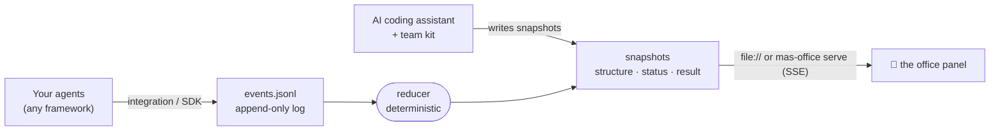

<div align="center">


# MAS Office

### A live office for AI agent teams.

Design a team of agents, watch every role work at its desk, and read a result whose sources independent checkers have graded.<br>
Runs in the AI tools you already use: Claude Code · Codex · Gemini CLI · OpenAI Agents SDK · LangGraph · Claude Agent SDK · your own Python or JS.

[](https://github.com/weixijia/mas-office/actions/workflows/ci.yml)
[](https://www.npmjs.com/package/mas-office)
[](LICENSE)
[](spec/README.md)
[](#-quick-start)
[](CONTRIBUTING.md)
[](https://github.com/weixijia/mas-office/stargazers)

[**Website & live examples**](https://www.xijiawei.com/mas-office/) · [**Why**](#-why-mas-office) · [**Quick start**](#-quick-start) · [**Team kit**](#-no-code-team-kit) · [**Integrations**](#-plug-in-your-framework) · [**Protocol**](spec/README.md) · [**Roadmap**](#%EF%B8%8F-roadmap) · [**Contributing**](CONTRIBUTING.md) · [**中文**](README.zh-CN.md)


</div>

---

Most multi-agent tools help you run *more* agents. MAS Office helps you run them as a **team you can trust**: you design the roles and lock them, finders work in parallel, checkers with a clean context look for mistakes, and the Lead writes an answer where every claim links to a source graded A to D. The whole time, each agent sits at a desk in a live office, so you can see who is working, who handed what to whom, and what a checker just caught.

> **Where it stands (v0.2.2).** Today MAS Office is a live office view, an open event protocol with JS and Python SDKs, and a no-code team kit that turns Claude Code, Codex, Gemini CLI or Antigravity into the Lead of your team. Next, it starts and steers real Claude Code and Codex sessions itself, with one inbox for everything that needs you. See the [roadmap](#%EF%B8%8F-roadmap).

```bash
npx mas-office demo        # 30 seconds, no API key, nothing to set up
```

## ✨ Why MAS Office

| | | |
|---|---|---|
| 🧭 **A team you design and lock** | You agree the roles, what runs in parallel and who checks whom. The locked design runs the same way every time, and you can run it again next week. | today |
| 🔍 **Every source checked and graded** | Checkers start with a clean context, flag problems and grade each source: **A** can be bought or run · **B** study with data · **C** demo or marketing · **D** opinion. | today |
| 🔁 **Follow-ups re-run only the roles needed** | Ask about the result and the Lead sends back just the roles your question needs. Each answer joins the result as a new round. | today |
| 🏢 **A picture, not a log** | Desks, handoff paths, parallel stages, flags and a lounge for agents that are done. Readable by your PM, your class, or you at 2 a.m. | today |
| 🔌 **Any framework, an open protocol** | Integrations for the OpenAI Agents SDK, LangGraph, the Claude Agent SDK and Claude Code hooks; anything else appends JSON lines. Zero dependencies, no account, no cloud. | today |
| 📥 **One inbox for what needs you** | Tool approvals, decisions, checker flags and stage gates from every agent, answered in place, with how long each has waited. | next |
| 🎮 **Steer any agent from its desk** | Click a worker to read its live transcript and talk to its real Claude Code or Codex session, or take over its terminal. | next |

## 🆚 Where it fits

MAS Office does not replace the tools below; it sits on top of them or next to them.

| You may already use | It is great at | MAS Office adds |
|---|---|---|
| Claude Code or Codex subagents and workflows | running many agents from one session | a team you design and lock, across vendors, with sources graded by independent checkers and an office you can watch |
| Parallel agent orchestrators (Orca, Conductor, Gas Town, Claude Squad) | many independent tasks side by side | roles that check each other, and (next) one inbox for everything that needs you |
| Agent office views (pixel-agents and others) | coding sessions drawn as characters | team meaning: stages, handoffs, checker flags, graded evidence, follow-up rounds |
| Deep Research products | a cited report from one prompt | a team you shape and rerun, where checkers verify the sources instead of only listing them |
| Tracing platforms (Langfuse, Phoenix, AgentOps) | prompt, token and latency debugging | the team-level view for people who will never read a trace; every event can carry trace ids, so use both |

## 🚀 Quick start

**See it** (Node ≥ 18):

```bash
npx mas-office demo
```

A five-agent team plans a weekend in Lisbon: two finders search in parallel, a budget checker catches a problem, a planner takes over, a helper is spawned at runtime, and the lead writes the result.

**Run your own team without code** — see the [team kit](#-no-code-team-kit):

```bash
npx mas-office init --kit my-team
```

**Report a run from Python** (≥ 3.10; PyPI release coming soon):

```bash
pip install "mas-office @ git+https://github.com/weixijia/mas-office#subdirectory=packages/python"
```

```python
from mas_office import Office

with Office(workspace="./runs") as office:
    run = office.project("headphone-deals", title="Headphone deals").run()
    finder = run.agent("finder", name="Retail finder", emoji="🔎")
    finder.working("Searching Currys", progress=30)
    finder.source(id="currys", title="Sony XM6 — Currys", url="https://www.currys.co.uk/", evidence="A")
    finder.handoff("lead")
    finder.done()
    run.result(markdown="## Shortlist\n- Currys — £279")
    run.finish()
```

**Or from JavaScript / TypeScript:**

```bash
npm install mas-office
```

```js
import { Office } from 'mas-office';

const office = new Office({ workspace: './runs' });
const run = office.project('headphone-deals', { title: 'Headphone deals' }).run();
const finder = run.agent('finder', { name: 'Retail finder', emoji: '🔎' });
finder.working('Searching Currys', { progress: 30 });
finder.done();
run.result({ markdown: '## Shortlist\n- Currys — £279' });
run.finish();
await office.close();
```

**Then open the office:**

```bash
npx mas-office serve ./runs --open     # live updates over Server-Sent Events
```

Running agents in several processes or machines? Start `serve` once and point every SDK at it: `Office(url="http://127.0.0.1:4747")`.

## 🤖 No-code team kit

```bash
npx mas-office init --kit my-team
```

Open `my-team` in Claude Code, Codex, Gemini CLI or Antigravity and say *"Read SETUP.md and follow it."* Your assistant becomes the **Lead**:

1. **Describe** — it interviews you about the task and writes checkable requirements.
2. **Design** — it proposes a team: who finds, who checks, what runs in parallel. Reshape it in plain words.
3. **Lock** — each role gets its own job description; the office gives it a desk.
4. **Run** — each role runs as a separate subagent with a clean context while the office shows every step. The result slides out over the office, every claim linked to a graded source card.
5. **Follow up** — ask about the result; the Lead sends only the roles your question needs back to work and adds the answer as a new round.

In Claude Code, choose **"Yes, I trust this folder"** when you first open it: only a trusted folder applies the kit's settings. They give you:
- **The team in your terminal**: the status line shows who is working, who is done and what was flagged, with a link to the office.
- **A real browser for the roles** (`mas-browser`): a Chrome window with a temporary profile and none of your logins, confined to public addresses, for pages that block simple fetches. It needs Google Chrome.

This is also the engine behind the classroom edition, [**awesome-mas**](https://github.com/weixijia/awesome-mas).

## 🔌 Plug in your framework

<details open>
<summary><b>OpenAI Agents SDK</b> — one line</summary>

```python
from mas_office.integrations.openai_agents import install

run = Office(workspace="./runs").project("support", title="Support desk").run()
install(run)                                   # a TracingProcessor; OpenAI's own traces keep working
result = Runner.run_sync(triage_agent, "My order never arrived")
run.result(markdown=str(result.final_output)); run.finish()
```
Agents, function tools and handoffs become desks, tool uses and handoff paths.
</details>

<details>
<summary><b>LangGraph</b> — wrap your stream</summary>

```python
from mas_office.integrations.langgraph import stream_to_office

stream = graph.stream(inputs, stream_mode=["tasks", "updates", "custom"], subgraphs=True)
for chunk in stream_to_office(stream, run):    # chunks pass through unchanged
    ...
```
Nodes become agents (subgraph nodes get their parent); `get_stream_writer()({"say": "Reading 3 papers"})` sets the status line.
</details>

<details>
<summary><b>Claude Agent SDK</b> — hooks</summary>

```python
from mas_office.integrations.claude_agent_sdk import office_hooks

options = ClaudeAgentOptions(agents={...}, hooks=office_hooks(run))
async for message in query(prompt="Review this repo", options=options):
    ...
```
Subagents get desks; tool calls, permission prompts and failures show up live.
</details>

<details>
<summary><b>Claude Code</b> — zero code, just hooks</summary>

```bash
npm install -g mas-office
```
Add `mas-office hook claude-code --workspace ./.mas` as a hook command in `.claude/settings.json` ([full snippet](docs/integrations.md#claude-code-hooks-no-code)), then `mas-office serve ./.mas --open` and watch Claude Code and its subagents work.
</details>

<details>
<summary><b>Anything else</b> — the protocol</summary>

Append JSON lines to `<project>/mas/events.jsonl` (or `POST` them to `mas-office serve`):

```json
{"v":"0.1","seq":3,"ts":"2026-11-06T10:00:03Z","type":"handoff","agentId":"researcher","data":{"to":"critic"}}
```
That's the whole contract: [`spec/README.md`](spec/README.md). Validate with `npx mas-office validate`.
</details>

| Producer | Status | Guide |
|---|---|---|
| OpenAI Agents SDK (Python) | 🧪 experimental | [docs](docs/integrations.md#openai-agents-sdk-python) |
| LangGraph (Python) | 🧪 experimental | [docs](docs/integrations.md#langgraph-python) |
| Claude Agent SDK (Python) | 🧪 experimental | [docs](docs/integrations.md#claude-agent-sdk-python) |
| Claude Code (hooks) | 🧪 experimental | [docs](docs/integrations.md#claude-code-hooks-no-code) |
| AI coding assistants via `AGENTS.md` (Claude Code, Codex, Gemini CLI, Antigravity, Cursor…) | ✅ stable | [kit](kit/AGENTS.md) |
| CrewAI · AG-UI · OpenTelemetry · Google ADK · Mastra · CAMEL | 🙋 [help wanted](https://github.com/weixijia/mas-office/issues?q=is%3Aissue+is%3Aopen+label%3A%22help+wanted%22) | [how to write one](CONTRIBUTING.md#2-framework-integrations) |

## 🧠 How it works



- **Events in, pictures out.** Producers report what *happened*; the reducer computes what the panel shows *now*. Producers never have to track UI state.
- **Same answer everywhere.** The JS and Python reducers are checked against the same hand-written [conformance cases](spec/conformance/), so a log replays identically in both.
- **Runs you can replay.** Each project is an append-only `events.jsonl`. Replay it, diff it, commit it, attach it to a bug report.
- **Next: both directions.** Protocol 0.2 adds requests that wait for a person (approvals, decisions, checker flags) and commands back to the agents (send a message, answer, assign, interrupt), so the office can steer the team, not only show it.

Details: [architecture](docs/architecture.md) · [protocol](spec/README.md) · [why it is designed this way](docs/research/prior-art.md).

## 🧰 The CLI

| Command | What it does |
|---|---|
| `mas-office demo` | a simulated team in a temp workspace, served and opened |
| `mas-office serve [dir]` | panel at `/office/`, workspace read-only, `POST /v0/events`, live `GET /v0/stream` |
| `mas-office init [dir] [--kit]` | a new workspace with the panel (and the team kit) |
| `mas-office validate [path]` | check snapshots and event logs against the JSON Schemas |
| `mas-office reduce <project>` | rebuild snapshots by replaying the event log |
| `mas-office export --ag-ui <project>` | the log as AG-UI events (experimental) |
| `mas-office hook claude-code` | turn Claude Code hook input into events (experimental) |

## 🗺️ Roadmap

Next, MAS Office **drives** the team, not only shows it. Each role runs in the unmodified Claude Code or Codex that you sign in to yourself; MAS Office never asks for, reads or stores your login. It plans, schedules and checks the team.

- [x] **v0.1–v0.2** — protocol, JS and Python SDKs, CLI with a live server, the office panel, four integrations, the team kit, result drawer, follow-up rounds, a browser for roles, the team in Claude Code's status line
- [ ] **S0** — start and steer real Claude Code and Codex sessions from the office: see one blocked, click it, approve or reply, watch it continue
- [ ] **S1** — protocol 0.2, the inbox, chat with any agent from its desk, a raw-terminal tab you can take over
- [ ] **S2** — a Lead that schedules the team from a locked design, with per-role permissions enforced in each session
- [ ] **S3** — claim-by-claim verification (claim → source → link check → checker verdict) and an evaluation against a single agent with the same budget
- [ ] **S4** — a user study of supervising agent teams, and a desktop app

Full list: [ROADMAP.md](ROADMAP.md). Have an idea? [Start a discussion](https://github.com/weixijia/mas-office/discussions).

## ♻️ Built on open source

We would rather integrate good work than rewrite it. [`references/manifest.json`](references/manifest.json) pins the open-source projects we learn from, and [`docs/design/reuse-map.md`](docs/design/reuse-map.md) records, for each part of MAS Office, which files of which project to read and whether we depend on it, adapt it or only take the idea. Adapted code keeps its attribution in [`THIRD_PARTY_NOTICES.md`](THIRD_PARTY_NOTICES.md).

## 💡 Made for

- **Research and decisions** — price comparisons, trip plans, literature and feasibility checks, product and policy questions, where a wrong fact costs you.
- **Demos and teaching** — show what a multi-agent system actually does, to people who will never read a trace. The [classroom edition](https://github.com/weixijia/awesome-mas) lets non-programmers design and run their own teams.
- **Building and debugging** — spot the agent that never hands over, the stage that runs serially by accident, the checker that never fires.
- **Research on human–agent teams** — replayable, diffable logs of agent collaboration in one simple format.

## 🤝 Contributing

MAS Office is built to be extended — a new framework integration is usually **one file and a test with fake payloads**. Look for [`good first issue`](https://github.com/weixijia/mas-office/issues?q=is%3Aissue+is%3Aopen+label%3A%22good+first+issue%22) and [`help wanted`](https://github.com/weixijia/mas-office/issues?q=is%3Aissue+is%3Aopen+label%3A%22help+wanted%22), then read [CONTRIBUTING.md](CONTRIBUTING.md). Coding agents start from [CLAUDE.md](CLAUDE.md). Spec changes follow a lightweight [RFC process](spec/rfcs/README.md). We use the DCO (`git commit -s`), not a CLA.

```bash
git clone https://github.com/weixijia/mas-office && cd mas-office
npm install && npm test                                   # JS SDK, CLI, panel
cd packages/python && pip install -e '.[dev]' && pytest   # Python SDK
node references/fetch.mjs                                 # optional: the pinned reference code
```

Please follow the [Code of Conduct](CODE_OF_CONDUCT.md) and report vulnerabilities privately ([SECURITY.md](SECURITY.md)).

If MAS Office helps you, **a ⭐ helps other people find it.**

<a href="https://star-history.com/#weixijia/mas-office&Date">
  
</a>

<a href="https://github.com/weixijia/mas-office/graphs/contributors">
  
</a>

## 📖 Citation

If you use MAS Office in research or teaching, please cite it:

```bibtex
@software{wei2026masoffice,
  author  = {Wei, Xijia and {MAS Office contributors}},
  title   = {{MAS Office}: a live office for designing, watching and checking AI agent teams},
  year    = {2026},
  url     = {https://github.com/weixijia/mas-office},
  version = {0.2.2}
}
```

## 🙏 Acknowledgements

MAS Office grew out of [awesome-mas](https://github.com/weixijia/awesome-mas), a classroom kit for teaching multi-agent systems to people who don't write code. The event model borrows from [AG-UI](https://github.com/ag-ui-protocol/ag-ui), the [OpenTelemetry GenAI semantic conventions](https://github.com/open-telemetry/semantic-conventions-genai), [A2A](https://a2a-protocol.org) and LangGraph's event streaming. The idea of agents as little people at desks owes a lot to [pixel-agents](https://github.com/pixel-agents-hq/pixel-agents) and Stanford's [Generative Agents](https://github.com/joonspk-research/generative_agents). The next stage learns from many more open-source projects, listed in the [reuse map](docs/design/reuse-map.md). Fonts: Archivo and Red Hat Mono (SIL Open Font License).

## 📄 License

[MIT](LICENSE) © Xijia Wei and MAS Office contributors. Product names and logos are trademarks of their owners.
