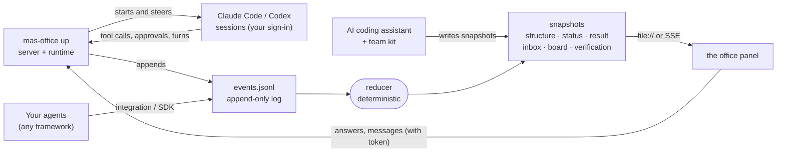

<div align="center">


# MAS Office

### An AI team you design, can watch, can steer, and that checks its own work.

[](https://github.com/weixijia/mas-office/actions/workflows/ci.yml)
[](https://www.npmjs.com/package/mas-office)
[](LICENSE)
[](spec/README.md)
[](packages/node/README.md)
[](CONTRIBUTING.md)
[](https://github.com/weixijia/mas-office/stargazers)

[**Website**](https://www.xijiawei.com/mas-office/) · [**Quick start**](#quick-start) · [**Design a team**](#design-and-lock-a-team) · [**Run a team**](#run-a-team) · [**Checking**](#how-answers-are-checked) · [**Other frameworks**](#show-any-other-frameworks-team) · [**CLI**](#cli) · [**Limits**](#limits-today) · [**Roadmap**](ROADMAP.md) · [**中文**](README.zh-CN.md)

</div>

Every role in the team is a real Claude Code or Codex session on your computer, signed in by you. You design the roles and lock the design; plain code schedules the work and enforces each role's tools. Tool approvals, questions, stuck roles, checker flags and stage checkpoints from every session land in one "Needs you" inbox, where you answer them in place. The answer comes back with each claim tagged with its sources, each link checked and each claim judged by a checker with a clean context.

The first use case is research and decision tasks: price comparisons, trip plans, literature and feasibility checks, product and policy questions.

<p align="center">
  
  <br>
  <sub>The "Needs you" inbox with an approval waiting. Screenshots on this page come from the real panel, server and engine; the "Headphone deals" data is made up.</sub>
</p>

> **Status (v0.3.0).** `mas-office up` runs a locked team on real Claude Code and Codex sessions. The office view, the event protocol with its JS and Python SDKs, and the no-code team kit work as before. Not done yet: a raw-terminal tab you can take over, evaluation runs, a desktop app. See [Limits today](#limits-today).

## Quick start

**Run a team on real sessions** (Node ≥ 18.14):

```bash
mkdir ~/mas-work && cd ~/mas-work
npm install mas-office mas-office-runtime        # Node 18.14 or later
claude auth login                                # you sign in yourself
codex login                                      # the example's checker runs on Codex
mkdir -p deals/mas
curl -fsSL https://raw.githubusercontent.com/weixijia/mas-office/main/examples/price-compare/mas/structure.js -o deals/mas/structure.js
npx mas-office team check deals
npx mas-office up . --project deals --open --task "Find the best UK price for Sony WH-1000XM6 headphones"
```

`up` reports whether Claude Code and Codex are installed and signed in, then prints a panel link that carries an access token (`--open` opens it). The example design is already locked; if you change it, run `npx mas-office team lock deals` again. Keep workspaces outside any folder with a `CLAUDE.md` you don't want the roles to read: Claude Code loads parent `CLAUDE.md` files. Below, `mas-office` means `npx mas-office` in that folder (or the command itself after `npm install -g mas-office`).

**Watch a simulated team** (Node ≥ 18, no sign-in):

```bash
npx mas-office demo
```

A five-agent team plans a weekend in Lisbon: two finders search in parallel, a budget checker raises a problem, a planner takes over, and the Lead writes the result.

<details>
<summary>The <code>demo</code> command (recorded with the 0.2 viewer)</summary>
<br>

</details>

**From a clone** (for contributors): `git clone https://github.com/weixijia/mas-office && cd mas-office && npm install` links both packages, and `node packages/node/bin/mas-office.js` stands for `mas-office`. Keep workspaces outside the clone, because Claude Code would load this repository's `CLAUDE.md`.

## Design and lock a team

A team is `<project>/mas/structure.json` (or its `.js` twin). Team design v2 adds optional fields to the protocol's `structure`: a `backend` per role, each role's tools with `allow`, `ask` or `deny`, reviewers and review rounds, gates, the approvals the Lead may give, a `budget` and verification thresholds. A 0.1 structure is still valid. Part of [`examples/price-compare`](examples/price-compare/mas/structure.js):

```jsonc
{
  "lead": {"id": "lead", "name": "Lead", "backend": "claude-code",
           "delegate": [{"effect": "allow", "kind": "approval", "tools": ["web search"]}]},
  "budget": {"maxParallel": 2},
  "groups": [{"id": "A", "label": "Search in parallel", "after": null},
             {"id": "B", "label": "Check", "after": "A"}],
  "roles": [
    {"id": "sony-deal-finder", "group": "A", "tools": ["web search"], "handsTo": "catch-checker", "…": "…"},
    {"id": "catch-checker", "group": "B", "backend": "codex", "tools": ["web search"],
     "reviewerOf": ["sony-deal-finder", "similar-model-finder"], "cleanContext": true,
     "review": {"maxRounds": 2, "onExceed": "ask-human"}, "handsTo": "lead", "…": "…"}
  ],
  "gates": [{"id": "g-offers", "after": "A", "kind": "stage",
             "title": "Look at the offers before they are checked", "blocking": true}],
  "verify": {"claims": true, "urlHealth": true}
}
```

**Tools** come from a fixed vocabulary; anything else is refused at lock:

| Word | What the role gets |
|---|---|
| `web search` | web search and page fetches |
| `browse the web` | the kit's role browser (`mas-browser`) |
| `read my files` | your own files in the project's `raw/` folder |
| `write notes` | writing its own files (allowed by default) |
| `run commands` | shell commands |
| `mcp:<server>` | an MCP server listed in the workspace `.mcp.json` |
| `cli:<prefix>` | commands starting with a prefix listed in `home/commands.json` |

Each entry is a word (effect `allow`) or `{"name": "…", "effect": "allow" | "ask" | "deny"}`. Every role can read the project folder (except `raw/` without `read my files`) and can write only its own files: `outputs/work/<role>*.md` and source cards in `sources/`. Some rules hold whatever the design says: credentials are never read; instruction and settings files (`CLAUDE.md`, `AGENTS.md`, `.claude/`, `.mcp.json`, …) are never written; local and private addresses are never fetched; a Grep or recursive search over the whole project folder is refused, so a role passes a narrower folder such as `outputs/` or `sources/`.

**Delegation** (`lead.delegate`): the first matching rule decides an approval. `allow` approves it by policy, `lead` lets the Lead decide within the tools and roles you listed, `human` (and no match) sends it to you. Gates, checker flags and requests marked for a person always come to you.

**Check, lock, show:**

```bash
mas-office team check <project>   # every problem in the design (exit 1 on errors)
mas-office team lock <project>    # check, then set "locked" and a signature
mas-office team show <project>    # the design as Markdown: roles, tools, who may approve what
```

A run refuses a design that is not locked or that changed after it was locked. At run time each role's tools are compiled into its session's own options, and every tool call passes one decision point (`decideTool`): allowed, denied, or sent to the inbox.

## Run a team

```bash
mas-office up <workspace> --project <p> --task "…" [--max-parallel 3] [--open] [--exit]
```

`up` starts the panel server with the runtime attached. Without `--task`, start a run from the panel. With `--exit`, it stops when the run ends and exits 1 if the run did not finish. A run goes like this:

1. **Plan.** The Lead, itself a real session, reads the task and the team and returns a plan and a brief for each role. The scheduler is plain code and validates everything the Lead returns.
2. **Stages** run in the design's order; roles inside a stage run in parallel. At most 3 roles work at once by default (`--max-parallel`, 1–12). The limit is for the whole `up` process, across projects, and the Lead is not counted; a design's `budget.maxParallel` can lower it.
3. **Review.** A reviewer reads its targets' work with a clean context and accepts it, sends it back with a note, or escalates. After `review.maxRounds`, or on escalation, you decide. Nothing is accepted silently.
4. **Checkpoints.** A blocking gate holds the run where the design put it until you continue, send the stage back with a note, or stop the run.
5. **Write-up.** The Lead writes the answer to `outputs/result.md` with every claim tagged; the claims are then checked (see [below](#how-answers-are-checked)).
6. **Follow-ups.** Ask about the result in the panel: the Lead answers from the files or sends back only the roles your question needs, and the answer becomes a new round.

<p align="center">
  
  <br>
  <sub>A stage checkpoint: the check stage waits until you continue, send the stage back with a note, or stop.</sub>
</p>

**The inbox.** Everything that waits on a person, from every session: tool approvals, questions, decisions (a stuck role, whether to continue a run), checker flags and gates. Each item shows how long it has waited, what it holds up and what happens if you don't answer. The office shows the same items as raised hands on the desks. Approvals you delegated are decided by policy or by the Lead, which can still pass one on to you; each such decision is in the log with who made it.

- **Allow once, always allow, deny.** "Always allow" remembers exactly that call (same tool, same input) for that agent, in that run.
- **Keyboard.** `N` jumps to the next agent that needs you, `I` to the inbox, `A` / `D` allow or decline the focused request, `1`–`9` open a stage, `?` lists the keys.

**Steering an agent.** Click a desk to open its drawer: the live transcript, its outputs and a chat box into its real session. A message can *steer* (delivered at its next break), *queue* (after the current turn) or *interrupt*; a receipt shows what the session did with it. *Stop* ends the agent's turn.

<p align="center">
  
  <br>
  <sub>The agent drawer: transcript, outputs and a chat box into the real session, with a delivery receipt.</sub>
</p>

**Stalls and restarts.** A role with no progress for `budget.stallMinutes` (default 5) is nudged once; next the Lead picks a recovery (retry, a new brief, or ask you); after that you decide. Waiting for a person is not a stall. A run stops at `budget.maxRunMinutes` (default 90), on Stop or on Ctrl+C. If `up` is restarted while a run is unfinished, the inbox asks whether to continue it; finished roles are not run again and the run's time budget keeps counting. Requests the old process left open expire, and the agent asks again.

**Who may answer.** The panel link printed by `up` and `serve` carries a token. Only a browser opened from that link can answer requests, message agents or start runs; anywhere else (`file://`, the website, a static server) the panel is read-only. While `up` is running, decisions, verdicts, results and the other events the runtime owns can be posted only by the runtime or by the panel with its token, so a role's shell command cannot vouch for its own work.

**Sessions you opened yourself.** With [`mas-office hook claude-code`](docs/integrations.md#claude-code-hooks-no-code) installed, a permission prompt in your own Claude Code session also appears in the inbox. You answer it in your terminal; the panel only watches that session.

## How answers are checked

1. **Claims.** The Lead's answer wraps each statement in `<claim id="c3" src="currys-xm6,ebay-xm6">…</claim>`; the sources are the roles' source cards in `sources/`.
2. **Links.** Every source URL is checked by plain code, not a model: live, archived, dead or invented, or blocked by a bot wall. Private and local addresses are never fetched.
3. **Verdicts.** Checkers with a clean context, from the same or another vendor, judge each claim against its cited sources: supported, partial, contradicted or unknown. Sources are graded **A** (can be bought or run), **B** (study with data), **C** (demo or marketing), **D** (opinion).
4. **Flags.** When the design's `verify.flagWhen` thresholds are crossed (for example one contradicted claim), a flag opens in the inbox.
5. **In the result**, claims are highlighted by verdict; a line counts the checked claims and live links; "What the checkers caught" lists contradicted claims and work that reviewers sent back.

<p align="center">
  
  <br>
  <sub>A result with checked claims, and the card for one claim: who checked it, the verdict and the cited source.</sub>
</p>

`mas-office verify <project>` runs steps 1 and 2 on any answer, including one written by another tool, and points at statements with numbers, dates or superlatives that carry no claim tag. `--no-network` only parses and counts. When the project has an event log, the findings are added to it and the panel shows them.

"Supported" means a checker judged that the cited page supports the claim; it does not mean the claim is true. Whether a team gives better answers than a single agent has not been measured yet: [`eval/`](eval/README.md) holds the tasks, team designs and metrics for that comparison, and no evaluation runs have been made.

## Your own sign-in

- Each role runs the unmodified `claude` or `codex` installed on your computer: Claude Code through Anthropic's Agent SDK pointed at your `claude`, Codex through your `codex app-server`.
- You sign in yourself with `claude auth login` and `codex login`. MAS Office only asks whether you are signed in (`claude auth status`, Codex `account/read`). It never reads, stores or forwards credentials or tokens, and never offers a login of its own.
- Sessions start with a minimal environment (your `PATH`, `HOME`, locale, terminal and proxy settings), not the server's own. Claude roles run with no user or project settings loaded; Codex roles run in a read-only sandbox, read inside the project with plain read commands, and every write they make is approved by the policy.
- Runs use your own plan. At most 3 roles work at once unless you change `--max-parallel`, and the panel shows the usage each program reports.
- `up` listens on this computer only (`127.0.0.1`) and refuses another `--host`. To reach it from another device, use an SSH tunnel or your own private network.

The rules behind this are in [`CLAUDE.md`](CLAUDE.md) §3.

## Show any other framework's team

The office view works for any multi-agent system. Producers append events to `<project>/mas/events.jsonl` (or post them to `mas-office serve`); a deterministic reducer turns the log into the snapshots the panel draws. Protocol 0.2 adds requests that wait for a person, commands back to agents with acknowledgements, tasks, reviews, claims, evidence and verdicts. The contract is [`spec/README.md`](spec/README.md); 0.2 is described in [RFC 0001](spec/rfcs/0001-protocol-0.2.md).

**JavaScript** (`npm install mas-office`):

```js
import { Office } from 'mas-office';

const office = new Office({ workspace: './runs' });
const run = office.project('headphone-deals', { title: 'Headphone deals' }).run();
const finder = run.agent('finder', { name: 'Retail finder', emoji: '🔎' });
const checker = run.agent('checker', { name: 'Checker', emoji: '✅' });

finder.working('Searching Currys', { progress: 30 });
finder.source({ id: 'currys-xm6', title: 'Sony XM6 at Currys', url: 'https://www.currys.co.uk/', evidence: 'A' });

// Something that needs a person: it waits in the inbox until it is resolved.
const ask = finder.request('Include refurbished offers?', {
  kind: 'decision',
  options: [{ optionId: 'new', name: 'New only' }, { optionId: 'any', name: 'Refurbished is fine' }],
});
finder.resolve(ask, { optionId: 'new' });   // when your app has the answer
finder.handoff(checker);
finder.done('Found one offer');

// A claim, and a checker's verdict on it.
const c1 = run.claim('Currys sells the XM6 for £279 with free delivery.', { sources: ['currys-xm6'] });
checker.verdict(c1, 'supported', { sourceId: 'currys-xm6' });
checker.done();

run.result({ markdown: '## Shortlist\n- Currys: £279, free delivery' });
run.finish();
await office.close();
```

**Python** (≥ 3.10; not on PyPI yet):

```bash
pip install "mas-office @ git+https://github.com/weixijia/mas-office#subdirectory=packages/python"
```

```python
from mas_office import Office

with Office(workspace="./runs") as office:
    run = office.project("headphone-deals", title="Headphone deals").run()
    finder = run.agent("finder", name="Retail finder", emoji="🔎")
    finder.working("Searching Currys", progress=30)
    finder.source("currys-xm6", title="Sony XM6 at Currys", url="https://www.currys.co.uk/", evidence="A")
    ask = finder.request("Include refurbished offers?", kind="decision",
                         options=[{"optionId": "new", "name": "New only"},
                                  {"optionId": "any", "name": "Refurbished is fine"}])
    finder.resolve(ask, option_id="new")
    run.claim("Currys sells the XM6 for £279 with free delivery.", sources=["currys-xm6"])
    finder.done("Found one offer")
    run.result(markdown="## Shortlist\n- Currys: £279, free delivery")
    run.finish()
```

Then open the office: `mas-office serve ./runs --open` (live updates over Server-Sent Events). Agents in several processes or on several machines can share one `serve`: `Office(url="http://127.0.0.1:4747")`.

The SDKs also have `stopped`, `usage`, `evidence` and `followUp` (`follow_up` in Python); see [`packages/node/README.md`](packages/node/README.md) and [`packages/python/README.md`](packages/python/README.md).

| Producer | Status | Guide |
|---|---|---|
| OpenAI Agents SDK (Python): `install(run)` adds a tracing processor | experimental | [docs](docs/integrations.md#openai-agents-sdk-python) |
| LangGraph (Python): `stream_to_office(graph.stream(...), run)` | experimental | [docs](docs/integrations.md#langgraph-python) |
| Claude Agent SDK (Python): `ClaudeAgentOptions(hooks=office_hooks(run))` | experimental | [docs](docs/integrations.md#claude-agent-sdk-python) |
| Claude Code hooks: `mas-office hook claude-code` | experimental | [docs](docs/integrations.md#claude-code-hooks-no-code) |
| AI coding assistants via `AGENTS.md` | stable | [kit](kit/AGENTS.md) |
| CrewAI · AG-UI · OpenTelemetry · Google ADK · Mastra · CAMEL | [help wanted](https://github.com/weixijia/mas-office/issues?q=is%3Aissue+is%3Aopen+label%3A%22help+wanted%22) | [how to write one](CONTRIBUTING.md#2-framework-integrations) |

## No-code kit

```bash
npx mas-office init --kit my-team
```

Open `my-team` in Claude Code, Codex, Gemini CLI or Antigravity and say *"Read SETUP.md and follow it."* Your assistant becomes the Lead: it interviews you about the task, proposes a team you can reshape in plain words, locks it, runs each role as a separate subagent with a clean context, and writes a result where every claim links to a graded source card. Follow-up questions send back only the roles they need. The kit does not use the runtime: the assistant you opened runs the team itself, and the office shows it.

In Claude Code, choose **"Yes, I trust this folder"** when you first open it; only a trusted folder applies the kit's settings. They add the team to Claude Code's status line and give roles a real browser (`mas-browser`: a Chrome window with a temporary profile and none of your logins, confined to public addresses; it needs Google Chrome). The kit is also the engine behind the classroom edition, [awesome-mas](https://github.com/weixijia/awesome-mas).

## CLI

| Command | What it does |
|---|---|
| `mas-office demo` | a simulated team in a temporary workspace, served and opened |
| `mas-office up [workspace] --project <p> [--task "…"]` | run a locked team on real Claude Code and Codex sessions, with the panel and inbox (needs `mas-office-runtime`) |
| `mas-office serve [workspace]` | the panel at `/office/`, workspace files read-only, `POST /v0/events`, `POST /v0/commands` (token), live `GET /v0/stream` with replay |
| `mas-office init [dir] [--kit]` | a new workspace with the panel (and the no-code kit) |
| `mas-office team check\|lock\|show <project>` | check a team design, lock and sign it, or print it as Markdown |
| `mas-office verify <project> [--no-network] [--json]` | list an answer's claims, check every source link, point at untagged statements |
| `mas-office validate [path]` | check snapshots and event logs against the JSON Schemas |
| `mas-office reduce <project>` | rebuild the snapshots by replaying the event log |
| `mas-office export --ag-ui <project>` | print the log as AG-UI events (experimental) |
| `mas-office hook claude-code` | turn Claude Code hook input into events (experimental) |

`mas-office <command> --help` lists each command's options. Without a runtime, `serve` leaves commands for an agent in `<project>/mas/commands/<agentId>.jsonl`, for a file-only assistant to pick up.

## Limits today

- No raw-terminal tab and no terminal take-over yet; they are planned as the optional `mas-office-terminal` package. Attaching the official Codex TUI to a role's thread is not supported yet.
- With Codex 0.167.0 the sandbox does not limit a Codex role's reads to the project folder. Commands Codex runs without asking are checked by the policy as they start and the turn is interrupted on a deny, but a fast command can finish first.
- Codex reports tokens but no cost, so cost totals are a lower bound.
- Interrupting a turn is covered by unit tests but has not been exercised against the real Claude Code CLI.
- A pending approval is not re-attached after a restart: it expires and the agent asks again.
- The Lead is woken for the plan, for requests routed to it, for stalls, for the write-up and for follow-ups; it does not yet get a digest after every finished role.
- `team show` prints Markdown, but a design cannot be read back from Markdown; edit the JSON.
- The no-code kit does not run on the same engine yet.
- One real end-to-end run has been made (2026-11-10: the Lead and a finder on Claude Code, the checker on Codex; the checker sent the work back once and accepted it in round 2). No evaluation runs have been made, so there are no measurements of answer quality.
- The Python SDK is not on PyPI yet.

The plan is in [ROADMAP.md](ROADMAP.md); changes per version are in [CHANGELOG.md](CHANGELOG.md).

## How it works



- **Events in, pictures out.** Producers report what happened; the reducer computes what the panel shows now.
- **Both directions, one log.** Requests that wait for a person and commands back to agents sit in the same log as everything else. A command never changes an agent's state; only what the session then reports does.
- **Same answer everywhere.** The JS and Python reducers are checked against the same 16 hand-written [conformance cases](spec/conformance/). A 0.1 log still reduces as before, apart from two new status fields.
- **Runs you can replay.** Each project is an append-only `events.jsonl`; each agent's full conversation is kept in `mas/transcript/<agent>.jsonl`.

Details: [architecture](docs/architecture.md) · [runtime design](docs/design/runtime.md) · [protocol](spec/README.md) · [protocol 0.2 RFC](spec/rfcs/0001-protocol-0.2.md) · [prior art](docs/research/prior-art.md).

## Repository layout

| Path | What |
|---|---|
| [`packages/node/`](packages/node/README.md) | `mas-office` on npm, zero dependencies: JS SDK, reducer, server, team design and compiler, approval policy, verification, panel, CLI |
| [`packages/runtime/`](packages/runtime/README.md) | `mas-office-runtime`: the Claude Code and Codex adapters and the engine behind `mas-office up` |
| [`packages/python/`](packages/python/README.md) | Python SDK, reducer and framework integrations |
| `panel/` | the office panel: plain HTML and JS, no build step |
| [`spec/`](spec/README.md) | protocol, JSON Schemas, conformance cases, RFCs |
| [`kit/`](kit/AGENTS.md) | the no-code `AGENTS.md` kit |
| [`eval/`](eval/README.md) | evaluation harness: tasks, locked designs, metrics, study protocol |
| `examples/` | finished example workspaces |
| [`docs/`](docs/architecture.md) | architecture, integration guides, design notes, research notes |
| [`references/`](references/manifest.json) | pinned open-source reference code (fetched on demand, not committed) |

## Contributing

A new framework integration is usually one file and a test with fake payloads. Look for [`good first issue`](https://github.com/weixijia/mas-office/issues?q=is%3Aissue+is%3Aopen+label%3A%22good+first+issue%22) and [`help wanted`](https://github.com/weixijia/mas-office/issues?q=is%3Aissue+is%3Aopen+label%3A%22help+wanted%22), then read [CONTRIBUTING.md](CONTRIBUTING.md). Coding agents start from [CLAUDE.md](CLAUDE.md). Spec changes follow a lightweight [RFC process](spec/rfcs/README.md). We use the DCO (`git commit -s`), not a CLA.

```bash
git clone https://github.com/weixijia/mas-office && cd mas-office && npm install
npm test                                                        # SDK, CLI, runtime, panel
PYTHONPATH=packages/python/src python -m pytest packages/python -q   # Python SDK
node packages/node/bin/mas-office.js validate examples          # example workspaces
git diff --check
PYTHONPATH=packages/python/src:eval python -m pytest eval -q    # evaluation harness
```

We would rather integrate good open-source work than rewrite it. [`references/manifest.json`](references/manifest.json) pins the projects we learn from, and [`docs/design/reuse-map.md`](docs/design/reuse-map.md) records, for each part of MAS Office, which files to read and whether we depend on them, adapt them or only take the idea.

Please follow the [Code of Conduct](CODE_OF_CONDUCT.md) and report vulnerabilities privately ([SECURITY.md](SECURITY.md)).

<a href="https://star-history.com/#weixijia/mas-office&Date">
  
</a>

<a href="https://github.com/weixijia/mas-office/graphs/contributors">
  
</a>

## Citation

If you use MAS Office in research or teaching, please cite it:

```bibtex
@software{wei2026masoffice,
  author  = {Wei, Xijia and {MAS Office contributors}},
  title   = {{MAS Office}: a live office for designing, watching and checking AI agent teams},
  year    = {2026},
  url     = {https://github.com/weixijia/mas-office},
  version = {0.3.0}
}
```

## Acknowledgements

MAS Office grew out of [awesome-mas](https://github.com/weixijia/awesome-mas), a classroom kit for teaching multi-agent systems to people who don't write code. The event model borrows from [AG-UI](https://github.com/ag-ui-protocol/ag-ui), the [OpenTelemetry GenAI semantic conventions](https://github.com/open-telemetry/semantic-conventions-genai), [A2A](https://a2a-protocol.org) and LangGraph's event streaming. The idea of agents as people at desks owes a lot to [pixel-agents](https://github.com/pixel-agents-hq/pixel-agents) and Stanford's [Generative Agents](https://github.com/joonspk-research/generative_agents). The runtime, the inbox and the verification layer learn from many more open-source projects, listed in the [reuse map](docs/design/reuse-map.md). Fonts: Archivo and Red Hat Mono (SIL Open Font License).

## License

[MIT](LICENSE) © Xijia Wei and MAS Office contributors. Code adapted from other projects is credited in [`THIRD_PARTY_NOTICES.md`](THIRD_PARTY_NOTICES.md). Product names and logos are trademarks of their owners.
