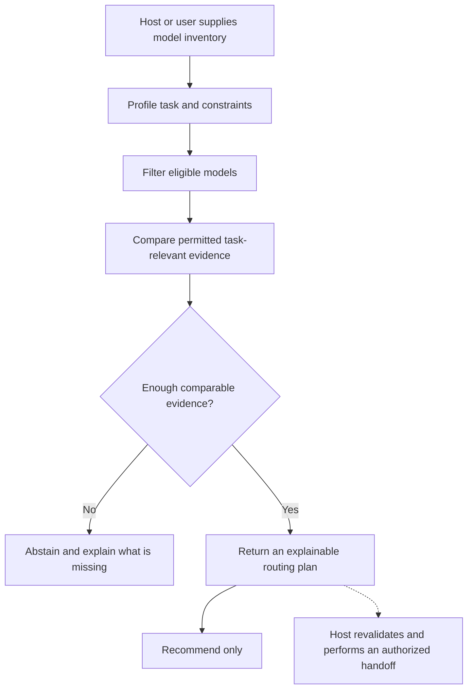

<picture>
  <source media="(prefers-color-scheme: dark)" srcset="docs/assets/banner-dark.svg">
  <source media="(prefers-color-scheme: light)" srcset="docs/assets/banner-light.svg">
  
</picture>

# Intelligent Model Router Skills

**Use the models you already have. Choose with evidence.**

A provider-neutral [Agent Skill](https://agentskills.io/specification) that helps your
agent choose a model **before a task handoff or subagent creation**. Start with the
models you can access, check the constraints, and get an explainable routing plan.
**Your host stays in control of execution.**

[](https://github.com/whale-devx/intelligent-model-router-skills/actions/workflows/ci.yml)
[](#current-status)
[](LICENSE)

[**Quick start**](#quick-start) · [**How it works**](#how-it-works) · [**Documentation**](docs/README.md) · [**Roadmap**](docs/ROADMAP.md) · [**ภาษาไทย**](docs/README.th.md)

> [!IMPORTANT]
> **0.1.0-alpha.1 is an offline reference implementation.** Host/user-supplied
> inventory and evidence work today. Automatic account discovery, live leaderboard
> imports, and native execution adapters are not implemented. Installing the skill
> does not override a host's built-in Auto mode. [See current status](#current-status).

## Quick start

### 1. Install the skill

Run this in your project, then choose your agent in the installer:

```sh
npx skills add whale-devx/intelligent-model-router-skills --skill intelligent-model-router
```

[Installation for Codex, Claude Code, Cursor, Gemini CLI, Kiro CLI and API clients](docs/PORTABILITY.md)

Use a Node.js version supported by the [Skills CLI](https://github.com/vercel-labs/skills#install-a-skill).
Python is **not** required for the instruction-only workflow.

<details>
<summary>Install across projects, choose an agent, or install manually</summary>

Add `-g` for a user-level installation:

```sh
npx skills add whale-devx/intelligent-model-router-skills --skill intelligent-model-router -g
```

Use `-a` to select an installer target, for example:

```sh
npx skills add whale-devx/intelligent-model-router-skills --skill intelligent-model-router -a claude-code
```

This names an installer target, **not** a certification of this skill's live-host
behavior. See the [host test checklist](docs/HOST-TESTS.md).

For a manual installation, copy the entire `skills/intelligent-model-router/`
folder to your host's documented skill location. Keep its references, assets,
scripts, and license together. Review before replacing an existing installation.

[Installation details, privacy, and troubleshooting](docs/GETTING-STARTED.md)

</details>

### 2. Ask your agent to use it

```text
Use intelligent-model-router before creating subagents.
Inspect the models this host exposes to me; do not assume access.
Choose a model for each actual task using relevant evidence.
Keep my existing permissions, privacy rules, and budget.
If evidence is missing, explain what is needed.
If delegation is unavailable, recommend only.
```

### 3. Review the plan

Expect the selected model, reasons, evidence dates, exclusions, and execution status.
When a verified endpoint stays a recommendation, check `reasons` for the
missing host or endpoint capability, policy authorization or delegation limit.
The helper **does not call a model**: it returns a recommendation or a proposed
host operation. A host must revalidate permissions and confirm any actual handoff.

**No new inference account. No gateway. No server required.** The skill and bundled
helpers send no telemetry. The external installer has its own
[telemetry settings](docs/GETTING-STARTED.md#installer-privacy).

## When to use it

| Your goal | The skill's role |
| --- | --- |
| **Choose a model for the next task** | Compare eligible models using task-relevant evidence and constraints. |
| **Create specialized subagents** | Recommend a model for each subagent's actual task, without expanding permissions. |
| **Reconsider a model or plan a fallback** | Make a new constrained decision at a safe boundary; never silently relax policy. |

The skill selects **among your available models**, not every model on a leaderboard.
It is not a provider subscription, inference proxy, or agent runtime.

## How it works



**In words:** inventory → constraints → comparable evidence → plan, or an honest
abstention. The dotted handoff belongs to the **external host**, not the offline
helper. A public catalog is not proof of access; a plan is not an execution receipt.

Read the [routing contract](skills/intelligent-model-router/references/contract.md)
for exact input fields, ranking rules, defaults, and limitations.

## Current status

| Available in this alpha | Not implemented or not yet verified |
| --- | --- |
| Portable `SKILL.md` and instruction-only workflow | Live-host conformance runs are not yet recorded |
| Host/user discovery protocol and explicit-file inventory import | Automatic host-native account/model discovery |
| Offline eligibility checks and deterministic ranking | Live leaderboard fetching and native execution adapters |
| Provenance, exact model identities, source deduplication | Calibrated success probabilities and learned routing |
| Proposed actions with permission and safe-boundary checks | A universal model switch or automatic Sub-agent API |

The CI badge reports **offline checks on `main`**, not live-host compatibility,
security certification, or an improvement in model quality.

**Evidence rules:** unknown is not zero; popularity is not capability; preference
is not correctness; leaderboard scores are not task-success probabilities.

<details>
<summary>What happens when information is missing?</summary>

| Result | Meaning |
| --- | --- |
| `needs_inventory` | Supply an authorized model inventory. |
| `no_eligible_models` | No candidate meets the current constraints. |
| `insufficient_evidence` | Comparable, sufficiently current evidence is missing. |
| `selected` | A model was selected; execution is still a separate host action. |

Invalid input is rejected. Unknown efficiency values are not treated as free or
instant. Missing evidence is not silently filled in. The complete rules are in the
[contract](skills/intelligent-model-router/references/contract.md).

</details>

## See the offline example

This example uses **fictional models and synthetic scores**, not a live benchmark.
From a repository checkout with Python 3.10+:

```sh
python skills/intelligent-model-router/scripts/route.py --input skills/intelligent-model-router/assets/example-request.json --as-of 2026-11-20
```

Abbreviated result:

```json
{
  "status": "selected",
  "selected": {"id": "example-b"},
  "action": "recommend",
  "execution_status": "not_executed",
  "estimated_success_probability": null
}
```

Synthetic evidence cannot plan execution. The fixed date makes the demonstration
repeatable; real requests must use current observations, not a replay date.

<details>
<summary>For contributors: run the offline test suite</summary>

```sh
python -m unittest discover -s tests -v
```

The helpers use Python's standard library. Tests cover validation, policy gates,
source deduplication, stale/missing evidence, subagent depth, CLI behavior, and
copying the skill outside the repository. See [contribution guidance](CONTRIBUTING.md).

</details>

## Find your next step

| I want to… | Start here |
| --- | --- |
| Install and try the skill | [Getting started](docs/GETTING-STARTED.md) |
| Browse all documentation | [Documentation hub](docs/README.md) |
| Integrate a host or supply model inventory | [Host protocol](skills/intelligent-model-router/references/host-protocol.md) |
| Understand decisions or supply evidence | [Contract](skills/intelligent-model-router/references/contract.md) · [Source guide](skills/intelligent-model-router/references/sources.md) |
| Test compatibility or report a problem | [Host checklist](docs/HOST-TESTS.md) · [Open an issue](https://github.com/whale-devx/intelligent-model-router-skills/issues/new/choose) |
| Help build the next version | [Roadmap](docs/ROADMAP.md) · [Contributing](CONTRIBUTING.md) |

Small contributions count: clarify a confusing step, improve a translation, or
record a reproducible host test. Report failures and unknowns as well as successes.
Never include credentials, personal inventories, or private prompts in public issues.
For vulnerabilities, follow [SECURITY.md](SECURITY.md).

## License and attribution

Project code and authored instructions use [Apache-2.0](LICENSE). Third-party data,
benchmarks, and trademarks retain their own terms. A source guide is not a data
redistribution license. No benchmark provider or host endorses this project.

[Changelog](CHANGELOG.md) · [Security](SECURITY.md) · [Documentation style](docs/WRITING-GUIDE.md) · [Back to top](#intelligent-model-router-skills)

[Import a pinned Arena English text snapshot](skills/intelligent-model-router/references/arena.md)

Pass `--request request.json` to check Arena mappings against the endpoints in
your routing request. A discovery key beginning with `unmapped:` cannot supply a quality score.
If the router returns `insufficient_evidence`, check `evidence_coverage` for
model keys missing observations and the number of independent origins that
compare every eligible identity. [Reading the result](skills/intelligent-model-router/references/contract.md#diagnosing-insufficient-evidence)
When sharing adapted scores, copy `source_notice` for the source and license
credit. The full import report contains your local endpoint mappings.
