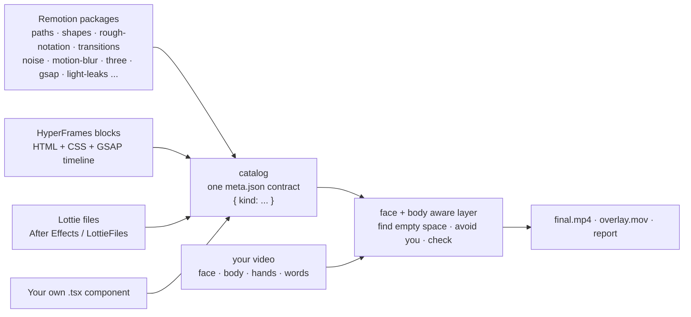

# connect-ai-video-motion

**Open source by CONNECT AI LAB · AI education for everyone.** An AI content employee for commerce and knowledge content. Give it your video, and it puts motion graphics on top.

[](docs/index.html)

## Start

One line. It gives your coding agent (Claude Code, Codex, Antigravity) the skill:

```bash
npx connect-ai-video-motion install-skill
```

Then open a new chat with your agent, drop in your video and say "put motion graphics on my video". The agent runs the kit for you: analyze, plan, check, render.

<p align="center">
  &nbsp;
  &nbsp;
  &nbsp;
  <br>
  <sub><b>Yeongsa Film Painter</b> (CONNECT AI HQ PixelCrew) — gently animated pixel portrait that switches expression as it greets, tracks face/hands, edits, and finishes your video.</sub>
</p>

## Watch it work

<table><tr>
<td width="30%" valign="top"><a href="https://www.youtube.com/shorts/fQvxvk9Wz10"></a><br><b>The Short</b><br><sub>Plays here without sound. Made with this kit on my own video. Watch with sound: <a href="https://www.youtube.com/shorts/fQvxvk9Wz10">YouTube</a> · <a href="https://www.instagram.com/reel/DgGc6Ouyjzv/">Instagram</a> · <a href="https://www.tiktok.com/@aimentorjay/video/7711556091162758420">TikTok</a></sub></td>
<td valign="top"><a href="https://www.instagram.com/p/DgGa9x6kssz/"></a> <a href="https://www.instagram.com/p/DgGa9x6kssz/"></a> <a href="https://www.instagram.com/p/DgGa9x6kssz/"></a> <a href="https://www.instagram.com/p/DgGa9x6kssz/"></a> <a href="https://www.instagram.com/p/DgGa9x6kssz/"></a> <a href="https://www.instagram.com/p/DgGa9x6kssz/"></a> <a href="https://www.instagram.com/p/DgGa9x6kssz/"></a> <a href="https://www.instagram.com/p/DgGa9x6kssz/"></a> <br><b>How it works, in 8 slides</b><br><sub><a href="https://www.instagram.com/p/DgGa9x6kssz/">Instagram carousel</a> · Learn the whole process: <a href="https://www.aicitybuilders.com/vibecoding">Visual Vibe Coding</a></sub></td>
</tr></table>

<!-- gallery:start -->
## Showcase

Made with this kit on the author's own videos (AI Mentor Jay, shown with his permission). The words on screen are words he said. Not one pixel of him was changed. Under each: what it does and its one line of `plan.json`.

<table>
<tr><!-- slot: palm-hologram --><td width="50%" valign="top"><br><b>Hologram from your hand</b><br>A 3D object spins over your raised hand, a beam runs from your palm.<br><code>{&quot;kind&quot;:&quot;body/palm-hologram&quot;,&quot;text&quot;:&quot;3D&quot;}</code></td><!-- slot: behind-text --><td width="50%" valign="top"><br><b>Word behind you</b><br>Big words stand behind you. You stay in front.<br><code>{&quot;kind&quot;:&quot;body/behind-text&quot;,&quot;text&quot;:&quot;Open source&quot;,&quot;behind&quot;:true}</code></td></tr>
<tr><!-- slot: air-draw --><td width="50%" valign="top"><br><b>Write in the air</b><br>Your fingertip is a pen of light. What you draw in the air is drawn big on the wall behind you.<br><code>{&quot;kind&quot;:&quot;body/air-draw&quot;,&quot;text&quot;:&quot;Store it&quot;}</code></td><!-- slot: aura --><td width="50%" valign="top"><br><b>Aura around you</b><br>Your outline grows into turning colour light behind you.<br><code>{&quot;kind&quot;:&quot;body/aura&quot;}</code></td></tr>
<tr><!-- slot: halo-words --><td width="50%" valign="top"><br><b>Words circling your head</b><br>Your words orbit your head, behind you and out the other side.<br><code>{&quot;kind&quot;:&quot;body/halo-words&quot;,&quot;text&quot;:&quot;Connect AI Lab&quot;}</code></td><!-- slot: point-spot --><td width="50%" valign="top"><br><b>Spotlight where you point</b><br>A cone of light leaves your finger where you really point and lands as a spotlight behind you, your word inside.<br><code>{&quot;kind&quot;:&quot;body/point-spot&quot;,&quot;text&quot;:&quot;Interaction&quot;}</code></td></tr>
<tr><!-- slot: room-to-data --><td width="50%" valign="top"><br><b>Room turns into data</b><br>The room behind you turns into data pixels. You stay real.<br><code>{&quot;kind&quot;:&quot;body/room-to-data&quot;,&quot;text&quot;:&quot;Analyze&quot;}</code></td><!-- slot: hand-arc --><td width="50%" valign="top"><br><b>Energy between your hands</b><br>Strands of light run from palm to palm and bend with the real distance of your hands.<br><code>{&quot;kind&quot;:&quot;body/hand-arc&quot;,&quot;text&quot;:&quot;Physical&quot;}</code></td></tr>
<tr><!-- slot: pass-behind --><td width="50%" valign="top"><br><b>Object passes behind you</b><br>A 3D object flies through the room at eye height and passes behind your head, leaving a trail of light.<br><code>{&quot;kind&quot;:&quot;body/pass-behind&quot;,&quot;text&quot;:&quot;AI native&quot;}</code></td><!-- slot: afterimage --><td width="50%" valign="top"><br><b>Afterimages of your motion</b><br>Your outline from a moment ago trails you as colour silhouettes. Move your arms and a rainbow follows.<br><code>{&quot;kind&quot;:&quot;body/afterimage&quot;}</code></td></tr>
<tr><!-- slot: hand-dial --><td width="50%" valign="top"><br><b>Dial you turn by hand</b><br>A round gauge stands by your raised hand. Its needle follows the real tilt of your hand.<br><code>{&quot;kind&quot;:&quot;body/hand-dial&quot;,&quot;text&quot;:&quot;Quality&quot;}</code></td><!-- slot: scramble-title --><td width="50%" valign="top"><br><b>Scramble title (GSAP)</b><br>A thin title decodes letter by letter and a gold line draws under it.<br><code>{&quot;kind&quot;:&quot;hyperframes/gold-scramble-title&quot;,&quot;text&quot;:&quot;Predict&quot;,&quot;sub&quot;:&quot;the future&quot;}</code></td></tr>
</table>

## More you can make

The catalog has <!--n-->80<!--/n--> graphics, each one line of `plan.json`. Open a group to see them; the [catalog page](docs/index.html) has every one as a living clip with a prompt to copy.

<details open><summary><b>Body aware · 11</b>: Follow a hand, count fingers, stand behind you, trace your outline.</summary>

<table>
<tr><td width="25%" valign="top"><br><sub>Count on the beat</sub></td><td width="25%" valign="top"><br><sub>Line around you</sub></td><td width="25%" valign="top"><br><sub>Finger count stamp</sub></td><td width="25%" valign="top"><br><sub>Card in your hand</sub></td></tr>
<tr><td width="25%" valign="top"><br><sub>Chart your hand draws</sub></td><td width="25%" valign="top"><br><sub>Tag on the hand</sub></td><td width="25%" valign="top"><br><sub>Ray from your finger</sub></td><td width="25%" valign="top"><br><sub>Body data beside your shoulder</sub></td></tr>
<tr><td width="25%" valign="top"><br><sub>Card that makes way</sub></td><td width="25%" valign="top"><br><sub>Robot on your hand</sub></td><td width="25%" valign="top"><br><sub>Robot behind your shoulder</sub></td></tr>
</table>

</details>

<details><summary><b>Text · 20</b>: Your own words, set big: key words, titles, quotes, chapters.</summary>

<table>
<tr><td width="25%" valign="top"><br><sub>Words rise (GSAP SplitText)</sub></td><td width="25%" valign="top"><br><sub>Title card (HyperFrames)</sub></td><td width="25%" valign="top"><br><sub>Chapter line</sub></td><td width="25%" valign="top"><br><sub>Key word</sub></td></tr>
<tr><td width="25%" valign="top"><br><sub>Name tag</sub></td><td width="25%" valign="top"><br><sub>Check mark (Lottie)</sub></td><td width="25%" valign="top"><br><sub>Words lit in time</sub></td><td width="25%" valign="top"><br><sub>Letters fold up (GSAP)</sub></td></tr>
<tr><td width="25%" valign="top"><br><sub>Fit-to-space word</sub></td><td width="25%" valign="top"><br><sub>Fast word with trail</sub></td><td width="25%" valign="top"><br><sub>Jitter to clean word</sub></td><td width="25%" valign="top"><br><sub>Square brackets</sub></td></tr>
<tr><td width="25%" valign="top"><br><sub>Swoosh underline</sub></td><td width="25%" valign="top"><br><sub>Pen box</sub></td><td width="25%" valign="top"><br><sub>Highlighter</sub></td><td width="25%" valign="top"><br><sub>Message bubble</sub></td></tr>
<tr><td width="25%" valign="top"><br><sub>Speech callout</sub></td><td width="25%" valign="top"><br><sub>Hexagon badge</sub></td><td width="25%" valign="top"><br><sub>3D hex badge</sub></td><td width="25%" valign="top"><br><sub>Hopping character (Lottie)</sub></td></tr>
</table>

</details>

<details><summary><b>Labels and pointers · 11</b>: Tags, arrows, lists and steps that point at what you mean.</summary>

<table>
<tr><td width="25%" valign="top"><br><sub>Shape label (HyperFrames)</sub></td><td width="25%" valign="top"><br><sub>Screen card + arrow</sub></td><td width="25%" valign="top"><br><sub>1 · 2 · 3 steps</sub></td><td width="25%" valign="top"><br><sub>Signal pulse (Lottie)</sub></td></tr>
<tr><td width="25%" valign="top"><br><sub>Chip to card</sub></td><td width="25%" valign="top"><br><sub>Cursor clicks a button</sub></td><td width="25%" valign="top"><br><sub>Contour map label</sub></td><td width="25%" valign="top"><br><sub>Signal wave</sub></td></tr>
<tr><td width="25%" valign="top"><br><sub>Bracket list</sub></td><td width="25%" valign="top"><br><sub>Arrow with a word</sub></td><td width="25%" valign="top"><br><sub>Triangle marker</sub></td></tr>
</table>

</details>

<details><summary><b>Numbers and charts · 10</b>: A number or a comparison you said, drawn.</summary>

<table>
<tr><td width="25%" valign="top"><br><sub>Ring counter (GSAP)</sub></td><td width="25%" valign="top"><br><sub>Circle stat (HyperFrames)</sub></td><td width="25%" valign="top"><br><sub>Pill stat (HyperFrames)</sub></td><td width="25%" valign="top"><br><sub>Number counter</sub></td></tr>
<tr><td width="25%" valign="top"><br><sub>Journey A to B</sub></td><td width="25%" valign="top"><br><sub>Shape morph, before to after</sub></td><td width="25%" valign="top"><br><sub>Strike out</sub></td><td width="25%" valign="top"><br><sub>Rising bars</sub></td></tr>
<tr><td width="25%" valign="top"><br><sub>Star seal</sub></td><td width="25%" valign="top"><br><sub>Rays behind a number</sub></td></tr>
</table>

</details>

<details><summary><b>Whole-frame scenes · 10</b>: Graphics that fill a frame with nobody in it, light behind you, the end card.</summary>

<table>
<tr><td width="25%" valign="top"><br><sub>Neon word stack (GSAP)</sub></td><td width="25%" valign="top"><br><sub>End card</sub></td><td width="25%" valign="top"><br><sub>Orbit arcs (Lottie)</sub></td><td width="25%" valign="top"><br><sub>Light leak behind you</sub></td></tr>
<tr><td width="25%" valign="top"><br><sub>Flow field lines</sub></td><td width="25%" valign="top"><br><sub>Curve draws itself</sub></td><td width="25%" valign="top"><br><sub>Spirograph draws itself</sub></td><td width="25%" valign="top"><br><sub>Pie to a percent</sub></td></tr>
<tr><td width="25%" valign="top"><br><sub>3D gold coin</sub></td><td width="25%" valign="top"><br><sub>Agent robots pass the ball</sub></td></tr>
</table>

</details>

<details><summary><b>Transitions · 6</b>: From one shot to the next.</summary>

<table>
<tr><td width="25%" valign="top"><br><sub>Clock wipe, before to after</sub></td><td width="25%" valign="top"><br><sub>Card flip, before to after</sub></td><td width="25%" valign="top"><br><sub>Iris, before to after</sub></td><td width="25%" valign="top"><br><sub>Push cut with flash, before to after</sub></td></tr>
<tr><td width="25%" valign="top"><br><sub>Push slide, before to after</sub></td><td width="25%" valign="top"><br><sub>Diagonal wipe, before to after</sub></td></tr>
</table>

</details>

<!-- gallery:end -->

**[Open the catalog page](docs/index.html)**: all <!--n-->80<!--/n--> graphics as living clips on real footage, filter by kind, copy a prompt for your coding agent.

## How it works

**Every motion graphic ecosystem, called with one line, placed around you.** Remotion packages, HyperFrames blocks, Lottie files and your own components all go through one layer that knows where your face, body and hands are, puts each graphic in good empty space, and checks its own work.



Like mixed martial arts took the best moves of every style and made them work together, this kit does not invent one more graphics library. It connects the ones that exist, so any of them is one line in `plan.json`:

```json
{"kind": "remotion/rough-highlight", "at": {"text": "free", "near": 2.0}, "text": "Free"}
{"kind": "hyperframes/split-words-rise", "at": 7.6, "text": "More colorful"}
{"kind": "lottie/gold-check", "at": 9.9}
{"kind": "custom", "component": "./my/Thing.tsx", "at": 4.2, "text": "Mine"}
```

**It never changes a pixel of you.** By default every graphic avoids your face, your body and your hands (measured 15 times a second) and goes where there is room. Graphics that follow a hand or stand behind you exist too, but they are a few options in the catalog, not the default.

> **Licences.** This kit is MIT. It runs on [Remotion](https://www.remotion.dev), which is not MIT: Remotion is free for individuals, companies with up to 3 employees and non-profits; other companies need a Remotion Company License ([LICENSE.md](https://github.com/remotion-dev/remotion/blob/main/LICENSE.md)). Some catalog items use Remotion packages under the same Remotion License, HyperFrames blocks are Apache-2.0, GSAP uses GreenSock's standard no-charge license. Each item says its licence in its `meta.json`; the full list is in [NOTICE.md](NOTICE.md).

The clip above and every clip on the [catalog page](docs/index.html) is the author's own footage (four rooms, four kinds of light), shown with his permission. Each graphic is one line of `plan.json`; the words on screen are words he said in that clip (Korean, shown in English). No box was drawn by hand around his hands: the body detector found them.

<p align="center"><br><sub>Before and after. The same frames: plain, then with one plan.json line. The words stand behind him (person matte in front).</sub></p>

<p align="center"><br><sub>The same graphic. Left: pinned to one spot (cut off by the frame). Right: placed by the face.</sub></p>

## See it

| | File | What to look at |
|---|---|---|
| Catalog page | [docs/index.html](docs/index.html) | <!--n-->80<!--/n--> graphics, one living clip each, with its `kind`, licence and a prompt to copy |
| Reel | [docs/hero_v2.mp4](docs/hero_v2.mp4) | the reel at the top in 1920x1080 (with sound: [docs/hero_v2_social.mp4](docs/hero_v2_social.mp4)) |
| Sheet | [docs/sheet.jpg](docs/sheet.jpg) | one still per graphic at its peak |
| Body | [docs/body_sheet.jpg](docs/body_sheet.jpg) | what the body detector sees: person area, joints, hands, finger count |

## Try it

You need Node.js 18 or newer. No Python. The ffmpeg inside Remotion is used.

```bash
git clone https://github.com/wonseokjung/connect-ai-video-motion.git
cd connect-ai-video-motion
npm install
npx connect-ai-video-motion demo           # built-in sample, start to finish
npx connect-ai-video-motion catalog        # every graphic you can call, by source
npx connect-ai-video-motion gallery vm-demo --sheet
```

Your own video: `npx connect-ai-video-motion my-talk.mp4`, or with a coding agent (Claude Code, Codex, Antigravity): `npx connect-ai-video-motion install-skill`, then ask it to "put motion graphics on my video".

## How it places things

1. **Face.** macOS Vision on a Mac. On Windows and Linux (or a Mac without Xcode tools) the MediaPipe face detector finds it automatically; it ships with the kit, nothing to download. If no face is found, you or your agent write the face box from `face-sheet.jpg`.
2. **Body and hands.** macOS Vision finds the body joints (up to 19), 21 points per hand and the person area (a 64×36 grid), 15 times a second, plus a person matte where a graphic goes behind you. On Windows and Linux the same comes from MediaPipe (see below). Without either, the body is estimated from the face box, as in 0.1.
3. **Empty space.** The protected area is face + measured person (arms and hands too) + a margin, over the whole time a graphic is on screen. Named places beside you are tried first, then any free space. If you move so much that no place stays free, the graphic is cut in two halves that fade from one place to the next. If there is still no room, it is hidden and the report says why.
4. **Words.** `plan.json` is a table of "said word → graphic". A graphic lands 40 ms after its word (word times), or ±0.2 s with sentence subtitles.
5. **Check.** `check` writes every problem as a sentence: covers the face, covers the person (body, arms, hands, measured), lies on another graphic, outside the frame, more than 4 words, low contrast, a ray from your finger across your face or your body, a line around you that touches you, the same design twice.

## The catalog

`npx connect-ai-video-motion catalog` lists everything. Today: **<!--n-->80<!--/n--> graphics you can play** and 4 listed with the reason they cannot (yet).

| Source | Count | Examples |
|---|---|---|
| `kit/` | 7 | name tag, key word, counter, 1 · 2 · 3 steps, screen card, chapter, end card |
| `remotion/` | 39 | 3D gold coin (three), light leak behind you, a curve that draws itself, a spirograph, a noise flow field, rough-notation box / highlight / strike / bracket list, paths journey / morph / signal / swoosh, shapes pie / bars / callout / star seal / hex badge, transitions clock wipe / iris / flip / slide / wipe / push cut, noise jitter / contour map, motion-blur trail, starburst rays, 3D hex badge (svg-3d-engine), GSAP letters, macOS cursor click, words lit in time (captions), robot characters passing a ball (shapes + spring) |
| `hyperframes/` | 8 | gold scramble title, words rise, ring counter, neon word stack (our blocks in the HyperFrames format); warm-grain circle stat, pill stat, shape label, title card |
| `lottie/` | 4 | check mark, signal pulse, orbit arcs, hopping character |
| `body/` | 22 | 3D hologram from your hand, word behind you, aura around you, words circling your head, room turns into data, write in the air, spotlight where you point, energy between your hands, 3D object passes behind you, afterimages of your motion, dial you turn by hand, line around you, count on the beat, card in your hand, card that makes way, body data beside your shoulder, ray from your finger, finger count stamp, tag on the hand, live chart of your hand's height, robots that follow your hand or stand behind your shoulder |

Each item is a folder `catalog/<source>/<name>/` with the component (or `block.html` / `anim.json`) and a `meta.json`:

```json
{
  "kind": "remotion/shapes-pie",
  "title": "Pie to a percent",
  "description": "A pie fills to the percent you said, the number counts with it.",
  "source": {"type": "remotion", "package": "@remotion/shapes", "version": "4.0.529"},
  "license": "MIT",
  "use": "number",
  "props": {"value": "percent 0-100", "text": "what it is (1-3 words)"},
  "place": "box",
  "size": {"aspect": 2.2, "minW": 0.22, "maxW": 0.34},
  "dur": 2.8,
  "family": "pie"
}
```

A plan line can also carry `"scale": 1.3` (this graphic 30 % bigger; it still steps down if you leave no room), `"slot": "beside-right"` (try this side first), `"behind": true` or `"head"` (type drawn big behind you, under the person matte: the words are split at a word boundary and set on both sides of you, so your head never eats the letters; `check` fails if you cover more than 25 % of them), `"side": "minutes"` (one plain word on the other side of you, level with the graphic: number on the left, word on the right) and, for `kit/keyword`, a line break in the text (`"Visual\nVibe Coding"`) to stack the words with the last line in gold. `my-info.json` `"style"` picks the look: `connect` (black × gold, default), `day` (the same look for bright rooms: dark ink), `night`, `clean`. The looks use thin type; `"weight": 500` in `my-info.json` sets a heavier weight that reads better small.

`place` says how the layer treats it: `box` (empty space beside you), `attach` (`hand`, `fingers`, `point`, `contour`: follows your body, hidden while the hand is not seen clearly), `behind` (behind you, drawn under the person matte), `edge`, `post`, `full`. `family` is the design: the same family twice in one video gets a warning.

### Your own graphics

| You have | One line in plan.json |
|---|---|
| a Remotion component | `{"kind": "custom", "component": "./my/Thing.tsx", "at": 4.2, "meta": {"size": {"aspect": 2, "maxW": 0.3}}}` |
| a HyperFrames block | `{"kind": "hyperframes", "src": "./block.html", "at": 6, "meta": {"window": [0, 3], "text": {".title": "text"}}, "text": "Hello"}` |
| a Lottie file | `{"kind": "lottie", "src": "./anim.json", "at": 8}` |

A component gets `{it, r, lf, dur, st, ink, u, fps, L, mainF}`: the plan line, its box `[x, y, w, h]`, the frame inside the graphic, and more (see `src/catalog/ui.tsx`). It must stay inside `r`.

### HyperFrames

The adapter runs a block (HTML + CSS + a paused GSAP timeline in `window.__timelines`) in its own transparent iframe and seeks it to every Remotion frame. GSAP and its plugins come from the installed `gsap` package, never a CDN. `Math.random` is seeded and CSS animations are held at the frame time, so every render gives the same picture. `meta.window` picks seconds of the block's timeline, `meta.crop` a part of its canvas, `meta.text` puts your words in.

```bash
npx connect-ai-video-motion hf-import <folder>   # a registry checkout, a template, or your .html files
```

Each block is checked: WebGL / canvas, its own video or audio, a `requestAnimationFrame` loop, scripts from the internet, template placeholders and missing timelines are listed as `unsupported` with the reason.

## Face and body on Windows and Linux

The face works out of the box on every computer: `@mediapipe/tasks-vision` is a dependency and the face model (`models/mediapipe/blaze_face_short_range.tflite`, 230 KB, Apache-2.0, by Google) ships with the kit. On our test clip (3840x2160, 23 looks) its head box was within a median 37 px of the macOS Vision box. Run with `VM_FACE=mediapipe` on a Mac to try it there. Add `--verbose` (or `VM_VERBOSE=1`) to print what the face probe sees, frame by frame.

The macOS body detector needs nothing extra. On other computers the MediaPipe adapter (`lib/adapters/mediapipe-body.mjs`) runs MediaPipe Pose + Hands inside Remotion's own Chrome. The package comes with the kit; the two body models do not (Apache-2.0, by Google):

| What | Where it goes |
|---|---|
| `pose_landmarker_lite.task` | `models/mediapipe/` |
| `hand_landmarker.task` | `models/mediapipe/` |

Links are at the top of `lib/adapters/mediapipe-body.mjs`. With them, `analyze` uses MediaPipe automatically; without them it says which file is missing. It makes no person matte, so graphics that go behind you stay hidden there. This adapter follows the documented tasks-vision API and is not yet tested on Windows; please open an issue with what you see.

## Outputs

`out/final.mp4` · `out/short_9x16.mp4` (`--short`) · `out/overlay.mov` (`--overlay`, ProRes 4444 with alpha, for Premiere / CapCut / DaVinci) · `out/sheet.jpg` (enter / peak / exit of every graphic with the measured person drawn) · `out/report.md` · `out/gallery.mp4` and `out/gallery_sheet.jpg` (`gallery`) · `out/body-sheet.jpg` (`body-sheet`).

## Not yet

The full HyperFrames registry (456 items) is not in the package: download it and run `hf-import`. The shader transitions of `@remotion/transitions` (book flip, crosswarp, ripple ...) need the experimental HTML-in-canvas browser feature and are listed as unsupported. Sound effects and automatic word times (whisper) are not in this version.

## Credits

Built from open-source parts, each listed with package, version and licence in [NOTICE.md](NOTICE.md). The sample footage in the npm package is a drawn stand-in with a synthetic voice. The clips in `docs/` show the author, with his permission; they were made with `tools/make-showcase.mjs` and `tools/make-docs.mjs`.

MIT · CONNECT AI LAB

<!-- team:start -->
## CONNECT AI LAB's AI employees

I'm building AI employees one by one, in the open. Grab the one you need first.

<table>
<tr><td width="34%" valign="top"><b>Business analyst</b><br><a href="https://github.com/wonseokjung/reversebusiness"><code>reversebusiness</code></a></td><td valign="top">Give it a website, and it breaks down how that business makes money.</td></tr>
<tr><td width="34%" valign="top"><b>Video editor</b> · <b>this one</b><br><a href="https://github.com/wonseokjung/connect-ai-video-motion"><code>connect-ai-video-motion</code></a></td><td valign="top">Give it your video, and it puts motion graphics in the empty space around you.</td></tr>
<tr><td width="34%" valign="top"><b>Motion designer</b><br><a href="https://github.com/wonseokjung/connect-ai-motion"><code>connect-ai-motion</code></a></td><td valign="top">Give it a few lines of text, and it makes a motion graphics video. No footage needed.</td></tr>
<tr><td width="34%" valign="top"><b>Marketing team</b><br><a href="https://github.com/wonseokjung/connect-ai-marketer"><code>connect-ai-marketer</code></a></td><td valign="top">Replies, social listening and uploads, 24/7 in your own browser.</td></tr>
<tr><td width="34%" valign="top"><b>Writer</b><br><a href="https://github.com/wonseokjung/connect-ai-writer"><code>connect-ai-writer</code></a></td><td valign="top">Give it one video, and it writes a post for every platform in your voice, with pictures.</td></tr>
</table>
<!-- team:end -->
