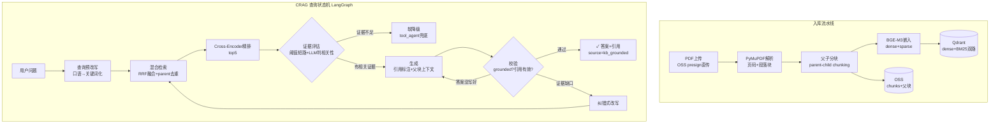

<div align="center">

# DeepRAG 🔍

**基于 LangGraph 的 Agentic RAG 智能问答系统 — CRAG 纠正式检索增强生成完整实现**
**Agentic RAG (Corrective RAG) framework on LangGraph — hybrid retrieval, reranking, self-correction, multi-tenant**

CRAG 自纠闭环 · 混合召回(BGE-M3 + BM25/RRF) · Cross-Encoder 重排 · 消融评测基线 · 多租户 JWT · SSE 流式

[](https://github.com/wzxsdf/DeepRAG/actions/workflows/ci.yml)


[](https://github.com/wzxsdf/DeepRAG/stargazers)

[English TL;DR](#-english-tldr) · [评测基线](docs/trials/baseline.md) · [English README](README_EN.md)

</div>

---

## 📖 项目简介

DeepRAG 是一个**检索增强生成（RAG / Retrieval-Augmented Generation）**问答系统的完整工程实现，核心是 **CRAG（Corrective RAG，纠正式检索增强生成）**状态机：检索 → 证据评估 → 生成 → 校验，证据不足自动**改写查询重检索**，答案不达标**带反馈重生成**——不是"检索一次就硬答"的单向流水线。

区别于大多数 RAG demo 项目，DeepRAG 把**评测当作一等公民**：自带 golden 消融基线、独立异模型 judge 评分、不可答负样本诚实降级率、分块断点续跑的评测执行器——每次改动检索/生成链路都能量化"变好还是变坏"。

> 适合场景：企业知识库问答、RAG 架构学习/二次开发、需要**可量化、可回归**的检索增强系统工程实践。

## ✨ English TL;DR

DeepRAG is a production-style **Agentic RAG** system implementing **CRAG (Corrective Retrieval-Augmented Generation)** as a LangGraph 1.x state machine: retrieve → grade evidence → generate → verify, with query-rewrite re-retrieval on evidence gaps and feedback-driven regeneration on answer defects.

- **Hybrid retrieval**: BGE-M3 dense + Qdrant native BM25 fused with weighted RRF, then Cross-Encoder (BGE-Reranker-v2-M3) reranking — ablated, with weights sweep archived
- **Honest evaluation harness**: golden ablation baseline, independent cross-family LLM judge, unanswerable negative set measuring honest-refusal rate, chunk-resumable eval runner with bad-window circuit breaker
- **Multi-tenant**: forced JWT auth, KB ownership (`owner_id`), tenant propagated from token (request body ignored), per-user cache keys
- **Engineering**: FastAPI + SSE streaming, PyMuPDF parent-child chunking (small-to-big), MySQL/Qdrant/OSS/Redis, in-process async ingestion

## ✨ 核心特性

### 🔄 CRAG 纠正式检索（Corrective RAG）
- LangGraph 1.x `StateGraph` + `Command` 声明式路由的完整自纠状态机：`entry → pre_rewrite → retrieve → grade → generate → verify`
- 证据缺口 → 携带失败原因/已试证据/历史的**纠错式查询改写**重检索；答案缺陷 → 携带 verifier 反馈的重生成
- 拒答校准：rerank 分数阈值短路（双峰分布标定 0.30），低于阈值的"低分证据硬答"幻觉路径被堵死

### 🔀 混合检索与精排
- BGE-M3 dense + Qdrant **原生 BM25 sparse**，服务端**加权 RRF 融合**（`RETRIEVAL_SPARSE_WEIGHT` 可调）
- Cross-Encoder 精排（BGE-Reranker-v2-M3），含端点退化**自愈重试**与**坏窗口熔断**
- 消融实证（62问×48文档）：短文档语料上 sparse 路无增益，生产默认 ≈ 纯 dense 最优——结论透明可复现，而非"默认开着 hybrid 就完事"

### 🧪 评测即一等公民（本项目最大差异点）
- **golden v3 消融基线**：62 问 × 48 文档（含语义近似干扰项）+ 10 不可答负样本
- **独立异模型 judge**：answer_correct / grounded / citation_correct 三维评分（替代自评 1.000 无区分度的老口径）
- **诚实降级率**：不可答问题必须"拒答或声明未验证"，编造引用计不诚实
- **分块断点续跑**：逐问 checkpoint、坏窗口熔断、窗口指纹预检（跨时间窗 trial 可解释）
- 全部 trial 记录入档 `docs/trials/`，基线 `mean±std` 可回归对比

### 🏢 多租户与安全
- JWT 强制鉴权（401 兜底，无匿名用户），tenant 从 token → users 表 → 检索过滤/入库/缓存世代**全链路贯通**，请求体 tenant_id 忽略（防伪造）
- KB 归属模型：`owner_id` 私有库 + 公共库兼容，越权 403；`kb_ids` 逐个校验防枚举越权检索
- 答案缓存按用户隔离；会话历史按归属过滤

### 💬 对话与流式
- SSE 双通道流式：Agent 节点进度（step）+ 逐 token 输出
- 多轮对话持久化（MySQL）+ 短期记忆治理（超预算自动摘要+窗口）
- 三种模式：quick（ReAct 工具） / kb（CRAG 检索闭环） / agent（Planner 多跳编排）

### 📄 文档处理
- PyMuPDF 解析（页码+段落块保留）→ **父子分块（parent-child chunking）**→ child 命中、parent 上下文展开（small-to-big）
- OSS 预签名直传，入库流水线 API 进程内异步

## 🧭 架构



## 🚀 快速启动

```bash
# 1. 起依赖服务 (MySQL / Redis / Qdrant)
docker compose up -d

# 2. 初始化MySQL表
python scripts/init_mysql.py

# 3. 安装依赖
pip install --user -e .

# 4. 配置 .env (OSS/Qdrant/MySQL/LLM/embedding 凭据)
copy .env.example .env

# 5. 起API
python -m apps.api.main

# 6. 入库流水线为API进程内异步(BackgroundTasks), 无需单独Worker
```

访问 http://localhost:8000 → `/health` 查依赖状态，`/api/v1/query` 问答（需登录拿 token，见下方查询示例）。

## 📡 查询示例

```bash
# 注册拿token(P3起 /query 强制鉴权; tenant从token贯通, 请求体tenant_id被忽略)
TOKEN=$(curl -s -X POST http://localhost:8000/api/v1/auth/register \
  -H "Content-Type: application/json" \
  -d '{"email":"a@b.c","password":"secret66"}' | python -c "import sys,json;print(json.load(sys.stdin)['token'])")

# 单轮
curl -X POST http://localhost:8000/api/v1/query \
  -H "Content-Type: application/json" -H "Authorization: Bearer $TOKEN" \
  -d '{"question":"DeepRAG的检索层用了什么技术?","mode":"kb"}'

# 多轮 (conversation_id 复用上下文)
curl -X POST http://localhost:8000/api/v1/query \
  -H "Content-Type: application/json" -H "Authorization: Bearer $TOKEN" \
  -d '{"question":"它输出多少维?","conversation_id":"sess-1","mode":"kb"}'
```

## 🔐 鉴权与多租户

- **强制鉴权**：除 `/auth/*`、`/health`、`/` 外所有业务接口需 `Authorization: Bearer <JWT>`；未带/无效 token → 401
- **KB 归属**：新建 KB 归属创建者（私有）；存量无主 KB 为公共库。私有库的读/写/删/上传/检索一律仅 owner，越权 → 403
- **tenant 贯通**：tenant_id 从 JWT → users 表 → 检索过滤/入库/缓存世代全链路服务端取值，请求体字段被忽略（防跨租户伪造）
- **缓存隔离**：查询结果缓存键含 user_id，不同用户同问题不复用缓存

## 🧪 评测与消融

| 配置 | R@1 | R@5 | nDCG@5 | 说明 |
|---|---|---|---|---|
| dense-only | 0.839 | 0.938 | 0.895 | BGE-M3 直排 |
| hybrid(RRF) | 0.834 | 0.938 | 0.893 | sparse 权重扫参定 0.15 |
| **漏斗 top20→rerank5** | **0.903** | **0.944** | **0.926** | 候选池扩大+Cross-Encoder 精排 |
| +CRAG(独立judge) | — | — | — | answer_correct **0.885~0.903**（跨窗口均值） |
| 不可答负样本诚实降级 | — | — | — | **10/10** 满格（不编造引用） |

> **诚实口径**：以上数字来自自建 golden v3 评测集（62问×48文档+10不可答），非公开学术基准；judge 为独立异模型评分，trial 记录全量入档，跨窗口 rerank 分数漂移已识别并防御（窗口指纹/熔断/自愈重试）。

复现评测：

```bash
python scripts/run_w2_eval.py --only all        # 消融+漏斗+CRAG+不可答
python scripts/aggregate_baseline.py            # 聚合基线 mean±std
```

<details>
<summary><b>全部验证脚本</b></summary>

| 脚本 | 验证内容 |
|---|---|
| `scripts/test_connections.py` | MySQL / OSS / Qdrant 连接 |
| `scripts/test_full_ingestion_final.py` | 入库流水线（OSS+MySQL+Qdrant + 真实 embedding） |
| `scripts/test_hybrid_retrieval.py` | dense / sparse-BM25 / RRF 三路对比 + rerank |
| `scripts/test_agent_e2e.py` | CRAG 状态机端到端（带引用答案） |
| `scripts/test_api.py` | `/query` + `/health` |
| `scripts/test_parent_expansion.py` | 父块展开（child 命中 + parent 上下文） |
| `scripts/test_multi_turn.py` | 多轮对话持久化 + 指代理解 |
| `scripts/test_multi_hop.py` | Planner 多跳（子查询分解 + 并行融合） |
| `scripts/run_w2_eval.py` | golden v3 消融+漏斗对照 → `docs/trials/<trial_id>_w2_ablation.{csv,md}` |
| `scripts/test_cache_invalidation.py` | 缓存 generation 失效链路 |
| `scripts/test_semantic_cache.py` | 语义缓存命中链路 + kb_ids scope 隔离 |

</details>

## 🧰 技术栈

| 层 | 技术 |
|---|---|
| Agent 编排 | LangGraph 1.x（StateGraph + Command 声明式路由） |
| LLM 接入 | langchain `init_chat_model` 统一网关（OpenAI 兼容端点，purpose 路由：生成/判断/评测异模型） |
| 检索 | BGE-M3 dense + Qdrant 原生 BM25 sparse（加权 RRF）+ BGE-Reranker-v2-M3 Cross-Encoder 精排 |
| 文档解析 | PyMuPDF（页码+段落块保留）+ 父子分块 |
| 存储 | MySQL 8.0（元数据/对话，aiomysql）+ 阿里云 OSS（原文/chunks/父块）+ Qdrant（dense+sparse）+ Redis（缓存） |
| 服务 | FastAPI + SSE（sse-starlette），入库流水线进程内异步 |

## 📁 目录结构

```
DeepRAG/
├── apps/api/          # FastAPI 路由(query/kb/documents/auth/monitor/conversations)
├── apps/worker/       # 入库流水线(进程内异步)
├── src/agents/        # CRAG 状态机 + ReAct/Planner Agent + 查询路由
├── src/retrieval/     # 混合检索(RRF) + 嵌入 + Cross-Encoder 精排
├── src/storage/       # Qdrant / MySQL(aiomysql) / OSS / Repository 层
├── src/evaluation/    # golden 集 + 消融评测器(断点续跑/熔断/独立judge)
├── src/core/          # 配置 / LLM网关 / lifespan / 日志
├── src/memory/        # 短期记忆治理(默认开) + 长期记忆(默认关断,待A/B)
├── scripts/           # 验证脚本 + 评测执行器
├── docs/trials/       # 全量评测 trial 记录 + 基线
└── tests/unit/        # 单元测试(CI)
```

## 🗺 Roadmap

- [x] CRAG 自纠闭环（改写重检索 / 反馈重生成 / 阈值拒答校准）
- [x] 混合检索消融定案（sparse 权重扫参，结论入档）
- [x] 独立 judge 评测 + 不可答负样本 + 断点续跑评测基建
- [x] 多租户最小安全版（JWT 强制鉴权 + KB 归属 + tenant 贯通 + 缓存隔离）
- [ ] **精排侧优化**：剩余口语问缺口的失败签名已定位为 cross-encoder 打分瓶颈（文档在候选池但得分<0.30）→ 本地 reranker / 分问阈值校准
- [ ] 长期记忆质量 A/B 重评（代码保留，默认关断）
- [ ] Agent 规划与工具深度优化

## 📚 文档

- [docs/trials/baseline.md](docs/trials/baseline.md) — **golden 基线**（mean±std + 治疗组注记）
- [DESIGN.md](DESIGN.md) — 完整技术方案
- [docs/RESUME_MATERIAL.md](docs/RESUME_MATERIAL.md) — 架构图 + 量化 bullet + 消融数据
- [docs/W1](docs/W1_VERIFICATION.md) / [W2](docs/W2_VERIFICATION.md) / [W3](docs/W3_VERIFICATION.md)_VERIFICATION.md — 三阶段验收报告
- [English README](README_EN.md)

---

如果这个项目对你的 RAG 工程/学习有帮助，欢迎 **Star ⭐ / Fork / Issue** 交流。
