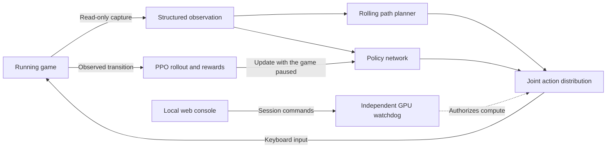

# TH06NC-Neural-Pilot

English · [简体中文](README.zh-CN.md)

[](LICENSE)
[](#requirements)
[](pyproject.toml)
[](docs/en/core-logic.md)
[](native/README.md)

TH06NC-Neural-Pilot is an experimental reinforcement learning agent for the Windows Steam edition of **Touhou Koumakyou: New Classic - the Embodiment of Scarlet Devil**. It combines a PPO policy with a rolling path planner to dodge bullets, collect power items, and keep shots on target while playing the game. The agent observes the running game through read-only state capture and acts through standard Windows keyboard input. [Official game listing](https://store.steampowered.com/app/4659620/)

[Quick start](#quick-start) · [Session controls](#session-controls) · [How it works](#how-it-works) · [Developer documentation](#developer-documentation)

## What you can do

- Train a new policy, resume a checkpoint, watch the policy play, or evaluate it over ten independent rounds.
- Choose Story or Stage Practice, select a difficulty and Reimu or Marisa with shot type A or B, and choose an unlocked starting stage in Practice.
- Train for survival with emergency bomb use enabled, or choose **No Miss No Bomb (NMNB)** to disable bomb actions and track misses.
- Review action timing, reward components, resource pickups, and snapshots from before deaths in the local web console.

## Requirements

| Component | Supported setup |
| --- | --- |
| Operating system | Windows 10 or 11, x64 |
| Game | Steam build `25306795`. The reader verifies the executable hash and code signatures before attaching. |
| Python and GPU | Python 3.10, `uv`, and an NVIDIA driver compatible with the CUDA build of PyTorch installed by the setup script |
| Console build | Node.js 22.12+ or 24 LTS with npm |
| Native acceleration | Optional Rust and MSVC toolchain for the PyO3 extension |

The repository ships source code. Bring your own copy of the game and calibrate it locally before the first run. Training starts from a new policy or a checkpoint you created. The verified live training baseline is **Normal with Reimu A**. Consistent full clears and NMNB clears remain research goals.

## Quick start

Clone the repository and run the Python deployment command.

```powershell
git clone https://github.com/xialongxl/TH06NC-Neural-Pilot.git
cd TH06NC-Neural-Pilot
python deploy.py
```

The command installs the backend dependencies, builds the web UI, and creates `LaunchAI.exe`. Run `python deploy.py --help` to see the individual steps.

1. Open `config.json` and set `game_exe` to the full path to your `th06nc.exe`. Deployment creates the file from `config.example.json` on the first run.
2. Double-click `LaunchAI.exe` in File Explorer. It opens the console at [127.0.0.1:18765](http://127.0.0.1:18765) without a terminal window. Choose **English** or **简体中文** in the top bar. The browser remembers your selection.
3. In **Safety & Diagnostics**, run the GPU check, open the game, and complete live calibration. Then verify Power, bombs, and lives and save the required local resource confirmation. [First-run calibration](docs/en/development.md#first-run-calibration)
4. In the **Training Console**, choose your game setup, objective, and duration. Select **New model** for a fresh run or **Resume Training** to continue from a saved checkpoint. Keep the game window focused during live play.

To inspect the console and saved history, launch the read-only preview.

```powershell
.\.venv\Scripts\python.exe -m th06ai open --preview
```

The preview opens at port `18766`. CLI and legacy desktop messages use the system language by default. Set `$env:TH06AI_LANG = 'en'` or `$env:TH06AI_LANG = 'zh-CN'` in PowerShell to override it for that terminal.

## Session controls

| Control | Effect |
| --- | --- |
| **F7** | Pause or resume the current round with the model, optimizer, and partial rollout retained in memory. |
| **Resume Training** | Start a fresh session using saved weights and compatible optimizer state. |
| **Save and Finish** | Stop at a safe boundary and write the latest updated checkpoint. |
| **F8** | Stop the protected process tree and release keys immediately. Recovery starts from the last completed checkpoint. |
| **Shut Down** | Finish the active session, save training progress, and shut down the local backend. |

Refreshing or closing the browser keeps the session running. Double-click the launcher again to reopen the existing console. You can also run `.\LaunchAI.exe shutdown` to shut it down with the same launcher.

Training pauses the game briefly for PPO updates and resumes automatically. At the planned duration, the agent finishes the stage in progress before saving, with up to ten minutes of overtime. A Miss that ends the attempt also triggers the save. [Training lifecycle](docs/en/core-logic.md#3-execute-reward-update-and-save)

During play, the agent uses the arrow keys, **Shift** for focus movement, **Z** to shoot, and **X** to bomb. The independent GPU watchdog continues to run during pauses. Default stop conditions include a 70°C core temperature, 90% VRAM usage, and 60 seconds of stale telemetry. [Safety configuration](docs/en/development.md#safety-settings)

## How it works



The planner tests short paths against bullets, enemy collision bodies, and straight lasers while accounting for input delay. Resource and attack alignment scores help rank viable paths. The policy samples the joint movement and bomb action that PPO later evaluates. The React console manages sessions over localhost REST and receives state updates over SSE. Checkpoints, trajectories, and logs live on disk.

The optional Rust extension accelerates search, collision checks, and parts of state capture and input. CUDA Graph inference and reusable buffers reduce policy dispatch overhead. See the [native build guide](native/README.md) and [benchmark methodology](docs/en/testing-and-performance.md) for verification scope and reproducible checks.

## Developer documentation

Browse the [English documentation index](docs/en/README.md) or switch to [简体中文文档](docs/README.md).

| Task | Reference |
| --- | --- |
| Install, configure, and troubleshoot | [Development guide](docs/en/development.md), [FAQ](docs/en/faq.md) |
| Work with difficulty, characters, and Practice | [Game setup](docs/en/game-settings.md) |
| Follow the process and data flow | [Architecture](docs/en/architecture.md), [Code map](docs/en/code-map.md) |
| Change observations, actions, models, or logs | [Data contracts](docs/en/data-contracts.md), [Implementation pitfalls](docs/en/gotchas.md) |
| Tune capture, recording, and checkpoints | [Performance tuning](docs/en/performance-tuning.md) |
| Translate console or backend messages | [Localization guide](docs/en/localization.md) |
| Contribute a fix, test fixture, or benchmark | [Contributing](CONTRIBUTING.md), [Project instructions](docs/en/maintainer-instructions.md) |

## License and credits

Maintained by **xialongxl** as an independent research project. The source code is licensed under MIT. The game and its assets are governed by their respective rights holders. [License](LICENSE) · [Disclaimer](DISCLAIMER.md)

Credit for Touhou Project and the original Scarlet Devil goes to **ZUN** and **Team Shanghai Alice**. The Steam listing credits Team Shanghai Alice and Shanghai Alice Reprise as developers of New Classic and Alliance Arts as publisher. [Touhou Project](https://touhou-project.news/touhou_project/) · [Steam credits](https://store.steampowered.com/app/4659620/)

PyTorch, Stable-Baselines3, Gymnasium, NumPy, React, FastAPI, and PyO3 support the learning and console stack. [Third-party notices](THIRD_PARTY_NOTICES.md)
