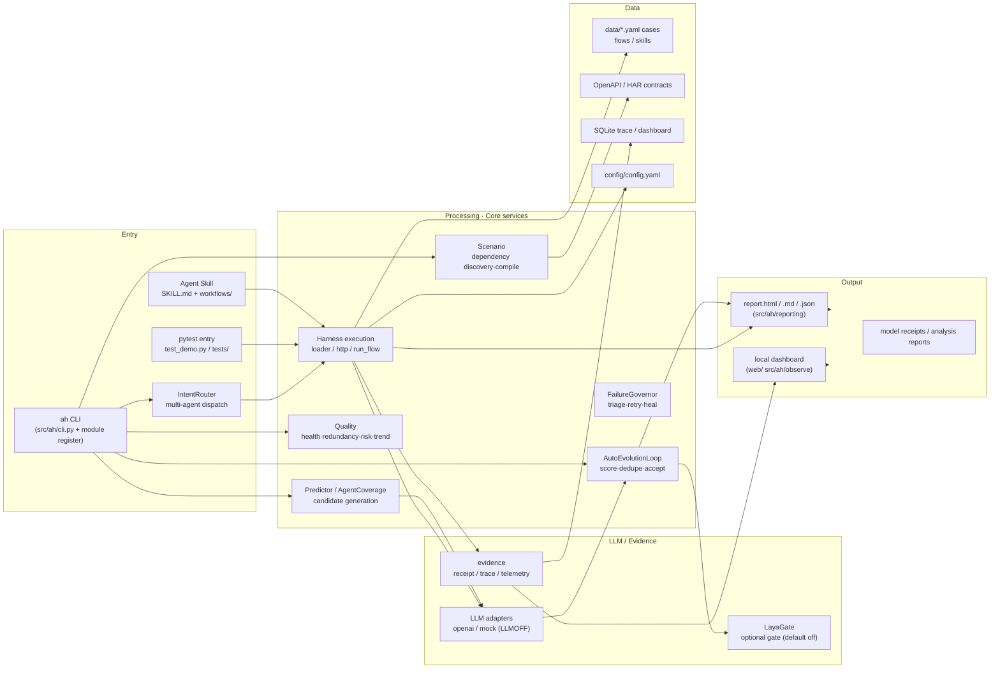

<p align="center">
  <a href="https://img.shields.io/badge/version-0.1.0-blue"></a>
  <a href="LICENSE"></a>
  <a href="https://img.shields.io/badge/Python-3.10%2B-green"></a>
  <a href="https://img.shields.io/badge/status-stable-brightgreen"></a>
</p>

<h1 align="center">Auto API Test Harness</h1>

<p align="center"><strong>An Agent-oriented API testing and testcase-evolution framework.</strong></p>

<p align="center"><a href="./README.zh-CN.md">中文</a></p>

<p align="center">Turns API contracts and changes into executable testcases with Python, pytest and YAML,<br/>then turns regression failures into diagnostic evidence, repro drafts and verify-ready follow-up candidates.</p>

<hr>

## Table of Contents

- [What is it](#what-is-it)
- [Why](#why)
- [Core Concepts](#core-concepts)
- [Repository Structure](#repository-structure)
- [Architecture](#architecture)
- [Quick Start](#quick-start)
- [Features & Usage](#features--usage)
- [Configuration](#configuration)
- [Integrations & Extensions](#integrations--extensions)
- [Safety](#safety)
- [FAQ](#faq)
- [Roadmap](#roadmap)
- [Contributing](#contributing)
- [License](#license)
- [Maintainer](#maintainer)

## What is it

`auto-api-test-harness` is an **Agent-oriented API testing and testcase-evolution framework**. It turns "API contracts and changes" into executable YAML/pytest testcases, and turns "regression failures" into diagnostic evidence, repro drafts and verify-ready follow-up candidates.

HTTP requests, variable passing and business assertions are executed by the Harness. Models can participate in **planning, candidate generation, semantic diagnosis or report analysis**. Plain regressions run offline with `LLMOFF=1`, with no model at all.

## Why

Manually maintaining API testcases becomes costly when interfaces change often, step chains are long and assertions are complex — and when a test fails it is hard to find the root cause. Common pain points:

| Pain point | This solution |
|---|---|
| Hand-written testcases go stale as interfaces change | Import case skeletons from OpenAPI contracts + scan coverage gaps and auto-suggest candidates |
| "Assertion failed" alone doesn't tell you why | Failure governance collects assertion/status/exception signals and routes them through rules and failure fingerprints |
| Backfilling cases relies on memory and gets missed | Agent Loop collects failures → generates candidates → scores/dedupes → writes back into evolution |
| Multi-step dependency chains are hard to maintain | Cross-interface dependency discovery + strict scenarios block downstream on prior failure and isolate context |
| Regression runs are unobservable | SQLite tracing + LLM usage stats + local dashboard + per-capability reports |

## Core Concepts

- **Case**: a single-interface or single-assertion unit described in one YAML, with variables, datasets, soft assertions and retry policies.
- **Flow**: a multi-step scenario supporting cross-step variable passing, prior dependencies and strict failure blocking.
- **Assertion**: business assertions on status code, JSON path (jmespath), etc.; results flow into a receipt.
- **Receipt**: records "planned vs actual" execution, distinguishing failed / blocked / skipped / unverified, and keeps request, response and assertion evidence.
- **Evolution**: the Agent Loop generates candidates from failures, scores and dedupes, then writes accepted ones back to `data/evolution.yaml` — a continuously evolving loop.
- **Governance**: routes failures to "keep as product defect / re-run original step / try a repair candidate", with failure clustering and reviewed-knowledge reuse.
- **Skill**: a reusable API capability unit supporting conditions, polling and agreed resource cleanup.

## Repository Structure

```text
auto-api-test-harness-v5/
├── README.md               # English README
├── README.zh-CN.md         # Chinese README
├── pyproject.toml          # Package definition & dependencies (uv)
├── uv.lock                 # Locked dependency versions
├── LICENSE                 # MIT license
├── .gitignore              # Excludes artifacts and secrets
├── .gitattributes          # Normalizes line endings
│
├── src/
│   └── ah/                 # Core package (package name `ah`, CLI prefix `ah`)
│       ├── cli.py          # Unified CLI: mounts & dispatches each module's subcommands
│       ├── core/           # config / dispatch / orchestrator / receipt / variables / trace
│       ├── harness/        # Execution harness: loader / http / registry / flow orchestration
│       ├── evolution.py    # Agent Loop & testcase evolution (evolve / run)
│       ├── failure/        # Failure governance: governor / triage / cluster / knowledge
│       ├── llm/            # LLM adapters: agents / openai / mock (LLMOFF)
│       ├── predict/        # Prediction & candidate generation: generator / risk / assist
│       ├── scenario/       # Cross-interface scenarios: dependencies / compile
│       ├── coverage/       # Contract coverage: gap / openapi import
│       ├── quality/        # Quality: audit / health / redundancy / lowvalue
│       ├── observe/        # Local observability: server / ingest / store / llmdetail
│       ├── skill/          # API Skill: executor / flow / validate
│       ├── reporting/      # Reports: writer (html / md / json)
│       ├── scheduler.py    # Change-driven / scheduled / parallel scheduling
│       ├── scaffold.py     # Scaffolding: generate standalone test projects
│       └── property.py     # Property-based exploration (Hypothesis)
│
├── config/
│   └── config.yaml         # Framework config: base URL / LLM / token / report dir
├── projects/
│   └── demo/               # Offline example project (data / flows / skills / pytest)
├── tests/                  # Framework tests (pytest, offline by default via LLMOFF)
├── skills/
│   └── auto-api-test-harness/   # Agent-facing skill (SKILL.md / references / workflows)
├── docs/                   # Operation guide & design docs
└── web/                    # Local dashboard frontend (React)
```

## Architecture

The framework is organized into four layers — Entry → Processing → Data → Output — with arrows indicating the main data/control flow.



> Note: commands like `ah evolve` (offline evolution), `ah add-case` (candidate generation), `ah scenario` (scenario discovery) and `ah observe` (dashboard) are mounted onto the unified CLI by each module's `register(subparsers)`. With `LLMOFF=1` the LLM layer uses `mock` and runs fully offline.

## Quick Start

### Requirements

- Python 3.10+
- [uv](https://docs.astral.sh/uv/)

### Install

From the repository root:

```bash
uv sync --locked --extra all
```

### Run the offline example

```bash
LLMOFF=1 AH_LOCAL_OBS=0 AH_TRACE_ENABLED=0 uv run --locked pytest -q -p no:cacheprovider projects/demo
```

Expect **4 passed**. Open `projects/demo/report/report.html`; the same directory also holds `report.md`, `report.json` and `run.log`.

Print one stubbed health-check result:

```bash
LLMOFF=1 AH_LOCAL_OBS=0 uv run --locked ah debug demo health-check --stub
```

### Run the framework test suite

```bash
LLMOFF=1 AH_LOCAL_OBS=0 AH_TRACE_ENABLED=0 uv run --locked pytest -q -p no:cacheprovider tests projects/demo
```

Expect **698 passed** (current version).

### Build release artifacts

```bash
uv build
# Produces dist/auto_api_test_harness-<version>.tar.gz (sdist) and -py3-none-any.whl (wheel)
```

## Features & Usage

### Agent Loop & testcase evolution

Run cases, collect failures, plan regression, generate candidates, and score/dedupe them. Accepted candidates are appended to `data/evolution.yaml`, with acceptance/rejection reasons and stop conditions recorded each round; failures can be written as local repro drafts. Later runs select cases by filter criteria.

```bash
ah evolve
```

### Failure triage & governance

Collect failing assertions, status codes and exceptions, and route through rules, known issues and failure fingerprints. Product defects can be kept, recoverable issues re-run on the original step, and high-confidence script issues get repair-candidate attempts. Failure clustering and reviewed-knowledge reuse are supported.

```bash
ah run
```

### Generate & extend testcases

Generate YAML drafts from natural language. Fill blind spots with boundary-value and abnormal-input candidates based on failures, existing cases and coverage gaps. Prediction and coverage helpers can validate candidates through an injected HTTP client.

```bash
ah add-case example_api 'Generate a GET /health health check expecting status 200'
```

### Execution harness

Manages single interfaces, multi-step scenarios, multiple services, authentication, datasets, type preservation and cross-step dependencies. Strict scenarios block downstream steps when a prior dependency fails, isolating context. Reuse API Skills for conditions, polling and agreed resource cleanup.

Entry points: YAML, pytest, `run_single`, `run_flow`, `ah skill validate`.

### Verifiable execution results

Records planned vs actual execution, distinguishing failed / blocked / skipped / unverified. The Python receipt API yields "not executed" and "unverified" results for no-op runs and zero valid assertions respectively. Reports keep request, response and assertion evidence.

Entry points: `build_verification_receipt`, with Markdown / JSON / HTML reports.

### Contract & dependency discovery

Import case skeletons from OpenAPI and compare interface coverage gaps. Extract cross-interface dependency candidates from local OpenAPI/HAR, review field provenance and business assertions, then compile them into executable scenarios.

```bash
ah openapi
ah coverage-gap
ah scenario
```

### Change-driven & long-running regression

Pick affected interfaces from Git changes, filter by environment, priority and tags; independent cases can run in parallel. Flaky isolation, risk ranking, trend analysis, case health and redundancy checks are supported.

```bash
ah ci-trigger
ah scheduled-run
ah trend-gate
ah quality
```

### Process observability

Records per-run, per-step and per-model-call details. Optional SQLite tracing, LLM usage summaries and a local dashboard.

```bash
ah observe
ah telemetry
```

### Property-based exploration

Scan request parameters or JSON bodies with Hypothesis, reuse case assertions, and reproduce samples with a seed.

```bash
ah property
```

### Scaffolding & entry generation

Generate a standalone test project from scratch, or refresh pytest entries from existing YAML. Projects can run, be maintained and produce reports independently.

```bash
ah scaffold example-api --api http://127.0.0.1:8000/health
ah scaffold --gen-entry
```

### Multi-agent intent routing

Rule-first with optional model fallback, dispatching natural language to data generation, diagnosis, self-healing, reporting, prediction, coverage, single-interface or scenario execution. Missing dependencies yield an inspectable skip result.

### Optional Laya decision gate

Provides routing signals for intent, data, assertion, failure classification, quality gating and stop decisions. Off by default; requires a separately configured Laya backend.

### HTML report capability matrix

Shows the usage state and evidence of 28 capabilities from the current run's signals, aggregating evolution quality, model usage, interface health, trends and risk.

## Configuration

Config file `config/config.yaml` holds base URL, token, report directory and LLM model settings.

Common environment variables:

| Variable | Description |
|---|---|
| `LLMOFF=1` | Disable all model calls; use canned/mock; zero network |
| `AH_BASE_URL` | Service base URL (used by relative-path entries) |
| `AH_TRACE_ENABLED` | Enable tracing |
| `AH_LOCAL_OBS` | Enable local observability |
| `OPENROUTER_API_KEY` | LLM service API key (via env, not committed) |
| `AH_LLM_MODEL_CHEAP` / `AH_LLM_MODEL_STRONG` | Cheap / strong model IDs |
| `OPENROUTER_BASE_URL` | OpenAI-compatible service URL |

> Sensitive config is always injected via environment variables, never committed.

## Integrations & Extensions

- **Coding Agent integration**: provides case schema, execution & diagnosis workflows, config guidance and YAML templates for coding assistants (see `skills/auto-api-test-harness/`).
- **OpenAPI / HAR**: import contracts to build case skeletons and cross-interface scenarios.
- **Langfuse / usage ledger**: optionally export Langfuse traces; combine with local SQLite tracing or a usage ledger to review model calls, cost and success rate.
- **pytest plugin**: provides pytest capabilities via `ah.core.plugin`.

## Safety

- All sensitive config (API keys, etc.) is injected via environment variables, never committed; `.env` is excluded by `.gitignore`.
- With `LLMOFF=1` the framework makes no model calls and runs safely offline; `--llm-off` is equivalent.
- Reports and receipts only record request/response/assertion evidence, not secrets.

## FAQ

**Do I have to use a model?**
No. Plain regressions run with `LLMOFF=1`; models only participate in enhanced steps such as planning, candidate generation, semantic diagnosis or report analysis.

**What language do you write cases in?**
YAML. Single interfaces, multi-step scenarios, datasets, assertions and retries are described in YAML.

**How do I connect my own test API?**
```bash
LLMOFF=1 uv run --locked ah scaffold example-api --api http://127.0.0.1:8000/health
LLMOFF=1 uv run --locked pytest -q projects/example_api
```

**Are failing cases auto-written back?**
`ah evolve` appends high-scoring candidates to `data/evolution.yaml`, which application-layer review then executes; use `ah evolve --undo` to revert the most recent write.

## Roadmap

- [x] Execution harness (single interface / multi-step flow / multi-service)
- [x] Verifiable receipts & multi-format reports
- [x] Agent Loop & testcase evolution (`ah evolve`)
- [x] Failure governance & self-healing
- [x] OpenAPI / HAR contract & scenario discovery
- [x] Change-driven & long-running regression
- [x] Process observability (SQLite / dashboard / telemetry)
- [x] Property exploration, scaffolding, multi-agent routing
- [ ] Laya decision gate activated end-to-end by default
- [ ] More third-party report / trace backends

## Contributing

1. Fork and clone the repository.
2. Create a feature branch: `git checkout -b feat/your-feature`.
3. Follow TDD: write a failing test first, then a minimal implementation, then refactor.
4. Before submitting, run: `LLMOFF=1 AH_LOCAL_OBS=0 AH_TRACE_ENABLED=0 uv run --locked pytest -q -p no:cacheprovider tests projects/demo`.
5. Open a pull request describing the change and your verification evidence.

## License

[MIT](LICENSE)

## Maintainer

- [Alan_Hsu](https://github.com/xsoway)