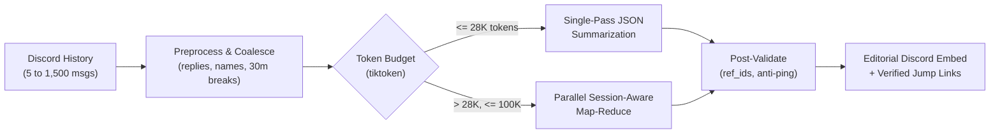

<p align="center">
  
</p>

<h1 align="center">TL;DR Bot</h1>

<p align="center">
  <strong>Distill 5 to 1,500 unread Discord messages into speaker-attributed summaries with verified jump links, powered by your server's own LLM key.</strong>
</p>

<p align="center">
  <a href="https://discord.com/oauth2/authorize?client_id=1574466194864607242">
    
  </a>
</p>

<p align="center">
  <a href="https://github.com/yammdd/tldr-bot/actions/workflows/ci.yml">
    
  </a>
  
  
  
  
</p>

<p align="center">
  <a href="#quick-start">Quick Start</a> &bull;
  <a href="#commands">Commands</a> &bull;
  <a href="#how-it-works">How It Works</a> &bull;
  <a href="#self-hosting">Self-Hosting</a> &bull;
  <a href="#contributing--standards">Contributing</a>
</p>

<p align="center">
  
</p>

---

## Quick Start

1. **Invite the bot:** Click **[Add to Discord](https://discord.com/oauth2/authorize?client_id=1574466194864607242)** to install TL;DR Bot on your server.
2. **Place the bot role:** Open **Server Settings > Roles** and place the Bot role below your Admin/Mod roles and above regular members (only the Server Owner or members with a higher role can change API configuration).
3. **Configure once:** Run `/config`, choose a provider (Google Gemini, DeepSeek, OpenAI, Anthropic Claude, OpenRouter, Groq, or Custom Endpoint), and enter your API key in the private Discord modal. A live smoke test verifies credentials before saving.
4. **Summarize any channel:** Run `/tldr` or right-click any message > **Apps > TL;DR from here**. Run `/language` anytime to choose the output language summaries are written in.

---

## Highlights

<table>
  <tr>
    <td width="50%" valign="top">
      <strong>Speaker-Attributed Pipeline</strong><br />
      Untangles reply chains (<code>-&gt;(Name #id)</code>), resolves <code>@mentions</code>, <code>#channels</code>, and colliding display names, coalesces rapid turns, and routes automatically between Single-Pass (up to 28K tokens) and Parallel Map-Reduce (up to 1,500 messages / 100K input tokens).
    </td>
    <td width="50%" valign="top">
      <strong>Write-Only BYOK Security</strong><br />
      Per-server API keys are submitted privately, verified with a live smoke test, and stored in SQLite WAL using AES-256-GCM with guild-bound AAD (or RAM-only via <code>KEY_STORAGE_MODE=memory</code>). Keys and custom endpoints are never exposed in public commands or logs, and chat messages are never written to disk.
    </td>
  </tr>
  <tr>
    <td width="50%" valign="top">
      <strong>Any OpenAI-Compatible Provider</strong><br />
      Built-in presets for Google Gemini, DeepSeek, OpenAI, Anthropic Claude, OpenRouter, Groq, and any HTTPS Custom Endpoint with SSRF protection. Discover and switch models via <code>/model</code> without re-entering your API key.
    </td>
    <td width="50%" valign="top">
      <strong>Quiet, Readable Output</strong><br />
      Summaries adapt tone to the channel (crisp for work, natural for casual chat), verify every <code>ref_id</code> before rendering clickable jump links, neutralize mass pings, and isolate personal <code>Mentions of you</code> highlights strictly to <code>private:True</code> views.
    </td>
  </tr>
</table>

---

## Commands

| Command / Action | Permission | Description |
| :--- | :--- | :--- |
| `/tldr [count] [since] [focus] [private]` | Everyone | Summarize recent channel messages publicly by default, or set `private:True` |
| Right-click message > **Apps > TL;DR from here** | Everyone | Summarize everything from the selected message up to the present |
| `/config` | Owner or Role > Bot | Pick a provider or custom endpoint, enter API key privately, and run a live smoke test |
| `/model [model_id]` | Owner or Role > Bot | Fetch chat models from the active endpoint and switch models without re-entering the API key |
| `/language` | Owner or Role > Bot | Set the server summary output language (`en`, `vi`, `ja`, `ko`, `zh`, `auto`; default `en`) |
| `/status` | Everyone | View active provider, model, summary language, and context limits (never shows API key or endpoint URL) |
| `/reset_config` | Owner or Role > Bot | Delete the server's stored API key and LLM configuration |
| `/help` | Everyone | Quick setup and usage guide |

---

## How It Works



---

## Self-Hosting

Prefer to host your own instance? Expand one of the deployment guides below.

<details>
<summary><strong>Deploy on Railway (Recommended)</strong></summary>

This repository includes `railway.toml` and an automatic volume-permission entrypoint in `Dockerfile`.

1. Sign in at [Railway](https://railway.com) and select **New Project > Deploy from GitHub Repo** (`yammdd/tldr-bot`).
2. Attach a persistent volume: open the service **Volumes > Add Volume** and set **Mount Path** to `/app/data`.
3. Open **Variables** and add:
   - `DISCORD_TOKEN`: your bot token from the Discord Developer Portal
   - `VAULT_MASTER_KEY`: a 32+ character random secret (keep fixed across redeploys)
   - `DB_FILE_PATH`: `/app/data/tldr_bot.db`
   - `HEALTH_PORT`: `8080`
4. Railway builds the Docker image automatically, verifies `/healthz`, and redeploys on every merge to `main`.

</details>

<details>
<summary><strong>Deploy with Docker Compose</strong></summary>

```bash
cp .env.example .env
# Fill DISCORD_TOKEN and VAULT_MASTER_KEY in .env
docker compose up -d --build
```

Verify container readiness:

```bash
curl http://127.0.0.1:8080/healthz
```

Production notes:
- Mount a persistent volume at `/app/data` and keep `VAULT_MASTER_KEY` fixed across redeploys (changing it invalidates decryption of existing rows).
- Set `HEALTH_PORT=8080` so your hosting platform or reverse proxy can probe `/healthz`.

</details>

<details>
<summary><strong>Local Setup &amp; Discord Developer Portal</strong></summary>

1. Create an application at [Discord Developer Portal](https://discord.com/developers/applications) and open the **Bot** tab.
2. Upload the avatar from `assets/bot-avatar.png` (vector source in `assets/bot-avatar.svg`).
3. Enable **Public Bot** (for multi-server invites) and **Privileged Gateway Intents > `MESSAGE CONTENT INTENT`** *(required to read channel history)*.
4. Under **OAuth2 > URL Generator**, select scopes `bot`, `applications.commands` and permissions `View Channels`, `Send Messages`, `Read Message History`, `Embed Links`.
5. Install dependencies and run locally:

```powershell
python -m venv .venv
.\.venv\Scripts\pip.exe install -r requirements.txt
Copy-Item .env.example .env
python -c "import secrets; print(secrets.token_urlsafe(32))"
# Paste DISCORD_TOKEN and VAULT_MASTER_KEY into .env
.\.venv\Scripts\python.exe run.py
```

Run the offline test suite:

```powershell
.\.venv\Scripts\pytest.exe -v
```

</details>

---

## Contributing & Standards

Before opening a pull request, read:
- [CONTRIBUTING.md](CONTRIBUTING.md): branching, Conventional Commits, PR workflow, and repository map
- [CODING_STANDARDS.md](CODING_STANDARDS.md): clean code, async Discord rules, UI discipline, and security invariants
- [SECURITY.md](SECURITY.md): security model and vulnerability reporting

---

## Legal & Privacy

See [PRIVACY.md](PRIVACY.md) and [TERMS.md](TERMS.md).
