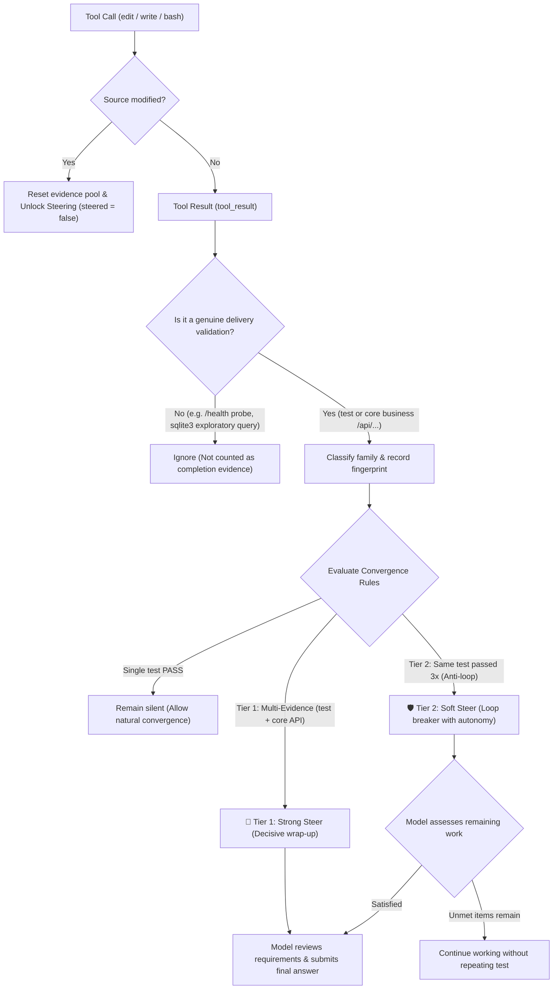

# pi-extension-convergence

[](LICENSE)
[](https://github.com/earendil-works/pi)
[](#)

> **Production-grade Convergence & Anti-Overthinking Steering Extension for [Pi Coding Agent](https://github.com/earendil-works/pi).**  
> Tuned specifically for deep reasoning models (e.g., **Ternary Bonsai 2**, **Qwen 2.5 / 3**, **DeepSeek R1**) to eliminate repetitive verification loops, over-thinking, and step-limit timeouts without hard process kills.

---

[English](#overview) | [中文说明](#中文说明)

---

## Overview

### The Problem: Over-Verification & Thinking Loops
Deep reasoning coding models often suffer from **"over-verification syndrome"**:
1. After fixing a bug or implementing a feature, the model gets stuck in repeated self-doubt.
2. It repeatedly runs the same unit test or health probe, inspecting already passing results.
3. Steps are wasted (often hitting 25+ step limits and timing out), despite the code being 100% correct.

### The Philosophy
> **"Prompt informs the model that it should converge;**  
> **Extension reminds the model that it can converge when reliable evidence exists;**  
> **When evidence is insufficient, it prefers not to intervene."**

Unlike naive supervisors that violently kill processes (`SIGKILL`) or blindly intercept bash commands, `pi-extension-convergence` operates entirely through Pi's official Extension API (`tool_call`, `tool_result`, `sendUserMessage(..., { deliverAs: "steer" })`). It gently steers the model's next turn without corrupting workspace state.

---

## Core Architecture & Invariants



### 1. Two-Tier Steering
* 🚀 **Tier 1: Strong Steer (Multi-Evidence: `test` PASS + core `runtime` API PASS)**
  > *"The required validation has already passed and no source code has changed since then. Do not perform additional verification. Review the explicit task requirements once, provide the final result, and end the task."*
* 🛡️ **Tier 2: Soft Steer (Loop-Breaker: Same test PASS 3 times with no code changes)**
  > *"You have repeated the same successful validation without source changes. Do not run the same check again. If all explicit requirements are satisfied, finish the task now. Otherwise continue only with the remaining unmet requirements."*
  * Prevents infinite loops while **preserving the model's freedom** to continue implementing genuine unmet requirements.

### 2. Strict Evidence Filtering
* ✅ **Genuine Evidence**:
  * `test`: Automated unit/integration tests (`pytest`, `npm test`, `node --test`).
  * `runtime`: Core business API endpoints (`/api/...`).
* ❌ **Excluded False Signals**:
  * `/health`: Generic scaffold liveness probe (never counted as feature completion).
  * `sqlite3` queries / schema dumps: Exploratory inspection commands.
  * `ls`, `read`, `grep`: Read-only exploratory tools.

### 3. Post-Steer Self-Healing Invariant
* If the model receives a Steer but determines code changes are still needed, any subsequent `edit` or `write` immediately:
  * Increments `sourceRevision`.
  * Wipes all prior evidence.
  * **Unlocks steering (`steered = false`)**, allowing the model to be steered again once truly complete.

---

## Benchmark Results (Bonsai 2 27B)

Evaluated across standardized coding tasks with strict physical isolation:

| Task | Category | Baseline (No Control) | Prompt Only | **Convergence v1.0** | Hidden Validator |
| :--- | :--- | :---: | :---: | :---: | :---: |
| **A1** | Long-Chain Bug & Service Migration | TIMEOUT (26+ steps) | 24 steps | **19 steps** (Steer@18) | **PASS (100%)** |
| **P1** | REST API & CSV Export Feature | TIMEOUT (26+ steps, 551s) | 24~25 steps | **16 steps** (Steer@15, 216s) | **PASS (100%)** |
| **C1** | Python Algorithmic Bug Fix | 13 steps | 12 steps | **10 steps** (Natural finish) | **PASS (100%)** |
| **C2** | TypeScript Async Tenant Service | 14 steps | 10 steps | **8 steps** (Natural finish) | **PASS (100%)** |

---

## Installation & Usage

### Option A: Project-Level Installation (Recommended for Testing)
Place `convergence.ts` into your project's `.pi/extensions/` folder:

```bash
# macOS / Linux
mkdir -p .pi/extensions
curl -sSL https://raw.githubusercontent.com/yang2020chen/pi-extension-convergence/main/convergence.ts -o .pi/extensions/convergence.ts

# Windows (PowerShell)
New-Item -ItemType Directory -Force .pi\extensions
Invoke-WebRequest -Uri "https://raw.githubusercontent.com/yang2020chen/pi-extension-convergence/main/convergence.ts" -OutFile ".pi\extensions\convergence.ts"
```

Pi automatically discovers extensions in `.pi/extensions/` on startup.

---

### Option B: Global Installation (All Workspaces)
To make convergence protection active globally across all Pi sessions:

```bash
# macOS / Linux
mkdir -p ~/.pi/agent/extensions
curl -sSL https://raw.githubusercontent.com/yang2020chen/pi-extension-convergence/main/convergence.ts -o ~/.pi/agent/extensions/convergence.ts

# Windows (PowerShell)
New-Item -ItemType Directory -Force "$env:USERPROFILE\.pi\agent\extensions"
Invoke-WebRequest -Uri "https://raw.githubusercontent.com/yang2020chen/pi-extension-convergence/main/convergence.ts" -OutFile "$env:USERPROFILE\.pi\agent\extensions\convergence.ts"
```

---

### Companion Prompt (`prompts/convergence.md`)
For maximum effectiveness, append `prompts/convergence.md` to your system prompt:

```bash
pi --append-system-prompt path/to/prompts/convergence.md
```

Or configure it in your `settings.json`:
```json
{
  "systemPromptAppend": "Once the required validation has passed and no source code has changed after that, do not perform additional verification. Review the explicit task requirements once, provide the final result, and end the task."
}
```

---

<a name="中文说明"></a>
## 中文说明

### 解决什么痛点？
具备深度思考能力的大模型（如 Bonsai 2、Qwen 2.5/3、DeepSeek R1）在写代码时极易产生**“过度复测与思维震荡”**：
- 业务代码其实已经改好、单测也已跑通，但模型依然不断重跑同一条单测，甚至自己去查换行符、探内存，最终逼近步数上限（25+ 步）超时挂掉。
- 传统外部强杀进程（Hard Kill）或命令拦截容易破坏工作区状态或造成死锁。

### 核心设计原则
> **“Prompt 负责告诉模型应该收敛；Extension 负责在有可靠证据时提醒它可以收敛；证据不足时宁可不干预。”**

### 双梯级分流引导机制
1. **梯级 1：强 Steering（多维强证据）**：
   - 当**自动化单测（test）通过**且**核心业务 API（/api/...）调用通过**，达成独立强证据闭环时触发。
   - 强力引导模型不再做多余复测，复核显式要求后直接交卷。
2. **梯级 2：软 Steering（防死循环兜底）**：
   - 当完全相同的测试命令**在源码无变化的情况下连续通过 3 次**时触发。
   - 严禁继续重跑该重复命令以打破死循环，但**赋予模型继续做未完成需求的自由**。
3. **彻底剔除假证据**：
   - `/health` 存活探针、`sqlite3` 查询、`ls`/`read`/`grep` 永远不计入完成证据池。
4. **源码修改即刻解锁**：
   - 收到 Steer 后模型若发现遗漏并再次执行 `edit` / `write`，旧证据清空且 `steered = false`，允许后续真正做完后再次 Steer。

---

## License

[MIT License](LICENSE) © 2026 yang2020chen
