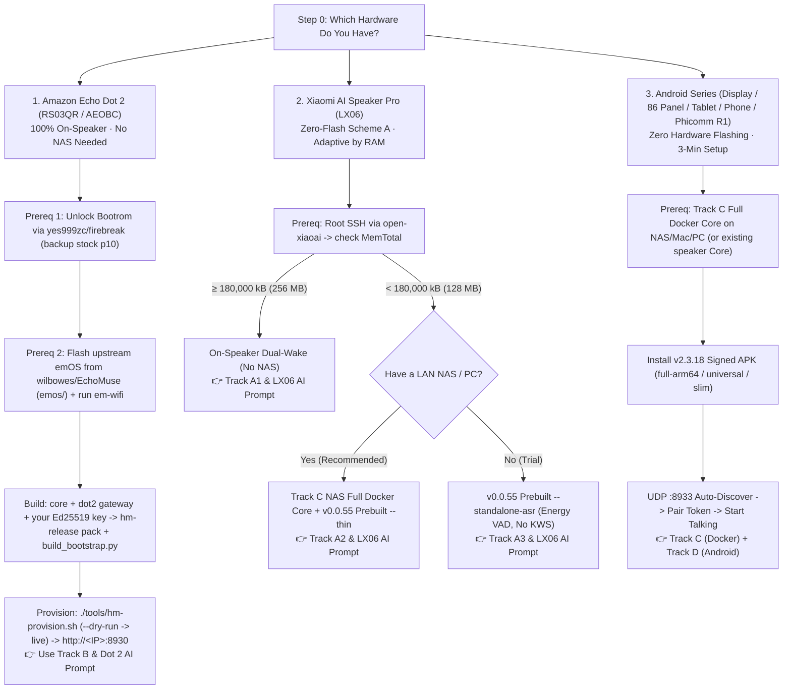

<p align="center">
  
</p>

<p align="center">
  <strong>English</strong> · <a href="README.zh-CN.md"><strong>简体中文</strong></a> · <a href="https://mymate.homes"><strong>Official Website (mymate.homes)</strong></a>
</p>

<p align="center">
  <a href="https://mymate.homes"></a>
  <a href="LICENSE"></a>
  <a href="LICENSE-PROTOCOL-APACHE-2.0"></a>
  
  
</p>

---

## What is Home Mate (XiaoRui / 小瑞)?

**Home Mate (小瑞)** is the next-generation evolution of [rui (小瑞)](https://github.com/yes999zc/rui), rewritten from scratch in **pure Rust** with a three-layer sovereign household architecture:

1. **On-Speaker Sovereign Edge Brain (`hm-core`) — Or NAS Docker Multi-Room Hub**
   - Unlike first-generation `rui`, Home Mate compresses the voice runtime (`hm-core` + Vue 3 Web Console `:8930` + `hm-gateway` + `hm-kws` Zipformer & Silero VAD) to run **100% directly inside ARM64 smart speakers** (Echo Dot 2 & 256 MB Xiaomi LX06) — with zero external streaming server required.
   - The exact same `hm-core` also runs in **Full Docker mode on a NAS / home server** (`linux/amd64` & `linux/arm64`), hosting **128 MB LX06 thin gateways** and **Android phones, tablets, smart displays, and 86 wall panels** simultaneously.
2. **Master Brain / Family Agent Orchestration (`brain.delegate / status / steer / cancel`)**
   - The edge speaker handles low-latency wake, instant Q&A, music/stories/reminders, and closed-loop Home Assistant control with mandatory post-action readback.
   - Complex long-horizon tasks, cross-tool research, briefings, and fleet diagnostics (`skills/home-mate-fleet`) are **delegated asynchronously to a Household Master Brain Agent** (Hermes / OpenAI-compatible Agent gateway) — never blocking everyday voice turns, with spoken callbacks back to the initiating room.
3. **Edge Brain + Multi-Gateway Strict Isolation (`Northbound Protocol v2`)**
   - A single `hm-core` concurrently manages multiple heterogeneous gateways (Echo Dot 2, LX06 256 MB / 128 MB, multiple Android devices) with:
     - **Per-device isolated sessions**, retreat context archiving (`退下`), and unified current + archived conversation clear (`DELETE /api/v0/devices/{id}/conversation`);
     - **Per-hardware-family KWS sensitivity isolation** (Dot2 `0.32 / 2.50`, LX06 `0.20 / 2.50`, Android `0.22 / 3.00`, with explicit per-device overrides winning — zero cross-family clobbering);
     - **Oneshot `wake_dur_ms` command slicing**, wake-ack tail bridging, millisecond local-exit interruption, and Bearer Token + opt-in private-LAN exemption (`lan_gateway_exempt`) security boundaries.
     - *(Note: Everyday voice interaction defaults to stable half-duplex with wake-word & local-exit barge-in; **Full-Duplex is currently in active development** and clearly labeled `In Dev` across the console and Android app.)*

> [!IMPORTANT]
> **Hardware Research Disclaimer & Custom Speaker Roadmap**
> 1. **For Research & Personal Experimentation Only**: Adaptation of third-party commercial speakers (**Xiaomi AI Speaker Pro `LX06`** and **Amazon Echo Dot 2 `RS03QR`**) in this project is provided **strictly for edge-AI architectural research, acoustic arbitration validation, and personal non-commercial experimentation**. All trademarks belong to their respective owners. This project is not affiliated with Xiaomi or Amazon and **does not sell modified third-party brand-name speakers**.
> 2. **First-Party Custom Speaker Under Active Development**: We are actively engineering a **dedicated custom Home Mate (小瑞) smart speaker hardware platform** featuring an open far-field microphone array, tuned acoustic enclosure, and native sovereign Rust firmware out of the box—requiring zero third-party unlock steps.

---

## Unified 3-Repository Ecosystem (Now Open: Linux Unified Gateway & Android Universal APK)

<p align="center">
  
</p>

We have consolidated and opened the complete **3-repository Home Mate ecosystem**:

| Repository | Role & Highlights | License |
| :--- | :--- | :--- |
| **[yes999zc/home-mate](https://github.com/yes999zc/home-mate)** *(this repo)* | **Core Edge Brain & Console**: `hm-core` (Full Docker with in-process Silero VAD & `--slim` speaker build), Master Brain delegation, Multi-Gateway isolation, `hm-release` Ed25519 signed OTA manager, Vue 3 Web Console (`web/`), `tools/hm-provision.sh`, and Northbound v2 protocol contract. | `AGPL-3.0` (`Apache-2.0` Protocol v2 Spec) |
| **[yes999zc/home-mate-gateway-linux](https://github.com/yes999zc/home-mate-gateway-linux)** *(Unified Linux Gateway)* | **Replaces legacy separate `dot2` & `lx06` repos**: Feature-gated Rust hardware gateway supporting **Echo Dot 2 (`board-dot2`)**, **Xiaomi LX06 256 MB** (on-speaker Scheme A dual-wake), and **Xiaomi LX06 128 MB** (Thin Gateway w/ NAS or Standalone Pure-ASR w/o NAS). | `AGPL-3.0` |
| **[yes999zc/home-mate-gateway-android](https://github.com/yes999zc/home-mate-gateway-android)** *(Universal Android Gateway)* | **One adaptive zero-dependency APK** (Android 5–16) turning **Android smart displays, 4-inch 86 wall panels (1:1), tablets, everyday phones, and repurposed old Android phones** into offline-KWS far-field voice terminals & multi-room controllers with GitHub Releases auto-update. | `AGPL-3.0` |

> **Migration Note**: Legacy single-board repositories (`home-mate-gateway-dot2` and `home-mate-gateway-lx06`) have been unified into **[yes999zc/home-mate-gateway-linux](https://github.com/yes999zc/home-mate-gateway-linux)**. All new deployments and AI agent scripts should target `home-mate-gateway-linux`.

### Zero-to-Talking Device Decision Map (Start Here!)

Not sure which track, prerequisite, or AI prompt to use? Follow your device branch from top to bottom:



### Which Combination Should I Choose? (Quick Matrix)

| What Hardware You Have | Prerequisites | Recommended Topology | External NAS/Server Needed? | Jump To |
| :--- | :--- | :--- | :--- | :--- |
| **Amazon Echo Dot 2 (`RS03QR` / `AEOBC`)** | `firebreak` unlock (`p10` backup) + upstream **EchoMuse `emOS`** + `em-wifi` | On-speaker Full `hm-core` + `hm-gateway` + `hm-kws` (7-mic + 160ms AEC + 12-LED ring) | **No** (100% on-speaker) | [Track B (Dot 2)](#track-b-amazon-echo-dot-2-rs03qr--aeobc--from-stock-to-talking) |
| **Xiaomi LX06 (256 MB RAM)** | `open-xiaoai` Root SSH, `MemTotal ≥ 180,000 kB` | On-speaker `hm-core --slim` + `hm-gateway` + `hm-kws` (Scheme A dual-wake) | **No** (100% on-speaker) | [Track A (LX06)](#track-a-xiaomi-ai-speaker-pro-lx06--adaptive-256-mb--128-mb-deploy) |
| **Xiaomi LX06 (128 MB · w/ NAS Recommended)** | `open-xiaoai` Root SSH + LAN NAS Full Docker Core | Prebuilt **Thin Gateway** (`--thin`, `~4 MiB` RAM) → **Full Docker `hm-core`** (Silero VAD) | **Yes** | [Track A](#track-a-xiaomi-ai-speaker-pro-lx06--adaptive-256-mb--128-mb-deploy) + [Track C](#track-c-nas--docker-full-core-multi-gateway-hub-for-128-mb-lx06--android) |
| **Xiaomi LX06 (128 MB · No-NAS Trial)** | `open-xiaoai` Root SSH, `/data ≥ 5.5 MiB` | Prebuilt **Standalone Pure-ASR** (`--standalone-asr`: `hm-core --slim` + `hm-gateway`, no KWS) | **No** (100% on-speaker) | [Track A (LX06)](#track-a-xiaomi-ai-speaker-pro-lx06--adaptive-256-mb--128-mb-deploy) |
| **Android Display / 86 Panel / Tablet / Phone / R1** | Android 5–16 (Zero hardware flashing!) | **Full Docker `hm-core`** on NAS/PC + **Android Universal APK** (`v2.3.18`) | **Yes** *(or Manage-Only on speaker Core)* | [Track C](#track-c-nas--docker-full-core-multi-gateway-hub-for-128-mb-lx06--android) + [Track D](#track-d-android-universal-terminal-smart-displays-86-panels-tablets--old-phones) |

---

## Xiaomi AI Speaker Pro (`LX06`) Highlights (Adaptive 256 MB / 128 MB)

Deployed via **[yes999zc/home-mate-gateway-linux](https://github.com/yes999zc/home-mate-gateway-linux)**, Home Mate automatically inspects `MemTotal` in `/proc/meminfo` and adapts to both Xiaomi factory batches:

1. **Adaptive 256 MB On-Speaker vs. Dual 128 MB Modes**:
   - **256 MB batch (`MemTotal >= 180,000 kB`)**: Unpacks the `<= 6.0 MiB` Scheme A archive (`/data/hm/hm-bundle.tar.xz`) into `120.9 MiB` `/tmp` RAM tmpfs on boot — `hm-core --slim`, Vue 3 Console (`:8930`), `hm-gateway`, and `hm-kws` (with hardware-calibrated `0.20 / 2.50` KWS sensitivity) run **100% on-speaker**.
   - **128 MB batch (`MemTotal < 180,000 kB`, ~59 MB `/tmp`)**:
     - **With NAS (Recommended — `--thin`)**: Auto-enters **Thin Gateway mode** (`hm-lx06-thin.tar.xz`, ~606 KB compressed / ~4 MiB RAM), dialing your **NAS / server Full Docker `hm-core`** (with in-process Silero neural VAD) over private LAN `:8932` or SSH reverse tunnel.
     - **Without NAS (Trial — `--standalone-asr`)**: Skips local `hm-kws` (saving ~50–68 MiB RAM) and runs `hm-core --slim` (`HM_VOICE_EVENTS=0` to protect 58 MB `/tmp`) + `hm-gateway` + `:8930` Console directly on the speaker (~26–31 MiB net RAM, ~22–30 MiB free headroom) using energy VAD + cloud ASR wake.
2. **Zero Damage to Stock Firmware (Dual-System Coexistence)**:
   - **0 bytes modified in stock SquashFS**: Factory read-only `mtd4 (system0)` and `mtd5 (system1)` partitions remain **100% untouched** (zero brick risk).
   - **1-Line Factory Restore**: Run `rm -rf /data/hm /data/init.sh && reboot` over SSH to return to 100% stock state.
3. **Instant System Switching by Wake Word (256 MB Dual-Wake)**:
   - Say **"XiaoAi TongXue" (小爱同学)** → Answered natively by stock Xiaomi XiaoAi.
   - Say **your custom wake word (e.g. "NiHao GaoDa" / "NiHao XiaoZhi")** → Answered by **Home Mate**.
   - Say **"QieHuan XiaoAi" (切换小爱)** *(or long-press Play/Pause 1.5 s)* → Immediately yields or toggles pinned stock XiaoAi mode.

---

## Live Interface Gallery: Android Universal App & Web Console

### Android Universal Client & Voice Gateway (`v2.3.10+` · 4:3 & 1:1 Adaptive Layouts)

One APK adapts cleanly across phones, repurposed spare phones, 4-inch 86 wall control panels (`1:1`), and smart displays / tablets (`4:3`) — featuring offline Sherpa-ONNX JNI KWS, mid-playback PBFDAF AEC barge-in, unified conversation history with one-tap clear, whole-house multi-room controls, battery exemption management, and GitHub Releases auto-updates:

<table>
  <tr>
    <td width="50%">
      
      <p align="center"><strong>1. Voice Companion &amp; Unified History Clear (Phone · 4:3)</strong><br>3D nebula orb, bottom live transcript synced with top-right history sheet &amp; one-tap Clear (current + archived)</p>
    </td>
    <td width="50%">
      
      <p align="center"><strong>2. Whole-House Control &amp; Settings (Phone · 4:3)</strong><br>Multi-room Core switching, Kiosk 86-panel launcher, battery keep-alive &amp; GitHub Releases auto-update</p>
    </td>
  </tr>
  <tr>
    <td width="50%">
      
      <p align="center"><strong>3. Smart Display / Tablet Adaptive Layout (Native 4:3)</strong><br>Automatic left navigation rail for landscape smart displays, bedside stands &amp; tablets</p>
    </td>
    <td width="50%">
      
      <p align="center"><strong>4. 4-Inch 86 Wall Control Panel Layout (Native 1:1)</strong><br>Compact square UI with optional Kiosk Home Launcher mode for wall-mounted Android panels</p>
    </td>
  </tr>
</table>

### Built-In Web Console (`:8930` · Light Theme Default)

Every Core (on-speaker or NAS Docker) serves the responsive Vue 3 Web Console directly at `http://<CORE_IP>:8930`:

<table>
  <tr>
    <td width="50%">
      
      <p align="center"><strong>1. Status Overview (<code>/status</code>)</strong><br>Readiness checks, gateway connection generation, microphone capture state &amp; active program</p>
    </td>
    <td width="50%">
      
      <p align="center"><strong>2. Wake Words &amp; Follow-up (<code>/interaction</code>)</strong><br>Custom wake phrases, per-family sensitivity, 9s follow-up window &amp; local exit words</p>
    </td>
  </tr>
  <tr>
    <td width="50%">
      
      <p align="center"><strong>3. Hardware &amp; Audio Gate (<code>/devices</code>)</strong><br>Firmware status, room assignment, Silero VAD dBFS gates &amp; post-playback blind window</p>
    </td>
    <td width="50%">
      
      <p align="center"><strong>4. Speaker Voicing EQ (<code>/devices</code>)</strong><br>Dedicated 3-band custom woofer curve for Xiaomi LX06 and 10-band EchoMuse curve for Echo Dot 2</p>
    </td>
  </tr>
  <tr>
    <td width="50%">
      
      <p align="center"><strong>5. LLM, ASR, TTS &amp; Master Brain (<code>/services</code>)</strong><br>Primary/fallback LLMs (DeepSeek / GLM / OpenAI), Qwen3-ASR, Volcengine TTS &amp; Master Family Agent config</p>
    </td>
    <td width="50%">
      
      <p align="center"><strong>6. Home Assistant Closed-Loop Readback (<code>/tools</code>)</strong><br>Auto-discovered Assist entities with mandatory post-action state readback verification</p>
    </td>
  </tr>
</table>

---

## Quickstart & AI Coding Agent Deployment Prompts (4 Tracks)

### Track A: Xiaomi AI Speaker Pro (`LX06`) — Adaptive 256 MB / 128 MB Deploy

#### Prerequisites
1. **Model & Memory Check**: Black cylinder **Xiaomi AI Speaker Pro (`LX06`, A113X `aarch64`)**. Always run `grep ^MemTotal /proc/meminfo` over SSH first to identify **256 MB (`>= 180,000 kB`)** vs. **128 MB (`< 180,000 kB`)**.
2. **Root SSH Unlocked**: Enable root SSH (port 22) via [idootop/open-xiaoai](https://github.com/idootop/open-xiaoai).
3. **If 128 MB Batch**: With a NAS/server, deploy **Track C (Full Docker `hm-core`)** first and use `--thin`; without a NAS, use `--standalone-asr` directly (`v0.0.54+` Releases include zero-compile prebuilt archives for both).

#### Manual Commands (`v0.0.54+` ships zero-compile prebuilt Release assets)
```bash
git clone https://github.com/yes999zc/home-mate-gateway-linux.git
cd home-mate-gateway-linux

# Option A1 — 256 MB LX06 (100% on-speaker dual-wake):
./tools/pack_lx06_bundle.sh
python3 -m http.server 18089 --directory build/lx06 &
./deploy/lx06/install-lx06.sh --device-ip 192.168.1.50 --kws-url http://192.168.1.10:18089/hm-kws-lx06.tar.xz

# Option A2 — 128 MB LX06 + NAS (Recommended; zero-compile prebuilt Thin Gateway -> NAS Full Docker Core):
mkdir -p build/lx06 && for f in hm-lx06-thin.tar.xz hm-lx06-thin.sha256 init.sh unxz SHA256SUMS.txt; do
  curl -fL "https://github.com/yes999zc/home-mate-gateway-linux/releases/download/v0.0.55/$f" -o "build/lx06/$f"
done && chmod +x build/lx06/init.sh build/lx06/unxz
./deploy/lx06/install-lx06.sh --thin --device-ip 192.168.1.50 --core-addr 192.168.1.10:8932 --device-id lx06-living --core-token "<TOKEN>"

# Option A3 — 128 MB LX06 without NAS (Standalone Pure-ASR trial; zero-compile main bundle, no local KWS):
mkdir -p build/lx06 && for f in hm-bundle.tar.xz hm-bundle.sha256 init.sh unxz SHA256SUMS.txt; do
  curl -fL "https://github.com/yes999zc/home-mate-gateway-linux/releases/download/v0.0.55/$f" -o "build/lx06/$f"
done && chmod +x build/lx06/init.sh build/lx06/unxz
./deploy/lx06/install-lx06.sh --standalone-asr --device-ip 192.168.1.50 --device-id lx06-standalone
```

#### Let an AI Coding Agent Deploy LX06 (Auto-Detects 256 MB vs Dual 128 MB Modes)
Copy and paste into **Claude Code, Cursor, Codex, or Antigravity** *(replace the example IPs `192.168.1.50` and `192.168.1.10` with your real LAN IPs; note "no NAS" if you want 128 MB standalone pure-ASR)*:
```text
Help me deploy Home Mate (XiaoRui) onto my Xiaomi AI Speaker Pro (LX06, root SSH enabled via open-xiaoai):
[Replace the example IPs below with your real LAN IPs]
- LX06 Speaker SSH: root@192.168.1.50
- LAN NAS / Host IP: 192.168.1.10 (if I don't have a NAS, use 128 MB Standalone Pure-ASR mode)

Follow these strict rules:
1. NEVER modify stock SquashFS partitions (mtd4 / mtd5). Use only non-invasive Storage Scheme A under /data/hm and /data/init.sh.
2. Clone https://github.com/yes999zc/home-mate-gateway-linux.git (and https://github.com/yes999zc/home-mate.git side-by-side if building 256 MB from source or deploying NAS Docker).
3. SSH into root@<SPEAKER_IP> and inspect `uname -m`, `grep ^MemTotal /proc/meminfo`, and `df -k /data /tmp`:
   - If MemTotal >= 180000 kB (256 MB batch -> On-Speaker Dual-Wake):
     a) Verify /data has >= 6000 KB free, pack with `./tools/pack_lx06_bundle.sh`, and serve `build/lx06/` on <HOST_IP>:18089 (confirm HTTP 200 on `hm-kws-lx06.tar.xz`).
     b) Run `./deploy/lx06/install-lx06.sh --device-ip <SPEAKER_IP> --kws-url http://<HOST_IP>:18089/hm-kws-lx06.tar.xz`.
     c) Verify `hm-core`, `hm-gateway`, and `hm-kws` are running, `http://<SPEAKER_IP>:8930` loads HTTP 200, and `/api/v0/mode` shows LX06 KWS `0.20 / 2.50`.
   - If MemTotal < 180000 kB (128 MB batch — download prebuilt Release `v0.0.54+` assets into `build/lx06/` and verify `SHA256SUMS.txt` without Rust compilation):
     * [Preferred w/ NAS -> Thin Gateway]:
       a) Deploy standard **Full Docker `hm-core`** (NOT `--slim`, `HM_GATEWAY_ALLOW_LAN=1`) from `yes999zc/home-mate` on <HOST_IP> (`docker compose up -d`) and pair an admin token.
       b) Download `hm-lx06-thin.tar.xz`, `hm-lx06-thin.sha256`, `init.sh`, and `unxz`, then run `./deploy/lx06/install-lx06.sh --thin --device-ip <SPEAKER_IP> --core-addr <HOST_IP>:8932 --core-token "<TOKEN>"`.
       c) Verify ONLY `hm-gateway` runs on the speaker and it appears online at `http://<HOST_IP>:8930`.
     * [No-NAS Trial -> Standalone Pure-ASR]:
       a) Confirm `/data` has >= 5500 KB free; download `hm-bundle.tar.xz`, `hm-bundle.sha256`, `init.sh`, and `unxz`.
       b) Run `./deploy/lx06/install-lx06.sh --standalone-asr --device-ip <SPEAKER_IP>`.
       c) Verify ONLY `hm-core` (`HM_VOICE_EVENTS=0`) and `hm-gateway` (no `hm-kws`) run, `/tmp` stays < 45%, and `http://<SPEAKER_IP>:8930` returns HTTP 200.
     * [Optional DIY (Say "XiaoAi TongXue" to Interrupt Playback in 128 MB Non-KWS Mode)]: Upstream keeps stock `pns` paused during Home Mate playback for 256 MB dual-wake stability. If I want to interrupt playback by waking stock XiaoAi in non-KWS mode, customize `crates/gateway/src/firmware/lx06_vendor.rs` (`wants_pns` under `!local_kws_enabled` + `instruction.log` native-wake playback stop) locally and rebuild via `./tools/build_firmware_lx06.sh`.
4. Never commit real IPs or tokens to Git. Pair a household admin token and save it to `~/.home-mate/` (chmod 600).
```

---

### Track B: Amazon Echo Dot 2 (`RS03QR` / `AEOBC`) — From Stock to Talking

#### Step-by-Step Prerequisites (Where `emOS` Comes From)
Home Mate runs **100% on-device** on top of **`emOS`** — a minimal Linux userspace originally created by the upstream **[`wilbowes/EchoMuse`](https://github.com/wilbowes/EchoMuse)** project that keeps your Dot 2's stock MediaTek 3.18 kernel and 7-mic/3.5mm audio hardware while removing Amazon's FireOS/Android userspace completely.

1. **Step 0 — Unlock Bootrom via `firebreak` (`amonet`)**:
   - **Do NOT update a brand-new/stock Dot 2 via the Alexa App before unlocking.**
   - Connect your 2nd-Gen Echo Dot (`RS03QR` / `AEOBC`) over Micro-USB and unlock it using **[`yes999zc/firebreak`](https://github.com/yes999zc/firebreak)** (`uvx firebreak@latest`). **Save your stock `p10` partition backup safely.**
2. **Step 1 — Flash Upstream `emOS` from `wilbowes/EchoMuse`**:
   - Clone **[`wilbowes/EchoMuse`](https://github.com/wilbowes/EchoMuse)** and follow its root **[`SETUP.md`](https://github.com/wilbowes/EchoMuse/blob/main/SETUP.md)** and **[`emos/`](https://github.com/wilbowes/EchoMuse/tree/main/emos)** wizard (`emos-v0.10+`) to build and flash `emOS` around **your own speaker's kernel/DTB**. *(We intentionally delegate `emOS` flashing to upstream EchoMuse — `emOS` is not a one-way door; `/init recovery` returns to TWRP anytime.)*
3. **Step 2 — Connect Wi-Fi Over USB Serial**:
   - Plug the Dot 2 into your Mac/Linux host via Micro-USB, open the USB serial console (`/dev/cu.usbmodem*` on macOS or `/dev/ttyACM*` on Linux), verify `cat /etc/os-release` reports `ID=emos`, and run **`em-wifi`** to join your home Wi-Fi and obtain a LAN IP.

#### Step 3 — Build, Self-Sign & Generate Bootstrap Seed (First-Time Setup)
> **Host Toolchain Prerequisites (macOS or Linux)**: Rust (`rustup target add aarch64-unknown-linux-musl armv7-unknown-linux-musleabihf` + `rustup component add llvm-tools` / `rust-lld`), `zig` + `cargo-zigbuild`, Node.js 20+, Python 3 + `pyserial`, and the Sherpa-ONNX aarch64 KWS sidecar bundle at `~/.home-mate/kws-build/bundle` (assembled via `home-mate-gateway-linux/kws/build.sh` + `kws/assemble.sh`).

Clone both repositories side by side (`hm-provision.sh` and `build_bootstrap.py` automatically find `../home-mate-gateway-linux`):
```bash
git clone https://github.com/yes999zc/home-mate.git
git clone https://github.com/yes999zc/home-mate-gateway-linux.git
cd home-mate

# 1. Generate YOUR OWN Ed25519 signing keypair (outside Git) and embed your pubkey into hm-release:
cargo build -p hm-release
./target/debug/hm-release keygen --out ~/.home-mate/signing/release-signing-key.hex
./target/debug/hm-release pubkey --key ~/.home-mate/signing/release-signing-key.hex > deploy/release/release-pubkey.hex
./tools/build_release.sh             # aarch64 static hm-release carrying YOUR pubkey
cargo build -p hm-release            # refresh host verifier with YOUR pubkey

# 2. Build full hm-core (aarch64), Vue 3 console, and Dot 2 gateway (armv7 — NEVER raw cargo zigbuild!):
./tools/build_core.sh
(cd web && npm install && npm run build)
(cd ../home-mate-gateway-linux && ./tools/build_firmware.sh)

# 3. Assemble & sign home-mate-release.tar (see deploy/release/README.md for exact layout):
VER=$(date +%Y.%m.%d)-1
REL="build/release-$VER"
mkdir -p "$REL/components/model"
cp target/aarch64-unknown-linux-musl/release/hm-core "$REL/components/core-aarch64"
cp ../home-mate-gateway-linux/target/armv7-unknown-linux-musleabihf/release/home-mate-device-gateway "$REL/components/firmware-armv7"
cp -a web/dist "$REL/components/web"
# Download the audited Silero VAD v4 16 kHz ONNX (643,854 B, SHA-256 verified by hm-release pack):
curl -fL https://github.com/k2-fsa/sherpa-onnx/releases/download/asr-models/silero_vad.onnx \
  -o "$REL/components/model/silero_vad.onnx"
./target/debug/hm-release pack --dir "$REL" --out "build/release/home-mate-release-$VER" \
  --serial 1 --version "$VER" --key ~/.home-mate/signing/release-signing-key.hex \
  --model AEOBC --profile dot2d-emos --firmware-min 0.0.44 --firmware-max 0.0.99

# 4. Build the per-device bootstrap seed (requires Sherpa-ONNX KWS bundle at ~/.home-mate/kws-build/bundle;
#    pass --allow-empty-wake-acks for your household's very first Dot 2 before TTS is configured):
python3 tools/build_bootstrap.py \
  --device-id dot2-living \
  --release "build/release/home-mate-release-$VER.tar" \
  --allow-empty-wake-acks
```

#### Step 4 — Provision Over USB Serial (`tools/hm-provision.sh`)
```bash
# 1. Read-only dry-run preflight (touches zero bytes on the speaker):
./tools/hm-provision.sh --device-id dot2-living \
  --seed "build/bootstrap/home-mate-bootstrap-dot2-living-$VER.tar.gz" \
  --release "build/release/home-mate-release-$VER.tar" \
  --serial /dev/cu.usbmodem8401 --ip 192.168.1.73 \
  --wake-word "Hey Mate" --dry-run

# 2. Remove --dry-run to install, activate (health self-checks), pair token & optionally clone config:
./tools/hm-provision.sh --device-id dot2-living \
  --seed "build/bootstrap/home-mate-bootstrap-dot2-living-$VER.tar.gz" \
  --release "build/release/home-mate-release-$VER.tar" \
  --serial /dev/cu.usbmodem8401 --ip 192.168.1.73 \
  --wake-word "Hey Mate"
```
*(Open `http://<DOT2_IP>:8930` to configure your LLM / ASR / TTS & Home Assistant — `hm-core` will auto-synthesize wake acks once TTS is saved. Never copy per-unit acoustic calibration across different Dot 2 units.)*

#### Let an AI Coding Agent Set Up Echo Dot 2 End-to-End (From Stock or emOS)
Copy and paste into **Claude Code, Cursor, Codex, or Antigravity** *(replace the example values below with your real serial port, LAN IP, and preferred wake word)*:
```text
Help me deploy Home Mate onto my Amazon Echo Dot 2nd Gen (RS03QR / AEOBC):
[Replace the example values below with your own]
- Current speaker state: <stock / already unlocked via firebreak / already running emOS on Wi-Fi>
- USB Serial Port: /dev/cu.usbmodem8401   (or auto-detect via `ls /dev/cu.usbmodem* /dev/ttyACM*`)
- Speaker LAN IP:  192.168.1.73           (after running `em-wifi` on emOS)
- Desired Node ID & Wake Word: dot2-living / "Hey Mate" (customize to English or Chinese)
- (Optional) Existing Reference Speaker IP: none

Follow this exact end-to-end checklist safely:
1. Prerequisites (guide me interactively; NEVER auto-flash p10 without my explicit confirmation):
   - If still stock: guide me through unlocking Bootrom with `yes999zc/firebreak` (`uvx firebreak@latest`) and saving my stock `p10` backup.
   - If not yet on emOS: guide me to clone upstream `https://github.com/wilbowes/EchoMuse` and flash `emOS` (`emos/` directory, `emos-v0.10+`) around my own kernel/DTB, then run `em-wifi` over USB serial until `cat /etc/os-release` shows `ID=emos` and `wlan0` has an IP.
2. Clone `https://github.com/yes999zc/home-mate.git` and `https://github.com/yes999zc/home-mate-gateway-linux.git` side by side (`hm-provision.sh` and `build_bootstrap.py` auto-detect `../home-mate-gateway-linux`).
3. Build & Self-Sign (check `deploy/release/README.md`):
   - Generate my own Ed25519 key at `~/.home-mate/signing/release-signing-key.hex` (chmod 600, outside Git), write its pubkey into `deploy/release/release-pubkey.hex`, and rebuild `hm-release` (`./tools/build_release.sh` + `cargo build -p hm-release`).
   - Build full `hm-core` (`./tools/build_core.sh`), `web/dist`, and Dot 2 gateway (`./tools/build_firmware.sh` in `home-mate-gateway-linux` — NEVER raw `cargo zigbuild`!).
   - Pack & sign `home-mate-release.tar` via `hm-release pack`, then build the per-node seed via `python3 tools/build_bootstrap.py --device-id dot2-living --release <tar> --allow-empty-wake-acks` (after preparing the Sherpa-ONNX KWS bundle at `~/.home-mate/kws-build/bundle`).
4. Provision safely:
   - Run `./tools/hm-provision.sh ... --dry-run` first and show me the preflight output (`ID=emos`, `/data/emos/sockets`, IP).
   - After I confirm, run without `--dry-run`, verify health checks, save the token to `~/.home-mate/dot2-living.token` (chmod 600), and verify `http://<SPEAKER_IP>:8930` loads HTTP 200.
5. Never commit real IPs, tokens, or signing keys to Git, and never copy acoustic calibration parameters from another Dot 2 unit.
```

---

### Track C: NAS / Docker Full Core (Multi-Gateway Hub for 128 MB LX06 & Android)

Deploy **Full `hm-core`** (with **pre-bundled Silero VAD v4** + Vue 3 Console) on Synology, fnOS, UGREEN, Unraid, Raspberry Pi, Linux, or macOS. With `HM_GATEWAY_ALLOW_LAN=1`, it hosts multiple Android terminals and 128 MB LX06 thin gateways concurrently while keeping every device's sessions, audio streams, and KWS thresholds strictly isolated.

```bash
# On Linux NAS/servers, create ./data writable by container UID 1000:1001
# and use --network host so UDP :8933 discovery & real LAN IPs work natively:
mkdir -p ./data && sudo chown -R 1000:1001 ./data
docker run -d \
  --name home-mate-core \
  --restart unless-stopped \
  --network host \
  -e TZ=UTC \
  -e HM_GATEWAY_ALLOW_LAN=1 \
  -v "$(pwd)/data:/data" \
  ghcr.io/yes999zc/home-mate:latest
```
*(On macOS Docker Desktop, replace `--network host` with `-p 8930:8930 -p 8932:8932 -p 8933:8933/udp`. Or download `docker-compose.yml` and run `docker compose up -d` — it pulls `ghcr.io/yes999zc/home-mate:latest` directly with zero compiling! Always pair a household admin token immediately on first login at `http://<NAS_IP>:8930`.)*

#### Let an AI Coding Agent Deploy NAS Docker Full Core + Master Brain
```text
Help me deploy Home Mate Full Docker `hm-core` on my LAN NAS/server at 192.168.1.10 from https://github.com/yes999zc/home-mate:
1. Start the standard FULL `hm-core` image (NEVER `--slim`) with `HM_GATEWAY_ALLOW_LAN=1`, persistent volume `./data:/data`, and ports 8930/tcp (Web Console), 8932/tcp (Northbound v2 Gateways), and 8933/udp (LAN Auto-Discovery).
2. Verify `http://192.168.1.10:8930/` returns HTTP 200 and `/api/v0/status` reports healthy vault & DB.
3. Immediately pair a household admin Bearer token via `/api/v0/auth/provision` (save to `~/.home-mate/nas.token`, chmod 600) so the NAS is never left unauthenticated on LAN; guide me on configuring LLM/ASR/TTS, optional Master Family Agent (`master_brain`), and optional `lan_gateway_exempt` for trusted LAN devices.
```

---

### Track D: Android Universal Terminal (Smart Displays, 86 Panels, Tablets & Old Phones)

Turn any Android 5–16 device (smart display, 4-inch 86 wall panel, tablet, primary phone, or spare old phone) into a Home Mate far-field voice terminal & whole-house controller in 3 minutes with **zero hardware unlocking**:

1. **Choose Your APK** from **[yes999zc/home-mate-gateway-android](https://github.com/yes999zc/home-mate-gateway-android/releases)**:
   - **`full-arm64` (~13 MB)** — Recommended for modern 64-bit phones/tablets (offline KWS included, smallest full package).
   - **`universal` (~21 MB)** — Includes both `arm64-v8a` + `armeabi-v7a` offline KWS (best for 32-bit 86 wall panels, older tablets, or if unsure).
   - **`slim` (~225 KB)** — Ultra-lightweight pure-Java client without offline KWS (for pure remote control / tap-to-talk / text chat).
2. **Connect**: Tap **Scan LAN** (discovers Cores over UDP `:8933`) or add `http://<CORE_IP>:8930` manually, enter your household token (or enable `lan_gateway_exempt` on your Core), and start talking!
3. **Auto-Updates**: Checks **GitHub Releases** by default with ABI-aware APK selection (and also supports custom LAN `version.json` mirrors).

#### Let an AI Coding Agent Set Up or Build the Android Gateway
```text
Help me connect (or build from source) the Home Mate Android Universal Gateway (`https://github.com/yes999zc/home-mate-gateway-android`) against my Home Mate Core at 192.168.1.10:
1. Verify `http://192.168.1.10:8930/api/v0/auth` is reachable, `HM_GATEWAY_ALLOW_LAN=1` is enabled on `:8932`, and UDP `:8933` is open for auto-discovery.
2. Recommend the right APK variant (`full-arm64` for 64-bit phones, `universal` for 32-bit 86 wall panels / older devices, `slim` for lightweight control-only).
3. If building locally from source, run `./tools/test_jvm.sh` and `./tools/build_apk.sh` (using a dedicated release keystore for public distribution, never debug credentials).
```

---

## First-Time Console Setup: LLM, ASR, TTS & Wake Word

After your speaker or NAS Core is online at `http://<CORE_IP>:8930`, open **Services** (`http://<CORE_IP>:8930/services`) and configure all three services so voice wake-up and replies work (especially on **128 MB LX06 `--thin` / `--standalone-asr`**, which rely on **VAD → ASR → wake word matching** because local `hm-kws` is skipped):

| Service Card | Accepted `provider` Values | `base_url` Rule (Avoiding HTTP 404) | Copy-Paste Example |
| :--- | :--- | :--- | :--- |
| **Speech Recognition (`ASR`)** | **`openai-asr`** (any OpenAI-compatible `/v1/audio/transcriptions` endpoint) or `mock` | **Must end with `/v1`** — `/audio/transcriptions` is appended automatically (do NOT omit `/v1` or append `/audio/transcriptions`) | `provider`: `openai-asr`<br/>`base_url`: `https://api.siliconflow.cn/v1` *(or `https://api.openai.com/v1` / `https://api.groq.com/openai/v1` / local `http://<IP>:<PORT>/v1`)*<br/>`model`: `FunAudioLLM/SenseVoiceSmall` *(or `whisper-1` / `whisper-large-v3-turbo`)* |
| **Speech Synthesis (`TTS`)** | **`volc`** (Volcano Engine / Doubao `seed-tts-2.0`)<br/>**`omni`** (any OpenAI-compatible `/v1/audio/speech` returning WAV; alias `openai_compat`)<br/>or `mock` | - `volc`: leave `base_url` & `model` **blank** for official defaults (`seed-tts-2.0`)<br/>- `omni`: **must end with `/v1`** (`/audio/speech` is appended automatically) | **Volcano**: `provider`: `volc`, `voice`: `zh_female_xiaohe_uranus_bigtts`, `api_key`: Volcano `X-Api-Key`<br/>**OpenAI-compat**: `provider`: `omni`, `base_url`: `https://api.openai.com/v1` *(or `https://api.siliconflow.cn/v1`)*, `model`: `tts-1` *(or `FunAudioLLM/CosyVoice2-0.5B`)*, `voice`: `alloy` |
| **Conversation Model (`LLM`)** | Any OpenAI-compatible label (e.g. `deepseek`, `openai`, `siliconflow`, `ollama`) | Root API URL (usually ending with `/v1`); do NOT append `/chat/completions` | `provider`: `deepseek`, `base_url`: `https://api.deepseek.com/v1`, `model`: `deepseek-chat` |

> **Default Wake Word & Verification**:
> 1. Click **Save** → **Test connection** on each card until all three return green `✓`.
> 2. Open **Interaction** (`http://<CORE_IP>:8930/interaction`) to view or customize your wake word (default is **`你好高达`**; e.g. change to `Hey Mate` or `你好小智`).
> 3. Confirm your speaker gateway shows **Online** on **Status / Devices**, then speak your wake word!

---

## Acknowledgments

Home Mate stands on the shoulders of many open-source projects and hardware communities. Full license details live in [THIRD_PARTY_NOTICES.md](THIRD_PARTY_NOTICES.md).

- **On-Speaker & Gateway Pipeline**: [idootop/open-xiaoai](https://github.com/idootop/open-xiaoai) & [@coderzc/open-xiaoai](https://github.com/coderzc/open-xiaoai) (MIT), [k2-fsa/sherpa-onnx](https://github.com/k2-fsa/sherpa-onnx) (Apache-2.0), [Microsoft ONNX Runtime](https://onnxruntime.ai/) (MIT), [snakers4/silero-vad](https://github.com/snakers4/silero-vad) (MIT), [xiph/speexdsp](https://github.com/xiph/speexdsp) (BSD-3-Clause), [pdeljanov/Symphonia](https://github.com/pdeljanov/Symphonia) (MPL-2.0), Tokio, Axum, Rusqlite, RustCrypto, Vue 3, and Lucide.
- **Community Contributors**: Special thanks to **[@jiantongzh](https://github.com/jiantongzh)** for hardware-validating the 128 MB LX06 batch and inspiring Thin Gateway mode.
- **Architectural Lineage**: [yes999zc/rui](https://github.com/yes999zc/rui), [wilbowes/EchoMuse](https://github.com/wilbowes/EchoMuse), [Rhasspy](https://github.com/rhasspy/rhasspy) / [Wyoming](https://github.com/rhasspy/wyoming), [Home Assistant](https://github.com/home-assistant/core), and [Navidrome](https://github.com/navidrome/navidrome).

---

## License & Contact

- **Open-Source License**: Licensed under **[GNU AGPL v3.0 (`AGPL-3.0-only`)](LICENSE)**. The Northbound v2 protocol specification (`crates/hm-core/src/gateway/`) is additionally licensed under **[Apache-2.0](LICENSE-PROTOCOL-APACHE-2.0)** (see [`LICENSING.md`](LICENSING.md)).
- **Official Website**: **[https://mymate.homes](https://mymate.homes)**
- **Contact (Custom Speaker R&D / Commercial OEM Licensing)**: **`zhangcong1985@gmail.com`** / **`yes999zc@163.com`**
