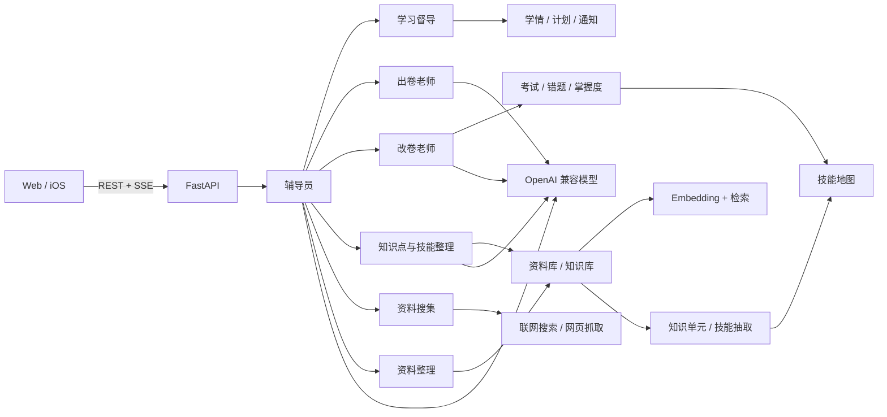

# 考公私塾


自己做的一个考公学习系统。资料、知识、技能、出卷、改卷、学情都放在一个对话框里，数据默认存在本机。


---

## 为什么做这个

备考的时候，资料散在 PDF、网课视频、公众号文章和几个网盘里。真正做题时想回头找一个公式，通常要翻很久。市面上的题库和 AI 助手大多不能吃我自己的资料，也没法按我的薄弱点出题。

所以就有了这个项目：把资料丢进去，让它变成能检索、能引用、能出题、能批改的东西。

现在它大概能做完这些事：

- 上传讲义、网页、截图、录音或者 B 站课程，自动解析成可检索的知识
- 从资料里抽出「这个知识点怎么考、题目长什么样、步骤是什么、坑在哪、还会怎么变」
- 按模块生成试卷，限时做完自动判分，逐题讲错因，顺手更新掌握度
- 用技能地图看每个板块练到什么程度，按薄弱点排周计划
- 记录每个模型和服务商的调用量与费用

---

## 怎么用

对话只有一个入口。问什么由辅导员判断该谁接：找资料、整理知识、出卷、讲错题、看学情，各有对应老师。

做题卡住时还有个问答老师。它是专门为「这题为什么这么算」这类碎问题准备的：你先问，它去技能地图里找出对应的方法，再按那套步骤讲，而不是从头给你上一整节课。

每个角色可以单独配模型。日常问答用便宜的，出卷和改卷换强一点的，也可以接不同供应商。

### 资料

支持 PDF、DOCX、TXT、Markdown、网页、图片、音频，以及 B 站 / YouTube 视频。

- 文档按标题层级切分，保留「资料 > 章节 > 小节」，PDF 会先去掉重复的页眉页脚和页码
- 网页优先走 DeepSeek 的抓取接口，失败回退本地解析
- 图片用 macOS Vision 识别中文，认不出再试 DeepSeek OCR
- 扫描版 PDF 要配 DeepSeek 官方 Key，否则只能索引有文字层的页面。判定按「平均每页有效字符数」而不是有没有文字，影印件里只带页码和水印也能识别出来；识别按 20 页一批提交，单批失败不影响其它批次，被截断的页会在提示里标出来
- 视频先找字幕。没有字幕就本地 whisper 转写，然后抽帧、OCR、把讲解对齐到每一页，生成带时间戳和关键帧的笔记

### 知识

知识和技能是两层东西，别混。

**知识挖掘**放的是单题深度分析。做题时让知识老师把这题拆开讲：考什么、怎么识别、每一步怎么走、坑在哪、换个条件怎么变。讲完你说「保存到知识挖掘」，这条分析才会入库，之后可以回看、编辑、复盘。

系统不再在资料入库时自动批量抽取。想要批量的，知识挖掘页右上角有「批量抽取」，按整份资料抽一遍，属于可选的补录入口。

**技能地图**放的是可反复套用的方法，比知识高一层。默认内置的是花生十三体系，按资料分析、数量关系、言语理解、判断推理、常识判断、申论、答题策略、备考规划八大块分好类，共两百多项技能。点开能看到考法、步骤、陷阱。

想往技能地图里加新技能，在对话里明确说「把这个技能加到技能地图」，老师会先查是否重复，再问你确认，然后归到对应模块。技能地图按模块展示掌握状态：熟练、会用、了解、不清楚、待复习。掌握度优先用真实作答算，没练过的会标「知识点估算」，免得看着像精确数据。

加进去的技能，问答老师马上就能用：它每次都从技能地图现查，不做缓存，所以没有「需要重启才生效」这回事。

**技能从哪来，在哪看。** 技能地图右上角有「技能来源」，列出每个来源装了多少项、覆盖哪些模块、什么时候更新的。内置的花生十三体系已经打包在 `backend/skillpacks/` 里，点一次「安装」就能装好，不需要联网。想装别的，填一个同结构的 git 仓库地址就行——仓库要有 `references/` 目录，每个 `.md` 对应一个模块，用「题型 N：xxx」「方法 N：xxx」这类小节拆分技能。导入会整体替换该来源下的旧数据，对话里手动新增的技能不受影响。

### 考试

按科目、模块、难度、题量组卷，30 题默认 28 单选加 2 简答。可以指定生成几道 AI 原创题，生成失败会回退题库。

答题页有倒计时、答题卡、自动保存，时间到自动交卷。客观题直接判分，主观题按评分细则踩点；配了真实模型时由改卷模型给分，失败回退关键词匹配。

报告里有逐题解析、评分细则命中情况、这题对应的技能、技能掌握度变化，还有举一反三的变式。

### 学情与费用

学情看板有模块雷达、最近两周的正确率趋势、知识点热力图和薄弱点。周计划和周报都基于真实作答，不靠模型编。

费用页按渠道区分：平台接的按月付费的不计单次费用，DeepSeek 官方按官网价算（含高峰/空闲时段），本地 Ollama 记作免费。搜索、抓取、OCR、语音转写和知识抽取的用量都会记录。

---

## 快速开始

需要 macOS（图片 OCR 和 iOS 用得上，后端本身跨平台）、Python 3.12、[uv](https://docs.astral.sh/uv/)、Node 20+、`ffmpeg`。

```bash
git clone https://github.com/yijiejiang/kaogong-school.git
cd kaogong-school

cp backend/.env.example backend/.env
# 改一下 APP_SECRET_KEY，其他留空也能跑

make install
make start
```

`make start` 会检查环境，缺 `.env` 自动生成随机密钥，然后同时起前后端，等两边都就绪才提示完成。Ctrl-C 一起停。

打开 http://localhost:3000，去「设置」填模型地址和 Key。

没有 Key 也能完整走一遍流程：

```bash
make demo
```

演示模式会返回固定的学情、试卷和知识库回答。资料入库用本地哈希向量，不需要 Embedding Key。想切回真实模型，把 `backend/.env` 里的 `MOCK_LLM` 改成 `0` 再 `make start`。

端口被占用时：

```bash
BACKEND_PORT=8010 FRONTEND_PORT=3010 make start
```

### 拿一条视频试试

打开「资料 → 导入网页」，粘一个 B 站或 YouTube 课程链接，等入库完成，展开就能看到逐页笔记和关键帧。

视频没字幕的话，建议先装本地转写：

```bash
cd backend
uv add faster-whisper
# 想要更准可以设 ASR_LOCAL_MODEL=medium
```

---

## 配置

大部分配置在网页「设置」里改就行，也可以写进 `backend/.env`。

| 变量 | 作用 |
|---|---|
| `APP_SECRET_KEY` | 加密存 API Key 用的，换了要重新填 Key |
| `MOCK_LLM` | `1` 演示模式，`0` 真实模型 |
| `DATABASE_URL` | 默认 SQLite，可以换成 PostgreSQL |
| `PUBLIC_BASE_URL` | 二维码里用的地址，Tailscale 或隧道地址填这里 |
| `LLM_API_BASE` / `LLM_API_KEY` / `LLM_DEFAULT_MODEL` | 全局模型默认值 |
| `LLM_EMBEDDING_MODEL` | 留空用本地 `hash-384`，填了就调 Embedding API |
| `DEEPSEEK_API_KEY` | 可选，联网搜索、扫描 PDF OCR、短音频转写 |
| `TAVILY_API_KEY` | 可选，DeepSeek 搜索不通时的兜底 |
| `ASR_LOCAL_MODEL` | faster-whisper 模型，默认 `small` |
| `ENABLE_KNOWLEDGE_EXTRACTION` | 入库后是否自动抽知识单元，默认关闭（改由对话中明确要求时保存） |

Key 在数据库里加密，接口只返回打码后的值。`backend/.env` 别提交。

---

## 架构



分层细节在 [docs/architecture.md](docs/architecture.md)。

---

## iOS

```bash
open ios/KaogongSchool.xcodeproj
```

原生 SwiftUI，最低 iOS 17。对话、学情、考试、资料、知识挖掘、技能地图、设置都在，另外支持视频关键帧、扫码连接和连接历史。

考试作答时可以随手打开草稿纸，用 Apple Pencil 手写演算，每道题各自保存一页，交卷后还能回看。

iPad 连后端最省事的办法：

1. Mac 和 iPad 连同一个 Wi-Fi
2. `make backend-lan` 起后端（监听 `0.0.0.0`）
3. 网页「设置 → 用 iPad / iPhone 扫码连接」，用系统相机或 App 内扫

不在同一个网络就上 Tailscale，步骤见 [deploy/tailscale.md](deploy/tailscale.md)。打 TestFlight 看 [deploy/testflight.md](deploy/testflight.md)。

### 没有苹果开发者账号能装吗

能。99 美元/年的开发者计划（Developer Program）只影响上架 App Store 和分发 TestFlight，自己在设备上装不需要它。

**免费 Apple ID 就能做的事**

用普通 Apple ID 登录 Xcode，把 iPhone / iPad 插到 Mac 上直接运行：

1. Xcode 打开工程，Target → Signing & Capabilities
2. Team 换成你自己的 Apple ID（Add an Account 里登录后就会出现「个人团队」）
3. Bundle Identifier 改成唯一的，例如 `com.yourname.kaogong`
4. 选中你的设备，Run

限制：

- **签名 7 天过期**，过期后 App 打不开，要重新连 Mac 跑一次
- 最多 3 台设备，同时只能有 10 个 App ID
- 不能安装到别人设备上分发

**只想要长期使用又不想付费**

- 用免费的 **iOS App Store 的 TestFlight 不行**（需要付费账号），但可以自己用 Xcode 装
- 或者干脆用 Web 端，Safari「添加到主屏幕」，功能和 iPad 版几乎一致，PWA 壳无需签名

**必须付费的情况**

- 要发给别人测试（TestFlight）
- 要上架 App Store
- 需要用无线调试、后台能力、CloudKit 等需要 entitlement 的功能
- 希望签名一年有效、不用每 7 天重装

工程不含任何人的团队 ID。首次打开 iOS 工程前，先建本地签名配置：

```bash
cp ios/Config/Signing.local.xcconfig.example ios/Config/Signing.local.xcconfig
```

然后在 `Signing.local.xcconfig` 里填上自己的 `DEVELOPMENT_TEAM`。这个文件已被 `.gitignore` 忽略，不会提交。
Team ID 可以在 Xcode → Settings → Accounts，或 developer.apple.com 的 Membership 页面查到。

---

## 部署

本机常驻：

```bash
make install-service    # launchd 开机自启
make service-logs       # 看日志
make uninstall-service  # 停掉并移除
```

要 PostgreSQL：

```bash
make infra
# 然后把 DATABASE_URL 改成 postgresql+asyncpg://...
```

Cloud Run 见 [deploy/cloudrun.md](deploy/cloudrun.md)。上传目录现在是本地磁盘，公网部署前最好接个对象存储，顺便把登录鉴权补上。

---

## 让 AI 帮你部署

把下面这段丢给你电脑上的 Claude Code、Codex 或 Cursor，它会自己检查环境、装依赖、起服务、验证。

```text
你是我的部署助手。请在这台电脑上部署开源项目「考公私塾」：
https://github.com/yijiejiang/kaogong-school

结构：backend（Python 3.12 + FastAPI + Google ADK）、frontend（Next.js 15）、ios（SwiftUI，仅 macOS）。
目标：把 Web 端跑起来，能打开 http://localhost:3000 并正常对话。不用管 iOS。

一步一步来，每步做完先报结果。失败就停下来说原因和可选方案，不要跳过：

1. 环境检查
   - git、uv（https://docs.astral.sh/uv/）、Node 20+、pnpm、ffmpeg
   - macOS 再看一下 Xcode Command Line Tools
   - 缺东西先给安装命令，等我确认再装

2. 拉代码
   - git clone https://github.com/yijiejiang/kaogong-school.git
   - 确认 README.md、Makefile、backend/、frontend/ 都在

3. 后端配置
   - cp backend/.env.example backend/.env
   - 生成随机 APP_SECRET_KEY 写进去，别用默认值
   - 问我有没有 LLM 的 Base URL、API Key、模型名
     有就写进 LLM_API_BASE、LLM_API_KEY、LLM_DEFAULT_MODEL
     没有就把 MOCK_LLM 设成 1，先用演示模式
   - 提醒我别提交 backend/.env

4. 装依赖
   - 后端：cd backend && uv sync
   - 前端：cd frontend && pnpm install（没 pnpm 就用 npm，并说明区别）

5. 启动和验证
   - 后端：cd backend && uv run uvicorn app.main:app --reload --port 8000
     （演示模式加 MOCK_LLM=1）
   - 前端：cd frontend && pnpm dev
   - curl http://127.0.0.1:8000/api/health 应该返回 status: ok
   - 打开 http://localhost:3000，确认界面能加载
   - 发一句「你好」，确认有回复

6. 可选项（先问我，别自己决定）
   - Embedding：本机有 Ollama 的话可以用 qwen3-embedding:0.6b，填到设置页后重新索引
   - 视频转写：cd backend && uv add faster-whisper，设 ASR_LOCAL_MODEL=small
   - DeepSeek 官方能力：设置页填官方 Base URL 和 Key
   - 局域网给 iPad 用：make backend-lan，然后扫码
   - 开机自启：make install-service

7. 收尾
   - 告诉我前后端地址、现在是演示模式还是真实模型、开了哪些可选能力
   - 列出执行过的命令，以及跳过或失败的地方

注意：
- 报错先看日志，别直接重装，也别删 backend/data/
- 不要改 backend/.env.example，不要提交密钥
- 8000 或 3000 被占用的话，先告诉我是什么进程，我同意了再换端口
- 每步都要真的跑过并验证，不要假设成功
```

跑完可以继续让同一个 Agent 帮你上传资料、配模型或者排查问题。

---

## API

| 分类 | 接口 |
|---|---|
| 对话 | `POST /api/chat/stream`、`GET /api/chat/sessions` |
| 资料 | `/api/materials/*`、`POST /api/search` |
| 知识 | `/api/knowledge/tree`、`/units`、`/skills`、`/skill-map` |
| 考试 | `/api/exams/*`、`/api/attempts/*` |
| 学情 | `/api/analytics/*`、`/api/plan/*` |
| 费用 | `GET /api/analytics/usage`、`GET /api/analytics/billing` |
| 通知 | `/api/notifications/*` |
| 语音 | `/api/asr/status`、`/api/asr/transcribe` |
| 连接 | `/api/connect/info`、`/api/connect/qr.png` |
| 设置 | `/api/settings`、`/api/settings/models`、`/api/settings/test` |

按学习者隔离的接口都收 `user_id` 查询参数，Web 和 iOS 会自动带上当前学习者。

---

## 评测

资料打标和检索有一套小评测集：

```bash
cd backend
uv run python scripts/evaluate_library.py
```

看 Top-1 知识点准确率、Top-3 标签召回、chunk 类型准确率和 Recall@5。用例在 [backend/evals/library_cases.json](backend/evals/library_cases.json)。

跑测试和编 iOS：

```bash
cd backend && uv run pytest -q

xcodebuild -project ios/KaogongSchool.xcodeproj \
  -scheme KaogongSchool -configuration Debug \
  -sdk iphonesimulator \
  -destination 'generic/platform=iOS Simulator' \
  CODE_SIGNING_ALLOWED=NO build
```

---

## 已知问题

没做登录鉴权，只适合单人本机用。想放到公网，先补认证。

视频这块还比较粗糙：固定间隔抽帧，没有镜头检测，也没有视觉模型去理解图表。两小时的课第一次入库会等挺久。

字幕经常受平台限流或 Cookie 影响。拿不到字幕就退化到语音转写，再不行只能索引简介。

本地 `small` 模型转中文考公术语还有同音错字，「截位直除」偶尔会变成「截位值除」。要更准就换 `medium`，代价是慢不少。

题目到技能的匹配目前是知识点加文本信号的启发式，信号不明显时会退回该知识点下置信度最高的那个技能。

旧作答不会自动回填技能级掌握度。新做的练习会正常更新。

扫描 PDF 的完整 OCR 依赖 DeepSeek 官方 Key，没有的话只能索引有文字层的页面。

费用是估算。设置页单价填 0 时只统计 token，不算钱。

---

## 参与

Issue 和 PR 都欢迎，比较想要的是：更多题库和评测案例、技能分类的设计意见、视频关键帧识别的改进、iOS 和 Web 的交互细节。

提之前看一眼 [CONTRIBUTING.md](CONTRIBUTING.md)，顺手跑一下：

```bash
cd backend && uv run ruff check . && uv run pytest -q
```

改了资料解析或检索，再跑一遍上面的评测脚本。`backend/.env`、Key、数据库和上传的资料都别提交。

---

## License

[MIT](LICENSE) © 2026 yijiejiang

---

关键词，方便搜索：考公、公考、公务员考试、国考、省考、事业单位、行测、申论、资料分析、数量关系、判断推理、言语理解、常识判断、科学推理、错题本、学习计划、AI 家教、知识库问答、RAG、知识图谱、多智能体、Agent、Google ADK、LiteLLM、DeepSeek、Ollama、自托管、本地部署、SwiftUI、Next.js、FastAPI。

English: Chinese civil service exam, gongkao, kaogong, exam prep, AI tutor, study assistant, multi-agent, RAG, self-hosted, local-first.
