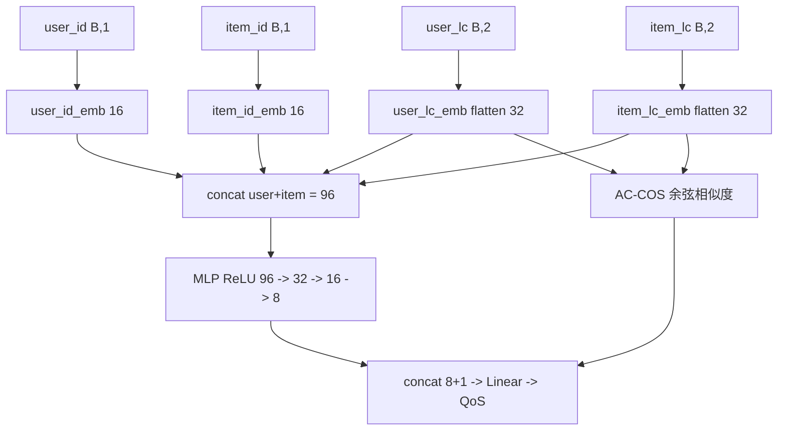

# Location-aware Deep Collaborative Filtering (PyTorch)

本仓库是论文 **Location-aware Deep Collaborative Filtering for Service Recommendation** 的复现代码，已从原 Keras 2 / TensorFlow 1.4 实现**迁移到 PyTorch**，并补足了数据预处理、单元测试、可复现性、文档与许可证等工程化短板。

> Yiwen Zhang, Chunhui Yin, Qilin Wu*, Qiang He and Haibin Zhu. [Location-aware Deep Collaborative Filtering for Service Recommendation](https://ieeexplore.ieee.org/document/8805172), IEEE Transactions on Systems, Man, and Cybernetics: Systems. 10.1109/TSMC.2019.2931723, 2019. (SCI)
>
> **如果你使用本代码，请引用上述论文。**

原始 Keras 实现已归档在 [`legacy/`](legacy/) 目录，仅供参考。

## 任务背景

在 Web 服务 QoS（服务质量）场景下，对用户-服务的稀疏观测矩阵预测**响应时间 (rt)** 或**吞吐量 (tp)**。模型在协同过滤基础上引入**位置感知**（用户/服务的国家、AS 等地理-网络位置特征）。

## 模型结构



- 嵌入维度 `emb = layers[0] / 4`（默认 64/4 = 16）。
- 用户向量 = ID 嵌入(16) ⊕ 位置嵌入(2×16=32)；服务向量同理；两者拼接后 = 96 维进入 MLP。
- **AC-COS** 分支：用户/服务位置隐向量的余弦相似度（原版 `dot(normalize=True)`）。
- 输出层：MLP 输出(8) 与余弦标量(1) 拼接后线性回归到 QoS。
- 损失：Huber Loss（delta=1.0）；优化器：Adam（lr=1e-4）。

## 环境要求

- Python ≥ 3.9
- 见 [`requirements.txt`](requirements.txt)（PyTorch / numpy / pandas / scikit-learn / pytest）

```bash
pip install -r requirements.txt
```

## 数据获取与预处理

原始 WS-Dream Dataset#1（339 用户 × 5825 服务）可从下列地址下载：

- http://wsdream.github.io/dataset/wsdream_dataset1.html

下载后将原始文件（`rtMatrix.txt` / `tpMatrix.txt` / `userlist.txt` / `wslist.txt`）放入某目录（如 `./Data/WSDream/raw`），运行预处理脚本生成训练/测试文件：

```bash
python scripts/preprocess.py --dataType both --rawDir ./Data/WSDream/raw --outDir "./Data/WSDream/Dataset#1"
```

生成的文件（制表符分隔、无表头）：

- `{rt|tp}_origin.txt`：全部有效实例。
- `{rt|tp}_train_{density:.2f}.txt` / `{rt|tp}_test_{density:.2f}.txt`：各密度训练/测试实例。

每行 7 列：`User ID | Service ID | QoS | User Country | User AS | Service Country | Service AS`。

> 注意：Country / AS 的整数编码方式作者原始实现未公开，本脚本采用独立 LabelEncoder。若需与 `Result/` 历史指标**精确**对齐，建议使用作者当年生成的原始预处理文件。

## 运行

```bash
# 响应时间
python run_rt.py

# 吞吐量
python run_tp.py
```

常用可选参数（完整见 [`ldcf/config.py`](ldcf/config.py)）：

| 参数 | 默认 | 说明 |
|------|------|------|
| `--density` | 0.05 … 0.30 | 矩阵稀疏密度（可多值） |
| `--epochNum` | 50 | 训练轮数 |
| `--batchSize` | 256 | 批大小 |
| `--layers` | 64 32 16 8 1 | MLP 各层维度 |
| `--optimizer` | Adam | Adam\|Adamax\|Nadam\|Adagrad |
| `--lr` | 1e-4 | 学习率 |
| `--seed` | 42 | 随机种子（可复现性） |
| `--valSplit` | 0.0 | >0 时从训练集切验证集选 best epoch |
| `--cpu` | 关 | 强制使用 CPU |

例：`python run_rt.py --density 0.05 0.10 --epochNum 50 --seed 2024`

## 复现与指标对照

- 评估指标：MAE 与 RMSE（sklearn 口径，与原版一致）。
- 结果写入 `Result/{dataType}_result_{density}.txt`，格式与原版相同（Avg / Min / 每 epoch 明细）。
- 仓库内 `Result/` 已保留原 Keras 版的历史指标作为参考（如 `rt_result_0.05` 的 Min MAE ≈ 0.4052 / RMSE ≈ 1.3070）。

> 跨框架（Keras → PyTorch）无法做到逐位一致。复现目标为**统计意义对齐**：固定种子、多 seed 平均后，各密度 MAE/RMSE 落入历史指标的合理误差带。

## 测试

```bash
pytest -q
```

测试使用合成数据，不依赖真实数据集，覆盖模型前向/形状/初始化、数据列解析与评估指标。

## 目录结构

```
ldcf/            # PyTorch 实现（model / data / trainer / evaluator / config / utils）
scripts/         # 数据预处理脚本
tests/           # 单元测试
run_rt.py        # rt 实验入口
run_tp.py        # tp 实验入口
Result/          # 历史指标（参考）
legacy/          # 原 Keras 实现（归档）
```

## 与原实现的差异

| 项 | 原 Keras 版 | 本 PyTorch 版 |
|----|-------------|---------------|
| 框架 | Keras 2.0.9 / TF 1.4 | PyTorch ≥ 2.0 |
| 多密度调度 | multiprocessing 并行 | 顺序执行（确定性更好） |
| 模型保存 | `.h5` 权重 | `.pt` state_dict |
| 可复现性 | 无种子 | `--seed` + cudnn deterministic |
| 数据预处理 | 无脚本 | `scripts/preprocess.py` |
| 测试 | 无 | pytest 单元测试 |
| best epoch 监控 | 仅测试集 | 默认测试集，可选 `--valSplit` |
