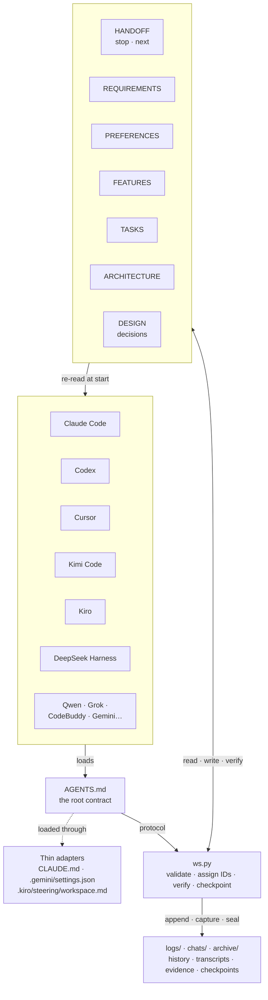

# Agent workspace template

**[中文](README.zh-CN.md)** | English

A file-based memory system for AI coding agents. It gives any agent tool — Claude Code, Codex,
Cursor, Kimi Code, Kiro, DeepSeek Harness, and others — a shared, persistent memory that survives
window switches, context compaction, and tool changes.

Every project fact lives in plain Markdown files under `docs/`. A new session reads them and picks
up exactly where the last one stopped. No database, no server, no lock-in: standard-library Python,
plain text, and a CLI tool.

## Why

AI agents lose track of long projects. They forget requirements, re-do finished work, propose
features the user already rejected, and claim tasks are done without proof. This template prevents
that by making the agent record every requirement, decision, task and piece of evidence in files
that the next session reads before doing anything.

### What it is for

- **Long projects that span many sessions.** The agent re-reads the goal, the current task, the
  exact stop point and the next step before touching any code — not just a summary it wrote itself.
- **Context compaction.** When the host compresses the conversation, everything the agent never
  wrote down is gone. Here, requirements, prohibitions and decisions live on disk, so compaction
  costs nothing. Chat transcripts are copied into the project, and `ws reconcile` turns every
  saved user message into a checklist until it is accounted for.
- **Switching windows or tools.** A session started in Claude Code can continue in Codex or Kimi
  Code: all of them read the same `AGENTS.md` and the same state files. The handoff card says
  where the work stopped; the evidence files say what was actually verified.
- **Changing requirements.** Every requirement has a permanent ID. Replacing one lists the open
  tasks and features that cite it, so the follow-up work is updated instead of silently building
  the old behavior. Removed features stay visible with their reason, so they are not re-proposed.
- **Proof of completion.** Each task carries its own acceptance command. `ws verify` runs it,
  stores the output, and marks the task done only when it passed — zero tests, skipped tests and
  stale evidence are all reported, never silently accepted.
- **Parallel agent windows.** Sessions claim tasks by file path and resource name; overlapping
  claims are refused. A taken-over window cannot keep writing, and the workspace lock is a system
  file lock that ends with the process holding it.
- **Credentials.** You decide once whether credentials are kept as written in files you name,
  or kept out of files; until then the agent asks. Everything else the tool writes, chat
  transcripts included, is redacted.

## Architecture

Every agent tool loads one root contract, `AGENTS.md`, through a thin adapter. The agent runs
`ws.py` to record and verify; the tool reads and writes the Markdown files under `docs/`. At the
next session the agent re-reads those files, so the memory survives windows, compaction and tool
switches.



Top to bottom: the **agent tools**, the shared **`AGENTS.md` contract** with its thin adapters,
the **`ws.py` tool**, and the **`docs/` memory** — the current facts in `state/` plus the
`logs/`, `chats/` and `archive/` history. The loop closes when the state files are re-read at
the start of the next session.

## Repository layout

```text
agent-workspace-template/
├── AGENTS.md                     the root contract every agent reads first
├── CLAUDE.md                     Claude Code adapter: the line "@AGENTS.md"
├── CODEBUDDY.md                  CodeBuddy / WorkBuddy adapter
├── DESIGN.md                     why the structure is the way it is
├── README.md · README.zh-CN.md   this file, in English and Chinese
├── LICENSE                       MIT
├── .gemini/settings.json         Gemini CLI / Antigravity adapter
├── .kiro/steering/workspace.md   Kiro adapter
├── .trae/rules/workspace.md      Trae adapter
├── .agents/                      system files, identical in every project
│   ├── guides/                   QUICKSTART · PROTOCOL · STRUCTURE · HOSTS
│   ├── skills/                   workflows loaded on demand
│   ├── template/                 spec & trial templates, test-result parsers
│   │   ├── spec/                 requirements.md · design.md · tasks.md
│   │   └── examples/             unittest_json · pytest_junit · go_json
│   └── tools/                    the CLI
│       ├── ws.py                 the tool every agent runs
│       ├── wslib/                its modules (core, validate, evidence, …)
│       └── tests/                the template's self-tests (not installed)
├── docs/                         the project's memory — created in each project
│   ├── state/                    current facts, read at every session start
│   │   ├── HANDOFF.md            stop point · next step · ownership
│   │   ├── REQUIREMENTS.md       what the user wants, with acceptance
│   │   ├── PREFERENCES.md        stable user preferences
│   │   ├── FEATURES.md           current and retired capabilities
│   │   ├── TASKS.md              work items · acceptance · evidence
│   │   ├── ARCHITECTURE.md       entry points · commands · environment
│   │   └── DESIGN.md             decisions · rejected options
│   ├── logs/                     history tables written by the tool
│   ├── chats/                    transcripts copied by hooks
│   ├── archive/                  checks/ · checkpoints/ · closed/ · snapshots/
│   └── specs/<slug>/             detail for one large requirement
└── dist/                         release zips (attached to GitHub Releases)
```

Installing the template into a project writes only the runtime files: the adapters, the guides,
skills and templates, `ws.py` and its modules, and the generated `docs/` skeleton. The maintainer
files — `MAINTAINING.md`, `DESIGN_REQUIREMENTS.md`, `FIXES.md`, the self-tests, the folder previews — stay in
this repository and are never copied into a project, so a business agent's search never finds the
template's own history.

## Quick start

1. **Download** the latest release ZIP from
   [Releases](https://github.com/yourhoneypomelo-cell/agent-workspace-template/releases)
   and unzip it into an empty project folder.

2. **Open the project** in your agent tool and say:

   > Read AGENTS.md and start.

3. **State your goal** in one sentence when the agent asks. It will create the state files, record
   your goal as a requirement, and begin working.

4. **Optional: enable hooks** so the tool saves chat transcripts and injects the workspace brief
   at session start:

   ```bash
   python .agents/tools/ws.py hooks enable claude
   ```

   Replace `claude` with `codex`, `cursor`, `gemini`, `copilot`, `kiro`, `grok`, `qwen`, or
   `codebuddy` for your tool.

## How it works

```text
Session start:  brief → read state → start → work and record → verify → checkpoint
Next session:     ↑                                                              |
                  └──────────────────────────────────────────────────────────────┘
```

- **AGENTS.md** is the root contract every agent reads. It defines the session protocol, the
  state file format, and the rules that keep the workspace consistent.
- **`docs/state/`** holds seven Markdown files: the handoff card, requirements, preferences,
  features, tasks, architecture, and design decisions. These are the source of truth.
- **`docs/logs/`** records what happened: session history, requirement changes, feature changes.
- **`docs/chats/`** saves chat transcripts so no user message is lost.
- **`ws.py`** is the CLI tool that validates writes, assigns IDs, runs acceptance tests, and seals
  checkpoints. It is the only thing the agent needs to run.

## Key features

- **Record first, act second.** Every user message is checked for new requirements, decisions
  and preferences before any work begins.
- **Verified completion.** A task is done only when its acceptance command passes in the current
  session. The tool runs the test, stores the evidence, and marks it done.
- **Parallel sessions.** Multiple agent windows can work on the same project. Task claims use
  file paths and resource names to prevent conflicts. The workspace lock ends with the process
  that holds it, so a crashed window never leaves it behind.
- **Credential safety.** The tool asks how the project handles credentials (kept as written in
  files you name, or kept out of files) and redacts them everywhere else it writes.
- **Host adapters.** AGENTS.md is the single contract. Adapters for Claude Code, Codex, Cursor,
  Gemini, Kiro, Kimi Code, Grok, DeepSeek Harness, CodeBuddy and Qwen Code load it natively.
- **Compaction survival.** State files are on disk, not in the agent's context window. After
  compaction, the agent re-reads them and continues.

## Install into an existing project

```bash
# From the template folder:
python .agents/tools/ws.py install --target /path/to/your/project --merge

# Or unzip a release into the project root.
```

`--merge` preserves your existing AGENTS.md by appending it under "Project rules".

## Design

[DESIGN.md](DESIGN.md) explains the reasoning behind the structure: why files instead of a
database, why record-before-act, how evidence works, and which alternatives were rejected.

## Guides

| Guide | Use |
| --- | --- |
| [Quickstart](.agents/guides/QUICKSTART.md) | Installation, first session, daily use |
| [Protocol](.agents/guides/PROTOCOL.md) | Formats, ownership, evidence and recovery |
| [Structure](.agents/guides/STRUCTURE.md) | Folders, naming, document size and writing style |
| [Hosts](.agents/guides/HOSTS.md) | Per-tool entry files and hooks |

## Requirements

**Runtime**

- Python **3.9 or newer**, available on the PATH as `python`. No packages to install — the tool
  uses only the standard library.
- Windows, macOS or Linux. Windows notes (Git Bash vs PowerShell, UTF-8, hook commands) are in
  [HOSTS.md](.agents/guides/HOSTS.md).
- An agent tool that can read files and run shell commands. Any tool works: the contract is read
  from `AGENTS.md`, and the CLI is plain Python.
- Git is recommended for the project, but not required. The workspace itself never runs git.

**Host integration (optional)**

- Without hooks the workspace still works; the agent just runs `ws brief` itself. Hooks automate
  transcript capture and the session-start brief. One command sets them up per tool:
  `python .agents/tools/ws.py hooks enable <host>` for `claude`, `codex`, `cursor`, `gemini`,
  `copilot`, `antigravity`, `kiro`, `codebuddy`, `qoder`, `qwen` or `grok`.
- Some hosts ask you to trust the project or its hooks first (Codex `/hooks`, Qwen Code, Kiro,
  Qoder, WorkBuddy). [HOSTS.md](.agents/guides/HOSTS.md) lists the entry file and the trust step
  for each one.
- Importing DeepSeek Harness session history needs Python **3.14+** or the `backports.zstd`
  package, because its store is zstd-compressed. Everything else works on 3.9.

**Disk**

The template is under 1 MB. A project's `docs/` grows with its history and chat transcripts;
`ws compact` archives closed rows and `ws check` warns before files get too large for a host to
read.

## License

[MIT](LICENSE)
