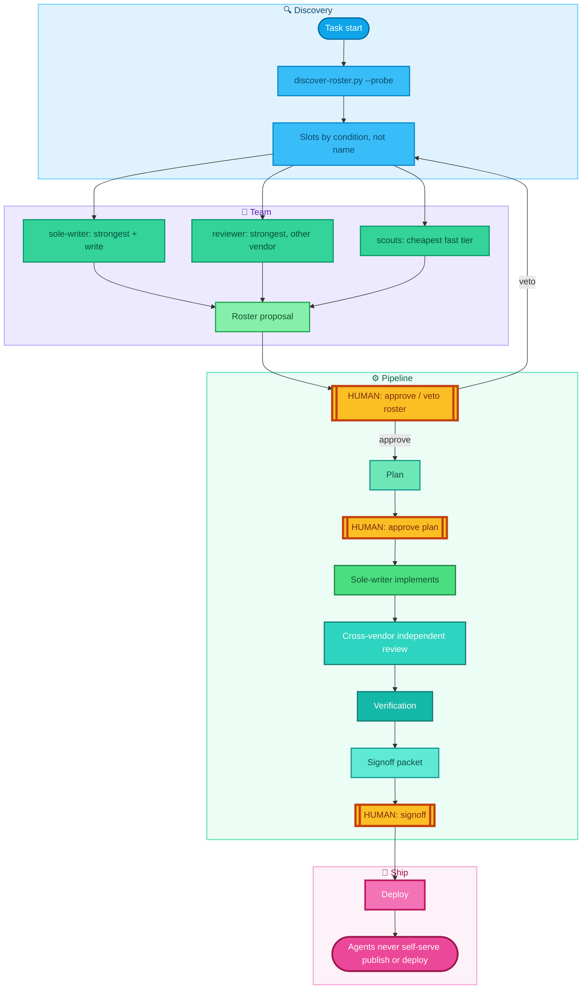

# agent-sop

agent-sop is a loadable SOP skill for coding agents (Claude Code, Codex CLI, Gemini CLI and others) that discovers the agent CLIs installed on your machine, assigns writer/reviewer/scout roles by capability for multi-agent work, and enforces cross-vendor review, evidence-based verification and human signoff (human-in-the-loop gates) before anything ships.

[中文说明 →](README.zh.md)

The goal is not to make agents more autonomous — it is to pick the right process weight for each risk level, so that work stays traceable, reviewable, and signable without small tasks drowning in ceremony.

High-risk work follows the full auditable sequence:

```text
research → plan → human approval → implementation → independent review
        → verification → signoff packet → human signoff → deploy
```

Low-risk work runs a deliberately lighter path. Tiers and boundaries are defined in `SKILL.md` §1.1.

## How it works



## Design principles

- **Agent-first.** Skills are operated by agents, not hand-configured by humans. The skill guides an agent to detect its environment, write its own configuration, and ask the human only for decisions. A step that requires a human to edit files by hand is a design bug.
- **Discovered roster, never a hardcoded one.** At task start the orchestrator runs `scripts/discover-roster.py --probe` to find the coding-agent CLIs actually installed and healthy on the machine, then assigns capability slots **by condition, never by name** (see `references/roster-protocol.md`). Install a new agent CLI and it joins the pool on the next run, with zero skill edits.
- **Capability slots, not fixed roles.** `orchestrator`, `sole-writer`, `reviewer`, `scout`, `monitor` — exactly one writer per repo at a time; reviewers are read-only and, whenever possible, from a **different vendor** than the writer (independence degradation ladder documented and recorded when full independence is unavailable). A `monitor` slot tracks long-running background work; it is usually carried by the orchestrator (see `SKILL.md` §5.1).
- **Humans own decisions; gates are structural.** Publish/deploy/data-write steps are never self-served by an agent. The orchestrator splits dispatched work at every gate; approval is explicit — silence is never approval. Signoff status can only be set to `approved` by a human, and agents recording it must quote the human verbatim.
- **Claims require evidence.** "Tests passed" without commands and captured output is treated as unverified. Reviewers re-run security-relevant checks instead of trusting the writer's summary.

## When to use

Good fit:

- You have two or more coding-agent CLIs installed on the same machine.
- Changes touch production services, data, or deployment and need an audit trail and human signoff.
- You want the reviewer to come from a different vendor than the writer.

Not a good fit:

- One-off small scripts or read-only Q&A — `SKILL.md` §1.1 defines a lighter path for these.
- Fully automatic, unattended publishing — this SOP is designed not to allow it.

## FAQ

**What is agent-sop, and how is it different from a plain prompt?**
It is a skill file (`SKILL.md`) plus a discovery script (`scripts/discover-roster.py`) that an agent loads, not a one-off prompt.

**Which agents does it support?**
The script's built-in detection list is: `claude`, `codex`, `gemini`, `grok`, `opencode`, `pi`, `omp`. Any other CLI can be discovered by adding an entry to `CANDIDATES` in the script.

**Do I need multiple agents?**
No. Level 3 of the reviewer-independence ladder is a fresh session of the same model, allowed only for low/medium-risk tasks (see `references/roster-protocol.md`).

**How is the reviewer chosen?**
By condition: a different vendor from the writer is preferred, then the independence degradation ladder is followed downward and the level reached is recorded.

**Can agents deploy or publish on their own?**
No. The orchestrator splits dispatched work at every gate; publish, deploy and data-write steps stay with the human.

**Does `--probe` cost tokens or send data?**
For each agent that has a probe recipe it makes one short non-interactive call ("reply with exactly: ok") with a 60 s timeout. The script never prints credentials.

**Does it need Herdr?**
No. A pane-based control plane such as Herdr is recommended when present, but not required.

**Is it only for Claude Code?**
No. The workflow is agent-agnostic; Claude Code is just one runtime it can be loaded into.

## Files

- `SKILL.md` — the workflow itself (English), written to be loaded by an agent as a skill.
- `references/roster-protocol.md` — roster discovery, condition-based slot assignment, reviewer-independence ladder, `roster.json` schema.
- `references/review-checklist.md` — independent review checklist with a reusable VERDICT/BLOCKING/SUGGESTED/EVIDENCE contract.
- `scripts/discover-roster.py` — agent CLI discovery with optional live health probes (catches expired auth and provider outages *before* work is assigned).
- `templates/signoff-packet.md` — Markdown signoff packet template (Chinese; structure is language-neutral).
- `tests/` — stdlib `unittest` tests for the discovery script; run `python3 -m unittest discover -s tests -v`.
- `llms.txt` — short index of this repo for LLM tools.
- `CHANGELOG.md` — release notes (Chinese).

## Quick start

1. **Requirements.** Any agent runtime that can load Markdown skills (`SKILL.md` with frontmatter). Running the discovery script needs Python 3.8+ (standard library only), with or without `--probe`.
2. **Install.** Clone the repo and symlink (or copy) it into your agent's skills directory. For Claude Code:

   ```bash
   git clone https://github.com/ythx-101/agent-sop
   ln -s "$(pwd)/agent-sop" ~/.claude/skills/sop
   ```

   For other runtimes, put it in that runtime's skills directory (see its documentation for the path). The workflow itself is agent-agnostic.
3. **First run.** Discover which agent CLIs are installed (add `--probe` to live-test their health):

   ```bash
   cd agent-sop
   python3 scripts/discover-roster.py
   python3 scripts/discover-roster.py --probe
   ```

   Then tell your agent, for example:

   > Use `sop` plan mode. Convert the verified research into small phases with tests before implementation, rollback, security checks, and explicit human approval points. Write the plan artifact and wait for approval.

## Provenance

This workflow is used in production by its authors, and it was used to produce itself: the roster-discovery redesign and this public release each ran through the full pipeline — plan, sole-writer implementation, cross-vendor independent review, verification, signoff — before shipping.

## License

MIT — see [LICENSE](LICENSE).
