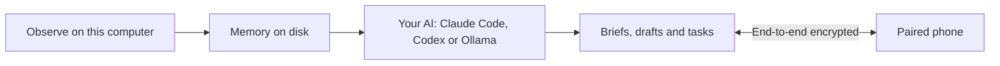

# Isoform

A proactive personal AI. Works ahead. Lives on your computer.

<picture>
  <source media="(prefers-color-scheme: dark)" srcset="docs/readme/today-dark.png">
  
</picture>

[Download for Mac](https://www.isoform.ai/download/mac) · [iPhone app](https://apps.apple.com/app/isoform/id6827347350) · [Reserve your name for Agent of You](https://www.isoform.ai/agents)

## What it does

- **Briefs before you ask.** Morning and evening briefs bring together what moved, what's next, and what needs your attention. Find them on Today, in the menu bar, and on a paired iPhone.
- **Needs you.** Review drafts and decisions waiting for you. A proposed reply waits for you to send it.
- **Chat with context.** Ask about your work and Isoform can bring relevant memories and know-how into the conversation.
- **How you do things.** Isoform learns reusable know-how from your work, with the moments and sources it learned from.
- **About you.** A portrait brings together what Isoform has learned about your work, preferences, and interests. You can review and correct it.
- **Tasks.** Give Isoform work to do with your signed-in Claude Code or Codex and see what is running, done, or waiting for you.

**Agent of You: reservations open.** Once Isoform knows how you work, other people can hire an agent that works like you, on your computer, and you're paid by the minute. Today it's a name reservation, not a live marketplace. [Reserve your name](https://www.isoform.ai/agents).

## How it works



Memory on disk gives you a record on your computer that you can review and control. Isoform builds on AI tools you already use instead of shipping its own model. Claude Code, Codex, or Ollama handles the model work while Isoform brings in context from your day.

## Privacy

Screenshots, audio recordings, and memory are stored on this computer. Proposed messages and posts to other people wait for your approval; the table shows what can leave your computer as part of using Isoform.

| What leaves | Where and when | How to turn it off |
| --- | --- | --- |
| Text needed for a task | Your selected AI when Isoform prepares a brief or runs a task. | Pause observing, stop the task, or use a local model for requests. |
| Cropped WeChat screenshots | Your selected AI when Isoform processes observed WeChat activity. | Turn off **Watch my screen** or exclude WeChat from observing. |
| Briefs, including spoken briefs | Your paired phone through an end-to-end encrypted relay, when phone delivery is enabled. | Disconnect the phone or turn off its connection in Settings. |
| Diagnostic events | PostHog when diagnostic sharing is enabled. | Turn off **Share diagnostic data** in Settings > Privacy. |
| Topic names and short search phrases | A web search provider when **Find new things on my topics** is enabled or you request a search. | Turn off **Find new things on my topics** and avoid requesting searches. |

Isoform filters detected sensitive information, including passwords, codes, and card numbers, from observed content. Detection is best effort; see [PII handling](wails-gui/internal/pii/README.md).

## Try it in 60 seconds

1. [Download Isoform for Mac](https://www.isoform.ai/download/mac). It requires macOS 14 or later and supports Apple silicon and Intel.
2. Open the app and follow setup.

## Build from source

Install Go 1.25 or later, Node.js 20.19 or later, pnpm, and the [Wails v2 CLI](https://wails.io/docs/gettingstarted/installation). The build uses bundled dependencies; the `download-*.sh` scripts in `wails-gui/scripts/` prepare them when needed. See [development](docs/development.md) for details.

```bash
./wails-gui/scripts/start-wails-gui.sh
./wails-gui/scripts/build-wails.sh
```

The first command starts the development app; the second creates a production build.

## Releases

See the [release pipeline](docs/release/pipeline.md) for release checks and publication. Local notarization uses a working `APPLE_NOTARY_KEYCHAIN_PROFILE` (default `isoform-notary`), then an App Store Connect API key, then Apple ID credentials. Set `APPLE_NOTARY_KEY_PATH`, `APPLE_NOTARY_KEY_ID`, and `APPLE_NOTARY_ISSUER` to override the API key; the ID and issuer default to `ISOFORM_ASC_KEY_ID` and `ISOFORM_ASC_ISSUER_ID` or the Isoform iPhone upload values, and the path defaults to `~/.appstoreconnect/private_keys/AuthKey_<key-id>.p8`. The key file remains in place. The release preflight checks the selected credentials with Apple before building.

## FAQ

**Do I need an API key?** No. Isoform can use your signed-in Claude Code or Codex account. An API key is optional.

**Does it work offline or with a local model?** Isoform can use a local Ollama model as a fallback. Cloud models and the phone relay need a network connection; full offline behavior depends on the features and models you use.

**What does it cost?** Isoform uses your existing AI subscriptions and does not require a new Isoform model subscription. Your AI provider's plan and usage limits apply.

**What about Windows, Linux, and iPhone?** The desktop download is for macOS. Windows and Linux are planned; the [iPhone companion is available on the App Store](https://apps.apple.com/app/isoform/id6827347350) and pairs with the desktop app.

## Roadmap

- Windows and Linux
- Agent of You
- Teams

The iPhone app is already on the App Store.

## Repository and contributing

The desktop app is in `wails-gui/`, the agent runtime is in `yansu-agent/`, and the phone and relay live in `ios/`, `relay/`, and `mobile-protocol/`. See [development](docs/development.md) for setup and tests. Open an issue or pull request describing the change and how you tested it.

## Credits

Built on [Claude Code](https://www.anthropic.com/claude-code), [Codex](https://openai.com/codex/), [magpie](https://github.com/yetone/magpie), [Wails](https://github.com/wailsapp/wails), and [dumbpipe](https://github.com/n0-computer/dumbpipe) / [iroh](https://github.com/n0-computer/iroh).

## License

Isoform is open source under the [Functional Source License (FSL-1.1-ALv2)](LICENSE.md); each version becomes Apache 2.0 two years after release.
