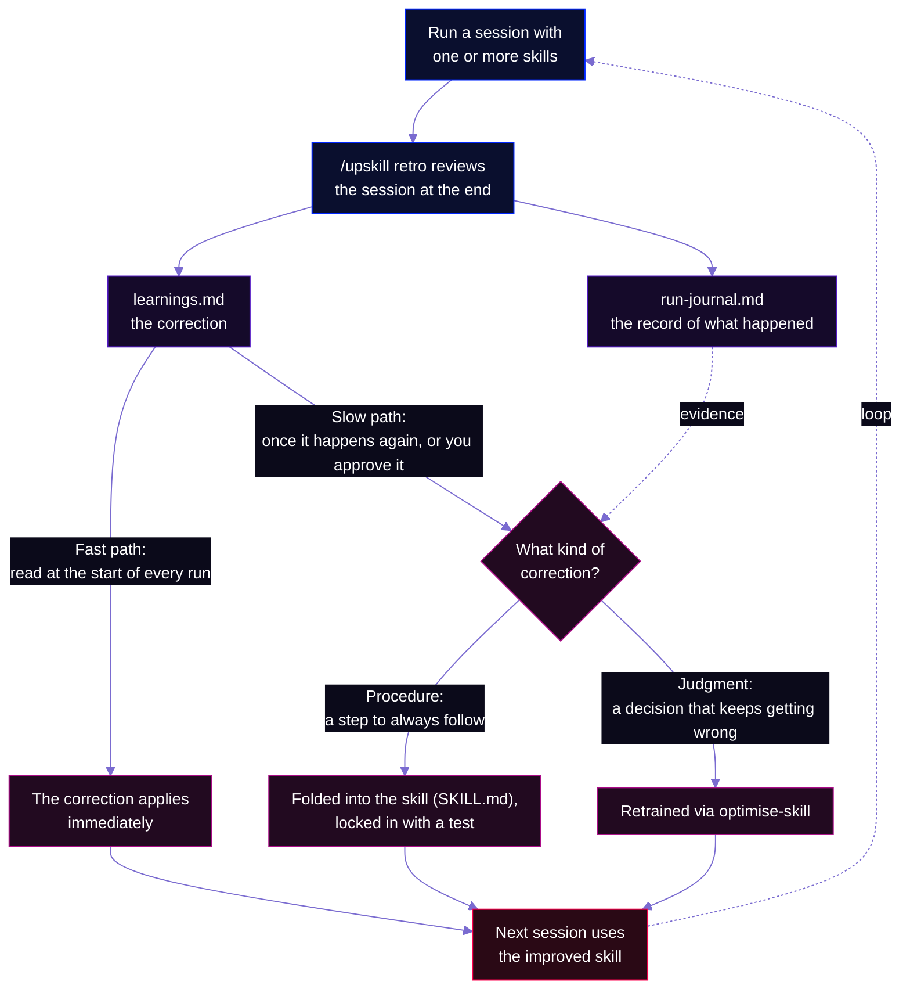
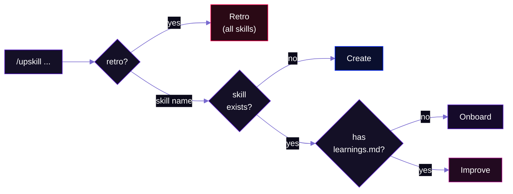
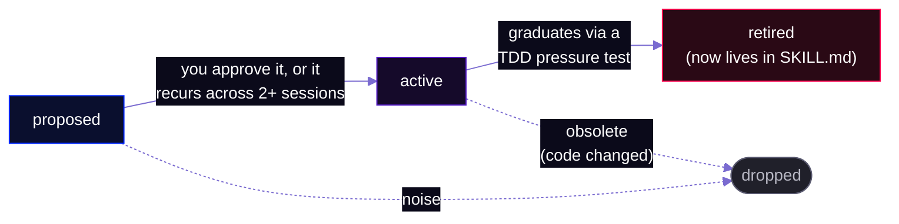
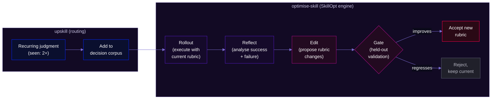

# upskill

**The recursive, self-improvement system for skills (including itself).**


Skills only get better when three things line up: something obviously breaks, you remember to note what went wrong, and you can be bothered to fold it back into the skill. upskill is itself a skill, and its job is to improve your other skills, consistently and on its own. It reads the session, runs the retro, and proposes the improvement. Your skills compound every session instead of plateauing, and get measurably better each time you use them, without the bloat.

<p align="center">
  
</p>

## Why this exists

I had ~30 skills running production work: customer triage, ticket implementation, PR review, bulk merges, email drafting, multi-agent feature builds for my app. I built them as I went, whenever I caught myself repeating something. They only improved when I read back through a session, noted what to do better, and logged it in a markdown file. Doing that every session when running multiple sessions in parallel didn't feel feasible because of the overhead / cognitive load of it all, so in reality most sessions' potential improvements were lost when the context window closed.

The same mistakes kept recurring across sessions:
- Workarounds proposed for features that already existed
- Bugs diagnosed from code analysis without checking what the user actually did
- Drafts written before the investigation was complete
- Ticket calibration challenged by the operator every time

I wanted this to be automatic, not something I only did when I remembered to. Microsoft's SkillOpt paper (building on Google DeepMind's OPRO) showed half the answer: for the judgment calls a skill makes, "is this a real bug or a confused user?", "should this become a ticket?", you can grade past decisions against what actually happened and tune the skill to call them better next time. But most of my corrections weren't judgment calls. They were plain procedures, "check this before doing that", which you can't grade. The skill just has to remember them. So there are two kinds of lesson, each needing its own fix.

I'd already tried to give my skills this kind of memory, three different ways, and they were in tension: frozen prose retrospectives (written once, never updated), atomic rule-cards (the distilled rule, but no raw signal behind it), and machine-readable corpora (only good for the tuning step above). The same filename even meant two different things across skills. No retrospective log. No graduation path. No scoring to check that a new rule actually improves the skill instead of over-specifying it.

upskill resolves all three into a single system.

## How it works



**Two graduation paths**, because not every lesson is the same kind of thing:

- **Procedures** ("always check X before doing Y") graduate into the skill's own SKILL.md, gated by a TDD pressure test that proves the failure mode is caught. (A subtlety learned in production: some failures are vigilance-under-load — they only surface when the agent is juggling a batch under pressure, so a calm single-task test won't reproduce them. The fix is a load-faithful test that buries the trap mid-batch; if even that passes, the lesson is better kept as a run-start reminder.)
- **Judgments** (scorable decisions like "is this a bug or working-as-designed?") graduate to `optimise-skill` for rubric retraining against labelled examples from real runs.

Both paths start in `learnings.md`. Each retro also appends a `run-journal.md` entry, the evidence trail those graduation and retrain decisions draw on later. The fast path (reading learnings every run) makes corrections effective immediately. Once a lesson recurs or you ratify it, graduation makes it permanent.

<p align="center">
  
</p>

## Getting started

Install with the open skills CLI. It picks up both `upskill` and `optimise-skill`, into whichever agent you use:

```bash
npx skills add yungbose/upskill
```

Or install by hand, copying the folders into your agent's skills directory (`~/.claude/skills/` for Claude Code):

```bash
git clone https://github.com/yungbose/upskill.git && cd upskill
cp -r upskill/ ~/.claude/skills/upskill/
cp -r optimise-skill/ ~/.claude/skills/optimise-skill/   # optional, for judgment retraining
```

Onboard an existing skill so it starts improving:

```bash
/upskill my-existing-skill
```

Then, at the end of any session, run the retro to capture what every skill learned:

```bash
/upskill retro
```

That's it. `/upskill retro` detects which skills ran, captures learnings, and writes them where the skills will read them next time.

## Commands

`/upskill` has four modes:

| Command | Mode | What it does |
|---|---|---|
| `/upskill <name>` (doesn't exist) | **Create** | Authors the skill via TDD behind a staging contract: stage to a temp folder, test, approve, then atomic-commit or clean-discard. Never writes a half-broken skill to disk. |
| `/upskill <skill>` (no learnings.md) | **Onboard** | Reads the skill's SKILL.md, generates a tailored retrospective checklist (key decisions, data sources, failure modes), creates learnings.md + run-journal.md, wires the reads in. |
| `/upskill <skill>` (wired) | **Improve** | Runs the retrospective for that one skill: writes learnings, flags graduation candidates. |
| `/upskill retro` | **Retro** | End of session. Runs the retrospective across every onboarded skill that ran. |

Detection is automatic. You don't pick the mode.



### `/upskill retro`

Run at the end of every session. It:

1. **Detects which skills ran** (scans for skill invocations in the session)
2. **Filters to onboarded skills** (ones with `references/learnings.md`). Surfaces un-onboarded skills: "These ran but aren't wired yet."
3. **Walks a structured retrospective checklist** for each skill:
   - **Corrections**: every time the operator pushed back or corrected an output
   - **Successes**: what worked well and should be protected (not just failures)
   - **Outputs**: was each deliverable correct on first attempt? If revised, why?
   - **Procedure**: did the skill follow its own steps? Where did it skip?
   - **Skill-specific checks**: domain checks from `retrospective-checklist.md`
4. **Writes artifacts per skill**: journal entry, proposed learnings, retrain flags
5. **Cross-skill and project-wide patterns**: a correction that spans skills is copied into every relevant skill's `learnings.md` (each reads its own file at run start); one that belongs to no single skill (session workflow, tool conventions, safety rules) goes to the project-wide `learnings.md` instead

The retrospective must independently review the session trace, not just process a summary. Corrections often live in the back-and-forth that a summary smooths over, so reading only the summary silently drops them.

## Learnings lifecycle



| Status | Meaning | How it gets there |
|---|---|---|
| `proposed` | Advisory. Surfaced every run, but not enforced. | Written automatically by each retro. |
| `active` | Enforced on every future run. | You ratify it, or it recurs across 2+ sessions. |
| `retired` | Folded into SKILL.md, with a test in the suite. | Graduated via a TDD pressure test. |

A learning entry:

```markdown
### verify-user-state-before-diagnosis · status: proposed · source: operator-correction · seen: 1 · updated: 2026-01-15
**What happened:** A bug was misdiagnosed from code analysis alone. Analytics
events and database records proved a different root cause.
**Rule:** Before proposing a root cause, verify the user's actual state in at
least two of: analytics events, DB records, customer screenshots.
**Check:** Does every bug diagnosis cite at least two data sources?
**Related:** [[bug-triage/check-analytics-before-code]] -- same verification pattern
```

Three source types:
- `operator-correction`: the operator corrected the skill (strongest signal, enforced when active)
- `positive-pattern`: something that worked well and should be protected ("don't break this")
- `skill-inferred`: the skill's own observation (advisory only until ratified)

## File layout

Once a skill is onboarded (or created with upskill), it has:

```
<skill>/
  SKILL.md                                # The skill itself (read every run)
  references/
    learnings.md                          # Corrections wiki (read every run)
    run-journal.md                        # Retrospective log (read when reflecting)
    retrospective-checklist.md            # Domain-specific retro checks
  tests/                                  # Pressure tests from graduated learnings
```

Two more artifacts live outside the skill folder:

- `<project-config>/learnings.md` — project-wide learnings for patterns that span skills. Same format, PII-free, synced across machines.
- `<project>/.claude/<skill>-corpus/` — the decision corpus `optimise-skill` trains on. Project-local and gitignored, since it can hold PII.

## Design decisions

### 1. learnings.md is staging, SKILL.md is the real improvement
A lesson in `learnings.md` is fast to add but fragile (context read 100k tokens ago is easy to forget under pressure). The durable improvement is when the lesson gets folded into the skill itself. The gate: a TDD pressure test that proves the failure mode is caught (RED: test fails without the fix, GREEN: test passes with the SKILL.md edit, REFACTOR: close loopholes). Each graduated lesson leaves a test behind. The growing test suite IS the score.

### 2. Dual graduation at seen:2
Not every recurring lesson is a judgment. At `seen: 2` (or when ratified), the lesson routes by type:
- Recurring **procedure** ("always check X before Y") --> SKILL.md via pressure test TDD
- Recurring **judgment** (scorable per-decision call) --> optimise-skill corpus for rubric retraining

### 3. Freshness as trust signal
Entries with `updated:` older than 30 days are surfaced for re-verification during the staleness check ("still relevant?"). Matching gstack's confidence decay model. Old + never confirmed = probably stale. Old + recently confirmed = durable, candidate for graduation.

### 4. Cross-skill linking
Path-qualified wikilinks with inline summaries: `[[skill-name/entry-id]] -- reason`. Tags in headers (`#pii-boundary`, `#investigation`) for grep-based cross-cutting discovery. 3-5 outbound links max per entry (Zettelkasten practical limit: over-linking degrades signal).

### 5. Proposed by default
The skill cannot promote its own observations to enforced rules. The only path to an enforced lesson runs through the operator (or a proven outcome across multiple sessions). This prevents the skill from laundering its guesses into policy.

### 6. Safety rails
- **Self-targeting block**: upskill cannot autonomously edit itself or its trust chain (optimise-skill, writing-skills, and the safety gate it relies on). Requires explicit human invocation.
- **No PII in synced files**: learnings are generalised; customer-specific data stays project-local and gitignored.
- **Undoable-only autonomy**: an undoable-only model (git-revertibility is the line, allow-list not deny-list).

### 7. upskill orchestrates, it doesn't reimplement
upskill owns the memory, the routing, and the safety rules, and delegates everything else. Authoring a new skill runs through `writing-skills` and its TDD discipline; retraining a judgment runs through `optimise-skill`. Each stays a replaceable part with one job, and upskill stays small instead of swallowing skill-creation and rubric-tuning into one monolith.

## Judgment retraining via optimise-skill

When the same scorable decision keeps going wrong across runs (e.g. "is this a bug or working-as-designed?"), upskill flags it for retraining and hands off to `optimise-skill`.

optimise-skill adopts [Microsoft SkillOpt](https://github.com/microsoft/SkillOpt) ([arXiv:2605.23904](https://arxiv.org/abs/2605.23904)) on [OPRO](https://arxiv.org/abs/2309.03409) (Google DeepMind) foundations as its optimiser engine:

- **OPRO** (Chengrun Yang et al., 2023): LLMs can optimise prompts by reading a score-sorted history of prior attempts. The proposal step.
- **SkillOpt** (Yifan Yang et al., 2026): generalises OPRO from prompts to full skill documents. Executive strategy loop with self-reflection. The engine I vendor.
- **My adaptation**: OPRO and SkillOpt optimise against benchmarks with ground-truth scorers. Real production skills have no ground truth. optimise-skill manufactures noisy, delayed labels from production outcomes (reverts, reopened tickets, operator corrections) via an outcome-attribution pass.

upskill owns the routing (when to retrain, which decisions qualify); optimise-skill owns the engine (how to retrain). See `optimise-skill/dev/papers.md` for the full SkillOpt/OPRO provenance.



## Real-world examples

### What a correction looks like

The operator corrects an output: a workaround proposed for a feature that already exists, say, or a diagnosis the skill never verified. Whatever the mistake, the correction follows the same path:

1. **Captured.** `/upskill retro` records it as a proposed learning.
2. **Effective immediately.** Every later run of that skill reads `learnings.md` at startup and applies it while it is still `proposed`.
3. **Confirmed.** When the same class of correction recurs, the learning moves to `active` and is enforced.
4. **Graduated.** Once proven, it folds into the skill's SKILL.md behind a TDD pressure test, and the entry retires. The test stays as the permanent record.

The same path protects what works, not just what breaks: a pattern that succeeded is captured as something to preserve, so a later change does not quietly undo it.

### From the runs that built it

upskill was built and stress-tested on a stack of skills doing real production work, and the first runs are where the seed learnings came from.

**The dogfood run.** During a support-triage session:
- The skill proposed a heavy workaround (delete and re-import data) for a problem a shipped one-click feature already solved. The operator pushed back: one step, not a re-import.
- The operator challenged the skill's calibration: only two tickets out of nine items?
- A customer follow-up landed in an already-handled thread after the email ingest. The operator caught it. It was a real bug in the ingest.
- An MCP integration was silently disconnected.

These corrections became the seed learnings and the first critic-pass checks: the full loop in miniature, correction --> `learnings.md` --> checks on future runs --> graduation when the lesson recurs.

**The stress test.** The next session triaged six tickets and misdiagnosed three of them from code analysis alone:

1. **A button that would not submit.** Diagnosed as a missing database table in production. Tracing what the user actually did showed a required field left blank, so the button was correctly disabled. A UX gap, not a backend bug.

2. **A value that appeared to revert on every save.** Diagnosed as a persistence bug. The screenshots showed the form already working, and the database confirmed the value had been saved for weeks. The real cause was form-state only: an auto-detect hook overwrote the saved value each time the edit dialog reopened.

3. **A headline figure that looked wrong.** Filed as a display issue without reading the component. A forked debugging agent found the exact mismatch: the summary legend used a pre-aggregation figure while the main number used the corrected one.

`/upskill retro` captured nine learnings in total, six for the triage skill and three for upskill itself. On the next run the triage skill checks the analytics before tracing code, reads the screenshots before drafting, and confirms the database state before concluding a persistence bug.

**The meta-lesson:** the retro at first captured only three of the six learnings, because it processed the arguments it was handed instead of independently reviewing the session. The operator caught it. That became the structured retrospective checklist and the rule to never rely solely on the arguments passed to `/upskill`. upskill improving itself from its own first real run.

**The load-faithful test.** A later run ratified a procedure lesson: verify a claim against the live code path, not just a grep hit that something exists somewhere. The obvious pressure test asked a fresh agent the same question in isolation, and it passed — an unhurried, single-task agent traced the path and got it right. That looked like "no procedure gap, keep it a reminder." But the original mistake had happened mid-batch, under time pressure, with several other items in flight. Re-running the test in that shape — the same trap buried as one item in a batch of distractor tasks, under a "move fast, keep it tight" framing — reproduced the failure: the agent stopped at the grep hit and asserted the claim. That failing test justified folding the check into SKILL.md, and re-running the load version confirmed the fix. The method lesson: an isolated pressure test can't see a vigilance-under-load lapse, so when an isolated RED passes but you know the failure was real, re-test under load before concluding the skill is already sufficient.

## Inspirations

upskill started as habits scattered across my own skills: one kept a running learnings file and persistent documentation that survived between sessions; another only ran actions it could safely undo. They worked, but each skill reinvented them, and none improved on its own. upskill pulls those practices into one standalone skill that every other skill can share, then systematises them with ideas drawn from several sources:

**[gstack](https://github.com/garrytan/gstack) (Garry Tan).** The skill-based architecture for Claude Code: 23 opinionated tools that turn an agent into a virtual engineering team. Garry Tan's thesis: "A model is just the engine, and everything else is the car." What I took: the `/skillify` staging contract ("never write a half-broken skill to disk"), the shared project-wide learnings file concept, the 30-day confidence decay threshold for staleness. What upskill adds: the **after**. `/skillify` creates skills; upskill keeps them improving. His later [GBrain](https://github.com/garrytan/gbrain) (a self-wiring knowledge graph, 146k+ pages, zero LLM calls for graph extraction) takes the memory layer further, but the core insight is shared: agents need persistent, compounding memory that survives across sessions.

**[LLM Wiki](https://gist.github.com/karpathy/442a6bf555914893e9891c11519de94f) (Andrej Karpathy).** "Stop re-deriving, start compiling." RAG re-interprets raw sources from scratch on every query. Instead, have the LLM compile sources once into structured, interlinked markdown that compounds with every interaction. What I took: the compile-don't-retrieve philosophy, the wiki-as-staging-area pattern, the freshness-as-trust-decay concept. `learnings.md` is a direct application: instead of re-deriving "check the analytics before tracing code" from first principles every session, the correction is compiled into a wiki entry read at startup.

**[SkillOpt](https://github.com/microsoft/SkillOpt) (Microsoft) on [OPRO](https://arxiv.org/abs/2309.03409) (Google DeepMind).** The academic lineage for the judgment-retraining path. OPRO showed LLMs can optimise prompts from score-sorted histories. SkillOpt generalised this to full skill documents. The included `optimise-skill` vendors SkillOpt and adapts it for production (outcome-attribution from reverts and corrections, not benchmark scorers).

**[Zettelkasten](https://en.wikipedia.org/wiki/Zettelkasten) / second-brain systems.** Path-qualified wikilinks (`[[domain/note-id]]`) rather than bare names (unambiguous across 30+ skill domains). Inline context on links so readers get semantic context without dereferencing. The 3-5 outbound link ceiling (over-linking degrades signal). Link rot is the primary killer at scale.

**[writing-skills](https://github.com/anthropics/claude-code/wiki) (superpowers plugin).** TDD applied to process documentation. The Iron Law: "No skill without a failing test first." This gave me the graduation gate: a lesson isn't durable until a pressure test proves it changes behaviour. RED --> GREEN --> REFACTOR. Each graduated lesson leaves a test behind.

**The gap upskill fills:** gstack creates skills, GBrain remembers facts, Karpathy's wiki compiles knowledge, SkillOpt optimises rubrics. None of them close the loop from "operator corrected the skill" to "the skill doesn't make that mistake again." upskill is that loop.

## What's next

### Always-on session capture

`/upskill retro` handles skill-triggered sessions. Three things it doesn't yet cover:

1. **Skill-less sessions.** When no skill runs (debugging, architecture discussions, ad-hoc tasks), Retro finds nothing to scan. The knowledge evaporates. Fix: extend Retro to always run with a generic checklist.

2. **Quantitative metrics.** A rolling health dashboard tracking correction count, override rate, and improvement trends across sessions. "Which skills are getting better? Where should I invest?"

3. **Correction pairs for future optimisation.** Every correction is a natural preference pair: (what was proposed, what replaced it). Capturing these builds the dataset for cross-skill optimisation and better few-shot examples.

## Further reading

| File | Purpose |
|---|---|
| `upskill/SKILL.md` | The full procedure (four modes, autonomy model, safety rails) |
| `upskill/references/learnings-format.md` | Canonical entry format (status lifecycle, graduation, linking, tags) |
| `upskill/references/run-journal-format.md` | Journal entry format |
| `upskill/references/critic-pass.md` | The standing reviewer (inline vs full panel, seed checks) |
| `upskill/dev/design.md` | Original design (why separate from optimise-skill, MoE review) |
| `upskill/dev/run-memory-design.md` | Run memory design (resolving three competing models) |
| `upskill/dev/TODO-always-on-session-capture.md` | Part 2 scope and research summary |
| `optimise-skill/SKILL.md` | Judgment retraining procedure |
| `optimise-skill/CHARTER.md` | optimise-skill design decisions |
| `optimise-skill/dev/papers.md` | SkillOpt/OPRO academic provenance |
