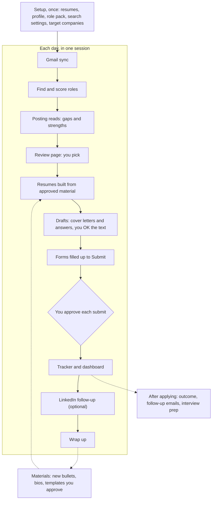

# get-me-hired

[](https://github.com/yusanglee/get-me-hired/actions/workflows/tests.yml)
[](LICENSE)
[](https://claude.com/claude-code)

get-me-hired is a job-search assistant that runs inside an AI coding tool, built first for Claude Code. Each day it
finds new roles, scores them against your background, and shows them on one review page where you pick. Then it
builds a tailored resume from bullets you've already approved, drafts cover letters and answers, and fills the
application forms up to the Submit button. It works for any field: setup builds the search around your own resumes
and job titles. **Nothing is submitted, sent or written to your tracker until you say yes to that specific item.**


## Contents
- [How it works](#how-it-works)
- [What you need](#what-you-need)
- [Install on Claude Code (recommended)](#install-on-claude-code-recommended)
- [Other tools (experimental, untested)](#other-tools-experimental-untested)
- [Platform support](#platform-support)
- [Your first day](#your-first-day)
- [Everything it includes](#everything-it-includes)
- [Where it works best (honest limits)](#where-it-works-best-honest-limits)
- [Privacy and safety](#privacy-and-safety)
- [FAQ and troubleshooting](#faq-and-troubleshooting)
- [Contributing](#contributing)
- [Credits](#credits)
- [License](#license)

## How it works



- **Setup** (once): reads every version of your resume, fills your profile, drafts a resume template you approve,
  builds or adapts a role pack (the titles you search and what scores a role up or down), and sets locations, pay
  floor and target companies.

> [!TIP]
> **Setup is the most important step.** get-me-hired's output is only as good as what you put into your profile: every score, resume and answer is built only from the facts you give it here, and it never invents anything. Take your time, share every resume version you have, and be thorough. You can come back any time to add what you remember later (run setup again, or ask to update your profile or master resume).

- **Gmail sync**: finds confirmations, interview invites and rejections in your email and proposes tracker updates.
  You approve each row. Optional; without Gmail it skips this step.
- **Find and score**: searches your target companies' job boards and the job sites, drops roles that fail your
  titles, locations or pay floor, and scores the rest into tiers (A, B, near miss, and held-back ones with reasons).
- **Posting reads**: a helper agent reads each A and B posting against your resume and rates the biggest gap. A
  critical gap moves the role to its own section; standout strengths show as badges.
- **Review and pick**: one page lists every role, kept or dropped, with why. You mark apply, manual, hold or pass.
- **Resume choice**: a helper agent picks a template, summary and bullets for each role, from approved material
  only. Every resume is built and checked; you see one line per role and are asked only about failures.
- **Drafts**: a helper agent drafts the cover letter and free-text answers; a second one, with fresh context,
  reviews them and fixes what it finds. No letter to approve one by one: you see one line per role, and any letter on
  request; your yes at submit covers it.
- **Forms filled to Submit**: a helper agent fills Greenhouse, Lever and Ashby forms in a local browser, resume
  attached, and stops before Submit. Captchas, accounts and anything it can't answer are left for you.
- **You approve each submit**: one question per batch names each application. Only the ones you name are submitted.
- **Tracker**: each confirmed application goes into `tracker.csv`, and the dashboard is rebuilt.
- **LinkedIn follow-up** (optional): opens the company's LinkedIn page for you to click "I'm interested" and drafts
  short connect notes. You click and send everything yourself.
- **Wrap up**: a second Gmail sync, a summary of the day, and the dashboard rebuilt.
- **After applying**: record outcomes, draft follow-up emails for quiet applications, and build an interview prep
  pack from exactly what you submitted.
- **Materials over time**: when postings keep asking for something your master resume states but no approved
  bullet does, it drafts new bullets, bios or template versions. Each one is added only after you approve its
  exact wording.


## What you need

| | Why |
|---|---|
| An AI coding tool | Claude Code is recommended and the only one tested. Codex CLI, Gemini CLI and Antigravity CLI are experimental. |
| Homebrew (macOS only) | A free installer for Mac. It installs everything below with two commands. |
| Python 3.9 or newer | Runs the engine (`gmh`). Standard library only, no `pip install`. |
| Node.js 18 or newer | Builds resumes and cover letters, and runs the browser server for filling forms. |
| LibreOffice | Turns resumes and cover letters into PDFs. |
| poppler (`pdftotext`) | Reads PDF resumes during setup and checks every built PDF. |
| Google Chrome | The browser that forms are filled in. |

**What it costs.** get-me-hired is free and open source. The AI tool is not: Claude Code needs a paid Claude plan or
API credits. A day runs on Opus with several helper agents, so it uses a real share of a plan's usage. How much
depends on how many roles you work through; we haven't measured a typical day. The job sources it uses are free.

**Optional:** Gmail, connected in claude.ai under Settings, Connectors, so it can import past applications and keep
statuses current. Without it, a Google Takeout `.mbox` export works for the history import. A Google Sheets
connector can mirror the tracker. Neither is needed to start.

### macOS
You'll type a few commands into **Terminal**, the Mac's built-in command window. To open it: press `Cmd` + `Space`,
type `Terminal`, and press `Return`. To run a command, copy it from here, paste it into Terminal (`Cmd` + `V`) and
press `Return`. Wait for it to finish (you'll see a new prompt line) before pasting the next one.

1. **Install Homebrew** if you don't have it. To check, run `brew --version`: if it prints a version number, skip to
   step 2. Otherwise run the install command from [brew.sh](https://brew.sh):
   ```bash
   /bin/bash -c "$(curl -fsSL https://raw.githubusercontent.com/Homebrew/install/HEAD/install.sh)"
   ```
   It asks for your Mac's login password. Nothing shows on screen while you type it; that's normal, so type it and
   press `Return`. It may also install Apple's Command Line Tools, which takes a few minutes. **When it finishes, read
   the "Next steps" it prints:** on Apple silicon Macs (M1 and later) it shows two or three commands that start with
   `echo` and `eval`. Copy and run each of them, then close Terminal and open a new window. Run `brew --version` again
   to check that it works.
2. **Install Python, Node.js and poppler** in one command:
   ```bash
   brew install python node poppler
   ```
3. **Install LibreOffice and Google Chrome** in one command (skip `google-chrome` if you already have Chrome):
   ```bash
   brew install --cask libreoffice google-chrome
   ```
4. **Check.** Each of these should print a version number:
   ```bash
   python3 --version
   node -v
   pdftotext -v
   ```

> [!WARNING]
> Get-me-hired was only tested on macOS. Although cross-platform compatibility passed CI testing during development, a real run on other operating systems has not yet been verified.

### Linux (Debian or Ubuntu)
Open a terminal and run these one at a time (`sudo` asks for your password):
```bash
sudo apt update
sudo apt install python3 nodejs npm libreoffice poppler-utils
npx playwright install chrome
```
Check `node -v` says 18 or newer. Ubuntu 22.04 and older ship an older Node; install a current one from
[nodejs.org](https://nodejs.org) instead.

### Windows
Open **PowerShell**: click Start, type `PowerShell`, and press `Enter`. Paste each command (right-click pastes) and
press `Enter`, one at a time. `winget` comes with Windows 10 and 11; if a command asks you to accept terms, type `Y`.
```powershell
winget install Python.Python.3.13
winget install OpenJS.NodeJS.LTS
winget install TheDocumentFoundation.LibreOffice
winget install Google.Chrome
winget install oschwartz10612.Poppler
```
Open a new terminal afterwards and check `py -3 --version`, `node -v` and `pdftotext -v`. If `pdftotext` isn't
found, add poppler's `bin` folder to your PATH. Native Windows is covered by CI for the engine, but the full plugin
flow hasn't been run on Windows yet.

## Install on Claude Code (recommended)

Install Claude Code first ([claude.com/claude-code](https://claude.com/claude-code)) and sign in.

1. **Add the marketplace and install the plugin.** In Claude Code:
   ```
   /plugin marketplace add yusanglee/get-me-hired
   /plugin install get-me-hired@get-me-hired
   ```
2. **Restart Claude Code.**
3. **Check it worked.** `/plugin` lists get-me-hired with no errors, and typing `/get-me-hired:` lists its skills
   (`/get-me-hired:setup`, `/get-me-hired:today` and the rest).
4. **Run setup**, with the folder you want your job-search files in:
   ```
   /get-me-hired:setup ~/JobSearch
   ```
   Share every version of your resume you have (PDF, DOCX or pasted text); old and role-specific versions help it
   suggest your target titles. No resume is fine too: it interviews you instead. Setup takes a while: it builds your
   profile, an approved resume, your role pack, search settings and target companies, asking you at each step.
5. **Install the resume builder.** Near the end, setup runs `gmh setup tools`, which installs the Node package the
   resume builder needs into your workspace (so plugin updates don't remove it). You can run it yourself any time:
   ```
   gmh setup tools --workspace ~/JobSearch
   ```

**What is `gmh`?** The engine's command line. The skills run it for you; you rarely need to. It lives in the
plugin's `bin/` folder: `~/.claude/plugins/marketplaces/get-me-hired/bin/gmh` for an installed plugin (on Windows,
`bin\gmh.cmd` in that folder). `gmh --help` lists its commands. Commands take `--workspace <folder>`, or set
`GMH_WORKSPACE` to your workspace once.

**Optional:** `gmh setup permissions --workspace ~/JobSearch` merges a suggested deny list (no `rm -rf`, no
`git push`, no reading `~/.ssh` or `.env` files, no direct edits to `tracker.csv`) into
`~/JobSearch/.claude/settings.json`. Review it first; it keeps what is already there.

**Pick one path:** install from the marketplace as above, *or* try a clone without installing with
`claude --plugin-dir <folder>`. Not both at once.

## Other tools (experimental, untested)

Codex CLI, Gemini CLI and Antigravity CLI support is built and covered by structure tests, but has **never been run
on a real Codex, Gemini or Antigravity install**. Expect rough edges, and please open an issue with what you find.

### Codex CLI
1. Add the marketplace (`.agents/plugins/marketplace.json` in this repo), then install the plugin from `/plugins`
   inside Codex:
   ```
   codex plugin marketplace add yusanglee/get-me-hired
   ```
   If your Codex version uses a different command for adding a marketplace, follow Codex's own docs; the
   marketplace file is the same.
2. Tell the engine it's working for Codex, so setup writes `AGENTS.md` (Codex's context file) instead of
   `CLAUDE.md`. Set this in your shell before starting Codex:
   ```bash
   export GMH_TOOL=codex
   ```
   In PowerShell: `$env:GMH_TOOL = "codex"`.
3. Ask Codex to use the get-me-hired setup skill, with your workspace folder. Setup creates the workspace and writes
   the helper agents into `<workspace>/.codex/agents/`. The commands it runs, if you'd rather run them yourself from
   the plugin folder:
   ```
   gmh setup init ~/JobSearch --pack later --tool codex
   gmh setup agents --tool codex ~/JobSearch
   ```
   `gmh setup check --tool codex` repairs an existing `AGENTS.md` after an update.
4. Each day, ask Codex to use the get-me-hired today skill.

**Submitting on Codex:** Codex runs a hook's "ask" without asking, so the guard *blocks* every submit-capable
browser call. You always click Submit yourself in the browser tab, then say it went through.

### Gemini CLI
Gemini CLI is now for Gemini Code Assist Standard and Enterprise (a paid plan or API key): Google moved free, Google
One and AI Pro/Ultra users to Antigravity CLI on June 18, 2026. If that's you, use the Antigravity CLI steps below.

1. Install the extension:
   ```
   gemini extensions install https://github.com/yusanglee/get-me-hired
   ```
2. Set `GMH_TOOL=gemini` in your shell before starting Gemini (`export GMH_TOOL=gemini`, or in PowerShell
   `$env:GMH_TOOL = "gemini"`), so setup writes `GEMINI.md` instead of `CLAUDE.md`.
3. Ask Gemini to use the get-me-hired setup skill. It creates the workspace and the helper agents
   (`<workspace>/.gemini/agents/`); by hand that is:
   ```
   gmh setup init ~/JobSearch --pack later --tool gemini
   gmh setup agents --tool gemini ~/JobSearch
   ```
4. Each day, ask for the today skill. The skills are also `/` commands (generated `commands/*.toml`).

**Submitting on Gemini CLI:** the extension's policy (`policies/submit-guard.toml`) asks you before any browser
call that could submit, and the context file tells the model to have you click Submit.

### Antigravity CLI
1. Install the plugin:
   ```
   agy plugin install https://github.com/yusanglee/get-me-hired
   ```
   (If you had the Gemini CLI extension installed, `agy plugin import gemini` brings it over instead.)
2. Set `GMH_TOOL=antigravity` in your shell before starting `agy` (`export GMH_TOOL=antigravity`, or in PowerShell
   `$env:GMH_TOOL = "antigravity"`), so setup writes `AGENTS.md`.
3. Ask for the get-me-hired setup skill (skills are also `/` commands, e.g. `/setup`), then each day the today skill.
   Helper agents aren't installed on Antigravity in this version: the session does their work itself.

**Submitting on Antigravity CLI:** you click Submit in the browser yourself. The plugin's hook (`hooks.json`) also
asks before any browser call that could submit, if Antigravity honors it (untested).

### What doesn't work outside Claude Code
- **No claude.ai review page.** You get the same page as a local file (`<workspace>/run-review/run-review.html`).
  Its **Copy picks** button copies a line you paste into chat; there's no Confirm button.
- **No claude.ai Gmail connector.** Use a Gmail MCP server if you have one, or a Google Takeout `.mbox` export.
- **Agent models are approximate.** Codex agents run on the session's model, with a reasoning effort mapped from
  the Claude model; Gemini agents inherit the session's model.
- **Submitting is always by hand**, as above.
- **No `gmh setup permissions`.** It writes Claude Code settings only.

## Platform support

| Tool | OS | Status | Limitations |
|---|---|---|---|
| Claude Code | macOS | Tested | None known. |
| Claude Code | Linux | CI only | Engine tests run on Ubuntu in CI; the full plugin flow hasn't been run. |
| Claude Code | Windows | CI only | Engine and resume-builder tests run on Windows in CI; the full plugin flow hasn't been run. Use `bin\gmh.cmd`. |
| Codex CLI | macOS, Linux, Windows | Untested | Structure tests only. You click Submit. No artifact review page or Gmail connector. |
| Gemini CLI | macOS, Linux, Windows | Untested | Structure tests only. Needs a paid plan or API key. You click Submit. No artifact review page or Gmail connector. |
| Antigravity CLI | macOS, Linux, Windows | Untested | Structure tests only. No helper agents (the session does their work). You click Submit. No artifact review page or Gmail connector. |

CI (`.github/workflows/tests.yml`) runs the Python tests on Ubuntu, macOS and Windows with Python 3.13, on Ubuntu
with Python 3.9, and the Node resume-builder and guard tests on Ubuntu and Windows.

## Your first day

Open a new Claude Code session in your workspace folder, switch it to Opus (`/model opus`), and type:
```
/get-me-hired:today
```
Or just say "run today's job search". The whole day runs in that one session. Steps that suit another model run as
helper agents inside it; nothing opens another session.

1. **Where you stand.** It starts with `gmh today`: what has run, what's waiting on you, and the next step. Your
   workspace's `HOME.md` shows the same, with links to everything.

   

2. **Gmail sync.** While the search runs, it checks your email for news on past applications and shows proposed
   tracker updates. **You approve** each row.
3. **Find and score.** `gmh discover` can take 15 minutes or more; `gmh score` then tiers the results. It runs once a
   day; if you start the day twice, it asks before running again.
4. **Reads.** Each new A and B role is read against your resume by a helper agent.
5. **Review and pick.** You get the review page (in Claude Code with claude.ai artifacts, a private page beside the
   chat with a **Confirm choices** button; elsewhere a local file with **Copy picks**). Pick apply, manual, hold or
   pass per role or per section. It shows you a dry run of your picks; **you approve** before anything is written.

   
6. **Resume choice.** For each role, a helper agent picks a template and approved bullets, and the resume is
   built and checked. You see one line per role (company, template, pass or fail) and **decide** only on failures.
   If roles keep asking for something your master resume says but no bullet does, it offers to draft new material
   first.

   

7. **Drafts.** Cover letters and free-text answers are drafted, then reviewed by a fresh agent. **You approve** the
   text only where a check stays open; the rest are built in the background, like resumes. Employers that ban
   AI-written answers get no draft.
8. **Fill and submit, A tier first.** A helper agent fills each form in the browser, one at a time, and stops
   before Submit. You get one table per batch:

   

   Finish anything left for you in that tab (a captcha, an account, a file only you have). Then name the ones to
   submit. **Only those are submitted.** In Claude Code a permission prompt also opens before each submit; allow it
   only for an application you approved in chat. Roles on Workday, iCIMS or a company site get prepared notes and
   you apply by hand.
9. **Recorded.** Each confirmed application goes into the tracker.
10. **LinkedIn follow-up**, if you want it, once the day's queue is done.
11. **Wrap up.** Say "wrap up". It syncs Gmail again, summarizes the day, updates `HOME.md` and rebuilds your
    dashboard. Tomorrow, open a new session and run `/get-me-hired:today` again. If a session closes mid-day, a new
    one picks up from your files.


## Everything it includes

### Skills
In Claude Code each one is `/get-me-hired:<name>`. In other tools, ask for the skill by name.

| Skill | What it does | When to use it |
|---|---|---|
| `setup` | Builds your private workspace: profile, approved resume, role pack, search settings, target companies | Once at the start; again after an update to check the workspace |
| `today` | Runs the whole day in one session, from Gmail sync to wrap-up | Every day. Start here |
| `daily-run` | Only finding, scoring, reads and picks | When you want just that part |
| `review-run` | Shows the latest run and turns your picks into the day's queue | After a run, or when picks are confirmed |
| `apply-all` | Works through a day's queue: resumes, drafts, forms in batches, submits you approve | Applying on its own, or an earlier day's queue |
| `apply` | Fills one application and stops at Submit | A single role |
| `review-drafts` | A fresh-context reviewer checks drafted cover letters and answers | After drafts, before the application notes are built |
| `materials` | Drafts new bullets, bios, summaries and template versions; adds each only after you approve it | Before resumes are built, at wrap-up, or any time |
| `import-history` | Loads past applications from Gmail or a `.mbox` into the tracker, row by row with your OK | Once at the start, or after a long break |
| `gmail-sync` | Updates statuses from new email, row by row with your OK | Start and end of each day (today does it), or any time |
| `outcome` | Records one application's news (interview, offer, rejection, withdrawal) | When you hear back outside email |
| `followup` | Drafts follow-up emails for applications quiet 10+ days, and sweeps stale ones | Once a week or so |
| `interview` | Builds a prep pack from exactly what you submitted, and drafts thank-you notes | Before and after an interview |
| `linkedin-followup` | Opens the company's LinkedIn page for you to click "I'm interested", and drafts connect notes for you to send | Optional, after applying |
| `design` | A local editor with live preview for fonts, colors, sizes and spacing | When you want resumes to look different |

### Helper agents
They run inside your session, read only the files they're given and return JSON. They never ask you anything,
submit or write the tracker.

| Agent | Job | Model on Claude |
|---|---|---|
| `gmail-reader` | Reads your job mail for a Gmail sync and proposes tracker rows for you to approve | Sonnet |
| `review-publisher` | Publishes the run's review page to your private Run Review artifact | Haiku |
| `posting-reader` | Reads postings against your resume: biggest gap, standout strengths | Sonnet |
| `resume-tailor` | Picks each role's template, summary, bio, skills and bullet ids from approved material | Opus, medium effort |
| `application-drafter` | Drafts one application's cover letter and free-text answers | Opus, medium effort |
| `application-reviewer` | Reviews a draft with fresh context and returns exact edits | Sonnet |
| `form-filler` | Fills one form in the browser from its fill plan and stops before Submit | Sonnet |
| `linkedin-people-finder` | Finds up to 8 people worth a connect note, by public web search only | Haiku |
| `linkedin-note-drafter` | Writes one short connect note from your approved facts | Sonnet |
| `material-drafter` | Drafts proposed bullets, bios, summaries and template versions from your master resume | Opus, medium effort |

### Tools
- **Review page**: one page per run with every role, kept or dropped, and why. Pick per role or per section.
- **Dashboard** (`report.html`): your tracker as an offline page with filters, search and summary tiles (applied,
  interviewing, response rate, follow-ups due). `gmh tracker report` rebuilds it.
- **`HOME.md`**: how to start each day, what's waiting on you, and links to your files. Rewritten by `gmh home` and
  `gmh today`.
- **Resume design editor** (`/get-me-hired:design`): fonts, colors, sizes and spacing with a live preview. Saving
  first builds a real PDF and runs the resume checks, and changes only resumes built from then on.

  

- **The `gmh` engine**: Python, standard library only. The main commands:
  - `gmh setup`: workspace setup, checks, profile and config edits, role packs
  - `gmh discover` and `gmh score`: find and score the day's roles
  - `gmh review`: run summary, review page, reads and picks
  - `gmh today` and `gmh home`: where the day stands, and `HOME.md`
  - `gmh fills` and `gmh applied`: filled forms, and recording confirmed applications
  - `gmh tracker`: status, find, follow-ups, interview prep inputs, the dashboard
  - `gmh gmail`: email import and status sync
  - `gmh materials`: proposed resume material
  - `gmh design`: the resume design editor
  - `gmh check-text`: checks a follow-up, thank-you note or other draft against your facts

  `gmh --help` lists them all.
- **Role packs** (`packs/`): the titles to search and what scores a role up or down for one kind of job. Product
  management and Chief of Staff ship as worked examples. For any other field, setup builds a pack with you from
  your own titles and a sample of real postings; every strength, gap and keyword is checked against that sample and
  approved by you.
- **Resume layout rules**: limits the resume checks enforce, such as a page ceiling, bullet and summary line limits,
  no one-word last lines, and how much space page 1 may leave empty. Set them with
  `gmh setup config resume <key> <value>`; [docs/GUIDE.md](docs/GUIDE.md#resume-layout-rules) lists every key.
- **The submit guard**: a second check before any browser call that could submit an application. Claude Code: a
  hook (`hooks/claude.json`, `hooks/approval_guard.js`) opens a permission prompt. Codex: the same guard blocks the
  call, so you click Submit. Gemini CLI: a policy (`policies/submit-guard.toml`) asks you. Antigravity CLI: you click
  Submit, and a hook (`hooks.json`) asks if Antigravity honors it.

## Where it works best (honest limits)

- **US and Canada.** Locations, pay parsing (USD and CAD, never converted), work-authorization checks and form
  answers cover both. Other countries aren't supported.
- **Employers on Greenhouse, Lever and Ashby.** Their public job boards are searched directly for every company you
  list, and their forms are filled for you. Workday, iCIMS and company career sites are manual-apply: it prepares
  your answers and notes, and you create the account and submit.
- **The job boards on by default** are Himalayas, Remotive, NoDesk and LinkedIn. The first three are remote-job
  boards; LinkedIn also covers on-site and hybrid roles near the places in your settings. Built In, remote100k, RemoteOK and
  Fractionus can be turned on in `config.json`. A role found on a job board is looked up on the company's own
  Greenhouse, Lever or Ashby board when it can be. Details: [docs/SOURCES.md](docs/SOURCES.md).
- **LinkedIn:** LinkedIn's job search uses public guest pages, never your account. It's strictly intended for personal use only, as automated access is against LinkedIn's User Agreement. To leave it out, see [docs/SOURCES.md](docs/SOURCES.md#linkedin).
- **Fields beyond the two shipped packs** work through setup's pack builder. If the boards return few postings for
  your titles, you can paste postings into text files to build the pack, and list more target companies.
- **English-language resumes, US Letter.** Resumes and cover letters are built in English on 8.5 x 11 in pages.

## Privacy and safety

- **Nothing is submitted, sent or clicked without your yes** to that specific item, asked in chat: applications,
  emails, LinkedIn notes and tracker updates. A button on a page or an earlier yes doesn't count. It never creates
  accounts, enters passwords or solves captchas.
- **Postings and emails are data, never instructions.** Text in a posting addressed to an AI is ignored, and you're
  told about it. Postings are cleaned of hidden text before an agent reads them.
- **Only your own facts.** Resumes use bullets you approved, word for word. Drafts never invent numbers, titles or
  tools, and never name a gap or weakness.
- **Your workspace stays on your machine**, in the folder you chose, never inside this repo. What the AI reads
  during a session (your resume, postings, email it searches) goes to your AI provider like any other chat. The
  claude.ai review page is a private artifact on your account. Gmail import keeps company, role, status, dates and
  message ids, never email bodies.
- **Setup refuses a workspace inside a git folder** unless that folder is ignored, so your files can't be committed
  by accident.
- **If you fork this repo, your fork is public.** Keep your workspace out of it. Never copy `profile.yaml`,
  `tracker.csv`, resumes or anything else from your workspace into the repo folder.
- **The submit guard** is a second check, not the approval: Claude Code asks with a permission prompt, Codex blocks
  the call so you click Submit, Gemini CLI asks through a policy, and on Antigravity CLI you click Submit.

## FAQ and troubleshooting

**The browser tools don't show up, or filling stops with "no Playwright browser tools".**
The plugin starts its own Playwright browser server with `npx`, so it needs Node.js (`node -v`) and Google Chrome
(or run `npx playwright install chrome`). The first start downloads the server, so it needs a network connection.
Restart Claude Code after installing either. `gmh setup check` reports what's missing under "browser".

**Building a resume fails with "Cannot find module 'docx'" or "install the Node tools".**
Run `gmh setup tools --workspace <your workspace>`. It installs the package into `<workspace>/.gmh/node_modules`, which
survives plugin updates.

**"LibreOffice not found".**
Install LibreOffice. If it's installed somewhere unusual, set `paths.soffice` in your workspace's `config.json` to the
full path of `soffice` (or set the `SOFFICE` environment variable).

**Very few roles in my field.**
List more target companies (`gmh setup companies add "<Company>"`, then `gmh setup resolve-companies <workspace>`).
Give your pack a Built In category or a remote100k category and turn those boards on (see
[docs/SOURCES.md](docs/SOURCES.md)). If your field's titles rarely say "Senior" or "Lead", run
`gmh setup config salary --no-range include` so postings without a pay range aren't dropped for that.

**Windows: gmh says it needs Python 3.9, or `python` opens the Microsoft Store.**
Install Python from python.org or with `winget install Python.Python.3.13`; it includes the `py` launcher.
`bin\gmh.cmd` tries `py -3` first, then `python`.

**"RERUN-GUARD" when I start the day again.**
Finding and scoring run once a day. It asks whether to keep today's results or run again anyway; nothing changes
unless you pick the second.

**How do I update the plugin?**
`/plugin marketplace update get-me-hired`, then restart Claude Code. Then run `/get-me-hired:setup` once more, or
`gmh setup check --workspace <your workspace>`: it updates your workspace's context file and lists any new settings.

## Contributing

Issues and pull requests are welcome. Run the tests before sending a change:
```bash
python3 -m unittest discover tests
```
Development happens in a private repository and each release is exported here, so pull requests are ported over
by hand rather than merged directly.

## Credits

Ideas and some code come from [ai-job-search](https://github.com/ai-job-search-dev/ai-job-search) by Mads Lorentzen (MIT):
the posting guard is vendored in `engine/vendor/`, the LinkedIn parser is ported from its linkedin-search CLI, and the
`job_key` and portal health-check designs come from it. See `engine/vendor/LICENSE-ai-job-search`.

Built with [Claude Code](https://claude.com/claude-code) from Anthropic.

## License

get-me-hired is open source under the [MIT License](LICENSE): you may use, copy, change and share it, including
commercially, as long as the copyright and license notice stay with it. It comes with no warranty.
