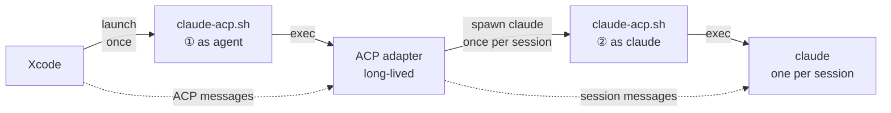

# claude-xcode-agent

Claude Code as an Xcode 27 agent, using your own API key or gateway.

## Design

Xcode talks to agents over ACP, and an adapter (`claude-agent-acp`) bridges ACP to Claude Code. Used on its own, the adapter has two problems:

- Xcode starts the agent from the GUI, so there's no shell env to hold a key or gateway URL.
- The adapter hardcodes `claude --setting-sources user,project,local`, so your global `~/.claude/settings.json` gets applied to Xcode too.

`claude-acp.sh` fixes both: the key and gateway come from `config.json`, and `~/.claude/settings.json` is not read unless you opt in with `setting_sources`. It does this by running twice in two roles:



1. **As agent**: loads `config.json` into env, points `CLAUDE_CODE_EXECUTABLE` at itself, execs the adapter.
2. **As claude**: swaps `--setting-sources` for `project,local`, adds your MCP servers, execs the real `claude`.

Both steps `exec`, so no wrapper process stays alive and stdout stays pure ACP.

① runs once per agent launch, ② once per session. Messages within a session go straight to the running `claude`.

## Run

```sh
git clone https://github.com/yusuke-114/claude-xcode-agent.git && cd claude-xcode-agent
./setup.sh        # installs node, claude and the adapter, then prints the path for Xcode

# optional: your own key / gateway / model / MCP servers (see Configure)
cp config.example.json config.json && chmod 600 config.json
```

In Xcode › Settings › Intelligence › Add an Agent…, set **Executable** to the printed `claude-acp.sh` path.

Logs go to `.runtime/agent.log`.

## Configure

`config.json` lives next to `claude-acp.sh`. Every field is optional. Without the file, `claude` uses its own login. The script reads it each time Xcode launches the agent; restart Xcode if a change doesn't show up.

### Base URL and key

| Endpoint | Fields |
|---|---|
| Anthropic API | `api_key` |
| Gateway, Bearer auth | `base_url` + `auth_token` |
| Gateway, `x-api-key` auth | `base_url` + `api_key` |

`base_url` is the gateway root, without `/v1/messages`.

```json
{
  "base_url": "https://your-gateway.example.com",
  "auth_token": "your-token"
}
```

### Model

`model` is the default model (sets `ANTHROPIC_MODEL`). Use a full ID or an alias like `opus`.

If your gateway names models differently, map the aliases with `env`:

```json
{
  "model": "opus",
  "env": {
    "ANTHROPIC_DEFAULT_OPUS_MODEL": "your-gateway-opus-id",
    "ANTHROPIC_DEFAULT_SONNET_MODEL": "your-gateway-sonnet-id",
    "ANTHROPIC_DEFAULT_HAIKU_MODEL": "your-gateway-haiku-id"
  }
}
```

### MCP servers

`mcp_servers` uses the same format as Claude Code's `mcpServers`. They're added alongside the servers Xcode provides. Each key is a name you choose. The example below shows a local server (started as a process) and a remote one (reached over HTTP).

```json
{
  "mcp_servers": {
    "my-local-server": { "command": "/absolute/path/to/server", "args": ["--stdio"], "env": { "TOKEN": "..." } },
    "my-remote-server": { "type": "http", "url": "https://mcp.example.com/mcp", "headers": { "Authorization": "Bearer ..." } }
  }
}
```

Use absolute paths, since Xcode doesn't start the agent with your shell's PATH. Each session logs the loaded server names to `.runtime/agent.log`.

### Other fields

- `setting_sources`: defaults to `project,local`. Set `user,project,local` to also load `~/.claude/settings.json`.
- `env`: environment variables passed to `claude` as-is, for anything the fields above don't cover (e.g. `HTTPS_PROXY`). Xcode doesn't start the agent with your shell's env, so set them here. `base_url`, `auth_token`, `api_key` and `model` already become `ANTHROPIC_*` variables, so don't repeat them here.

## License

[MIT](LICENSE)
