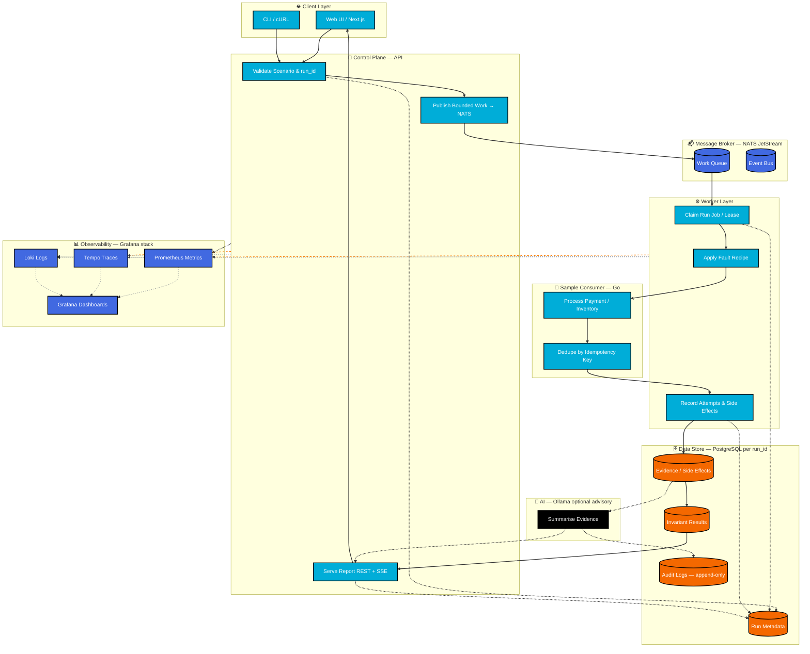

<p align="center">
  
</p>

<h1 align="center">GenesisGO</h1>

<p align="center">
  <b>Event-driven reliability testing and controlled failure simulation for backend developers.</b><br/>
  Reproduce message-processing failure modes (duplicate delivery, retries, out-of-order delivery, consumer restart, crash after commit before ack)<br/>
  against an isolated sample consumer and get a deterministic invariant verdict per run.
</p>

<p align="center">
  <a href="https://go.dev"></a>
  <a href="https://nextjs.org"></a>
  <a href="https://react.dev"></a>
  <a href="https://www.typescriptlang.org"></a>
  <a href="https://tailwindcss.com"></a>
  <a href="https://ui.shadcn.com"></a>
  <a href="https://www.docker.com"></a>
</p>

<p align="center">
  <a href="https://www.postgresql.org"></a>
  <a href="https://nats.io"></a>
  <a href="https://ollama.com"></a>
  <a href="https://opentelemetry.io"></a>
  <a href="https://prometheus.io"></a>
  <a href="https://grafana.com"></a>
  <a href="https://grafana.com/oss/tempo"></a>
  <a href="https://grafana.com/oss/loki"></a>
</p>

<p align="center">
  <a href="https://arcjet.com"></a>
  <a href="https://www.postman.com"></a>
  <a href="https://github.com/zannunakiz/GenesisGO/actions"></a>
  <a href="https://trivy.dev"></a>
  
</p>

<p align="center">
  <i>No production infrastructure is touched. Every run is isolated by <code>run_id</code>; AI diagnosis is optional and advisory only — it never decides pass/fail.</i>
</p>

---

## 🏗️ System Design

<p align="center">
  
</p>

<p align="center">
  <sub>
    <b>End to end:</b> the browser or CLI calls the <b>API</b> → API validates the scenario and publishes bounded work to <b>NATS JetStream</b> → the <b>Worker</b> claims the job, applies the fault recipe to the <b>Sample Consumer</b>, records events / attempts / side effects in <b>PostgreSQL</b> (all scoped by <code>run_id</code>) → the <b>Invariant Engine</b> checks determinism → a <b>Report</b> is served over REST + SSE. Optional <b>Ollama</b> can summarise the evidence, and an <b>Observability</b> stack (OpenTelemetry · Prometheus · Grafana · Tempo · Loki) watches the loop.
  </sub>
</p>

---

## 🔄 How GenesisGO Works

<p align="center">
  
</p>

Follow these six steps to run a reliability test and get a deterministic invariant verdict:

| # | Step | What happens |
|---|------|--------------|
| 1 | **Pick a Scenario** | Select a built-in failure scenario, such as duplicate delivery, retry, out-of-order events, or worker crashes. |
| 2 | **Run the Test** | Start an isolated test run. GenesisGO orchestrates the execution using a unique `run_id`. |
| 3 | **Simulate Failures** | The worker applies controlled fault recipes to the sample Go consumer to reproduce real-world messaging failures. |
| 4 | **Track the Results** | Inspect the event timeline, side effects, delivery history, and deterministic invariant verdict (PASS/FAIL). |
| 5 | **Get AI Diagnosis (Optional)** | Use local Ollama to summarise execution evidence and suggest potential issues. AI never determines test results. |
| 6 | **Build More Reliable Systems** | Use reproducible test results to identify weaknesses and verify backend reliability without touching production infrastructure. |

---

## 📚 Table of Contents

| | Section |
|---|---|
| 🌱 | [About](#-about) |
| 🔄 | [How GenesisGO Works](#-how-genesisgo-works) |
| 🚀 | [Get Started](#-get-started) |
| 🔌 | [Integrations](#-integrations) |
| ✨ | [Features](#-features) |
| 🧱 | [Tech Stack](#-tech-stack) |
| 🛠️ | [Engineering Highlights](#-engineering-highlights) |
| 🗂️ | [Project Structure](#-project-structure) |
| 📜 | [Scripts](#-scripts) |
| 🧪 | [Tests & CI](#-tests--ci) |
| 🤝 | [Contributing](#-contributing) |
| 📄 | [License](#-license) |

---

## 🌱 About

GenesisGO is a **local-first reliability test harness** for event-driven consumers. V1 executes only its built-in Go payment/inventory sample consumer, with synthetic data and isolated test state. A scenario is a versioned, validated fault recipe with expected business invariants; its result comes from inspecting recorded state, not from whether message delivery alone succeeded.

Supported scenarios are normal processing as a control, duplicate delivery, retry/redelivery after a transient failure, out-of-order delivery, acknowledgement timeout, consumer restart, and crash after a database commit but before acknowledgement.

<table>
<tr><td width="50%" valign="top">

**For the backend engineer**

- Reproduce real message-processing failure modes against an isolated consumer
- Deterministic, reproducible invariant verdicts per `run_id`
- Optional local AI (Ollama) for advisory diagnosis — never fabricates, never decides pass/fail
- Bounded, cancellable workers with run deadlines and lease-based recovery

</td><td width="50%" valign="top">

**For the operator / DevOps**

- All published Compose ports bind to `127.0.0.1` only — nothing is exposed publicly
- API keys stored as SHA-256 digests; no default production secret
- Request logs and audit details are redacted; secrets never appear in logs or reports
- Production mode requires explicit TLS for database / NATS / CORS and rejects debug logging

</td></tr>
</table>

---

## 🚀 Get Started

**Requirements:** Docker & Docker Compose, Go 1.27+, Node.js (for the frontend), and a terminal. No cloud account required.

### 1 — Clone the repository

```bash
git clone https://github.com/zannunakiz/GenesisGO.git
cd GenesisGO
```

### 2 — Configure the environment

```bash
cp .env.example .env     # macOS / Linux
copy .env.example .env   # Windows (cmd / PowerShell)
```

Every key is documented inline in `.env.example`. `.env` is gitignored and must never be committed.

### 3 — Bootstrap an API key (control-plane)

```bash
go run ./cmd/bootstrap-key
```

Copy the one-time `GENESISGO_API_KEY` value and keep it out of tracked files, logs, and reports.

### 4 — Start the core stack

```bash
make compose-up      # docker compose --profile core up -d
```

This brings up **PostgreSQL**, **NATS**, the **API**, the **Worker**, the **Sample Consumer**, and the **Web** frontend — all bound to `127.0.0.1`.

### 5 — Run it locally

- **API:** `http://127.0.0.1:8080` (health at `/health/live`, `/health/ready`, `/healthz`)
- **Web:** `http://127.0.0.1:3000`
- **Metrics:** `http://127.0.0.1:9090` (loopback only)

<sub>Opt-in profiles: `--profile ai` adds Ollama for local AI diagnosis; `--profile observability` adds OpenTelemetry, Prometheus, Tempo, Loki and Grafana.</sub>

---

## 🔌 Integrations

### 🗄️ Data — PostgreSQL (per `run_id`)

<p align="center">
  
</p>

PostgreSQL stores test-run metadata, evidence, side effects, and invariant results. **All persisted mutations are scoped by `run_id`** — records never mix events or state from different runs. Migrations in `migrations/` run automatically on API startup:

- `0001_init_schema` — core schema
- `0002_run_lifecycle` — run states/transitions
- `0003_rejected_events` — rejected event envelopes
- `0004_run_job_leases` — bounded worker leases
- `0005_state_snapshots` — before/after side-effect state
- `0006_audit_logs` — append-only security-relevant actions

### 📬 Message Broker — NATS JetStream

<p align="center">
  
</p>

NATS JetStream transports backend-managed work and events between the API, the Worker, and the Sample Consumer. Work is published bounded and consumed with leases, so no single worker can monopolise a run.

### 🔐 Identity — API keys (SHA-256 digests)

Control-plane authentication uses API keys stored only as SHA-256 digests in `API_KEYS_FILE` (default `.local/api-keys.json`). There is **no default production secret**. Keys carry `read`, `run`, or `admin` scopes (`admin` implies both, `run` implies `read`). Missing or unknown keys return `401`; a valid key without the required scope returns `403`. `DEMO_AUTH_DISABLED=true` is a local-only escape hatch for read-only demo calls and is rejected in production.

### 🤖 AI — Ollama (optional, advisory only)

<p align="center">
  
</p>

Ollama is opt-in and local-only. When configured (`OLLAMA_URL` / `OLLAMA_MODEL`), it can summarise evidence; when not configured, diagnosis is reported as unavailable — **never fabricated**. The verdict is always computed from recorded state and invariant evaluation, never from AI.

### 📊 Observability — OpenTelemetry · Prometheus · Grafana · Tempo · Loki

The observability profile emits W3C trace context through a run's persisted job and NATS message headers. API metrics are served on loopback (`127.0.0.1:9090`); worker health and metrics share loopback port `8081`. Metrics use only bounded labels — they never include run/event IDs, SQL, prompts, or payloads.

---

## ✨ Features

<table>
<tr><td width="50%" valign="top">

**🧪 Fault-injection scenarios**

- `normal_payment` — payment delivered and acknowledged exactly once (control / happy path)
- `duplicate_delivery` — same payment delivered twice; consumer must dedupe by idempotency key
- `retry_after_timeout` — delivery times out and is retried; at-least-once without duplicate effect
- `out_of_order` — events delivered out of order; correct transition sequence enforced
- `crash_after_commit_before_ack` — consumer commits then crashes before ack; redelivery must not duplicate
- `worker_restart` — worker restarts mid-scenario; in-progress state recovered, no lost or duplicated effects

**📊 Deterministic verdicts**

- Run lifecycle: `queued` → `running` → `passed` / `failed` / `cancelled` / `timed_out`
- `passed` only when execution and verification completed and all required invariants passed
- Infrastructure errors are recorded as execution errors — never fabricated as business-invariant failures

</td><td width="50%" valign="top">

**📈 Reporting & observability**

- REST + SSE endpoints for runs, reports, events, and exports (JSON / CSV)
- Run-scoped evidence: delivery timeline, side effects, and invariant results per `run_id`
- Retention: diagnostic artifacts pruned after `RETENTION_PERIOD` (default 24h); terminal runs capped by `MAX_RUNS` per scenario (default 1000); `audit_logs` are append-only
- Health endpoints (`/health/live`, `/health/ready`, `/healthz`) and Prometheus metrics on loopback

**🔒 Security boundaries**

- API keys as SHA-256 digests; no secrets in images; runtime secrets from gitignored `.env`
- No Docker socket mounted into the API; no API-driven arbitrary container execution
- All Compose ports bind to `127.0.0.1` only; nothing is exposed publicly
- Request logs and audit details redacted (`store.SanitizeDetail`)

</td></tr>
</table>

---

## 🧱 Tech Stack

**Application**

| Layer | Choice | Why it is here |
|---|---|---|
| Backend language | **Go 1.27** | Compiled, statically typed, built-in concurrency for workers and leases |
| Backend framework | Go standard library + `pgx`, `nats.go`, `prometheus/client_golang`, OpenTelemetry SDK | Minimal dependency surface; database driver, NATS client, metrics, tracing |
| Security / rate limiting | **Arcjet** (arcjet-go) | Shield, token-bucket rate limiting, abuse protection on control-plane routes |
| Frontend | **Next.js 16** + **React 19** | App Router, Server Components, reactive dashboard |
| Language | **TypeScript 5** (strict, `@/*` alias) | One source of truth from schema to JSX |
| Styling | **Tailwind CSS** | Token-driven theme, zero runtime CSS |
| UI components | **shadcn/ui** over **Radix** | Accessible, copy-owned components |
| Icons / toasts | **lucide-react**, **sonner** | Icon set and toast queue |
| API docs | **Swagger UI** | OpenAPI contract documentation |

**Data & infrastructure**

| Layer | Choice | Why it is here |
|---|---|---|
| Database | **PostgreSQL 15** | Relational evidence store, `run_id`-scoped isolation |
| Message broker | **NATS JetStream** | Bounded work/events between API, worker, consumer |
| Migrations | **golang-migrate** | Committed SQL migrations applied on API startup |
| Container orchestration | **Docker Compose** | Local-first, one-command core stack with optional profiles |
| AI (optional, advisory) | **Ollama 0.5.7** | Local LLM for evidence summarisation; never decides pass/fail |

**Observability**

| Layer | Choice | Why it is here |
|---|---|---|
| Tracing | **OpenTelemetry** + **Grafana Tempo** | W3C trace context through run jobs and NATS message headers |
| Metrics | **Prometheus** | Loopback API metrics; bounded labels only (no PII or payloads) |
| Logging | **Grafana Loki** | Log aggregation for API and worker |
| Dashboards | **Grafana OSS** | Visualisation of Prometheus metrics, Tempo traces, Loki logs |

**Platform & quality**

| Layer | Choice | Why it is here |
|---|---|---|
| Linting (Go) | **golangci-lint**, `go vet`, **staticcheck** | Enforced by CI and `make lint` |
| Formatting (Go) | **gofmt** / `go fmt` | Canonical Go layout |
| Linting (frontend) | **biome** | Fast formatter/linter for TypeScript/React |
| Testing (Go) | `go test`, **testify**, **Testcontainers** | Unit, race, and integration tests (PostgreSQL + NATS) |
| Testing (frontend) | **vitest** + **jsdom** + @testing-library | Unit and component tests |
| Contract check | **Swagger Parser** | OpenAPI vs registered Go route validation |
| CI / CD | **GitHub Actions** | Format, vet/staticcheck, tests, frontend build, Trivy scans, Docker build, SBOM |
| Security scanning | **Trivy** | Filesystem, image, and configuration scans (vuln, secret, misconfig) |
| SBOM | **CycloneDX** | Generated with every Docker build |

---

## 🛠️ Engineering Highlights

Everything below is enforced by code, not by convention.

### 1. `run_id` isolation — evidence never mixes across runs

Every event envelope, delivery attempt, side effect, invariant result, and report is associated with exactly one `run_id`. Reports never mix events or state from different runs, so parallel scenario executions stay hermetic.

### 2. Deterministic invariant engine — the verdict comes from state, not from delivery

Verdicts are computed from recorded state and invariant evaluation, not from whether message delivery alone succeeded. Infrastructure errors are recorded as execution errors and must never be represented as business-invariant failures.

### 3. Bounded, cancellable workers with lease-based recovery

The worker claims bounded run jobs with leases and checkpoints terminal state on shutdown. Interrupted runs are never marked `passed`; they remain `queued` / `running` / `cancelled` / `timed_out` and can be re-enqueued or inspected. Shutdown cancels active run work, closes HTTP / database / broker / telemetry in bounded order, then exits.

### 4. Control-plane security by default

API keys are stored only as SHA-256 digests. No default production secret exists. All published Compose ports bind to `127.0.0.1` only. No Docker socket is mounted into the API, and there is no API-driven arbitrary container execution. Production startup refuses to run without explicit TLS for database / NATS / CORS and rejects debug logging.

### 5. Redaction everywhere secrets could leak

Request logs record method, path, status, duration, and correlation identifiers only. Auth headers, API keys, cookies, secrets, connection strings, and raw payment fields are replaced with a fixed placeholder. Credentials, SQL, stack traces, and raw payment fields never appear in logs or reports.

### 6. Flowchart diagram — end-to-end reliability test loop


<details open>
<summary>Mermaid source</summary>


</details>

<p align="center">
  <sub>
    <b>Flow summary:</b> Client → API validates scenario → NATS JetStream queues bounded work → Worker claims lease → applies fault recipe to Sample Consumer → records evidence & side effects in PostgreSQL (scoped by <code>run_id</code>) → Invariant Engine computes deterministic verdict → Report served via REST + SSE.<br/>
    Optional Ollama summarises evidence (advisory only, never decides pass/fail). Observability stack (Prometheus · Tempo · Loki · Grafana) watches the loop — all ports bound to <code>127.0.0.1</code>.
  </sub>
</p>

---

## 🗂️ Project Structure

```
GenesisGO/
├── cmd/                 # Application entry points (API, worker, sample-consumer, bootstrap-key)
├── config/              # Runtime configuration (env-driven, Arcjet, Ollama, telemetry)
├── internal/            # Go packages: httpapi, worker, invariant engine, store, observability, protection
├── migrations/          # Committed SQL migrations (0001–0006)
├── web/                 # Next.js frontend (app router, components, vitest, OpenAPI contract)
├── docs/                # Architecture, audit retention, baseline, monitoring notes
├── public/              # Static assets (Logo.png, SystemDesign.png, openapi.yaml)
├── .github/workflows/   # CI (lint, test, build, Trivy, Docker, SBOM)
├── docker-compose.yml   # Core + optional AI / observability profiles
├── Dockerfile           # Multi-target builds (api, worker, sample-consumer, web)
├── Makefile             # compose-up, test, lint, format, build, quality, web-*
├── .env.example         # Environment variable template (copy to .env locally)
└── LICENSE              # MIT License
```

---

## 📜 Scripts

| Command | What it does |
|---|---|
| `make test` | `go test ./...` |
| `make race-test` | `go test -race ./...` |
| `make integration-test` | `go test -tags=integration ./...` (Testcontainers; needs Docker) |
| `make lint` | `go vet`, `staticcheck`, `npm lint` |
| `make format` | `go fmt`, `npm format` |
| `make build` | `go build ./...` |
| `make web-check` | Frontend lint, typecheck, vitest, OpenAPI contract check |
| `make web-build` | `next build` |
| `make quality` | lint + test + build + web-check + web-build |
| `make compose-up` | `docker compose --profile core up -d` |

CI equivalent: `.github/workflows/ci.yml` runs Go formatting, vet/staticcheck, unit/race/integration tests, frontend checks/build, Trivy fs/image/config scans, Docker build, and CycloneDX SBOM — no paid keys, least-privilege permissions, pinned action SHAs.

---

## 🧪 Tests & CI

| Suite | Focus |
|---|---|
| `go test ./...` | Unit tests over pure rules and internal packages |
| `go test -race ./...` | Race-detector unit tests (Linux CI) |
| `go test -tags=integration ./...` | Integration tests with Testcontainers (PostgreSQL, NATS) |
| `npm run test` (web) | vitest + OpenAPI contract check |
| `make lint` | `go vet` + `staticcheck` + ESLint/biome |
| `make web-build` | Next.js production build |

`.github/workflows/ci.yml` runs on every push and pull request as independent jobs: formatting, vet/staticcheck, unit/race/integration tests, frontend checks/build, Trivy fs/image/config scans, Docker build, and CycloneDX SBOM. Installing from the lockfile with caching keeps jobs reproducible and fast.

---

## 🤝 Contributing

Issues and pull requests are welcome. The house rules are visible in the code itself:

1. **No user-supplied workloads** — the API does not execute user-supplied workloads or decide invariant outcomes.
2. **Verdicts from state, never from AI** — Ollama is advisory only; it never decides pass/fail.
3. **`run_id` isolation everywhere** — all persisted evidence and mutations are scoped by `run_id`.
4. **Redact before you log** — secrets, credentials, SQL, stack traces, and raw payment fields never appear in logs or reports.
5. **Explain the *why* in a comment, and ship a test** — anything touching access, runs, or evidence should prove itself.

---

## 📄 License

Released under the **MIT License** — see [`LICENSE`](./LICENSE).

---

<p align="center">
  <br/>
  Built with 🧡 by <b>Richky Abednego</b><br/>
  <sub>Deep dives: <a href="./docs/architecture.md">Architecture</a> · <a href="./docs/audit-retention.md">Audit Retention</a> · <a href="./docs/monitoring.md">Monitoring</a></sub>
</p>
