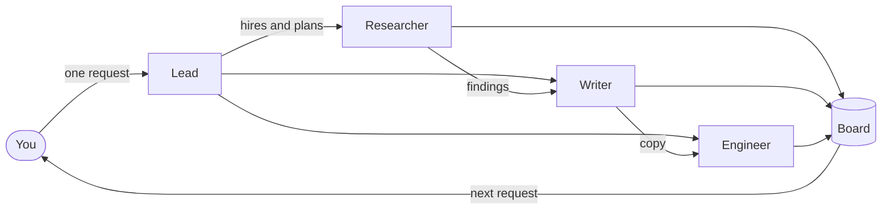

<div align="center">


# Satgas

**One request in. A task force out.**

A self-hosted canvas where your Claude Code and Codex agents work as a team you can see.

[](https://github.com/zeative/satgas/actions/workflows/ci.yml)
[](package.json)
[](LICENSE)
[](https://bun.sh)
[](https://github.com/zeative/satgas/stargazers)
[](https://m8ven.ai/mcp/zeative-satgas-1gi14d?s=readme)

[Quick start](#quick-start) · [Features](#features) · [Self-hosting](#self-hosting) · [Configuration](#configuration) · [Security](#security) · [Contributing](#contributing)

<p>
  Sponsored by&nbsp;&nbsp;&nbsp;
  <a href="https://dcloud.co.id/?ref=DCloudKejaa5">
    <picture>
      <source media="(prefers-color-scheme: dark)" srcset="docs/dcloud-dark.svg">
      <source media="(prefers-color-scheme: light)" srcset="docs/dcloud-light.svg">
      
    </picture>
  </a>&nbsp;&nbsp;&nbsp;
  Referral&nbsp;code&nbsp;<code>DCloudKejaa5</code>
</p>

</div>

<picture>
  <source media="(prefers-color-scheme: dark)" srcset="docs/screenshot-dark.png">
  <source media="(prefers-color-scheme: light)" srcset="docs/screenshot-light.png">
  
</picture>

## Why Satgas

Four agent terminals open, and no idea which one is stuck, which one is done, or where the good output scrolled off to. Satgas puts them all in one place.

- **See who is doing what.** You write one request. A lead picks the roles that request needs, splits the work, and each task shows who has it, what it waits on and how it is going.
- **Keep what they make.** Results land on the board as cards: docs, tables, code and live previews of the pages they built. Move them, edit them, and build on them in the next request.
- **Own the whole thing.** The agents are the real [Claude Code](https://code.claude.com/docs) or [Codex](https://github.com/openai/codex) CLI on your machine or server, so the result is real files in a real folder. Satgas is open source and runs where you put it.

It is not only for code. The same team can research competitors, write a launch brief, or make a pitch deck.

> _Satgas_ is Indonesian for _satuan tugas_, a task force.

> [!NOTE]
> Satgas is early (v0.1). Expect rough edges and breaking changes, and please [open an issue](https://github.com/zeative/satgas/issues) when you hit one.

## How it works



1. **Ask.** Write what you want in plain language, and attach files if they help. Questions get a direct answer. If a choice would change the work, the lead asks before planning.
2. **Plan.** The lead hires only the roles this request needs and plans up to 12 tasks, with who does what and what depends on what.
3. **Work.** Tasks run as soon as what they depend on is done, three at a time by default. Each agent receives the reports it depends on. A failed task stops only its own branch.
4. **Build on it.** Results land on the board. Send a follow-up and the same team picks it up with what it already knows.

### Questions people ask

**Can't I do this with tmux and git worktrees?** You can run the agents that way, and if it works for you, keep it. What Satgas adds is the whole job in one view: who waits on whom, and every output side by side as something you can edit.

**Isn't a team of named agents just theater?** The names are there so you can tell who did what. The lead hires only what a request needs, and there is no fixed roster. Agents don't chat with each other by default. In one benchmark, letting them do so used 34% more input tokens and produced the same fix.

**Who reviews all this?** You do, so Satgas keeps it small. A round holds at most 12 tasks, every task shows its diff and can be reverted on its own, and steps that are hard to undo can wait for your approval.

**Does my code leave my machine?** Only what the agent CLIs send to the model provider you chose, and what goes through connectors or channels you turn on. Satgas itself calls GitHub for the update check, the star count and the skills you install. See [Security](#security).

## Features

**Team and canvas**

- **A visible team.** Everyone the lead hires has a name, a role and a face, and stays on the board for later requests.
- **A board you can use.** Notes, docs, tables, code, images, live page previews, shapes, frames, connectors and freehand drawing, with grouping, alignment and snapping.
- **Live widgets.** Checklists, variables, buttons, triggers, and the status of branches and pull requests.
- **Canvas or chat.** Switch with <kbd>⌘J</kbd>. Chat Only shows the same cards inline and is the default on small screens.
- **Sessions and forks.** A board holds several chats that share its canvas and team. A fork copies the whole board so you can try another direction.

**Real engineering work**

- **Isolated changes.** When a round has several writing tasks in a clean repository, each gets its own git worktree and merges back as commits. A conflict fails that task and keeps its branch.
- **Diffs and undo.** See what every task changed and revert it. This history is private to Satgas and never touches your own git.
- **Pull request watch.** Link a PR and the team fixes what reviewers ask for, up to three rounds.
- **Memory and rules.** Standing knowledge and instructions that carry across boards.

**Runs without you**

- **Schedules and webhooks.** Start work on an interval, at a time of day, or when another service calls.
- **Channels** <sup>experimental</sup>. Message your team from [Telegram or WhatsApp](#channels), off by default.

**Set up your way**

- **Model providers.** Pick one model in the composer, and the lead and every task run on it. Claude Code serves your Claude sign-in or subscription token, the Anthropic API, DeepSeek, Qwen, Z.ai, OpenRouter and Ollama. Codex serves your Codex sign-in, the OpenAI API, Groq and LM Studio, though connectors may not reach models on Groq and LM Studio.
- **Connectors.** One-click GitHub, GitLab, Notion, Linear, Vercel, Supabase, Sentry, Zapier, Repliz and dozens more, or any MCP server of your own.
- **Skills.** Add them from a GitHub repository, a `.zip` or your own `SKILL.md`. Built-ins cover engineering practice, security audits and interface design.
- **Tools.** Programs around each agent's work, such as a command guard, auto-format, gitleaks, RTK and agent-browser.
- **Usage.** Tokens, estimated API cost, plan limits and disk use in one place.

The UI is in English and Bahasa Indonesia. It follows your system theme until you pick one.

## Quick start

**You need**

- [Bun](https://bun.sh) 1.2 or newer
- [Claude Code](https://code.claude.com/docs) or the [Codex CLI](https://github.com/openai/codex), for the provider you want to use

**Run it**

```sh
git clone https://github.com/zeative/satgas.git
cd satgas
bun install
bun run dev
```

The terminal prints a sign-in link. Open it once and your browser stays signed in. If you lose it, paste the token from `~/.satgas/token` on the sign-in page.

In development the UI is on port 5317 and the API on 4317. Change them with `SATGAS_WEB_PORT` and `SATGAS_PORT`.

**Or build a single binary**, with the server and UI inside:

```sh
bun run build      # creates dist/satgas
./dist/satgas      # serves http://localhost:4317
```

### Keyboard

| Key                                                              | Action                                      |
| ---------------------------------------------------------------- | ------------------------------------------- |
| <kbd>⌘K</kbd> / <kbd>Ctrl K</kbd>                                | Command palette                             |
| <kbd>N</kbd>                                                     | New board, or a sticky note when on a board |
| <kbd>⌘J</kbd> / <kbd>Ctrl J</kbd>                                | Switch between canvas and chat              |
| <kbd>⌘B</kbd> / <kbd>Ctrl B</kbd>                                | Toggle the workspace panel                  |
| <kbd>V</kbd> <kbd>H</kbd> <kbd>R</kbd> <kbd>D</kbd> <kbd>O</kbd> | Select, hand, rectangle, diamond, ellipse   |
| <kbd>+</kbd> <kbd>−</kbd> <kbd>0</kbd>                           | Zoom in, zoom out, fit the board            |
| <kbd>⌘Z</kbd> / <kbd>Ctrl Z</kbd>                                | Undo on the board                           |

## Channels

Message your team without opening Satgas. Channels are experimental and have not been tried on real accounts yet, so they stay off until you set `SATGAS_CHANNELS=1`. Then turn a channel on under **Integrations → Channels** and pair your chat with the one-time code shown there.

- **Telegram** uses a bot of your own, made with [@BotFather](https://t.me/BotFather). Satgas connects outward, so it needs no public address.
- **WhatsApp** connects with [zaileys](https://github.com/zeative/zaileys) by scanning a QR code. This is not an official WhatsApp connection and a number can get banned, so use a spare one.

Chats reach the same boards as the web. Send `/help` to your bot for the commands. Channels handle private text chats for now, and run only while Satgas runs.

> [!WARNING]
> A paired person can start agents on your machine. Pair only people you would trust with a terminal there.

## Self-hosting

Satgas runs the same way on a laptop and on a server, and only a few variables change. On your own computer nothing needs setting: it listens on `127.0.0.1` and generates its own token.

### On a server

Run it behind a reverse proxy that handles HTTPS, such as Caddy, Traefik, Nginx or Dokploy:

```sh
bun run build
SATGAS_HOST=0.0.0.0 \
SATGAS_PUBLIC_URL=https://satgas.example.com \
SATGAS_TOKEN="$(openssl rand -base64 32)" \
SATGAS_DATA_DIR=/var/lib/satgas \
./dist/satgas
```

- `SATGAS_PUBLIC_URL` is required for remote access. Satgas only answers requests addressed to this machine or that address, and marks its cookie `Secure` when it is `https`.
- Open your address and paste `SATGAS_TOKEN` to sign in. The cookie lasts a year. Sign out from the command palette.
- The proxy must pass WebSocket upgrades on `/ws`. Caddy and Traefik do by default.
- Agents run commands as the user running Satgas. Give it a dedicated user whose home holds only what agents should see.

### With Docker

The image includes Satgas, Claude Code, Codex, curl, git, ripgrep, Chromium with agent-browser, RTK, gitleaks, ast-grep, and tools for making documents. Everything runs as an unprivileged user. The container is the boundary here: Docker refuses what Codex's own sandbox needs, so the sandbox setting has no effect and a look-only Codex task is asked, not forced, to change nothing.

```sh
cp .env.example .env        # on a server, set SATGAS_PUBLIC_URL and SATGAS_TOKEN
docker compose up -d
docker compose logs satgas  # shows the sign-in link when SATGAS_TOKEN is not set
```

Boards, settings and workspaces live in the `satgas-data` volume, and the agents' sign-ins in `satgas-home`. Connect providers under **Integrations → Providers**, or sign a CLI in once inside the container with `docker compose exec -it satgas claude`.

Compose publishes the port on `127.0.0.1` for a proxy on the host. Behind Traefik or Dokploy, drop `ports` and route to the service on port `4317`.

On Dokploy, the template sets everything up on a generated `http` domain. Find your sign-in token as `SATGAS_TOKEN` in the service's **Environment** tab, and open the domain to sign in. Before you connect a real provider, add your own domain with HTTPS and change `SATGAS_PUBLIC_URL` to match it, so your keys and token are not sent in the clear.

### Updating

Satgas tells you when a new version is out, with an **Update available** button in the sidebar and the release notes. Pressing it downloads the release, checks its SHA-256 and that it runs, then restarts in a moment. Boards and settings stay, and it waits for running agents to finish. You can turn the check off in **Configurations → Settings**.

- **In Docker** the new version lives in the `satgas-data` volume, so no Docker socket is needed. Agents run inside this container and must never hold one. If a new version dies right after starting, the image's own takes over. The bundled programs, such as Claude Code, Codex and RTK, update when you pull a newer image.
- **The binary** replaces itself, keeping the old one beside it as `satgas.prev`.
- **From source**, run `git pull && bun install && bun run build`.

## Configuration

Most settings live in the app under **Configurations** and **Integrations**. Environment variables cover the server itself and a few defaults.

<details>
<summary><b>All environment variables</b></summary>

| Variable                                 | Default                                             | Purpose                                                                    |
| ---------------------------------------- | --------------------------------------------------- | -------------------------------------------------------------------------- |
| `SATGAS_PORT`                            | `4317`                                              | HTTP port                                                                  |
| `SATGAS_WEB_PORT`                        | `5317`                                              | Vite port in development                                                   |
| `SATGAS_HOST`                            | `127.0.0.1`                                         | Address to bind. Use `0.0.0.0` on a server or in a container               |
| `SATGAS_PUBLIC_URL`                      | none                                                | Public address behind a reverse proxy                                      |
| `SATGAS_TOKEN`                           | generated into `<data dir>/token`                   | Sign-in token. Set a long random value on a server                         |
| `SATGAS_DATA_DIR`                        | `~/.satgas`                                         | Boards, settings and workspaces                                            |
| `SATGAS_CONCURRENCY`                     | `3`                                                 | Agents running at the same time                                            |
| `SATGAS_PLANNER_MODEL`                   | model used for tasks                                | Model for the lead                                                         |
| `SATGAS_CLAUDE_MODEL`                    | CLI default                                         | Model for Claude Code tasks                                                |
| `SATGAS_CODEX_MODEL`                     | CLI default                                         | Model for Codex tasks                                                      |
| `SATGAS_CLAUDE_PERMISSION_MODE`          | `acceptEdits`                                       | Claude Code permission mode for tasks                                      |
| `SATGAS_CLAUDE_ALLOWED_TOOLS`            | `Read Write Edit Glob Grep Bash WebFetch WebSearch` | Tools Claude Code tasks may use                                            |
| `SATGAS_CODEX_SANDBOX`                   | `workspace-write`                                   | Codex sandbox policy, unused in Docker                                     |
| `SATGAS_LEAN_AGENTS`                     | `1`                                                 | Set to `0` to let agents load your own CLI settings, hooks and MCP servers |
| `SATGAS_TEAM_TALK`                       | follows the setting                                 | Force team talk on (`1`) or off (`0`)                                      |
| `SATGAS_CLAUDE_BIN` / `SATGAS_CODEX_BIN` | `claude` / `codex`                                  | Paths to the CLIs                                                          |
| `SATGAS_CHANNELS`                        | off                                                 | Set to `1` to turn on the experimental chat channels                       |
| `SATGAS_TELEGRAM_API`                    | `https://api.telegram.org`                          | Your own Telegram Bot API server                                           |
| `SATGAS_GITHUB_CLIENT_ID`                | Satgas's own OAuth App                              | Your own GitHub OAuth App with Device Flow on, for forks                   |
| `SATGAS_REPO`                            | `zeative/satgas`                                    | Repository shown on the home page, for forks                               |
| `SATGAS_UPDATE_API`                      | `https://api.github.com`                            | Where releases are read from, for forks                                    |

</details>

**Lean agents.** By default agents start without your personal hooks, plugins and MCP servers, so each one starts quickly and stays light. If your CLI depends on its settings files for a custom provider, a proxy or a model, set `SATGAS_LEAN_AGENTS=0`.

## Security

Satgas runs agents that **read, write and execute commands**. Treat a request like running a script in that folder, and never expose Satgas without HTTPS and a strong token.

- **Access.** Every API call and the live socket need the sign-in token, as an `HttpOnly`, `SameSite=Strict` cookie or the `x-satgas-token` header. Failed sign-ins are rate limited.
- **Origins.** Requests must name this machine or `SATGAS_PUBLIC_URL`, and writes from any other origin are refused, so a web page you visit cannot start work. Other sites cannot frame the UI.
- **Previews.** Agent pages load through a per-board key that opens that board's files and nothing else.
- **Secrets.** Provider keys and connector secrets stay on the server, and the browser only sees `••••`. Agents ask for missing secrets through a private field, never the chat.
- **Agents.** Claude Code tasks run with `acceptEdits` and a tool allow-list, and Codex tasks in its `workspace-write` sandbox, or with the container as the boundary in Docker. Change both under **Settings → Security**. Steps that are hard to undo can be held for your approval.
- **Rendering.** Agent text never reaches the page as raw HTML, and only `http(s)` links become links.

**What leaves your machine:** what the agent CLIs send to your model providers, what agents send through connectors you install, and your channel messages. Satgas itself only calls GitHub for the star count on the home page, the update check and skills you install. Links opening outside Satgas carry `ref=satgas.id`.

Please report vulnerabilities through a [private security advisory](https://github.com/zeative/satgas/security/advisories/new), not a public issue.

## Contributing

Contributions are welcome. Read [CONTRIBUTING.md](CONTRIBUTING.md) first, and agree to the [Contributor License Agreement](CLA.md) on your first pull request. Then:

```sh
bun run dev        # API on :4317 and UI on :5317, both with hot reload
bun run check      # typecheck, lint and tests
bun run format     # apply formatting
```

Tests never call a real agent. They replay canned output through a fake CLI.

```
src/
  server/    Bun HTTP and WebSocket server, lead, scheduler, agent adapters, channels, JSON store
  shared/    Types and logic used by both sides
  web/       React UI: Vite, TanStack Router, Tailwind v4, shadcn/ui and React Flow
tests/       bun test suites, mirroring src/
scripts/     Binary build, built-in skill vendoring and the performance bench board
```

UI decisions and their reasons are in [`.interface-design/system.md`](.interface-design/system.md).

## Acknowledgements

Satgas ships these as built-in skills, each with its license beside it in `src/server/builtin-skills`:

- [agent-skills](https://github.com/addyosmani/agent-skills) by Addy Osmani (MIT)
- [security-audit](https://github.com/cloudflare/security-audit-skill) by Cloudflare (MIT)

To update one, clone its repository and run `bun scripts/vendor-skills.ts <path to the clone> [agent-skills | security-audit]`.

Team avatars are [DiceBear Notionists](https://www.dicebear.com/styles/notionists/) (CC0).

## License

Copyright 2026 zeative. Satgas is licensed under the [GNU Affero General Public License v3.0](LICENSE). Third-party code keeps its own license, listed in [THIRD_PARTY_NOTICES](THIRD_PARTY_NOTICES).

You can use, change and self-host Satgas freely, for yourself or your company. If you offer a changed version to other people over a network, the license asks you to give them its source code as well; set `SATGAS_REPO` to your public repository so the app links there.

Versions up to 0.1.6 were released under the MIT License, and those releases stay MIT.
