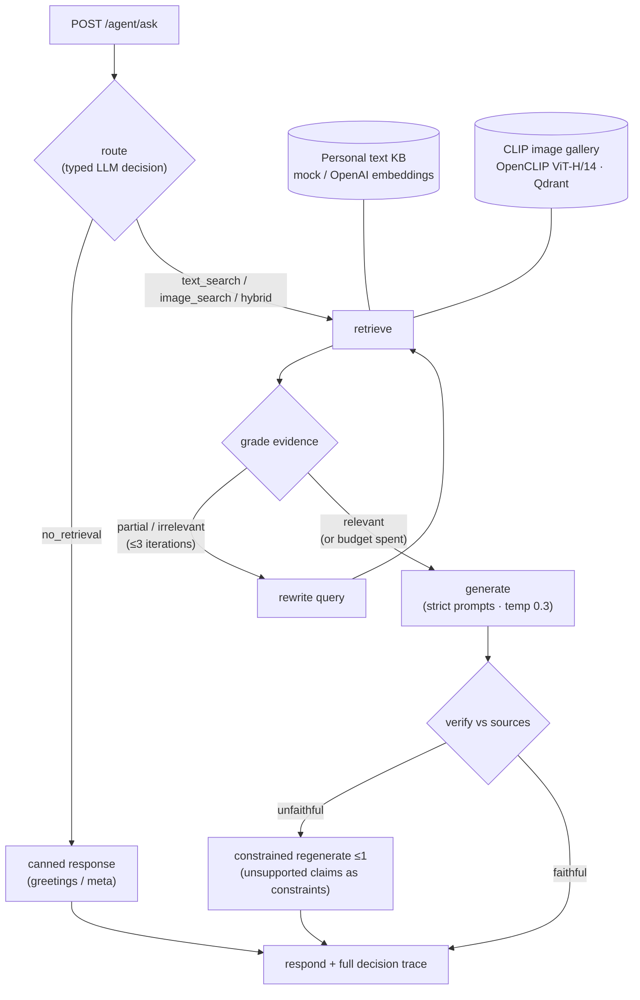
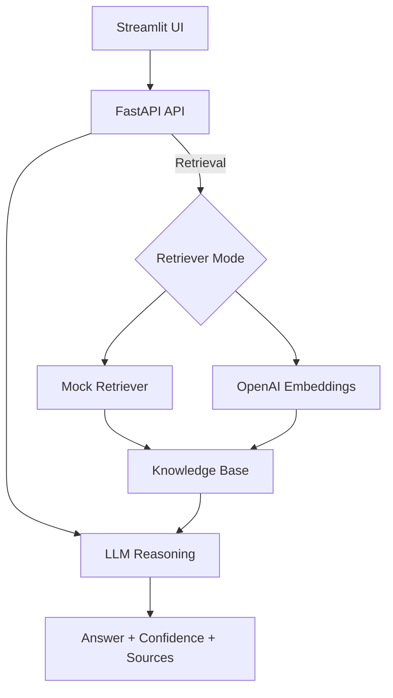
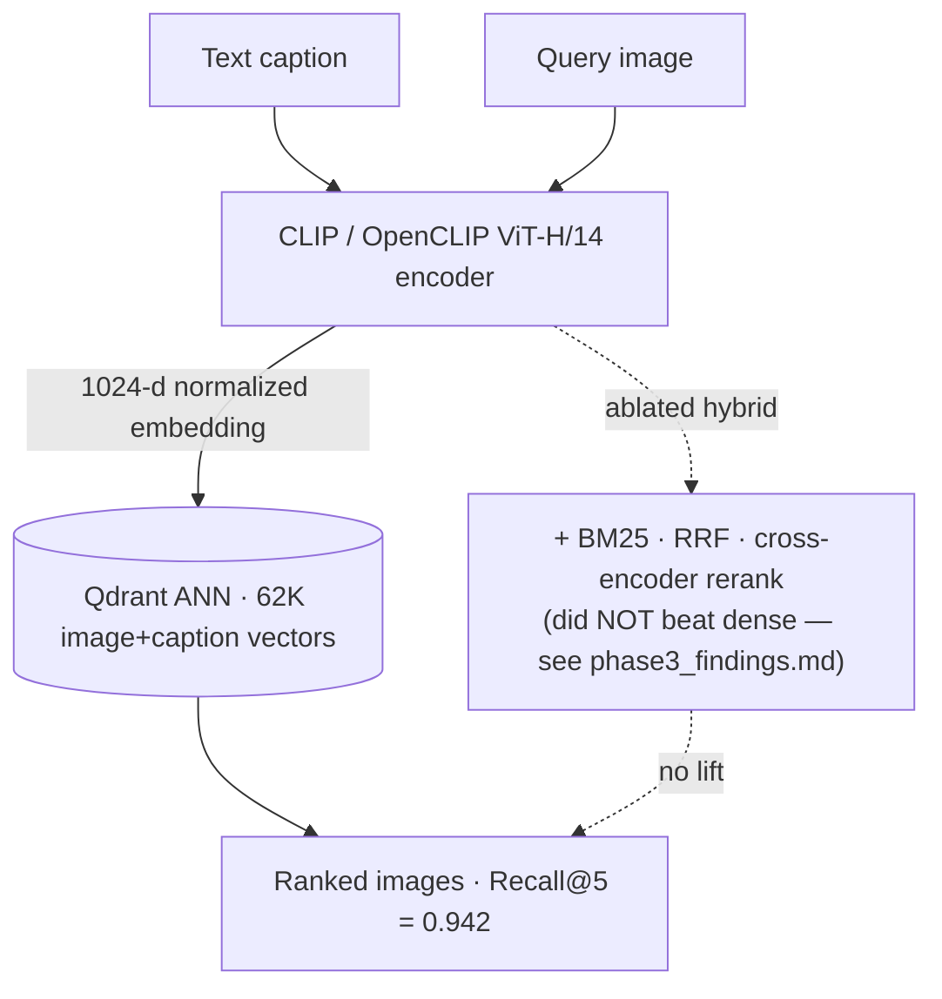

# 🤖 Agentic Multimodal RAG

> **A production-style RAG system upgraded from a fixed retrieve→generate pipeline into an
> agentic loop — routing, self-grading, query rewriting, and post-generation verification —
> over text + CLIP image retrieval, with two provably-equivalent orchestrators (hand-written
> and LangGraph). Every headline claim below is a measured, reproducible number.**

[](https://www.python.org/downloads/)
[](https://fastapi.tiangolo.com/)
[](https://streamlit.io/)
[](https://opensource.org/licenses/MIT)

## 🔗 Quick Links

- **🌐 Live Demo**: **[dzpersonal-rag-demo.streamlit.app](https://dzpersonal-rag-demo.streamlit.app/)** (public, no login required)
- **Local Frontend**: `http://localhost:8501` (after running `streamlit run frontend/personal_app.py`)
- **API Docs (FastAPI)**: `http://localhost:8000/docs`
- **Quickstart**: [Getting Started](#-quick-start)
- **Agent Design**: [state machine, budget guards, fallback matrix](docs/agent_design.md)
- **Agentic vs Baseline (measured)**: [40-case eval report](eval/results/phase4_agentic_vs_baseline.md)
- **Hand-written vs LangGraph**: [honest comparison](docs/langgraph_vs_handwritten.md)
- **Architecture & Metrics**: [Architecture](#-architecture) · [Metrics & Evaluation](docs/metrics.md)
- **Contributing**: [CONTRIBUTING.md](CONTRIBUTING.md)
- **Data Quality & Monitoring**: [Observability Notes](docs/observability.md)

## 🎯 Overview

A personal-website Q&A system that grew, eval-first, into an **agentic multimodal RAG**.
Visitors ask questions in natural language; the system routes, retrieves, self-checks, and
answers from a personal knowledge base — refusing honestly when it doesn't know.

### Three layers (each evaluated on its own terms)

- **Agent decision layer** (`POST /agent/ask`) — a budget-guarded loop that decides *how* to
  answer: **route** (text / image / hybrid / no-retrieval) → **retrieve** → **grade** the
  evidence → **rewrite & retry** (≤3) → **generate** → **verify** the answer against sources →
  **constrained regenerate** (≤1). Every decision is a typed, temperature-0 JSON call; every
  request returns a full decision `trace`. Two orchestrators, one logic: hand-written
  (zero framework deps) and a LangGraph twin (optional extra), equivalence enforced by tests.
- **Retrieval layer** — dual modality: the personal **text KB** (mock keyword / OpenAI
  embeddings) and a **CLIP image gallery** (OpenCLIP ViT-H/14 + Qdrant, benchmarked at
  **94.2% Recall@5** on the standard Flickr30k 5,000-caption protocol — a retrieval metric,
  *not* the Q&A "accuracy").
- **Generation layer** (`POST /ask`, unchanged) — strict anti-hallucination prompts, low
  temperature, confidence scoring, source tracing. Kept byte-identical as the **A/B baseline**
  the agent is measured against.

### Key Highlights

- ✅ **Agentic loop with hard budget guards** — ≤3 retrieval iterations, capped LLM calls,
  per-request deadline; any decision failure falls back to the baseline (never a 500)
- ✅ **Quantified honestly** — 40-case eval, real LLMs, dual judges (independent LLM judge +
  zero-LLM mechanical grounding), 95% CIs, losses reported next to wins ([Results](#-results-measured-reproducible))
- ✅ **Two provably-equivalent implementations** — hand-written and LangGraph, same node
  functions, byte-identical outputs under test
- ✅ **Multimodal routing** — visual queries routed to the CLIP gallery (8/8 in the eval),
  degrading gracefully when the image backend is absent
- ✅ **Production hygiene** — 199 tests (offline, no API keys in CI), Prometheus metrics,
  structured logs, mock mode at zero API cost, live Streamlit demo

## 📊 Results (measured, reproducible)

Every number below comes from a real run in this repo; raw artifacts live under
`eval/results/`. Wins and losses are both listed — that's the point.

### Agentic loop vs baseline RAG (40-case QA eval, real LLMs)

Decisions: gpt-3.5-turbo · independent judge: gpt-4o-mini · plus a **zero-LLM mechanical
grounding check** (numeric/entity claims literally matched against retrieved documents).
Wald 95% CIs. Full report with traces: [`eval/results/phase4_agentic_vs_baseline.md`](eval/results/phase4_agentic_vs_baseline.md).

| Metric | Baseline `/ask` | Agentic `/agent/ask` |
|---|---|---|
| Faithfulness — LLM-judged | 42.1% ±22.8 (n=19) | **57.1%** ±26.9 (n=14) |
| Faithfulness — mechanical grounding (no LLM) | **100.0%** ±0.0 (n=19) | 92.9% ±14.0 (n=14) |
| Retrieval hit rate | **90.9%** ±12.3 (n=22) | 86.4% ±14.7 (n=22) |
| Refusal correctness (should-refuse) | 90.0% ±19.6 (n=10) | **100.0%** ±0.0 (n=10) |
| Over-refusal (answerable) | **18.2%** ±16.5 (n=22) | 31.8% ±19.9 (n=22) |
| Assertion pass rate | **77.3%** ±17.9 (n=22) | 68.2% ±19.9 (n=22) |
| Visual route accuracy | — | **100.0%** (8/8) |
| Latency p50 / mean | **0.98 s / 1.0 s** | 6.26 s (~6.4×) / 21.6 s* |
| LLM calls · tokens per request | 1 (by construction) · n/a | 5.67 · ~2,699 |

\* the agent mean is skewed by a single 603 s OpenAI transport hang (default 600 s timeout on
the generation call); p50 is the representative number.

- **Where the agent wins:** honest refusals (100% — it caught the "have you worked at
  Google?" trap the baseline fell for), visual-query routing (8/8; the baseline has no routing
  at all), and LLM-judged faithfulness **+15pp — but the CIs overlap; n=40 is not enough to
  claim significance**.
- **Where it loses:** over-refusal (its strict grader refuses slangy-but-answerable
  questions the baseline handles), assertion pass rate, and the mechanical grounding check —
  where the **baseline scores 100%**: the strict anti-hallucination prompt already keeps it
  fabrication-free on this KB (the agent's single miss is a benign abbreviation expansion,
  token-level auditable in the report).
- **Honest takeaway:** *the agent buys reliability properties — refusal discipline, visual
  routing, self-verification — not raw answer quality, because the baseline's strict prompt
  already rarely fabricates on this KB.* The price is ~6× median latency and 5.7× LLM calls.
- **Methodology note:** the dual-judge design earned its keep — the LLM judge alone rated the
  same baseline answers 21% faithful that the mechanical check proved 100% grounded (judge
  noise, exposed), and the eval caught + fixed a real bug in the agent's own verifier
  (decision nodes were judging truncated evidence while generation used full documents).

Reproduce: `python -m eval.agentic.run_comparison --mode full` (real LLMs, needs
`OPENAI_API_KEY`) · `--mode smoke` (offline, deterministic, runs in CI).

### Multimodal retrieval quality (Flickr30k)

Standard 5,000-caption protocol, 1K-image gallery, with 95% CIs:

| Dense backbone | Recall@5 | Recall@10 | MRR@10 | nDCG@10 |
|---|---|---|---|---|
| CLIP ViT-B/32 (baseline) | 0.844 ±0.010 | 0.902 | 0.699 | 0.748 |
| **OpenCLIP ViT-H/14 (shipped)** | **0.942 ±0.006** | 0.967 | 0.847 | 0.877 |

- The **0.94 Recall@5** is reached via a stronger dense backbone — **not** BM25-RRF or a text
  cross-encoder reranker, which an honest ablation showed plateau at ~0.84 (a structural ceiling;
  see `eval/results/phase3_findings.md`). Corroborated by LAION's published ViT-H/14 number (94.0).
- Index: **62,028 CLIP vectors** (31,014 images + 31,014 captions) in **Qdrant**; vector-DB rankings
  proven identical to a numpy baseline (1000/1000, `faithfulness.json`).

### Load test

Locust, mock mode (serving + retrieval layer), single `uvicorn` worker:

| Concurrency | Throughput | p50 | p95 | p99 | Failures |
|---|---|---|---|---|---|
| 100 users | 325 req/s | 2 ms | 5 ms | 19 ms | **0%** |
| 500 users | 1,151 req/s | 110 ms | 180 ms | **210 ms** | **0%** |

Zero failures at 500 concurrent users with sub-second p99. Full report: `tests/load/results/load_report.md`.

### Kubernetes autoscaling (observed, local kind cluster)

Deployed to a local kind cluster and drove the Locust load through a NodePort; the HPA
scaled on CPU:

| Phase | CPU util / target | Ready pods |
|---|---|---|
| baseline | 3% / 50% | **2** |
| under 500-user load | peaked **300%** / 50% | **6** (scaled 2→6 in ~40s) |
| load removed | → 3% / 50% | **6 → 3 → 2** (back to floor, ~115s) |

Real run (`make k8s-demo`), 79,228 requests / 0 failures while scaled out. It's a **local kind
demo, not a cloud/production deployment**, and the HPA is tuned for a short observable run — full
detail + caveats in `k8s/results/autoscaling_report.md`.

**Multimodal search endpoints** (served from the OpenCLIP gallery, gated/lazy):
`POST /search/text` (caption→image) and `POST /search/image` (reverse image search). Qualitative
examples: `eval/results/phase2_qualitative.md`.

## 🏗️ Architecture

### The agentic loop (decision layer above dual-modal retrieval)



Hard budget guards on every run: ≤3 retrieval iterations, ≤10 LLM calls (one reserved for
generation), 30 s cooperative deadline. Any decision parse/API failure **falls back to the
baseline `/ask` pipeline** — agent machinery never causes a 500. Full state machine, node
rationale, and the fallback matrix: [docs/agent_design.md](docs/agent_design.md).

### Baseline `/ask` path — the non-agentic A/B control (Mermaid)



### Multimodal retrieval engine (Mermaid)

The shipped retrieval path is **dense only** (CLIP/OpenCLIP → Qdrant). BM25 + RRF + a
cross-encoder reranker were evaluated and **did not beat dense** (~0.84 ceiling) — the
0.942 lift comes from the **ViT-H/14 backbone**, not fusion/reranking.



Served via `POST /search/text` (caption→image) and `POST /search/image` (reverse image).

## 🔁 Two Implementations, One Logic

The agentic loop ships with **two orchestrators that are provably the same agent**:

- **Hand-written** (`src/agents/loop.py`) — a plain while-loop, zero framework
  dependencies (stdlib + pydantic + the openai SDK the repo already uses). The default.
- **LangGraph twin** (`src/agents/langgraph_impl/`) — the *same* node functions, budgets,
  and fallback matrix (it subclasses the hand-written loop and overrides only the control
  flow as a `StateGraph`), plus what the framework adds for free: **checkpointing**,
  **interrupt/resume** (pause before generation, approve, continue), and **step streaming**.
  Optional extra: `pip install -r requirements_langgraph.txt`, then `POST /agent/ask?impl=langgraph`.

Equivalence is not a claim, it's a test suite: 13 tests feed both implementations identical
scripted decisions and assert identical answers, token accounting, and trace step sequences
(`tests/agents/test_langgraph_impl.py`). **When to use which** (full analysis in
[docs/langgraph_vs_handwritten.md](docs/langgraph_vs_handwritten.md)): fixed control flow,
minimal dependencies, or line-by-line defensibility → hand-written; durable execution,
human-in-the-loop gates, or streaming UIs → LangGraph.

## 🛡️ Anti-Hallucination Strategies

This system implements **5 layered strategies** to prevent AI fabrication:

### 1. **Low Temperature Generation** (0.3)
- Reduces randomness in LLM responses
- Increases determinism and factual accuracy
- Configurable via environment variables

### 2. **Strict Prompt Engineering**
- Explicit system prompts: "Only use provided context"
- Clear instructions to state when information is unavailable
- No speculation or fabrication allowed

### 3. **Confidence Assessment**
- Three-level confidence scoring (High/Medium/Low)
- Based on retrieval similarity scores
- Visual indicators in UI

### 4. **Source Tracing & Verification**
- Every answer includes source documents
- Relevance scores for each source
- Optional second-pass verification mode

### 5. **Agentic Self-Verification** (loop-level, `/agent/ask`)
- Post-generation verify step checks every claim against the retrieved sources
- Unfaithful drafts trigger ONE regeneration with the unsupported claims injected as constraints
- Still-unfaithful answers ship with an explicit disclaimer and downgraded confidence
- Measured end to end in the [40-case eval](eval/results/phase4_agentic_vs_baseline.md)

## ✨ Features

### Core Capabilities
- 🔤 **Semantic Search** - Natural language queries with OpenAI embeddings
- 🤖 **RAG-Powered Q&A** - Contextual answers with LLM integration
- 💬 **Conversation Mode** - Multi-turn dialogue with context retention
- 📊 **Real-time Metrics** - Monitor system performance and latency
- 💭 **User Feedback** - Collect ratings to improve quality

### Technical Features
- **Dual Retrieval Modes**: Mock (keyword-based, no API) or OpenAI (semantic embeddings)
- **Structured Logging**: request-context fields on every log line (JSON suffix); set `LOG_FORMAT=json` for full JSON lines
- **Metrics Endpoints**: JSON app metrics (`/metrics`) + real Prometheus text exposition (`/metrics/prometheus`) with agent-loop counters/histograms
- **Feedback Collection**: Store user feedback for continuous improvement
- **Category Weighting**: Boost important document categories (FAQ, personal info)

## 🧭 Data Quality & Monitoring (Optional)

This project does not ingest streaming wearable data by default, but extension
points are documented for data validation and drift monitoring:

- [Observability Notes](docs/observability.md)

## 🚀 Quick Start

### Prerequisites
- Python 3.11-3.12
- OpenAI API key (optional, for OpenAI mode)

### Installation (Local)

1. **Clone the repository**
```bash
git clone https://github.com/zhengbrody/multimodal-rag-system.git
cd multimodal-rag-system
```

2. **Create virtual environment**
```bash
python -m venv venv
source venv/bin/activate  # On Windows: venv\Scripts\activate
```

3. **Install dependencies**
```bash
# Install lightweight dependencies (recommended)
pip install -r requirements_simple.txt
```

4. **Configure environment**
```bash
cp .env.example .env
# Edit .env and add your OPENAI_API_KEY (optional for mock mode)
```

5. **Prepare knowledge base**
```bash
# Edit data/raw/knowledge_base.json with your personal information
# See docs/PERSONAL_RAG_README.md for structure details
```

6. **Start the system**
```bash
# Option 1: Use the run script (starts both API and frontend)
python run.py

# Option 2: Start separately
# Terminal 1: API
uvicorn src.api.personal_api:app --reload --port 8000

# Terminal 2: Frontend
streamlit run frontend/personal_app.py
```

7. **Access the application**
   - Frontend: http://localhost:8501
   - API Docs: http://localhost:8000/docs
   - Health Check: http://localhost:8000/health

### Try the agentic loop (works in mock mode, zero API cost)

```bash
# Ask through the agent -- response includes the full decision trace
curl -sX POST "http://localhost:8000/agent/ask" \
  -H "Content-Type: application/json" \
  -d '{"question": "What is your work experience?", "k": 5}' | python -m json.tool

# Watch a visual query get routed (and degrade honestly without the CLIP gallery)
curl -sX POST "http://localhost:8000/agent/ask" \
  -H "Content-Type: application/json" \
  -d '{"question": "Show me a photo of a dog on the beach"}' | python -m json.tool

# Agent metrics in Prometheus exposition format
curl -s http://localhost:8000/metrics/prometheus | grep agent_

# Reproduce the agentic-vs-baseline eval
python -m eval.agentic.run_comparison --mode smoke   # offline, deterministic (runs in CI)
python -m eval.agentic.run_comparison --mode full    # real LLMs, needs OPENAI_API_KEY (~$1)

# Optional: the LangGraph twin
pip install -r requirements_langgraph.txt
curl -sX POST "http://localhost:8000/agent/ask?impl=langgraph" \
  -H "Content-Type: application/json" -d '{"question": "What is your work experience?"}'
```

### Docker Quick Start

```bash
# Build and run API + frontend
docker-compose up --build

# Access
# Frontend: http://localhost:8501
# API Docs: http://localhost:8000/docs
```

## 📖 Usage

### API Endpoints

#### Ask a Question
```bash
curl -X POST "http://localhost:8000/ask" \
  -H "Content-Type: application/json" \
  -d '{
    "question": "What technologies are you proficient in?",
    "k": 5,
    "use_verification": false,
    "conversational": false
  }'
```

#### Agentic Q&A
```bash
curl -X POST "http://localhost:8000/agent/ask" \
  -H "Content-Type: application/json" \
  -d '{"question": "What is your work experience?", "k": 5}'

# LangGraph orchestrator (optional extra): same loop, add ?impl=langgraph
```
The agentic loop: **route → retrieve → grade → (rewrite & retry ≤3) → generate → verify →
(constrained regenerate ≤1)**. Every decision is a typed, temperature-0 JSON call validated
by Pydantic; hard budget guards cap iterations, total LLM calls, and wall-clock time; any
decision failure falls back to the baseline pipeline (never a 500). The response is the
standard answer payload plus a full `trace` — route decision, per-step timings, token usage,
and fallback/degrade flags. `/ask` is unchanged and serves as the non-agentic A/B baseline;
in mock mode the loop runs on deterministic heuristic decisions at zero API cost.
Design doc: [docs/agent_design.md](docs/agent_design.md) · implementations comparison:
[docs/langgraph_vs_handwritten.md](docs/langgraph_vs_handwritten.md) · agent metrics:
`GET /metrics/prometheus`.

#### Multimodal Search (caption→image / reverse image)
```bash
# Text → image: find gallery images matching a description
curl -X POST "http://localhost:8000/search/text" \
  -H "Content-Type: application/json" \
  -d '{"query": "a dog running on the beach", "k": 5}'

# Image → image: upload a photo, get the most similar gallery images
curl -X POST "http://localhost:8000/search/image?k=5" -F "file=@/path/to/photo.jpg"
```
> Served from the OpenCLIP ViT-H/14 gallery when present; returns `503` in the lightweight
> mock deployment (no multi-GB model is loaded there).

#### Get Metrics
```bash
curl http://localhost:8000/metrics
```

#### Submit Feedback
```bash
curl -X POST "http://localhost:8000/feedback" \
  -H "Content-Type: application/json" \
  -d '{
    "question": "What is your experience?",
    "answer": "...",
    "rating": 5,
    "helpful": true
  }'
```

### Frontend Features

- **💬 Chat Interface**: Conversation-style UI with message bubbles
- **📊 Analytics Tab**: View system metrics and performance
- **🌓 Theme Toggle**: Light/dark mode support
- **💭 Feedback**: Rate answers with emoji reactions
- **📖 Source Viewing**: Expand to see where answers come from

## 🧪 Testing

**199 tests, 1 skip** (BM25 extra) — all offline: LLM decisions are scripted/deterministic,
no API keys needed; the 13 LangGraph equivalence tests skip cleanly without the extra.
CI runs the suite on Python 3.11 + 3.12 with black/ruff and enforced mypy on
`eval/` + `src/agents/` + the typed retrieval modules.

```bash
# Run all tests (same env & flags as CI)
USE_MOCK=true pytest tests/ -v --cov=src

# Focused suites
pytest tests/agents/ -v                          # agent loop, nodes, LLM clients, equivalence
pytest tests/test_agentic_comparison_smoke.py -v # the Phase-4 eval, end-to-end offline
pytest tests/test_pipeline_generate.py -v        # baseline /ask characterization guard
```

## 📁 Project Structure

```
multimodal-rag-system/
├── data/
│   └── raw/knowledge_base.json      # Personal knowledge base
├── src/
│   ├── agents/                      # ★ the agentic loop (framework-free)
│   │   ├── loop.py                  #   orchestrator: budgets, trace, fallback matrix
│   │   ├── router.py / grader.py / rewriter.py / verifier.py   # decision nodes
│   │   ├── llm.py                   #   strict-JSON OpenAI client + deterministic heuristic
│   │   ├── schemas.py / prompts.py / config.py / protocols.py
│   │   └── langgraph_impl/graph.py  # ★ LangGraph twin (optional extra)
│   ├── api/personal_api.py          # FastAPI: /ask, /agent/ask, /search/*, metrics
│   ├── rag/                         # retrieval + generation
│   │   ├── pipeline.py              #   anti-hallucination pipeline (baseline /ask)
│   │   ├── retriever.py / mock_retriever.py / knowledge_processor.py
│   │   ├── openclip_retriever.py / clip_retriever.py / vector_store.py  # multimodal
│   │   └── image_search_service.py  #   lazy/gated CLIP gallery bridge
│   └── utils/
│       ├── prometheus_metrics.py    # ★ agent metrics (trace -> Prometheus)
│       └── logger.py                # structured logging (extras + LOG_FORMAT=json)
├── eval/
│   ├── agentic/                     # ★ Phase-4 eval: 40 cases + comparison runner
│   │   ├── qa_cases.jsonl
│   │   └── run_comparison.py        #   dual faithfulness judges, --mode smoke|full
│   ├── evaluate.py / metrics.py / ablation_rerank.py   # Flickr30k harness
│   └── results/                     # measured artifacts (all numbers above live here)
├── frontend/personal_app.py         # Streamlit UI (untouched by the agentic upgrade)
├── tests/                           # 199 tests: agents/, eval smoke, API, integration
├── docs/
│   ├── agent_design.md              # ★ state machine, budgets, fallback matrix
│   ├── langgraph_vs_handwritten.md  # ★ honest orchestrator comparison
│   └── DEPLOYMENT.md / REPRODUCE.md ...   # deployment, reproduction, troubleshooting
├── requirements_simple.txt          # lightweight serving deps (CI/Docker)
├── requirements_langgraph.txt       # optional LangGraph extra
├── requirements_eval.txt            # Flickr30k eval harness (torch/CLIP/Qdrant)
└── run.py                           # Launch script (API + UI)
```

## 🔧 Configuration

### Environment Variables

```bash
# Required for OpenAI mode
OPENAI_API_KEY=sk-...

# Optional
LLM_MODEL=gpt-3.5-turbo          # or gpt-4
USE_MOCK=true                     # Use mock mode (no API costs)
API_URL=http://localhost:8000
LOG_LEVEL=INFO
LOG_FORMAT=json                   # full JSON log lines (default: text + JSON suffix)
```

Agent loop knobs (all optional; defaults shown):

```bash
AGENT_MAX_ITERATIONS=3            # retrieval iterations (hard-capped at 3)
AGENT_MAX_LLM_CALLS=10            # total model invocations per request
AGENT_TIMEOUT_S=30                # cooperative per-request deadline
AGENT_LLM_CALL_TIMEOUT_S=12       # per-call SDK timeout
AGENT_DECISION_MODEL=$LLM_MODEL   # override the decision-node model
AGENT_ENABLE_VERIFY=true          # post-generation verification switch
AGENT_JUDGE_MODEL=$LLM_MODEL      # eval-only: the offline faithfulness judge
```

### Knowledge Base Structure

See `docs/PERSONAL_RAG_README.md` for detailed structure. Key sections:
- `personal_info`: Basic information
- `skills`: Technical skills
- `projects`: Project experience
- `experience`: Work history
- `education`: Education background
- `faq`: Frequently asked questions

## 📊 Performance Metrics

The system tracks:
- **Request Count**: Total API requests
- **Average Latency**: Response time in milliseconds
- **Error Rate**: Percentage of failed requests
- **Question Count**: Total questions answered
- **Feedback Count**: User feedback submissions

Access via `/metrics` endpoint or frontend Analytics tab.

## 🚢 Deployment

### Docker Deployment

```bash
# Build and run
docker-compose up --build

# Access services
# Frontend: http://localhost:8501
# API: http://localhost:8000
```

### Streamlit Cloud

1. Push code to GitHub
2. Connect to Streamlit Cloud
3. Set main file: `frontend/personal_app.py`
4. *(Optional)* Add secret `API_URL` if you have a deployed backend

> **No backend needed:** The app automatically uses the local knowledge base
> (`data/raw/knowledge_base.json`) when no backend is reachable, so it works
> out-of-the-box on Streamlit Cloud without any extra setup.
>
> **Public access:** If the deployed URL redirects to
> `share.streamlit.io/-/auth/app`, update the Streamlit Cloud app visibility to
> public/anyone with the link before sharing it with recruiters.

See `docs/DEPLOYMENT.md` for deployment details and `docs/REPRODUCE.md` for
reproducing the benchmark results.

## 💼 Resume Highlights

This project demonstrates:

### Technical Skills
- **Machine Learning**: RAG pipeline design, embedding models, semantic search
- **Backend Development**: FastAPI, REST APIs, structured logging, metrics
- **Frontend Development**: Streamlit, modern UI/UX design
- **MLOps**: Model deployment, monitoring, feedback loops
- **Software Engineering**: Testing, CI/CD, code quality

### Key Achievements
- ✅ Upgraded a fixed RAG pipeline into a **budget-guarded agentic loop** (routing, self-grading,
  query rewriting, post-generation verification) with a full decision trace per request
- ✅ **Quantified the upgrade honestly**: 40-case eval with dual faithfulness judges
  (independent LLM judge + zero-LLM mechanical grounding) and 95% CIs — the agent wins refusal
  discipline (100%) and visual routing (8/8) at a measured ~6× latency cost, and the eval
  caught a real bug in the agent's own verifier
- ✅ Built **two provably-equivalent orchestrators** (hand-written + LangGraph) over the same
  node functions, equivalence locked by 13 tests
- ✅ Benchmarked multimodal retrieval at **94.2% Recall@5** (Flickr30k standard protocol,
  OpenCLIP ViT-H/14 + Qdrant) with an honest ablation showing fusion/reranking did NOT help
- ✅ Production hygiene throughout: 199 offline tests, CI with enforced mypy, Prometheus
  metrics, structured logging, 0-failure 500-user load test, K8s HPA demo

## 🧠 Design Decisions (Why these choices?)

- **Why mock mode?**  
  Added a mock retriever and mock RAG pipeline so the UI and API can be exercised without any external APIs or GPU. This is the default for CI and local development.

- **Why OpenAI instead of self-hosted models?**  
  The pipeline is implemented in a way that the retriever and generator are pluggable, but OpenAI embeddings + GPT are used as a pragmatic baseline for a personal portfolio project.

- **Why "answer only from retrieved context"?**  
  The generation step is constrained to the retrieved snippets and uses explicit instructions to say "I do not have enough information" when recall is low, trading off creativity for reliability.

- **Why keep CLIP / heavier multimodal components optional?**  
  Multimodal and heavy Torch dependencies are kept out of the Streamlit-only requirements so that lightweight deployments (e.g., Streamlit Cloud) do not have to build GPU stacks. The same policy isolates the LangGraph extra.

- **Why a hand-written agent loop first, and a framework second?**  
  The control flow is small and fixed (two bounded retry loops), so a while-loop with typed decisions is fully debuggable and dependency-free. The LangGraph twin exists to prove the architecture point: with decisions in pure node functions and policies in shared helpers, the orchestrator is a ~400-line swappable detail — and to demonstrate what a framework buys (checkpointing, interrupt/resume, streaming) and costs (12+ packages, a pydantic bump). See [docs/langgraph_vs_handwritten.md](docs/langgraph_vs_handwritten.md).

- **Why Qdrant for the vector store?**  
  Self-hosted, reproducible, and honest to benchmark: local mode does exact search, and the repo includes a faithfulness proof that Qdrant rankings match a numpy baseline 1000/1000. The `VectorStore` abstraction keeps Pinecone/Chroma pluggable.

## 🤝 Contributing

Contributions welcome! Please:
1. Fork the repository
2. Create a feature branch
3. Add tests for new features
4. Submit a pull request

## 📝 License

MIT License - see [LICENSE](LICENSE) file for details.

## 🙏 Acknowledgments

- OpenAI for GPT models and embeddings
- FastAPI and Streamlit teams
- RAG research community

## 📧 Contact

For questions or feedback, please open an issue on GitHub.
---

**Built with ❤️ to demonstrate agentic multimodal RAG the honest way — measured, budget-guarded, and self-verifying**
