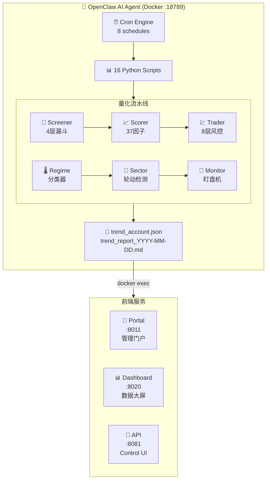
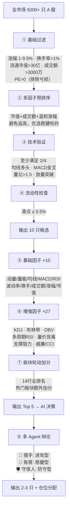
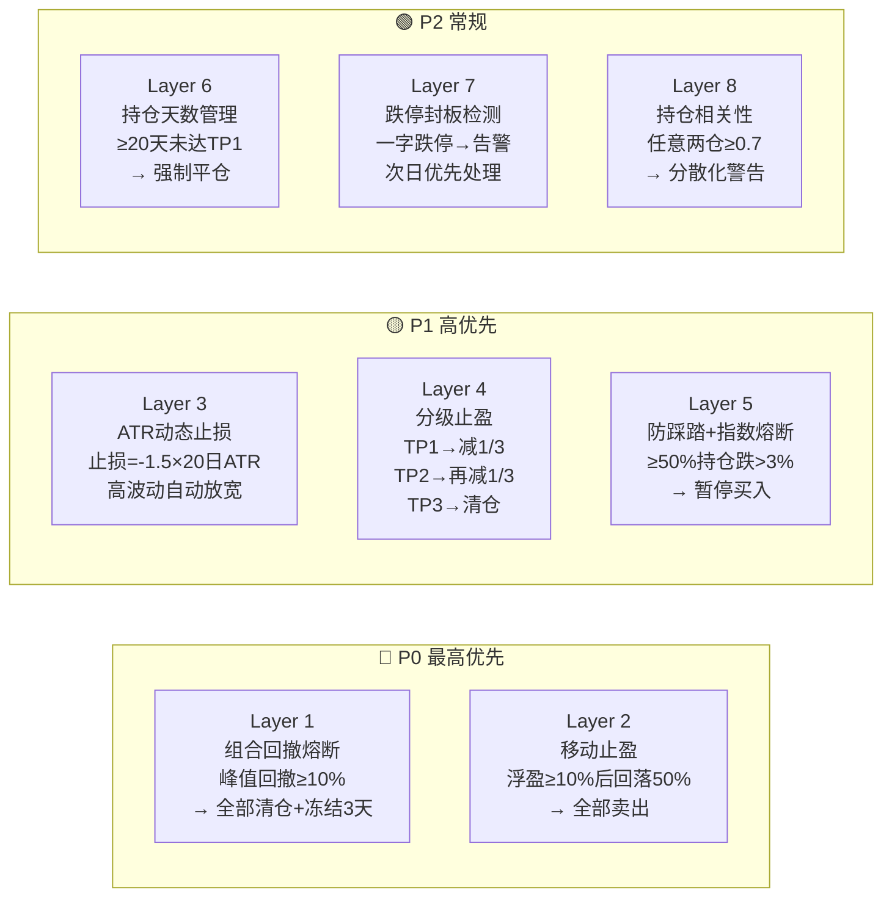

<div align="center">

# 🦞 EasyUp Platform

### 从选股到交易到展示，A 股量化全链路自动化

**AI-Powered Quantitative Trading System — Fully Automated A-Stock Simulation**

<br>


<br>


-1DD1A1?style=flat-square)

<br>


<br>

<table>
<tr>
<td align="center"><b>🧠 AI 辩论选股</b><br/>猎手 · 账房 · 守夜人</td>
<td align="center"><b>📊 37 因子评分</b><br/>基础10 + 增强27</td>
<td align="center"><b>🛡️ 8 层风控</b><br/>回撤熔断 → 个股止损</td>
<td align="center"><b>⏰ 每日 15 次</b><br/>9:30 开盘 → 16:00 收盘</td>
</tr>
<tr>
<td align="center"><b>📈 同花顺大屏</b><br/>K线 · 热力图 · 瀑布图</td>
<td align="center"><b>🔄 全自动流水线</b><br/>选股→评分→交易→日报</td>
<td align="center"><b>📡 多实例管理</b><br/>门户 + 容器监控</td>
<td align="center"><b>🆓 全免费数据</b><br/>东财/腾讯/新浪 API</td>
</tr>
</table>

<br>

[Features](#-features) · [Quick Start](#-quick-start) · [Architecture](#-architecture) · [Trading Engine](#-trading-engine) · [Risk Management](#-risk-management-system) · [Deploy](#-one-click-deploy) · [FAQ](#-faq)

</div>

---

## 🦞 EasyUp 是什么

EasyUp 是一个 **开箱即用的 A 股量化交易系统**，集成了 AI 选股、自动交易、八层风控和同花顺级数据大屏。不需要你写一行代码，从选股到盯盘到日报，全程由 AI Agent 自动完成。

> 🤖 **AI Agent** 通过 OpenClaw 驱动，Cron 调度全天自动盯盘 15 次
>
> 📊 **16 个 Python 脚本** 组成选股 → 评分 → 交易 → 风控 → 日报完整流水线
>
> 📈 **同花顺级数据大屏** 实时可视化所有交易数据、行情、K 线
>
> 📡 **多实例管理门户** 统一管理多个 OpenClaw AI Agent 实例

---

## 🆚 与传统量化框架的区别

| | **EasyUp** | **vnpy / backtrader** |
|:---|:---|:---|
| 部署 | 一键脚本，10 分钟上线 | 需要手动配置环境和依赖 |
| AI 决策 | 多 Agent 辩论（猎手/账房/守夜人） | 纯规则或手动策略 |
| 可视化 | 内置同花顺级数据大屏 | 需要额外集成 Grafana 等 |
| 风控 | 8 层自动风控，开箱即用 | 需要自己实现 |
| 数据源 | 免费 API，无需 API Key | 部分需要付费数据源 |
| 调度 | OpenClaw Cron 全自动，每日 15 次 | 需要自己写调度逻辑 |

---

## 🎮 Quick Start

### 30 秒体验（无需 Docker）

```bash
git clone https://github.com/zhou343-de/easyup-platform.git
cd easyup-platform/stock-dashboard
pip install flask
python3 app.py
# 打开 http://localhost:8020 → 内置 Demo 数据，即开即看
```

### 完整部署（AI Agent + 大屏 + 门户）

```bash
cd easyup-platform
chmod +x setup.sh && ./setup.sh
```

交互式安装器会引导你配置 LLM API、Docker 实例和 Nginx 反代，全程自动化。

---

## ✨ Features

### 🤖 AI Agent Core

- 🧠 **多 Agent 辩论选股** — 猎手（进攻）、账房（稳健）、守夜人（防守）三角色辩论决策
- ⏰ **Cron 全自动调度** — OpenClaw Cron 引擎，8 个定时任务，每日盯盘 15 次
- 📊 **16 脚本完整流水线** — 选股 → 因子 → 交易 → 风控 → 日报 → 回测，全链路覆盖
- 🔄 **自愈 + 告警** — 健康检查 + 邮件告警，异常自动发现

### 📊 数据大屏

- 🖥️ **单视口设计** — 100vh 自适应，所有数据一屏展示，零滚动
- 📈 **实时行情** — 东财推送 API，持仓股 30s 自动刷新
- 🕯️ **K 线图** — TradingView Lightweight Charts，支持日/周/月切换
- 🔥 **板块热力图** — Finviz 风格，18 大行业涨跌一目了然
- 📰 **7×24 快讯** — 新浪财经实时新闻滚动条
- 🎯 **策略评分** — 5 维环形图（胜率/盈亏比/止损/仓位/市场环境）
- 📊 **盈亏分布** — 巨亏 → 大赚分桶柱状图
- 📉 **回撤检测** — Top 5 回撤事件自动识别
- 🔍 **股票搜索** — 东财联想 API，支持键盘导航
- 🗓️ **收益日历** — GitHub 风格每日收益色块
- 💰 **持仓瀑布图** — 各持仓贡献度可视化

### 📡 管理门户

- 🔐 **密码登录** — 单密码认证，零注册
- 📊 **容器监控** — CPU / 内存 / 网络 I/O 实时监控
- 💚 **健康检查** — 自动检测实例在线状态
- 🚀 **一键跳转** — 直接进入 OpenClaw Control UI

---

## 🏗️ Architecture



---

## 🔧 Trading Engine

### 选股流水线 — 四层漏斗



### 交易执行 — A 股铁律

```python
# simulate_trend.py — 交易引擎核心规则

# T+1: 买入当日不可卖出
# 100 股取整: 主板/创业板 100 股起
# 涨跌幅限制: 主板 ±10%, 创业板 ±20%, ST ±5%
# 价格笼子: 主板 ±2% 且 ±0.10 元
# 费用: 佣金万3(最低5元) + 过户费0.001% + 印花税0.05%
# 动态滑点: 根据成交额调整 (0.2%-0.5%)
```

### Cron 调度表

| 时间 | 任务 | 说明 |
|:---|:---|:---|
| 09:30 | 早盘盯盘 | 熔断/移动止盈/ATR止损/分级止盈 |
| 09:45 | 开盘建仓 | 空仓触发，延后 15 分钟避波动 |
| 09:50 | 早盘盯盘 | 第二轮风控检查 |
| 10:00 - 11:40 | 智能盯盘 ×6 | 每 20 分钟一次 |
| 13:00 - 14:40 | 午后盯盘 ×6 | 每 20 分钟一次 |
| 15:10 | 尾盘风控 | 只卖不买 |
| 15:30 | 收盘日报 | 夏普/基准/回撤/相关性矩阵 |
| 16:00 | 健康检查 | 验证数据完整性，异常发邮件 |
| 周五 16:00 | 周度优化 | 回测 + 因子权重调优 |

> 节假日自动跳过（`trading_calendar.json`：2026 年 30 天节假日 + 3 天调休）

---

## 🛡️ Risk Management System

**八层风控防护，从组合级到个股级全覆盖：**



### 市场环境自适应参数

| 环境 | 止损 | 止盈三档 | 最大仓位 | 最多持仓 | ATR 倍数 |
|:---|:---|:---|:---|:---|:---|
| 🐂 牛市 | -8% | 15 / 25 / 35% | 90% | 4 只 | 1.5x |
| 📊 震荡 | -7% | 15 / 25 / 35% | 85% | 3 只 | 1.5x |
| 🐻 熊市 | -4% | 10 / 18 / 25% | 60% | 2 只 | 1.2x |

> 环境分类器：120 根日 K 线技术面 + 涨跌家数情绪面 → `bull` / `range` / `bear` + 置信度

---

## ⚡ One-Click Deploy

```bash
git clone https://github.com/zhou343-de/easyup-platform.git
cd easyup-platform
chmod +x setup.sh && ./setup.sh
```

```
  ╔═══════════════════════════════════════╗
  ║  🦞 EasyUp Platform — 一键部署       ║
  ║     AI 量化大屏 + OpenClaw 门户      ║
  ╚═══════════════════════════════════════╝

── LLM API 配置 ──
  ? API 地址 [https://api.xiaomimimo.com/v1]:
  ? API Key: sk-xxxxxxxxxxxx
  ? 模型名称 [mimo-v2.5-pro]:

── 部署选项 ──
  ? 部署 OpenClaw Docker 实例? [Y/n]: Y
  ? 安装为 systemd 服务? [Y/n]: Y
  ? 配置 Nginx 反向代理? [Y/n]: Y

  ✔ Python 依赖已安装
  ✔ .env 已生成
  ✔ openclaw.json 已生成（含 API 配置）
  ✔ Docker 实例已启动
  ✔ systemd 服务已安装
  ✔ Nginx 配置已生效

  ═══════════════════════════════════════════
  ✔ 部署完成！
  ═══════════════════════════════════════════

  📡 门户:       http://YOUR_IP:8011
  📊 数据大屏:   http://YOUR_IP:8020
  🤖 实例一:     http://YOUR_IP:8081
  🤖 实例二:     http://YOUR_IP:8082
```

> **不想装 Docker？** Dashboard 自带 Demo 数据，只要 Python 就能跑。

---

## 📡 Data Sources

所有数据 API **零依赖**（仅用 `urllib.request`），**无需任何 API Key**。

| 数据 | 来源 | 刷新频率 | 需要 Key |
|:---|:---|:---|:---|
| 大盘指数 | 腾讯财经 | 15s | ❌ 免费 |
| 板块热力图 | 新浪行业 | 60s | ❌ 免费 |
| 实时行情 | 东财推送 | 30s | ❌ 免费 |
| K 线数据 | 东财 / 腾讯 | 按需 | ❌ 免费 |
| 7×24 快讯 | 新浪直播 | 30s | ❌ 免费 |
| 股票搜索 | 东财联想 | 实时 | ❌ 免费 |
| 基本面 | 东财行情 | 按需 | ❌ 免费 |

---

## 📁 Project Structure

```
easyup-platform/
├── setup.sh                  # ⚡ 一键交互式安装器
├── run.py                    # 统一启动器（多服务）
├── docker-compose.yml        # OpenClaw 实例编排
├── requirements.txt
├── .env.example
│
├── openclaw-portal/          # 📡 实例管理门户
│   └── app.py                # Flask (port 8011)
│
├── stock-dashboard/          # 📊 交易数据大屏
│   ├── app.py                # Flask (port 8020) + 12 个 API
│   ├── dashboard.html        # HTML 结构
│   ├── style.css             # 同花顺暗色主题 (490 行)
│   └── app.js                # Chart.js + TradingView 渲染 (1022 行)
│
├── nginx/                    # 反向代理配置
│   ├── main-site.conf
│   └── openclaw-ports.conf
│
└── data/                     # Docker 卷挂载
    ├── openclaw1/
    └── openclaw2/
```

### OpenClaw 容器内部（stock-trader skill）

```
/home/node/clawd/skills/stock-trader/
├── SKILL.md                  # AI Agent 技能定义
├── config/                   # SMTP 邮件配置
├── data/
│   ├── trend_account.json    # 账户核心数据（持仓/交易/快照/环境）
│   ├── trend_report_*.md     # 每日收盘日报
│   ├── scoring_weights.json  # 动态因子权重
│   └── trading_calendar.json # 交易日历（节假日+调休）
└── scripts/                  # 16 个 Python 脚本
    ├── market_regime.py      # 市场环境分类器
    ├── sector_rotation.py    # 板块轮动检测
    ├── stock_screener.py     # 量化选股（4 层漏斗）
    ├── factor_scorer.py      # 因子评分（37 因子）
    ├── simulate_trend.py     # 交易执行引擎
    ├── monitor.py            # 盯盘全流程自动化
    ├── debate_selector.py    # 多 Agent 辩论选股
    ├── daily_report.py       # 收盘日报生成
    ├── backtest.py           # 回测引擎
    ├── health_check.py       # 系统健康检查
    └── ...                   # +6 more scripts
```

---

## 📝 API Reference

<details>
<summary>展开查看 API 端点</summary>

| Endpoint | Description |
|:---|:---|
| `GET /api/data` | 完整数据集（持仓、交易、图表、指标、评分） |
| `GET /api/realtime` | 所有持仓的实时行情 |
| `GET /api/indices` | 大盘指数（上证/深证/创业板/科创50） |
| `GET /api/sectors` | Top 18 板块涨跌幅 |
| `GET /api/news` | 7×24 实时财经快讯 |
| `GET /api/kline/<code>` | K 线 OHLCV（`?period=daily\|weekly\|monthly`） |
| `GET /api/stock/<code>` | 个股详情（行情+K线+基本面） |
| `GET /api/search?q=` | 股票搜索（代码/名称） |

</details>

---

## ❓ FAQ

<details>
<summary><b>Q: 端口被占用怎么办？</b></summary>

```bash
# 找到占用端口的进程
lsof -i :8020
# 或
ss -tlnp | grep 8020

# kill 后重试
kill <PID>
```
</details>

<details>
<summary><b>Q: Docker 启动失败？</b></summary>

```bash
# 检查 Docker 版本（需要 ≥ 20.10）
docker --version
docker info

# 如果权限不足
sudo usermod -aG docker $USER
# 然后重新登录
```
</details>

<details>
<summary><b>Q: LLM API 连接超时？</b></summary>

检查 `.env` 中的 `API_URL` 和 `API_KEY` 是否正确。可以用 curl 测试：

```bash
curl -s https://api.xiaomimimo.com/v1/models \
  -H "Authorization: Bearer YOUR_KEY" | head -5
```
</details>

<details>
<summary><b>Q: 数据大屏显示空白？</b></summary>

1. 确认 `stock-dashboard/app.py` 正在运行
2. 检查浏览器控制台是否有 CORS 错误
3. 如果在服务器上部署，确认 Nginx 反代配置正确
4. 试试内置 Demo 数据模式：`cd stock-dashboard && python3 app.py`
</details>

<details>
<summary><b>Q: 交易数据是真实的吗？</b></summary>

**不是。** EasyUp 使用的是 **模拟交易**（`simulate_trend.py`），不连接真实券商。所有数据基于实时行情计算，但交易是虚拟的。适合策略验证和学习，不构成投资建议。
</details>

---

## 🔧 Management

```bash
# Services
systemctl start|stop|restart easyup-portal easyup-dashboard
journalctl -u easyup-portal -f

# Docker
docker ps --filter name=openclaw
docker logs openclaw1 -f
docker stats --filter name=openclaw

# Quick test
curl -s http://localhost:8020/api/data | python3 -m json.tool | head -5
curl -s http://localhost:18789/v1/models -H "Authorization: Bearer 123456"
```

---

## 📄 License

MIT License

> ⚠️ **免责声明**：本项目仅供学习和研究使用，不构成任何投资建议。量化交易存在风险，请谨慎使用。

---

<div align="center">

**Built with 🦞 by [zhou343-de](https://github.com/zhou343-de)**


</div>
