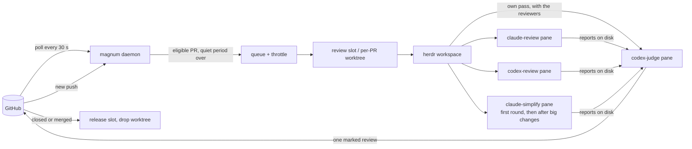

<p align="center">
  
</p>

<h1 align="center">Magnum PR</h1>

<p align="center"><strong>Multiple agents. One review. No drama.</strong></p>

<p align="center">
  <a href="https://go.dev/"></a>
  
  <a href="https://herdr.dev"></a>
  <a href="https://cli.github.com/"></a>
  <a href="LICENSE"></a>
</p>

Magnum reviews your pull requests with the AI coding agents you already use. On every push, several
agents (Claude Code, Codex, droid, omp or any CLI [herdr](https://herdr.dev) can drive) review the PR
side by side, a **judge** agent proves or rejects each finding they raise, and Magnum posts exactly
**one** GitHub review, as you or as a GitHub App. It runs as a daemon on your Mac, on the agent
subscriptions you already have, and every agent works in a herdr pane you can watch or take over.

<p align="center">
  <a href="#quick-start">Quick start</a> ·
  <a href="#how-it-works">How it works</a> ·
  <a href="#what-the-author-sees">What the author sees</a> ·
  <a href="#faq">FAQ</a> ·
  <a href="#configuration">Configuration</a> ·
  <a href="#daily-use">Commands</a> ·
  <a href="#the-pr-board">PR board</a>
</p>

- **Several reviewers, one review.** Each agent has its own prompt, model, credentials and schedule.
  Their findings go to a judge, so the author reads one review with one verdict, not four.
- **Proven or dropped.** The judge reproduces each finding and posts it on the line that must change,
  with the reproduction and the fix. A finding it cannot prove is not posted.
- **Re-reviews that remember.** A push goes back to the sessions that reviewed the PR before: they read
  the author's replies, check the claimed fixes and review only what changed.
- **Real checkouts.** Each PR gets its own worktree, or a warm slot with its own databases for a big app,
  so the agents can run the tests; a closed or merged PR releases it.
- **Your machine, your budget.** No hosted service in between: the agent CLIs you are logged into do the
  reviewing, and GitHub calls go through `gh`. Quiet periods, minimum intervals and daily caps keep a
  burst of pushes from burning your subscription, and a model at its limit can hand over to a fallback.
- **Fixes what it finds.** On a PR you wrote, one key starts a fixer agent that fixes the findings worth
  fixing, answers the threads and pushes as you. Magnum then reviews the push again, up to a cap of
  cycles ([Fixing your own PRs](#fixing-your-own-prs)).
- **Learns the repository.** The judge keeps notes per repository (how to test it, known pitfalls), and
  an optional daily retro collects what human reviewers caught that Magnum missed.

> [!NOTE]
> **Disclaimer:** this repository is 100% vibecoded and, I'd say, 100% awesome. It saves me hours, and I
> use it every day. If you're happy to let AI review your pull requests, I hope you won't mind that AI
> wrote the reviewer too.

### What the author sees

One review per round: a verdict line first (`Fix 1 problem before merging.`, or `No problems found.
LGTM :shipit:`), then each finding as an inline comment on the line that must change, like this one:

> **[P2] Old Reject error appears in a new chat**
>
> If Reject fails after the user opens another chat, the old error appears there.
>
> **Reproduce** (`app/chat.test.jsx:88`)
>
> ```js
> it("keeps a late Reject error out of a new chat", async () => {
>   const chat = render(<Chat />);
>   api.reject.mockRejectedValueOnce(new Error("timeout"));
>   await chat.click("Reject");
>   await chat.click("New Chat");
>   await flushPromises();
>   expect(chat.text()).not.toContain("timeout"); // fails: the error is shown
> });
> ```
>
> **Fix**
>
> The `catch` changes state before the session check. Check the captured session first.

The author answers on the thread (`fixed`, `not a bug: <why>`, `won't fix: <why>`), and the next push is
re-reviewed against those answers. A reply with no push gets its answer a few minutes later: the judge
re-decides the thread and answers there (an acknowledgement, one sentence with its evidence, or an answer
to a question), or posts a new review when its verdict changes; after two rebuttals in one thread it
stops arguing and leaves the call to the operator. A P1 or P2 problem the judge proved next to the PR's changes that the
PR did not bring is not a finding: up to three go into a collapsed "Found nearby, not this PR's" block
before Checks, one line each, never counted in the verdict (a security one only into `magnum debt`).
A false claim of the description that bears on risk (a ticked "Can be reverted easily" the previous
release cannot keep) is a finding, or one `Description: ✗ <claim>: <why>` line when it harms nothing.
[The judge skill](#the-judge-skill) has the full format.

With `[pipeline] status_comment = true` the PR also gets one comment, edited in place, that says whether
its review is queued (and why it waits), in progress or posted (with its verdict in a few words), says when
Magnum's own failure stopped it, answers a review request on a PR Magnum leaves out, and ends on a true
line when the PR is closed, merged or turned into a draft first, so nobody merges before it by accident
(see [Review status comment](#review-status-comment)).

## How it works



1. **Poll.** One GraphQL query per organization finds new PRs, new heads, new repositories and closed
   PRs, and a second reads the CI state of the watched repositories' open PRs (a CI run that ends does not
   count as a change of the PR). Open PRs that existed before Magnum started are left alone until they
   change.
2. **Throttle.** A new head waits for a quiet period (default 5 min, 15 min after a burst of three
   pushes within 30 min) and at least 30 min since the previous round (2 h for drafts); pushes coalesce
   to the latest head; `magnum review` overrides.
3. **Check out.** Pool repositories (big apps with databases) get one of N provisioned slots; small
   repositories get a worktree next to their clone. Checkouts are detached, so they never collide with
   branches you have open yourself.
4. **Review.** Every role from the pipeline configuration gets a pane: candidate reviewers and the
   read-only simplifier (it proposes simplifications in a report, edits nothing) run in parallel, the
   judge does its own full pass alongside them, a checkout a role left modified is caught and restored,
   and once both ended the judge weighs every report against its own pass.
5. **Post and verify.** The judge posts one review with inline comments and an invisible run marker
   through `magnum post-review`, which checks every inline comment's line against the PR's diff first;
   Magnum verifies on GitHub that exactly that review by exactly that identity exists for that commit.
6. **Repeat and clean up.** New commits re-prompt the same sessions. A push while the reviewers (and the
   judge's own pass) still run restarts them in place on the new head (at most twice per round); a push
   while the judge weighs the reports is noted on the posted review and re-reviewed right after the
   quiet period. A closed or merged PR
   releases its folder after a grace period, with teardown hooks for its databases. If the poll confirms the
   close or the merge while a round runs, the round stops as `magnum abort` stops it (a `round.stopped`
   event). A round that someone asked for (`magnum review`, the board's `r`, a review request) and a
   post-merge review run on.

## Quick start

Requirements: macOS (see [Linux](#linux) below), [herdr](https://herdr.dev) 0.9.3+ running, `gh` logged
in and the agent CLIs you want to use (`codex`, `claude`, `droid`, `omp`). MySQL only for a `[[pool]]`
that declares databases: DBngin's server at 127.0.0.1:3306 (root, no password), or any other one that
`MAGNUM_MYSQL_DSN` names (a [go-sql-driver DSN](https://github.com/go-sql-driver/mysql#dsn-data-source-name)
such as `root:secret@tcp(127.0.0.1:3307)/`) in the environment of the daemon and the CLI (the LaunchAgent
does not carry it: a daemon launchd runs sees it only through `mise exec`, from the checkout's mise env);
[mise](https://mise.jdx.dev) only for a pool whose worktrees use it; dev.fast Whiteboard only for
whiteboards, with `[pipeline] whiteboard = true` or by hand with `magnum whiteboard` ([Whiteboards of reviewed
PRs](#whiteboards-of-reviewed-prs)): Whiteboard
Desktop running (or `whiteboard server start`) and its `whiteboard` CLI on PATH.

```bash
brew install zhuravel/tap/magnum             # built from source by Homebrew
magnum init                                  # ~/.config/magnum/config.toml: your gh login, one repository, who posts
magnum doctor                                # what this setup uses, with the exact fix for each problem
magnum daemon                                # in a second terminal or herdr pane: the daemon in the foreground
magnum review owner/repo#123 --wait          # one review of that repository's PR, start to finish
```

When the review has posted, hand the daemon to launchd (`install` stops the foreground one) and add the
extras you want:

```bash
magnum install --plugin                      # launchd agent + herdr plugin
magnum install --gh --no-launchd             # optional: `gh magnum …`
magnum completion zsh > "${fpath[1]}/_magnum"
```

To upgrade: `brew upgrade magnum && magnum daemon-restart --when-idle` (the daemon keeps running the old
binary until it restarts; `--when-idle` restarts at the first moment nothing is in flight, no round and no
notes curation or retro, `--drain` also stops new rounds meanwhile). `magnum status` and every reply to a
command the daemon answers say when the daemon runs an older build than the CLI or the binary on disk; with
`[daemon] restart_on_new_build = true` the daemon restarts on a new build by itself, at the first tick
nothing is in flight.

`magnum init` refuses to replace an existing config without `--force` (the old file is kept as
`config.toml.bak`); [config.example.toml](config.example.toml) is the same minimal setup to copy by hand.
To post as a GitHub App, answer 2 when init asks who posts: it asks for the App's ids and names the file
to save its private key as, `~/.config/magnum/keys/<app>.pem` (it never asks for the key); `magnum
identities check` verifies the App. A big repository with its own databases gets a pool of warm slots:
add a `[[pool]]` (see below), then `magnum slots provision --count 6`. `--count` takes 1 to 999; a count that would pass the pool's `max` is refused before anything is provisioned.

## FAQ

**How is this different from a hosted review bot?** Magnum is not a service: it runs on your Mac and
drives the agent CLIs you are already logged into, so reviews come out of subscriptions you already have.
The agents work in a real checkout of the PR (a worktree, or a pool slot with its own databases), so they
can run your tests, and you can watch any of them in its pane. A judge has to reproduce a finding before
it is posted, and later pushes resume the same sessions. The trade-off: reviews happen only while your
Mac is on and the daemon runs, and they spend your own budget.

**What does it cost?** Magnum is free (MIT); every round spends some of the budget of each agent it runs.
The defaults keep that down: a push waits for 5 quiet minutes (15 after a burst), a PR gets at most one
round per 30 minutes (2 hours for a draft) and 12 automatic rounds a day, a push that only touches
comments, whitespace or docs, or only merges the base branch, is not re-reviewed, and a change under 30
code lines since the last review gets a check by the judge alone. With 80% of the Codex budget used,
full re-reviews wait; at 95%, rounds that need Codex wait. `magnum status` shows how fast that budget goes,
`magnum stats` lists the PRs that took the most agent time, and
[triage](#triage-fewer-reviewers-for-a-small-diff) can skip reviewers on a small diff.

**Is it safe to point agents at pull requests?** Reviewing a PR means running its code: the agents run
its tests in the checkout, with the autonomy your agent CLIs allow. Watch repositories whose contributors
you would let run code on your machine; PRs from forks are skipped by default. Magnum treats PR content
as data: PR text never goes into a prompt, the repository's instruction files count only for its
conventions, permission prompts are answered No, hooks a checkout brings are declined, and your personal
GitHub tokens are stripped from review worktrees. [Under the hood](#under-the-hood) has the details.

**How noisy is it?** The judge posts only what it can reproduce, ranks findings by who can reach them (P0
to P3), and offers at most three simplifications, marked optional. Every candidate it rejects is recorded
with a reason, so `magnum stats` shows per reviewer how many findings were raised, posted and rejected,
and why. The optional [retro](#learning-from-other-reviewers) measures the other side: what human
reviewers caught that Magnum missed.

**Why herdr panes and not headless runs?** So you can see what an agent is doing, take it over or answer
it when it is stuck, and so its session lives on: a re-review continues the conversation that wrote the
first review. herdr also gives Magnum pane titles, toasts and a plugin for its popups.

**Can it post as a bot instead of me?** Yes: give it a GitHub App and the App posts, so its approvals and
change requests do not come from your account. See [Identities](#identities-who-posts).

**Does it run on Linux?** Not yet. [Linux](#linux) lists the four macOS-only spots; a small platform
interface around them is the whole job, and contributions are welcome.

## Configuration

Two layers and the App keys:

- The built-in defaults: [config.defaults.toml](config.defaults.toml), embedded in the binary. The
  daemon defaults, the agent kinds and the review roles, every key documented; it names no account,
  repository or path of yours. Editing it changes the defaults after `make build`.
- Your config, `~/.config/magnum/config.toml` (`$XDG_CONFIG_HOME/magnum/config.toml` when that is set;
  `magnum init` writes it): your identities, watches, pools and repos, plus any default you want to
  override. Its `[[watch]]`, `[[identity]]`, `[[pool]]` and `[[repo]]` blocks are appended, a `[[role]]`
  overrides the keys it sets on the role of the same name (or is appended), scalar keys and
  `[kinds.<name>]` entries override key by key. [config.full.example.toml](config.full.example.toml) is
  a complete, working setup (Talkable's) to copy from. `magnum config` and `magnum doctor` say which
  files were read.
- App private keys: PEM files the identity's `private_key_file` names, by convention
  `~/.config/magnum/keys/<identity>.pem` (chmod 600; doctor warns about a looser mode). The older
  `private_key_env` (an environment variable holding the PEM or its path, e.g. from a checkout's
  `mise.local.toml`) still works; launchd then runs the daemon through `mise exec`.

Magnum keeps its own files where XDG says: the registry, review reports and repository notes in
`~/.local/share/magnum` (`$XDG_DATA_HOME`), logs, locks, the identities' gh config dirs and the tab-bar
file in `~/.local/state/magnum` (`$XDG_STATE_HOME`); `magnum config` prints both. `MAGNUM_HOME=<checkout>`
keeps them in the checkout's `state/` instead, for development.

`--config FILE` (or `$MAGNUM_CONFIG`) replaces the built-in defaults with a complete file of your own.

Besides those, Magnum reads `MAGNUM_MYSQL_DSN` (the MySQL server, see [Quick start](#quick-start)) and
`HERDR_BIN_PATH` (the herdr executable that `magnum open`, `reveal_on_attention` and the plugin commands run;
herdr sets it inside plugin actions, else `herdr` on `PATH`), and hands `[herdr] socket` to the herdr
commands it runs and to the LaunchAgent as `HERDR_SOCKET_PATH`. `MAGNUM_BIN` names the `magnum` binary that
the herdr plugin's commands run (else the plugin's own `bin/magnum`, then the installed one),
`MAGNUM_PICK_QUERY` is the initial filter of `magnum pick` (as `--query`), and `MAGNUM_TUI_TRACE=<file>`
makes a live screen append one line per message to the file, with how long its Update and View took, to
diagnose a frozen or spinning screen (off unless set). Every role's pane gets the round's context
in its environment, next to the identity's gh selection (an App's `GH_CONFIG_DIR`, with `GH_TOKEN` and
`GITHUB_TOKEN` blanked) and the slot's env: `MAGNUM_PR_URL`, `MAGNUM_IDENTITY` (`gh` or `app`),
`MAGNUM_REVIEWER_LOGIN` (the login that posts), `MAGNUM_SELF_LOGIN` (the watch's poll login),
`MAGNUM_NO_FINDINGS_EVENT` and `MAGNUM_BLOCKING_EVENT` (the repository's verdict events) and
`MAGNUM_REPORT_DIR` (the round's report directory).

`[daemon] restart_on_new_build` (default `false`): when `true`, every reconcile looks at the binary
launchd starts; once a new one passes its check (`<binary> version` and `<binary> config`, as
`daemon-restart` checks it) the daemon exits at the first tick no round is claiming, reviewing or
verifying, and launchd starts the new build (events `daemon.restart_pending`, then
`daemon.restarted_for_build`). Dispatch is never held for it, and a daemon launchd does not run (started
by hand) only says so: nothing would start it again.

`[daemon] shell_path` (default `false`): launchd gives the daemon a fixed `PATH` (`~/.local/bin`, mise's
shims, Homebrew's and the system directories), and every command it runs inherits it: the pool hooks, the
readiness commands, `mise exec`, gh and the agent CLIs. A tool only your shell's exports put on `PATH`, such
as DBngin's `mysql`, `psql` or `redis-server` in versioned directories, is missing there. With `true` the
daemon asks your login shell for its `PATH` once at its start, before it runs anything (`$SHELL -ilc`, `zsh`
when `SHELL` is unset, 20 s at most, no terminal and no stdin), and appends the directories its own `PATH`
lacks, in the shell's order. launchd's `PATH` stays first, so mise's shims still win. Banners and hook
output are skipped: the last line that reads as a `PATH` (colon-separated absolute directories) counts. The
`daemon.shell_path` event says how many directories were added ("PATH from zsh: 4 directories added"),
and `magnum status` shows the count on its daemon line. The debug log names the directories, the event
never does. A shell that fails, prints no `PATH` or answers nothing in 20 s leaves launchd's `PATH`
alone, with a warning event ("the login shell (zsh) answered nothing in 20s. The launchd PATH stays"). A
change of your shell's `PATH` (a DBngin upgrade) takes effect at the next `magnum daemon-restart`, as a
config change does. The CLI keeps the environment of the terminal it runs in.

Three more `[daemon]` keys pace the agents. `max_total_working_codex` (default 5) caps the Codex agents working at once, your own sessions included. `agent_start_stagger` (default `"15s"`) is the least time between two agent launches, across rounds, and at most 3 Codex agents start at once. `min_warm` (default `"30m"`) is how long a pool slot another PR holds must stay unused before a waiting PR may take it back, its sessions parked and the slot released: with no human typing, no session working, blocked or prompted within it, no run and no pin.

A command handed to the daemon waits up to 30 s for its answer (the daemon answers requests before its
GitHub poll and between the poll's GitHub calls, so one waits for a single call); a request still pending says how to follow it (`magnum logs request:<id> -f`). A request
that reaches a daemon newer than it fails with "this daemon predates <field>: restart it" instead of
running without the field. Without a daemon, `review`, `approve`, `request-changes` and `open` of a parked
PR refuse and queue nothing (they would post or act whenever a daemon next started); the other commands
still queue for the next start, and a request no daemon saw within an hour fails at startup as "expired:
queued while no daemon ran".

The daemon prunes audit events older than `[daemon] keep_events` (default `"30d"`) and handled CLI
requests older than `keep_requests` (default `"7d"`) on every reconcile; `"0"` keeps them forever. The
step rows a checkout resumes from after a crash are the one exception, and only while their subject (a
checkout, named with the head's sha) has had an event inside the window: a subject quiet for `keep_events`
loses them with the rest. `poll_interval` and `reconcile_interval` must be positive, the other waits and
quiet periods (`close_grace`, `push_quiet_period`, ...) and `min_free_disk_gb` not negative, and
`default_repo`, when set, `owner/name`; the config is refused otherwise. Two `[[pool]]` blocks may not
render the same `slot_name` or `slot_path`.

A push that lands while a round's reviewers still run restarts them on the new head, up to
`[daemon] max_round_restarts` times per round (default 2; `0` turns restarts off). The turns it cuts
short are interrupted and their roles prompted again on the new head: an agent reviewer with esc, a shell
role's command with ctrl+c, and the judge's own pass with one ctrl+c, which aborts Codex's turn and keeps
the session with its context (two quit Codex, as for a judge that timed out). All of them get their keys
at once, before Magnum waits for any of them, and then Magnum waits for all of them side by side, so the
restart waits for the slowest turn, not for each in turn. A shell role's command that still runs 10 seconds
after its ctrl+c gets another, three in all, and a warning names the role when it runs on, since the
restart's line would find its pane busy. An agent gets up to a minute after its interrupt to go idle, and a
warning names it when it does not. A claude reviewer still at work 10 seconds after its esc whose
transcript shows background work it started still running (a test run in the background keeps it at work
after an interrupt) is told then to stop that work, which is what ends it, rather than at the end of the
minute; one idle within the 10 seconds gets no message then, only the one about work its transcript still
shows once it is idle. A stop that worked is an info event (`round.cut_settled`, with the seconds the agent
took to go idle), not a warning. When a refusal or a lost judge ends the round instead, the turns still at
work are stopped the same way.
A push that lands while the judge works lets the round finish: Magnum appends "Reviewed <sha>; N commits arrived during
the review, re-review follows" (or, for a small delta, "a short check of those commits follows") to the
posted review and queues the re-review without waiting for `min_rereview_interval`. A PR whose head changed `burst_pushes` times (default 3) within `burst_window`
(default `"30m"`) waits `burst_quiet_period` (default `"15m"`) instead of `push_quiet_period`; a
`[[watch]]` can override all three, and `burst_pushes = 0` turns the rule off.

A watch's `include_own = false` skips the PRs you authored (its author is one of your logins: every gh
identity and every watch's posting identity, the board's "mine"), whichever of your logins opened them,
not only the watch's poll login. A PR you authored waits `[daemon] own_min_rereview_interval` after its
last round instead of `min_rereview_interval` when that is set (default `"0"`: the same interval), say `"2h"` while another
session of yours pushes to it often; an own draft waits the longer of it and `draft_min_rereview_interval`,
a `[[watch]]` can override it, and a review request or `magnum review` skips it like the other timing
rules. The wait names it ("re-review · own PR interval → 16:40").

`magnum snooze <ref>` holds one PR's automatic rounds for a while: `--for` (default `2h`), `--until 18:00`
(tomorrow once past) or an RFC 3339 time; `--off` lifts it. Until then no push, quiet period, re-review,
reply round or delta check starts a round on it (the first review of a new PR included), while
`magnum review`, the board's review keys and a review request on GitHub still run one and leave the
snooze in place. It ends on its own at its time and survives a daemon restart (the registry keeps it); a
round in flight finishes. The board's `z` snoozes the selected PR for 2h after a y/N, and on a snoozed PR
offers to lift it; the state cell says `snoozed → 18:00` (in the wait, or after the state when nothing
waits), the card until when, since when and by whom (`magnum snooze` or the board), and `tui --json`
has `snoozed_until`, `snoozed_at` and `snoozed_by`.

Codex may block an account it takes for a cyber abuser, also when all it reads is your team's own code. So
when a role's turn ends on one of Codex's safety warnings ("This content was flagged for possible
cybersecurity risk", the words "cyber permissive safeguards" or "Daybreak access", or a usage-policy
violation, abuse or a threat named in Codex's own `■`/`⚠`/`ERROR:` line; the kind's `health_patterns`
`refused` list, read from the pane after the turn's prompt and, when the pane scrolled past it, from the
turn's error in the session's Codex rollout, `codex_error_info` `cyber_policy`), the round ends at once,
whichever role it was (the judge's own pass, its candidates turn, a nudge or a continue, a reviewer,
codex-review's output; also when a push cut the stage a moment before). A Codex helper agent the role's
session spawned counts as the role: when its rollout (the one naming the session as its parent) records a
`cyber_policy` refusal within the turn, the round ends the same way, even though the session's own turn
ended ok and the judge posted its review (which stays posted): no nudge, no retry, the other
roles are interrupted (the turns of the refused kind first), and the round's outcome and
the PR's last error say "Codex refused the review: content flagged as a cybersecurity risk (codex-judge,
run r-…)". The PR is flagged for good (the refused head, role, run and time) and one toast says so:
magnum never reviews it again, on any head, by itself or when asked (no retry, continue, reply round or
delta check; `magnum review` and the board's `r`/`R` refuse with the reason). With
`[pipeline] judge_fallback = "claude-judge"` (a `[[watch]]` may set its own) the PR goes on instead: it is
flagged for Codex, which never sees it again, its roles of that kind (`codex-judge`, `codex-review`) are
dropped, and `claude-judge`, the second built-in judge held in reserve (Claude Opus at xhigh, the judge's
prompts and skill), judges it from the next round on, starting fresh through the recovery prompt that
reads the earlier reviews and threads from GitHub. The PR goes back in line (a reviewed one as
`rereview_pending`, an unreviewed one `queued`) and waits the usual re-review interval, keeps its slot
and agents, and `magnum review` works; the board's cell reads `Codex flagged · judge claude-judge`. A
refusal by the fallback's kind too, or a fallback no longer declared as a judge of another kind, holds
the PR as below. Without the key, the board's state cell and
card read `Codex flagged · never reviewed again`, the card says when and where and how to lift it,
`magnum status` lists the PR among what needs you, `magnum tui` prints `codex-flagged` in STATE and
`tui --json` has `codex_flag` and `codex_flag_detail`; `magnum stats` counts such rounds as `refused`.
Review it by hand. Only `magnum codex-flag clear <ref>` lifts the flag, after a y/N question on a
terminal that names the account risk; `magnum codex-flag set <ref> [reason]` flags a PR by hand (one
Codex warned about elsewhere). The flag fails closed: a flag record magnum cannot parse is a flag, a
registry read that fails holds the PR that tick, and a flag a refused round could not write holds the PR
from memory and is written again every tick. A flagged PR gives back what it holds: the tick after the
flag parks its idle agents and releases its pool slot (a `pr.codex_flag_released` event), unless
`magnum open` pinned it for you to review by hand. Another PR's judge never hears of it: `related.json`
leaves flagged PRs out. A `magnum eval run` case whose replay was refused is recorded in
`<state>/eval/flagged.json` and never replayed, nor is another case on the same PR (`owner/repo#N`) or a
case whose PR the registry holds a Codex flag for (`eval run` says so; delete its entry, or clear the
flag, to replay it).

`[daemon] quiet_hours` (unset by default) holds the costly rounds of every PR during a daily window of
local time, `"HH:MM-HH:MM"` such as `"01:00-07:00"`: inside it first reviews, full re-reviews (a review
request's on GitHub too) and the continue of a judge turn a usage limit paused wait for its end
(`re-review · quiet hours → 07:00`), while their timing rules keep counting. A round of the judge alone
still starts: a delta check of a small push, a reply round, and a re-review of the head Magnum reviewed
(a review request after a reply), each one turn of a few minutes. `magnum review`, the board's and the
picker's review keys still start any round, and a round in flight finishes. Nothing else stops: the poll,
auto-approval, the retro, notes curation, parking and cleanup go on. The window includes its start and
excludes its end, and crosses midnight when the end comes first (`"22:00-06:00"` covers 22:00 to 05:59); a
malformed value or an empty window (`"07:00-07:00"`) is refused when the config loads.

### Re-reviews

A push whose changes since the last review are only comment lines, whitespace or documentation is not
re-reviewed: Magnum compares the reviewed commit with the new head (one GitHub call), moves the review
to the new head with its verdict, keeps an App's approval and records `pr.trivial_delta`. When such a
commit arrived during the judge's turn, the note on the review says "(comments only), no re-review
needed" instead. `[daemon] skip_trivial_deltas` (default `["comments", "whitespace", "docs", "base"]`,
`[]` = re-review every push) picks the kinds, a `[[watch]]` can override it, and `magnum review` always
runs. A file that steers the review agents (an `AGENTS.md`, `CLAUDE.md` or `CLAUDE.local.md` in any
directory, anything under `.claude/` or `.codex/`, `.mcp.json`) never counts as documentation for this. A
comment line that holds its language's interpolation counts as code, because in a heredoc, a template or a
`run:` block it runs: `#{` in Ruby and ERB, `{` in Python, `${` in JavaScript, TypeScript, Kotlin, shell and
Terraform, `{{` in YAML.

A push that merges the base branch into the PR (or rebases it onto the base) is judged by the PR's own
diff, not by the commits it brings: when the comparison of the reviewed commit with the new head shows a
merge commit or a divergence, Magnum compares the PR's diff against its base before and after the push
(two more GitHub calls, `<base>...<reviewed>` and `<base>...<head>`), file by file, by the sequence of
added and removed lines (context lines and hunk positions, which master's changes move, do not count).
When no file's own change differs, the push is the kind `base` ("base merge only"): the review stands
and `pr.trivial_delta` says, e.g., "the push to 2017f29 only merges master (13 commits, the PR's own
changes unchanged)". A file without a complete patch, or a diff over GitHub's 300-file cap, makes the
comparison incomplete, and the push is measured as any other. A daemon that starts on this rule checks
the PRs already waiting for a re-review once more, on its first poll, and settles those a base merge
queued.

Any other push is measured by the same GitHub call: the changed lines that are code (not comments,
blank lines, whitespace moves or documentation) since the reviewed commit; after a base merge or a
rebase, only the lines that changed in the PR's own diff. An automatic re-review runs after the quiet
period once that delta reaches `[daemon] rereview_min_lines` (default 30) or adds a file; a smaller
delta waits for further pushes, at most `rereview_max_wait` (default `"2h"`) after its first push.
`rereview_min_lines = 0` turns the threshold off, and a `[[watch]]` can override both. A force push back to
an ancestor of the reviewed commit (GitHub: "behind") has nothing to measure, so the threshold does not hold
its re-review.

Such a small delta (more than 0 and fewer than `rereview_min_lines` code lines, no added file) gets a
delta check instead of that wait and a full round (`[daemon] delta_check`, default `true`; a `[[watch]]`
can override it): once the push quiet period (or the burst one) is over, only the judge runs, in its own
session at its `rereview_effort`, without triage or reruns, and its prompt asks for one short review of the
commits since its last one against the PR's purpose and its earlier findings (`delta_check: true`, and the
delta's files listed in `delta-check.json` in the report directory). A modified image or other binary file
(no patch) counts 0 lines there and is named in that list; an added file still means a full round. Pauses,
the re-review interval, the daily cap, capacity and drains hold it as any round, and a forced or requested
round, or one that names roles, runs in full. The board, the card and `magnum status` call it a delta
check (`delta check · quiet → 14:09` while it waits, `delta check (4 lines)` on the card's last round and
in `engine.round_start`); the board marks a running one `∆` after its pill. A judge whose session is gone
(lost, parked by an identity migration, or fresh sessions requested) checks the delta in a fresh session
(`round.delta_check_fresh`): a recovery round of the judge alone at its `rereview_effort`, whose prompt has it read its previous review and threads before it
reviews just those commits (`delta_check: true` in `judge-recovery.md`); only when no review by the PR's
current or former identities is on record to build on does it become a full recovery round
(`round.delta_check_dropped`). An App's approval of the reviewed commit stands meanwhile (`review.approval_kept_for_check`): the check's approval supersedes it
(`review.approval_superseded`); a check that comments, requests changes, fails or needs attention, a later
push that makes the delta too large, or no check posted within an hour of the check becoming due (after the
push quiet period; quiet hours do not hold the check, and a `magnum pause` counts) dismisses it then, with the reason. `delta_check = false` keeps the wait and the full round.

A re-review of a head Magnum already reviewed (no new commits: `magnum review`, or a review request, to
have it re-read an author's reply) runs the judge alone as a delta check does: no triage, reruns or own
pass, at its `rereview_effort`, in a fresh session too when the old one is gone (`round.same_head_fresh`).
Its prompt says the head is unchanged: re-read the replies and comments since the last review, re-decide
each earlier finding under the reply contract, run no check that review already ran, and post one short
review, headed `Re-review of <sha> (no new commits):`. `round.same_head` records it. A request that names
roles (`--role`, `--simplify`) or asks for fresh sessions (`--fresh`) runs every reviewer as before, and so
does a round whose checkout finds a newer head (`round.same_head_dropped`).

A re-review reads only the commits since the last review, so after its first review nothing reads a
long-lived PR whole again. Every tenth automatic re-review is therefore a full pass (`[pipeline]
full_pass_every`, default `10`; `0` turns it off): the PR's sessions are parked and every role starts fresh
as with `--fresh`, the reviewers review the whole PR with their first-review prompts at their full effort
(triage judges the whole PR, as for a first review), and the judge gets the recovery prompt with a full-pass
clause (`full_pass: true`): review the full PR diff again as a first review does, then decide every earlier
thread under the reply contract; a finding the earlier reviews missed ends its title with `(missed
earlier)`, and the body is headed `Re-review <a> → <b> (full pass):`. The judge's own pass (with the
default `judge_own_pass = "parallel"`) is blind: it reviews the full diff as a first review does and reads
no earlier review, thread or reply, so the fresh session does not take on the old framing before it reads
the code; the candidates prompt then lists the earlier reviews, and the judge decides their threads there.
It costs a first review's rounds of every role. The count is the PR's re-reviews that posted a review on new
commits since its first review or its last full pass, read from the registry's runs, so a PR reviewed
before the key existed counts its past re-reviews. A delta check counts, and a due full pass overrides it:
the small push runs the full pass instead of the judge's check, so small pushes never put one off. A forced
or requested round counts but never becomes one, except `magnum review --fresh`: its round, on a new head or
the reviewed one, runs the full pass when any rule (`full_pass_every`, or the churn and age rules below)
makes one due, as an automatic re-review would, and the reason ends `, on magnum review --fresh`
(talkable#11483's recovery of its reviewed head after a dead judge ran none after 34 re-reviews and never a
full pass); a re-review of the same head, a reply round and a CI check neither count nor become one. The
soft Codex budget cap holds a full pass as any automatic full re-review.

Rounds say how often the whole-PR view was lost, not how much the code changed, so churn and age make a
full pass too. A PR's baseline is its last full pass, else its first review (a PR reviewed before these
rules: its next review of new commits); a round of the reviewed head that is no full pass (a same-head
round, `magnum review --fresh` with no full pass due) never becomes it, since it read nothing new and the
age rule would count from it. The baseline holds the PR's size then: its changed files and their added plus deleted lines,
lockfiles and the watch's `related_ignore` paths left out (`git diff --numstat` in the round's checkout).
Every review that posts on new commits adds them to the churn since the baseline, measured as the re-review
reads them: from the reviewed commit to the head, or, when the push merged the base branch, the change of
the PR's own diff before and after it, so the base branch's commits are not the PR's. The next automatic
re-review is a full pass once that churn reaches `full_pass_lines` lines (default `500`) or touches
`full_pass_files` files (default `10`, each file once), or a quarter of the PR's lines or files at the
baseline when that is more, or once `full_pass_after` (default `"12h"`) passed since the baseline, whatever
the PR's size, so the first push of a workday gets a whole read; `0` turns each rule off alone. The rules apply in that order, after
`magnum review --full` and `full_pass_every`, and a full pass that posts is the new baseline. `round.full_pass`
says why one runs and which rule fired (`rule`: the key, or `requested`), `engine.round_start` says
`re-review (full pass)` with the reason in `full_pass_reason`, the card's last round `full pass`, and the
status comment `In progress (full pass)`. `magnum review --full <ref>` asks for one by hand.

An approval rests on a whole read of the PR, not on a chain of deltas each read on its own. A re-review of a
PR that had `[pipeline] approve_after_full_pass` re-reviews or more since its baseline (default `2`, counted
as `full_pass_every` counts; `0` turns it off) cannot approve: its `no_findings_event` is `COMMENT`, its
prompt says why, and a clean verdict's body adds the line `A full pass of the whole PR follows before
approval.` after the verdict line. When such a review posts with the verdict `clean`, Magnum forces a full
pass of the same head at once, as `magnum review --full` does: every role starts fresh on the whole diff,
its clean verdict approves (one that finds problems posts as usual), and it is the new baseline, so the
next push and a clean re-review approve on their delta again. With the default, one round of fixes after
the first review approves on its delta. The hold applies to automatic and requested rounds alike (a delta
check, a recovery, an audit pass, a re-review of the same head) and to your own PRs, whose clean verdict
is a comment anyway; a full pass, a post-merge review, a reply round, a CI check and a dry run never hold.
Auto-approval as you waits for the full pass too. `round.approval_hold` says why a round holds
(`engine.round_start` carries `approval_hold`), `pr.approval_full_pass` that the full pass follows, whose
`round.full_pass` names the rule `approval` (`before_approval` in its start event), and the card's last
round says `full pass (before approval)`. Until a later review posts, the board's FINDINGS reads `✔ held`
for the review that held its approval (`findings.held` in `magnum tui --json`).

A full pass reads the whole PR again; what the evidence map (see the judge's `evidence.json` under the
pre-pass) says no round read or probed, or changed since one did, needs only those areas read. Every fifth
automatic re-review of a PR whose map holds `unknown` or `stale` entries is therefore an audit pass
(`[pipeline] audit_every`, default `5`; `0` turns it off), counted as the full pass counts, since the PR's
first review, its last full pass or its last audit pass: every session starts fresh, the round runs as a
recovery whose reviewers re-review the delta at their rereview effort (as with a cold judge), and the judge
gets `audit.json` in the report directory (the areas come from the PR, so the prompt names only the file):
at most three `unknown` or `stale` areas, the riskiest first (an irreversible write, authorization, money,
an optional branch, a file of the pre-pass's lists), and, marked `rotation`, the oldest probe on a file the
pushes touched since, to run again. It probes each through its real entry point with a control, writes each
probe that passes as `probed` in its evidence, posts no finding that only says an area is unknown, then
re-reviews the delta and decides the earlier threads. An audit pass counts toward the full pass's count and
never replaces one: when both are due, the full pass runs. A delta check, a re-review of the same head, a
reply round, a CI check, a forced or requested round and a push that left the head as reviewed never become
one. `round.audit_pass` says why it runs, `engine.round_start` says `re-review (audit pass)` and the card's
last round `audit pass`.

Replies get that round on their own, without a push. The poll reads, for a PR whose activity moved, its
reviews and comments with their authors and their association with the repository (no text): a reply in
one of Magnum's threads by the PR's author or by an owner, member or collaborator of the repository, or a
comment by the PR's author or a review of theirs with no inline comments (a body alone answers the review
as a whole; the author's agent's "(Claude)" replies are the author's), never one by Magnum's own logins.
A review of the author's whose inline comments start threads of their own (the findings of their own
review tool, say) or answer another reviewer's is no reply. The poll's read says which for the last two
reviews; for every other review since Magnum's latest review of the PR (up to ten) it asks GitHub in one
more call for the batch (1 point, none when nothing needs it), and a review it could not ask about counts
as before. Anyone else's reply in a thread (in a public repository anyone may
reply), a bot's without that association, a teammate's review elsewhere or a bot's top-level comment
starts nothing; the next round's judge reads them anyway. When such replies came on a head Magnum reviewed, the PR waits
`[daemon] reply_debounce` (default `"3m"`, `"0"` turns it off) after the last one and at least
`reply_min_interval` (default `"2h"`) after the last such round on that head, and then the judge alone
re-decides the threads (`re-decision · 2 replies → 14:09` while it waits, `reply round (2 replies)` in
`engine.round_start`). The quiet periods, the re-review interval and the daily cap do not hold it, and it
does not count against the cap; a round that only answers does not hold the next push either, whose
re-review interval counts from the last review round. When its verdict and event stay those of its last review, the judge posts
no review: it answers in the threads through `magnum post-review --replies` (an acknowledgement for a
reason it accepts, since resolving the thread is the author's; one sentence with its evidence for a
rebuttal; an answer as deep as asked; nothing where a reply needs none), and the round ends `replied`,
verified by the replies carrying its run's marker (`pr.replied`; the review stands, findings and
auto-approval are untouched). A thread another reviewer or the author started is theirs: the judge never
answers it inline, and `post-review` skips a reply there (listed under `skipped`) and posts the rest. A
reply round with nothing of Magnum's to answer ends `replied` with no replies, never blocked: the PR
stays reviewed with the replies read, so they start no new round, and `round.replies_none` says how many
replies started it and why none was Magnum's to answer (none in its threads, or the ones there needed no
answer); it never needs your attention. A changed verdict posts one short review, as any round does. A push
meanwhile wins: the re-review of the new head reads the replies too. After two of Magnum's rebuttals in
a thread, an answer marks the thread `stop`: the judge replies there no more, `post-review` refuses to,
and the board flags the PR for you (`pr.stalemate`; `reviewed · argued` in STATE) until you act on it
(`magnum review`, a verdict, a mute). Replies older than the daemon's first start with this build start nothing on their own; the board
counts them (`↩N`), and `magnum review --replies` (the board's `r` on such a row) re-decides them now.

CI that finishes red after the review gets a round of its own too. The judge reads the head's failing
checks when its prompt goes out (see The judge skill), so a review posted before CI finished never saw a
check that failed later. When a check of the head Magnum reviewed (no push since) fails after the judge
prompt behind the latest review posted on that head (the prompt's time, not the post's: a check that
finished in between was not seen either), the PR waits for a judge check of that head (`pr.ci_red`;
`CI check · CI red` on the board, "CI turned red after the review; judge check pending" on the card).
The judge alone, told that CI finished red after its review, decides each failed check from its log (a
P1 broken build when the PR causes it, else an unrelated Checks line) and posts one review
(`rereview round (CI red after the review)` in `engine.round_start`). Like a reply round it skips the
quiet periods, the re-review interval and the daily cap, counts against no cap and runs in quiet hours;
a snooze or a mute holds it. One judge check covers each failing check of a head: a rerun that fails the
same way starts no other, a different check failing later does. A rerun that turns the checks pending,
or passes, while it waits drops it (`pr.ci_red_dropped`, back to reviewed), and a push supersedes it.
The poll reads a head's checks again when its CI rollup's state changes, and also when its counts of
failed or pending checks do (a rollup stays FAILURE while an earlier failure is red); the counts come in
the same rollup request, with more fields.

The rest of the re-review sees a base merge the same way: triage reads the PR's own diff of the files whose
own change differs, the simplify reviewer's rerun measures that change, and the reviewers' and the judge's
prompts say the push merged the base branch, so they compare the PR's diff before and after it instead of
reading the base branch's commits as the PR's.

### Review requests, caps and pauses

A review request runs without delay: when someone requests a review from the poll login, from a posting
identity's login (an App's `<slug>[bot]` too) or from a team a `[[watch]]` lists in `request_teams`, or
marks a draft ready for review, the round starts `[daemon] request_debounce` (default `"1m"`) after the
request and the last push. It skips the quiet periods, the re-review intervals, the delta threshold and
the daily cap. Requests are edge-triggered by their time on the PR's timeline: one counts once, and only
when it is newer than the PR's last round start; a review of the head posted after it answers it too.
On a draft a `[[watch]]` skips (`include_drafts = false`), such a request makes the draft eligible for the
one round it starts, and the wait says so (`review · requested on a draft by alice → 14:09`); a later
push to the draft is skipped again until a newer request (GitHub keeps your request after magnum's App
reviews, so the request alone does not count twice).

The daily cap (`max_rounds_per_pr_per_day`, default 12) counts automatic rounds when they start:
requested rounds and `magnum review` never count. A round Magnum itself cut short is refunded
(`round.refunded`): one a shutdown, restart, drain, abort or the PR's close on GitHub stopped, one that
failed before any agent was prompted or on a prompt this build could not render, and one whose judge ran
out of fallback models. Posted, blocked, timed-out and needs-attention rounds count.

Every PR waiting for a round says why and until when: the dashboard's queue and the PR board show a
compact form (`re-review · quiet → 14:09`, `re-review · cap 6/6 → 00:00`, `re-review · small delta
8/30 lines → 16:40`, `re-review · requested by alice → now`, `delta check · quiet → 14:09`), and the card and
`magnum status <ref>` the full sentence with the command that lifts it (`magnum review <ref>` for the
timing rules, `magnum resume` for a pause). A retry names the attempt to come and what the last one hit
(`re-review · retry 2/3 setup → 22:57`, `retry 2/3 judge lost`, `timeout`, `human active`, ...; a narrow
column drops the cause first). A round waiting on the PR's pinned slot (`magnum open` pins the PR it
restores, `magnum pin` too) reads `re-review · pinned → u` with no error mark, the card says who pinned it
("pinned by magnum open (u unpins)"), and once the round has waited 30 minutes one toast per PR and pin says
"talkable#11792 waits for your pin (magnum unpin …)". A pin never lapses by itself, not when GitHub
merges or closes the PR either: the `pr.closed` event then says "slot kept: pinned (magnum unpin)" instead
of "slot released after 10m0s", one toast per PR says "magnum: talkable#11999 closed | its slot review16
stays pinned (magnum unpin)", `magnum status` lists every pin with the PR's state and the pin's age
("pinned:   review16 (talkable#11999, closed 5h ago, pinned 5d)"; a pin older than the events kept has no
age; `pins` in the JSON), and the board's summary pill adds how many of its pins hold a closed PR
("📌 4 pinned · 2 on closed PRs", only when there is one).

A slot its guard holds (`head_drift`: a commit made in it or a moved HEAD, `unpushed_commits`: commits on
no remote, `dirty_worktree`: a person's changes) keeps its PR waiting, and every sentence that says so names
the way back with the slot in quotes: "waiting: slot talkable/talkable-integration#867 is held: head_drift
(magnum unpin "talkable/talkable-integration#867")" in the reply of `magnum review`, in the PR's wait on the
board and the card, and in the refusal of `magnum fix`; the attention line of `magnum status` says
"check the folder, then `magnum unpin "<slot>"`"; and the skipped line of a release plan says "held:
head_drift (acknowledge it with magnum unpin "<slot>")" (its JSON keeps `reason: hold_reason` and the
`detail`, and adds `slot`). `magnum unpin <PR or slot>` hands the slot back whether or not anything is
pinned: for a `head_drift` or `unpushed_commits` hold it takes the folder's current HEAD as the checkout
Magnum expects, so the next release resets the slot, and answers "acknowledged the head_drift hold of slot
talkable/talkable-integration#867: HEAD 3e8c5b6 is now the checkout magnum expects; the next release resets
it" (a `dirty_worktree` hold comes back at the next guard while the changes are there). `magnum release`
never acknowledges a hold: a release must not take a HEAD it did not check out.

A round that fails three times on one head (a timeout, an error, a setup failure charged to the PR) parks
its PR in needs attention. When the cause was Magnum's own (an unknown role, a launch line that broke), the
fix is a new build, config or prompts, so the attention records what the daemon ran (the build's commit
and the binary's mtime, a hash of the config and one of the prompts and skills it loaded), and the next
start, after its recovery and before the first dispatch, puts back in line every open PR a failed round
parked under another one: queued, or re-review pending for a reviewed PR, with its attempts reset and not
forced, so it waits its turn like any PR. Each gets a `pr.retried_after_restart` event ("retried after the
restart on e7ad419: the failure's build differs") and one toast names them all ("magnum: retrying 2 PRs
parked by failed rounds before this build"). A PR that fails again on the same build, config and prompts
stays parked (and its attention toasts again), as does every other cause: a fix loop that needs your call,
a blocked judge, an identity failure, an API that stayed overloaded, a Codex flag.

A fetch, clone, checkout or dependency step that fails for a reason outside the PR (an SSH key the
agent lost, DNS, a network timeout or refusal, TLS, or the same dependency error on two PRs within ten
minutes) pauses dispatch for everything once, with one toast, and is never charged to the PR. Magnum
probes `git ls-remote` of a watched clone (over HTTPS through gh, like its fetches) after 2 minutes, then after twice as long each time it still
fails (up to 30 minutes), and resumes by itself when it answers; `magnum resume` lifts the pause at once.

A logged-out agent CLI pauses its kind: the login check before a round (`[kinds.*] login_check`) skips a
logged-out reviewer and ends a round whose judge is logged out, and a run that fails with the login error
(a reviewer's command, the judge's pane) pauses the kind the moment it fails, not when the round ends, so
other rounds stop starting its roles while this one goes on without the reviewer. A judge that stops
without a result while a reviewer's run proved its kind logged out ends its turn as `login_required`,
which Magnum continues once the login is back, instead of a nudge. The pause lifts when the login check
passes, and, for a pause a run proved, once the kind's login file changed too (`login_file`, codex:
`auth.json` under its home): `codex login status` reads the saved tokens and says logged in while a
revoked refresh token fails every call. A login file written after the run that failed (you logged in
since) leaves the decision to the login check alone, so a pause the round's end repeats lifts on its next
check. A pause whose login file stays unchanged lifts after 2 hours at most once the login check passes,
with a warning event; a run that fails again pauses the kind again.

The `[usage]` section watches the Codex budget, which Magnum reads from Codex's own session files
(`codex_home`, default `$CODEX_HOME` or `~/.codex`) at most once a minute. At `codex_soft` percent
(default 80) automatic full re-reviews wait (`re-review · Codex soft cap` on the board), since a full
re-review costs about twice a first review and finds no more; first reviews, delta checks, re-reviews of
the same head, reply rounds, a review request and `magnum review` still run. At `codex_hard` (default 95)
every round that needs Codex waits until the budget is below it again. `magnum status` and the tab bar
show the gauge (`codex 87%`); `0` turns a cap off. The reading can be stale: after a switch to another
Codex account the newest session file still carries the old account's limits, and no Codex session runs
while the kind is paused to refresh it. `magnum resume --tool codex` lifts the pause and overrules the
reading: both caps wait for Codex's next reading, from the next Codex session magnum or you run, and
apply again if it is still at the cap. `magnum status` says so on its codex line (`lifted by magnum resume
11:20: the caps wait for Codex's next reading`; `overruled_at` in the JSON), and a round's wait names the
command (`magnum resume --tool codex` lifts the pause).

Once every agent of a reviewed PR has been idle for `[daemon] park_idle_after` (default `"2h"`, `"0"`
never) its sessions are parked to free memory; the next round resumes them. The same goes for a PR whose
review or re-review waits behind `magnum pause`, a drain, the daily cap, or anything else that ends more than
`park_idle_after` from now. Pinned PRs and PRs you typed into within `human_cooldown` keep their agents.
The fixer's session is parked with the others; the next fix job resumes its conversation. A park closes the
panes it parked (see below), and a resume starts the conversation in a new pane; `o` and `magnum open` open
what is live, so a role whose pane is gone focuses a live agent pane of the PR, the judge's first. A park that
fails, for example because an agent does not quit on ctrl+c, is not tried on every tick. The next try waits
twice as long as the last wait: two ticks after the first failure, then four, eight and so on, up to 12
hours. A new round of the PR or a change in its sessions starts the wait over. The first failure of each
cause records a `pr.park_failed` warning with the cause's class (`quit_timeout`, `busy`, `herdr` or
`error`) and the wait. Later failures of the same cause record nothing, and a park that works records
`pr.parked` as usual. A park that cannot quit one agent still quits the PR's others and reports the
failures together. When the failure was an agent that did not quit (`quit_timeout`), the idle park's next
try, once the wait has passed, parks in the hard mode described below, and its `pr.parked` event says
"(hard: an agent did not quit at the plain park)". A failure of another class keeps the plain park, and a
restart forgets the record, so the first try after it is plain again.

A fresh start (`magnum review --fresh`, a full or audit pass, a new identity) parks every agent of the PR
first. When an agent stays in its pane through ctrl+c, that park waits like any busy agent: a minute at a
time, no attempt charged, and the board and the card count the tries (`retry 2/3 agent busy`). The second
try parks in the hard mode. Magnum sends the kind's `exit_keys` (Claude: `/exit`), waits again, and then
closes that pane alone, never the workspace, whose other panes may be yours. The session is closed, not
parked, and a `pr.park_forced` event names the role and the pane. A park that waits for a run of the PR (a
fixer or another round at work) is never forced, and `magnum abort` parks the same hard way on its last of
three tries. The release of a Codex-flagged PR keeps the plain park and its backoff.
Once any park worked (the idle park, a fresh start's, a hard one, `magnum abort`, `magnum release`, the
release of a Codex-flagged PR, an eviction), magnum closes the panes of the sessions it parked or closed, so
the workspace keeps one pane per role of the round plus the panes magnum does not own. The pane of a session
that was lost (its agent exited) is closed at the tick that sees it, unless a round holds the PR, and the
reconcile closes what is left for every PR, at the daemon's start and every `reconcile_interval`. A pane is
closed only when a parked, closed or lost session of the PR recorded it, it shows an idle shell and no
starting or live session of the PR still uses it, so a shell you opened in the workspace, which no session
recorded, stays, and a workspace left with no pane at all is closed. A
`pr.panes_closed` event says how many and of which roles, and, of a lost session's pane, the error line the
CLI printed before it died (`last_lines`, by role; a line that starts at column 0 with error, fatal or panic,
redacted), read before the pane closes; a reconcile with nothing to close records nothing.
A parked or lost conversation is kept: the role's next start resumes it in a new pane.

An agent CLI that dies as it starts can leave herdr listing the launch under the role's agent name
(`launch_pending`, status unknown) on a pane that shows only a shell prompt, and herdr refuses that name to
every later start (`agent_name_taken`). Before a start, and when the quit that starts a role fresh finds the
name still listed after its wait, magnum closes such a pane and records a `pr.launch_cleared` warning with
the role, the pane and the CLI's own error line. A pane whose agent works or is blocked, or whose
foreground is anything but the shell, is never touched. When the launch held the very pane the role was
about to start in, magnum first splits a replacement from it, with the same environment and label, and the
agent starts there.

A new CLI version is the first suspect when launches start failing, so the daemon reads the version of each
agent kind its roles use, as `magnum doctor` does (`<kind> --version` through its PATH), when it starts and
at every tick's health check, and keeps it in the registry with the binary (the kind's command with its
links resolved; for a mise shim, which links to mise itself, the binary `mise which <kind>` names) and its
modification time. The version command runs again only once the binary changes. Another version than the
one recorded is a `kind.version_changed` warning and one toast ("codex-cli 0.162.1 → 0.163.0 at 11:24"),
and `magnum status` shows the versions on its `clis:` line, with "(changed at 11:24)" for a day after a
change. For that day a PR that goes to needs attention because a role of that kind did not start (the
"failed 3× … start codex-judge" line, a dead launch's line among them) ends its line with "; the codex CLI
changed at 11:24". When two or more PRs' agents end with the same pane error line within 30 minutes (the
line of a `pr.launch_cleared`, of a prompt herdr refused because the agent was gone, or of a lost agent's pane
in `pr.panes_closed`), the daemon records an `agents.shared_failure` warning naming the PRs, the roles, the
line and a CLI change of the day, with one toast ("2 PRs' codex-judge launches end the same way"), once per
line a day. Nothing is paused and no version is pinned: you decide, and mise owns the versions.

The judge is the exception to resuming. Codex's prompt cache lasts about an hour and a half, so a judge
resumed later re-reads its whole conversation uncached on its first turn (25 of 39 resumed judge turns did,
4.7M tokens in 2.3 days). A judge whose last turn on the PR ended longer than `[pipeline] judge_fresh_after`
ago (default `"90m"`, `"0"` always resumes) starts the next round in a fresh session instead, the way a judge
whose session was lost does: a re-review becomes a recovery, whose prompt has the judge read its earlier
reviews and their threads from GitHub, while the reviewers keep their conversations and re-review the new
commits as usual. Unlike a lost session's, that judge works at its `rereview_effort` and its own pass reviews
the commits since the last review (the whole PR again after a force push); a delta check or a re-review of
the same head runs with a fresh judge at its `rereview_effort` too. A judge still live in its pane is quit
first, which parks its conversation (history kept), and the fresh one starts once herdr no longer lists it.
A continue finishes its paused turn in the old conversation. Each such start is a `round.judge_fresh_cold`
event with the idle time. A session that has served its role's `max_session_rounds` (the judge's 6) starts
fresh the same way, however recent its last turn (see Roles and kinds).

### Review status comment

People on a PR cannot see that Magnum is about to review it: they merge before the review posts, or ask
you where it is while it waits out a quiet period or a slot. `[pipeline] status_comment = true` (default
`false`) gives every PR Magnum means to review one comment on its conversation that says where the review
stands. Magnum posts it as the PR's posting identity (the watch's `identity`, the one the reviews use),
edits it in place and never posts a second one; its first line is the marker `<!-- magnum:status -->`:

```
<!-- magnum:status -->
**Magnum review status** (status changed 14 Oct, 18:43 UTC)
- [x] Review queued for `54fc258`: not before 18:45 UTC (the push quiet period)
- [ ] In progress
- [ ] Posted

This comment updates by itself.
A merge before the review posts skips it.
Reviews by the team's magnum.
```

```toml
[pipeline]
status_comment = true                              # default false
status_comment_note = "Reviews by the team's magnum."   # a line of yours under a review to come; "" = none

[[watch]]
owner = "example"
status_comment = false                             # this watch's PRs get none (true: only this watch's get one)
```

The header's time is when the stage or the wait last changed, with the day; an edit of anything else (a
link that turned up, your note) leaves it. The first line says where the review stands, in plain words:

- **Review queued for `54fc258`** once the PR waits for its round (queued, or waiting for a re-review,
  with the wait `magnum status` shows) or its round starts without a wait; "Re-review queued for" after an
  earlier review, and "Another review requested for" when `magnum review` (the board's `r`) or a review
  request asks for one more review of the head magnum reviewed. Then why it waits, in fixed words: "other
  reviews are running" (the slots and the review capacity), the earliest start of a timing rule ("not
  before 18:45 UTC (the push quiet period)", and the same for the burst quiet period, the re-review
  intervals, the daily round cap, a small change, a snooze, quiet hours and a review request's short
  delay), never a promised start, since the capacity can delay it, "a retry after a failed attempt", "starts
  shortly", or "held on Magnum's side" for a pause, an identity, a pinned slot and the like, whose own words
  can name an error, a branch, a pool or an identity. The comment carries no PR text. A re-review's list is
  followed by the latest earlier review, "Earlier review of `a1b2c3d`: <link>", and, when that review's
  result recorded earlier findings it kept open, "The last review recorded 2 earlier findings still open."
  (that review's count, not a live one).
- **In progress since 18:47 UTC** once the round started.
- **Posted**: the list collapses to one line, "Review of `54fc258` posted 18:52 UTC: Fix 1 problem before
  merging, 4 optional. <link>", without the sentences or your note. The words before the link are the
  review's verdict line, rebuilt from the result its round stored: "Blocking: 2 problems must be fixed
  before merging" (a P0 or P1, new or still open), "Fix 1 problem before merging" (P2), "No blocking
  problems" (optional ones only) or "No problems found", the optional ones (P3s and simplifications)
  counted after it, never a score; a review no round of Magnum's posted (a manual verdict) has only the
  link. The comment stays, and the next review of the PR starts the list again in it. A round on the
  reviewed head that nobody asked for (a reply round, a judge check of red CI, a re-decision of the
  replies) leaves the posted line. A review that held its approval (`approve_after_full_pass`, under
  Re-reviews) reads "Review of `54fc258` posted 18:52 UTC: No problems found. <link>. A full pass follows
  before approval." while its full pass waits; the full pass then shows as "Full pass before approval of
  `54fc258`" with "In progress (full pass) since 18:53 UTC", and its posted line replaces it.
- A [fix loop](#fixing-your-own-prs) shows as its own line: "Applying automatic fixes, cycle 1 of 3"
  under the posted line while the fixer works, and "Reviewing the fixes in `b2c3d4e`" for its re-review of
  what the fixer pushed, from the loop's state (never the fixer's words).
- One line replaces the list when Magnum will not review the head: "Magnum will not review this head. The
  operator was told." for a PR muted, ignored, flagged by Codex (with no fallback judge) or parked by a
  fix loop for your call, with no word of the cause. A PR Magnum's own failure parked for you
  (needs_attention: a setup or round that failed on every attempt, the agent API overloaded, a judge that
  reported a blocker or stopped without a review, an identity problem) reads "Magnum failed to finish the
  review of `54fc258`. The fault is on its side, not in your PR. The operator was told. A new push starts
  a new review." (a push queues it again); muted, it reads as muted.
- A review request that comes while the PR is muted or the watch's filters leave it out (a baseline PR
  included) gets "Magnum is not reviewing this PR. The operator was told.": it opens the comment where none
  stands, or turns the one there, and names no reason (the repositories are public, and a mute's reason or a
  filter could tell who is reviewed). The request is someone's, yours included; a draft marked ready is
  not one. You get one info toast per request that names the reason ("magnum: talkable/example#12: review
  requested by alice (not reviewed: muted)"; a manual repository's own toast stands for it) and a
  `pr.request_declined` event. The line holds while that request is the newest and no round served it; an
  unmute, or a filter change that queues the PR, hands the comment back to its review, and a mute or unmute
  drops the request (kv `pr.<id>.request_declined`).

Every comment ends on a true line, written at once (the 2-minute spacing below does not hold it) and only
once: "Closed before the review of `54fc258` posted." for a PR closed without a merge, "Merged before the
review of `54fc258` posted." for one GitHub merged first, the posted line for one merged or closed after its
review, and "Not reviewing: the PR is a draft." for a PR that turned into a draft (with `include_drafts =
false`) while its review was queued. A tick writes it whatever the PR's state, a release included (released
PRs of the last 24 hours are read for it). After it nothing is written until a new head, a new review
request, `magnum review`, a reopen or, for a draft, ready for review.

A post-merge review, an eval replay, a dry run (`magnum daemon --dry-run`, `magnum review --no-post`) and a
watch with the key off get none. A draft gets one only for a review someone asked for (a review request, or
`magnum review`), which opens it as on a ready PR, and otherwise only keeps one it had; a PR of a manual
repository gets one once `magnum review` queues it, or the not-reviewing line for a review request. The
daemon brings the comment in line with the registry at every tick, after it recorded the waits, and edits
only a changed text, at most once per PR every 2 minutes and 10 comments a tick, so In progress and Posted
can follow the round by a tick or two. The
comment never holds a round: a write GitHub refuses records a `pr.status_comment_failed` warning (at most
one per PR an hour) and a later tick tries again, and each comment posted or edited records a
`pr.status_comment` event with its stage. A comment someone deleted is posted once more at its next change
(a last line is not); deleted a second time, the PR gets none until its next push. The kv row
`pr.<id>.status_comment` keeps the comment's id, the identity that posted it, what it last said and whether
it ended. An App identity comments with the "Pull requests" write permission its reviews already need.

### Identities: who posts

```toml
[[identity]]
name = "me"
kind = "gh"                        # your gh login
login = "your-login"
no_findings_event = "APPROVE"
# dismiss_own_stale_change_requests = true   # default: false for kind = "gh", true for "app" (see below)
# review_footer = "_Reviewed {{.Short}} by the team's bot; reply on the thread._"   # a template; default: magnum's (see below); "" = none

[[identity]]
name = "reviewer-app"
kind = "app"                       # a GitHub App: reviews appear as <slug>[bot]
login = "your-app[bot]"
app_id = 123456
client_id = "Iv23liXXXXXXXXXXXXXX"
installation_id = 12345678
private_key_file = "~/.config/magnum/keys/reviewer-app.pem"
no_findings_event = "COMMENT"      # never let a bot approval unlock a merge by accident
```

App tokens are minted from a short-lived JWT and refreshed before they expire; every GitHub call,
including those, goes through `gh api` by default, so no extra firewall rules are needed (`[github] transport = "direct"` makes the JWT and token calls Go `net/http` requests, which an outbound firewall may block for a rebuilt, unsigned binary). The App needs the repository
permission Pull requests "Read and write"; Actions, Checks and Commit statuses "Read-only" are
recommended, since the judge reads the PR's CI with the App's token (without Actions it cannot read why a
CI job failed). `magnum identities check` verifies the key, the App, the installation, its permissions and
that `login` is the App's `<slug>[bot]`; a recommended permission the installation lacks is a WARN line
that does not fail the check. A PR follows its watch's identity. When you move a watch to another
identity, the next round of each of its PRs posts as the new one (`pr.identity_migrated`): it parks the
sessions the old identity ran in, reads the old login's reviews and threads as its own history (the
previous review, the replies to answer, the earlier findings), and once its review is posted dismisses
what the old identity left standing, its change requests and an App's approvals, with the old identity's
own credentials. It reads every review of the PR for that (up to 500); a PR with more dismisses nothing
and says so in a `review.former_dismiss_failed` warning. `magnum review --as <identity>` pins one PR to an
identity, and a pinned PR never migrates.

`dismiss_own_stale_change_requests` says what happens to an identity's own earlier REQUEST_CHANGES review
once a newer review of the PR has nothing blocking: `true` dismisses it ("Superseded by the newer Magnum
review"), `false` leaves it standing, and a standing change request keeps blocking the author's merge until
a human dismisses it. The default follows the kind: `true` for an `app`, `false` for `gh`, because a `gh`
identity is your own account and its reviews are yours to withdraw; set it to `true` on a `gh` identity to
let Magnum do that. A change request you posted by hand (`magnum request-changes`) and any review posted
after the PR was merged are never dismissed, and a dismissal that fails (a missing permission) only warns.

`review_footer` is the footer Magnum appends to every review the identity posts, once the review is
verified, there for the PR's author (the judge never writes it, and a dry run gets none). Without the key it
is Magnum's: the reviewed commit, then, collapsed under "About Magnum", that the review is automated, that a
P0-P2 thread is answered with `fixed`, `not a bug: <why>` or `won't fix: <why>` (the words the reply
classifier knows; a P3's title says it needs no reply), that simplifications are optional (only when the
watch runs a role aliased `simplify`), that new pushes are re-reviewed automatically (when
`[daemon] quiet_hours` is set, during it only small ones by a short check, the window named with the
daemon's offset from UTC, "03:00-12:00 UTC+3"; drafts only on request when the watch has
`include_drafts = false`), that a thread reply gets an answer without a push,
and whose review request starts a round (the watch's poll login when that is a `gh` identity, else the
posting login); `config.defaults.toml` shows it word for word. It is a Go
`text/template` of at most 2,000 characters, line breaks allowed, with `.SHA` and `.Short` (10 characters)
of the reviewed commit, `.Repo`, `.Number`, `.Login` (the posting login), `.Simplify`, `.Clean` (no
findings and no simplifications), `.Event` (`APPROVE`, `COMMENT` or `REQUEST_CHANGES`), `.PostMerge`,
`.DeltaCheck`, `.QuietHours` (`""` when unset), `.DraftsSkipped` and `.RequestLogin`; `""` turns it off. A template that does not render fails validation and the start check,
like a broken prompt. Magnum starts the footer with `<!-- magnum:footer -->` after a blank line, puts its
own notes ("_Reviewed d4e5f6a; 1 commit arrived during the review …_") above it, and replaces it rather than
adding a second one when it edits the review again; a review whose judge wrote the old footer itself is left
as it is.

### Watches, pools and repos: what to review and where

```toml
[[watch]]
owner = "talkable"
include = ["talkable"]             # repository globs; ["*"] for the whole organization
identity = "reviewer-app"          # who posts
poll_identity = "me"               # who polls
include_drafts = true              # false: a draft waits until ready for review, or a review request for you (one round per request)
skip_bot_authors = true
allow_bot_authors = ["helper[bot]"]
skip_departed_authors = true       # default: a branch PR by someone (not a bot) no longer a member or collaborator is not reviewed
roles = ["claude-review", "codex-review", "claude-simplify", "codex-judge"]
stakes = "A SaaS on the public internet: merchants' money and shoppers' personal data."   # what its repositories put at risk

[[repo]]                           # an internal tool of the same owner states its own
repo = "talkable/example"
stakes = "Internal tooling with no customers: a defect costs a colleague an hour at most."

[[pool]]                           # a big app with its own databases: a pool of warm slots
repo = "talkable/talkable"
main_clone = "~/Projects/talkable"
slot_path = "~/Projects/talkable.review{n}"
min = 12
max = 18
setup = ["bin/worktree-setup"]     # runs once per slot with WT_BRANCH=review<n>
teardown = ["bin/worktree-archive"]
copy_files = ["mise.local.toml", "config/initializers/local.rb"]
```

Repositories without a pool get a worktree per PR (`<clone>__worktrees/pr-<N>`). The clone is the one found
under the watch's `clone_root` (default `~/Projects`) by its `origin`. If the clone has
[worktrunk](https://worktrunk.dev) hooks in `.config/wt.toml`, Magnum runs them with
`WT_BRANCH=magnum-pr-<N>` on create and before removal, so apps that derive databases from the
workspace name get isolated ones. A `[[repo]]` block can declare `setup`, `teardown`, `copy_files` and
`env` explicitly instead, and `wt_hooks = false` there ignores `.config/wt.toml` without replacing it. The main clone's local mise file is rendered into the worktree (GitHub
tokens and the `[[repo]]` `strip_env` keys dropped, its `env` set) and its `copy_files` copied when the
worktree is created and again at each round's checkout, as a pool slot's are, so a `strip_env` name or
`env` key added since reaches the next round's panes once the daemon runs with it; the rendered file is
rewritten each time. The rendered file keeps the main clone's spelling, `mise.local.toml` or
`.mise.local.toml` (the dotted one when both exist, as mise lets it override the other); a pool slot
whose main clone has neither gets `mise.local.toml`. A file magnum rendered under the other spelling
is removed, so renaming the main clone's file leaves none behind; a file magnum did not write is kept,
and `copy_files` never copies either spelling. The guard that keeps a slot or worktree with a person's
untracked files from removal does not count the file magnum rendered (its first line is magnum's
marker), even where the PR's `.gitignore` names only the other spelling; a file of that name without the
marker still counts. Its `no_findings_event` and `blocking_event` override the posting identity's
verdicts for that repository, pooled or not. When a PR an App identity approved gets new commits,
Magnum dismisses that approval before the re-review is queued (a small delta keeps it until its delta
check posts, at most an hour); `keep_approvals = true` on the `[[repo]]` (or the `[[watch]]`) keeps it.
`stakes` on the `[[repo]]` (or the `[[watch]]`; the repo's wins), one line of at most 300 characters, says
what the repository puts at risk, as in the example above: the judge's prompts carry it as `stakes` in
their `<magnum>` block and the claude-review prompts in one sentence, and the judge sizes each finding's
harm against it, never against a stakes block in the checkout, which is PR content; codex-review gets
none. Unset, nothing renders. `prepare` (such as `["bin/rails db:test:prepare"]`) and
`ready` (probes, exit 0 = ready) on a `[[pool]]` or `[[repo]]` run in the checkout before the
reviewers, as `zsh -lc` with the slot's env and within `ready_timeout` (5m) together, followed by a
check that the login shell runs the Ruby the checkout pins; a failure never stops the round, it tells
the judge what will not work. A pool's `post_checkout` commands (such as
`["bundle check >/dev/null || bundle install --jobs 4", "yarn install --frozen-lockfile"]`) run in the
slot through `mise exec` after a checkout or a release, within 30 minutes, when the checkout's lockfiles
or the commands themselves differ from those of their last run in that slot: Gemfile.lock,
pnpm-lock.yaml, yarn.lock, package-lock.json, bun.lock, composer.lock, go.sum, Cargo.lock, poetry.lock
and uv.lock at the checkout's root, one it lacks counting for nothing. So an edit to the commands reruns
them at each slot's next checkout; a slot's `setup` counts as their first run. When the files under a pool's `schema_paths` (such as `["db/"]`) differ
from those the slot's databases were last loaded from, or the development database's
`schema_migrations` no longer match them, the pool's `reset_db` commands run first, as a release runs
them (through `mise exec` in the slot, not `zsh -lc`, so the checkout's local mise file does not
override the pool's env) within 30 minutes of their own (with `ready_timeout` starting after them), so the slot's databases
carry the PR's tables and columns. Another round of the same PR, or a PR on the same schema, reloads
nothing ("schema unchanged since <commit>: no reset"), and a release keeps the databases as they are
for the next PR to compare (each reload rewrites every table); `magnum open` reloads them the same way
before it hands a person a free slot. `reset_db_on_schema_change = false` on the `[[pool]]` keeps
`reset_db` to the release, which then loads the base schema, and `magnum doctor` warns about a pool with
`schema_paths` and no `reset_db`. A slot whose checkout changed the files under `schema_paths` against its
base carries the `dirty_schema` flag, and a release that must reload the databases (the flag with
`reset_db_on_schema_change = false`, or kept databases that no longer match what was loaded) moves the slot
to the `dirty_schema` state and runs `reset_db` through `mise exec` within 30 minutes. A reload that fails
twice in a row makes the slot `broken`, with the reload's error as its last error, and lets its PR go: the
PR's next round takes another slot (a slot pinned meanwhile keeps its PR, which waits for it).
`magnum slots repair <slot>` provisions the slot again and puts it back in the pool. A free slot above a pool's `min` is removed once it has been idle for
`idle_remove_after` (168h when unset or 0; a negative value is refused). A watch's `skip_paths` (path globs where `**` spans
directories, such as `["docs/**", "**/*.md"]`) skips a PR whose changed files all match, while a forced
`magnum review` still runs it. A watch's `skip_bot_authors` (default `true`) skips every bot's PR, and its
`allow_bot_authors` names the bots whose PRs are reviewed all the same, such as `["helper[bot]"]` above for
an App that writes code for the team, while the dependency bots' PRs stay skipped: GitHub logins, matched as `skip_authors`
matches them (any case, with or without `[bot]`; none empty or with a space; `helper` or `helper[bot]`, never
`app/helper`, which the config refuses in this list, in `skip_authors` and in `auto_approve_skip_authors`
because it would match no author), and a `[[repo]]` block's
`allow_bot_authors` adds logins for that repository alone. Such a PR is reviewed as a person's would be,
under every other filter but `skip_departed_authors`, which reads only people's membership (an App's
`authorAssociation` is `NONE` whatever its installation writes): `skip_authors` wins (a login on both lists is skipped), with
`skip_bot_authors = false` the list changes nothing, and auto-approval treats it as any PR its watch
reviews (`auto_approve_skip_authors` keeps it out). Its author is still a bot: its remarks count only in
Magnum's threads, and nothing in the PR is trusted. The daemon classifies the skipped PRs again when it
starts, so once it restarts on the new list a bot's PR the poll skipped ("bot author") is queued without a
push, and one open since the repository's first sync goes back to baseline, as the first sync left it; a
skipped PR that another rule still skips shows that rule's reason from then on. A
watch's `skip_cross_repository` (default `true`) skips a PR whose head lives in a fork, and `false` reviews it. A watch's `manual_repos` (names of repositories it covers, without owner
or pattern, such as `["example"]`) keeps them on the board, in `magnum tui`, the status and the retro,
but starts no round there on its own: not for a new PR, a push or a review request on GitHub. Their PRs
read "skipped · manual"; `magnum review`, the board's `r`/`R` and the picker review one. A review request
on such a repository is still recorded: its `pr.review_requested` event says "manual repository: no round
starts by itself; `magnum review <owner/repo#N>` runs one", and one toast per request names who asked
("magnum: talkable/example#12: review requested by alice (manual repository)"). A PR whose base
branch name has anything but letters, digits, `.`, `_`, `/` and `-` (or `..`, or a leading `-`) is never
reviewed: the judge prompts put `origin/<base>` into a git command when the merge base is unknown, and git
allows `$`, `|`, `&` and parentheses in a branch name that anyone who can push may create. The poll makes
such a PR ineligible ("base branch name has characters magnum does not pass to a shell"), and a round
forced on it fails at its prompts, which refuse such a base. See the comments in `config.defaults.toml` for
every key.

#### Approving as you

GitHub does not count a GitHub App's approval toward a branch's required approvals, so a PR Magnum found
clean still waits for yours. A watch can let Magnum post your own approval on the repositories it names
(off by default):

```toml
[[watch]]
owner = "talkable"
include = ["talkable"]
identity = "reviewer-app"
auto_approve = ["talkable"]        # repository names of the watch, or ["*"]
auto_approve_as = "me"             # an identity of kind gh: your own account
# auto_approve_body = "Approved after Magnum's review of {{.Short}}."   # one line; magnum adds its marker
# auto_approve_skip_authors = ["alice"]   # GitHub logins whose PRs Magnum never approves as you on its own
```

Magnum approves as `auto_approve_as`, on the head it reviewed, as soon as the round that posted the review
ends (each tick looks again, for a post to retry or a PR that changed), only when all of these hold:

- its author is not in `auto_approve_skip_authors` (below);
- its latest verified review is of the PR's current head and leaves nothing to fix before merging: no
  P0, P1 or P2 finding, still-open earlier ones included, by the priorities the judge's result gives them
  (P3 findings and simplifications are optional). Only a result written before it gave them leaves the
  still-open ones to the review's verdict line (`No blocking problems.`, `No problems found…`, `No new
  problems since…`); a line it does not know is not clean;
- the review heard every reviewer of its round: none ran and left no report (wrote none, timed out,
  failed) or was skipped as logged out (the judge then posts `COMMENT`, which an App posts anyway). A
  round continued after a pause counts only the roles its paused round ran; a round of the judge alone (a
  delta check, a same-head re-review, a reply round) counts what the round before it went without, since
  its review builds on that one. Magnum keeps the record of each round's reports, and a review whose round
  it has no record of (one posted before Magnum kept them) is not approved;
- the PR is open, not a draft, not muted, not yours, and no round is due or running on it; a dry run or
  a post-merge review never approves;
- its watch would review it on its own: a `magnum review` of a PR the watch's filters leave out (a
  `manual_repos` repository's, a bot's, one with a `skip_labels` label, one whose files all match
  `skip_paths`, ...) is not approved, however clean, nor is a PR Codex flagged;
- it changes none of the review agents' instructions or hooks: no `AGENTS.md`, `AGENTS.override.md`,
  `CLAUDE.md` or `CLAUDE.local.md` at any depth and in any case, nothing under `.claude/` or `.codex/`
  and no `.mcp.json` (the head's file list, as the poller read it), and no session of the head ran
  without the PR's project config (they steer the review agents, and their hooks run on every
  teammate's machine once merged). A PR of more files than GitHub lists (100) is not approved either;
- its head's checks pass, or it has none: while they fail or still run (the rollup `FAILURE`, `ERROR`,
  `PENDING` or `EXPECTED`) Magnum waits, and approves once they pass. A check that fails the same way on
  the base branch's tip (the same workflow and check failed on the tip the poller last read) does not
  hold it: once the head's other checks finished, a head whose every failing check also fails there is
  approved, and a `review.auto_approve_ci_base` event says so once per head and review (it names no
  check). The base tip's checks are read once per tip and ten minutes; a failure Magnum cannot match
  (another check, another workflow, no known tip, a read that fails) still holds the PR;
- on GitHub (read just before posting) you have not approved that head, have no review in progress, and
  have not reviewed the PR by hand; a PR with more reviews than Magnum reads (500) is not approved.

When the review, the watch, the agents' files or the checks hold a PR back, the card says why ("magnum does
not approve it as you: its head's checks fail …"; `auto_approve_refused` in `magnum tui --json`) and a
`review.auto_approve_refused` event records each reason once. They do not refuse the board's `A` (or
`magnum approve --as`) on a row that needs you: there you decide by hand.

`auto_approve_skip_authors` keeps some authors' PRs for a person's review, whatever Magnum's review says
(a colleague whose PRs must get an explicit human approval): GitHub logins, matched as `skip_authors`
matches them (any case, with or without `[bot]`; none empty or with a space; `app/<name>` is refused). A `[[repo]]` block's
`auto_approve_skip_authors` adds logins for that repository alone. On such a PR Magnum reviews as
usual and never posts your approval: the refusal is recorded once per head, whatever round reviewed it
(`auto_approve_refused` reads "the author is in auto_approve_skip_authors", the card "auto-approval: off
for this author (auto_approve_skip_authors)", and the row shows no `✔ auto`). The board's `A` still
approves it as you, since you are the person it waits for, and an approval standing from before the
author was listed stays (a later review that finds something to fix withdraws it as any other). Nothing
on GitHub names the author or the list: the PR's status comment reads as on a watch without
auto-approval.

The body is one line, `Auto-approved: Magnum's review of `<sha7>` found no blocking problems ([review](<url>)).`
(or `auto_approve_body`, a template of `.Short`, `.SHA`, `.ReviewURL`, `.Repo` and `.Number`), with a hidden
`<!-- magnum:auto-approval head=<sha7> -->` marker Magnum knows its approvals by. One approval per review:
a post GitHub refuses (403, 422) is not tried again for that review, another failure is tried again after
5 minutes (three posts at most), and one whose answer was lost is found on GitHub instead of posted twice.

New commits alone leave the approval standing (the repository decides about stale approvals): the next
review decides. One that leaves something to fix, on any head, withdraws it (Magnum dismisses it as you:
"Magnum's review of <sha7> found blocking problems; this automatic approval is withdrawn ([review](<url>))."),
and a clean one of the PR's head is held to the reviewers, watch, agents' files and checks conditions above
as a new approval is: one they refuse withdraws it too ("Magnum's review of <sha7> found nothing to fix, but
it changes the review agents' instructions or hooks (AGENTS.md); this automatic approval is withdrawn
([review](<url>)).") with the same event and toast, while the head's checks still run Magnum waits, and a
head it has not reviewed yet changes nothing. A clean review they let through leaves the approval standing
without a second one, and they decide once per review: checks that fail afterwards do not withdraw it before
the next review. A clean review after a withdrawal approves again (a head whose checks pass later included).
A withdrawal GitHub refuses (422) reads the review again: one gone ends there, and one dismissed
meanwhile counts as that dismissal (below: by you or anyone else it stops auto-approval of the PR, by GitHub
on a push it does not); one GitHub keeps refusing is tried three times, 5 minutes apart, then ends failed
with an event and one urgent toast (dismiss it on GitHub). `magnum request-changes` withdraws your standing
approval first, as you, since GitHub would count it next to the changes request, and auto-approval waits
until the changes request is recorded. The approval of a PR that was merged or
closed ends as history (`review.auto_approval_ended`): nothing follows it any more.

Your word wins, for good on that PR: once you review it by hand (an approval, a comment or a changes
request; one you post with `magnum approve` or `magnum request-changes` counts as yours, but not `magnum
approve --as` your account, the board's `A` on a row that needs you, which is followed like these
approvals), or you or anyone
else dismisses one of these approvals, Magnum stops approving that PR as you, and your changes request shows
as `✔ lift your ✗` instead. `magnum review` does not change that; `magnum unapprove --resume <ref>` does
(only what you do from then on counts). GitHub dismissing it as stale on a push does not stop it.
`magnum unapprove <ref>` (y/N on a terminal) and the board's `D` (y/N) withdraw a standing approval and stop
it too.

You see every one: a toast per approval ("approved as you: talkable#12001", with the link) and per
withdrawal, `✔ auto` in the board's STATE and "N auto-approved" in the titles, the card, `magnum tui
--auto-approved`, and "approvals: auto-approved: N today, M standing" in `magnum status`. Each post and
withdrawal is a row of the registry's `auto_approvals` with begin, ok and fail events
(`review.auto_approve_begin`, `review.auto_approved`, `review.auto_approve_failed`,
`review.auto_approval_withdraw_begin`, `review.auto_approval_withdrawn`, `review.auto_approval_withdraw_failed`);
`magnum approve` and `magnum request-changes` write `review.manual_verdict_begin`, `review.manual_verdict`
and `review.manual_verdict_failed`.

### Roles and kinds: the review pipeline

The pipeline is data. Each `[[role]]` is a pane: which agent runs it, with which prompt, model,
effort and credentials, when it runs and how its report is captured. Exactly one role per watch is
the judge.

```toml
[[role]]
name = "claude-review"
kind = "claude"                    # codex | claude | droid | omp | … | shell
prompt = "claude-review.md"        # prompts/<file>; embedded defaults when absent
rereview = "claude-rereview.md"    # new commits since its last report: the delta only
restart = "claude-restart.md"      # a push cut its review short; the round restarted on the new head
effort = "high"
rereview_effort = "medium"         # re-reviews of new commits: fewer, surer findings on the delta
runs = "always"                    # always | first | manual | never
output = "claude-review.md"        # the report the judge receives

[[role]]
name = "codex-review"
kind = "shell"
tool = "codex"                     # codex's login check, pauses and health patterns apply
effort = "high"                    # -c model_reasoning_effort=high, never your global Codex effort
command = "{{.DBLockCommand}} codex review{{if .Model}} -c model={{.Model}}{{end}}{{if .Effort}} -c model_reasoning_effort={{.Effort}}{{end}}{{range .MCPOff}} {{.}}{{end}} --base {{if .BaseSHA}}{{.BaseSHA}}{{else}}{{.BaseRef}}{{end}}"   # takes its turn on the slot's databases; no MCP servers; the merge base
capture = "stdout"

[[role]]
name = "claude-simplify"
kind = "claude"
prompt = "claude-simplify.md"      # read-only: four angles in parallel subagents, every qualifying proposal, ranked
runs = "first"                     # first review of a PR, then on request (`magnum review --role claude-simplify`, or `--simplify`)
rerun_min_lines = 150              # ...and again once 150 code lines changed since its last run (0 = never)
output = "claude-simplify.md"      # the proposals; no `after`, so it runs alongside the reviewers

[[role]]
name = "codex-judge"
kind = "codex"
judge = true
skill = "{{repo}}/skills/magnum-review/SKILL.md"
prompt = "judge-initial.md"
rereview = "judge-rereview.md"
effort = "xhigh"
rereview_effort = "high"           # re-reviews of new commits; the first review stays at xhigh
max_subagents = 2                  # subagents open at once (0 = none)
max_session_rounds = 6             # rounds one session serves on a PR, then a fresh one (0 = no limit)
timeout = "90m"
```

A role's `timeout` bounds each of its turns (40m, a judge's 90m). `[daemon] reviewer_timeout` and
`judge_timeout` are only the timeouts of a role that sets none: a role's own wins, and the seven built-in roles
set theirs, so they change only a role you add without one, and `magnum config` (and doctor) warns when they
change nothing. To give a built-in role another, set `timeout` in a `[[role]]` block of its name.

Non-judge roles run in parallel unless `after = [...]` orders them; the judge runs last and gets every
other role's report. The judge's own full pass needs no report, so by default it starts with the
reviewers: `[pipeline] judge_own_pass = "parallel"` (a `[[watch]]` may set its own) prompts the judge
with `judge-own-pass.md` in the first stage, and it reads the code, runs its checks and writes its proven
findings to `judge-own.md` in the report directory, posting nothing; once every reviewer and that pass
ended, whichever comes last, its usual prompt names `phase: candidates` and that file, and it judges the
reports against it, posts and updates the notes. Over 54 rounds a first review took 32 minutes at the
median (51 at p90), the reviewers 17 and then the judge 15 one after the other; overlapping the own pass
leaves about the longer of the two plus 5 to 8 minutes of judging and posting, some 9 minutes off the
median at about the same usage. The own pass is a run of its own (kind `own_pass`, `round.own_pass`
events, `codex-judge own pass` on the board's card, in `magnum stats` and `own_pass` in `tui --json`;
the state cell reads `reviewers+judge` while both work), bounded by the judge's `timeout`; a push cuts
it short and the restart prompts it again on the new head, naming the head it moved from, and a pass
that left no file only makes the candidates prompt ask for it. Crash recovery counts it with the
reviewers (a daemon restart during it starts the round again), and a usage limit there pauses the round
at the candidates prompt, whose turn the paused round then continues. A judge alone (a delta check, a re-review of the same head, a continued
turn, a round whose reviewers were all dropped) gets one prompt, and `judge_own_pass = "after"` keeps one
prompt after the reviewers.

A watch without `roles = [...]` runs every role and its first judge. A second judge stands in reserve: the
built-in `claude-judge` (kind claude, model opus, effort xhigh, the same `judge-*.md` prompts and skill,
output `claude-judge.json`) runs for no watch until `[pipeline] judge_fallback = "claude-judge"` (or a
`[[watch]]`'s) names it as the judge that takes a PR over after a Codex refusal, or a watch's `roles`
names it as its judge. Validation refuses a `judge_fallback` that names no judge, a shell role, the
watch's own judge, a judge of the same kind, or a role the watch's `roles` already list.

A third kind of role takes part in no round: the fix role (`fix = true`). The built-in `claude-fix` (kind
claude, model opus, effort high, the prompt `fix.md`, the fix skill, `timeout` 60m, no identity) belongs to
the fix job, which fixes Magnum's findings on your own PRs (see [Fixing your own
PRs](#fixing-your-own-prs)). Four `[pipeline]` keys configure the job, and a `[[watch]]` may set its own of
the first three. `fix_role` (default `"claude-fix"`) names the role the job 