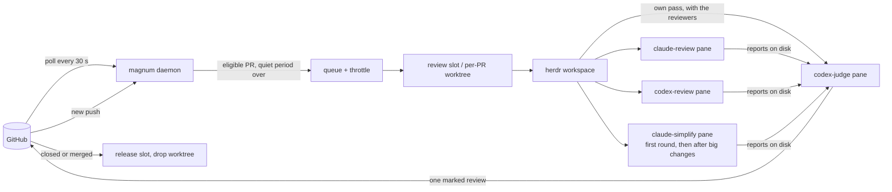

<p align="center">
  
</p>

<h1 align="center">Magnum PR</h1>

<p align="center"><strong>Multiple agents. One review. No drama.</strong></p>

<p align="center">
  <a href="https://go.dev/"></a>
  
  <a href="https://herdr.dev"></a>
  <a href="https://cli.github.com/"></a>
  <a href="LICENSE"></a>
</p>

Magnum reviews your pull requests with the AI coding agents you already use. On every push, several
agents (Claude Code, Codex, droid, omp or any CLI [herdr](https://herdr.dev) can drive) review the PR
side by side, a **judge** agent proves or rejects each finding they raise, and Magnum posts exactly
**one** GitHub review, as you or as a GitHub App. It runs as a daemon on your Mac, on the agent
subscriptions you already have, and every agent works in a herdr pane you can watch or take over.

<p align="center">
  <a href="#quick-start">Quick start</a> ·
  <a href="#how-it-works">How it works</a> ·
  <a href="#what-the-author-sees">What the author sees</a> ·
  <a href="#faq">FAQ</a> ·
  <a href="#configuration">Configuration</a> ·
  <a href="#daily-use">Commands</a> ·
  <a href="#the-pr-board">PR board</a>
</p>

- **Several reviewers, one review.** Each agent has its own prompt, model, credentials and schedule.
  Their findings go to a judge, so the author reads one review with one verdict, not four.
- **Proven or dropped.** The judge reproduces each finding and posts it on the line that must change,
  with the reproduction and the fix. A finding it cannot prove is not posted.
- **Re-reviews that remember.** A push goes back to the sessions that reviewed the PR before: they read
  the author's replies, check the claimed fixes and review only what changed.
- **Real checkouts.** Each PR gets its own worktree, or a warm slot with its own databases for a big app,
  so the agents can run the tests; a closed or merged PR releases it.
- **Your machine, your budget.** No hosted service in between: the agent CLIs you are logged into do the
  reviewing, and GitHub calls go through `gh`. Quiet periods, minimum intervals and daily caps keep a
  burst of pushes from burning your subscription, and a model at its limit can hand over to a fallback.
- **Fixes what it finds.** On a PR you wrote, one key starts a fixer agent that fixes the findings worth
  fixing, answers the threads, also those of other reviewers that nobody answered, and pushes as you.
  Magnum then reviews the push again, up to a cap of
  cycles ([Fixing your own PRs](#fixing-your-own-prs)).
- **Learns the repository.** The judge keeps notes per repository (how to test it, known pitfalls), and
  an optional daily retro collects what human reviewers caught that Magnum missed.

> [!NOTE]
> **Disclaimer:** this repository is 100% vibecoded and, I'd say, 100% awesome. It saves me hours, and I
> use it every day. If you're happy to let AI review your pull requests, I hope you won't mind that AI
> wrote the reviewer too.

### What the author sees

One review per round: a verdict line first (`Fix 1 problem before merging.`, or `No problems found.
LGTM :shipit:`) with the problems it counts listed under it, then each finding as an inline comment on the
line that must change, like this one:

> **[P2] Old Reject error appears in a new chat**
>
> If Reject fails after the user opens another chat, the old error appears there.
>
> **Reproduce** (`app/chat.test.jsx:88`)
>
> ```js
> it("keeps a late Reject error out of a new chat", async () => {
>   const chat = render(<Chat />);
>   api.reject.mockRejectedValueOnce(new Error("timeout"));
>   await chat.click("Reject");
>   await chat.click("New Chat");
>   await flushPromises();
>   expect(chat.text()).not.toContain("timeout"); // fails: the error is shown
> });
> ```
>
> **Fix**
>
> The `catch` changes state before the session check. Check the captured session first.

The author answers on the thread (`fixed`, `not a bug: <why>`, `won't fix: <why>`), and the next push is
re-reviewed against those answers. A reply with no push gets its answer a few minutes later: the judge
re-decides the thread and answers there (an acknowledgement, one sentence with its evidence, or an answer
to a question), or posts a new review when its verdict changes; after two rebuttals in one thread it
stops arguing and leaves the call to the operator. A P1 or P2 problem the judge proved next to the PR's changes that the
PR did not bring is not a finding: up to three go into a collapsed "Found nearby, not this PR's" block
before Checks, one line each, never counted in the verdict (a security one only into `magnum debt`,
unless the repository is private).
A false claim of the description that bears on risk (a ticked "Can be reverted easily" the previous
release cannot keep) is a finding, or one `Description: ✗ <claim>: <why>` line when it harms nothing;
a change the base does not need (the failure it names does not happen there, or code, configuration
or a validation every writer passes already meets its goal) is one finding that names what does it and
leaves closing the PR, or keeping it with the true reason, to the author;
and with `[jira]` on a requirement of the PR's Jira issue it does not meet is one `Ticket: ✗ <what>: <why>`
line, or a finding when it has impact. [The judge skill](#the-judge-skill) has the full format.

With `[pipeline] status_comment = true` the PR also gets one comment, edited in place, that says whether
its review is queued (and why it waits), in progress or posted (with its verdict in a few words), says when
Magnum's own failure stopped it, answers a review request on a PR Magnum leaves out, and ends on a true
line when the PR is closed, merged or turned into a draft first, so nobody merges before it by accident
(see [Review status comment](#review-status-comment)).

## How it works



1. **Poll.** One GraphQL query per organization finds new PRs, new heads, new repositories and closed
   PRs, and a second reads the CI state of the watched repositories' open PRs (a CI run that ends does not
   count as a change of the PR). Open PRs that existed before Magnum started are left alone until they
   change. A draft waits until it is ready for review or someone requests a review (`include_drafts`).
2. **Throttle.** A new head waits for a quiet period (default 5 min, 15 min after a burst of three
   pushes within 30 min) and at least 30 min since the previous round (2 h for a draft a watch
   includes); pushes coalesce to the latest head; `magnum review` overrides.
3. **Check out.** Pool repositories (big apps with databases) get one of N provisioned slots; small
   repositories get a worktree next to their clone. Checkouts are detached, so they never collide with
   branches you have open yourself.
4. **Review.** Every role from the pipeline configuration gets a pane: candidate reviewers and the
   read-only simplifier (it proposes simplifications in a report, edits nothing) run in parallel, the
   judge does its own full pass alongside them, a checkout a role left modified is caught and restored,
   and once both ended the judge weighs every report against its own pass.
5. **Post and verify.** The judge posts one review with inline comments and an invisible run marker
   through `magnum post-review`, which checks every inline comment's line against the PR's diff first;
   Magnum verifies on GitHub that exactly that review by exactly that identity exists for that commit.
6. **Repeat and clean up.** New commits re-prompt the same sessions. A push while the reviewers (and the
   judge's own pass) still run restarts them in place on the new head (at most twice per round); a push
   while the judge weighs the reports is noted on the posted review and re-reviewed right after the
   quiet period. A closed or merged PR
   releases its folder after a grace period, with teardown hooks for its databases. If the poll confirms the
   close or the merge while a round runs, the round stops as `magnum abort` stops it (a `round.stopped`
   event). A round that someone asked for (`magnum review`, the board's `r`, a review request) and a
   post-merge review run on.

## Quick start

Requirements: macOS (see [Linux](#linux) below), [herdr](https://herdr.dev) 0.9.3+ running, `gh` logged
in and the agent CLIs you want to use (`codex`, `claude`, `droid`, `omp`). MySQL only for a `[[pool]]`
that declares databases: DBngin's server at 127.0.0.1:3306 (root, no password), or any other one that
`MAGNUM_MYSQL_DSN` names (a [go-sql-driver DSN](https://github.com/go-sql-driver/mysql#dsn-data-source-name)
such as `root:secret@tcp(127.0.0.1:3307)/`) in the environment of the daemon and the CLI (the LaunchAgent
does not carry it: a daemon launchd runs sees it only through `mise exec`, from the checkout's mise env);
[mise](https://mise.jdx.dev) only for a pool whose worktrees use it; dev.fast Whiteboard only for
whiteboards, with `[pipeline] whiteboard = true` or by hand with `magnum whiteboard` ([Whiteboards of reviewed
PRs](#whiteboards-of-reviewed-prs)): Whiteboard
Desktop running (or `whiteboard server start`) and its `whiteboard` CLI on PATH.

```bash
brew install zhuravel/tap/magnum             # built from source by Homebrew
magnum init                                  # ~/.config/magnum/config.toml: your gh login, one repository, who posts
magnum doctor                                # what this setup uses, with the exact fix for each problem
magnum daemon                                # in a second terminal or herdr pane: the daemon in the foreground
magnum review owner/repo#123 --wait          # one review of that repository's PR, start to finish
```

When the review has posted, hand the daemon to launchd (`install` stops the foreground one) and add the
extras you want:

```bash
magnum install --plugin                      # launchd agent + herdr plugin
magnum install --gh --no-launchd             # optional: `gh magnum …`
magnum completion zsh > "${fpath[1]}/_magnum"
```

To upgrade: `brew upgrade magnum && magnum daemon-restart --when-idle` (the daemon keeps running the old
binary until it restarts; `--when-idle` restarts at the first moment nothing is in flight, no round, no
notes curation or retro, no slot job and no approval being posted or withdrawn as you, `--drain` also stops new
rounds meanwhile). `magnum status` and every reply to a
command the daemon answers say when the daemon runs an older build than the CLI or the binary on disk; with
`[daemon] restart_on_new_build = true` the daemon restarts on a new build by itself, at the first tick
nothing is in flight.

`magnum init` refuses to replace an existing config without `--force` (the old file is kept as
`config.toml.bak`); [config.example.toml](config.example.toml) is the same minimal setup to copy by hand.
To post as a GitHub App, answer 2 when init asks who posts: it asks for the App's ids and names the file
to save its private key as, `~/.config/magnum/keys/<app>.pem` (it never asks for the key); `magnum
identities check` verifies the App. A big repository with its own databases gets a pool of warm slots:
add a `[[pool]]` (see below), then `magnum slots provision --count 6`. `--count` takes 1 to 999; a count that would pass the pool's `max` is refused before anything is provisioned.

## FAQ

**How is this different from a hosted review bot?** Magnum is not a service: it runs on your Mac and
drives the agent CLIs you are already logged into, so reviews come out of subscriptions you already have.
The agents work in a real checkout of the PR (a worktree, or a pool slot with its own databases), so they
can run your tests, and you can watch any of them in its pane. A judge has to reproduce a finding before
it is posted, and later pushes resume the same sessions. The trade-off: reviews happen only while your
Mac is on and the daemon runs, and they spend your own budget.

**What does it cost?** Magnum is free (MIT); every round spends some of the budget of each agent it runs.
The defaults keep that down: a draft waits until it is ready for review or a review is requested, a push
waits for 5 quiet minutes (15 after a burst), a PR gets at most one round per 30 minutes (2 hours for a
draft a watch includes) and 12 automatic rounds a day, a push that only touches
comments, whitespace or docs, or only merges the base branch, is not re-reviewed, and a change under 30
code lines since the last review gets a check by the judge alone. With 80% of the Codex budget used,
full re-reviews wait; at 95%, rounds that need Codex wait. `magnum status` shows how fast that budget goes,
`magnum stats` lists the PRs that took the most agent time, and
[triage](#triage-fewer-reviewers-for-a-small-diff) can skip reviewers on a small diff.

**Is it safe to point agents at pull requests?** Reviewing a PR means running its code: the agents run
its tests in the checkout, with the autonomy your agent CLIs allow. Watch repositories whose contributors
you would let run code on your machine; PRs from forks are skipped by default. Magnum treats PR content
as data: PR text never goes into a prompt, the repository's instruction files count only for its
conventions, permission prompts are answered No, hooks a checkout brings are declined, and your personal
GitHub tokens are stripped from review worktrees. [Under the hood](#under-the-hood) has the details.

**How noisy is it?** The judge posts only what it can reproduce, ranks findings by who can reach them (P0
to P3), and offers at most five simplifications by default (`max_simplifications`), marked optional.
Every candidate it rejects is recorded with a reason, so `magnum stats` shows per reviewer how many
findings were raised, posted and rejected, and why. The optional
[retro](#learning-from-other-reviewers) measures the other side: what human reviewers caught that Magnum
missed.

**Why herdr panes and not headless runs?** So you can see what an agent is doing, take it over or answer
it when it is stuck, and so its session lives on: a re-review continues the conversation that wrote the
first review. herdr also gives Magnum pane titles, toasts and a plugin for its popups.

**Can it post as a bot instead of me?** Yes: give it a GitHub App and the App posts, so its approvals and
change requests do not come from your account. See [Identities](#identities-who-posts).

**Does it run on Linux?** Not yet. [Linux](#linux) lists the five macOS-only spots; a small platform
interface around them is the whole job, and contributions are welcome.

## Configuration

Two layers and the App keys:

- The built-in defaults: [config.defaults.toml](config.defaults.toml), embedded in the binary. The
  daemon defaults, the agent kinds and the review roles, every key documented; it names no account,
  repository or path of yours. Editing it changes the defaults after `make build`.
- Your config, `~/.config/magnum/config.toml` (`$XDG_CONFIG_HOME/magnum/config.toml` when that is set;
  `magnum init` writes it): your identities, watches, pools and repos, plus any default you want to
  override. Its `[[watch]]`, `[[identity]]`, `[[pool]]` and `[[repo]]` blocks are appended, a `[[role]]`
  overrides the keys it sets on the role of the same name (or is appended), scalar keys and
  `[kinds.<name>]` entries override key by key. [config.full.example.toml](config.full.example.toml) is
  a complete, working setup (Talkable's) to copy from. `magnum config` and `magnum doctor` say which
  files were read.
- App private keys: PEM files the identity's `private_key_file` names, by convention
  `~/.config/magnum/keys/<identity>.pem` (chmod 600; doctor warns about a looser mode). The older
  `private_key_env` (an environment variable holding the PEM or its path, e.g. from a checkout's
  `mise.local.toml`) still works; launchd then runs the daemon through `mise exec`.

Magnum keeps its own files where XDG says: the registry, review reports and repository notes in
`~/.local/share/magnum` (`$XDG_DATA_HOME`), logs, locks, the identities' gh config dirs and the tab-bar
file in `~/.local/state/magnum` (`$XDG_STATE_HOME`); `magnum config` prints both. `MAGNUM_HOME=<checkout>`
keeps them in the checkout's `state/` instead, for development.

`--config FILE` (or `$MAGNUM_CONFIG`) replaces the built-in defaults with a complete file of your own.

Besides those, Magnum reads `MAGNUM_MYSQL_DSN` (the MySQL server, see [Quick start](#quick-start)) and
`HERDR_BIN_PATH` (the herdr executable that `magnum open`, `reveal_on_attention` and the plugin commands run;
herdr sets it inside plugin actions, else `herdr` on `PATH`), and hands `[herdr] socket` to the herdr
commands it runs and to the LaunchAgent as `HERDR_SOCKET_PATH`. `MAGNUM_BIN` names the `magnum` binary that
the herdr plugin's commands run (else the plugin's own `bin/magnum`, then the installed one),
`MAGNUM_PICK_QUERY` is the initial filter of `magnum pick` (as `--query`), and `MAGNUM_TUI_TRACE=<file>`
makes a live screen append one line per message to the file, with how long its Update and View took, to
diagnose a frozen or spinning screen (off unless set). Every role's pane gets the round's context
in its environment, next to the identity's gh selection (an App's `GH_CONFIG_DIR`, with `GH_TOKEN` and
`GITHUB_TOKEN` blanked) and the slot's env: `MAGNUM_PR_URL`, `MAGNUM_IDENTITY` (`gh` or `app`),
`MAGNUM_REVIEWER_LOGIN` (the login that posts), `MAGNUM_SELF_LOGIN` (your own login: the watch's
poll login when a `gh` identity polls, see `poll_identity`), `MAGNUM_NO_FINDINGS_EVENT` and
`MAGNUM_BLOCKING_EVENT` (the repository's verdict events) and `MAGNUM_REPORT_DIR` (the round's report
directory).

`[daemon] restart_on_new_build` (default `false`): when `true`, every reconcile looks at the binary
launchd starts; once a new one passes its check (`<binary> version` and `<binary> config`, as
`daemon-restart` checks it) the daemon exits at the first tick no round is claiming, reviewing or
verifying, and launchd starts the new build (events `daemon.restart_pending`, then
`daemon.restarted_for_build`). Dispatch is never held for it, and a daemon launchd does not run (started
by hand) only says so: nothing would start it again.

`[daemon] shell_path` (default `true`): launchd gives the daemon a fixed `PATH` (`~/.local/bin`, mise's
shims, Homebrew's and the system directories), and every command it runs inherits it: the pool hooks, the
readiness commands, `mise exec`, gh and the agent CLIs. A tool only your shell's exports put on `PATH`, such
as DBngin's `mysql`, `psql` or `redis-server` in versioned directories, is missing there (every schema load
then fails). So the daemon asks your login shell for its `PATH` once at its start, before it runs anything (`$SHELL -ilc`, `zsh`
when `SHELL` is unset, 20 s at most, no terminal and no stdin), and appends the directories its own `PATH`
lacks, in the shell's order. launchd's `PATH` stays first, so mise's shims still win. Banners and hook
output are skipped: the last line that reads as a `PATH` (colon-separated absolute directories) counts. The
`daemon.shell_path` event says how many directories were added ("PATH from zsh: 4 directories added"),
and `magnum status` shows the count on its daemon line. The debug log names the directories, the event
never does. A shell that fails, prints no `PATH` or answers nothing in 20 s leaves launchd's `PATH`
alone, with a warning event ("the login shell (zsh) answered nothing in 20s. The launchd PATH stays"). A
change of your shell's `PATH` (a DBngin upgrade) takes effect at the next `magnum daemon-restart`, as a
config change does. The CLI keeps the environment of the terminal it runs in. `false` keeps launchd's
`PATH` alone and runs no shell.

Three more `[daemon]` keys pace the agents. `max_total_working_codex` (default 5) caps the Codex agents working at once, your own sessions included. `agent_start_stagger` (default `"15s"`) is the least time between two agent launches, across rounds, and at most 3 Codex agents start at once. `min_warm` (default `"30m"`) is how long a pool slot another PR holds must stay unused before a waiting PR may take it back, its sessions parked and the slot released: with no human typing, no session working, blocked or prompted within it, no run and no pin.

A command handed to the daemon waits up to 30 s for its answer (the daemon answers requests before its
GitHub poll and between the poll's GitHub calls, so one waits for a single call); a request still pending says how to follow it (`magnum logs request:<id> -f`). A request
that reaches a daemon newer than it fails with "this daemon predates <field>: restart it" instead of
running without the field. Without a daemon, `review`, `approve`, `request-changes` and `open` of a parked
PR refuse and queue nothing (they would post or act whenever a daemon next started); the other commands
still queue for the next start, and a request no daemon saw within an hour fails at startup as "expired:
queued while no daemon ran".

The daemon prunes audit events older than `[daemon] keep_events` (default `"30d"`) and handled CLI
requests older than `keep_requests` (default `"7d"`) on every reconcile; `"0"` keeps them forever. The
step rows a checkout resumes from after a crash are the one exception, and only while their subject (a
checkout, named with the head's sha) has had an event inside the window: a subject quiet for `keep_events`
loses them with the rest. `poll_interval` and `reconcile_interval` must be positive, the other waits and
quiet periods (`close_grace`, `push_quiet_period`, ...) and `min_free_disk_gb` not negative, and
`default_repo`, when set, `owner/name`; the config is refused otherwise. Two `[[pool]]` blocks may not
render the same `slot_name` or `slot_path`.

A push that lands while a round's reviewers still run restarts them on the new head, up to
`[daemon] max_round_restarts` times per round (default 2; `0` turns restarts off). The turns it cuts
short are interrupted and their roles prompted again on the new head: an agent reviewer with esc, a shell
role's command with ctrl+c, and the judge's own pass with one ctrl+c, which aborts Codex's turn and keeps
the session with its context (two quit Codex, as for a judge that timed out). All of them get their keys
at once, before Magnum waits for any of them, and then Magnum waits for all of them side by side, so the
restart waits for the slowest turn, not for each in turn. A shell role's command that still runs 10 seconds
after its ctrl+c gets another, three in all, and then Magnum stops it itself (see below). The checkout never
switches, nor is restored, under a command that still runs, the command of a shell reviewer that timed out
before the push included: when Magnum cannot stop it, a warning names the role and the round fails with
that cause. That round costs the PR no attempt and no round of the daily cap, and the PR's next round takes
it up again. An agent gets up to a minute after its interrupt to go idle, and a
warning names it when it does not. A claude reviewer still at work 10 seconds after its esc whose
transcript shows background work it started still running (a test run in the background keeps it at work
after an interrupt) is told then to stop that work, which is what ends it, rather than at the end of the
minute; one idle within the 10 seconds gets no message then, only the one about work its transcript still
shows once it is idle. A stop that worked is an info event (`round.cut_settled`, with the seconds the agent
took to go idle), not a warning. When a refusal or a lost judge ends the round instead, the turns still at
work are stopped the same way.

`codex review` sometimes goes on after its ctrl+c, and its pane stays busy. Two things end it. First,
`magnum db-lock`, which the built-in shell line runs every command through, passes the interrupt on and
notes the processes under the command. A command, or one of those processes, that still runs 10 seconds
later gets SIGTERM, and 5 seconds after that SIGKILL, together with every process under it (a sandbox's child
in a process group of its own too). db-lock says so on stderr, keeps the lock until those processes are gone
or SIGKILL went out, and exits with 128 plus that signal. Second, Magnum stops the command itself after the
restart's last ctrl+c, but only its own run: the shell line's db-lock names the run (`--run <run>`), and
Magnum keys or signals a pane's command only when that argv names a run of the PR's role in this checkout,
in the role's own pane, and the run is the one cut or no longer in flight. Its ctrl+c goes only to the
role's own pane, and only to a command that carries that run's token. A command without a token gets it only
when the line Magnum typed carried none (a `command` of your own without `{{.DBLockCommand}}`) and herdr still
shows the pane in the session's checkout, with no other PR's session in it. A run whose line was never typed
(it still waited for a busy pane) gets nothing at all. Magnum notes the job's processes from
the process table, each by its pid and start time (a process that moves to another process group stays the
same process), and before each signal it reads the table and asks herdr again: a process whose identity
changed gets nothing, and neither does a pane whose job changed. It sends SIGTERM to the job's process group,
reads the table again, and sends SIGTERM to each of those processes, then SIGKILL the same way 5 seconds
later. Each wait has one 5-second deadline that every read shares. The stop counts only once the shell is
idle and every noted process is gone, so a pane that went idle after a ctrl+c is a stop only once the
processes noted at that ctrl+c are gone too; a process that outlives SIGKILL fails it. When SIGKILL
leaves the pane busy, Magnum splits a new pane with the session's working directory and environment, moves
the role there, asks herdr once more and closes the old one. Without a recorded environment the old pane
closes all the same and the session is lost, so the next round lays a new pane out. Each stop writes
`pr.shell_stop_begin` (the process group and the processes as pid, group and name, never arguments),
`pr.shell_stopped` (the step that worked and the seconds) or `pr.shell_stop_failed` (`not_own`, `signal` or
`close`). A stop never counts a command as yours: nothing during a round starts `human_cooldown` or keeps
the judge from its prompt. A shell reviewer that timed out, or whose wait failed, gets the same stop before
its run ends. A shell role whose pane is still busy when its next run starts
does the same: an earlier run of its own that is over is stopped at once, and the line runs. Anything else
gets the minute a fresh pane's shell has to start. When the pane is still busy then, Magnum splits a new pane
with the session's environment, moves the role there (`pr.shell_move_begin`, then `pr.shell_moved` or
`pr.shell_move_failed`) and runs the line in it. It never sends the busy pane a key, a signal or a close:
the pane stays on a closed row of the role and closes with the other retired panes once it is an idle shell.
The new line's db-lock then waits for the lock that the busy command may hold, up to its `--timeout` (20
minutes) or the role's timeout, rather than failing as busy after a minute. Without a recorded environment
the run fails as busy, as before.

Nothing switches a slot's checkout while a command still runs in a shell pane of its PR there. Before a
round checks the PR out, before the fixer starts, before `magnum open` checks a PR out and before a release
resets the slot, Magnum closes the runs a crashed daemon left open and looks at the PR's shell panes in that
slot. It asks herdr only when the PR has a shell pane there. A pane herdr shows as another's (another agent,
or a working directory outside the checkout) is left alone, unless its command carries Magnum's line for
this checkout. A pane whose working directory herdr does not report stays in the look. An earlier run of
its own is stopped. A command Magnum did not start (no run token, or another PR's, role's or run's), the
command of a role of your own without the run token, or one of its own that it cannot stop, holds the
switch. The hold costs no attempt and no round of the daily cap. Magnum looks again after about 1, 2 and 5
minutes, then every 10 minutes. It writes one event when the hold starts (`pr.shell_hold`) and one when it ends
(`pr.shell_hold_ended`), and shows one toast. After 15 minutes of a round's hold the PR shows under
needs-attention with a plain reason: "a command magnum did not start keeps the shell pane of <slot> busy",
"the <role> command (no run token) still runs in the shell pane of <slot>", or "magnum cannot stop its own
command in <slot>: <cause>". The fixer and the other jobs that would switch that checkout see the same hold.
A hold that one of them meets is looked at again at each reconcile until it ends. The next round's first
look starts a hold of its own, with its event and its toast, and so does a round's look at a hold that
nothing looked at for 30 minutes. If herdr cannot say what the panes run, nothing is held: the round tries
again a minute later, with no event and no toast, and a slot that a failed `magnum fix` or `magnum open`
reserved still goes back to the pool. The hold never marks you as at work. A shell role whose `command` of
your own leaves `{{.DBLockCommand}}` out carries no run token: its interrupts are the plain ctrl+c presses it
always got, Magnum never signals or closes its command, a restart that finds it still running ends the
round, as above, and the next checkout waits for it.

A push that lands while the judge works lets the round finish: Magnum appends "Reviewed <sha>; N commits arrived during
the review, re-review follows" (or, for a small delta, "a short check of those commits follows") to the
posted review and queues the re-review without waiting for `min_rereview_interval`. A PR whose head changed `burst_pushes` times (default 3) within `burst_window`
(default `"30m"`) waits `burst_quiet_period` (default `"15m"`) instead of `push_quiet_period`; a
`[[watch]]` can override all three, and `burst_pushes = 0` turns the rule off.

A watch's `include_own = false` skips the PRs you authored (its author is one of your logins: every gh
identity and every watch's posting identity, the board's "mine"), whichever of your logins opened them,
not only the watch's poll login. A PR you authored waits `[daemon] own_min_rereview_interval` after its
last round instead of `min_rereview_interval` when that is set (default `"0"`: the same interval), say `"2h"` while another
session of yours pushes to it often; an own draft waits the longer of it and `draft_min_rereview_interval`,
a `[[watch]]` can override it, and a review request or `magnum review` skips it like the other timing
rules. The wait names it ("re-review · own PR interval → 16:40").

`magnum snooze <ref>` holds one PR's automatic rounds for a while: `--for` (default `2h`), `--until 18:00`
(tomorrow once past) or an RFC 3339 time; `--off` lifts it. Until then no push, quiet period, re-review,
reply round or delta check starts a round on it (the first review of a new PR included), while
`magnum review`, the board's review keys and a review request on GitHub still run one and leave the
snooze in place. It ends on its own at its time and survives a daemon restart (the registry keeps it); a
round in flight finishes. The board's `z` snoozes the selected PR for 2h after a y/N, and on a snoozed PR
offers to lift it; the state cell says `snoozed → 18:00` (in the wait, or after the state when nothing
waits), the card until when, since when and by whom (`magnum snooze` or the board), and `tui --json`
has `snoozed_until`, `snoozed_at` and `snoozed_by`.

Codex may block an account it takes for a cyber abuser, also when all it reads is your team's own code. So
when a role's turn ends on one of Codex's safety warnings ("This content was flagged for possible
cybersecurity risk", the words "cyber permissive safeguards" or "Daybreak access", or a usage-policy
violation, abuse or a threat named in Codex's own `■`/`⚠`/`ERROR:` line; the kind's `health_patterns`
`refused` list, read from the pane after the turn's prompt and, when the pane scrolled past it, from the
turn's error in the session's Codex rollout, `codex_error_info` `cyber_policy`), the round ends at once,
whichever role it was (the judge's own pass, its candidates turn, a nudge or a continue, a reviewer,
codex-review's output; also when a push cut the stage a moment before). A Codex helper agent the role's
session spawned counts as the role: when its rollout (the one naming the session as its parent) records a
`cyber_policy` refusal within the turn, the round ends the same way, even though the session's own turn
ended ok and the judge posted its review (which stays posted): no nudge, no retry, the other
roles are interrupted (the turns of the refused kind first), and the round's outcome and
the PR's last error say "Codex refused the review: content flagged as a cybersecurity risk (codex-judge,
run r-…)". The PR is flagged for good (the refused head, role, run and time) and one toast says so. By
default (`[pipeline] judge_fallback = "claude-judge"`; a `[[watch]]` may set its own) the PR goes on: it is
flagged for Codex, which never sees it again, its roles of that kind (`codex-judge`, `codex-review`) are
dropped, and `claude-judge`, the second built-in judge held in reserve (Claude Opus at xhigh, the judge's
prompts and skill), judges it from the next round on, starting fresh through the recovery prompt that
reads the earlier reviews and threads from GitHub. The PR goes back in line (a reviewed one as
`rereview_pending`, an unreviewed one `queued`) and waits the usual re-review interval, keeps its slot
and agents, and `magnum review` works; the board's cell reads `Codex flagged · judge claude-judge`.
`magnum roles` names each watch's fallback judge. The built-in default is off, with no error and no
warning, for a watch it does not fit: one whose judge is `claude-judge` or another Claude judge, or every
watch of a base config (`--config`) whose own `[[role]]` list has no `claude-judge`; a value you write
must fit (see [Roles and kinds](#roles-and-kinds-the-review-pipeline)). Without a fallback judge
(`judge_fallback = ""`, or the default off for the watch), after a refusal by the fallback's kind too, or
with a fallback no longer declared as a judge of another kind, magnum never reviews the PR again, on any
head, by itself or when asked (no retry, continue, reply round or delta check; `magnum review` and the
board's `r`/`R` refuse with the reason): the board's state cell and
card read `Codex flagged · never reviewed again`, the card says when and where and how to lift it,
`magnum status` lists the PR among what needs you, `magnum tui` prints `codex-flagged` in STATE and
`tui --json` has `codex_flag` and `codex_flag_detail`; `magnum stats` counts such rounds as `refused`.
Review it by hand. Only `magnum codex-flag clear <ref>` lifts the flag, after a y/N question on a
terminal that names the account risk; `magnum codex-flag set <ref> [reason]` flags a PR by hand (one
Codex warned about elsewhere). The flag fails closed: a flag record magnum cannot parse is a flag, a
registry read that fails holds the PR that tick, and a flag a refused round could not write holds the PR
from memory and is written again every tick. A flagged PR gives back what it holds: the tick after the
flag parks its idle agents and releases its pool slot (a `pr.codex_flag_released` event), unless
`magnum open` pinned it for you to review by hand. Another PR's judge never hears of it: `related.json`
leaves flagged PRs out. A `magnum eval run` case whose replay was refused is recorded in
`<state>/eval/flagged.json` and never replayed, nor is another case on the same PR (`owner/repo#N`) or a
case whose PR the registry holds a Codex flag for (`eval run` says so; delete its entry, or clear the
flag, to replay it).

`[daemon] quiet_hours` (unset by default) holds the costly rounds of every PR during a daily window of
local time, `"HH:MM-HH:MM"` such as `"01:00-07:00"`: inside it first reviews, full re-reviews (a review
request's on GitHub too) and the continue of a judge turn a usage limit paused wait for its end
(`re-review · quiet hours → 07:00`), while their timing rules keep counting. A round of the judge alone
still starts: a delta check of a small push, a reply round, and a re-review of the head Magnum reviewed
(a review request after a reply), each one turn of a few minutes. `magnum review`, the board's and the
picker's review keys still start any round, and a round in flight finishes. Nothing else stops: the poll,
auto-approval, the retro, notes curation, parking and cleanup go on. The window includes its start and
excludes its end, and crosses midnight when the end comes first (`"22:00-06:00"` covers 22:00 to 05:59); a
malformed value or an empty window (`"07:00-07:00"`) is refused when the config loads.

### Settings: changing your config from a screen

The settings screen (`magnum settings`) changes a fixed list of settings in `~/.config/magnum/config.toml`
so you do not have to open an editor:

- **Spend & models:** `[pipeline] spend`, each agent kind's own `[kinds.<name>] spend`, the model, effort
  and re-review effort of each role in each `[spend.<level>]` table, and each role's base `model` in its
  `[[role]]` block. A role that two `[[role]]` blocks of your file name is left to a hand edit: the loader
  merges them, so which one to change is not clear.
- **Usage caps:** `[usage] codex_soft` and `codex_hard`.
- **Each `[[watch]]`:** `roles`, `auto_approve`, `auto_approve_authors`, `auto_approve_skip_authors`,
  `manual_repos`, `ignore_checks`, `include_drafts`, `stakes` and `own_min_rereview_interval`.
- **Each repository:** its `[[repo]]` block's `stakes`, `max_simplifications`, `auto_approve_authors`,
  `auto_approve_skip_authors`, `allow_bot_authors`, `required_checks` and `ignore_checks`. A watched
  repository without a block gets a minimal one.
- **Schedule:** `quiet_hours`, `push_quiet_period`, `min_rereview_interval` and
  `own_min_rereview_interval`.
- **Reviews & agents:** `[pipeline]` `status_comment`, `whiteboard`, `judge_fallback`, `fix_cycles`,
  `autofix`, `max_simplifications` and `judge_fresh_after`, and `[daemon]` `park_idle_after`,
  `max_concurrent_reviews` and `max_total_working_codex`.

It never edits identities, `auto_approve_as`, App keys, paths and sockets, commands, args, env, hooks,
MCP, the sandbox or pools. Those stay hand edits.

A save edits the file in place and never rewrites it:

- **Changed values:** only the value is replaced. The trailing comment stays at its column (a gap that
  holds a tab is kept as it is), even when several cells of one inline table change, and every other
  comment, blank line and line ending stays as it was. Each key of an inline table is edited in place
  inside its braces.
- **Keys you did not set:** a new key goes after the last key of its table, so above a `[pool.env]`
  subtable.
- **New blocks and tables:** a missing `[[repo]]` or `[[role]]` block goes after the last one of its kind.
  A missing table goes after the last table of its family (`[spend.*]`, `[kinds.*]`); with no family, it
  goes before the first array of tables.
- **Back to the default:** the key's line is deleted and its comment stays as a comment line.
- **Dated notes:** each changed line gets a note such as `# 2026-10-20: was "high"`. On a line that
  already has a comment, the note goes first, and it takes the place of the "was" note an earlier save left
  there (a line keeps the newest one; the rest of its comment stays). Notes are on by default and can be
  turned off.

Before anything is written, the save makes five checks:

- The file must not have changed on disk since the screen read it.
- The new file must decode with exactly the edited values changed.
- No line outside the edited keys' lines may change, byte for byte. A failure here, or a file that does not
  read back, is a bug in the editor and is reported as one; nothing is written.
- It must pass `magnum config`'s checks: the loader and the prompt render.
- The settings screen must understand the shape it is editing. A shape it does not, such as a table only
  dotted keys define, an inline table over several lines, or a multi-line array with comments inside, is
  refused, and you edit that key by hand.

The file is written atomically and keeps its mode. Saves take a lock file beside the config,
`~/.config/magnum/.config.toml.lock` (created 0600 and kept), so two screens, or a screen and a script,
never interleave, whatever `MAGNUM_HOME` each runs with. The hash is checked again right before the
write. A symlinked config, or one with more than one hard link, is refused rather than replaced with a
file.

The version a save replaces is kept in `~/.local/share/magnum/config-history/`, one
`<UTC time>-<sha>.toml` per save, and the last 20 are kept. A restore goes through the same checks (it needs
no current file that loads: a restore mends one a hand edit broke), and
the version it replaces is kept too.

The daemon reads the config only when it starts, so a save takes effect after a restart:

- **Restart when idle:** the screen can ask the daemon to restart once nothing is in flight. Before any
  idle restart (a saved config, a new build, a landed skill version) the daemon checks what it would start
  on. It loads a changed config file again, and when the binary on disk changed since it started, it runs
  that binary's own check; a binary that is missing or cannot be read counts as a failure. If the check
  fails, the daemon does not exit, drops the save's request and says so once (`daemon.config_restart_refused`).
  A new build or a landed skill version still waits: it checks again when the file or the binary changes,
  or every 10 minutes. With only the saved config waiting nothing checks again: once the file is fixed,
  `magnum daemon-restart --when-idle` or a new save restarts on it, as the event says. Right before exiting it checks once more that nothing
  started meanwhile. When it
  exits, launchd starts it again. A file reverted by hand to the config the daemon runs needs no restart,
  and the request is dropped. The events are `daemon.restarted_for_config` and
  `daemon.config_restart_refused`.
- **Restart by hand:** a daemon that launchd does not run leaves the restart to you
  (`magnum daemon-restart --when-idle`).
- **Restart pending:** the daemon records the hash of the user config it loaded. Until it runs the file on
  disk, `magnum status` shows `config: ... changed since the daemon started` and how the change will
  apply. When the daemon refused to restart on the file, it says to fix the file (`magnum config` shows
  why) instead.

### Re-reviews

A push whose changes since the last review are only comment lines, whitespace or documentation is not
re-reviewed: Magnum compares the reviewed commit with the new head (one GitHub call), moves the review
to the new head with its verdict, keeps an App's approval and records `pr.trivial_delta`. When such a
commit arrived during the judge's turn, the note on the review says "(comments only), no re-review
needed" instead. `[daemon] skip_trivial_deltas` (default `["comments", "whitespace", "docs", "base"]`,
`[]` = re-review every push) picks the kinds, a `[[watch]]` can override it, and `magnum review` always
runs. A file that steers the review agents (an `AGENTS.md`, `CLAUDE.md` or `CLAUDE.local.md` in any
directory, anything under `.claude/` or `.codex/`, `.mcp.json`) never counts as documentation for this. A
comment line that holds its language's interpolation counts as code, because in a heredoc, a template or a
`run:` block it runs: `#{` in Ruby and ERB, `{` in Python, `${` in JavaScript, TypeScript, Kotlin, shell and
Terraform, `{{` in YAML.

A push that merges the base branch into the PR (or rebases it onto the base) is judged by the PR's own
diff, not by the commits it brings: when the comparison of the reviewed commit with the new head shows a
merge commit or a divergence, Magnum compares the PR's diff against its base before and after the push
(two more GitHub calls, `<base>...<reviewed>` and `<base>...<head>`), file by file, by the sequence of
added and removed lines (context lines and hunk positions, which master's changes move, do not count).
When no file's own change differs, the push is the kind `base` ("base merge only"): the review stands
and `pr.trivial_delta` says, e.g., "the push to 2017f29 only merges master (13 commits, the PR's own
changes unchanged)". A file without a complete patch, or a diff over GitHub's 300-file cap, makes the
comparison incomplete, and the push is measured as any other. A daemon that starts on this rule checks
the PRs already waiting for a re-review once more, on its first poll, and settles those a base merge
queued.

Any other push is measured by the same GitHub call: the changed lines that are code (not comments,
blank lines, whitespace moves or documentation) since the reviewed commit; after a base merge or a
rebase, only the lines that changed in the PR's own diff. An automatic re-review runs after the quiet
period once that delta reaches `[daemon] rereview_min_lines` (default 30) or adds a file; a smaller
delta waits for further pushes, at most `rereview_max_wait` (default `"2h"`) after its first push.
`rereview_min_lines = 0` turns the threshold off, and a `[[watch]]` can override both. A force push back to
an ancestor of the reviewed commit (GitHub: "behind") has nothing to measure, so the threshold does not hold
its re-review.

Such a small delta (more than 0 and fewer than `rereview_min_lines` code lines, no added file) gets a
delta check instead of that wait and a full round (`[daemon] delta_check`, default `true`; a `[[watch]]`
can override it): once the push quiet period (or the burst one) is over, only the judge runs, in its own
session at its `rereview_effort`, without triage or reruns, and its prompt asks for one short review of the
commits since its last one against the PR's purpose and its earlier findings (`delta_check: true`, and the
delta's files listed in `delta-check.json` in the report directory). A modified image or other binary file
(no patch) counts 0 lines there and is named in that list; an added file still means a full round. Pauses,
the re-review interval, the daily cap, capacity and drains hold it as any round, and a forced or requested
round, or one that names roles, runs in full. The board, the card and `magnum status` call it a delta
check (`delta check · quiet → 14:09` while it waits, `delta check (4 lines)` on the card's last round and
in `engine.round_start`); the board marks a running one `∆` after its pill. A judge whose session is gone
(lost, parked by an identity migration, or fresh sessions requested) checks the delta in a fresh session
(`round.delta_check_fresh`): a recovery round of the judge alone at its `rereview_effort`, whose prompt has it read its previous review and threads before it
reviews just those commits (`delta_check: true` in `judge-recovery.md`); only when no review by the PR's
current or former identities is on record to build on does it become a full recovery round
(`round.delta_check_dropped`). An App's approval of the reviewed commit stands meanwhile (`review.approval_kept_for_check`): the check's approval supersedes it
(`review.approval_superseded`); a check that comments, requests changes, fails or needs attention, a later
push that makes the delta too large, or no check posted within an hour of the check becoming due (after the
push quiet period; quiet hours do not hold the check, and a `magnum pause` counts) dismisses it then, with the reason. `delta_check = false` keeps the wait and the full round.

A re-review of a head Magnum already reviewed (no new commits: `magnum review`, or a review request, to
have it re-read an author's reply) runs the judge alone as a delta check does: no triage, reruns or own
pass, at its `rereview_effort`, in a fresh session too when the old one is gone (`round.same_head_fresh`).
Its prompt says the head is unchanged: re-read the replies and comments since the last review, re-decide
each earlier finding under the reply contract, run no check that review already ran, and post one short
review, headed `Re-review of <sha> (no new commits):`. `round.same_head` records it. A request that names
roles (`--role`, `--simplify`) or asks for fresh sessions (`--fresh`) runs every reviewer as before, and so
does a round whose checkout finds a newer head (`round.same_head_dropped`).

A re-review reads only the commits since the last review, so after its first review nothing reads a
long-lived PR whole again. Every tenth automatic re-review is therefore a full pass (`[pipeline]
full_pass_every`, default `10`; `0` turns it off): the PR's sessions are parked and every role starts fresh
as with `--fresh`, the reviewers review the whole PR with their first-review prompts at their full effort
(triage judges the whole PR, as for a first review), and the judge gets the recovery prompt with a full-pass
clause (`full_pass: true`): review the full PR diff again as a first review does, then decide every earlier
thread under the reply contract; a finding the earlier reviews missed ends its title with `(missed
earlier)`, and the body is headed `Re-review <a> → <b> (full pass):`. The judge's own pass (with the
default `judge_own_pass = "parallel"`) is blind: it reviews the full diff as a first review does and reads
no earlier review, thread or reply, so the fresh session does not take on the old framing before it reads
the code; the candidates prompt then lists the earlier reviews, and the judge decides their threads there.
It costs a first review's rounds of every role. The count is the PR's re-reviews that posted a review on new
commits since its first review or its last full pass, read from the registry's runs, so a PR reviewed
before the key existed counts its past re-reviews. A delta check counts, and a due full pass overrides it:
the small push runs the full pass instead of the judge's check, so small pushes never put one off. A forced
or requested round counts but never becomes one, except `magnum review --fresh`: its round, on a new head or
the reviewed one, runs the full pass when any rule (`full_pass_every`, or the churn and age rules below)
makes one due, as an automatic re-review would, and the reason ends `, on magnum review --fresh`
(talkable#11483's recovery of its reviewed head after a dead judge ran none after 34 re-reviews and never a
full pass); a re-review of the same head, a reply round and a CI check neither count nor become one. The
soft Codex budget cap holds a full pass as any automatic full re-review.

Rounds say how often the whole-PR view was lost, not how much the code changed, so churn and age make a
full pass too. A PR's baseline is its last full pass, else its first review (a PR reviewed before these
rules: its next review of new commits); a round of the reviewed head that is no full pass (a same-head
round, `magnum review --fresh` with no full pass due) never becomes it, since it read nothing new and the
age rule would count from it. The baseline holds the PR's size then: its changed files and their added plus deleted lines,
lockfiles and the watch's `related_ignore` paths left out (`git diff --numstat` in the round's checkout).
Every review that posts on new commits adds them to the churn since the baseline, measured as the re-review
reads them: from the reviewed commit to the head, or, when the push merged the base branch, the change of
the PR's own diff before and after it, so the base branch's commits are not the PR's. The next automatic
re-review is a full pass once that churn reaches `full_pass_lines` lines (default `500`) or touches
`full_pass_files` files (default `10`, each file once), or a quarter of the PR's lines or files at the
baseline when that is more, or once `full_pass_after` (default `"12h"`) passed since the baseline, whatever
the PR's size, so the first push of a workday gets a whole read; `0` turns each rule off alone. The rules apply in that order, after
`magnum review --full` and `full_pass_every`, and a full pass that posts is the new baseline. `round.full_pass`
says why one runs and which rule fired (`rule`: the key, or `requested`), `engine.round_start` says
`re-review (full pass)` with the reason in `full_pass_reason`, the card's last round `full pass`, and the
status comment `In progress (full pass)`. `magnum review --full <ref>` asks for one by hand.

An approval rests on a whole read of the PR, not on a chain of deltas each read on its own. A re-review of a
PR that had `[pipeline] approve_after_full_pass` re-reviews or more since its baseline (default `2`, counted
as `full_pass_every` counts; `0` turns it off) cannot approve: its `no_findings_event` is `COMMENT`, its
prompt says why, and a clean verdict's body adds the line `A full pass of the whole PR follows before
approval.` after the verdict line. When such a review posts with the verdict `clean`, Magnum forces a full
pass of the same head at once, as `magnum review --full` does: every role starts fresh on the whole diff,
its clean verdict approves (one that finds problems posts as usual), and it is the new baseline, so the
next push and a clean re-review approve on their delta again. With the default, one round of fixes after
the first review approves on its delta. The hold applies to automatic and requested rounds alike (a delta
check, a recovery, an audit pass, a re-review of the same head) and to your own PRs, whose clean verdict
is a comment anyway; a full pass, a post-merge review, a reply round, a CI check and a dry run never hold.
Nor does a re-review in a repository with no approval to hold: where a clean review comments anyway (the
`no_findings_event` of the identity it posts as, or of its `[[repo]]` block, is `COMMENT`) and Magnum does
not approve as you (no `auto_approve` for it), the clean re-review posts its comment without the line and
no full pass follows.
Auto-approval as you waits for the full pass too. `round.approval_hold` says why a round holds
(`engine.round_start` carries `approval_hold`), `pr.approval_full_pass` that the full pass follows, whose
`round.full_pass` names the rule `approval` (`before_approval` in its start event), and the card's last
round says `full pass (before approval)`. Until a later review posts, the board's FINDINGS reads `✔ held`
for the review that held its approval (`findings.held` in `magnum tui --json`).

A full pass reads the whole PR again; what the evidence map (see the judge's `evidence.json` under the
pre-pass) says no round read or probed, or changed since one did, needs only those areas read. Every fifth
automatic re-review of a PR whose map holds `unknown` or `stale` entries is therefore an audit pass
(`[pipeline] audit_every`, default `5`; `0` turns it off), counted as the full pass counts, since the PR's
first review, its last full pass or its last audit pass: every session starts fresh, the round runs as a
recovery whose reviewers re-review the delta at their rereview effort (as with a cold judge), and the judge
gets `audit.json` in the report directory (the areas come from the PR, so the prompt names only the file):
at most three `unknown` or `stale` areas, the riskiest first (an irreversible write, authorization, money,
an optional branch, a file of the pre-pass's lists), and, marked `rotation`, the oldest probe on a file the
pushes touched since, to run again. It probes each through its real entry point with a control, writes each
probe that passes as `probed` in its evidence, posts no finding that only says an area is unknown, then
re-reviews the delta and decides the earlier threads. An audit pass counts toward the full pass's count and
never replaces one: when both are due, the full pass runs. A delta check, a re-review of the same head, a
reply round, a CI check, a forced or requested round and a push that left the head as reviewed never become
one. `round.audit_pass` says why it runs, `engine.round_start` says `re-review (audit pass)` and the card's
last round `audit pass`.

Replies get that round on their own, without a push. The poll reads, for a PR whose activity moved, its
reviews and comments with their authors and their association with the repository (no text): a reply in
one of Magnum's threads by the PR's author or by an owner, member or collaborator of the repository, or a
comment by the PR's author or a review of theirs with no inline comments (a body alone answers the review
as a whole; the author's agent's "(Claude)" replies are the author's), never one by Magnum's own logins.
A review of the author's whose inline comments start threads of their own (the findings of their own
review tool, say) or answer another reviewer's is no reply. The poll's read says which for the last two
reviews; for every other review since Magnum's latest review of the PR (up to ten) it asks GitHub in one
more call for the batch (1 point, none when nothing needs it), and a review it could not ask about counts
as before. Anyone else's reply in a thread (in a public repository anyone may
reply), a bot's without that association, a teammate's review elsewhere or a bot's top-level comment
starts nothing; the next round's judge reads them anyway. When such replies came on a head Magnum reviewed, the PR waits
`[daemon] reply_debounce` (default `"3m"`, `"0"` turns it off) after the last one and at least
`reply_min_interval` (default `"2h"`) after the last such round on that head, and then the judge alone
re-decides the threads (`re-decision · 2 replies → 14:09` while it waits, `reply round (2 replies)` in
`engine.round_start`). The quiet periods, the re-review interval and the daily cap do not hold it, and it
does not count against the cap; a round that only answers does not hold the next push either, whose
re-review interval counts from the last review round. When its verdict and event stay those of its last review, the judge posts
no review: it answers in the threads through `magnum post-review --replies` (an acknowledgement for a
reason it accepts, since resolving the thread is the author's; one sentence with its evidence for a
rebuttal; an answer as deep as asked; nothing where a reply needs none), and the round ends `replied`,
verified by the replies carrying its run's marker (`pr.replied`; the review stands, findings and
auto-approval are untouched). A thread another reviewer or the author started is theirs: the judge never
answers it inline, and `post-review` skips a reply there (listed under `skipped`) and posts the rest. A
reply round with nothing of Magnum's to answer ends `replied` with no replies, never blocked: the PR
stays reviewed with the replies read, so they start no new round, and `round.replies_none` says how many
replies started it and why none was Magnum's to answer (none in its threads, or the ones there needed no
answer); it never needs your attention. A changed verdict posts one short review, as any round does. A push
meanwhile wins: the re-review of the new head reads the replies too. After two of Magnum's rebuttals in
a thread, an answer marks the thread `stop`: the judge replies there no more, `post-review` refuses to,
and the board flags the PR for you (`pr.stalemate`; `reviewed · argued` in STATE) until you act on it
(`magnum review`, a verdict, a mute). Replies older than the daemon's first start with this build start nothing on their own; the board
counts them (`↩N`), and `magnum review --replies` (the board's `r` on such a row) re-decides them now.

CI that finishes red after the review gets a round of its own too. The judge reads the head's failing
checks when its prompt goes out (see The judge skill), so a review posted before CI finished never saw a
check that failed later. When a check of the head Magnum reviewed (no push since) fails after the judge
prompt behind the latest review posted on that head (the prompt's time, not the post's: a check that
finished in between was not seen either), the PR waits for a judge check of that head (`pr.ci_red`;
`CI check · CI red` on the board, "CI turned red after the review; judge check pending" on the card).
The judge alone, told that CI finished red after its review, decides each failed check from its log (a
P1 broken build when the PR causes it, else an unrelated Checks line) and posts one review
(`rereview round (CI red after the review)` in `engine.round_start`). Like a reply round it skips the
quiet periods, the re-review interval and the daily cap, counts against no cap and runs in quiet hours;
a snooze or a mute holds it. One judge check covers each failing check of a head: a rerun that fails the
same way starts no other, a different check failing later does. A rerun that turns the checks pending,
or passes, while it waits drops it (`pr.ci_red_dropped`, back to reviewed), and a push supersedes it.
A check `ignore_checks` names is no failure here: it starts no judge check, and its record never names
it. The poll reads a head's checks again when its CI rollup's state changes, and also when its counts of
failed or pending checks do (a rollup stays FAILURE while an earlier failure is red); the counts come in
the same rollup request, with more fields.

The rest of the re-review sees a base merge the same way: triage reads the PR's own diff of the files whose
own change differs, the simplify reviewer's rerun measures that change, and the reviewers' and the judge's
prompts say the push merged the base branch, so they compare the PR's diff before and after it instead of
reading the base branch's commits as the PR's.

### Review requests, caps and pauses

A review request runs without delay: when someone requests a review from your login (the watch's poll
login when a `gh` identity polls, else its `auto_approve_as` or the first `gh` identity: see
`poll_identity`), from a posting identity's login (an App's `<slug>[bot]` too) or from a team a `[[watch]]`
lists in `request_teams`, or marks a draft ready for review, the round starts `[daemon] request_debounce` (default `"1m"`) after the
request and the last push. It skips the quiet periods, the re-review intervals, the delta threshold and
the daily cap. Requests are edge-triggered by their time on the PR's timeline: one counts once, and only
when it is newer than the PR's last round start; a review of the head posted after it answers it too.
On a draft a `[[watch]]` skips (`include_drafts = false`, the default), such a request makes the draft eligible for the
one round it starts, and the wait says so (`review · requested on a draft by alice → 14:09`); a later
push to the draft is skipped again until a newer request (GitHub keeps your request after magnum's App
reviews, so the request alone does not count twice).

The daily cap (`max_rounds_per_pr_per_day`, default 12) counts automatic rounds when they start:
requested rounds and `magnum review` never count. A round Magnum itself cut short is refunded
(`round.refunded`): one a shutdown, restart, drain, abort or the PR's close on GitHub stopped, one that
failed before any agent was prompted or on a prompt this build could not render, and one whose judge ran
out of fallback models. Posted, blocked, timed-out and needs-attention rounds count.

Every PR waiting for a round says why and until when: the dashboard's queue and the PR board show a
compact form (`re-review · quiet → 14:09`, `re-review · cap 6/6 → 00:00`, `re-review · small delta
8/30 lines → 16:40`, `re-review · requested by alice → now`, `delta check · quiet → 14:09`), and the card and
`magnum status <ref>` the full sentence with the command that lifts it (`magnum review <ref>` for the
timing rules, `magnum resume` for a pause). A retry names the attempt to come and what the last one hit
(`re-review · retry 2/3 setup → 22:57`, `retry 2/3 judge lost`, `timeout`, `human active`, ...; a narrow
column drops the cause first). A round waiting on the PR's pinned slot (`magnum pin`, or `magnum open` with
`[daemon] open_hold = "0"`) reads `re-review · pinned → u` with no error mark, the card says who pinned it
("pinned by magnum open (u unpins)"), and once the round has waited 30 minutes one toast per PR and pin says
"talkable#11792 waits for your pin (magnum unpin …)". A restore by `magnum open` (the board's `o`) holds the PR
as a pin does but ends by itself (`[daemon] open_hold`, default `30m`, extended to `human_cooldown` after your
last input in its panes): the round waiting on it reads `re-review · held → 03:21` and toasts nothing, any
other row's state cell says `held → 03:21`, the card "held by open until 03:21 (u hands it back, p keeps it)",
`magnum status` "review8 (talkable#12048, open, held by open until 03:21)" on its pins line and "held by open
until 03:21" on the PR's card (`held_until` in the JSON of both and in `tui --json`), and the summary pill
counts it apart ("📌 2 pinned · 1 held"); when it ends, the tick unpins the PR and its slot before dispatch with
one `pr.open_hold_ended` event (a hold a slot guard persisted for your changes stays, as for a review's unpin).
At the daemon's start a lasting pin an earlier `magnum open` made (its newest pin event is the open's) becomes
a hold ending `open_hold` after the start (`pr.open_hold_set`). A pin never lapses by itself, not when GitHub
merges or closes the PR either: the `pr.closed` event then says "slot kept: pinned (magnum unpin)" instead
of "slot released after 10m0s", one toast per PR says "magnum: talkable#11999 closed | its slot review16
stays pinned (magnum unpin)", `magnum status` lists every pin with the PR's state and the pin's age
("pinned:   review16 (talkable#11999, closed 5h ago, pinned 5d)"; a pin older than the events kept has no
age; `pins` in the JSON), and the board's summary pill adds how many of its pins hold a closed PR
("📌 4 pinned · 2 on closed PRs", only when there is one).

A slot its guard holds (`head_drift`: a commit made in it or a moved HEAD, `unpushed_commits`: commits on
no remote, `dirty_worktree`: a person's changes) keeps its PR waiting, and every sentence that says so names
the way back with the slot in quotes: "waiting: slot talkable/talkable-integration#867 is held: head_drift
(magnum unpin "talkable/talkable-integration#867")" in the reply of `magnum review`, in the PR's wait on the
board and the card, and in the refusal of `magnum fix`; the attention line of `magnum status` says
"check the folder, then `magnum unpin "<slot>"`"; and the skipped line of a release plan says "held:
head_drift (acknowledge it with magnum unpin "<slot>")" (its JSON keeps `reason: hold_reason` and the
`detail`, and adds `slot`). `magnum unpin <PR or slot>` hands the slot back whether or not anything is
pinned: for a `head_drift` or `unpushed_commits` hold it takes the folder's current HEAD as the checkout
Magnum expects, so the next release resets the slot, and answers "acknowledged the head_drift hold of slot
talkable/talkable-integration#867: HEAD 3e8c5b6 is now the checkout magnum expects; the next release resets
it" (a `dirty_worktree` hold comes back at the next guard while the changes are there). `magnum release`
never acknowledges a hold: a release must not take a HEAD it did not check out. A HEAD that is the PR's
pushed head is no drift, though: when the folder's HEAD is the head the poll last read from GitHub, its tree
has no changes and none of its commits is missing from the remotes (a person went on in the PR's panes and
pushed), the guard takes it as the checkout Magnum expects (a `slot.head_recorded` event) and the round goes
on; any other moved HEAD is held as before.

A round that fails three times on one head (a timeout, an error, a setup failure charged to the PR) parks
its PR in needs attention. When the cause was Magnum's own (an unknown role, a launch line that broke), the
fix is a new build, config or prompts, so the attention records what the daemon ran (the build's commit
and the binary's mtime, a hash of the config and one of the prompts and skills it loaded), and the next
start, after its recovery and before the first dispatch, puts back in line every open PR a failed round
parked under another one: queued, or re-review pending for a reviewed PR, with its attempts reset and not
forced, so it waits its turn like any PR. Each gets a `pr.retried_after_restart` event ("retried after the
restart on e7ad419: the failure's build differs") and one toast names them all ("magnum: retrying 2 PRs
parked by failed rounds before this build"). A PR that fails again on the same build, config and prompts
stays parked (and its attention toasts again), as does every other cause: a fix loop that needs your call,
a blocked judge, an identity failure, an API that stayed overloaded, a Codex flag.

An agent API that answers overloaded (a 5xx, a 429, "stream disconnected before completion" in the judge's
pane) pauses the PR's round, never the kind: the round continues after 1 minute, then after 2, and the
third overload on the head parks the PR in needs attention. An overload other PRs share is the provider's,
not the PR's, and charges no attempt: when, within the last hour, another PR's round on the same agent
kind ended overloaded, or another PR's agent of that kind ended with the same pane line (the lines
`agents.shared_failure` groups), the round continues after a wait that doubles from 1 minute up to 30
minutes for as long as its overloads come shared, and the PR does not park for them. The hour is twice
that longest wait, so PRs that retry together every 30 minutes still find each other. Its error says so
(`overloaded: codex is overloaded across 3 PRs (no attempt charged; retry 2 in 2m): judge pane: …`), and
each such retry is one `round.overload_shared` info event under the PR naming how many PRs share it. An
overload no other PR shares is charged as before, and a PR an overload already parked stays parked until
`magnum review`.

A fetch, clone, checkout or dependency step that fails for a reason outside the PR (an SSH key the
agent lost, DNS, a network timeout or refusal, TLS, or the same dependency error on two PRs within ten
minutes) pauses dispatch for everything once, with one toast, and is never charged to the PR. Magnum
probes `git ls-remote` of a watched clone (over HTTPS through gh, like its fetches) after 2 minutes, then after twice as long each time it still
fails (up to 30 minutes), and resumes by itself when it answers; `magnum resume` lifts the pause at once.

A logged-out agent CLI pauses its kind: the login check before a round (`[kinds.*] login_check`) skips a
logged-out reviewer and ends a round whose judge is logged out, and a run that fails with the login error
(a reviewer's command, the judge's pane) pauses the kind the moment it fails, not when the round ends, so
other rounds stop starting its roles while this one goes on without the reviewer. A judge that stops
without a result while a reviewer's run proved its kind logged out ends its turn as `login_required`,
which Magnum continues once the login is back, instead of a nudge. The pause lifts when the login check
passes, and, for a pause a run proved, once the kind's login file changed too (`login_file`, codex:
`auth.json` under its home): `codex login status` reads the saved tokens and says logged in while a
revoked refresh token fails every call. A login file written after the run that failed (you logged in
since) leaves the decision to the login check alone, so a pause the round's end repeats lifts on its next
check. A pause whose login file stays unchanged lifts after 2 hours at most once the login check passes,
with a warning event; a run that fails again pauses the kind again.

The `[usage]` section watches the Codex budget, which Magnum reads from Codex's own session files
(`codex_home`, default `$CODEX_HOME` or `~/.codex`) at most once a minute. At `codex_soft` percent
(default 80) automatic full re-reviews wait (`re-review · Codex soft cap` on the board), since a full
re-review costs about twice a first review and finds no more; first reviews, delta checks, re-reviews of
the same head, reply rounds, a review request and `magnum review` still run. At `codex_hard` (default 95)
every round that needs Codex waits until the budget is below it again. `magnum status` and the tab bar
show the gauge (`codex 87%`); `0` turns a cap off. The reading can be stale: after a switch to another
Codex account the newest session file still carries the old account's limits, and no Codex session runs
to refresh it while the kind is paused, or at the soft cap while every round waiting is a full re-review.
`magnum resume --tool codex` (or `--tool all`, with or without a daemon) overrules the reading whenever it
is at either cap, a pause or not, and lifts the hard cap's pause: both caps wait for Codex's next reading,
from the next Codex session magnum or you run, and apply again if it is still at a cap. A reading below
the soft cap is not overruled. `magnum status` says so on its codex line (`lifted by magnum resume 11:20:
the caps wait for Codex's next reading`; `overruled_at` in the JSON), and a round's wait names the
command (`magnum resume --tool codex` lifts the pause; at the soft cap, it overrules a reading made stale
by a switch of Codex account).

A Codex process keeps the login it started with, so after a switch of Codex account (clauth makes
`~/.codex/auth.json` a symlink to a profile's file) a live session goes on spending the old account's
budget. Once a minute, with the budget, the daemon reads `auth.json` under `codex_home` (through a
symlink) and keeps only a fingerprint of its account in the registry (the sha256 of `tokens.account_id`,
or of `api-key` in API-key mode; never a token). When it changes, or at the first read when a live Codex
session started before the file last changed, every live Codex session started before parks once it is
idle (a busy one after its turn; a pinned PR's stay), so its next prompt resumes it with `codex resume
<id>` in a new process under the new login, a judge keeping its conversation; no round starts on its PR
before (the wait says `codex-judge restarts in a new process first`). The usage-limit pause of `codex`
is lifted and the budget reading overruled, both the old account's, and one `codex.login_changed` event
and toast say how many sessions restart ("Codex login changed: 3 Codex sessions restart with the new
one"). A token refresh of the same account changes nothing. A usage limit hit by a session started
before the current login pauses no kind: the session restarts, and its round retries a minute later
(`codex.stale_usage_limit`). `magnum restart-sessions --tool <kind>` (or `x` on the kind's row of the
settings screen's Runtime section) does the same by hand for any kind, Claude included, whose login magnum
does not watch.

A round's end pauses a kind again for a reviewer's usage limit or lost login only when it came after the
kind's pause was last lifted on purpose: by `magnum resume --tool <kind>` (or `all`, with or without a
daemon, a pause or not) or, for `codex`, by a change of Codex login; a pause that ends by itself lifts
nothing. A paused round's continue carries its reviewers' reports, and the end of the paused turn is the
failure's time; a run of the round has its own end. A failure from before the lift pauses nothing, and an
info event under the PR says so (`round.pause_skipped`: "codex-review's usage_limit is from before the
codex pause was lifted at 22:50; not paused again"); the review still names the report as missing.

Magnum meters its own GitHub calls. Every GraphQL call tells it the points GitHub charged and the rate
limit left, every REST call counts as one request against the core budget, and the daemon adds them up
per identity, per op and per clock hour (the last 24 hours, written to the registry at most once a minute),
keeping each identity's budget: the lowest reading whose window has not ended, whatever reset each names,
since one login can show two windows at once. A call GitHub refuses for its rate limit sets the budget to
0 until the reset the meter knows, or for 5 minutes when it knows none. `magnum status` shows one line per
identity, the window reaching back to the hour before while the current hour is younger than 30 minutes:

```
github:   zhuravel 4692/5000, resets 17:13 · since 16:00 1,470 points: round setup 620, settle 300, radar 180, …
```

The ops say what read GitHub: a round's setup (with its triage, delta check, full pass, rerun and
post-merge reads named apart), the round itself (the threads file, posting, verification) and its
settle; the poll's radar, CI, details and confirmations under their own names, a push's since-review
size and trivial-delta check; a fix job, its reads of the other reviewers (`other reviewers`) and its
settle; a whiteboard, the retro, auto-approval, the approval follow-up, the status comments and
`magnum approve`. `magnum status --json` has every hour by op under `github.identities`. The budget is
the identity's own: on your gh login it is shared by every tool that uses it (agents' `gh` calls
included), while the ops count only the daemon's calls.

So the meter also keeps each GraphQL rate-limit window its calls answered in, by the reset GitHub names
(one login can show two windows at once; a reset within 10 seconds of a kept window's is that window):
the most points used any answer in it gave, and what the daemon's own calls there cost. The rest went to
calls outside magnum, the points spent in the window before the daemon's first call included. On your gh login that is every other tool signed in with it (a
terminal or editor app's pull request and CI views, your own `gh`) and the agents' `gh` calls in the
panes; for an App identity it is the agents' `gh` calls, which a pane makes as its posting identity, and
anything else that uses the installation. When the windows that have not reset hold 100 points or more of
it, the identity's line ends with their sum and since when (the earliest window's start, an hour before
its reset):

```
github:   zhuravel 62/5000, resets 17:29 · below the floor of 500: new work waits until 17:29 · since 16:00 526 points: radar 227, ci states 227, details 54 · 4,412 points outside magnum since 16:29
```

`windows` in the JSON lists each identity's windows of the last 24 hours with `reset_at`, `limit`,
`used`, `points` and `outside`. The first tick that finds a window's outside spend at a fifth of its
limit (1,000 of 5,000) says so once for that window, with a `github.outside_spend` warning and a toast:
"GitHub budget of zhuravel: 1,050 points of this window went to calls outside magnum (another tool on this
login, or the agents' own gh)". Nothing waits for it: the floor below reads the budget left as before.

Below `[github] budget_floor` points of an identity's budget (default 500 of 5,000; `0` turns it off;
at most 5000), no new work that reads GitHub as that identity starts until the budget's reset:

```toml
[github]
budget_floor = 500
```

A round waits (`review · github budget → 17:13` on the board, `waits: github budget: zhuravel at 312
points until 17:13` on the card and in `magnum status <ref>`) when its watch's poll identity or the
identity it posts as is below the floor; `magnum review` still forces it, and the forced round waits
too, its answer ending `waiting: github budget: ...`. A fix job waits: `magnum fix` and an autofix are
held, as during a drain (`held; the fix of ... starts once the GitHub budget of zhuravel recovers if
the review on a1b2c3d still stands`), and a fix loop's next cycle waits the same way (`fix.waiting`);
the tick that finds the budget recovered starts them before any round takes the PR, as long as the
review still stands (a held autofix also needs autofix still on and no `magnum fix --off`). Below the
floor a fix reads nothing from GitHub and takes no pin off: the other reviewers' threads and comments are
read when the held fix starts. A fix whose read of them, made before it starts, GitHub refuses for the rate
limit is held the same way once the budget shows below the floor. A posted review's whiteboard is
remembered and made once the identity it reads as recovered (`magnum whiteboard` is refused with the
budget and its reset), and the retro and a notes curation are queued until then. Auto-approval reads
nothing from GitHub as such an identity (a PR's reviews as the identity it approves as, a base tip's checks
as the poll identity), nor while the poll waits for the rate limit, and says so once in the log; a read
GitHub refuses for its rate limit is made again only after the identity's reset, not on every tick. What runs
goes on: a running round finishes (its settle and posting reads are the round's), a fix job or a
whiteboard that started runs to its end, a paused round's continuation finishes its judge turn, and
the poll keeps its own floor of 50 points, so new pushes and requests are still seen. The first tick
below the floor writes a `github.budget_low` event and toasts once ("GitHub budget of zhuravel at 312
points: new rounds wait until 17:13"), `magnum status` lists the hold among its pauses
(`github:zhuravel: budget floor until 17:13`), and the tick that finds the budget recovered writes
`github.budget_recovered`.

An idle agent is parked to free memory once it has idled for `[daemon] park_idle_after` (default `"15m"`,
`"0"` never); the next round resumes its conversation, which costs a Claude role a few seconds. Its idle time
counts from its own last turn or from the end of the PR's last round, fix job or whiteboard job, whichever is
later, so a reviewer that waited while the judge worked is not parked during the round or right after it,
and a fix cycle or a whiteboard that starts after the round finds the agents where they were. The judge
waits `[pipeline] judge_fresh_after` (`"90m"`) instead when that is longer: within it the next round reuses
the live judge rather than launch Codex again, and after it the judge would start fresh anyway (see below);
with `judge_fresh_after = "0"` it parks at `park_idle_after` like the others. So 15 minutes after a round
the reviewers park alone, their panes closed and the workspace kept, and `pr.parked` names their roles, each
with the threshold it idled past, with `"partial": true`, and says which agent stays until when; at
`judge_fresh_after` the PR's park takes the judge, the `codex-review` shell and the workspace. Only an agent
whose conversation can be resumed (herdr reported its session id) parks early: one without waits for the
PR's park. An early park quits the agent with one ctrl+c and a second later its kind's `exit_keys`
(Claude: `/exit`). Before each of these keys, herdr must still show the session's own conversation idle in
that pane, and a read of the screen right before the key must show no dialog and the composer, the one line
between its two rules, as a bare prompt mark (nothing typed, no placeholder, no draft). Otherwise nothing
more is sent (a screen that is not bare at the start gets no key at all), the park fails busy and the
session waits for the PR's park. A kind without `exit_keys` gets two ctrl+c. It ends as the PR's park
does: once the pane is an idle shell, the pane is closed and only then is the session parked, a pane that
runs something by then being left for a later close; each session's park records `pr.session_park_begin`,
then `pr.session_parked` ("quit with its exit keys" when they quit it) or `pr.session_park_failed`. This
covers a reviewed PR, an ineligible one (a draft, a mute or a skip after its review), and a PR whose review
or re-review waits behind `magnum pause`, a drain, the daily cap, or anything else that ends more than
`park_idle_after` from now. A PR that needs attention keeps its agents, since its pane shows what went
wrong, and so do pinned or held slots and PRs you typed into within `human_cooldown`; nothing parks while a
round, a fix job or a whiteboard job holds the PR, or while one of its agents works or is blocked.
The fixer's session is parked with the others; the next fix job resumes its conversation. A park closes the
panes it parked (see below), and a resume starts the conversation in a new pane; `o` and `magnum open` open
what is live, so a role whose pane is gone focuses a live agent pane of the PR, the judge's first. A park that
fails, for example because an agent does not quit on ctrl+c, is not tried on every tick. The next try waits
twice as long as the last wait: two ticks after the first failure, then four, eight and so on, up to 12
hours. A new round of the PR or a change in its sessions starts the wait over, and so does the PR's park
after an early park failed, so a reviewer that will not quit does not hold the judge's park. An early park
never uses the hard mode: an agent that ignores its exit keys too stays live, nothing closed, and waits for
the PR's park. The first failure of each cause records a `pr.park_failed` warning with the cause's class
(`quit_timeout`, `busy`, `herdr` or `error`) and the wait. Later failures of the same cause record
nothing, and a park that works records `pr.parked` as usual. A park that cannot quit one agent still quits
the PR's others and reports the
failures together. When the failure was an agent that did not quit (`quit_timeout`), the idle park's next
try, once the wait has passed, parks in the hard mode described below, and its `pr.parked` event says
"(hard: an agent did not quit at the plain park)". A failure of another class keeps the plain park, and a
restart forgets the record, so the first try after it is plain again.

A fresh start (`magnum review --fresh`, a full or audit pass, a new identity) parks every agent of the PR
first. When an agent stays in its pane through ctrl+c, that park waits like any busy agent: a minute at a
time, no attempt charged, and the board and the card count the tries (`retry 2/3 agent busy`). The second
try parks in the hard mode. Magnum sends the kind's `exit_keys` (Claude: `/exit`), waits again, and then
closes that pane alone, never the workspace, whose other panes may be yours. The session is closed, not
parked, and a `pr.park_forced` event names the role and the pane. A park that waits for a run of the PR (a
fixer or another round at work) is never forced, and `magnum abort` parks the same hard way on its last of
three tries. The release of a Codex-flagged PR keeps the plain park and its backoff.
Once any park worked (the idle park, a fresh start's, a hard one, `magnum abort`, `magnum release`, the
release of a Codex-flagged PR, an eviction), magnum closes the panes of the sessions it parked or closed, so
the workspace keeps one pane per role of the round plus the panes magnum does not own. The pane of a session
that was lost (its agent exited) is closed at the tick that sees it, unless a round holds the PR, and the
reconcile closes what is left for every PR, at the daemon's start and every `reconcile_interval`. A pane is
closed only when a parked, closed or lost session of the PR recorded it, it shows an idle shell and no
starting or live session of the PR still uses it, so a shell you opened in the workspace, which no session
recorded, stays, and a workspace left with no pane at all is closed. A
`pr.panes_closed` event says how many and of which roles, and, of a lost session's pane, the error line the
CLI printed before it died (`last_lines`, by role; a line that starts at column 0 with error, fatal or panic,
redacted), read before the pane closes; a reconcile with nothing to close records nothing.
A parked or lost conversation is kept: the role's next start resumes it in a new pane.
herdr numbers its workspaces and panes from the start again after it restarts, so old sessions' ids can
name the new panes of another PR. Magnum never closes, reuses or parks away a pane or a workspace that a
starting or live session of another PR records (of two live sessions with one pane, the newer owns it): an
old parked, closed or lost session of the PR that records one has its herdr ids dropped, which one
`agents.herdr_ids_reused` event says, and nothing of it is closed; its conversation still resumes, in a new
pane. What no registry row records, an eval replay's panes (a replay keeps its sessions in a registry of its
own) or your own, can take an old id too, so magnum closes, parks or reuses a pane by the id a session
recorded, or sends it a key there (a park's or a quit's ctrl+c, a hard park's exit keys), only while herdr
shows it is still that session's: the agent there carries the session's agent name, or, with no agent, the
pane works in the PR's checkout (the slot the session ran in). A quit that finds its pane someone else's
sends nothing and logs it: it counts as done when herdr lists the session's agent nowhere, and waits for
the next try (busy) when herdr shows that agent in another pane, where magnum moves the session. A workspace is
closed or reused only while every pane in it is the PR's that way (a pane no session records must carry one
of the PR's agents or work in its checkout, so a shell you `cd` elsewhere in a PR's workspace makes the next
round lay out a workspace of its own). A pane or a workspace that fails is left alone, and the old
session that recorded it has its herdr ids dropped, one `agents.herdr_ids_reused` event per reason
(`other_pr`, `another_agent`, `outside_checkout`) naming the ids, never a pane's text or directory.

An agent CLI that dies as it starts can leave herdr listing the launch under the role's agent name
(`launch_pending`, status unknown) on a pane that shows only a shell prompt, and herdr refuses that name to
every later start (`agent_name_taken`). Before a start, and when the quit that starts a role fresh finds the
name still listed after its wait, magnum closes such a pane and records a `pr.launch_cleared` warning with
the role, the pane and the CLI's own error line. A pane whose agent works or is blocked, or whose
foreground is anything but the shell, is never touched. When the launch held the very pane the role was
about to start in, magnum first splits a replacement from it, with the same environment and label, and the
agent starts there.

A new CLI version is the first suspect when launches start failing, so the daemon reads the version of each
agent kind its roles use, as `magnum doctor` does (`<kind> --version` through its PATH), when it starts and
at every tick's health check, and keeps it in the registry with the binary (the kind's command with its
links resolved; for a mise shim, which links to mise itself, the binary `mise which <kind>` names) and its
modification time. The version command runs again only once the binary changes, except that a read that
failed (an error, its 15-second timeout, a context that ended) leaves nothing recorded and is tried again at
the next health check: one warning per cause since the daemon started, and a `kind.version_unknown` warning
when three checks in a row failed (the start's read is the first; the reads go on). Another version than the
one recorded is a `kind.version_changed` event. For a CLI mise pins, one whose tool in `mise ls --current
--json` (by the kind's name, else the one whose install directory holds the binary) requests the very version
it resolves to (`codex = "0.162.1"`), the change is unexpected: a warning and one toast ("codex-cli 0.162.1 →
0.163.0 at 11:24"), both naming the pin ("mise pins it to 0.162.1"). Any other change is routine, such as
Claude Code updating itself or a tool mise requests as `latest`, `lts` or a prefix: the event is info, with
no toast, and so is a change when mise cannot answer (mise is asked only when a version changed). Either way
`magnum status` shows the versions on its `clis:` line, with "(changed at 11:24)" for a day after a change.
For that day a PR that goes to needs attention because a role of that kind did not start (the "failed 3× …
start codex-judge" line, a dead launch's line among them) ends its line with "; the codex CLI changed at
11:24", whether mise pins the CLI or not. When two or more PRs' agents end with the same pane error line
within 30 minutes (the line of a `pr.launch_cleared`, of a prompt herdr refused because the agent was gone, or
of a lost agent's pane in `pr.panes_closed`), the daemon records an `agents.shared_failure` warning naming the
PRs, the roles, the line and a CLI change of the day, pinned or not, with one toast ("2 PRs' codex-judge
launches end the same way"), once per line a day. Nothing is paused and magnum pins no version: you decide,
and mise owns the versions.

The machine's memory is measured, not acted on. At most once a minute the health check starts a sample of
the kernel's memory pressure level (`sysctl -n kern.memorystatus_vm_pressure_level`: 1 normal, 2 warn, 4
critical) and the swap (`sysctl -n vm.swapusage`) on a goroutine of its own, each command with a 3-second
timeout, so one that fails keeps the other's reading; the tick never waits for it, and the next tick's check
records the finished sample in the registry (`machine.memory`: the level, the swap used and its total in
bytes, when it was read and, for a part it could not read, why). A new level counts once two samples in a
row read it (the first known level since a start counts at once), so a level that flaps for one sample
records nothing, and each change of the level that counts is a `machine.memory_pressure` event: the first
known level since a start is info, a return to normal is info, warn a warning and critical an error. A run
of critical pressure, which starts at its first critical sample and lasts until a normal sample, toasts
once ("magnum: memory pressure critical", with the swap and how many of magnum's agents are live), and never
twice within an hour, so a level that flaps does not toast again. A command that fails (Linux has neither
value) leaves its part unknown, with one warning per value and kind of failure (a non-zero exit, a timeout,
a failed start, an answer that does not parse) since the daemon started, and no sysctl at `/usr/sbin/sysctl`
stops the sampling until the daemon restarts; an unknown sample is never a return to normal. `magnum status`
shows the sample on its `memory:` line and `magnum doctor` reads the level and the swap at once (a WARN at
critical). Nothing waits on memory pressure yet: the samples tell how often it is critical, which a hold on
it would need to know.

The judge is the exception to resuming. Codex's prompt cache lasts about an hour and a half, so a judge
resumed later re-reads its whole conversation uncached on its first turn (25 of 39 resumed judge turns did,
4.7M tokens in 2.3 days). A judge whose last turn on the PR ended longer than `[pipeline] judge_fresh_after`
ago (default `"90m"`, `"0"` always resumes) starts the next round in a fresh session instead, the way a judge
whose session was lost does: a re-review becomes a recovery, whose prompt has the judge read its earlier
reviews and their threads from GitHub, while the reviewers keep their conversations and re-review the new
commits as usual. Unlike a lost session's, that judge works at its `rereview_effort` and its own pass reviews
the commits since the last review (the whole PR again after a force push); a delta check or a re-review of
the same head runs with a fresh judge at its `rereview_effort` too. A judge still live in its pane is quit
first, which parks its conversation (history kept), and the fresh one starts once herdr no longer lists it.
A continue finishes its paused turn in the old conversation. Each such start is a `round.judge_fresh_cold`
event with the idle time. A session that has served its role's `max_session_rounds` (the judge's 6) starts
fresh the same way, however recent its last turn (see Roles and kinds). So does a live Codex judge that never
took a prompt, whatever its idle time and `judge_fresh_after`: one with no session id and no rollout (Codex
writes it at the first prompt) more than a minute after its last prompt went out, whose prompts would stall
the same way again; its `round.judge_fresh_cold` event says so (`reason` `no_rollout`).

### Review status comment

People on a PR cannot see that Magnum is about to review it: they merge before the review posts, or ask
you where it is while it waits out a quiet period or a slot. `[pipeline] status_comment = true` (default
`false`) gives every PR Magnum means to review one comment on its conversation that says where the review
stands. Magnum posts it as the PR's posting identity (the watch's `identity`, the one the reviews use),
edits it in place and never posts a second one; its first line is the marker `<!-- magnum:status -->`:

```
<!-- magnum:status -->
**Magnum review status** (status changed 14 Oct, 18:43 UTC)
- [x] Review queued for `54fc258`: not before 18:45 UTC (the push quiet period)
- [ ] In progress
- [ ] Posted

This comment updates by itself.
A merge before the review posts skips it.
Reviews by the team's magnum.
```

```toml
[pipeline]
status_comment = true                              # default false
status_comment_note = "Reviews by the team's magnum."   # a line of yours under a review to come; "" = none

[[watch]]
owner = "example"
status_comment = false                             # this watch's PRs get none (true: only this watch's get one)
```

The header's time is when the stage or the wait last changed, with the day; an edit of anything else (a
link that turned up, your note) leaves it. The first line says where the review stands, in plain words:

- **Review queued for `54fc258`** once the PR waits for its round (queued, or waiting for a re-review,
  with the wait `magnum status` shows) or its round starts without a wait; "Re-review queued for" after an
  earlier review, and "Another review requested for" when `magnum review` (the board's `r`) or a review
  request asks for one more review of the head magnum reviewed. Then why it waits, in fixed words: "other
  reviews are running" (the slots and the review capacity), the earliest start of a timing rule ("not
  before 18:45 UTC (the push quiet period)", and the same for the burst quiet period, the re-review
  intervals, the daily round cap, a small change, a snooze, quiet hours and a review request's short
  delay), never a promised start, since the capacity can delay it, "a retry after a failed attempt", "starts
  shortly", or "held on Magnum's side" for a pause, an identity, a pinned slot and the like, whose own words
  can name an error, a branch, a pool or an identity. The comment carries no PR text. A re-review's list is
  followed by the latest earlier review, "Earlier review of `a1b2c3d`: <link>", and, when that review's
  result recorded earlier findings it kept open, "The last review recorded 2 earlier findings still open."
  (that review's count, not a live one).
- **In progress since 18:47 UTC** once the round started.
- **Posted**: the list collapses to one line, "Review of `54fc258` posted 18:52 UTC: Fix 1 problem before
  merging, 4 optional. <link>", without the sentences or your note. The words before the link are the
  review's verdict line, rebuilt from the result its round stored: "Blocking: 2 problems must be fixed
  before merging" (a P0 or P1, new or still open), "Fix 1 problem before merging" (P2), "No blocking
  problems" (optional ones only) or "No problems found", the optional ones (P3s and simplifications)
  counted after it, never a score; a review no round of Magnum's posted (a manual verdict) has only the
  link. The comment stays, and the next review of the PR starts the list again in it. A round on the
  reviewed head that nobody asked for (a reply round, a judge check of red CI, a re-decision of the
  replies) leaves the posted line. A review that held its approval (`approve_after_full_pass`, under
  Re-reviews) reads "Review of `54fc258` posted 18:52 UTC: No problems found. <link>. A full pass follows
  before approval." while its full pass waits; the full pass then shows as "Full pass before approval of
  `54fc258`" with "In progress (full pass) since 18:53 UTC", and its posted line replaces it.
- **Why no approval came**, on a repository Magnum [approves as you](#approving-as-you): under the posted
  line of a review that left nothing to fix, one line says why Magnum did not approve the head as
  `auto_approve_as`, naming its login as plain text (never `@alice`, which would notify it at every edit),
  in the third person and in fixed words for each kind of reason: "Not approved as alice: the PR changes
  its own CI workflows or actions, so alice must review and approve it in person." (and the same for a PR
  that changes the instructions or configuration of the AI review agents, or more files than Magnum can
  check); "Not approved as alice: one of Magnum's reviewers did not finish on this head, and Magnum
  approves only a complete review. The next review, or a review by alice, decides."; "Approval as alice
  waits for the checks of this head to pass." (with "Some fail now." when they fail); "Magnum stopped
  approving this PR as alice. A review by alice decides." once your review by hand, a dismissal or
  `magnum