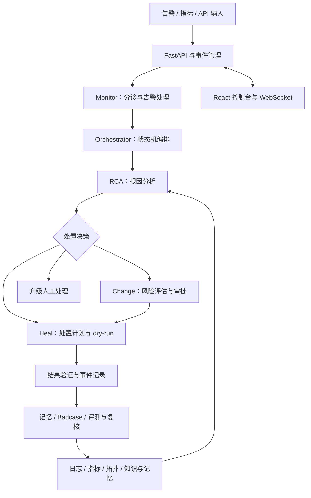

# AIOps Agent Platform

**面向运维故障定位的多智能体协作平台：从告警分诊、根因分析到受控自愈与评测反馈。**

Python · FastAPI · LangGraph · React · TypeScript · ChromaDB · Docker Compose

将指标、日志、服务拓扑和历史处置经验组织成故障调查上下文，由专职 Agent 分工完成分析、决策与处理，并通过审批、审计、恢复验证和 Badcase 评测约束自动化过程。项目用于工程实践与技术展示，默认自愈为 **dry-run**，实验能力通过配置开关启用。

[快速开始](#快速开始) · [架构与代码](#架构与代码) · [验证与评测](#验证与评测) · [技术文档](docs/README.md)

## 项目解决什么问题

故障定位通常需要在告警、指标、日志和历史工单之间反复切换。本项目围绕三项工程问题展开：

- **协作与流程控制**：将分诊、分析、自愈和审批拆成明确的 Agent 职责，用状态机管理处理路径。
- **证据与可追溯性**：结合检索、拓扑、工具调用及调查记录，保留根因判断与处理过程的依据。
- **效果验证与迭代**：将失败案例纳入 dev / test / holdout 数据集，保存评测历史和基线，并提供人工复核与受控演化模块。

## 架构与代码



图示概括模块关系；调查验证闭环等扩展能力需单独启用，具体主路径以代码与配置为准。

| 能力 | 实现内容 | 代码入口 |
| --- | --- | --- |
| 多智能体编排 | 告警分诊、RCA、自愈、审批、升级等状态流转 | [orchestrator.py](backend/app/agents/orchestrator.py) |
| 根因分析 | 结合工具、知识、日志和拓扑上下文形成分析结果 | [rca_agent.py](backend/app/agents/rca_agent.py) |
| 受控处置 | 自愈计划、风险审批及结果验证模块 | [heal_agent.py](backend/app/agents/heal_agent.py)、[change_agent.py](backend/app/agents/change_agent.py) |
| 调查验证 | 候选验证、反证、重规划与恢复观测；默认关闭 | [investigation_loop_engine.py](backend/app/services/investigation_loop_engine.py) |
| 记忆与 Runbook | 短期/长期记忆、知识检索和 Runbook 版本管理 | [memory/](backend/app/memory/)、[runbook_service.py](backend/app/services/runbook_service.py) |
| 评测与反馈 | Badcase 分集、评测历史、基线比较、人工复核 | [eval/](backend/app/eval/)、[review/](backend/app/review/)、[evolution/](backend/app/evolution/) |
| 可视化与接口 | 故障、Agent、拓扑、记忆、Runbook 和评测页面 | [frontend/src/pages/](frontend/src/pages/)、[api/](backend/app/api/) |

## 快速开始

建议使用 Python 3.11+、Node.js 20+。首次安装后端依赖会包含 PyTorch、Transformers 等较大的包。以下本地开发命令使用 **Windows PowerShell**，在仓库根目录执行。

```powershell
git clone https://github.com/zihan154896-jpg/aiops-agent-platform.git
cd aiops-agent-platform
python -m venv .venv
.\.venv\Scripts\python.exe -m pip install -r backend/requirements.txt
Copy-Item backend/.env.example backend/.env
$env:PYTHONUTF8 = "1"
cd backend
..\.venv\Scripts\python.exe -m uvicorn app.main:app --host 127.0.0.1 --port 8000
```

另开一个终端，在仓库根目录启动前端：

```powershell
cd frontend
npm ci
npm run dev
```

前端访问 `http://localhost:3000`；交互式 API 文档访问 `http://localhost:8000/docs`；健康检查为 `http://localhost:8000/health`。Vite 已将 `/api` 和 `/ws` 代理到本地后端。

macOS / Linux 可使用 `python3 -m venv .venv`、`source .venv/bin/activate`、`cp backend/.env.example backend/.env`，随后在 `backend/` 运行 `python -m uvicorn app.main:app --host 127.0.0.1 --port 8000`。

### 运行模式与配置

编辑 `backend/.env` 配置本地后端。没有 API Key 时允许规则/fallback 路径运行，但不代表真实 LLM 分析已被验证；真实指标和日志查询还需要相应基础设施。

| 配置 | 用途 |
| --- | --- |
| `LLM_PROVIDER`、`LLM_MODEL`、`LLM_API_KEY` | 模型供应商、模型和凭据 |
| `LLM_BASE_URL` | 自定义兼容 API 地址 |
| `AGENT_HEAL_DRY_RUN=true` | 默认模拟自愈操作 |
| `AGENT_VERIFICATION_ENABLED=false` | 调查验证闭环，默认关闭 |
| `AGENT_RCA_V2_ENABLED=false` | RCA 合成优化，默认关闭 |
| `PROMETHEUS_URL`、`LOKI_URL` | 外部指标与日志服务 |
| `LANGFUSE_ENABLED=false` | 可选的模型调用追踪 |

完整字段见 [环境模板](backend/.env.example) 与 [config.py](backend/app/config.py)。

### Docker Compose

仓库提供前后端、ChromaDB、Loki 和 Promtail 的容器编排。Prometheus 配置位于 `infrastructure/`，请按实际监控环境单独接入。

```powershell
Copy-Item .env.example .env
# 按需编辑根目录 .env
docker compose config --quiet
docker compose up -d --build
```

容器方式前端端口为 `8080`，后端为 `8000`。Promtail 使用 Docker 日志目录挂载，Windows 建议使用 Docker Desktop 的 Linux 容器环境。Compose 文件属于部署配置，本次未完成容器端到端运行验证。

## 验证与评测

在 `backend/` 中使用已安装依赖的 Python：

```powershell
$env:PYTHONUTF8 = "1"
$env:AIOPS_FORCE_FALLBACK = "1"
python -m pytest tests/test_eval_v3_unified.py tests/test_eval_v3_history.py tests/test_detection_v3_smd.py tests/test_self_evolution.py tests/test_review.py tests/test_badcase_eval.py -q
python -m app.eval.cli run --split dev --analyzer local_rules
python -m app.eval.cli history
```

前端构建：在 `frontend/` 执行 `npm ci` 与 `npm run build`。

样本位于 [data/badcases/](data/badcases/)，数据适配器位于 [data/adapters/](data/adapters/)。保留 dev / test / holdout 分离；若反复根据 holdout 调参，需要重新建立独立留出集。规则评测结果不能直接当作真实 LLM 的线上根因定位准确率。

实测环境、结果与限制见 [验证记录](docs/VALIDATION.md)。仓库不宣称未经验证的线上准确率、MTTR 改善或生产部署规模。

## 目录导航

```text
backend/          FastAPI、Agent、服务、评测与测试
frontend/         React + TypeScript 控制台
data/             版本化评测样本与数据适配器
infrastructure/   指标、日志与告警组件配置
scripts/          演示脚本与原有终端录像
docs/             技术说明、验证记录、设计及历史开发记录
courses/          原有学习材料、图解与讲解文档
archive/          原有历史文档
config/           辅助工具配置
.github/          自动化检查
```

推荐从 [文档导航](docs/README.md) 阅读，再结合源码查看实现。历史方案与学习材料中的计划、旧指标和示例不等同于当前版本实测结果。

## 当前边界

- 默认自愈为 dry-run；真实环境接入与恢复效果需在隔离环境中验证。
- 部分控制台趋势图使用静态展示数据，不应解释为实时生产监控。
- 调查验证、RCA V2 等能力默认关闭，启用前阅读 [验证与自愈手册](docs/RCA验证与自愈执行手册.md)。
- Python 依赖主要使用版本下限，尚未提供完整锁文件；不同环境需验证兼容性。
- 历史问题见 [遗留问题](docs/遗留问题.md)，文件处理说明见 [发布整理说明](docs/PUBLISHING.md)。
